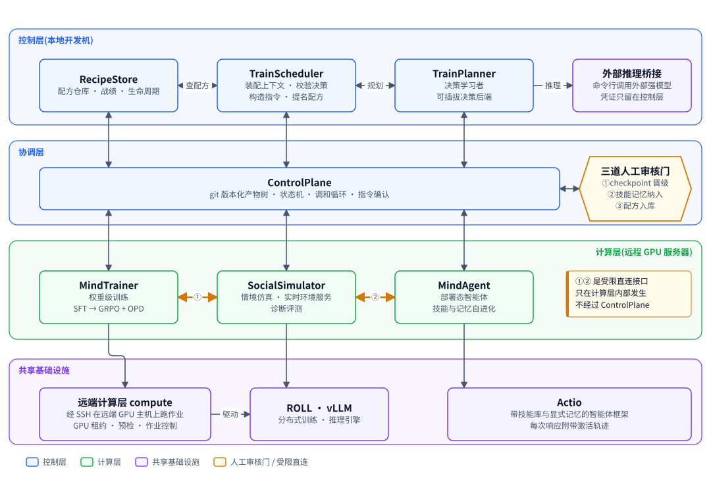

# Rise

**Rise**（Recursive Interactive Social mind Evolution，递归交互式社会心智进化）是一套"AI 驱动的社会心智后训练工厂"。输入一个通用开源基础模型，输出社会心智能力增强的模型，代号 ZenGen。

工厂把五件事串成一个闭环：社会情境仿真、权重级训练、诊断评测、训练配方沉淀、智能体技能与记忆自进化。每一轮练什么由 AI 决定，人在三道审核门把关。

> 现状：编排、可追溯与路由已经端到端跑通。训练默认是 mock 执行器，诊断默认是 mock 评估器，所以默认入口证明的是"闭环会转"，不是"模型变强了"。真实的 ROLL LoRA SFT、vLLM 服务与 SoMEval 评测要用开关显式打开（见下文"真实后端"）。

## 整体架构



图分四层：
- **控制层**：放 RecipeStore、TrainScheduler、TrainPlanner 与外部推理桥接，负责沉淀配方、规划下一轮。规划可以经桥接交给更强的外部模型。
- **协调层**：ControlPlane 管产物树、状态机与调和循环，配三道人工审核门。
- **计算层**：MindTrainer 改权重；SocialSimulator 做情境仿真、实时环境服务与诊断评测；MindAgent 让部署态智能体自进化技能与记忆。
- **共享基础设施**：每个角色位都是一个 Actio 智能体，记忆由 Starling 提供。真实训练与推理经远端计算层 compute 下发到 GPU 主机上的 ROLL 与 vLLM。

子系统之间不直接调用，只经 ControlPlane 读写产物。例外只有两条橙色的受限直连，都连到 SocialSimulator：① 来自 MindTrainer，承载 InteractTrain 的 rollout；② 来自 MindAgent，承载部署经验采集。

图的源码在 `docs/design/diagrams/fig_00-architecture.py`，各子系统的细节见 `docs/design/00-overview.md` 第 3 章。

## 工作原理

1. 所有协作数据都是 git 树里的 YAML 产物（"信封"）。子系统之间不直接调用，只读写产物。
2. 调和循环周期性扫描产物树，由纯函数算出下一步动作，执行后把结果写回树，每次变更都是一次提交。
3. 训练指令触发训练，训练产出候选 checkpoint，诊断评测给候选打分并标出退化。
4. 人在三道门批准或拒绝：① 候选模型晋级，② 智能体技能与记忆提案收录，③ 训练配方入库。批准后候选晋级为新基座，下一轮从它起步。
5. 每轮结果回流成下一轮规划的输入。失败只留痕，等人处理。

三条训练路径：

| 路径 | 改权重 | 数据来源 | 产出 |
|---|---|---|---|
| BatchTrain | 是 | 批量合成的仿真数据集，SFT 冷启动后 GRPO 加 OPD | 候选 checkpoint |
| InteractTrain | 是 | 与实时环境服务做多轮 rollout，每个角色位都是带记忆的智能体 | 候选 checkpoint |
| AgentRSI | 否 | 模拟部署中的经验，分析后提出技能与记忆增量 | 增量提案 |

## 代码结构

| 目录 | 内容 |
|---|---|
| `src/controlplane` | 产物树、信封、状态机、调和循环与守护进程、审核门 |
| `src/simulator` | 情境与人格、仿真运行器、批量数据集、实时环境服务（gRPC 双向流） |
| `src/diagnostic` | 诊断评测：编排、SoMEval 运行器、退化判定、污染准入检查 |
| `src/mindtrainer` | 训练：batch 与 interact 轨迹源、奖励管线、续训、ROLL 执行器 |
| `src/actio` | 智能体框架：技能、记忆端口（替身与 Starling）、激活轨迹 |
| `src/mindagent` | 部署态智能体自进化：部署轮次、经验分析、提案、离线验证 |
| `src/recipestore` | 训练配方的可复现性校验、检索、战绩 |
| `src/trainscheduler`、`src/trainplanner` | 装配规划上下文、生成并校验下一轮决策、构造指令 |
| `src/inference_bridge` | 调外部强模型的桥接与成本记录 |
| `src/compute` | 远端计算层：经 SSH 在 GPU 主机上起作业、vLLM 服务、ROLL 部署 |
| `src/factory` | 组合根：把以上全部装起来，`factory` 命令行 |
| `cli/` | TypeScript 审核命令行 `rise`：review、approve、reject、confirm、status |
| `third_party/ROLL4ZenGen` | 训练框架 ROLL 的 submodule，`--executor roll` 时部署到远端 |
| `docs/design/` | 权威系统设计文档集，从 `docs/design/README.md` 读起 |

依赖方向由导入检查测试强制：`factory` 是唯一可以导入所有包的地方，任何包都不导入它。

## 环境要求

- Python 3.11 或更高，用 [uv](https://docs.astral.sh/uv/) 管理依赖
- Node.js 20 或更高（只有审核命令行要）
- git
- 可选：Starling 记忆库（extra `memory`，构建要 C++ 编译器、CMake 3.27 或更高与 Ninja）
- 可选：带 NVIDIA GPU 的远端主机（只有真实后端要）

## 安装

```bash
git clone --recurse-submodules https://github.com/ZenGen-AI/Rise.git
cd Rise
uv sync --extra dev            # 要真 Starling 记忆时再加 --extra memory

cd cli && npm install && npm run build && cd ..
```

只想跑 mock 闭环时，可以不拉 submodule（去掉 `--recurse-submodules`）。

## 快速上手：在本机转一轮 mock 闭环

下面的步骤从空目录走到第一个晋级模型 `zengen-v1`，全程 mock，不需要 GPU 和网络。

```bash
# 1. 建一棵控制面仓库：默认资产与配置，外加一条 pending 训练指令 run-001 和它的数据集清单
uv run python -c "import sys; sys.path[:0] = ['src', 'tests']; \
from factory_fixtures import closed_loop_repo; closed_loop_repo('/tmp/rise-demo')"

# 2. 跑三轮调和：派发训练，产出候选，补诊断，停在待审
for i in 1 2 3; do uv run python scripts/run_factory_dev.py reconcile /tmp/rise-demo --once; done
#   dispatch_directive run-001
#   request_diagnostic cand-run-001
#   await_review cand-run-001

# 3. 人工审核（在控制面仓库根目录里运行）
cd /tmp/rise-demo
node /path/to/Rise/cli/dist/index.js status
node /path/to/Rise/cli/dist/index.js review cand-run-001
node /path/to/Rise/cli/dist/index.js approve cand-run-001
cd /path/to/Rise

# 4. 再调和一轮：候选晋级
uv run python scripts/run_factory_dev.py reconcile /tmp/rise-demo --once
#   promote_candidate cand-run-001
ls /tmp/rise-demo/control-plane/models/      # zengen-v1.yaml
```

`git -C /tmp/rise-demo log --oneline` 能看到每一步写进树的提交。

`tests/factory_fixtures.py` 里的 `closed_loop_repo` 是测试夹具，用它只是为了省掉手写指令。指令有二十多个训练配置字段，目前没有子命令生成它。自己的仓库可以先跑 `factory install-defaults <repo>` 写默认资产，再手写 `control-plane/runs/<run-id>/directive.yaml`。

## 命令行

组合根入口有两个：`scripts/run_factory.py`（默认不接受 mock 证据），以及开发入口 `scripts/run_factory_dev.py`（`run` 与 `reconcile` 自动加 `--allow-mock-evidence`）。两者共用下面的子命令。

| 子命令 | 作用 |
|---|---|
| `run <repo>` | 跑调和循环（守护进程） |
| `reconcile <repo> --once` | 只跑一轮调和并打印动作 |
| `install-defaults <repo>` | 写入默认诊断资产、评估器配置、规划提示模板、调度配置与部署素材；已存在的配置不覆盖 |
| `import-sombench` | 把 SoMEval 检出目录里的 SoMBench 导入成树内资产与树外污染索引 |
| `trace` / `cost` / `logs` | 只读：打印一轮的全链路产物、成本明细、日志 |

`run` 与 `reconcile` 的常用开关：

| 开关 | 含义 |
|---|---|
| `--enable plan,nominate,track,agent,admit` | 打开闭环的规划、提名、战绩、智能体轮次与门② 收录；不传则只跑训练、诊断与晋级 |
| `--planner-backend heuristic\|bridge` | 规划后端：确定性启发式，或经外部推理桥接调强模型 |
| `--executor mock\|roll` | 训练执行器：mock 替身（默认），或经 SSH 在远端 GPU 上跑真实 ROLL LoRA SFT |
| `--evaluator mock\|someval` | 诊断评估器：mock 替身（默认），或起 vLLM 用 SoMEval 评测真实候选 |
| `--interact` | 装配实时环境客户端与策略工厂，让 interact 指令由远端 vLLM 上的真模型说话 |
| `--endpoint <id>` | 点名 `control-plane/compute/endpoints.yaml` 里的远端端点 |

完整说明见 `uv run python scripts/run_factory.py <子命令> -h` 与 `docs/design/90-factory-and-cli.md`。

## 真实后端

真实后端都要远端 GPU 主机，主机经 SSH 访问。要准备的有：

- **端点配置**：在控制面仓库里写 `control-plane/compute/endpoints.yaml`，给出工作目录、基座模型路径、留出集路径与预检阈值。远端路径没有合理默认值，`install-defaults` 不写它。
- **主机映射**：端点 id 到 ssh 别名的映射写在仓库外的 YAML 里，路径由 `RISE_COMPUTE_HOSTS` 指定。主机、用户与密钥都放在 `~/.ssh/config`，地址不进 git。
- **ROLL**：`--executor roll` 第一次预检时，从本仓库的 submodule 把钉住版本的 ROLL 部署到远端，并建好训练容器，不需要人手放代码。

`--executor roll` 不能与 `--enable` 同用，也不能与 `--interact` 同用；一次训练会占住调和循环数小时。

## 智能体记忆（可选）

Actio 的记忆按"模拟世界"组织：部署时一个情境一个世界，训练时每条 rollout 一个平行世界，人格是世界里的主体。

- **替身**：不设 `RISE_MEMORY_CONFIG` 时用确定性替身，部署记忆落在控制面仓库的 `.git/rise-memory` 下。
- **Starling**：生产实现，要先装 `--extra memory`。然后写一份仓库外、权限 0600 的记忆配置，用 `RISE_MEMORY_CONFIG` 指向它：

```yaml
root: /var/lib/rise-memory            # 绝对路径，在仓库之外
extraction_base_url: https://api.example.com/v1
extraction_model: <抽取模型名>
embedding_base_url: https://api.example.com/v1
embedding_model: <嵌入模型名>
embedding_dim: 1536                   # 必须与端点实际维度一致
timeout_ms: 4000                      # timeout_ms × (max_retries + 1) 不得超过 4000
max_retries: 0
```

抽取与嵌入的密钥只从环境变量 `OPENAI_API_KEY` 读，不写进配置。配置有问题时，装配期以退出码 2 拒绝启动。

## 配置与凭证

| 内容 | 位置 | 进 git |
|---|---|---|
| 后端选择、模型名、提示模板、调度与训练默认值 | 控制面仓库 `control-plane/config/` | 进 |
| 远端端点的路径与阈值 | 控制面仓库 `control-plane/compute/endpoints.yaml` | 进 |
| 端点 id 到 ssh 别名的映射 | `RISE_COMPUTE_HOSTS` 指向的本机文件 | 不进 |
| 记忆配置 | `RISE_MEMORY_CONFIG` 指向的本机文件，权限 0600 | 不进 |
| API 密钥、SSH 口令 | 环境变量 | 绝不进 |

树里出现凭证值字段时，加载器拒绝加载；日志写出前会先脱敏。

## 测试

```bash
uv run --extra dev pytest -m "not slow" -q     # 约 4800 条，十几分钟
uv run --extra dev pytest tests/test_mt_config.py -q
cd cli && npm test
```

- `slow` 标记的用例会真起子进程或多段作业。
- `memory_live` 标记的用例连真实抽取与嵌入端点，只在设了 `RISE_MEMORY_LIVE=1` 与真实记忆配置时才跑。

## 文档

- `docs/design/README.md`：设计文档集的入口，按问题找文档。
- `docs/design/00-overview.md`：系统总览、核心机制、端到端流程、现状、路线图与风险。
- `docs/design/10-` 到 `90-`：各子系统的设计，每篇自包含。
- `docs/superpowers/specs/`、`docs/superpowers/plans/`：历史设计与逐任务施工计划，与 `docs/design/` 冲突时以后者为准。

文档里的状态标记：**[已落地]** 表示代码在主干上且有测试，**[计划中]** 表示设计已定、代码未写，**[推迟]** 表示 V1 明确不做。

## 现状与限制

- 真实 GRPO 加 OPD 训练与真实 judge 推迟，仍用确定性 mock，所以真实评测的报告等级仍是 mock。
- ROLL LoRA SFT 在真实主机上跑通过单段两步训练，多段训练与续训没在真机上验证过。
- InteractTrain（`--interact`）在真机上跑通过：真 vLLM、两个适配器、关思考。真抽取与真嵌入下的单次延迟与召回质量还没核实。
- MindAgent 部署路的模型后端仍是罐头实现，真实模型没有接入。
- Starling 正在改成独立服务，rise 侧接上它的客户端是后续工作。

未核实项的完整列表见 `docs/design/00-overview.md` 第 10 章。
