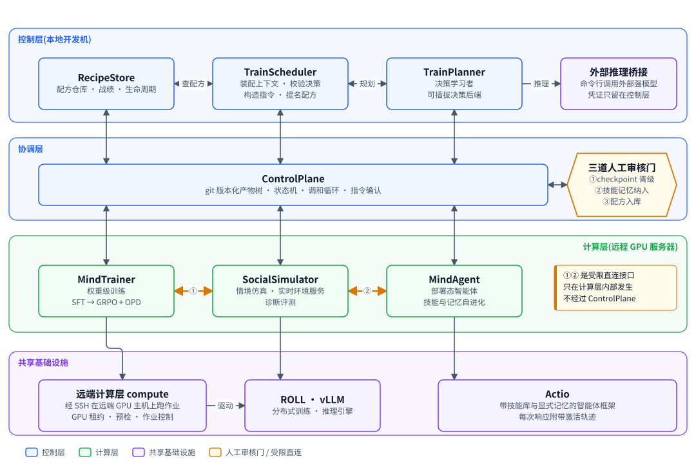
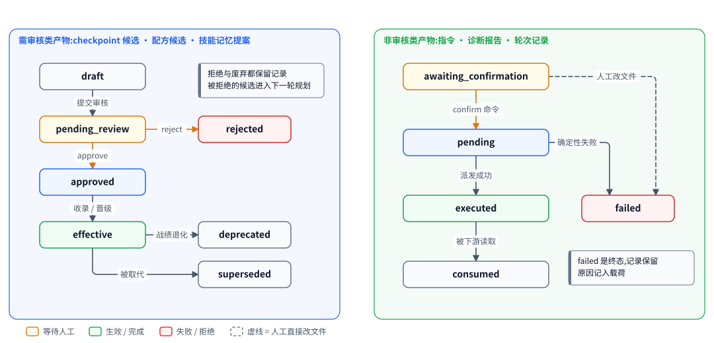
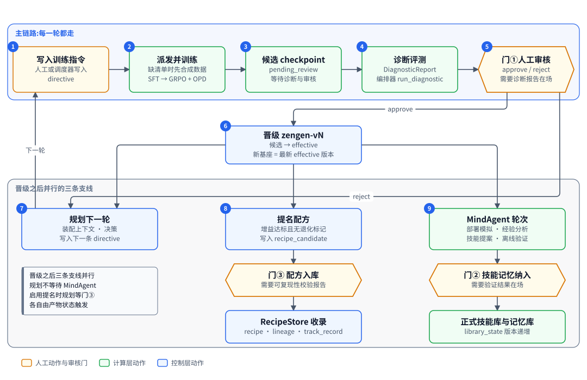
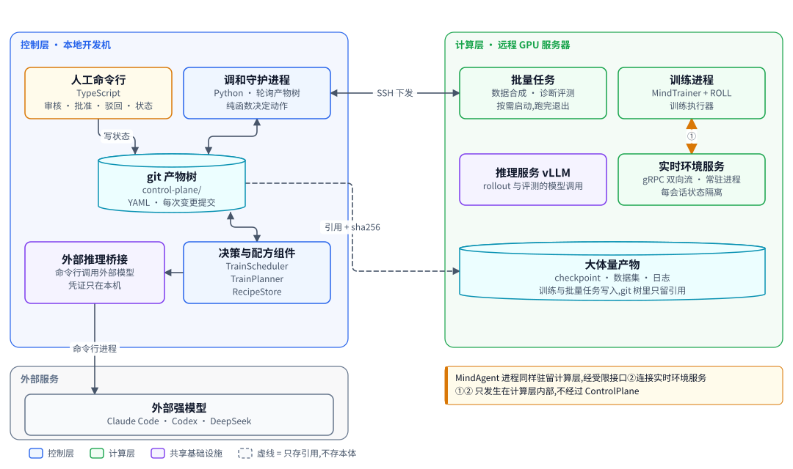

# Rise 系统总体设计

| 项 | 内容 |
|---|---|
| 读者 | 人类架构师与 AI。只读本文即可建立对全系统的完整认识 |
| 代码基线 | 主干提交 `b826440`(2026-10-21),3109 个 Python 测试 |
| 状态标记 | **[已落地]** 代码在主干上且有测试。**[计划中]** 设计与施工计划已定,代码未写。**[推迟]** V1 明确不做 |
| 状态 | 闭环、实时交互训练、技能自进化等主干 [已落地]。智能体记忆 [已落地]:场景二每个角色位都是带记忆的 SimpleActio 智能体,记忆端口的生产实现是 Starling 适配器,替身是内存元组与落盘的 FileTupleStore。记忆按情境世界组织 [已落地]:一个情境一个部署世界,每条 rollout 一个世界,人格是世界里的主体。训练里每条 rollout 从同一起点出发。部署记忆持久累积。改为经客户端连 Starling 记忆服务 [计划中]。其中要真机或真端点才能核实的几项仍未核实,见风险表第 21 到 37 项 |
| 内容 | 目标与约束、架构、核心机制、端到端流程、部署、横切关注点、现状、路线图、风险、决策、术语 |

## 1. 一页读懂

Rise(Recursive Interactive Social mind Evolution,递归交互式社会心智进化)是一套"AI 驱动的社会心智后训练工厂"。输入通用开源基础模型,输出社会心智能力显著增强的模型,代号 ZenGen。工厂把五件事串成一个闭环:社会情境仿真、权重级训练、诊断评测、训练配方沉淀、智能体技能与记忆自进化。每一轮由 AI 决定练什么,由人在三道审核门把关。SimpleActio 的记忆由 Starling 提供,场景二里每个角色位都是带记忆的 SimpleActio 智能体。

**五句话讲清工作原理**

1. 所有协作数据都是 git 树里的 YAML 产物。子系统之间不直接调用,只读写产物。
2. 调和循环周期性扫描产物树,由纯函数算出下一步动作,执行后把结果写回树。
3. 训练指令触发训练。训练产出候选 checkpoint。诊断评测给候选打分并标出退化。
4. 人在三道门批准或拒绝。批准后候选晋级为新基座,下一轮从它起步。
5. 每轮结果回流成下一轮规划的输入:被拒绝的候选与诊断报告进入规划上下文,失败只留痕、等人处理。晋级还会触发 MindAgent 自进化技能与记忆。

**现状一览**

| 范围 | 状态 | 说明 |
|---|---|---|
| 产物树、状态机、调和循环、审核门① | [已落地] | 守护进程、派发缝、证据驱动的门、两类状态机 |
| 情境与人格、仿真运行器、批量数据集 | [已落地] | 数据集带 sha256 清单,GRPO 分组键由清单提供 |
| 实时环境服务 | [已落地] | gRPC 双向流,会话状态机,资源上限,角色可见性隔离 |
| 诊断评测 | [已落地] | 编排器、真实 SoMEval 运行器与污染准入检查都在;`factory run --enable` 注入 mock 评估器,`--evaluator someval` 注入真实评估器。缺省入口与 `scripts/run_controlplane.py` 不注入,那两条路径仍由占位桩写报告 |
| MindTrainer | [已落地] | batch 与 interact 轨迹源、奖励管线、续训;训练由 mock 执行器完成。不传 `--interact` 时闭环组合根不装配实时客户端,interact 指令判 `failed`;`--interact` 装配实时客户端与策略工厂。真实 ROLL LoRA SFT 由 `--executor roll` 装配 |
| 闭环:规划、提名、配方、智能体、桥接、组合根 | [已落地] | 九个工作包全部落地并有端到端测试;闭环默认不启用,要 `factory run --enable` 显式打开,默认入口仍走 mock 训练与占位诊断 |
| 远端计算层(经 SSH)、ROLL LoRA SFT 真实执行器与适配器导出转换器 | [已落地] | `factory run --executor roll` 装配它们(默认入口与 `run_controlplane.py` 仍用 mock);已在真实主机上从训练指令端到端跑到待审候选一次,只跑过单段两步,多段与续训未在真机上验证 |
| vLLM 服务组件 | [已落地] | 命令拼装、SSH 隧道、服务生命周期;真机端到端待 GPU 空闲后补 |
| 真实 SoMEval 运行器、SoMBench 题库导入、训练数据污染准入检查 | [已落地] | 由 `--evaluator someval` 启用,默认仍是 mock;真机只验证到预测阶段,判分与真实裁判未在真机上跑通 |
| 智能体记忆:场景二每个角色位都是带记忆的 SimpleActio 智能体,记忆由 Starling 提供 | [已落地] | 记忆端口加 Starling 适配器,库文件在仓库之外;训练路每条 rollout 从同一起点出发;部署记忆持久累积;会话资源有序关闭。分八步施工,前五步只用替身 |
| 记忆按情境世界组织 | [已落地] | 一个情境一个部署世界,每条 rollout 一个平行世界,人格是世界里的主体;部署对手位也跨会话积累记忆;替身与 Starling 两个后端过同一套世界契约测试,Starling 一侧是真 Starling 加本机回环的假抽取与嵌入端点 |
| 接 Starling 记忆服务 | [计划中] | 世界协议不变,只换后端:rise 用纯 Python 客户端 `starling_client` 连记忆服务,缺省是用户本机已在跑的看板服务;世界、快照、分叉都按名字与 id 交给服务,rise 不再打开任何库文件;施工分第 0 至 5 步 |
| 真实 GRPO 加 OPD 训练、真实 judge | [推迟] | 仍用确定性 mock,所以真实评测的报告等级仍是 mock |

今天能跑通的端到端路径有两条。缺省入口:人工写一条 batch 训练指令,守护进程派发给 MindTrainer 派发器,mock 训练产出候选,占位诊断补齐证据,人工经命令行批准,守护进程晋级候选并写入 zengen 版本。闭环模式(`factory run --enable`,端到端测试盖的就是这条):同一轮之外还有规划、提名、配方入库、智能体轮次与技能记忆提案,决策由规划后端给出,诊断由注入的评估器写;训练与诊断仍可以是 mock,证据等级据此标 `mock`。

设计二 [已落地] 把场景二换成带记忆的智能体。训练位包着正在训练的模型,对手位包着原来的三种驱动,每个角色位都是一个 SimpleActio 实例。记忆库在仓库之外。每条 rollout 从同一份起点记忆出发,用完即弃;部署态的记忆持久累积。诊断评测的动态轨与批量数据集生产仍用裸后端 [推迟]。

记忆按模拟世界组织 [已落地]。一个世界是一份 Starling 库或一份替身账本,人格是其中的主体。部署时一个情境一个世界,智能体位与对手位都在里面跨会话积累记忆。训练时每条 rollout 从该情境的种子世界复制出一个平行世界,没有种子时从空世界起。原因是同一情境的几个人在同一个世界里,一人一库会把他们拆进平行世界。

接 Starling 记忆服务 [计划中]。今天 `src/simple_actio/memory_starling.py:27` 是全仓库唯一导入 `starling` 的地方,每个世界一个库文件,由 rise 自己复制、备份、换文件(`src/simple_actio/memory_starling.py:498-557`)[已落地]。改后世界是服务注册表里的具名世界,rollout 世界从种子分叉,结束后只关不删,留在看板里复盘。端口五个方法、替身、部署驱动器与门② 的流程、世界锁都不变。

## 2. 目标、非目标与约束

### 2.1 四类核心能力

| 能力 | 含义 | 承担者 |
|---|---|---|
| 社会情境仿真 | 情境生成、人格模拟、训练数据合成、交互式训练支持、交互式动态评测 | SocialSimulator |
| 权重级后训练 | 交互式多轮训练,或单轮的 SFT、GRPO、OPD 流水线 | MindTrainer |
| 智能体技能与记忆自进化 | 部署态智能体不改权重,提升技能库与记忆库 | MindAgent、SimpleActio |
| 有效方案沉淀 | 把验证有效的完整训练配方版本化、可检索、可复用 | RecipeStore |

"RSI"在本项目取广义:用 AI 决策训练过程。允许调用外部更强的闭源模型,经命令行决定每轮训练策略与数据合成方向。

### 2.2 非目标

| 项 | 状态 | V1 的处理 |
|---|---|---|
| 多租户运行时:资源调度、租户隔离、鉴权 | [推迟] | 只预留数据归属字段 |
| 配方跨工厂导入导出 | [推迟] | 配方引用自描述,预留 `fetch_hint` |
| TrainPlanner 改写子系统代码 | [推迟] | 输出限定为结构化决策,因此不需要代码沙箱 |
| MindAgent 接入真实生产日志 | [推迟] | 经验只来自模拟部署 |
| 图形界面与监控看板 | [推迟] | rise 的人机接口只有命令行。Starling 自带的看板不属于 rise:接记忆服务后人在它上面看世界、删孤儿快照、升级种子 [计划中] |
| 并行多轮在途 | [推迟] | 同一时间只允许一轮在途 |
| 异步派发 | [推迟] | 契约已定:指令加 `submitted` 状态,派发器拆成提交与轮询;V1 派发器同步返回 |
| 真实 GRPO 加 OPD 训练、真实 judge、把适配器合并回完整权重 | [推迟] | 仍用 mock;LoRA SFT 之外的训练阶段拒绝与真实执行器混用 |
| 共享感知:在场的人都记住同一句话 | [推迟] | 每个实例只写他人的发言,写在自己的主体名下 |
| 同一人格跨情境共享记忆 | [推迟] | 同一人格在两个情境里是两个世界里的两个主体 |
| 记忆服务跨机器 | [推迟] | 服务只听回环地址,与 rise 同机 [计划中] |
| 跨记忆根共用种子 | 不做 | 按标签找种子按 `root` 过滤,种子只在建它的记忆根下可用;两台机器或两个记忆根要用同一份种子,各自从部署世界建 [计划中] |
| rise 自己清理 rollout 世界与孤儿快照 | 不做 | 交给 Starling 的自动清理(第 6 期)与人在看板里删;第 6 期合并前接受堆积 [计划中] |

### 2.3 约束

| 约束 | 内容 | 影响 |
|---|---|---|
| 定位 | V1 是单开发者、单能力维度的研究原型 | 追求闭环完整,不追求规模与 SLA |
| 基础模型 | 开源权重,支持全参数与 LoRA 微调、GRPO 等权重级训练 | MindTrainer 可以真实存在 |
| 复用策略 | 只复用底层基础设施,业务逻辑自建 | 仿真、奖励、评测自建;训练与推理框架复用开源 |
| 拓扑 | 控制层在本地开发机,计算层在远程 GPU 服务器 | 两层经 SSH 通信 [已落地] |
| 凭证 | git 树里只存环境变量名,不存值 | 每次状态变更都提交,密钥进历史无法清除 |
| 外部推理 | 输出只当文本解析成结构化决策,不被执行 | 决策经严格解析与领域校验两道才生效,ControlPlane 只校验信封;子进程默认只传白名单环境变量、在空临时目录里运行、参数模板关闭工具或开只读沙箱,默认模板下的实际效果未核实 |
| 可测试 | 核心逻辑必须脱离 GPU 与外部服务可测 | 到处是协议加确定性 mock |

## 3. 架构

图 1 给出四层结构。控制层放决策与配方组件,协调层 ControlPlane 承载产物树与三道人工门,计算层放训练、仿真与智能体,共享基础设施提供智能体框架与引擎。除两条橙色的受限直连接口外,所有交互都经 ControlPlane 的产物。

<!-- figure:begin 00-architecture -->


**图 1　Rise 系统架构**　四层结构。控制层放决策与配方相关的四个组件。协调层 ControlPlane 配三道人工审核门。计算层放三个子系统。共享基础设施放 SimpleActio、Starling 记忆服务、远端计算层、训练与推理引擎。三个计算层子系统都使用 SimpleActio 实例,MindTrainer 用的是训练位实例。所有子系统经 ControlPlane 读写产物,只有两条受限直连接口绕过它。

<details>
<summary>文字版:图中的节点与连线</summary>

**节点**

- RecipeStore:配方仓库 · 战绩 · 生命周期
- TrainScheduler:装配上下文 · 校验决策 / 构造指令 · 提名配方
- TrainPlanner:决策学习者 / 可插拔决策后端
- 外部推理桥接:命令行调用外部强模型 / 凭证只留在控制层
- ControlPlane:git 版本化产物树 · 状态机 · 调和循环 · 指令确认
- 三道人工审核门:①checkpoint 晋级 / ②技能记忆纳入 / ③配方入库
- MindTrainer:权重级训练 / SFT → GRPO + OPD
- SocialSimulator:情境仿真 · 实时环境服务 / 诊断评测
- MindAgent:部署态智能体 / 技能与记忆自进化
- 远端计算层 compute:经 SSH 在远端 GPU 主机上跑作业 / GPU 租约 · 预检 · 作业控制
- ROLL · vLLM:分布式训练 · 推理引擎
- SimpleActio:带技能库与显式记忆的智能体框架 / 每次响应附带激活轨迹 / Starling 记忆
- Starling:记忆服务 · 具名世界 · 快照与分叉 / 一个情境一个世界,人格是主体

**连线**

- RecipeStore ↔ ControlPlane
- TrainScheduler ↔ ControlPlane
- TrainPlanner ↔ ControlPlane
- ControlPlane ↔ MindTrainer
- ControlPlane ↔ SocialSimulator
- ControlPlane ↔ MindAgent
- ControlPlane ↔ 三道人工审核门
- RecipeStore ↔ TrainScheduler:查配方
- TrainScheduler ↔ TrainPlanner:规划
- TrainPlanner → 外部推理桥接:推理
- MindTrainer ↔ SocialSimulator:①
- SocialSimulator ↔ MindAgent:②
- MindTrainer → 远端计算层 compute
- 远端计算层 compute → ROLL · vLLM:驱动
- SocialSimulator → SimpleActio
- MindAgent → SimpleActio
- MindTrainer → SimpleActio:训练位实例
- SimpleActio ↔ Starling:读写

</details>
<!-- figure:end 00-architecture -->

### 3.1 分层

| 层 | 组件 | 职责 | 运行位置 |
|---|---|---|---|
| 控制层 | TrainScheduler、TrainPlanner、RecipeStore、外部推理桥接 | 决策、配方管理、调用外部强模型 | 本地开发机 |
| 协调层 | ControlPlane | 产物树、状态机、调和循环、审核门 | 本地开发机 |
| 计算层 | MindTrainer、SocialSimulator、MindAgent | 训练、仿真与评测、智能体自进化 | 远程 GPU 服务器 |
| 共享基础设施 | SimpleActio、Starling、远端计算层 `compute` [已落地]、ROLL、vLLM、外部推理桥接 | 多个子系统共用的运行支撑 | 随使用方;`compute` 在本地开发机,经 SSH 驱动远端 GPU 主机;Starling 今天内嵌在 SimpleActio 实例的进程里,库文件与实例同机 [已落地];改为本机的记忆服务进程,只听回环地址 [计划中] |

外部推理桥接在概念上属共享基础设施(可被规划器、智能体等多个子系统调用),物理上运行在控制层所在的本地开发机,原因:命令行工具的登录态与网络出口绑定在本地。

Starling 是内嵌的 SQLite 记忆库,属共享基础设施。它从源码构建,经可选 extra `memory` 安装。环境变量 `RISE_MEMORY_CONFIG` 未设时才用替身。设了而文件或依赖不合规(含 Starling 未装),装配期退出码 2。库文件在仓库之外,根目录由本机记忆配置给出。库必须和 SimpleActio 实例同机,否则每轮召回都要跨机往返。接记忆服务后 [计划中],extra `memory` 装客户端 `starling-client` 与服务端 `starling-memory[dashboard]` 两行,钉同一个提交;记忆根只放世界锁、在途记录与 `.owner`,拉起模式下另放服务的数据目录。

### 3.2 七个子系统

| 子系统 | 职责 | 读 | 写 | 现状 |
|---|---|---|---|---|
| ControlPlane | 产物树、状态机、调和循环、审核门 | 全部产物 | 状态迁移、晋级、结果摘要 | 核心 [已落地] |
| SocialSimulator | 情境与人格生成、多智能体仿真、实时环境服务、诊断评测 | 指令、候选 | 情境、人格、Episode、数据集清单、诊断报告 | [已落地] |
| MindTrainer | batch 与 interact 两条训练路径,产出候选 checkpoint | 指令、数据集清单 | 训练记录、候选 checkpoint | [已落地] |
| MindAgent | 部署模拟、经验分析、技能与记忆提案、离线验证 | 晋级模型、技能与记忆库 | 轮次记录、增量提案 | [已落地] |
| RecipeStore | 配方可复现性校验、检索、战绩、生命周期 | 配方候选、诊断、结果 | 配方、谱系、战绩 | [已落地] |
| TrainScheduler | 装配规划上下文、校验决策、构造指令、提名配方 | 诊断、配方、近期结果 | 规划决策、指令、配方候选 | [已落地] |
| TrainPlanner | 经可插拔后端给出下一轮训练决策 | 规划上下文 | 结构化决策与理由 | [已落地] |

两条"对称的 RSI 循环"是设计的骨架。MindAgent 自进化部署态智能体的技能与记忆。TrainPlanner 自进化工厂的训练决策。两者都不碰权重,都向 ControlPlane 提交版本化产物,都受审核门约束。

训练决策这一环另外沉淀自己的经验:每轮把决策、结果与证据压成一条记录,同签名的记录聚合成条目,下一轮规划时把有效的几条渲染进提示。记录与条目都是树里的产物,评分信号只来自诊断报告,外部 agent 改不到——换后端、重跑、崩了重入都不影响这段记忆(见 `55-strategy-experience.md`)。

SimpleActio 不在上表里,它是各子系统共用的智能体框架。它是 Actio 的简化版:功能完备的正式版 Actio 在本仓库之外开发,完成后再接入 [计划中]。它的记忆经记忆端口访问:生产实现是 Starling,确定性替身是现有的内存元组 `MemoryEntry`。两种实现过同一套契约测试,所以替身路径与 Starling 路径的语义不分叉。今天记忆库是仓库之外的 Starling SQLite 文件,Starling 是可选 extra `memory` [已落地];接服务后世界在 Starling 服务的数据目录里,rise 不再打开库文件 [计划中]。记忆属于个体而不属于环境,所以它放在 SimpleActio 内部,模拟器不知道它的存在。

部署记忆另有管理面 DeploymentMemoryStore,放在 SimpleActio 内,按世界 id 打开端口、写事件、备份与恢复 [已落地];改为按快照 id 拍、恢复、删服务的 held 快照,事件按主体放弃 [计划中]。MindAgent 只经它访问部署记忆,所以不导入 `starling`。实现有 Starling 版 StarlingDeploymentStore 与落盘 JSON 的 FileTupleStore,替身也有提交点。

记忆按模拟世界组织 [已落地]。世界是记忆的单位,替身里是一份账本,Starling 里是一个库。世界里的主体(holder)就是人格 id,每条记忆与事件行都带主体。

| 世界 | 键 | 主体 | 路径(记忆根下) | 生命周期 | 状态 |
|---|---|---|---|---|---|
| 部署世界 | `scenario_id` | 该情境绑定的全部人格 | `deploy/<scenario_id>`,替身后缀 `.json`,Starling 后缀 `.db` | 长期,跨轮次累积 | [已落地] |
| 种子世界 | `(seed_id, scenario_id)` | 种子里的人格 | `seeds/<seed_id>/<scenario_id>.db` | 长期,人放入,rise 只读 | [已落地] |
| rollout 世界 | 逻辑 episode id | 这条 rollout 全部角色位的人格 | `runs/<run_id>/<episode_id>.db`;替身在内存里,从空世界起 | 一条 rollout | [已落地] |

一个端口打开时绑定 (世界, 主体),召回只返回本主体名下的记忆 [已落地]。记忆端口的五个方法签名里没有主体。管理面的方法都带世界 id,`open` 与 `remember_event` 另带主体。快照、恢复、摘要与待处理事件都作用于整个世界,不分主体。该世界还有任何打开的端口时恢复抛错,别的世界开着端口不影响。

```python
class DeploymentMemoryStore(Protocol):  # 按世界寻址
    def open(self, world_id: str, holder: str) -> MemoryBackend: ...
    def remember_event(self, world_id: str, holder: str, key: str, text: str, *, interlocutor: str) -> RememberOutcome: ...
    def abandon_event(self, world_id: str, key: str) -> None: ...
    def pending_events(self, world_id: str) -> list[str]: ...
    def backup_to(self, world_id: str, path: Path) -> str: ...
    def restore_from(self, world_id: str, path: Path) -> str: ...
    def digest(self, world_id: str) -> str: ...
    def wait_closed(self, world_id: str, timeout_s: float) -> bool: ...
```

`wait_closed` 等一个世界打开着的端口数降到 0,超时返回假 [已落地]。端口数在管理面实例内计数,所以组合根只造一个管理面,部署驱动器、门② 与服务端三方共用。

同一人格在一个情境里占两个角色位时拒绝 [已落地]。训练配置与合成的绑定判 T2,部署配置退出码 2。记忆根是旧布局时拒绝启动,退出码 2,文字列出可疑条目,提示移回配置或移出记忆根 [已落地]。旧库不迁移:它只来自验证,悄悄留着会让人以为它还在用。

接记忆服务后,世界是服务注册表里的具名世界 [计划中]。世界名以本机记忆配置的前缀 `world_prefix`(缺省 `rise`)开头,格式 `[A-Za-z0-9][A-Za-z0-9_-]{0,15}`,不含 `.`,所以名字能无歧义地拆开。每个 rise 世界都带两个公共标签:`repo=<前缀>`,与 `root=<记忆根绝对路径的 sha256 前 16 位>`。rise 只建、只开、只关这类世界,不碰同一个服务上用户别的世界。

| 世界 | 世界名 | 来源 | 标签(另加 `repo`、`root`) | 可回收 | 状态 |
|---|---|---|---|---|---|
| 部署世界 | `<前缀>.deploy.<scenario_id>` | 第一次用时 `create_world` | `kind=deploy`、`scenario_id` | 否 | [计划中] |
| 空种子 | `<前缀>.seed-empty` | 装配期自动建,`seed=true` | `kind=seed-empty`(不带 `seed_id`,免得和人起的种子 id 撞) | 否 | [计划中] |
| 种子 | `<前缀>.seed.<seed_id>.<scenario_id>.v<n>` | 人用 `factory seed` 从部署世界分叉 | `kind=seed`、`seed_id`、`scenario_id`、`version=<n>` | 否 | [计划中] |
| rollout 世界 | `<前缀>.ro.<episode_id>.<8 位十六进制>` | 从种子分叉 | `kind=rollout`、`run_id`、`scenario_id`、`episode_id`、`seed_id`、`attempt` | 是,按 `run_id` 归组 | [计划中] |
| 重放世界 | `<前缀>.verify.<round_id>.<scenario_id>.<8 位十六进制>` | 从验证快照分叉 | `kind=verify`、`round_id`、`scenario_id` | 是,按 `round_id` 归组 | [计划中] |

世界名的规则 [计划中]:

| 项 | 规则 |
|---|---|
| 字符 | Starling 只收首字符字母或数字、其余 `[A-Za-z0-9._-]`、1 到 128 个字符(`S:src/governance/world_store.cpp:47-60`)。白名单里的 id 与 `run-<数字>` 都合规 |
| 超长 | episode id 与 `seed_id` 各可到 128 个字符(`src/simple_actio/memory_port.py:13`),拼上前缀必然超长。超过 128 时把中间的 id 段换成它的 sha256 前 24 位,标签里照旧是完整的 id |
| 随机后缀 | 客户端删不掉世界,所以 rollout 与重放世界每次新建都换一个 8 位十六进制后缀,后缀在调用之前定 |
| 标签 | 建好不能改;空键被拒,空值可以 |

`ensure_world` [计划中] 是 rise 建部署世界与空种子的唯一入口。Starling 对注册表里没有的世界回 `world_not_found`,不会自动建。

| 步 | 动作 |
|---|---|
| 1 | `create_world`,带世界名、标签与 rise 设置;部署世界第一次建成时写创建标记 |
| 2 | 收到 `world_exists`:`list_worlds` 按 `repo`、`kind`、`scenario_id` 标签找这个名字。找不到,`seed` 或 `read_only` 与这类世界不符,或 `kind`、`repo` 不对,判永久失败,原因写"同名世界不是 rise 建的" |
| 3 | `root` 标签不等于本记忆根的摘要:装配期退出码 2,运行期永久失败,原因写"世界属于另一个记忆根"。都对得上就当作已建;设置是否一致由随后的 `open` 比较 |

`root` 标签防的是两个仓库或工作树各用自己的记忆根、用缺省前缀连同一个看板。世界锁在各自的记忆根里,服务端只挡得住两个会话同时写,A 的回滚会静默退掉 B 已提交的写入。记忆根挪了位置也按这条拒绝。

按标签找种子 [计划中]:`list_worlds` 按 `repo`、`root`、`kind=seed`、`seed_id`、`scenario_id` 标签查,带 `with_digest=True`,翻完所有页(每页缺省 50、上限 500),只取 `seed` 为真的项。取 `version` 最大的;同版本有几份(人在看板升级出来的种子照抄旧种子的标签)取 `created_at` 最大的,再相同取名字最大的。`created_at` 精确到秒。按 `root` 过滤,所以别的记忆根建的种子找不到,跨记忆根不共用种子。

管理面的签名随之改动 [计划中],施工时可能微调:`abandon_event` 多收主体,`pending_events` 返回 `list[PendingKey]`(`key` 与 `holder`);`backup_to`、`restore_from` 换成按快照 id 的 `snapshot`、`restore`、`delete_snapshot`;验证重放改用 `fork_replay`、`release_replay` 与只读的 `open_replay`。`open_replay` 收 `fork_replay` 返回的完整世界名,不走 `ensure_world`;`open` 只收部署世界 id,不按名字前缀推断世界种类。

一个 rise 进程同时只用一个服务会话,部署管理面、训练世界、解析器与实时服务端共用 [计划中]。写占用按会话算,两个会话写同一个世界会互相挡住。

### 3.3 代码包与依赖方向

| 包 | 可以导入 | 不得导入 | 状态 |
|---|---|---|---|
| `src/controlplane` | 标准库、`simulator.stubs`(骨架桩) | 任何闭环新包 | [已落地] |
| `src/simulator` | `controlplane` | `mindtrainer`、`diagnostic`、`simple_actio`、`starling` | [已落地] |
| `src/diagnostic` | `controlplane`、`simulator` | `mindtrainer` | [已落地] |
| `src/mindtrainer` | `controlplane`、`simulator`,真实执行器另加 `compute` | `diagnostic`、`simple_actio` | [已落地] |
| `src/compute` | 标准库、`controlplane.deferred` | 其余一切业务包,含 `factory` | [已落地] |
| `src/simple_actio` | `simulator.datamodel`,`starling`(只限 `src/simple_actio/memory_starling.py`,可选)[已落地];改为同一文件导入 `starling_client`,全仓库不再导入 `starling` [计划中] | 其余业务包 | [已落地] |
| `src/inference_bridge` | `controlplane` | 其余业务包 | [已落地] |
| `src/recipestore`、`src/trainplanner` | `controlplane`,后者另加 `inference_bridge` | 其余业务包 | [已落地] |
| `src/trainscheduler` | `controlplane`、`recipestore`、`trainplanner`、`mindtrainer` 的两个数据模块、`inference_bridge`(只取 `BridgeError`) | `diagnostic`、`simulator`、`simple_actio`、`mindagent` | [已落地] |
| `src/mindagent` | `controlplane`、`simple_actio`、`inference_bridge`、`simulator`(只限 `datamodel`、`store_adapter`、`realtime.client`) | `diagnostic`、`mindtrainer`、`recipestore`、`trainplanner`、`trainscheduler`、`factory` | [已落地] |
| `src/factory` | 任何包,含 `compute` | 无 | [已落地] |

`factory` 是组合根,是唯一可以知道所有包的地方,任何包都不导入它。`mindtrainer` 不导入 `diagnostic`,因为系统只开了两处受限例外,没有 MindTrainer 与诊断评测之间的直连。OPD 是否失效由诊断侧的通用能力探针判定,MindTrainer 只如实记录系数与损失。受限的是子系统间的运行时调用,不是共享数据结构:Episode、人格等数据模型可以复用。表里的「可以导入」「不得导入」指直接导入,`trainscheduler` 经 `mindtrainer.training_config` 传递地用到 `simulator.datamodel` 是允许的。

已落地的四个包今天满足这张表。`controlplane` 只有一处回指:守护进程的默认派发器与默认诊断器取自 `simulator.stubs`,形成包级循环依赖,运行时不成环,骨架桩移出之前保留。分层规则由基于语法树的导入检查测试强制 [已落地],在它落地之前靠约定和人工核对维持。表里 `simulator`、`mindtrainer` 不得导入 `simple_actio`、`starling` 这两条今天成立,都有测试强制:分层规则的导入检查覆盖 `simple_actio` 那条,另一条检查确认全 `src/` 只有 `src/simple_actio/memory_starling.py` 导入 `starling`。接记忆服务后这条检查改钉 `starling_client` [计划中]。

## 4. 核心机制

### 4.1 产物树与信封

产物树是 git 仓库里 `control-plane/` 目录下的 YAML 文件。git 是唯一真相。每次状态变更提交一次,所以历史就是审计日志。

| 路径 | 内容 | 写方 | 状态 |
|---|---|---|---|
| `runs/<run>/directive.yaml` | 训练指令 | 人工、TrainScheduler | [已落地] |
| `runs/<run>/candidate_checkpoint.yaml` | 候选 checkpoint | MindTrainer | [已落地] |
| `runs/<run>/diagnostic_report.yaml` | 诊断报告 | 诊断评测或桩 | [已落地] |
| `runs/<run>/training_run.yaml` | 训练运行记录与断点 | MindTrainer | [已落地] |
| `runs/<run>/dataset_manifest_<阶段>.yaml` | 数据集清单,带哈希 | SocialSimulator | [已落地] |
| `runs/<run>/episodes/<id>.yaml` | 一次多轮交互记录 | SocialSimulator | [已落地] |
| `runs/<run>/outcome.yaml` | 本轮晋级摘要,供人与 `trace` 查看,规划不读它 | ControlPlane | [已落地] |
| `models/zengen-v<N>.yaml` | 晋级的模型版本,只存引用 | ControlPlane | [已落地] |
| `scenarios/`、`personas/`、`diagnostics/` | 情境、人格、分类表与题库 | SocialSimulator | [已落地] |
| `config/` | 后端、调度、训练默认值等配置 | 人工、安装函数 | [已落地] |
| `recipe_candidates/`、`recipes/` | 配方候选与正式配方 | 提名器、RecipeStore | [已落地] |
| `skill_library/`、`memory_library/`、`skill_memory_proposals/` | 技能库、记忆库、增量提案。记忆库不再放这里:Starling 库文件在仓库之外,替身的落盘库在 git 的内部目录(与仓库锁同处)里,不在工作树里、不被 git 跟踪;`memory_library/` 必须为空,非空则装配期拒绝 | MindAgent | [已落地] |
| `agent_rounds/` | MindAgent 轮次记录 | MindAgent | [已落地] |
| `runs/<run>/run_trace.yaml`、`failure-<任务>.yaml` | 成本与失败记录 | 统一写入函数 | [已落地] |

所有产物共用一个信封,由 JSON Schema 校验。

| 字段 | 含义 |
|---|---|
| `id`、`type`、`version` | 标识、种类、产物自身版本 |
| `created_at`、`created_by` | 创建时间,以及归属 `{owner, visibility}` |
| `status` | 状态机里的当前状态 |
| `schema_version` | 数据结构版本。读取时先经迁移器链升到当前版本再消费 |
| `links` | 上游产物 id。任一 ZenGen 版本可沿它追溯到指令、数据与配方 |
| `payload` | 种类专属内容 |

checkpoint 等大体量内容不进 git,只存引用 `{uri, sha256, size_bytes, fetch_hint}`。数据集清单带哈希,但 V1 里数据集的每条 episode 仍作为产物逐条进 git,每条一次提交,只适合小规模 mock;V1 保持逐条写入,真实规模的数据集在接真实训练之前改成分片文件加引用,由清单引用。下一轮训练的基座由 `latest_promoted_checkpoint` 解析:取版本号最大、状态为 effective 的 zengen 模型。版本号按数字比较,缺引用就明确报错,不静默回退到更早的版本。真实后端 [已落地] 下这条链只走得通一轮:真实转换器产出的是适配器导出,晋级把它原样复制进模型产物,而真实执行器拒绝拿它当训练起点,所以第二轮的基座解析会得到一个训练起不来的引用。补救方案是让候选多带一个训练格式引用,本轮不做 [推迟]。

### 4.2 状态机

图 2 是两套状态机。需审核类产物必须经人工批准才能生效。非审核类产物从待执行走到已执行,失败是保留记录的终态。被拒绝与失败的产物都保留。被拒绝的候选连同原因进入下一轮规划的上下文,因为"没有改进"本身就是下一轮规划的信号;失败的指令与决策只留痕,等人处理,不进规划上下文。迁移表还允许 `draft` 提交审核、`executed` 被下游消费、`effective` 被废弃或被取代。V1 里这几条边对候选 checkpoint 与指令没有写方,只有配方的废弃有写方,模型的被取代 [推迟]。

<!-- figure:begin 00-states -->


**图 2　产物状态机**　需审核类产物经人工批准才能生效,可被拒绝,生效后可废弃或被取代。已批准的提案在收录失败时,只许收录处理器把它改为被拒绝。非审核类产物从待执行走到已执行再到已消费,失败是保留记录的终态。

<details>
<summary>文字版:图中的节点与连线</summary>

**节点**

- draft
- pending_review
- approved
- effective
- rejected
- deprecated
- superseded
- awaiting_confirmation
- pending
- executed
- consumed
- failed

**连线**

- draft → pending_review:提交审核
- pending_review → approved:approve
- pending_review → rejected:reject
- approved → effective:收录 / 晋级
- approved → rejected:仅收录处理器(虚线)
- effective → deprecated:战绩退化
- effective → superseded:被取代
- awaiting_confirmation → pending:confirm 命令
- pending → executed:派发成功
- executed → consumed:被下游读取
- pending → failed:确定性失败
- awaiting_confirmation → failed:人工改文件(虚线)

</details>
<!-- figure:end 00-states -->

需审核类的迁移表在 Python 与 TypeScript 里各有一份。两边只经 git 树里的文件通信,所以必须一致。唯一例外是 approved → rejected 这条边。

这条边只加在 Python 的 `controlplane.states`,只许收录处理器走,用于门② 记忆抽取失败的提案。命令行的 `REVIEW_TRANSITIONS` 不加它,人不能把已批准的提案改回拒绝。两张表从此有意不同。

`awaiting_confirmation` 是指令的初始状态之一,默认开启,由人工 `confirm` 迁到 `pending` [已落地]。

### 4.3 调和循环

调和循环是整个系统唯一的驱动力。它由一个纯函数和一个执行壳组成。

1. 读状态:扫描产物树,投影成只含必要字段的视图。
2. 决策:`reconcile(视图) → 动作列表`。纯函数,无 IO,同输入同输出。
3. 执行:逐个应用动作。只有"下发指令"这一类动作调用可注入的派发器。
4. 回写:把结果与新状态写回产物树并提交。
5. 休眠:守护进程按间隔重复。一次性模式只跑一轮。

循环无状态,动作幂等。进程崩溃或重启后,下一次扫描重新读树,续接未完成的动作,不丢事件,也不重做已完成的动作(今天的唯一例外见风险表第 11 条,设计已定修正)。这是整个系统恢复能力的来源,TrainScheduler 与 TrainPlanner 因此也设计成无状态。

| 动作 | 触发条件 | 状态 |
|---|---|---|
| `dispatch_directive` | 指令 `pending` | [已落地] |
| `request_diagnostic` | 候选 `pending_review` 或 `approved`,且无诊断报告 | [已落地] |
| `await_review` | 候选 `pending_review` 且有诊断报告 | [已落地],无自动动作 |
| `promote_candidate` | 候选 `approved` 且有诊断报告 | [已落地] |
| `plan_next_round` | 候选 `effective` 或 `rejected`,证据可接受,决策为空或 `pending`,没有在途轮,候选为 `effective` 且启用提名时来源 run 已有提名标记、其配方候选已离开 `pending_review` 与 `approved`,且该 run 是 `run-<数字>` 里编号最大的(整数比较,不匹配的名字不参与,一个都没有时不触发) | [已落地] |
| `nominate_recipe` | 候选 `effective`,证据可接受,没有提名标记 | [已落地] |
| `record_track` | 指令带配方引用,候选 `effective` 或 `rejected`,证据可接受,没有战绩标记 | [已落地] |
| `start_agent_round` | 最新 effective 模型尚无轮次产物或轮次 `pending` | [已落地] |
| `admit_recipe`、`admit_proposal` | 配方候选或提案 `approved` | [已落地] |

在途轮指任一指令是 `pending` 或 `awaiting_confirmation`,或任一候选是 `pending_review` 或 `approved`,同一时间只允许一轮在途。候选为 `effective` 且启用提名时,规划还要等配方入库门:来源 run 已有提名标记,且它的配方候选不在 `pending_review` 或 `approved`,所以刚入库的配方一定被下一轮规划看见。被拒绝的候选不提名,规划不等。证据可接受指等级为 `real`,或为 `mock` 且打开了接受 mock 的开关,没有报告与 `stub` 永不可接受。

触发采用轮询而不是文件系统监听,因为本地开发机跨 Mac、Windows、WSL,而 WSL 跨边界的 inotify 历来不稳,且状态变化的节奏是分钟到小时级。对 git 的所有操作走子进程调用 git 命令,不绑定任何语言的 git 库。

闭环新增的动作 [已落地] 只在对应处理器被注入时才产生,所以 `controlplane` 不需要导入任何新子系统,不注入时行为与现在逐字节相同。派发器遇到确定性失败抛 `DirectiveFailedError`,循环把指令置 `failed`,不再重试。其余异常原样上抛,指令保持 `pending`,下次重新派发。资源暂时不可用 [已落地] 走单独的延后通道:异常基类 `DeferredError` 由守护进程接住,不写树、状态不动,同一动作进入退避期而同一 tick 的其他动作照常处理,连续延后超过上限就带原因退出;派发器的通用异常分支对它原样上抛,不把它包成确定性失败。

### 4.4 三道人工审核门

| 门 | 审核对象 | 必需证据 | 批准后 | 状态 |
|---|---|---|---|---|
| ① checkpoint 晋级 | 候选 checkpoint | 诊断报告在场 | 登记 zengen 版本,成为新基座 | [已落地] |
| ② 技能记忆纳入 | MindAgent 增量提案 | 离线验证结果 | 写入正式技能库与记忆库 | [已落地] |
| ③ 配方入库 | 配方候选 | 可复现性校验报告 | 写入 RecipeStore | [已落地] |

门是证据驱动的。没有证据,命令行拒绝批准;晋级动作也要求树里已有诊断报告,不依赖审核人走了哪条路。占位报告带 `stub` 标记,`review` 命令醒目标出。门只保证证据在场,不保证被读过或可信。

### 4.5 受限直连与实时环境服务

两处高频、低延迟的实时调用绕过 ControlPlane。接口①连接 MindTrainer 与 SocialSimulator,承载 InteractTrain 的 rollout。接口②连接 MindAgent 与 SocialSimulator,承载部署经验采集。两处都发生在计算层内部。"是否启动该会话"仍由 ControlPlane 决策。

协议是单个 gRPC 双向流 `Interact`,一条流承载一次会话。

| 消息 | 方向 | 内容 |
|---|---|---|
| `CreateSession` | 客户端到服务端 | 角色分配、人格、用途、由客户端驱动的角色位;可选的逻辑 episode id |
| `SessionReady` | 服务端到客户端 | 会话 id,会话已进入 ACTIVE |
| `SubmitTurn` | 客户端到服务端 | 客户端驱动角色位的话语与内心推理 |
| `TurnUpdate` | 服务端到客户端 | 某一轮完成后立即推送,不攒批 |
| `EndSession` | 双向 | 终止原因、Episode 引用、失败详情 |

会话状态机是 CREATED、ACTIVE、COMPLETING、CLOSED。任一非终态都可因异常转入 FAILED;迁移表允许 CREATED 直接到 FAILED,但代码不走这条边,创建校验失败时根本不建会话。创建请求自带完整角色分配,校验通过即直接 ACTIVE,不做二次确认,以压低延迟。

三条硬规则。其一,调用方必须显式指定每个角色位由哪个模型后端驱动,SocialSimulator 内部不写死。其二,角色只读自己的内心推理与激活轨迹,对手的这两项在历史里被抹掉,否则对手能偷看被训模型的独白;完整记录仍落盘。其三,会话之间不共享任何可变状态。

终止原因共十三种 [已落地]:`max_turns`、`goal_reached`、`client_terminated`、`role_backend_failure`、`role_backend_timeout`、`role_backend_unavailable`、`role_backend_rejected`、`timeout`、`invalid_session`、`client_disconnected`、`persistence_failed`,以及 `role_memory_unavailable`(记忆调用瞬态失败,T1,客户端按条重跑)与 `role_memory_failure`(记忆调用确定性失败,T2,不重跑,指令判 `failed`)。训练位的记忆失败在客户端按同一分类处理。

`persistence_failed` 表示会话跑完了但落盘钩子失败,客户端按瞬态失败整条重跑,不收下这条 episode [已落地]。`role_backend_unavailable` 表示对手 API 暂时不可用(408、425、429、5xx、连不上),是 T1,客户端整条重跑;`role_backend_rejected` 表示对手 API 明确拒绝(4xx,408、425、429 除外),是 T2,不重跑,训练记录写 `failed` [已落地]。其中 `goal_reached` 只出现在批量路径,实时会话的停止判定只看客户端是否请求结束。

服务端默认值:单会话最多 200 轮,等待创建 10 秒,客户端提交一轮最多等 30 秒,后端单次调用最多 60 秒。

`--interact` 下服务端等客户端提交一轮改为 150 秒,后端单次调用改为 90 秒,客户端等相邻两条服务端消息的上限是 120 秒。超时视作 `timeout`,整条重跑。这组值是真机测过单轮延迟之后定的(2026-11-02):eager、两个适配器时每轮 20 到 65 秒。

记忆的每次网络调用至多 4 秒,一轮最坏合计 20 秒。含记忆的对手一轮最坏 80 秒(HTTP 60 秒加记忆 20 秒),低于 `--interact` 下后端单次调用的 90 秒。

部署路(MindAgent)的预算随记忆放宽。只开 `--enable agent` 且是 Starling 时,部署会话的服务端等提交取 40 秒,整条流按 max_turns × 40 秒折算。替身时保持现值:等提交 5 秒,整条流 15 秒。开着 `--interact` 时服务端等提交取 150 秒,两个开关同开也取 150 秒:两条路共用一个运行时,取较大值;后端单次调用的 90 秒同理,同开时部署会话的对手也按 90 秒等。整条流的 deadline 由调用方经 `client_factory(deadline_s=)` 传,两个开关同开时各用各的:训练 max_turns_per_episode × 150 秒,部署(Starling 时)max_turns × 40 秒。

会话资源有身份、有归属、有序关闭。每条会话的全部角色位的记忆与后端由一个会话资源对象持有。

| 项 | 内容 | 状态 |
|---|---|---|
| 身份 | 服务端的 `session_id` 就是 rollout 的身份;逻辑 episode id 由客户端定,重试不变,落盘的 episode 用它当 id;同一个逻辑 id 同一时刻只许一个活动会话,撞上时以 `role_backend_unavailable`(T1)拒绝,格式不合白名单才是 `invalid_session` | [已落地] |
| 终态收尾 | 会话进入终态后,先拒绝新调用,再等在途线程退出,再关本会话开的记忆端口;世界不由服务端删 | [已落地] |
| 等不到线程 | 资源整个保留,不关不删,继续占一个会话名额;每 60 秒重试一次,成功后才关端口 | [已落地] |
| 准入 | 检查、登记与滞留计数在同一把锁里;活动会话加滞留数达到并发上限,以 `role_backend_unavailable` 拒绝新会话,客户端按条重跑 | [已落地] |
| 清扫 | 取到仓库锁之后,只删记忆根目录下 `runs/` 的子项;`deploy/`、`seeds/`、`snapshots/` 不碰。`run` 在守护进程取锁之后、第一个 tick 之前清扫,`reconcile` 在锁内、装配之后、第一个动作之前清扫。`runs/` 本身是符号链接或不是目录时装配期拒绝,`runs/` 下的符号链接只删链接本身 | [已落地] |
| 记忆世界 | 训练:客户端建 rollout 世界并登记进进程内的表,服务端按逻辑 episode id 查表开对手位端口,查不到就拒绝会话,客户端等服务端端口关完再删世界。部署:部署驱动器登记过轮次的会话,服务端为对手位开部署世界的端口,终态时随会话资源关闭 | [已落地] |

先等线程再关端口,因为超时的后端线程仍在跑,此时关库或删库会写坏库文件。Python 的 daemon 线程杀不掉,所以挂死的后端会一直占着名额,直到进程重启;守护进程每分钟在日志里报一次滞留数。

### 4.6 失败分类

失败是数据,不是异常。每个失败点必须显式标明自己属于哪一类,不允许含糊。

| 类 | 特征 | 例子 | 处理 |
|---|---|---|---|
| T1 瞬态 | 重试大概率能过,与输入无关 | 网络抖动、外部接口限流、超时 | 有限次重试,耗尽升为 T3。是否退避按各子系统的配置:外部推理桥接指数退避,实时会话的 rollout 重试不带间隔 |
| T2 确定性 | 同样输入必然再失败 | 数据集哈希不符、配置非法、模型输出结构非法 | 不重放。LLM 的随机输出可有限次重采样 |
| T3 需人工 | 自动手段已耗尽,或超出自动决策边界 | 重试耗尽、训练崩溃且不能续、反复出现的 T2 | 写失败记录,不自动重跑,等人处理 |

"无限空转外部推理"是必须避免的最坏结果,所以桥接已退避重试过的 T1 一律升为 T3,而不是留作待执行。

### 4.7 后端可插拔与证据等级

同一个模式出现三次:SocialSimulator 的情境生成后端、MindAgent 的技能提案后端、TrainPlanner 的决策后端。每处都有一个协议、一个确定性实现和一个外部强模型实现。外部实现经统一的桥接调用,凭证与调用形态的差异被桥接吸收,调用方不感知,成本也由桥接单点记账。

诊断报告带证据等级:`stub` 是占位,`mock` 来自 mock 后端,`real` 来自真实后端。默认只有 `real` 证据能驱动规划与提名,开发入口用显式开关接受 `mock`。没有 `backends` 标记的报告一律判 `stub`。这避免 mock 分数在默认配置下驱动闭环自己转起来 [已落地]。

记忆后端也可插拔:生产实现是 `starling`,确定性替身是 `stand-in`,两者过同一套契约测试。训练记录的 `policy_backend` 块新增 `memory` 块,写明后端、起点摘要与记忆运行时身份。接记忆服务后两个后端仍过同一套契约测试,替身跟着改成按主体放弃事件、按快照 id 恢复 [计划中]。

## 5. 端到端流程

图 3 是一轮迭代。主链路从写入指令走到晋级。晋级之后三条支线并行,各自由产物状态触发。规划不等待 MindAgent,但启用提名时要等配方入库门。

<!-- figure:begin 00-closed-loop -->


**图 3　一轮迭代的闭环**　主链路从写入训练指令开始,经训练、诊断评测、人工审核门①晋级为新基座。晋级之后三条支线并行:规划下一轮并回到起点,提名配方经门③入库,MindAgent 自进化经门②入库。门①拒绝时不晋级,直接规划下一轮。

<details>
<summary>文字版:图中的节点与连线</summary>

**节点**

- 写入训练指令:人工或调度器写入 / directive
- 派发并训练:缺清单时先合成数据 / SFT → GRPO + OPD
- 候选 checkpoint:pending_review / 等待诊断与审核
- 诊断评测:DiagnosticReport / 编排器 run_diagnostic
- 门①人工审核:approve / reject / 需要诊断报告在场
- 晋级 zengen-vN:候选 → effective / 新基座 = 最新 effective 版本
- 规划下一轮:装配上下文 · 决策 / 写入下一条 directive
- 提名配方:增益达标且无退化标记 / 写入 recipe_candidate
- MindAgent 轮次:部署模拟 · 经验分析 / 技能提案 · 离线验证
- 门③ 配方入库:需要可复现性校验报告
- RecipeStore 收录:recipe · lineage · track_record
- 门② 技能记忆纳入:需要验证结果在场
- 正式技能库与记忆库:library_state 版本递增

**连线**

- 写入训练指令 → 派发并训练
- 派发并训练 → 候选 checkpoint
- 候选 checkpoint → 诊断评测
- 诊断评测 → 门①人工审核
- 门①人工审核 → 晋级 zengen-vN:approve
- 门①人工审核 → 规划下一轮:reject
- 晋级 zengen-vN → 规划下一轮
- 晋级 zengen-vN → 提名配方
- 晋级 zengen-vN → MindAgent 轮次
- 规划下一轮 → 写入训练指令:下一轮
- 提名配方 → 门③ 配方入库
- 门③ 配方入库 → RecipeStore 收录
- MindAgent 轮次 → 门② 技能记忆纳入
- 门② 技能记忆纳入 → 正式技能库与记忆库

</details>
<!-- figure:end 00-closed-loop -->

| 步 | 触发 | 动作 | 产出 |
|---|---|---|---|
| 1 | 人工或调度器 | 写入训练指令。人写的直接是 `pending`;调度器写的默认进入 `awaiting_confirmation`,`confirm` 后变 `pending`(`confirm_directives` 关闭时直接 `pending`) | `directive.yaml` |
| 2 | 指令 `pending` | 派发器读数据集清单;缺清单且指令带 `data_spec` 时先合成,否则判 `failed`;再训练,指令置 `executed` | `training_run`、候选 |
| 3 | 候选 `pending_review` 无报告 | `request_diagnostic` 产出诊断报告 | `diagnostic_report` |
| 4 | 报告在场 | 评测给出分数、置信区间、错误类型、退化标记 | 报告内容 |
| 5 | 人工 | `review` 看证据,`approve` 或 `reject` | 候选状态变更 |
| 6 | 候选 `approved` 且诊断报告在场 | `promote_candidate` 登记新版本,写结果摘要;`reject` 则不晋级,直接到步骤 7 | `zengen-vN`、`outcome` |
| 7 | 编号最大的 run 的候选到终态(`effective` 或 `rejected`)、证据可接受、无在途轮;候选 `effective` 且启用提名时还要等步骤 8 的配方候选过门③ | 规划:落账上一轮的经验(开关 `strategy_experience` 打开时),装配上下文,后端决策,校验,写下一条指令 | `strategy_experience`(默认不写)、`planner_decision`、新指令 |
| 8 | 候选 `effective` | 增益达标且无退化则提名配方,门③批准后入库 | 配方候选、配方 |
| 9 | 新模型晋级 | MindAgent 绑定新模型,部署模拟,分析,提案,验证,门②批准后入库 | 提案、技能库与记忆库 |

步骤 7 到 9 [已落地]:闭环模式下由守护进程自动走完,缺省入口只做到步骤 6。下一轮从步骤 1 重新开始,新指令的基座来自步骤 6 的 zengen 版本。

### 5.1 三条训练路径

| | BatchTrain | InteractTrain | AgentRSI |
|---|---|---|---|
| 改权重 | 是 | 是 | 否 |
| 数据来源 | SocialSimulator 批量合成的数据集 | 与 SocialSimulator 实时多轮 rollout | 模拟部署中的经验 |
| 流程 | SFT 冷启动,再 GRPO 加 OPD 联合更新 | 逐句归因奖励,GRPO 加 OPD 更新 | 经验分析,技能与记忆提案,离线验证 |
| 产出 | 候选 checkpoint | 候选 checkpoint | 增量提案 |
| 审核门 | ① | ① | ② |
| 复现性 | 数据哈希锚定,续训逐字节等价(mock 下) | 只能高度相似,因为推理服务有非确定性 | 锚定模板 id、阈值与生成器版本 |
| 现状 | [已落地] | [已落地],入口默认不提供实时服务端 | [已落地],注册在 `agent.yaml` 与配方里 |

两条权重路径的差异被收窄到"轨迹来源"一个模块。奖励管线、训练执行器、checkpoint 管理器完全共享,与模式无关。GRPO 与 OPD 在同一个训练 step 里联合更新:GRPO 负责探索,OPD 在同一批轨迹上施加教师分布约束,防止偏离已验证的推理模式。

### 5.2 三个典型场景

三条训练路径各取一个场景,从指令走到它的产出。数值取自测试的断言;测试没断言、靠按夹具实跑得到的,在原处注明。三个场景今天都跑在 mock 后端上,证明的是编排、可追溯与路由,不是模型能力;每个场景末尾写明它今天走得到哪一步。

**场景一:离线批训练。先合成静态数据,再批量训练**

一条带 `data_spec` 的 batch 指令。派发器发现它点名的清单不在树里,先让 SocialSimulator 合成,再训练。合成取自 `tests/test_mt_dispatch_synthesis.py` 的 `test_a_directive_with_data_spec_synthesizes_its_data_and_trains`;诊断之后的部分取自 `tests/test_factory_e2e_loop.py` 的 `test_the_whole_loop_turns_twice`,它的 `run-001` 数据由夹具预先合成,其余与派发时合成相同。

| 步 | 发生的事 | 产物与数值 |
|---|---|---|
| 1 | 指令带 `data_spec`:`scenario_count: 2`、`seed: 0`、`purpose: training`,阶段 `sft` 组大小 1、`grpo_opd` 组大小 2 | `directive.yaml`,`pending` |
| 2 | 派发器判定要合成:缺清单、指令带 `data_spec`、清单 id `dsm-<run>-<stage>` 解出的 run 就是本 run,三条同时成立;否则缺清单即 `failed` | 无 |
| 3 | 每个情境连续跑 `group_size` 条 rollout,先写 episode,最后写清单;清单是"这一阶段已完成"的标记 | episode id 形如 `run-1-grpo_opd-scen-auto-1-r1`(情境 `scen-auto-<seed+i>`,序号 r 从 0 起);清单 `dsm-run-1-sft`、`dsm-run-1-grpo_opd`,带 `episode_refs` 与 `manifest_hash`,`verify_manifest` 通过 |
| 4 | 生成器让偶数序号的 rollout 说出奖励规则的命中词,奇数序号说中性话,所以每组奖励恰是 `[0.0, 1.0]`,没有退化组 | `degenerate_groups_total = 0` |
| 5 | MindTrainer 先 SFT 冷启动,再 GRPO 加 OPD 联合更新;执行器是 mock,损失是合成函数 | 训练记录 `executed`;候选 `cand-<run>`,`pending_review`,`links` 为 run 与两份清单 |
| 6 | 诊断:mock 评估器对变体族的基题答对、变体题答错 | `run-000` 基线三层全 0.0,`run-001` 三层全 0.5,增益 0.5(实跑;测试只断言增益大于 `0.01`);画像 `{surface_match: 1.0}`,无退化标记 |
| 7 | 门①:人批准,晋级 | `zengen-v2`,`links = [cand-run-001, run-001]`;候选 `effective` |
| 8 | 提名:增益不低于 `min_gain`(默认 0.01)且无退化标记 | 配方候选 `recipe-run-001`,`pending_review`;载荷锚定每阶段清单的 id 与 `manifest_hash` |
| 9 | 门③:人批准,收录 | `recipes/recipe-run-001/` 下写配方、谱系、空战绩,候选 `effective` |
| 10 | 规划:启发式后端取一级分最低的维度,有 `effective` 的 batch 配方就 clone 战绩最好的一条 | 决策 `clone recipe-run-001`;`run-002` 的指令停在 `awaiting_confirmation`,不带 `data_spec`,复用 `run-001` 的清单 |

整条链要带 `--allow-mock-evidence`:mock 证据默认不可接受,不带它时晋级之后没有提名也没有规划。没有配方可 clone 时规划写 `new` 一条 batch,它带默认 `data_spec`,下一个 tick 派发时才为新 run 合成数据。

今天走得到哪:mock 下全程走通。真实执行器 `--executor roll` 只支持 SFT,带 GRPO 步数的配置在训练前即判 `failed`,且暂不能与 `--enable` 同用;真实评测 `--evaluator someval` 也一样。复现性靠数据哈希锚定,与后端无关;续训逐字节等价只在 mock 下有证据。

**场景二:实时交互式训练。边与社会情境模拟对话边训练**

一条 interact 指令。MindTrainer 经受限直连接口①连实时环境服务,每个 GRPO step 现收一组多轮 rollout,逐句归因奖励后更新。取自 `tests/test_mt_dispatch.py` 的 `test_an_interact_directive_trains_against_a_live_server_and_leaves_a_candidate` 与 `tests/test_mt_orchestrator.py` 的 `test_an_interact_run_collects_fresh_rollouts_for_every_grpo_step`;两者用同一套策略脚本与对手脚本。

| 步 | 发生的事 | 产物与数值 |
|---|---|---|
| 1 | 指令的 `training_config` 写明角色位:训练位 `a` 是 `self_play`,对手位 `b` 是 `frozen_reference`,`model_ref = zengen-v1`;对手由调用方指定,SocialSimulator 不写死 | `max_turns_per_episode = 4`,`group_size = 2`,奖励 `outcome_split`,规则 `goal → agreed` |
| 2 | SFT 阶段仍读清单 `dsm-run-1-sft`;GRPO 阶段不要清单 | 无 |
| 3 | 每个 GRPO step 按情境轮转取一个情境,连续开 `group_size` 个会话;一条 gRPC 流承载一次会话,每轮训练位提交一句,服务端驱动对手回一句 | 每条 rollout 4 轮;三步依次取 `s1`、`s2`、`s3`,服务端关闭的 episode 依次是 `s1, s1, s2, s2, s3, s3` |
| 4 | 逐句归因:训练位任一句含命中词,结果分为 1;第 k 个训练句得 `结果分 × gamma^(K-1-k)`,对手句为空 | 本例 `gamma = 1`:命中的 rollout 是 `[1.0, 空, 1.0, 空]`,未命中的是 `[0.0, 空, 0.0, 空]`;`gamma = 0.5` 时越靠后的句分越高,`tests/test_mt_reward_pipeline.py` 断言 `[0.25, 空, 0.5, 空, 1.0, 空]` |
| 5 | 同组两条一高一低,不退化;GRPO 加 OPD 更新(mock) | 每个 GRPO step:`n_groups = 1`、`n_degenerate_groups = 0`、`mean_reward = 0.5` |
| 6 | 收尾存点、转换、注册候选 | 指令与训练记录 `executed`,候选 `pending_review`;候选 `links` 只含 SFT 清单 |
| 7 | 之后与场景一相同:诊断、门①、提名、门③;interact 配方载荷记 `nondeterministic: true` | 无 |

失败路径:`max_turns_per_episode` 超过服务端上限 200 时会话以 `invalid_session` 被拒,训练记录与指令当轮判 `failed`。超时、传输不可用这类瞬态原因按 `max_retries_per_episode` 重试。

带记忆之后的场景二:训练位与对手位都是带记忆的 SimpleActio 实例。训练位的实例在客户端,每条 rollout 新造一个。对手位的实例在服务端,每个会话新造一个。每条 rollout 一个平行世界,训练位与对手位都是其中的主体。所以同组 `group_size` 条 rollout 的起点相同,组内优势只反映策略。

每轮先召回,回复后写入对方的话,再只做嵌入,不做后台维护。新写的语句在 Starling 里是 `volatile`,只嵌入不巩固,所以召回要显式放宽到 `volatile` 行;代价是这些行没经回放去重,召回里可能有近重复。后台维护有随机性,同一起点会得到不同状态。起点记忆的摘要与记忆运行时身份一起进 `config_hash`。种子库、Starling 版本、抽取或嵌入模型任一变了,续训升 T3。本设计落地前写下的 pending interact 配置没有 `memory` 段,在派发器的配置校验处判 T2,要人工重开。

rollout 世界的建与删 [已落地]:客户端进入 `policy_for_rollout` 时复制种子建世界,服务端按逻辑 episode id 加入。种子按情境放,路径是 `seeds/<seed_id>/<scenario_id>.db`。主体之间召回不到对方名下的记忆。

接记忆服务后 [计划中]:rollout 世界从种子世界分叉,标为可回收,打 run、scenario、episode、seed 标签;结束时只关不删,留给 Starling 的自动清理(第 6 期)。同一 episode 的每次重试换一个新世界名,不再先删后建。没有种子的情境从 rise 自动建的空种子分叉。种子由人用 `factory seed` 从部署世界分叉,`bind` 按起点摘要钉住解析时那一版。

起点摘要按情境给出 [已落地]。`memory.digests` 是 `{scenario_id: digest}`,键必须恰好是配置的情境,解析器按情境集合解析。按人格记键的 interact 训练记录续训时哈希不同,判 T3。

同一 episode id 的重试先删后建世界。表里还登记着同名世界,说明服务端端口还没关上,这时抛瞬态的 `FactoryMemoryUnavailableError` [已落地]。轨迹源把它记为 `role_memory_unavailable` 再重跑,重试用完走延后通道,指令保持 `pending`。判成确定性的话,一次慢收尾就让整个训练 run 判 T2,代价不对等。接服务后保留表与"端口没关上就判瞬态"不变,只把先删后建换成换一个后缀新建 [计划中]。

复现性弱于场景一。`config_hash` 覆盖情境、角色位与 `model_ref`,但 GRPO 阶段没有清单与数据哈希,rollout 是实时的,续训只保证情境轮转接得上,不声称等价。`model_ref` 只是字符串,没有带 sha256 的锚定,对手版本换了哈希会变,但权重本身不可追溯。

今天走得到哪:`factory run` 与 `factory reconcile` 加 `--interact` 后,interact 指令能从真实入口走到候选 `pending_review`,episode 落进该 run 的目录;端到端测试 `tests/test_factory_interact_e2e.py` 用本机 HTTP 替身代替 vLLM,真机没跑过。不带 `--interact` 的入口(含 `scripts/run_controlplane.py`)不提供实时客户端与策略,interact 指令判 `failed` 并写明原因。调度侧 `allow_interact` 默认关;打开且 `training_defaults.yaml` 写了 `interact` 段后,规划的 `new` 也能写出 interact 指令,缺段仍判违规,clone 已有的 interact 配方一直可行。真实 judge 归因 [推迟],入口里 judge 模式的指令判 `failed`。服务端经 `on_session_closed` 交出 episode,`--interact` 下由 `AgentRuntime` 的落盘钩子写进对应 run。已知风险:对手固定时,被训模型可能学到专门对付这个对手的套路,诊断基准与配方战绩回看是延迟发现手段。

接通的内容 [已落地]:装配开关 `--interact` 与 `--executor roll` 互斥。训练位由加载了本轮基座的真实模型经远端计算层上的 vLLM 说话,对手位有三种驱动:固定对话(角色位写 `driver: scripted` 时)、远端 vLLM 上的对手模型、外部 OpenAI 兼容 API,默认驱动按 `model_backend` 取。训练仍由 mock 执行器完成,要证明的是真模型能进实时会话、发言能落盘、奖励管线对真实发言成立,不是模型因此变好;目前只用本机 HTTP 替身代替 vLLM 验证了接线与落盘,真机没跑过,奖励管线没对真实发言验证。训练记录的 `policy_backend` 块如实写明谁在说话。不开 `--interact` 时 interact 指令的失败原因文字点名该开关 [已落地](原因是 `interact mode needs a client_factory and a policy or policy_factory; start factory run or factory reconcile with --interact to run interact directives`);还没做的 [计划中]:真机上的单轮延迟与两个 LoRA 的开销未测,见风险表第 21、22 项。

**场景三:不动参数的智能体演化。技能与记忆增量**

模型晋级后,MindAgent 为最新 effective 模型开一个轮次:SimpleActio 实例经受限直连接口②跑部署 episode,分析出路由缺口,生成技能提案,离线重放验证,经门②收录进技能库。模型权重全程不变。取自 `tests/test_ma_e2e.py` 的 `test_the_full_agent_rsi_loop_over_a_real_server`,它起真实的 loopback 服务端,跑三轮。

| 步 | 发生的事 | 产物与数值 |
|---|---|---|
| 1 | 调和循环看到最新 effective 模型没有轮次产物(或仍是 `pending`)就发 `start_agent_round`;它不看规划,也不等规划 | 轮次 `agent-round-zengen-v1` |
| 2 | 部署:三个情境 `s1`、`s2`、`s3` 各一条,`max_turns = 4`,对手先说"我真的很生气!!"再说"好吧,你说说看";SimpleActio 占客户端位,每句附激活轨迹,驱动器落盘 | 第一轮库为空,6 条智能体轨迹 `selected` 全为空;首轮信号 `[emotion_high, first_turn]` |
| 3 | 分析:选中技能为空的轮次不算路由错,所以第一轮零发现、零提案;这是预期行为,V1 不能从空库自举 | 轮次 `executed`,`findings` 与 `proposals` 都为空 |
| 4 | 人放入一条不处理情绪的基线技能 `skill-goal`,库版本 `skill 1`;第二个模型晋级后开第二轮 | `library_version = {skill: "1", memory: "0"}` |
| 5 | 分析:对手情绪高时选中的 `skill-goal` 不针对该信号,三条 episode 都受影响,过 `min_support = 3`、`min_ratio = 0.5` | 一条发现:信号 `emotion_high`,`support = 3`,`ratio = 1.0` |
| 6 | 提案:没接外部推理桥接时用规则模板 `rule_template.v1`;接了则由外部模型只写策略文本,触发条件仍由信号决定 | `proposal-agent-round-zengen-v2-1`,`pending_review`;草案技能触发 `{signal: emotion_high}`,指令"先回应对方的情绪,确认对方的感受,再谈具体问题" |
| 7 | 验证:用保存的对手原话离线重放动机 episode,智能体轮次由加载候选技能的实例重新生成,度量候选在动机轮次上被选中的比例 | `fired_on_motivating = 1.0`、`fired_elsewhere = 0.0`,阈值 0.8 与 0.2;实跑 `notes` 为动机轮次 3、其余轮次 3,基线 0 次选中候选 |
| 8 | 门②:人批准,收录 | 技能 `skill-agent-round-zengen-v2-1-1`;库版本 `{skill: "2", memory: "0"}`;提案 `effective` |
| 9 | 第三个模型晋级后的轮次绑定新库:动机轮次选中新技能,其余轮次仍选 `skill-goal`,不再有发现 | 话语 `[skill:skill-agent-round-zengen-v2-1-1] 先回应对方的情绪,确认对方的感受,再谈具体问题` |

验证度量的是"路由是否按预期改变",不度量对话质量;质量评分可选接 judge,单列在 `quality_notes`,不参与筛选。验证用的就是触发提案的同一批 episode,没有留出集 [推迟],过拟合说明写进 `notes`。

今天走得到哪:闭环里已走通(`factory run --enable agent,admit`),但部署后端是罐头的 `CannedGuidedBackend`,不加载 checkpoint,对手是脚本台词,所以部署 episode 只证明路由与轨迹,不代表模型能力。V1 只生成技能增量,不生成记忆增量。agent_rsi 配方能校验与检索,但不自动提名 [推迟],要入库须人写候选,锚定字段从轮次产物取。

带记忆之后的场景三:部署记忆持久累积,跨轮次不清空。每条部署 episode 开始前记一份起点摘要,失败重试前把世界回滚到起点。验证重放在世界的快照副本上只读,基线与候选看到同一份记忆。

按世界组织的场景三 [已落地]:轮次按情境取世界锁,按 `scenario_id` 排序依次取。部署对手位也开部署世界的端口,跨会话积累。部署 episode 失败时,对手位的写入与智能体位一起回滚。

起点快照、恢复与摘要都按整个世界,`episode_digests` 是 `{episode_id: 世界摘要}` [已落地]。验证重放给每个情境世界各拍一份快照,按 episode 的情境取基线与候选实例。指标照旧对全部 episode 累计。

| 规则 | 内容 | 理由或失败去向 | 状态 |
|---|---|---|---|
| 关闭等待 | 恢复、下一次尝试与提交之前,等这个世界的端口全部关掉;上限 `SESSION_CLOSE_WAIT_S` 取 70 秒,即服务端 join 上限 60 秒加 10 秒 | 恢复前超时抛 `RestoreFailedError`,库与快照保留等人;下一次尝试或提交前超时按瞬态,轮次留 `pending` | [已落地] |
| 别的轮次的快照 | 开新部署 episode 前,这个世界不能有别的轮次留下的未提交起点快照;本轮自己的快照照旧先恢复 | `DeferredError`,原因写出那个轮次 id,要人工恢复或删除快照;连续延后 20 次守护进程退出,这是有意的 | [已落地] |
| 事件 key | `<前缀>#<turn_index>@<主体>`;部署前缀是 `<round_id>/<部署 episode id>`,训练前缀是逻辑 episode id;门② 的 `<proposal_id>#<k>` 不变 | 不带主体时,三个及以上角色位的同一轮由两个主体各写一次,key 相撞 | [已落地] |
| 对手位拿轮次 id | 驱动器每次尝试开会话前经 `register_deployment_episode` 在 `AgentRuntime` 登记 episode id 到 round_id,尝试结束在 `finally` 里经 `unregister_deployment_episode` 注销;`CreateSession` 的 episode id 只允许 `[A-Za-z0-9._-]`,装不下 `/` | 查不到时对手位用一份空记忆,记 warning | [已落地] |
| 复用判据 | episode 已落盘、起点快照已删、起点摘要记过、每个智能体轮次的技能版本等于当前;不比较首个智能体轮次的 `digest_before` | 三个及以上角色位时,第二个对手可能先于智能体位写入世界 | [已落地] |

别的轮次的快照守卫只在两种情形下命中:那个轮次的回滚失败,或它的轮次产物读不出。正常流程里不会出现,因为轮次处理器开头会先回滚更旧的 `pending` 轮次。部署对手位的记忆随部署次数漂移,轮次之间比较行为时多一个变量。验证重放不受影响:重放只跑智能体位,对手的话按存档原样回放。

门② 的记忆增量经 `remember_event` 写进该情境的部署世界,记在该人格名下,不再写 `memory_library/`。收录前按情境取世界锁。锁被占,或该世界有未提交的起点快照,就抛 `DeferredError`,走延后通道(SYS-23):不写树,按退避重试。否则轮次重入会用起点快照覆盖部署世界,抹掉刚收录的记忆。

门② 的记忆增量 [已落地]:`definition` 恰好是 `{scenario_id, persona_id, text, interlocutor}` 四个键。`(scenario_id, persona_id)` 必须是部署配置里该情境绑定的一对,否则 T2,提案保持原状。任何未提交起点快照在场就延后,只含技能的提案也一样。V1 没有代码生成记忆增量,所以这里只有校验与写入。

收据分三段写入:先写 `pending` 事件行,再在事务之外抽取,最后改为 `committed` 并填语句 id。崩在第三段之前,重入按 `engram_ref` 补收据,所以不会二次抽取。抽取失败时先看 Starling 给的类别:`timeout` 与 `transport_failure` 是上游网络的瞬态,不放弃事件、不改提案,写一条 T1 失败记录并延后重试,恢复后收录完;其余类别是确定性的,一条记忆增量都没提交过时先放弃该事件、整份提案改为 `rejected`,被拒的提案不会复活,前面已有增量提交过时这一条留 `pending`、提案留 `approved`、记 T3 等人处理。混合提案(记忆加技能)的记忆增量先写,抽取失败则整份拒绝,技能条目也不落。旧目录 `memory_library/` 必须为空,非空则装配期拒绝启动。

**与早期设计里三个场景的出入**

早期的子系统设计也写过这三个场景。以下几处按代码改了,不再成立:

| 早期写法 | 现在 |
|---|---|
| MindAgent 订阅"已晋级"事件 | 没有事件总线;调和循环按产物状态发 `start_agent_round` |
| 批训练的诊断用规则式 HiToM 打分,给出逐阶分数提升 | mock 评估器或 SoMEval;mock 分数由答法决定,不是学习证据 |
| 交互训练由规划直接写一条新的 interact 指令 | `new` 加 interact 要 `allow_interact` 打开且 `training_defaults.yaml` 写了 `interact` 段;否则只能 clone 已有的 interact 配方,同样要 `allow_interact` 开 |
| 交互训练用 LLM 判官做逐句归因 | 真实 judge [推迟];已落地的是关键词结果分按 `gamma` 分摊 |
| 提案验证给出对话质量提升 | 只度量候选技能在动机轮次上的选中率,质量评分单列、可选 |
| 演化路径的配方由提名器打包入库 | agent_rsi 配方不自动提名,只能人写候选 |

## 6. 部署与技术选型

图 4 是目标部署。控制层决策与调度,计算层干重活。现状是全部组件在一台机器上、以 mock 运行;经 SSH 把训练与评测下发到远端 GPU 主机由远端计算层 `compute` 承担 [已落地]。MindAgent 的提案生成走本地的外部推理桥接,它要是整体放到计算层,凭证就得跟过去,与「凭证只留在控制层」冲突。V1 靠全部组件在同一进程里回避了这个问题,真实部署时怎么分是未决的部署问题。

<!-- figure:begin 00-deployment -->


**图 4　部署拓扑**　控制层跑在本地开发机,含命令行、调和守护进程、git 产物树和决策组件;计算层跑在远程 GPU 服务器,含批量任务、训练进程、实时环境服务和大体量产物。两层之间经 SSH 下发任务,大体量产物在 git 树里只存引用。

<details>
<summary>文字版:图中的节点与连线</summary>

**节点**

- 人工命令行:TypeScript / 审核 · 批准 · 驳回 · 状态
- 调和守护进程:Python · 轮询产物树 / 纯函数决定动作
- git 产物树:control-plane/ / YAML · 每次变更提交
- 外部推理桥接:命令行调用外部模型 / 凭证只在本机
- 决策与配方组件:TrainScheduler / TrainPlanner / RecipeStore
- 外部强模型:Claude Code · Codex · DeepSeek
- 批量任务:数据合成 · 诊断评测 / 按需启动,跑完退出
- 训练进程:MindTrainer + ROLL / 训练执行器
- 推理服务 vLLM:rollout 与评测的模型调用
- 实时环境服务:gRPC 双向流 · 常驻进程 / 每会话状态隔离
- 大体量产物:checkpoint · 数据集 · 日志 / 训练与批量任务写入,git 树里只留引用

**连线**

- 人工命令行 → git 产物树:写状态
- 调和守护进程 ↔ git 产物树
- 决策与配方组件 ↔ git 产物树
- 决策与配方组件 → 外部推理桥接
- 外部推理桥接 → 外部强模型:命令行进程
- 调和守护进程 ↔ 批量任务:SSH 下发
- 训练进程 ↔ 实时环境服务:①
- git 产物树 → 大体量产物:引用 + sha256(虚线)

</details>
<!-- figure:end 00-deployment -->

| 选型 | 内容 | 理由 |
|---|---|---|
| 存储 | git 追踪的 YAML 文件树,经 git 命令行访问 | 唯一真相、天然审计、跨平台可靠 |
| 事件 | 轮询加纯函数调和 | 不依赖文件监听;崩溃后无需重放事件 |
| 实时协议 | gRPC 双向流 | 强类型契合角色映射约束;逐轮即时推送;免重传历史 |
| 进程边界 | 批量任务按需启动,实时服务常驻,二者分进程 | 批量任务内存溢出不能打断进行中的训练会话 |
| 命令行 | TypeScript 管门控写命令,Python 管调和与只读观测 | 两边只经产物树通信 |
| 校验 | JSON Schema 校验信封 | 读取路径统一为"迁移、校验、反序列化" |
| 训练与推理 | ROLL 与 vLLM | 复用成熟开源库;V1 未接入 |
| 记忆 | Starling(SQLite,内嵌)[已落地];改为 Starling 记忆服务,rise 经纯 Python 客户端 `starling_client` 连接 [计划中] | 个体记忆、语句级抽取与语义召回;源码构建,可选 extra `memory`。服务化之后世界、快照、分叉由服务做崩溃安全,看板能看到全部世界 |

## 7. 横切关注点

### 7.1 可观测与成本

不引入独立的监控栈,避免出现与产物树平行的第二套真相。可观测数据分三层。

| 层 | 内容 | 存放 | 读者 |
|---|---|---|---|
| L1 结构化摘要 | 外部推理的成本与失败记录、指向证据产物的索引 | git 树,`run_trace.yaml` | 规划器、审核人 |
| L2 指标流 | 逐步 loss、reward、学习率 | 计算层文件,树里只存引用 | 研究者 |
| L3 原始日志 | 进程输出、外部命令行完整请求与响应,须脱敏 | 进程输出与训练日志在计算层;外部推理桥接的请求响应日志在控制面仓库内的 `.rise/logs/`,由自带的忽略规则挡在版本控制之外 | 研究者 |

全链路追踪复用两个键:`run_id` 与 `links`。成本是规划的一等输入信号:桥接每次成功调用外部模型,都经记账模块把这次的尝试次数写进 `run_trace.yaml`,规划上下文直接读它,不经结果摘要;重试耗尽的失败调用不记账。GPU 小时与墙钟时长在真实执行器接入前没有写入方 [推迟]。未记录的成本省略该键,不写 0,因为 0 会被读成"免费"。只读命令 `trace`、`cost`、`logs` 的函数 [已落地]。

### 7.2 配置与凭证

| 层 | 内容 | 位置 | 进 git |
|---|---|---|---|
| 可复现性配置 | 后端选择、模型名、提示模板版本、重试策略 | `control-plane/config/` | 进 |
| 环境配置 [已落地] | 远程服务器的路径与阈值:工作目录、基座与留出集路径、依赖源码副本的父目录(`host_deps_root`,只有 `--executor roll` 要)、预检阈值、轮询间隔与作业超时。ROLL 代码不再由人放上主机:`--executor roll` 从本仓库的 submodule 部署钉住的版本,端点里的 `roll_root` 与 `sft_template` 只剩 `--interact` 与 SoMEval 在用 | `control-plane/compute/endpoints.yaml` | 进,不含秘密;人工写,`install_defaults` 不安装 |
| ROLL 运行环境 [已落地] | ROLL4ZenGen 的版本(rise 仓库 HEAD 里 `third_party/ROLL4ZenGen` 的 gitlink)、训练镜像 id、Megatron-LM 与 fla 源码副本的内容指纹、容器参数 | ROLL 是 git submodule;其余是 `src/compute/roll_env.py` 的代码常量 | 进:改任何一项要改代码、过评审,训练记录的 `policy_backend` 记下实际用的那一份 |
| 主机映射 [已落地] | `endpoint_id` 到 ssh 别名,主机、端口、用户与密钥都在 `~/.ssh/config` | 本机文件,路径由环境变量 `RISE_COMPUTE_HOSTS` 指定 | 不进:地址一旦进了提交就清不掉 |
| 本机记忆配置 | 记忆库根目录、抽取与嵌入的端点和模型 [已落地];另加服务地址 `url`、`token_file` 与世界名前缀 `world_prefix` [计划中] | 树外,路径由 `RISE_MEMORY_CONFIG` 指定,权限 0600;`token_file` 同样在仓库外、0600 | 不进;密钥是 `OPENAI_API_KEY`,外部模式下由服务进程持有 |
| 凭证 | API token、SSH 口令 | 环境变量或被忽略的本地文件 | 绝不进 |

配置只写环境变量名。加载器按变量名解析,缺失就明确报错;树里出现凭证值字段就拒绝加载;写日志前过脱敏函数。

记忆配置照同一思路另写一份。配置里不放密钥,抽取与嵌入的密钥是 Starling 固定读取的 `OPENAI_API_KEY`。启动时只检查它非空,报错只写变量名。端点地址带用户名口令时读取即拒绝。`RISE_MEMORY_CONFIG` 未设时才用替身,训练路与部署路都是,并在启动日志里写 `memory backend: stand-in`。设了而文件不在、权限不是 0600、在仓库内、缺键多键、依赖未装,或记忆根下的 `runs/` 是符号链接或不是目录,装配期一律退出码 2。

接记忆服务后 [计划中]:给了 `url` 与 `token_file` 就连外部服务(缺省连看板服务,rise 不管它的起停,也查不到它的密钥);两者都不给就由 rise 以子进程拉起一个,只给测试与没有看板的机器用。客户端与服务的提交不一致、协议不一致或 token 错,装配期退出码 2;文字不含端点地址与 token。

### 7.3 面向 V2 的四项扩展性税

V2 要做多租户、配方跨工厂流通、数据结构升级。这些无法事后补,所以 V1 现在就付四项低成本税,全部 [已落地]。

| 税 | 内容 |
|---|---|
| 归属维度 | 信封的 `created_by` 是 `{owner, visibility}`,V1 不参与逻辑 |
| 结构版本 | 信封带 `schema_version` |
| 获取提示 | 大体量引用预留可选 `fetch_hint` |
| 迁移器链 | 读取统一经"迁移器链(V1 为空)后再消费",惰性迁移,不改写 git 历史 |

**演进规则。** 新产物类型的 `schema_version` 一律从 1 起。只加可选键不升版本。改语义或删键必须升版本、注册迁移器,并同步 TypeScript 命令行里的读者,因为它读取时不经迁移器链。

### 7.4 测试策略

先测编排,再测效果。"工厂模拟器优先":全轻量替身的集成环境验证状态机、门与数据流,再逐步换成真实子系统。

| 层次 | 做法 | 例子 |
|---|---|---|
| 纯函数 | 构造 fixture,断言输出 | 调和决策、续训判定、分组优势、状态迁移 |
| 协议加确定性替身 | 接口后面放可控 mock | 脚本化模型后端、mock 执行器、mock 诊断后端 |
| 真实 loopback | 真实 gRPC 服务端接在本机 | 实时服务的端到端与资源上限 |
| 端到端 | 整条链路走一遍 | batch 指令到晋级;候选走完未修改的调和循环 |
| 回归守卫 | 测试自身防止漏登记 | 打包清单必须覆盖所有顶层包 |
| 契约 | 记忆端口的两种实现过同一份规范样例:固定事件序列,逐步断言召回命中顺序与摘要变化 | 内存元组替身与 Starling;未装 Starling 时只跑替身 |
| 世界契约 [已落地] | 部署管理面与训练世界管理面各有替身与 Starling 两个实现,过同一套契约:同世界两主体互不召回,世界摘要覆盖全部主体,任一主体端口开着时恢复被拒,事件 key 带主体不撞 | 替身;真 Starling 加本机回环的假抽取与嵌入端点 |
| 记忆服务 [计划中] | 契约另加按主体放弃、按快照 id 恢复、只读端口拒写、`fork_replay` 摘要等于快照;服务进程的拉起、停止、残留核对与会话重连单测;两条依赖钉同一个提交 | 真 `starling-serve` 子进程,数据目录与 HOME 在临时目录,假抽取与嵌入端点 |

3109 个测试的分布如下,全部不需要 GPU、ROLL 或网络。数目是 `b826440` 上的实测收集数,按测试文件导入的包归属统计(一个文件计入它导入的最下游包)。

| 包 | 测试数 |
|---|---|
| mindtrainer(含 ROLL 执行器与转换器) | 684 |
| controlplane | 426 |
| factory | 395 |
| trainscheduler(含策略经验 103) | 314 |
| simulator(含实时服务) | 247 |
| trainplanner | 201 |
| recipestore | 197 |
| simple_actio | 159 |
| mindagent | 152 |
| compute | 127 |
| diagnostic | 126 |
| inference_bridge | 62 |
| 仅脚本与子进程 | 19 |

### 7.5 数据生命周期

产物树只增不减,增速与训练轮数和 episode 数成正比。V1 不做压缩与归档。

| 数据 | 增长来源 | V1 保留策略 | 清理 |
|---|---|---|---|
| 产物树提交 | 每次状态变更一个提交,每条 episode 落盘各自提交 | 全部永久保留 | 无自动清理 [推迟] |
| 被拒绝与失败的产物 | 拒绝、失败、被取代的记录 | 永久保留,拒绝的候选还是下一轮规划的输入 | 无 |
| 大体量产物 | checkpoint、数据集、训练日志,在计算层 | 树里只留引用 | 人工,计算层磁盘自理 |
| 桥接日志 | 每次外部推理一份,不轮转 | 留在本机,git 不可见 | 人工 |
| 部署记忆库 | 每个情境一个部署世界,智能体位与对手位都写入 [已落地] | 持久,跨轮次累积,不进工作树:Starling 库在仓库之外,替身在 git 内部目录;接服务后在服务的数据目录里 [计划中] | 无自动清理 |
| rollout 世界 | 每条 rollout 一个世界,全部角色位共用 [已落地] | 客户端在服务端端口关完后删;等不到时世界进保留表:端口还开着时同名重试先有界等待(默认 70 秒)端口关上,仍没关上才判瞬态,端口全关后同名重试先删后建;没有同名重试的,文件留给启动清扫。服务端资源滞留时不关端口 | 终态收尾;取到仓库锁之后只清扫 `runs/` 的子项,不碰 `deploy/`;`runs/` 是符号链接或不是目录时装配期拒绝,其下的符号链接只删链接本身 |
| 验证快照 | 部署轮次的起点快照每个部署 episode 一份、验证快照每个情境一份,都是整个世界 [已落地] | 起点快照在 episode 提交时删,验证快照在轮次结束时删 | 提交点与轮次收尾 |
| 服务里的世界与快照 [计划中] | 每个训练步分叉 `groups_per_step × group_size` 个 rollout 世界;每个部署轮次每个情境分叉一个重放世界,本轮全部提案的基线与候选实例都在它上面各开只读句柄;崩溃留下孤儿 held 快照;每次恢复留一份 `pre-rollback` 归档 | rollout 与重放世界可回收,结束后只关不删;快照的 `note` 写 episode id 或轮次与情境 | 可回收世界由 Starling 第 6 期自动清理,之前接受堆积;孤儿快照由人在看板里按 `note` 删 |

## 8. 代码地图与现状

| 位置 | 内容 | 规模 | 状态 |
|---|---|---|---|
| `src/controlplane` | 信封、git 存储、迁移、状态机、路径、调和、守护进程、观测、配置、仓库锁、证据等级、记账 | 1776 行 | [已落地] |
| `src/simulator` | 数据模型、运行器、后端协议、数据集、实时服务 | 2110 行 | [已落地] |
| `src/diagnostic` | 分类表、双轨评测、聚合、退化判定、隔离校验、编排器、SoMBench 导入、污染准入 | 2002 行 | [已落地] |
| `src/mindtrainer` | 配置、轨迹源、奖励、分组、执行器、续训、编排、派发、数据合成、ROLL 执行器 | 3362 行 | [已落地] |
| `cli/src` | TypeScript 命令行:`review`、`approve`、`reject`、`confirm`、`status` | 428 行 | [已落地] |
| `scripts/run_controlplane.py` | 守护进程入口,接 MindTrainer 派发器 | 薄壳 | [已落地] |
| `schemas/envelope.schema.json` | 信封的 JSON Schema | 1 个文件 | [已落地] |
| `src/simple_actio` | 技能、记忆、经验、实例、信号、激活轨迹;记忆端口、Starling 适配器 | 985 行 | [已落地] |
| `src/recipestore` | 可复现性校验、检索、增益、战绩、生命周期、收录 | 931 行 | [已落地] |
| `src/trainplanner` | 规划上下文、提示渲染、严格解析、三种决策后端 | 1196 行 | [已落地] |
| `src/trainscheduler` | 装配、领域校验、动作解析、指令构造、提名、策略经验 | 2152 行 | [已落地] |
| `src/mindagent` | 部署驱动、分析、提案、验证、打包、轮次与收录 | 1358 行 | [已落地] |
| `src/inference_bridge` | 命令行桥接:外部强模型调用、脚本化替身 | 340 行 | [已落地] |
| `src/factory` | 组合根:装配、配置文件、命令行、只读子命令 | 2142 行 | [已落地] |
| `src/compute` | 远端计算层:端点、SSH 传输、只依赖标准库的远端助手、GPU 租约与预检、客户端、服务与 vLLM 组件 | 1624 行 | [已落地] |

**今天是真的**

- 调和循环、派发缝、状态机、审核门①及其证据规则。
- 数据集清单的哈希校验与按 episode 分组。
- 实时环境服务的协议、会话状态机、资源上限、角色可见性隔离、客户端放弃会话不落半截 episode。
- MindTrainer 的校验、归因、分组、续训判定、编排与失败分类。
- 闭环:规划上下文装配、决策校验、指令构造、配方提名、配方库、智能体轮次与技能记忆提案、组合根与端到端。

**今天是 mock**

- 训练执行器与 checkpoint 转换器,checkpoint 是哈希链,损失值是合成函数,不是学习证据。
- 缺省入口与 `scripts/run_controlplane.py` 的 `request_diagnostic` 仍写占位桩报告。闭环模式经 `factory run --enable` 注入评估器:注入 mock 时报告标 `mock`,只有 `--evaluator someval` 才可能产出 `real`。
- 闭环里的智能体轮次用罐头后端 `CannedGuidedBackend`,不加载 checkpoint,轮次产物也不记后端来源。

## 9. 路线图

九个工作包把现状推到闭环,共 78 个任务,每个任务先写失败的测试再实现。九个包全部落地,下表留作落地顺序与依赖的记录;每行末尾写落地后的实际状态。

| 序 | 工作包 | 内容 | 前置 |
|---|---|---|---|
| 1 | 地基 | 路径与目录、确认态、成本与失败写入函数、配置信封、证据等级(缺标记判 `stub`)、外部推理桥接 | 无 |
| 2 | 数据合成接线 | `data_spec`、数据生产器、派发器缺清单时先合成 | 1 |
| 3 | RecipeStore | 可复现性校验、检索、增益、战绩、生命周期、收录与战绩处理器 | 1 |
| 4 | TrainPlanner | 规划上下文、提示渲染、严格解析、决策后端 | 1 |
| 5 | TrainScheduler | 装配、领域校验、动作解析、指令构造、配方提名、两个处理器 | 2、3、4 |
| 6 | SimpleActio | 技能、记忆、经验、实例、信号、激活轨迹协议改动 | 无 |
| 7 | MindAgent | 部署驱动、分析、提案、验证、打包、轮次与收录处理器 | 1、6 |
| 8 | 调和循环扩展 | 新视图与动作、规划等门③、晋级幂等与版本号、仓库文件锁与只带本文件提交、注入缝、真实诊断评估器、命令行泛化与 `confirm` | 1 |
| 9 | 组合根与端到端 | `factory` 装配、入口取仓库文件锁、只读子命令、全闭环与 MindAgent 端到端、跨包一致性核对 | 1 至 8 |

九个工作包已全部落地,都 [已落地]。剩下的真实接入按当前状态重写:

| 还没做的 | 现状 | 影响 |
|---|---|---|
| 真实 GRPO 加 OPD、真实 judge | [推迟],仍用确定性 mock | 报告等级恒为 `mock` 或更低,策略经验不会聚合出任何条目(它只收 `real`),提名增益也缺真实判据 |
| 真机多段训练与续训 | ROLL LoRA SFT 只在真机上跑通单段两步 | 多段流水线与续训未验证 |
| SoMEval 判分在真机上跑通 | 只验证到预测阶段 | `real` 等级尚未产生过 |
| vLLM 端到端 | 组件已落地,真机待补 | 真实推理服务未经真机验证 |
| interact 在真实入口接通 | [已落地],端到端测试用本机 HTTP 替身代替 vLLM,真机未跑 | 真模型进实时会话,对手位有固定对话、远端 vLLM 上的对手模型、外部 API 三种驱动;训练仍是 mock,证明会话与落盘,不证明学习效果 |

真实训练接入之前还要先改派发契约(风险表第 15 项)。

设计二:智能体记忆是九个工作包之外的新工作包,分八步施工,八步都 [已落地]。

| 步 | 内容 | 依赖 Starling 的 PR |
|---|---|---|
| 1 | 记忆端口、契约测试、替身记忆与落盘的部署替身、实例改持端口、每轮读写、激活轨迹加记忆键 [已落地] | 否 |
| 2 | 指导语进 prompt、后端工厂加会话身份、会话资源与在途线程登记、终态收尾、记忆失败终止原因 [已落地] | 否 |
| 3 | 训练路换成 SimpleActio:每条 rollout 一个实例、对手工厂包 SimpleActio、轨迹上行、时间预算 [已落地] | 否 |
| 4 | 训练配置的记忆段、运行时身份、`config_hash`、训练记录的记忆块、副本清扫。TrainScheduler 的 interact 段严格解析要加 `memory`,resolve 把 `memory.seed` 带进指令 [已落地] | 否,用替身 |
| 5 | MindAgent:部署记忆、轮次摘要、快照重放、门② 改路,先在落盘替身上跑通 [已落地] | 否,用替身 |
| 6 | Starling 补公开接口并经 PR 合入 [已落地] | 是,在 Starling 仓库 |
| 7 | Starling 适配器与部署管理面、本机记忆配置、可选 extra `memory` [已落地] | 是 |
| 8 | 文档与图收尾 [已落地] | 否 |

八步都已落地。第 1 到 5 步只用替身就能跑通,部署管理面有落盘替身,MindAgent 不依赖 Starling;第 7 步依赖第 6 步合入的公开接口。

记忆按情境世界组织是设计二之后的新工作包,十一个任务都 [已落地]。替身与 Starling 两个后端过同一套世界契约测试。

接 Starling 记忆服务是再下一个新工作包 [计划中],设计已定,施工计划另写。前提是 Starling 记忆服务第 1 至 4 期已合并(Starling `cff319d`)。每一步结束时全套测试绿,替身路径与 Starling 路径都能跑。

| 步 | 内容 | Starling 路径 |
|---|---|---|
| 0 | 核实风险表第 32 项:uv 能否锁住同仓库同提交的两个 git 依赖、`httpx2` 能否装上、从 git URL 装时服务报的提交是否 `unknown`。只改 `pyproject.toml` 与锁文件,结果写进风险表 | 不变 |
| 1 | 钉住的提交升到 `cff319d`,仍进程内;放弃事件带主体、`pending_events` 返回 PendingKey,替身按 `(holder, key)` 去重;写入判据改严、召回显式传参;三个调用处 | 进程内,按主体开连接放弃 |
| 2 | 管理面改按快照 id,加 `fork_replay`、`release_replay`、只读的 `open_replay`;在途记录取代快照文件与旁注;每轮每个情境一个重放世界;替身布局分出 `held/` 与 `replay/`;删验证用的临时管理面 | 过渡布局:进程内用 `held/<world_id>/<snapshot_id>.db` 存按 id 命名的备份,重放世界放 `replay/`;`deploy/*.db` 仍合法,`snapshots/` 下的 `.db` 与 `.world` 判旧布局 |
| 3 | 新模块,不接线:服务拉起与停止(含残留服务核对与归属锁)、服务会话与代号、重连与再核对、rise 设置、错误映射、运行时身份;extra 换成两行,带真服务的测试真正跑起来 | 不变 |
| 4 | 接线:端口、管理面、训练世界、解析器改走客户端;配置新键;装配顺序(设置核对在持锁之后);旧布局切到最终规则,第 2、3 步留下的 `held/`、`replay/` 下的 `.db` 一并判旧布局;`root` 标签;创建标记;删进程内代码。训练世界只接受 `seed` 为空。契约测试加"外部服务重启"与"分叉超时后复用" | 改走服务 |
| 5 | `factory seed` 子命令;`bind` 改三参,按摘要钉住种子版本 | 新增 |

第 4 步是一次提交,回退它就回到进程内 `cff319d`。没装 extra `memory`、没设 `RISE_MEMORY_CONFIG` 时替身路径一行不受影响。

工作包 9 的约束是不改其他包。集成时发现的跨包缺陷追加编号 110 起的修补任务,允许改对应的包,并重跑任务 106 至 109。

下表的变更已写进设计,也已纳入施工计划的对应任务。

| 变更 | 决策 | 施工计划里的任务 | 触及的既有代码 |
|---|---|---|---|
| 规划等配方入库门 | CP-11 | 工作包 8 任务 90、91;端到端用例在工作包 9 任务 105、108 | `reconcile.py` 的规划触发条件 |
| 晋级幂等与最大版本号加一 | CP-7 | 工作包 8 任务 98 | `daemon.py` 的晋级动作、`models.py`,`TreeState` 加 `max_model_version` |
| 证据失败关闭,`backends` 必填 | DX-12 | 工作包 1 任务 24;工作包 8 任务 94、95 | `evidence.py`;诊断存储适配与编排器,及其两个测试文件里的七个调用点 |
| 仓库文件锁,提交只带本文件 | CP-12 | 工作包 8 任务 98;工作包 9 任务 104、106 | `gitstore.py`、TypeScript 的 `gittree.ts`、`run_daemon`,新增 `lock.py` |
| 桥接默认隔离 | BR-8 | 工作包 1 任务 22、26 | `BackendConfig` 加 `env_allowlist` 与 `workdir`,`Runner` 加工作目录参数 |
| 集成缺陷修补 | SYS-21 | 工作包 9 之后,任务编号 110 起;施工计划里没有预留任务,这是约定 | 视缺陷而定 |

## 10. 风险与未核实项

| # | 项 | 影响 | 核实办法 |
|---|---|---|---|
| 1 | 离线分组 GRPO 在 ROLL 上的语义没有核实。数据集不是当前策略采的样 | 算法正确性无保证,只保证分组契约与退化组报错 | 接入真实 ROLL 前对照其文档与源码 |
| 2 | 晋级链路里 checkpoint 的格式。候选带推理格式,晋级把它原样复制进模型产物,下一轮基座由最新晋级模型解析 | 真实转换器产出的是 vLLM 适配器导出,不是训练起点,真实执行器的 `load` 会拒绝它:真实后端下第二轮必然确定性失败 | 真实后端本轮只支持单轮;补救是让候选多带一个训练格式引用并改晋级与基座解析 [推迟] |
| 3 | 外部命令行的参数模板与用量输出没有实测 | 成本数字可能缺失,参数模板可能要调 | 用真实 `claude`、`codex` 各调一次 |
| 4 | 外部推理期间调和循环同步阻塞,审核动作会被饿住 | 慢推理拖慢整个循环 | 记录推理时长,必要时改异步 |
| 5 | 守护进程遇到未捕获异常整体退出,重启后同一处再抛 | 需要外部监督者;损坏的已提交产物会卡死循环 | 资源暂时不可用这一类瞬态失败走延后通道(SYS-23),不再让进程退出 [已落地]。轮次产物按「没有轮次」处理(R19)、诊断报告按 `stub` 等级处理 [已落地]。指令、候选、规划决策、模型与门产物读不出时记为 `unreadable`:不对它动作,闭环动作整体暂停,有模型读不出时诊断与晋级也暂停,每个路径记一次警告,守护进程不退出(控制面 CP-17)[已落地];坏文件仍要人修 |
| 6 | 审核门只保证证据在场,不保证被读过或可信 | 空壳报告也能放行 | 真实诊断接入后加报告完整性校验 |
| 7 | 长跑 rollout 的 keepalive 没有验证 | 死连接可能不被及时发现 | 构造断连场景压测 |
| 8 | V1 的数据合成与目标维度无关 | 闭环能转,但训练数据不针对规划选的维度 | 按维度生成需桥接后端的生成器 |
| 9 | 续训逐字节等价只在 mock 下有证据 | 真实训练取决于优化器与随机数状态是否存点 | 真实执行器上做崩溃注入 |
| 10 | InteractTrain 对手固定时,被训模型可能学到针对该对手的套路 | reward hacking 延迟发现 | 诊断基准含多样人格;战绩回写触发配方废弃 |
| 11 | 今天的晋级动作不是原子的:写完 zengen 版本、还没把候选置 effective 时崩溃,重放会按文件数再登记一个版本 | 同一轮出现两个 `effective` 模型。下一轮基线、MindAgent 轮次、`outcome.yaml` 可能指向多出来的那个;人工删文件会留下悬空引用或版本号空洞 | 重启前人工检查 `models/`。设计的修正:晋级先找 `promoted_from` 等于该候选的模型并复用其版本号,新版本号取现有最大版本号加一,落在工作包 8 [已落地] |
| 12 | TypeScript 的 `writeProduct` 无条件提交,且读取不经迁移与 Schema 校验,与 Python 侧不对称 | 两边对同一产物的校验强度不同;空提交会抛错 | 命令行只改状态字段,风险有限;根治要两边共用一套读写 |
| 13 | 首轮闭环需要一个已晋级的基线模型与它的诊断报告,否则提名与规划都不触发 | 新部署的仓库装配完成后闭环不转,看不出原因 | 写首条指令之前先登记基线模型与报告,再跑一轮 |
| 14 | 今天同一控制面仓库没有单实例保护,命令行与守护进程各自 `git add` 加 `git commit` | 守护进程的提交会带走命令行已暂存的改动,命令行随后提交失败,审计信息失真;两个守护进程会对同一条 `pending` 指令重复派发 | 同一时间只跑一个守护进程。设计的修正:入口启动取排他文件锁,所有提交只带本文件,落在工作包 8 与 9 [已落地];命令行与守护进程并发提交时 git 的 `index.lock` 冲突仍会让一方失败,已复现:同一仓库六个线程各写 15 次,90 次里 62 次失败,守护进程遇到即退出,要外部监督者重启 |
| 15 | 派发契约是同步的:派发器返回即视为成功,指令随即置 `executed` | 真实训练在远程 GPU 上跑数小时,要么阻塞整个调和循环,要么指令在候选出现之前就被置 `executed`;接 ROLL 不是换一个执行器实现就能完成 | 契约已定:指令加 `submitted` 状态,派发器拆成提交与轮询,调和循环加轮询动作,训练记录里的远程任务引用作幂等键。异步派发本身仍 [推迟];真实 LoRA SFT 这一轮作为有限定的例外接受同步阻塞(SYS-22) |
| 16 | 外部命令行是能执行工具的智能体,桥接的默认隔离只限制写与环境,不限制读 | 工具仍能读 `HOME` 下的文件,因为登录态在那里;默认参数模板在两个工具真实版本上的效果未核实 | 用默认模板各调一次,让它创建文件并打印全部环境变量,确认不能写、看不到白名单之外的变量。要彻底隔离得放进容器,V1 不做 |
| 17 | 闭环组合根不装配实时客户端与策略后端 | interact 指令在闭环里派发即判 `failed`,闭环随之停住;策略后端与训练执行器的权重没有绑定,接真实后端后 rollout 不是当前策略采样的 | 接真实后端前给执行器协议加同步权重的方法,让策略跟随 |
| 18 | 无 `backends` 标记的诊断报告一律判 `stub`,手写或旧版编排器写出的无标记报告永远不可接受 | 要人补上标记才能驱动规划与提名 | 设计的修正落在工作包 1 与 8,既有七个调用点补传 `backends` [已落地] |
| 19 | 数据集的每条 episode 逐条进 git,每条一次提交,在本机实测一次写入约 40 毫秒 | V1 的上限是单阶段 1024 次提交,约 40 秒且阻塞循环;万条级数据集要数小时并撑大仓库 | V1 保持逐条写入并如实写明;接真实训练之前改成分片文件加引用 |
| 20 | 没有任何工作包交付监督脚本;规划与轮次处理器在非桥接瞬态异常下没有重入次数上限 | 持续的瞬态故障让守护进程反复重启,同一 tick 里排在后面的晋级与收录被队头阻塞;重跑可能重复调用外部推理,成本被去重后少记 | 加最小监督入口与重启退避,给规划决策与轮次产物加重入计数并在上限后判 T3;目前没有排进任何工作包 |
| 21 | [已落地] interact 的单轮延迟已在真机测过并据此定值。2026-11-01/02 在 161 上用真实基座经 vLLM(eager、训练位与对手两个适配器、关思考段)跑场景二:8 条 episode、每条 4 轮、38 个请求全 200,每轮 20 到 65 秒,最慢的贴着原先训练位 60 秒的上限。`--interact` 的预算整体放宽:训练位策略 HTTP 120 秒、对手 HTTP 60 秒、服务端后端单次调用 90 秒、服务端等提交 150 秒、客户端等相邻消息 120 秒、流 deadline `max_turns_per_episode × 150 秒`;收尾 join 仍 60 秒 | 放宽之后,真模型更慢时会话照样等;卡死的会话发现得更晚,占着名额更久 | 每轮耗时随会话变长而上升;轮数或上下文明显增加时重测,再看是否要限发言长度或开图优化 |
| 22 | [计划中] 一个 vLLM 进程同时挂训练位与对手两个 LoRA 的开销与显存余量未核实。服务命令的 `--max-loras` 等于挂载的适配器个数,至多 2 个(`src/compute/vllm_service.py`) | 显存不足则服务起不来,按资源暂时不可用走延后通道;两个适配器交替请求的切换耗时抬高单轮延迟,与第 21 项叠加 | 真机挂两个适配器起服务,交替请求,量切换耗时与显存占用 |
| 23 | [计划中] 真抽取与真嵌入的单次延迟是否落在 4 秒内 | 超时的抽取只计数、不抛,这一轮少一条记忆。超时的召回走 `role_memory_unavailable`(T1)按条重跑,训练吞吐下降 | 接真实端点跑 10 轮,记录每次召回、三段抽取与嵌入的耗时 |
| 24 | [计划中] 真嵌入下召回的命中质量未核实 | 召回句与对话无关时,记忆只增加 prompt 长度,对手位并没有因此更像某个个体 | 用 SoMBench 之外的手写情境,人工看召回句是否相关 |
| 25 | [计划中] `VACUUM INTO` 得到的副本,在 Starling 迁移版本与原库不同时能否打开未核实 | 打不开则升级 Starling 后,起点库与部署库的副本都不能用,续训判 T3 | 在 Starling 的 PR 里加用例:旧版本的库备份后,用新版本打开。接记忆服务后副本由服务做,种子落后时分叉回 `world_schema_behind`,由人在看板里升级,这一项随之失效 |
| 26 | [计划中] 每条 rollout 开一个世界对一个 GRPO step 总时长的影响未测 | 复制种子、等服务端端口关完、删世界叠加在每条 rollout 上,step 变慢,挂死的资源还占会话名额 | 跑一个 step 的 `groups_per_step × group_size` 条 rollout,记复制、等端口关完、删除的总耗时 |
| 27 | [计划中] 不跑后台维护时,承诺、共同点等分区不更新,对召回质量的影响未测 | 召回质量低于带维护的 Starling,但换来可复现 | 同一组对话分别跑后台维护与只做嵌入,比较召回结果 |
| 28 | [计划中] 外部端点上同一个模型名换了向量,摘要会变、续训升 T3,但旧向量无法复现 | 想复现旧状态必须缓存向量 | 先观察一个月内同一端点的向量是否稳定,再决定要不要加向量缓存 |
| 29 | [计划中] 服务端关端口的耗时分布未核实:正常收尾是否远低于 70 秒 | 收尾常超 70 秒时,部署轮次频繁延后,恢复前超时判 `RestoreFailedError` 等人;训练重试频繁落到瞬态记忆失败 | 跑 100 条部署 episode,记录每条从客户端结束到服务端端口关完的耗时 |
| 30 | [计划中] 部署对手位积累记忆后,智能体位的行为是否随部署次数漂移未核实 | 轮次之间的发现集合随对手记忆变化,分不清是模型变了还是对手变了 | 同一模型连续部署 5 轮,比较每轮的发现集合 |
| 31 | [计划中] 看板服务的进程环境里有没有 `OPENAI_API_KEY`、它报的提交是什么 | 外部模式下 rise 查不到密钥,首次抽取、嵌入或召回才报 `endpoint_key_missing`;提交不同则拒绝启动 | 用 `token_file` 连上调 `info()`;建一个空世界写一条事件 |
| 32 | [已落地] uv 锁得住同一仓库、同一提交的两个 git 依赖(一个带子目录);从 git URL 装时服务报完整提交,不是 `unknown`。2026-11-10 用 uv 0.10.7 在临时副本里钉 `cff319d` 核实:`uv lock` 锁出 `starling-client` 0.1.0(带子目录 `clients/python`)与 `starling-memory` 0.0.1 两项,新增 26 个包;`uv sync --extra memory` 从 PyPI 装上 `httpx2==2.16.0`;两份 `direct_url.json` 的 `vcs_info.commit_id`、`starling_client.COMMIT` 与服务 `info()` 的 `commit` 都是完整的 40 位提交,`protocol` 是 1 | extra 装得上;拉起模式比客户端与服务两个提交的设计不用改。只有源码树里未构建的客户端副本报 `unknown`,那不是支持的安装方式 | 升级 Starling 时用新提交重跑 `scripts/check_starling_deps.py`,七项全 OK 才改钉住的提交 |
| 33 | [计划中] rise 的事件会不会得到写入结果 `no_store` 或 `rejected` | 改后判永久失败:部署轮次 T3,训练 rollout T2;今天当成功、记零条语句 | 部署与训练各跑一轮真实对话,统计写入结果 |
| 34 | [计划中] rollout 世界、重放世界、孤儿快照与 `pre-rollback` 归档的堆积速度 | Starling 第 6 期合并前它们都留在服务的数据目录里;部署世界每次恢复多一份整库归档,第 6 期之前一份都不删 | 跑一个训练 run 与一个部署轮次,按标签数世界、量数据目录,每天记一次 |
| 35 | [计划中] 关掉来源 lane 后,服务的召回与摘要是否逐项等于进程内 Starling | 不等就改了记忆语义,违反只换后端的前提 | 用同一份世界设置在服务与进程内各跑一遍,比较 |
| 36 | [计划中] 看板正在看某个 rollout 世界时,`close_world` 会不会阻塞到 30 秒;本机睡眠唤醒后服务会话是否过期 | 前者拖慢 rollout 收尾;后者让唤醒后的第一批调用判瞬态并重连 | 看板打开一个世界页面同时调 `close_world` 计时;开一个会话,合盖 5 分钟后调用一次 |
| 37 | [已落地] 管理调用的 300 秒超时依赖 `starling_client` 的私有模块 `_transport`。2026-11-10 在 `cff319d` 上核实:`Transport` 也由 `starling_client.__all__` 导出;构造是 `(url, token, timeout_s=30.0, *, _httpx_transport=None)`,`post` 是 `(path, json=None, *, timeout_s=None) -> dict`,与管理传输的设计一致;用 `Transport(url, token, 300.0)` 发一次不带会话的 `list_worlds` 成功 | 管理传输的设计不用改。Starling 以后改了这两个签名,rise 的管理调用就坏了;句柄调用不受影响 | 第 3 步加一条测试按 `inspect.signature` 钉住两个签名;升级 Starling 时重跑 `scripts/check_starling_deps.py` |

## 11. 决策总表

R1 到 R21 是闭环集成阶段的细则裁决,在各子系统文档里就地展开。下表是系统级决策。

| 编号 | 决策 | 备选 | 理由 | 判错的代价 |
|---|---|---|---|---|
| SYS-1 | git 树是唯一真相,调和循环轮询 | 事件总线;文件监听 | 跨平台可靠;崩溃后免重放;天然审计 | 状态变化有数秒延迟 |
| SYS-2 | 子系统不直接调用,只读写产物 | 服务间 RPC | 松耦合,每个子系统可独立替换与测试 | 多一层读写开销 |
| SYS-3 | 两条受限直连,其余一律经 ControlPlane | 实时调用也走产物 | rollout 要高频低延迟,经 git 提交撑不住 | 两处受限直连要单独保证可观测 |
| SYS-4 | 决策后端可插拔,V1 用外部命令行强模型 | 要求被训模型自举决策 | 强模型决策质量高;实现快 | 依赖外部工具与凭证 |
| SYS-5 | TrainPlanner 输出限定为结构化决策 | 允许改写代码并配沙箱 | 不需要沙箱,校验只做 schema | 决策空间受限 |
| SYS-6 | 门是证据驱动的 | 只靠人工判断 | 防止盲批;证据随产物留痕 | 证据在场不等于可信 |
| SYS-7 | 两条对称 RSI 循环 | 合并为一个 | 一个改智能体能力,一个改工厂决策,评价口径不同 | 多维护一条循环 |
| SYS-8 | 只复用底层基础设施,业务逻辑自建 | 直接套用现成仿真与训练项目 | 奖励与评测是核心竞争力,需完全可控 | 自建成本高 |
| SYS-9 | 失败分 T1、T2、T3 三类 | 统一重试 | 把"无意义空转"与"放弃可自愈"都挡住 | 每个失败点都要标注类别 |
| SYS-10 | 惰性迁移,不改写 git 历史 | 批量重写历史产物 | 历史保持可追溯;读取路径统一 | 每次读取多一次迁移 |
| SYS-11 | 诊断双轨:静态集成现成评测工具,动态自建 | 只做静态 | 静态覆盖广,动态覆盖多轮过程性能力 | 动态轨成本高 |
| SYS-12 | 同一时间只允许一轮在途,指令确认默认开启 | 并行多轮;全自动 | 防止失控,先建立信任 | 闭环每轮停一次等人 |
| SYS-13 | 先 mock 后真实,工厂模拟器优先 | 直接接真实训练 | 把"编排对不对"与"训练效果好不好"分开验证 | mock 通过不代表真实可行 |
| SYS-14 | 规划等配方入库门:候选 `effective` 且启用提名时,来源 run 的配方候选离开 `pending_review` 与 `approved` 之后才规划 [已落地] | 不等,同一轮提名的配方最早在第 N+2 轮被复用 | 三道门的先后成为树里的状态事实,规划一定看得到刚入库的配方 | 每轮多停一次等人 |
| SYS-15 | 证据失败关闭:只有 `backends` 为 `real` 才判 `real`,缺标记判 `stub` [已落地] | 有分数就判 `real` | 无标记的 mock 报告绕不过默认不接受 mock 的规则 | 既有七个调用点要补传参数 |
| SYS-16 | 晋级幂等:先找 `promoted_from` 等于该候选的模型,新版本号取现有最大版本号加一 [已落地] | 推迟到统一幂等键;继续数文件数 | 崩溃重放不重复登记,人工删文件不使版本号错位 | 版本号可能有空洞 |
| SYS-17 | 并发写树:入口取排他文件锁,所有提交只带本文件 [已落地] | 命令行写入队列;维持现状 | 挡住两个守护进程重复派发,守护进程不带走命令行已暂存的改动 | 锁被占用时入口退出码 2;命令行与守护进程并发提交时 git 索引锁冲突仍会让一方失败,已复现,见风险表第 14 项 |
| SYS-18 | 异步派发契约现在定下,V1 不写代码 [推迟];接真实 LoRA SFT 的例外见 SYS-22 | V1 就实现;推迟到 V2 才设计 | 契约先于实现,真正做异步派发时不必同时改派发契约与调和循环 | 契约先于实现,细节会微调 |
| SYS-19 | 外部命令行默认隔离:白名单环境变量、空临时目录、关闭工具或只读沙箱 [已落地] | 传全部环境变量;沿用守护进程所在目录 | 「外部推理只产出文本」由配置强制而不靠约定 | 登录态变量漏进白名单会调用失败;工具仍能读 `HOME` 下的文件 |
| SYS-20 | 数据集在 V1 保持逐条 episode 进 git,接真实训练之前改成分片文件加引用 [推迟] | 现在就分片 | 小规模 mock 下逐条足够,分片要同时改清单格式与读写校验 | 单阶段 1024 次提交约 40 秒且阻塞循环 |
| SYS-21 | 集成缺陷追加编号 110 起的修补任务,允许改对应的包 | 在工作包 9 内放宽不改其他包的约束 | 保持工作包 9 的边界,修补可追溯 | 修补任务要重跑任务 106 至 109 |
| SYS-22 | 真实 LoRA SFT 这一轮接受训练同步阻塞调和循环,作为已评估的例外;异步派发留给下一轮,不作本轮前置 | 先落地异步派发再接真实训练 | 异步派发要改指令状态机与守护循环,与真实后端叠在一起风险过大;真实后端只由组合根在装配时启用 | 训练期间审核与晋级动作排队,一轮可达数小时 |
| SYS-23 | 资源暂时不可用走延后通道:`DeferredError` 由守护进程接住,不写树、按退避重试、连续延后有上限 [已落地] | 沿用「瞬态异常让守护进程退出」 | 验证主机上常有别人的服务,忙是常态;仓库没有监督脚本,退出等于停摆 | 上限偏小会过早退出,偏大发现得晚;树里没有任何写入,代价只是重启一次守护进程 |
| SYS-24 | SoMBench 的 3481 道题(Q1 到 Q4)只用于训练后候选的诊断评测,不得参与训练。保证分四道防线:树内题库只存 id 与维度;SoMEval 的工作目录在树外;训练数据上传前过 20 字滑窗哈希准入检查;报告只带维度级聚合 | 只靠约定与人工检查 | 诊断一旦被训练集污染,分数就不再反映真实能力,RSI 闭环失去判据;而评测集最容易在被当成「好数据」时混进训练 | 逐字重叠之外的改写抓不到;基座预训练是否见过它不在我们控制内 |
| SYS-25 | interact 在真实入口接通时,训练位接真推理,训练仍用 mock:真实执行器只支持 SFT,开不了 interact 的实时会话,所以候选由 mock 执行器产出,真模型只在会话里说话。训练记录新增 `policy_backend` 块,如实写明训练位与对手位各自用的是什么 [已落地] | 只做替身策略;只做推理验证入口;等真实 GRPO 落地再接通 | 设计目标是真模型进实时会话、发言落盘、奖励管线对真实发言成立,这三件事不必等 GRPO;当前只用本机 HTTP 替身验证过会话接线与发言落盘,奖励管线没对真实发言验证;GRPO 落地后接入工作原样复用,只换执行器。「谁在说话」决定数字怎么解读,所以写进记录 | 这一轮证明不了模型因此变好;闭环里的候选是 `mock://` 引用,训练位只能退回基座,不是上一轮的产出;GRPO 落地时要改装配开关 |
| SYS-26 | 场景二的每个角色位都是带记忆的 SimpleActio 智能体。训练位的实例包着正在训练的模型,对手位的实例包着原来的三种驱动:固定对话、站内 vLLM、外部 OpenAI 兼容 API。实例包哪个模型由角色位的后端决定,`simulator` 仍只认 `ModelBackend` | 只给训练位加记忆;对手位保持裸后端;记忆放进环境由模拟器持有 | 对手要靠记忆扮演某种人格的个体,它记得发生过的事、形成信念并据此回应;训练位的记忆让两边对称。SimpleActio 实例本来就满足 `respond`,模拟器不必知道记忆 | 每轮多一次召回与一次写入,会话变慢;对手位的轨迹多一份记忆信息 |
| SYS-27 | 记忆属于个体:一个人格一个 Starling 库文件,库的 agent 与 holder 都是该人格;库在仓库之外,根目录由本机记忆配置给出 | 多个人格共用一个库、靠 holder 过滤;库放进产物树 | 个体隔离靠文件而不靠过滤条件,同时打开多个文件已实测互不干扰;原生 SQLite 带 WAL,不适合当 git 产物 | 文件数多;库不在产物树里,不能从树追溯,靠起点摘要补;已由 SYS-31 取代 |
| SYS-28 | 起点记忆的逻辑摘要与记忆运行时身份一起进 `config_hash`;每条 rollout 在起点的私有副本上跑,用完即弃。摘要覆盖语句表、向量表、事件表的全部列,按排除清单去掉纯簿记列,与文件字节无关;interact 配置的记忆段必填,训练里每轮必写,没有关写的开关 | 摘要按包含清单列字段;rollout 之间共享一个库,记忆在 run 内累积;提供不写记忆的开关 | 库文件字节不稳定,所以哈希只能算逻辑内容;换 Starling、换抽取或嵌入模型行为也变,所以身份进哈希;同组 rollout 起点相同,组内优势只反映策略;不留绕开记忆的口子,实验才可比 | 记忆不在一条 run 内累积;落地前写下的 pending interact 配置在派发器校验处判 T2,要人工重开;摘要要读三张表,库加列要维护排除清单;摘要的键已由 SYS-36 改为情境 |
| SYS-29 | Starling 作可选 extra `memory`,依赖钉 git 提交,未设记忆配置时用替身并显式报告,设了而依赖未装则装配期退出码 2;Starling 缺的公开接口在 Starling 里补,经 PR 合入,本仓库钉合并提交,不碰它的私有接口与表结构 | 把 Starling 列为必装依赖;本仓库直接读它的私有接口和表;在本仓库里复制一份门面 | Starling 要从源码构建且未上 PyPI,必装会挡住没有编译环境的开发者;私有接口一改就坏,补公开接口才稳 | 未装的环境只测替身路径;依赖 Starling 先合 PR,第 5 步是第 6、7 步的前置 |
| SYS-30 | 记忆调用的失败分瞬态与确定性,映射是穷举的:召回的查询词嵌入失败、只做嵌入时有条目嵌入失败是瞬态(两者都不静默),终止原因 `role_memory_unavailable`(T1,客户端按条重跑);其余异常一律确定性,终止原因 `role_memory_failure`(T2,不重跑,指令判 `failed`)。写入时抽取失败(`remember` 返回 `failed`,含超时)不分类,只计数、不抛 | 并入 `role_backend_failure`;所有记忆失败都当瞬态重跑 | 并入 `role_backend_failure` 会被策略上下文译成延后,反复重试一个确定性故障;抽取端点的网络抖动又不该升人工。穷举映射让新异常先落进 T2,不会落进错的桶;写失败只少一条记忆,回复照样成立 | 分类依赖适配器对异常的识别;新的瞬态异常出现前先按 T2 处理 |
| SYS-31 | 记忆按模拟世界组织:世界是一份 Starling 库或一份替身账本,人格是其中的主体。部署一个情境一个世界,训练每条 rollout 一个平行世界,种子按情境 | 一个人格一个库;所有情境共处一个世界 | 情境是模拟世界的单位,在场、共识与二阶 ToM 都发生在情境里,一人一库把同一场景的人拆进平行世界;所有情境一个世界则共用时间线,回滚一个情境会退掉别的情境 | 同一人格在两个情境里记忆不相通;记忆根是旧布局时要手动清空,不迁移 |
| SYS-32 | 快照、恢复与摘要按整个世界,锁按世界取。部署轮次在一个世界里开新 episode 前,该世界不能有别的轮次留下的未提交起点快照 | 按主体局部恢复 | 局部恢复要在多主体共享的表里逐行剔除;回滚会退掉快照之后的全部写入,所以快照与回滚之间不能有别的动作写这个世界 | 回滚一个 episode 会退掉同世界里别人在快照之后的写入;守卫只在回滚失败或产物读不出时命中,连续延后 20 次后守护进程退出,要人处理 |
| SYS-33 | 部署对手位进部署世界,跨会话积累记忆,失败时与智能体位一起回滚 | 每会话一份空记忆 | 对手位的人格也是这个世界里的人,应当记得以前的相遇 | 对手行为随部署次数漂移,轮次之间比较行为多一个变量;验证重放按存档回放对手的话,不受影响 |
| SYS-34 | 事件 key 加主体,格式 `<前缀>#<turn_index>@<主体>`;部署对手位靠 `AgentRuntime` 里的登记表拿到轮次 id | key 不变,按主体分事件表;只在三个及以上角色位时加;放宽 episode id 的白名单 | 一个世界一张事件表,情境的角色位数没有上限,三个及以上位时同一轮由两个主体各写一次;两个位时也加,key 格式不随位数变。白名单拼进落盘路径,不能放宽 | 历史轨迹与旧库的 key 格式不同,不迁移;`AgentRuntime` 多维护一张登记表 |
| SYS-35 | 同一人格在一个情境里占两个角色位时拒绝 | 允许,两个位共用主体 | 共用主体就共用记忆与 key,与今天两个位互不可见的行为不同,也没有使用场景 | 想让一个人格同时扮两个位的配置写不出来 |
| SYS-36 | 起点摘要按情境给出:`memory.digests` 是 `{scenario_id: digest}`,键必须恰好是配置的情境,进 `config_hash` | 仍按人格给出 | 起点的身份从每个人格的库变成每个情境的世界;键的含义变了,哈希必须跟着变,续训才不会静默接上 | 已有 interact 训练记录续训时哈希不同,判 T3 |
| SYS-37 | rise 经纯 Python 客户端 `starling_client` 连 Starling 记忆服务,不再进程内导入 `starling`;缺省连用户本机已在跑的看板服务,rise 不管它的起停;没配地址时由 rise 拉起一个,只给测试与没有看板的机器用 [计划中] | 继续进程内;缺省由 rise 拉起 | 用户要在看板里查看全部世界,含训练中的 rollout 世界;拉起的服务没有页面,人拿不到端口与 token。世界、快照与分叉的崩溃安全交给服务 | 看板服务的提交要跟 rise 的钉住版本同步;数据目录与用户别的世界共用,靠前缀与标签区分 |
| SYS-38 | 一个 rise 进程同时只用一个服务会话,部署、训练、解析器与实时服务端共用;会话过期时换新会话,旧会话等它的端口关完再关 [计划中] | 部署与训练各一个会话;过期就退出 | 写占用按会话算,两个会话写同一个世界会互相挡住;部署轮次与训练 rollout 本来就按瞬态重跑 | 端口要记会话代号并按代号计数 |
| SYS-39 | rise 显式写出全部会影响记忆的世界设置,关掉来源 lane 与后台,建世界、分叉、开句柄都传同一份 [计划中] | 继承服务默认世界的设置 | 运行时身份要描述实际行为;进程内没有来源 lane;默认世界开着后台,部署世界会自己写、摘要漂移;外部服务的默认世界不归 rise 管 | 看板的对话页在 rise 的世界里不可用 |
| SYS-40 | rollout 与重放世界标为可回收,结束后只关不删,由 Starling 第 6 期自动清理;崩溃留下的孤儿快照由人在看板里按 `note` 删;rise 侧不做任何清理 [计划中] | rise 按标签清世界;兜底清理 | 客户端没有删世界的接口;rollout 世界结束后要留着复盘 | 第 6 期合并前接受堆积 |
| SYS-41 | 记忆后端是 Starling 的 interact run 续训一律判 T3;替身 run 不受影响 [计划中] | 为旧 run 做哈希兼容 | 旧记忆不迁移,旧 run 的起点已不存在;静默续训会把两套记忆行为拼进一个实验 | 在跑的 Starling run 要人工重开 |
| SYS-42 | rise 的每个世界打 `root` 标签(记忆根绝对路径的摘要),`ensure_world` 与按标签查找都比它;不符就拒绝 [计划中] | 只靠前缀与 `repo` 标签;装配期在服务上认领前缀 | `.owner` 只把记忆根绑到一个仓库,世界却在共享的看板服务里;两个记忆根用缺省前缀连同一个看板时,世界锁各管各的,A 的回滚会静默退掉 B 已提交的写入。认领前缀要在服务上另存状态,Starling 没有这个接口 | 记忆根挪了位置就认不出自己建的世界,要从空开始 |

接 Starling 记忆服务的决策散在各篇 [计划中]。设计四规格里的 D1 至 D12 与这里的编号对照如下,复审之后新加的几条没有 D 号:

| 规格编号 | 主题 | 编号 |
|---|---|---|
| D1 | 一个进程一个服务会话,重连换会话,旧会话等名下端口关完再关 | SYS-38、SS-34 |
| D2、D3 | 快照 id 记在在途记录里,`note` 写 episode id;提交时先删记录后删快照 | MA-41 |
| D4、D5 | rollout 世界名带随机后缀;无种子时从空种子分叉 | FC-43 |
| D6 | rise 写出全部世界设置,关来源 lane 与后台 | SYS-39 |
| D7 | `wait_closed` 保留,服务端检查兜底;恢复分码 | MA-44、MA-42 |
| D8 | `session_expired` 与排空窗口内的 `world_held` 改判瞬态 | FC-42 |
| D9 | `factory seed` 与 `bind` 钉住种子版本 | FC-44 |
| D10 | 服务端与客户端同一 venv,extra 两行同一提交 | FC-40、FC-45 |
| D11 | 缺省连看板服务 | SYS-37、FC-40 |
| D12 | 拉起模式的残留服务核对后停掉 | FC-41 |
| 无 | 一个会话;句柄调用 30 秒,管理调用走不带会话的传输、300 秒 | FC-46 |
| 无 | 运行期服务身份变了就停守护进程 | FC-47 |
| 无 | 设置核对在持锁之后 | FC-48 |
| 无 | 部署世界的创建标记 | FC-49 |
| 无 | 世界的 `root` 标签 | SYS-42 |
| 无 | 未列出的错误码信 Starling 的瞬态标记 | AC-33 |
| 无 | 可回收世界只关不删,rise 不清理;验证从快照分叉重放世界 | SYS-40、MA-43 |
| 无 | Starling run 续训判 T3 | SYS-41 |
| 无 | 放弃按主体、按快照 id 恢复、写入判据改严 | AC-30、AC-31、AC-32 |
| 无 | 重放世界只经 `open_replay` 打开,`open` 只收部署世界 id | AC-34 |

## 12. 术语表

| 术语 | 含义 |
|---|---|
| RSI | Recursive Self-Improvement,AI 训练 AI。本项目取广义:用 AI 决策训练过程 |
| ZenGen | 工厂输出的社会心智增强模型的代称 |
| Run | 一轮迭代,对应 `runs/run-<编号>/` 目录 |
| Directive | 训练指令。`directive.yaml` |
| Candidate | 候选 checkpoint,经诊断与门①才能晋级 |
| Episode | 一次多轮交互的完整记录 |
| Scenario、Persona、RoleAssignment | 社会情境、人格模板、把角色位绑定到人格与模型后端的分配 |
| Recipe | 验证有效的完整训练方案,分 batch、interact、agent_rsi 三类 |
| SFT | 监督微调,训练的冷启动阶段 |
| GRPO | 组相对策略优化,按同一上下文下的一组样本算优势 |
| OPD | 在线蒸馏,在同一 step 里约束模型不偏离教师分布,防止遗忘通用能力 |
| ROLL、vLLM | 分布式训练引擎、推理引擎 |
| SoMBench、SoMEval | 社会心智诊断基准、对接多个公开基准的评测执行工具 |
| G 组探针 | 通用能力探针,不计入社会心智得分,只用于监控退化 |
| SimpleActio | 带技能库与显式记忆的智能体框架 |
| 激活轨迹 | SimpleActio 每次响应附带的记录:命中的技能候选、选中的技能、命中的记忆 |
| 受限直连 | 绕过 ControlPlane 的两处高频实时接口 |
| 证据等级 | 诊断报告的可信等级 `stub`、`mock`、`real` |
| T1、T2、T3 | 瞬态、确定性、需人工三类失败 |
| BigRef | 大体量产物引用 `{uri, sha256, size_bytes, fetch_hint}` |
| Handler、Dispatcher | 注入调和循环的动作处理器、指令派发器 |
| 记忆端口 | SimpleActio 访问记忆的统一接口:召回、写入、只做嵌入、算摘要、关闭。一个端口实例只属于一个智能体。生产实现是 Starling,替身是内存元组。端口打开时绑定 (世界, 主体),召回只返回本主体名下的记忆 |
| 世界 | 记忆的单位:替身里是一份账本,Starling 里今天是一个库 [已落地],接服务后是服务注册表里的一个具名世界 [计划中]。部署世界与种子世界按情境,rollout 世界按逻辑 episode |
| 主体 | 世界里的一个人格,代码里叫 holder;端口、记忆行与事件 key 都带它 |
| 部署记忆管理面 | SimpleActio 里按世界 id 管部署世界的接口:打开 (世界, 主体) 端口、写事件、算摘要,`wait_closed` 等一个世界的端口关完;今天按路径备份与恢复 [已落地],接服务后按快照 id 拍、恢复、删 held 快照,并从快照分叉重放世界 [计划中]。MindAgent 只经它访问,所以不导入 Starling。实现有 Starling 版与落盘 JSON 的替身 |
| Starling 记忆服务 | Starling 以服务进程提供世界注册表、快照与分叉,rise 经纯 Python 客户端 `starling_client` 连它 [计划中] |
| 看板服务 | 用户本机已在跑的 Starling 看板服务(127.0.0.1:8787,数据目录 `~/.starling`),带前端;rise 缺省连它,不管它的起停 |
| 世界名、前缀 | 世界名是 Starling 注册表里的名字,由前缀 `world_prefix` 加种类与 id 拼成;前缀区分 rise 的世界与同一个服务上的其他世界 |
| 在途记录 | 记忆根下的 `.rec.json` 文件,记一份未提交快照属于哪个世界、快照 id 是什么 |
| held 快照 | 服务上不参与修剪、要调用方显式删的快照;rise 的起点快照与验证快照都是它 [计划中] |
| rise 设置 | rise 写出全部叶子的那份世界设置:端点、关掉的来源 lane 与后台、删掉的对话端点;建世界、分叉、开句柄都传它 [计划中] |
| 服务会话、代号 | 进程里当前在用的那个 `starling_client.Client`;代号从 1 递增,每个端口记下开它时的代号,旧会话等名下端口关完再关 [计划中] |
| 排空窗口 | 本进程一个会话丢失后 60 秒内,且丢失时它在这个世界上有可写句柄,世界按完整世界名比较;窗口内开句柄收到的 `world_held` 判瞬态 [计划中] |
| 外部模式、拉起模式 | rise 连用户已在跑的看板服务(缺省,rise 不管它的起停),或 rise 自己以子进程拉起一个服务(测试与没有看板的机器用,没有页面)[计划中] |
| 管理调用 | 建世界、分叉、快照、恢复、删快照、列世界等不开句柄的请求。请求体不带会话,rise 用一个超时 300 秒的传输对象发出;句柄调用超时 30 秒(FC-46)[计划中] |
| 内容 id | 记忆条目的标识:规范化语句行的哈希前缀,不含库内随机标识、簿记列与生命周期列(巩固状态、置信度等)。同样内容在任何库里得到同一个 id,所以它能安全地进 prompt 与激活轨迹 |
| 逻辑摘要 | 记忆库状态的 sha256:读语句、向量、事件三张表的全部列,去掉纯簿记列后规范化再哈希,与文件字节无关。起点记忆靠它进 `config_hash`。替身记忆按召回实际看到的条目算(被取代的旧条目不进);Starling 按全行算(被取代的行仍是召回候选,`volatile` 与 `pending_review` 行影响后续写入的冲突探测)。一个世界一个摘要,覆盖全部主体 |
| 记忆运行时身份 | 记录记忆后端、Starling 版本与安装来源、抽取与嵌入的端点和模型、重试与超时的字典 [已落地]。换其中任一项,记忆行为就变,所以它与逻辑摘要一起进 `config_hash`。接服务后版本取服务报的版本、提交与协议,安装来源不再进身份,抽取段另加服务的抽取配置摘要与 rise 设置摘要 [计划中] |
| 会话资源 | 一条实时会话在服务端持有的全部角色位的记忆端口与后端。终态时先拒绝新调用、再等在途线程、再关端口。rollout 世界由客户端在服务端端口关完后删 |
