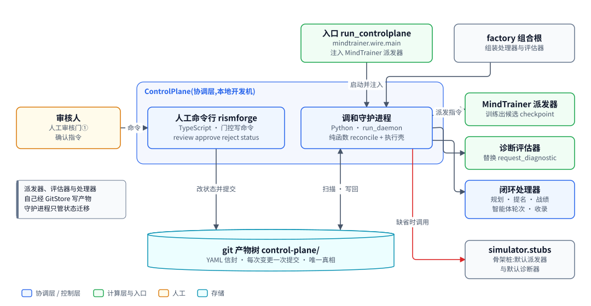
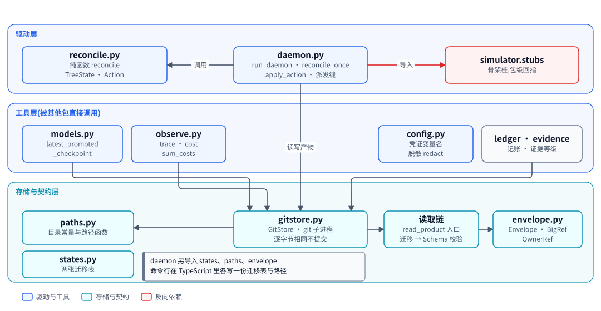
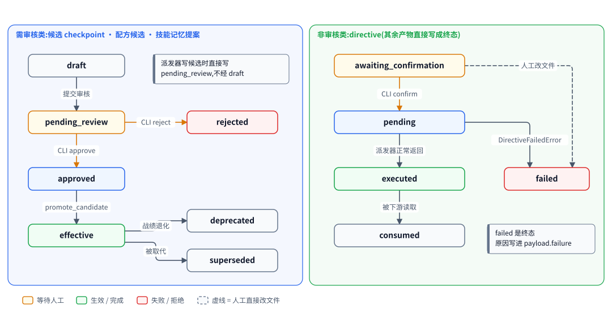
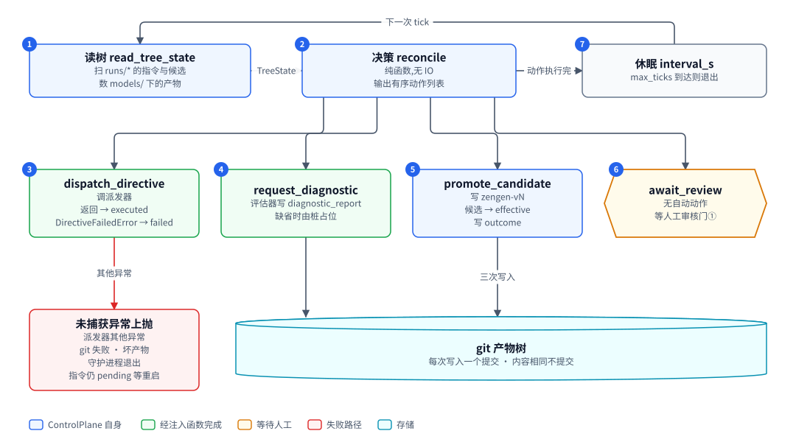

# ControlPlane:产物树、调和循环与审核门

| 项 | 内容 |
|---|---|
| 一句话 | 以 git 产物树为唯一真相,用纯函数调和循环驱动全系统,在审核门处等人 |
| 状态 | 基本落地 [已落地]:调和循环、派发缝、两类状态机、审核门①、信封、迁移器链、观测函数、配置加载与脱敏、命令行五个命令;闭环扩展也 [已落地]:新路径与目录、`awaiting_confirmation`、记账、配置信封、证据等级、新视图与动作、注入缝、命令行泛化与 `confirm`。闭环默认不启用:缺省入口与 `scripts/run_controlplane.py` 用 mock 派发器与诊断桩;闭环动作要 factory 带 `--enable` 才装配,真实评估器要 `--executor roll` 加 `--evaluator someval` |
| 所在层 | 协调层 |
| 代码位置 | `src/controlplane`(1776 行);`cli/src`(TypeScript,428 行);`schemas/envelope.schema.json`;`scripts/run_controlplane.py` |
| 基线提交 | `b826440`(2026-10-21) |
| 依赖 | git 命令行、PyYAML、jsonschema;`simulator.stubs`(骨架桩,包级回指) |
| 被依赖 | SocialSimulator、诊断评测、MindTrainer、TypeScript 命令行;闭环的七个新包(trainplanner、trainscheduler、recipestore、mindagent、factory、compute、inference_bridge) |
| 对应实施计划 | 工作包 1(任务 19 至 27)与工作包 8(任务 90 至 99);工作包 9 任务 109 的导入检查 |


## 0. 系统速览

<!-- shared:begin context-block -->
**系统是什么。** RismForge 是一套"AI 驱动的社会心智后训练工厂":输入通用开源基础模型,输出社会心智能力显著增强的模型,代号 **ZenGen**。工厂自己决定每一轮练什么、怎么练。训练决策可以交给外部更强的闭源模型(经命令行调用),关键决策点设人工审核门,其余环节自动。

**七个子系统。** 六个能力子系统加一个协调层 ControlPlane。

| 子系统 | 职责 | 所在层 | 现状 |
|---|---|---|---|
| ControlPlane | 协调层:git 版本化产物树、状态机、调和循环、三个审核门 | 控制层 | [已落地] |
| SocialSimulator | 情境与人格生成、多智能体仿真、实时环境服务、诊断评测 | 计算层 | [已落地];诊断默认用 mock 后端,`--evaluator someval` 装配 vLLM 加 SoMEval 的真实运行器 [已落地],真机只验证到预测阶段 |
| MindTrainer | 权重级训练:BatchTrain(SFT 后接 GRPO 加 OPD)与 InteractTrain | 计算层 | [已落地],默认入口的训练执行器是 mock;ROLL LoRA SFT 真实执行器 [已落地],由 `--executor roll` 装配,已在真实主机上端到端跑通一次 |
| MindAgent | 部署态智能体的技能与记忆自进化,不改权重 | 计算层 | [已落地],闭环里经 `--enable agent` 装配;部署驱动用的仍是罐头后端,真实模型后端未接 |
| RecipeStore | 验证有效的训练配方的版本化仓库 | 控制层 | [已落地] |
| TrainScheduler | 决策执行器:装配上下文、校验决策、构造训练指令、提名配方 | 控制层 | [已落地],含策略经验(默认关) |
| TrainPlanner | 决策学习者:经可插拔后端给出下一轮训练决策 | 控制层 | [已落地],默认后端经桥接调用命令行模型 |

共享基础设施有五个。**Actio** 是带技能库与显式记忆的智能体框架,每次响应附带激活轨迹;记忆由内嵌的 **Starling** 提供,一个人格一个树外 SQLite 库,可选 extra `memory` [已落地]。**外部推理桥接**用命令行调用外部强模型。**远端计算层** `compute` 经 SSH 在远端 GPU 主机上跑作业 [已落地]。**ROLL** 是分布式训练引擎,**vLLM** 是推理引擎。V1 经远端计算层接入 ROLL 的 LoRA SFT [已落地](由 `--executor roll` 装配,已在真实主机上从指令跑到候选一次)与 vLLM 推理服务 [已落地](命令拼装、SSH 隧道、服务生命周期;真机端到端待补)。已落地部分仍由确定性 mock 顶替。真实 GRPO 加 OPD 训练与真实 judge [推迟]。

**状态标记。** **[已落地]** 表示代码在主干上且有测试。**[计划中]** 表示设计与实施计划已定,代码还没写。**[推迟]** 表示明确不在 V1 范围内。图只画目标系统,不标进展,进展只看正文的状态标记。

**六条贯穿全系统的机制。**

| 机制 | 规则 |
|---|---|
| 产物树 | 所有协作数据是 git 树里的 YAML 产物,统一信封:`id`、`type`、`version`、`created_at`、`created_by`(含 `owner` 与 `visibility`)、`status`、`schema_version`、`links`、`payload`。checkpoint 等大体量内容只存引用 `{uri, sha256, size_bytes}`;V1 的数据集逐条 episode 进 git,只适合小规模 mock。git 树是唯一真相,读取时先经迁移器链再消费。 |
| 状态机 | 需审核类:`draft → pending_review → approved → effective`,之后可到 `deprecated` 或 `superseded`,`pending_review` 也可到 `rejected`。非审核类:`pending → executed → consumed`,`pending` 也可到 `failed`。被拒绝与失败的产物保留;被拒绝的候选进入下一轮规划的输入,失败只留痕、等人处理。 |
| 调和循环 | 纯函数 `reconcile(树视图) → 动作列表`,守护进程按间隔轮询并执行动作。循环无状态、动作幂等,进程崩溃后从 git 树续接。子系统之间不直接调用,只读写产物。 |
| 审核门 | 三道人工门:① checkpoint 晋级,② 技能与记忆增量纳入,③ 配方入库。证据不在场就不能批准:门①要诊断报告,门②要验证结果,门③要可复现性校验报告。门②与门③ [已落地]。 |
| 受限直连 | 两处高频实时调用绕过 ControlPlane:① MindTrainer 与 SocialSimulator 之间的 InteractTrain rollout,② MindAgent 与 SocialSimulator 之间的部署经验采集。两处都走 gRPC 双向流,发生在计算层内部。是否开会话仍由 ControlPlane 决策。 |
| 失败分类 | T1 瞬态:有限次指数退避重试,耗尽升为 T3。T2 确定性:不重放,按所属子系统的校验链处理,LLM 的随机输出可有限次重采样。T3 需人工:写失败记录,不自动重跑。失败是数据,不是异常。 |

**核心术语。**

| 术语 | 含义 |
|---|---|
| Run | 一轮迭代,对应产物树里的 `runs/run-<编号>/` 目录,该轮所有产物都挂在其下 |
| Directive(训练指令) | TrainScheduler 或人写入的 `directive.yaml`,调和循环据此下发训练 |
| Candidate(候选 checkpoint) | MindTrainer 产出的 `candidate_checkpoint.yaml`,经诊断评测与门①才能晋级 |
| ZenGen 版本 | 晋级后写入 `models/zengen-v<N>.yaml`;下一轮训练的基座取最新的 effective 版本 |
| Episode | 一次多轮交互的完整记录:情境、角色分配、逐轮话语、终止原因 |
| Scenario、Persona、RoleAssignment | 社会情境、人格模板,以及把角色位绑定到具体人格与模型后端的分配 |
| Recipe(配方) | 验证有效的完整训练方案,分 batch、interact、agent_rsi 三类 |
| DiagnosticReport | 诊断评测产出的报告:维度、分数、置信区间、错误类型、退化标记 |
| Activation trace(激活轨迹) | Actio 每次响应附带的记录:命中的技能候选、选中的技能、命中的记忆 |
| Evidence grade(证据等级) | 诊断报告的可信等级 `stub`、`mock`、`real`,决定它能否驱动规划与提名;缺标记一律判 `stub`,失败关闭 |
<!-- shared:end context-block -->

## 1. 定位

ControlPlane 是系统的协调层:它不训练、不评测,只读写产物并推进状态。子系统之间不直接调用,一律经它的产物树交换数据。它解决两件事:谁在什么时候该做下一步,以及哪一步必须等人。

<!-- figure:begin 10-controlplane-context -->


**图 1　ControlPlane 的上下文**　审核人经 TypeScript 命令行改审核状态,守护进程由入口启动并注入派发器。守护进程扫描 git 产物树,把指令交给派发器,缺省时调用骨架桩。诊断评估器与闭环处理器经注入缝接入,由 factory 组合根装配。

<details>
<summary>文字版:图中的节点与连线</summary>

**节点**

- 审核人:人工审核门① / 确认指令
- 人工命令行 rismforge:TypeScript · 门控写命令 / review approve reject status
- 调和守护进程:Python · run_daemon / 纯函数 reconcile + 执行壳
- 入口 run_controlplane:mindtrainer.wire.main / 注入 MindTrainer 派发器
- factory 组合根:组装处理器与评估器
- MindTrainer 派发器:训练出候选 checkpoint
- 诊断评估器:替换 request_diagnostic
- 闭环处理器:规划 · 提名 · 战绩 / 智能体轮次 · 收录
- git 产物树 control-plane/:YAML 信封 · 每次变更一次提交 · 唯一真相
- simulator.stubs:骨架桩:默认派发器 / 与默认诊断器

**连线**

- 审核人 → 人工命令行 rismforge:命令
- 人工命令行 rismforge → git 产物树 control-plane/:改状态并提交
- 调和守护进程 ↔ git 产物树 control-plane/:扫描 · 写回
- 入口 run_controlplane → 调和守护进程:启动并注入
- factory 组合根 → 调和守护进程
- 调和守护进程 → MindTrainer 派发器:派发指令
- 调和守护进程 → 诊断评估器
- 调和守护进程 → 闭环处理器
- 调和守护进程 → simulator.stubs:缺省时调用

</details>
<!-- figure:end 10-controlplane-context -->

审核人只通过 TypeScript 命令行改审核状态,命令行直接改树并提交。守护进程由入口启动,入口注入 MindTrainer 派发器。守护进程扫描产物树,把待执行指令交给派发器;没注入时调用 `simulator.stubs` 的骨架桩。诊断评估器与闭环处理器经注入缝接入,由 factory 组合根装配,都是 [已落地];缺省入口不注入它们,行为与引入注入缝之前相同。

| 邻居 | 它给 ControlPlane | ControlPlane 给它 |
|---|---|---|
| 审核人 | 批准、拒绝;确认指令 [已落地] | `review` 打印的证据 |
| MindTrainer | 派发器函数;写出的候选与训练记录 | 待执行的指令信封 |
| 诊断评测 | 诊断报告 | 候选 id 与 run id |
| SocialSimulator | 情境、人格、episode、数据集清单 | 路径函数与 `GitStore` |
| factory 组合根 [已落地] | 处理器、派发器、评估器 | `run_daemon` 与注入缝 |

## 2. 目标、非目标与约束

结论:V1 的 ControlPlane 只保证"编排正确、可追溯、可恢复",不负责调度资源。

| 编号 | 目标 | 验收方式 | 状态 |
|---|---|---|---|
| G1 | 状态全部在 git 树里,历史即审计日志 | 每次写产物一次提交 | [已落地] |
| G2 | 下一步动作由纯函数决定 | `reconcile` 纯函数测试与不改入参测试 | [已落地] |
| G3 | 崩溃后重启即续接,不丢不重 | 内容相同不提交;动作按树状态幂等 | [已落地] |
| G4 | 晋级必须有诊断证据在场 | approved 无报告时不晋级、不占版本号 | [已落地] |
| G5 | 派发方可替换,失败分类留痕 | 派发器注入测试;`failed` 写 `payload.failure` | [已落地] |
| G6 | 闭环动作可插拔,不注入时行为逐字节不变 | 回归测试比对动作列表 [已落地] | [已落地] |

| 非目标 | 状态 | V1 的处理 |
|---|---|---|
| 多租户隔离、资源调度 | [推迟] | 信封只预留 `created_by` 归属字段 |
| 经 SSH 下发到远端 GPU 主机 | [已落地] | 由远端计算层 `compute` 承担,控制面只认延后通道(CP-14),不认识 SSH |
| 事件总线或文件监听 | 不做 | 轮询,间隔由入口给定 |
| 查询索引 | 不做 | 按目录扫描 |
| 并行多轮在途 | [推迟] | 同一时间只允许一轮,规则 [已落地] |
| 异步派发 | [推迟] | 契约已定,V1 派发器同步返回;接真实 LoRA SFT 的这一轮作为有限定的例外接受同步阻塞(CP-15) |
| 图形界面 | [推迟] | 只有命令行 |
| 损坏产物的自动隔离 | 不做 | 读不出的产物不移走、不改写:视图记为 `unreadable`、闭环暂停,等人修(CP-17)[已落地] |

| 约束 | 内容 | 影响 |
|---|---|---|
| git 只走子进程 | `GitStore` 调 git 命令行,不用任何语言的 git 库 | 每次读写多一次进程开销 |
| 跨平台 | Mac、Windows、WSL 都要能跑 | 不用 inotify,改轮询 |
| 凭证不进树 | 配置只存环境变量名 | 树里出现凭证字段即拒绝加载 |
| 两种语言 | Python 管调和,TypeScript 管门控写命令 | 迁移表与文件名两边各写一份 |
| 同步执行 | 一个 tick 内动作串行执行 | 慢派发会饿住审核动作 |

## 3. 架构

结论:`controlplane` 分三层,驱动层调用工具层与存储层,存储层不知道调和循环存在。

<!-- figure:begin 10-controlplane-architecture -->


**图 2　controlplane 的模块**　三层模块。驱动层是纯函数 reconcile 与守护进程 daemon;工具层是只读解析、观测、配置函数,以及记账与证据等级;存储层是 GitStore、读取链、信封、路径与状态机。箭头是导入方向。

<details>
<summary>文字版:图中的节点与连线</summary>

**节点**

- reconcile.py:纯函数 reconcile / TreeState · Action
- daemon.py:run_daemon · reconcile_once / apply_action · 派发缝
- simulator.stubs:骨架桩,包级回指
- models.py:latest_promoted / _checkpoint
- observe.py:trace · cost / sum_costs
- config.py:凭证变量名 / 脱敏 redact
- ledger · evidence:记账 · 证据等级
- paths.py:目录常量与路径函数
- states.py:两张迁移表
- gitstore.py:GitStore · git 子进程 / 逐字节相同不提交
- 读取链:read_product 入口 / 迁移 → Schema 校验
- envelope.py:Envelope · BigRef / OwnerRef

**连线**

- daemon.py → reconcile.py:调用
- daemon.py → simulator.stubs:导入
- daemon.py → gitstore.py:读写产物
- models.py → gitstore.py
- observe.py → gitstore.py
- ledger · evidence → gitstore.py
- gitstore.py → paths.py
- gitstore.py → 读取链
- 读取链 → envelope.py

</details>
<!-- figure:end 10-controlplane-architecture -->

驱动层只有两个模块:`reconcile.py` 是纯函数,`daemon.py` 是执行壳。工具层的函数只经 `GitStore` 读树,不参与调和。存储层把每次读取都送进读取链:先迁移,再做 Schema 校验,最后反序列化。`daemon.py` 对 `simulator.stubs` 的导入是唯一指向外包的箭头。

| 模块 | 职责 | 依赖 | 状态 |
|---|---|---|---|
| `reconcile.py` | `TreeState` 到动作列表的纯函数 | `evidence`(证据等级) | [已落地] |
| `daemon.py` | 读树、执行动作、派发缝、注入缝、守护循环、文件锁 | reconcile、evidence、lock、gitstore、states、paths、`simulator.stubs` | [已落地] |
| `states.py` | 需审核与非审核两张迁移表 | 无 | [已落地] |
| `envelope.py` | `Envelope`、`OwnerRef`、`BigRef` | 无 | [已落地] |
| `gitstore.py` | 写入并提交、读取、列目录 | migration、paths、PyYAML | [已落地] |
| `migration.py`、`validate.py` | 迁移器链、JSON Schema 校验 | envelope、jsonschema | [已落地] |
| `paths.py` | 根目录、`SUBDIRS`、路径函数 | 无 | [已落地] |
| `models.py` | 解析最新晋级基座、读 `models/` 下的最大版本号 | gitstore、envelope | [已落地] |
| `observe.py` | `trace`、`cost`、`sum_costs` | gitstore、paths | [已落地] |
| `config.py` | 后端配置加载、凭证解析、脱敏、配置信封读写 | 无 | [已落地] |
| `deferred.py` | 延后通道的 `DeferredError` 基类 | 无 | [已落地] |
| `ledger.py` | 成本与失败写入 | envelope、gitstore、paths | [已落地] |
| `evidence.py` | 证据等级,纯函数 | 无 | [已落地] |
| `lock.py` | 仓库排他文件锁,守护进程与一次性 tick 的入口在第一个 tick 之前取 | 标准库 | [已落地](Windows 分支未在真机验证) |
| `cli/src` | `review`、`approve`、`reject`、`confirm`、`status` | git 命令行、js-yaml | [已落地] |

依赖方向规则:

| 规则 | 内容 | 强制方式 |
|---|---|---|
| 不导入闭环新包 | `controlplane` 不导入 recipestore、trainscheduler、mindagent、factory 等 | 约定;语法树导入检查 [已落地] |
| 不认识派发方 | 派发器只是一个 Callable,入口住在 `mindtrainer.wire` | 依赖反转,已落地 |
| 一处回指 | `daemon.py` 导入 `simulator.stubs`,而 simulator 导入 controlplane | 包级成环,运行时不成环;骨架桩移出前保留 |
| 读必经读取链 | 业务读取只走 `GitStore.read_product` | 约定;TypeScript 侧不遵守,见第 10 章 |

## 4. 数据模型与状态机

结论:所有产物共用一个信封,按种类走两套状态机之一;ControlPlane 自己只写三类产物。

| 实体 | 字段与含义 | 约束 |
|---|---|---|
| `Envelope` | `id`、`type`、`version`、`created_at`、`created_by`、`status`、`schema_version`、`links`、`payload` | 前七个必填,`version` 与 `schema_version` 不小于 1 |
| `OwnerRef` | `owner`、`visibility` | 默认 `default`、`shared`;`visibility` 只取 `private` 或 `shared` |
| `BigRef` | `uri`、`sha256`、`size_bytes`、`fetch_hint` | 大内容不进树,只存引用。构造即校验,且不可变 [已落地]:`uri` 是非空字符串;`sha256` 是 64 位小写十六进制;`size_bytes` 是不小于 0 的整数,`bool` 不算(未知时写 0);`fetch_hint` 为空或字典,字典的内容不约束。违反任一条抛 `InvalidBigRefError`,见 CP-16。真实后端 [已落地] 下 `fetch_hint` 的 `type` 与 `format` 两个键承担「这份存点是真实的还是 mock」的判定,不再只是取回提示:`type` 为 `roll_ssh` 表示训练存点在远端主机上,`format` 区分训练存点与适配器导出 |
| `DirectiveView` | `id`、`status`、`target_dimension`、`recipe_ref` | 由 `read_tree_state` 投影 |
| `CandidateView` | `id`、`status`、`run_id`、`has_diagnostic` | `has_diagnostic` 默认 `False`,未知即无证据 |
| `TreeState` | 指令视图、候选视图、`model_count` | `model_count` 是 `models/` 下 yaml 文件数;新增 `max_model_version`(默认 `None`),非 `None` 时 `reconcile` 用它加一定版本号,否则沿用 `model_count` 加一,既有 fixture 照旧 [已落地] |
| `Action` | `kind`、`target_id`、`detail` | 冻结数据类 |
| `RunView` [已落地] | `run_id`、`directive_status`、`recipe_ref`、`candidate_status`、`has_diagnostic`、`diagnostic_grade`、`planner_decision_status`、`has_nomination_note`、`has_track_note` | 每个 run 目录一条,含没有指令的目录;`recipe_ref` 缺失或不是字符串按空串;诊断报告读不出或载荷不是字典时等级记 `stub` |
| `ModelView` [已落地] | `model_id`、`version`、`run_id`、`status`、`agent_round_status` | `agent_round_status` 为 `None` 表示没有轮次产物或产物读不出;`has_agent_round` 是由它派生的只读属性,不是构造参数 |
| `GateView` [已落地] | `id`、`kind`、`status` | `id` 取产物信封的 id,不取文件名;`kind` 是 `recipe_candidate` 或 `skill_memory_proposal` |
| `TreeState` 新增字段 [已落地] | `runs`、`models`、`gates`(默认空列表),`enabled`(默认空集合),`accept_mock_evidence`(默认假) | 全部带默认值;`enabled` 为空时不填这几项,默认路径与现在逐字节相同 |
| `TreeState.unreadable` [已落地] | 读不出的产物的树内路径,排好序的元组,默认空 | 不论 `enabled` 是否为空都填(`enabled` 为空时也读模型文件,晋级的暂停规则要用);树里没有坏文件时为空,其余字段与原先相同。读不出的产物在各视图里的状态记为常量 `UNREADABLE_STATUS`(取值 `unreadable`),id 从路径取,见 CP-17 |

| 产物 | 路径(`control-plane/` 下) | 状态机 | 写方 | 状态 |
|---|---|---|---|---|
| 指令 | `runs/<run>/directive.yaml` | 非审核 | 人工;状态由守护进程推进 | [已落地] |
| 候选 checkpoint | `runs/<run>/candidate_checkpoint.yaml` | 需审核 | 派发器写,命令行审,守护进程晋级 | [已落地] |
| 诊断报告 | `runs/<run>/diagnostic_report.yaml` | 非审核 | 守护进程经桩写 | [已落地] |
| 结果摘要 | `runs/<run>/outcome.yaml` | 恒 `effective` | 守护进程 | [已落地] |
| 模型版本 | `models/zengen-v<N>.yaml` | 需审核,写入即 `effective` | 守护进程 | [已落地] |
| 成本与失败记录 | `runs/<run>/run_trace.yaml`、`failure-<任务>.yaml` | 非审核 | 记账函数 | [已落地] |
| 配置 | `config/<名>.yaml`,信封 `type: config` | 非审核 | 配置写入函数 | [已落地] |
| 远端计算端点 | `compute/endpoints.yaml`,信封 `type: config`,载荷是映射 `{endpoints: [...]}` | 非审核 | 人工写;配置写入函数只认 `config/` 下的路径,写不了它 | 读侧 [已落地](`factory.compute_config`),产物仍需人工写 |

`SUBDIRS` 由九个基础目录 `runs`、`recipes`、`skill_memory_proposals`、`models`、`compute`、`config`、`scenarios`、`personas`、`diagnostics`,加末尾追加的 `recipe_candidates`、`skill_library`、`memory_library`、`agent_rounds` [已落地],再加 `experience`(策略经验的全局条目目录)组成。追加只能接在末尾,顺序固定:已有目录的下标被别处按位置引用。

<!-- figure:begin 10-controlplane-states -->


**图 3　两类状态机与驱动者**　需审核类:候选由派发器直接写成 pending_review,命令行批准或拒绝,守护进程晋级为 effective。非审核类:指令由守护进程置 executed 或 failed;awaiting_confirmation 经命令行 confirm 转 pending。迁移表还允许 draft 提交审核、effective 废弃或被取代、executed 被下游消费。

<details>
<summary>文字版:图中的节点与连线</summary>

**节点**

- draft
- pending_review
- approved
- effective
- rejected
- deprecated
- superseded
- awaiting_confirmation
- pending
- executed
- consumed
- failed

**连线**

- draft → pending_review:提交审核
- pending_review → approved:CLI approve
- pending_review → rejected:CLI reject
- approved → effective:promote_candidate
- effective → deprecated:战绩退化
- effective → superseded:被取代
- awaiting_confirmation → pending:CLI confirm
- pending → executed:派发器正常返回
- executed → consumed:被下游读取
- pending → failed:DirectiveFailedError
- awaiting_confirmation → failed:人工改文件(虚线)

</details>
<!-- figure:end 10-controlplane-states -->

左边是需审核类,今天只有候选 checkpoint 与配方走它。派发器直接写 `pending_review`,不经 `draft`。右边是非审核类,指令由守护进程置 `executed` 或 `failed`。迁移表还允许 `draft` 提交审核、`deprecated`、`superseded` 与 `consumed`:配方退化有写方(`recipestore` 的 `track.py`),其余几条边 V1 代码里还没有写方。Python 一侧的迁移表另有 `approved → rejected` 一条边 [已落地],只许 MindAgent 收录处理器走:提案里一条记忆增量都没提交过时,记忆抽取失败才转 `rejected`;前面已有增量提交、后一条抽取失败时,提案留在 `approved`,处理器抛 `DeferredError` 退避重试。命令行不走这条边,两张迁移表从此有意不同。`awaiting_confirmation` 与 `confirm` 命令 [已落地];`reconcile` 对 `awaiting_confirmation` 的指令不产生任何动作,它只作初始状态,由调度器按配置写入。图中唯一的虚线是人工直接改文件,把待确认指令置 `failed`。

晋级时守护进程写的模型信封如下。

```yaml
id: zengen-v1
type: zengen_model
status: effective
schema_version: 1
links: [cand-run-001, run-001]
payload:
  promoted_from: cand-run-001
  checkpoint_ref: {uri: "file:///compute/checkpoints/run-001.safetensors", sha256: "000…0", size_bytes: 0, fetch_hint: null}
```

不变量:

| 编号 | 不变量 | 由谁保证 |
|---|---|---|
| I1 | 指令 id 等于它所在的 run 目录名 | 约定;`apply_action` 把 `target_id` 当 run id 用 |
| I2 | 候选晋级前,同一 run 目录里已有诊断报告 | `reconcile` 与 `approve` 两处 |
| I3 | 没晋级不消耗 zengen 版本号 | `reconcile` 只在产生晋级动作时加一 |
| I4 | 每次状态迁移先过迁移表 | `assert_transition`;TypeScript 侧 `assertTransition` |
| I5 | 内容不变的重写不产生提交 | `write_product` 先查暂存区是否为空 |
| I6 | `failed` 与 `rejected` 是终态,记录保留 | 迁移表出口为空 |
| I7 | 读取不改写历史文件 | 惰性迁移只在内存里升版本 |
| I8 | 任何 `BigRef` 实例的 `sha256` 都是 64 位小写十六进制,所以它可以直接拼进路径与作业参数 | `BigRef` 构造时校验、类不可变;`dataclasses.replace` 也走构造,同样校验 [已落地] |

## 5. 接口契约

结论:对内的唯一契约是派发器签名与异常约定;对外的契约是路径函数与信封。

已落地的入口:

```python
Dispatcher = Callable[[GitStore, Envelope], None]
class DirectiveFailedError(Exception):
    def __init__(self, reason: str, *, category: str = "T2") -> None: ...
def read_tree_state(store: GitStore) -> TreeState: ...
def reconcile(state: TreeState) -> list[Action]: ...
def apply_action(store, action, *, dispatcher=None) -> None: ...
def reconcile_once(store, *, dispatcher=None) -> list[Action]: ...
def run_daemon(store, interval_s, max_ticks=None, *, dispatcher=None) -> None: ...
# 新增 keyword-only 参数 on_locked:取到仓库锁之后、第一个 tick 之前调一次 [已落地]
def latest_promoted_checkpoint(store: GitStore) -> PromotedBase | None: ...
def trace(store, run_id) -> str: ...
def cost(store, run_id) -> str: ...
```

派发器约定:

| 派发器的结局 | 调和循环的处理 | 指令状态 |
|---|---|---|
| 正常返回 | 重读指令,置 `executed` 并提交 | `executed` |
| 抛 `DirectiveFailedError` | 写 `payload.failure = {category, reason}` | `failed`,不再派发 |
| 抛 `DeferredError` | 不写树、状态不动,该动作进入退避期;同一 tick 的其余动作照常 | 仍 `pending`,退避期过后再派发 |
| 抛其他异常 | 不接住,原样上抛 | 仍 `pending`,重启后再派发 |

派发器不改指令状态;它拿到的是一份读出的副本,改副本不影响树。续训与重试上限由派发器自己兜底。

闭环扩展的入口,全部 [已落地]:

```python
Handler   = Callable[[GitStore, Action], None]
Evaluator = Callable[[GitStore, str, str], None]        # (store, run_id, candidate_id)
def reconcile_once(store, *, dispatcher=None, handlers=None,
                   evaluator=None, accept_mock_evidence=False) -> list[Action]: ...
def record_cost(store, run_id, *, task_id, cost_type, gpu_hours=None, tokens=None, calls=None, usd=None) -> None: ...
def record_failure(store, run_id, *, task_id, category, point, retries, reason, log_ref=None) -> str: ...
def diagnostic_grade(payload: dict) -> str: ...         # "stub" | "mock" | "real"
def read_config(store, rel_path) -> dict: ...
def write_config(store, rel_path, config_id, payload, message) -> None: ...
def evidence_acceptable(grade: str, accept_mock: bool) -> bool: ...
```

| 闭环扩展的契约 | 内容 | 状态 |
|---|---|---|
| 处理器开关 | `handlers` 的键就是启用的动作;键只能取 `CLOSED_LOOP_ACTIONS` 的六个名字,其余键在执行任何动作前抛 `ValueError`;没有处理器的动作永远不产生 | [已落地] |
| 处理器职责 | 自己重读树、自己写幂等键与终态;瞬态异常原样上抛 | [已落地] |
| 评估器 | 注入后只替换 `request_diagnostic`,缺省仍走桩 | [已落地] |
| 记账 | `record_cost` 同一 `(task_id, cost_type)` 先到者为准,重复调用什么都不写;未知值省略键,不写 `null`,也不写 0;入参明显写错(空 id、含路径分隔符、负数、NaN、类别不在 T1 至 T3)抛 `ValueError` 且什么都不写;`run_trace` 首次建立时 id 为 `trace-<run>`、状态 `executed`,之后只改 `cost_records` | [已落地] |
| 失败记录 | 载荷 `run_id`、`task_id`、`category`、`point`、`retries`、`reason`、`log_refs`(列表,没有日志为空)、`recorded_at`;id 为 `failure-<run>-<task>`,状态 `executed`;同一 `(run, task)` 只写一次,已存在原样返回路径 | [已落地] |
| 配置信封 | `write_config` 写 `type: config`、状态 `effective`;载荷与 id 都没变就不写不提交,否则 `version` 加一;路径必须在 `config/` 下、以 `.yaml` 结尾、规范化后不含 `..`;目标已有非配置信封时抛 `ConfigTypeError`;写前与读后都递归检查凭证键;`read_config` 返回深拷贝,文件缺失抛 `FileNotFoundError` | [已落地] |
| 命令行 `confirm` | 把 `awaiting_confirmation` 改成 `pending` | [已落地] |

闭环动作与路径函数 [已落地],来自工作包 1 与工作包 8。

| 动作 | `target_id` | `detail` | 触发条件 | 幂等键(处理器负责写) |
|---|---|---|---|---|
| `admit_recipe` | 配方候选 id | 空字典 | `GateView.kind` 是 `recipe_candidate` 且状态 `approved` | 配方候选变为 `effective` |
| `admit_proposal` | 提案 id | 空字典 | `kind` 是 `skill_memory_proposal` 且状态 `approved` | 提案变为 `effective` |
| `record_track` | run id | `run_id`、`recipe_ref` | `recipe_ref` 非空;候选 `effective` 或 `rejected`;证据可接受;没有战绩标记 | `runs/<run>/recipe_track.yaml` |
| `nominate_recipe` | run id | `run_id` | 候选 `effective`;证据可接受;没有提名标记 | `runs/<run>/nomination.yaml` |
| `plan_next_round` | run id | `run_id` | 候选 `effective` 或 `rejected`;证据可接受;决策状态为空或 `pending`;没有在途轮;启用提名且候选为 `effective` 时,来源 run 已有提名标记,且配方候选 `recipe-<run>` 不在 `pending_review` 或 `approved`;该 run 是 `run-<数字>` 里编号最大的 | 规划决策变为 `executed` 或 `failed` |
| `start_agent_round` | 模型 id | `version`、`run_id` | 版本号(按数字)最大的 `effective` 模型,且轮次产物不存在、读不出或状态为 `pending` | 轮次产物变为 `executed` 或 `failed` |

- **输出顺序固定。** 既有动作在前,之后是 `admit_recipe`、`admit_proposal`、`record_track`、`nominate_recipe`、`plan_next_round`、`start_agent_round`。同种动作内,门按 id 字典序;run 按编号的数值序,`run-<数字>` 在前,不合约定的名字按字典序排在后面,同编号再按 run id 字典序。数值序是为了让 `reconcile --once` 的输出与 run 的先后一致(字典序会把 `run-10` 排在 `run-2` 前面);同一 tick 里这些动作彼此独立,次序不影响结果。先收录再规划,规划就能看到刚收录的配方;先记战绩再规划,退化的配方不会被同一 tick 选中。`plan_next_round` 每个 tick 至多一条。
- **在途轮。** 任一指令是 `pending` 或 `awaiting_confirmation`,或任一候选是 `pending_review` 或 `approved`。只有 `plan_next_round` 受它限制,提名与战绩是对已结束 run 的记账,不受限。启用提名且候选为 `effective` 时,`plan_next_round` 还要等配方入库门:来源 run 已有提名标记(`nominated` 或 `skipped`),且 `GateView` 里 id 为 `recipe-<run>` 的配方候选不在 `pending_review` 或 `approved`(CP-11)[已落地]。候选为 `rejected` 的 run 不等,因为被拒绝的候选不提名。
- **最大 run。** 按 `run-<数字>` 整数比较。不匹配的名字不参与。一个 `run-<数字>` 都没有时不触发规划,这是刻意的失败关闭,闭环停在等人写指令。编号相同(如 `run-7` 与 `run-007`)按 run id 字典序取较大者。若用字符串序,不补零的 `run-9` 会压过 `run-011`,闭环会静默停住。
- **读不出的产物不确定就停 [已落地]。** 状态为 `unreadable` 的产物不匹配任何触发条件,本身不会被派发、诊断、晋级或收录。在此之上两条暂停规则:`TreeState.unreadable` 非空时,六个闭环动作一个都不产生;`models/` 下有一份读不出时,`request_diagnostic` 与 `promote_candidate` 也不产生。理由是闭环处理器读树的范围很广(规划装配最近几轮与晋级基座,提名与战绩读基线模型算增益),真实评估器与晋级的重放判定都要读模型;只挡住读不出的那个对象,处理器读到别的坏文件时异常仍会漏出去。派发其余指令、等待审核这类不读模型、也不跨 run 读树的动作照常。
- **只对最大版本跑轮次。** 最大 `effective` 模型的轮次到终态后,更旧的模型即使没有轮次也不补跑。`start_agent_round` 的 `run_id` 取模型 `links` 的第二项,不足两项为空串。
- **轮次重入。** 轮次产物写回终态之前,每个 tick 都会再产生 `start_agent_round`。处理器必须先写 `pending` 的轮次产物作幂等键,重入时整份重写同一产物。

| 路径函数 | 返回路径(`control-plane/` 下) | 参数与前缀 |
|---|---|---|
| `recipe_candidate_file(run_id)` | `recipe_candidates/recipe-<run>.yaml` | 函数自己加 `recipe-` [已落地] |
| `recipe_dir(run_id)`、`recipe_file(run_id)` | `recipes/recipe-<run>/`、其下 `recipe.yaml` | 同上 [已落地] |
| `recipe_lineage_file(run_id)`、`recipe_track_file(run_id)` | `recipes/recipe-<run>/lineage.yaml`、`track_record.yaml` | 同上 [已落地] |
| `proposal_file(proposal_id)` | `skill_memory_proposals/<proposal_id>/proposal.yaml` | 传带 `proposal-` 前缀的完整 id [已落地] |
| `skill_file(skill_id)`、`memory_file(mem_id)` | `skill_library/<id>.yaml`、`memory_library/<id>.yaml` | 传带 `skill-` 或 `mem-` 前缀的完整 id [已落地] |
| `library_state_file()` | `library_state.yaml` | 无参数 [已落地] |
| `agent_round_file(model_id)` | `agent_rounds/agent-round-<model>.yaml` | 函数自己加 `agent-round-` [已落地] |
| `planner_decision_file(run_id)`、`nomination_file(run_id)` | `runs/<run>/planner_decision.yaml`、`nomination.yaml` | 无前缀 [已落地] |
| `recipe_track_note_file(run_id)` | `runs/<run>/recipe_track.yaml` | 战绩回写标记,与 `recipe_track_file` 不是同一个文件 [已落地] |
| `run_trace_file(run_id)`、`failure_record_file(run_id, task_id)` | `runs/<run>/run_trace.yaml`、`failure-<task>.yaml` | `run_trace_file` 与观测函数读的路径一致 [已落地] |
| `scheduler_config_file()`、`training_defaults_file()` | `config/scheduler.yaml`、`config/training_defaults.yaml` | 无参数 [已落地] |
| `planner_prompt_file(version)` | `config/prompts/planner-<版本>.yaml` | `prompts/` 不在 `SUBDIRS` 里,写入时自动建目录 [已落地] |
| `strategy_experience_note_file(run_id)`、`strategy_entry_file(entry_id)` | `runs/<run>/strategy_experience.yaml`、`experience/<entry_id>.yaml` | 传带 `exp-` 前缀的完整条目 id [已落地] |

指令文件没有路径函数,三处都写 `runs/<run>/directive.yaml`。工作包 1 之后 `paths`、`states`、`ledger`、`config`、`evidence` 冻结,后续工作包只消费,不再改。

证据等级只有一处实现 [已落地]:

| 项 | 规则 |
|---|---|
| `GRADES` | `stub`、`mock`、`real` |
| `diagnostic_grade(payload)` | `stub` 字段为真判 `stub`;`backends` 为 `mock` 判 `mock`;`backends` 为 `real` 且 `dimension_scores` 是非空列表,判 `real`;`backends` 缺失、取值不认识或没有分数,其余一律判 `stub`。载荷不是字典抛 `TypeError` [已落地] |
| `evidence_acceptable(grade, accept_mock)` | `real` 可接受;`mock` 仅在 `accept_mock` 为真时可接受;`stub` 与没有报告永不可接受。等级不在 `GRADES` 里抛 `ValueError`;`accept_mock` 不是布尔值时抛 `TypeError` [已落地] |

命令行契约:

| 命令 | 读 | 写 | 证据规则 | 状态 |
|---|---|---|---|---|
| `review <id>` | 候选与同目录诊断报告 | 无 | 缺报告打印 MISSING;占位报告标 `[STUB]` | [已落地] |
| `approve <id>` | 同上 | 候选置 `approved` 并提交 | 无报告拒绝批准 | [已落地] |
| `reject <id> [原因]` | 候选 | 置 `rejected`,写 `reject_reason` | 无 | [已落地] |
| `review`、`approve`、`reject` 对配方候选与提案 | 配方候选、提案 | 各自状态 | 配方候选要有 `repro`:`payload.repro` 是对象,`errors` 与 `warnings` 都是列表,`errors` 非空仍可批准,`{}` 一律拒绝;提案要有非空对象 `verification`;`reject` 不要求证据;mock 报告标 `[MOCK BACKENDS]`,`backends` 取值不认识时打印 `backends: UNREADABLE` | [已落地] |
| 按 id 找产物 | 三类审核路径 | 无 | 同一 id 命中多个产物报 `ambiguous`,不猜;找不到时保持原文 `candidate <id> not found` | [已落地] |
| `confirm <directive-id>` | 指令 | `awaiting_confirmation → pending` | 查 TypeScript 侧的非审核类迁移表,只有 `awaiting_confirmation` 能确认;已确认或多处命中都拒绝,不写文件、不提交 | [已落地] |
| `status` | 三类待审产物、待确认指令 | 无 | 分节输出待审与待确认;都为空时打印 `nothing awaiting review or confirmation` | [已落地] |

异步派发契约 [推迟]。V1 的派发器同步返回,训练由 mock 完成。真实训练要数小时,同步返回会阻塞调和循环,或让指令在候选出现之前就被置 `executed`;下面的契约就是为此定的。接真实 LoRA SFT 的这一轮不等它:作为已评估的例外接受同步阻塞,限定条件见 CP-15,异步派发本身仍 [推迟]。

| 项 | 契约 |
|---|---|
| 新状态 | 非审核类指令加 `submitted`:`pending → submitted → executed`,`submitted → failed`;Python 与 TypeScript 两份迁移表同步 [推迟] |
| 派发器 | 拆成 `submit(store, directive) -> JobHandle` 与 `poll(store, directive, handle) -> JobStatus`;轮询状态取 `running`、`succeeded`、`failed(category, reason)`;同步派发器保持原签名,返回即 `executed` [推迟] |
| 提交 | `submit` 在训练记录里写 `remote_job_ref`,调和循环随即把指令置 `submitted`;提交遇到瞬态异常原样上抛,指令仍 `pending` [推迟] |
| 轮询动作 | 新动作 `poll_training`,目标是处于 `submitted` 的指令;处理器调 `poll`:`running` 不写任何东西,`succeeded` 注册候选 `pending_review` 并置 `executed`,`failed` 置 `failed` 并写失败记录 [推迟] |
| 幂等键 | 训练记录里的 `remote_job_ref`;重复提交先查它,已有就不再提交 [推迟] |
| 在途轮 | `submitted` 与 `pending`、`awaiting_confirmation` 一样算在途 [推迟] |
| 超时 | 配置 `max_job_hours`,超时判 T3,不自动取消远程任务 [推迟] |
| 解除推迟的条件 | 远程执行器的假实现跑通提交、轮询、崩溃重入三类测试 [推迟] |

对邻居的假设:

| 邻居 | ControlPlane 假设它 | 它假设 ControlPlane |
|---|---|---|
| 派发器 | 把候选写成 `pending_review`,不改指令状态 | 返回即算成功,失败分两类处理 |
| 诊断评测 | 报告写在候选同目录 | 只按"报告在场"放行,不读分数 |
| TypeScript 命令行 | 只改审核状态,文件名与 Python 一致 | 守护进程会跟进晋级 |
| 外部监督者 | 守护进程退出后会重启它 | 重启后续接,不重做已完成动作 |

## 6. 关键流程

结论:一次 tick 读树、决策、逐个执行,执行顺序就是 `reconcile` 输出的顺序。

<!-- figure:begin 10-controlplane-tick -->


**图 4　一次调和 tick**　读树投影成视图,纯函数算出动作列表,逐个执行。下发指令走派发器,诊断走评估器,晋级做三次写入,等待审核不做事。资源暂时不可用时延后重试;读不出的产物记为 unreadable 并暂停闭环;其余未捕获的异常让守护进程退出;正常结束后休眠再来。

<details>
<summary>文字版:图中的节点与连线</summary>

**节点**

- 读树 read_tree_state:扫 runs/* 的指令与候选 / 取 models/ 的最大版本号 / 读不出的记为 unreadable
- 决策 reconcile:纯函数,无 IO / 输出有序动作列表
- 休眠 interval_s:max_ticks 到达则退出
- dispatch_directive:调派发器 / 返回 → executed / DirectiveFailedError → failed
- request_diagnostic:评估器写 diagnostic_report / 缺省时由桩占位
- promote_candidate:写 zengen-vN / 候选 → effective / 写 outcome
- await_review:无自动动作 / 等人工审核门①
- 未捕获异常上抛:派发器其他异常 / git 失败 · OSError / 守护进程退出 / 指令仍 pending 等重启
- DeferredError 延后:不写树 · 状态不动 / 退避重试,超上限才退出
- git 产物树:每次写入一个提交 · 内容相同不提交

**连线**

- 读树 read_tree_state → 决策 reconcile:TreeState
- 决策 reconcile → 休眠 interval_s:动作执行完
- 休眠 interval_s → 读树 read_tree_state:下一次 tick
- 决策 reconcile → dispatch_directive
- 决策 reconcile → request_diagnostic
- 决策 reconcile → promote_candidate
- 决策 reconcile → await_review
- dispatch_directive → 未捕获异常上抛:其他异常
- dispatch_directive → DeferredError 延后:资源暂不可用
- request_diagnostic → git 产物树
- promote_candidate → git 产物树:三次写入

</details>
<!-- figure:end 10-controlplane-tick -->

| 步 | 名称 | 做什么 | 产物与提交 |
|---|---|---|---|
| 1 | 读树 | 按目录名排序扫 `runs/*`,读指令与候选;取 `models/` 的最大版本号;读不出的产物记为 `unreadable`(CP-17) | 无 |
| 2 | 决策 | 先列 `pending` 指令,再按 run 顺序处理候选;注入了闭环处理器时,其后按固定顺序追加闭环动作:`admit_recipe`、`admit_proposal`、`record_track`、`nominate_recipe`、`plan_next_round`、`start_agent_round` | 无 |
| 3 | `dispatch_directive` | 调派发器;返回置 `executed`,确定性失败置 `failed` | 指令一次提交,另加派发器自己的提交 |
| 4 | `request_diagnostic` | 调评估器写报告;缺省入口没有评估器,由桩写,载荷带 `stub: true` | 一次提交 |
| 5 | `promote_candidate` | 写模型、候选置 `effective`、写结果摘要 | 三次提交 |
| 6 | `await_review` | 不做事,等审核门① | 无 |
| 7 | 休眠 | 睡 `interval_s` 秒;到 `max_ticks` 就退出 | 无 |

失败与恢复路径:

| 失败点 | 结果 | 恢复 |
|---|---|---|
| 派发器抛 `DeferredError` | 不写树,状态不动 | 同一进程按退避重试;连续延后超过上限才退出(CP-14)[已落地] |
| 派发器抛其他异常 | 守护进程退出,指令仍 `pending` | 外部重启后再派发 |
| 晋级三次写入中途崩溃 | 已写的模型文件留在树里 | 崩在第二次写入之前:重启后候选仍 `approved`;晋级先找 `promoted_from` 等于该候选的模型,找到就复用它的版本号,只补做后两次写入,不再登记 vN+1(CP-7)[已落地]。崩在第二、三次之间:候选已是 `effective`,不再晋级,结果摘要缺失;它只供人与追溯查看 |
| 读到损坏产物 | 视图记为 `unreadable`,不对它动作;闭环动作整体暂停,模型读不出时诊断与晋级也暂停;每个路径记一行警告,不退出(CP-17)[已落地] | 人工修复或删除该文件,下一 tick 自动续上 |
| 读产物时 `OSError` | 原样上抛,守护进程退出 | 排查磁盘或权限后重启 |
| git 命令非零退出 | 子进程异常上抛,守护进程退出 | 人工排查仓库 |

晋级动作的幂等键是模型产物里的 `promoted_from`。重启后候选仍是 `approved`,`apply_action` 先扫描 `models/` 找 `promoted_from` 等于该候选的模型:找到就复用它的版本号,只补做候选置 `effective` 与写结果摘要;找不到才按动作里的 `model_version` 新登记。`reconcile` 给出的 `model_version` 是现有最大版本号加一,所以人工删文件只会留下版本号空洞,不会重复 [已落地]。

走查例子取自 `tests/test_e2e_loop.py`:人工写指令 `run-001`,目标维度 `high_order_belief`,用缺省的桩派发器。

| tick | `reconcile` 输出 | 树的变化 | 提交数 |
|---|---|---|---|
| 1 | `dispatch_directive` | 写 `scenario_pool.yaml`、`cand-run-001`(`pending_review`),指令置 `executed` | 3 |
| 2 | `request_diagnostic` | 写 `diag-run-001`,`stub: true` | 1 |
| 3 | `await_review` | 无 | 0 |
| 人工 | 无 | `approve`,候选置 `approved` | 1 |
| 4 | `promote_candidate`,`model_version = 1` | 写 `zengen-v1`、候选置 `effective`、写 `outcome-run-001` | 3 |
| 5 | 空列表 | 无,闭环稳定 | 0 |

同一文件的 `test_rejected_candidate_never_promoted` 走另一个出口:人把候选置 `rejected` 后,`reconcile` 输出空列表,不登记模型,候选与拒绝理由留在树里。被拒绝的候选是终态:启用规划时,只要它属于编号最大的 run 且证据可接受,照样触发下一轮规划,`tests/test_factory_e2e_loop.py` 的 `test_only_the_largest_run_is_planned` 钉住了这一点。

桩派发器写的情境恒用维度 `tom`,与指令的 `high_order_belief` 无关(`daemon.py` 里写死)。

## 7. 关键决策

结论:本子系统的取舍围绕"树是唯一真相"展开;R 编号来自闭环集成阶段的裁决,内容就地写全。

| 编号 | 决策 | 备选 | 理由 | 判错的代价 |
|---|---|---|---|---|
| CP-1 | `reconcile` 是纯函数,执行壳单独放 | 在循环里边读边改 | 决策可用 fixture 全覆盖;同输入同输出 | 读树与执行要分两步,视图要手工投影 |
| CP-2 | 轮询 git 树 | 文件系统监听;事件总线 | 跨 Mac、Windows、WSL 可靠;状态变化是分钟到小时级 | 状态变化有一个间隔的延迟 |
| CP-3 | git 操作只走子进程 | 语言 git 库 | 不绑定语言,Python 与 TypeScript 同一手法 | 每次写入多两到三次进程启动 |
| CP-4 | 内容相同不提交 | 每次写都提交 | 崩溃重放半程 tick 时不因"无可提交"崩掉 | 无改动的重写不留历史痕迹 |
| CP-5 | 派发失败分两类:`DirectiveFailedError` 置 `failed`,其余上抛 | 统一吞掉重试;统一置 `failed` | 确定性失败不空转,瞬态失败不被错判成终态 | 瞬态异常让守护进程退出,需要外部监督 |
| CP-6 | 晋级要求树里已有诊断报告,即使候选已 `approved` | 只信命令行的 `approve` | 命令行不是唯一写方,底线不依赖审核人走哪条路 | 只保证证据在场,不保证被读过 |
| CP-7 | 新版本号取现有最大版本号加一,一轮内多个晋级依次递增;晋级先找 `promoted_from` 等于该候选的模型,找到就复用它的版本号 [已落地] | 取 `models/` 下的文件数加一 | 崩溃重放不再重复登记,人工删文件或手放模型文件不使版本号错位 | 人工删文件会留下版本号空洞;晋级多一次对 `models/` 的扫描 |
| CP-8 | 惰性迁移,读取统一经迁移器链,V1 链为空 | 批量改写历史产物 | 历史保持可追溯 | 每次读取多一次迁移与校验 |
| CP-9 | 配置只存凭证变量名,出现凭证字段即拒绝加载 | 允许本地明文 | 凭证绝不进 git | 换机器要自己配环境变量 |
| CP-10 | 需审核类迁移表在 Python 与 TypeScript 各一份 | 共享一份 schema 生成 | 两种语言只经树里的文件通信 | 两边改漏一处就会分叉,目前靠人工核对。唯一例外是 `approved → rejected`,只在 Python 一侧 |
| CP-11 | `plan_next_round` 还要等来源 run 的配方入库门:启用提名且候选 `effective` 时,来源 run 须已有提名标记,且配方候选 `recipe-<run>` 不在 `pending_review` 或 `approved`;候选 `rejected` 不等 [已落地] | 不等,同一轮提名的配方最早在第 N+2 轮被复用 | 三道门的先后成为树里的状态事实,规划一定看得到刚入库的配方,不再依赖同一 tick 里提名先于规划的顺序 | 每一轮多停一次等人审门③;人手放进树的候选没有提名标记,规划不触发,要人手写下一条指令;关掉提名开关规划就不再等 |
| CP-12 | 守护进程与一次性 tick 的入口在第一个 tick 之前取排他文件锁,锁文件在该工作树的 git 目录下(普通仓库是 `.git/`;worktree 与子模块的 `.git` 是 `gitdir:` 指针文件,锁放进它指向的目录,按工作树隔离);所有产物写入的提交只带本文件(`git commit -m <信息> -- <路径>`),Python 与 TypeScript 两侧一致;命令行不取锁 [已落地](Windows 的锁分支未在真机验证) | 命令行写入队列;维持现状 | 锁挡住两个守护进程重复派发与记账互相覆盖;只带本文件让命令行已暂存的改动不被守护进程带走 | 锁被占用时入口以退出码 2 退出;命令行与守护进程同时提交时 git 自己的索引锁冲突仍会让一方失败,已复现(同一仓库六个线程各写 15 次,90 次里 62 次失败),守护进程遇到即退出 |
| CP-13 | 异步派发的契约现在定下,V1 不写代码:指令加 `submitted` 状态,派发器拆成提交与轮询,调和循环加轮询动作 [推迟];接真实 LoRA SFT 的例外见 CP-15 | V1 就实现;推迟到 V2 才设计 | 契约先于实现,真正做异步派发时不必同时改派发契约与调和循环 | 契约先于实现,真实执行器落地时细节仍会微调 |
| CP-14 | 资源暂时不可用走延后通道 [已落地]:基类 `DeferredError(reason, retry_after_seconds)` 放在无依赖的 `controlplane/deferred.py`;守护进程在 `reconcile_once` 里接住它,不写树、状态不动;退避取 `retry_after_seconds` 与默认 30 秒的较大者、封顶 900 秒,退避期内跳过该动作而同一 tick 的其余动作照常;同一动作连续延后超过 20 次抛 `DeferredExhaustedError`(不继承 `DeferredError`),守护进程带原因退出;退避表只在内存。派发器的通用异常分支对 `DeferredError` 原样上抛,不把它包成 `DirectiveFailedError` | 沿用「派发器抛其他异常就让守护进程退出」;只在计算层内部重试 | 验证主机上常有别人的服务,忙是常态;仓库没有监督脚本,退出等于停摆;内部重试看不到守护进程的节奏 | 上限偏小会在长队列前过早退出,偏大发现得晚;树里没有任何写入,代价只是重启一次守护进程 |
| CP-15 | 接真实 LoRA SFT 的这一轮,训练同步阻塞调和循环,作为已评估的例外 [已落地]:限定条件是真实后端只由组合根在装配时直接启用;异步派发(CP-13)留给下一轮,不作本轮前置 | 先落地异步派发再接真实训练 | 异步派发要改指令状态机与守护循环,与真实后端叠在一起风险过大;训练期间排队的只是审核与晋级动作,树不会被写坏 | 一轮训练期间审核与晋级动作排队,可达数小时;真正做异步派发时,真实执行器要从同步形态改成提交与轮询两段 |
| CP-16 | `BigRef` 构造即校验并冻结,校验失败抛 `InvalidBigRefError`,它继承 `TypeError` [已落地]。64 位小写十六进制的规则只有一份,即 `controlplane.envelope.SHA256_HEX`,训练配置、配方校验、mock 执行器与转换器都引用它 | 由各使用方各自校验(此前的做法,共四份正则);抛 `ValueError` | 坏引用在进树、出树的第一刻就被拦下,不再靠每个用到它的地方记得检查;转换器把 `sha256[:8]` 拼进远端路径,此前全仓只有它一处在把关。继承 `TypeError` 是因为每个读树点都已把 `KeyError`、`TypeError`、`AttributeError` 当成确定性读不出:派发器转成指令 `failed`,MindAgent 转成轮次 `failed`。若抛 `ValueError`,它会从这些分支漏出去,在派发器里被当成瞬态失败,指令保持 `pending`、每个 tick 重派 | 手写进树的坏引用此后在读取时确定性失败,错误信息点名字段;此前它能被读出,直到某个使用方才出错或根本不出错 |
| CP-17 | 读不出的已提交产物在视图里记为 `unreadable`,不对它动作;有任何一份读不出时闭环动作整体暂停,有模型读不出时诊断与晋级也暂停;每个路径记一次警告 [已落地] | 维持退出;按「没有」处理 | 退出让一份坏文件停掉整个循环,有外部监督者时是重启再崩的死循环。按「没有」处理会做错事:规划决策「为空」正是 `plan_next_round` 的触发条件,会重新规划一次已经执行过的决策并分配第二个 run;指令或候选「没有」就不算在途,会在别的轮次还没走完时开新一轮;跳过最新的那份模型,轮次就绑到更旧的模型上。只挡住读不出的那个对象也不够:要逐个处理器列出它读哪些文件,既容易漏也没法验证,所以按粗粒度暂停 | 守护进程不再因坏文件退出,但一份坏文件(哪怕是一份旧提案)就让整个闭环停住,只靠警告日志提示;人仍要修文件。轮次产物(R19,重入时由处理器判损坏)与诊断报告(记 `stub`)沿用原有兜底,不改 |
| R1 | 事件就是树里的状态事实。每个触发对应一个新动作,幂等键是 run 目录内的标记产物 | 事件订阅 | 循环无状态,崩溃后重读即续接 | 每个触发多一个小文件 [已落地] |
| R2 | 新动作只有在对应处理器被注入时才会产生,`controlplane` 不导入任何新子系统 | 在 daemon 里直接调用新子系统 | 依赖方向不变;不注入时行为逐字节相同 | 入口要自己组装处理器 [已落地] |
| R3 | 指令确认默认开启,新增 `awaiting_confirmation` 状态,由 `confirm` 迁到 `pending` | 全自动下发 | 先建立信任 | 闭环每轮停一次等人,关掉要显式配置 [已落地] |
| R4 | 同一时间只允许一轮在途:任一指令 `pending` 或 `awaiting_confirmation`,或任一候选 `pending_review` 或 `approved`,就不规划下一轮 | 并行多轮 | 防止失控 | 不能并行多条训练线 [已落地] |
| R5 | 规划只在候选到终态且证据可接受时触发,且只对编号最大的 run 触发(按 `run-<数字>` 做整数比较,不匹配的名字不参与,一个都没有时不触发,编号相同按 run id 字典序取较大者);指令 `failed` 不触发 | 任何 run 到终态都规划 | 较早 run 的候选不会被重复规划 | 指令失败后闭环停住,等人写新指令 [已落地] |
| R6 | 配方候选放 `recipe_candidates/`,批准后由 RecipeStore 写入 `recipes/` | 候选与正式配方同目录 | `recipes/` 只有两个写方 | 多一个目录 [已落地] |
| R9 | 不建 SQLite 索引,按目录扫描 | 从树重建的 SQLite 缓存 | 不出现第二套真相 | 配方到数百条以上扫描才会慢 |
| R10 | 审核门记录就是产物自己的 `status` 与原因,不另建 `gate_*.yaml` | 每道门一个记录文件 | 与已落地的候选 checkpoint 一致 | 门的审核人与时间只能从 git 提交里看 |
| R11 | 正式技能库放 `skill_library/`,记忆库放 `memory_library/`,库版本记在 `control-plane/library_state.yaml` | 混放在提案目录 | 已纳入与待审分开 | 无 [已落地] |
| R16 | 命令拆两个入口:TypeScript 管门控写命令,Python 管调和与只读可观测 | 全部命令放一个 `rismforge` | 门控写命令与调和循环分属两种语言 | 用户要记两个入口 |
| R17 | 诊断报告带 `backends` 标记;默认不接受 `mock` 证据驱动规划与提名,开发入口用显式开关打开 | 不区分证据来源 | 防止 mock 分数让闭环自己转起来 | 默认配置下闭环不会自转,开发要加开关 [已落地] |
| R19 | 智能体轮次在"没有轮次产物或产物为 `pending`"时触发;产物在但读不出视同不存在 | 只在没有产物时触发 | 一次瞬态失败留下的 `pending` 轮次不会永远卡住 | 轮次处理器可能被连续唤醒,必须靠幂等键挡重复 [已落地] |

## 8. 失败处理与可观测

结论:ControlPlane 只区分"派发器说确定性失败"与"其他一切",其余分类由派发器与处理器自己标。

| 失败点 | 类 | 处理 | 留痕 |
|---|---|---|---|
| 派发器抛 `DirectiveFailedError` | 派发器标注,默认 T2 | 指令置 `failed`,不再派发,同一 tick 其余动作继续 | 指令 `payload.failure`,提交信息带类别 |
| 派发器抛 `DeferredError` | 资源暂时不可用,不是指令的错 | 守护进程接住,不写树,按退避重试;同一动作连续延后超过上限则抛 `DeferredExhaustedError` 带原因退出 | 结构化日志一行:动作、目标、原因、下次尝试时间;不进树 |
| 派发器抛其他异常 | 按 T1 对待 | 原样上抛,守护进程退出,指令仍 `pending` | 只有进程输出 |
| 产物读不出:YAML 坏、Schema 不符、版本过高、`BigRef` 不合规 | T3 | 指令、候选、规划决策、模型与门产物:视图记为 `unreadable`,不对它动作;闭环动作整体暂停,有模型读不出时诊断与晋级也暂停;其余既有动作照常;不退出 [已落地]。轮次产物与诊断报告各有既定兜底,见下两行。`OSError` 仍原样上抛,守护进程退出 | 每个读不出的路径记一行警告日志,带异常类名;同一守护进程里同一路径只记一次,修好后再坏会再记 [已落地] |
| 非法状态迁移 | T2 | `InvalidTransitionError` 上抛 | 进程输出 |
| 凭证缺失或凭证进树 | T2 | `MissingCredentialError`、`CredentialInGitTreeError` | 进程输出 |
| 处理器确定性失败 | 处理器标注 | 写自己产物的 `failed` 与失败记录 | `failure-<任务>.yaml` [已落地] |
| 轮次产物读不出 | 视图兜底 | 视图按「没有轮次」处理,不抛;轮次处理器重入时判定确定性损坏,自己写 `failed`(R19) | 轮次产物 [已落地] |
| 诊断报告读不出或载荷不是字典 | 视图兜底 | 等级记为 `stub`,永不可接受,不抛;规划、提名、战绩都不触发 | 无 [已落地] |
| 产物里的 `BigRef` 不合规 | T3 | 读取它的地方把 `InvalidBigRefError` 转成调用方本来就按确定性失败处理的那类异常,见下表;不让它从处理器或派发器漏出去打崩守护进程 [已落地] | 各自产物的 `failed` 与失败原因,原因点名是哪个引用 |

`InvalidBigRefError` 继承 `TypeError`,但不能指望每个读取点都恰好接 `TypeError`:有三处的调用方只接自己那一族异常。所以六个读取点各自显式转换,每一处都有用例 [已落地]:

| 读取点 | 调用方按什么判确定性失败 | 转成 |
|---|---|---|
| 训练配置里的两个引用(`mindtrainer.training_config`) | 从指令读配置时 `TypeError` 转 `InvalidTrainingConfigError`,派发器置指令 `failed` | 仍是 `InvalidBigRefError`,信息前加引用名 |
| 最新晋级模型的基座(`controlplane.models.latest_promoted_checkpoint`) | 规划动作解析把 `MissingCheckpointRefError` 转 `ResolveError`,决策 `failed` | `MissingCheckpointRefError`,含义扩为「缺失或不可用」 |
| 规划上下文的策略经验(`trainscheduler.assemble`) | 规划处理器接 `SchedulerError`,决策 `failed` | `ContextAssemblyError`;基座缺 `checkpoint_ref` 时同样转换 |
| MindAgent 轮次绑定的模型(`mindagent.rounds`) | 轮次处理器接 `AgentRoundFailedError`,轮次 `failed`、类别 T3 | `AgentRoundFailedError` |
| 训练运行记录(`mindtrainer.store_adapter.read_training_run`) | 派发器的确定性元组含 `NeedsHumanError`,指令 `failed`;派发器异常分支里重读记录处同样转 `DirectiveFailedError` | `NeedsHumanError`,记录在而读不出,要人处理 |
| 真实评测的候选导出(`factory.sombench_runner`) | 评估器接 `CandidateUnusableError`,写失败的诊断报告 | `CandidateUnusableError` |

只读观测手段:

| 手段 | 内容 | 状态 |
|---|---|---|
| `git log` | 每次状态变更一个提交,提交信息带动作与 run id | [已落地] |
| `trace(store, run_id)` | 列 run 目录顶层产物的状态与 `links`,检查 `log_refs`、`metric_stream_refs` 是否可达 | [已落地],只认 `file://` |
| `cost(store, run_id)` | 读 `run_trace.yaml` 的 `cost_records`,打印明细与 GPU 小时、token 合计 | [已落地];写方是 `inference_bridge` 的外部调用记账 |
| `review`、`status` | 命令行打印候选与诊断摘要 | [已落地] |
| `trace`、`cost`、`logs` 子命令 | Python 命令行入口(`factory` 的 `trace`、`cost`、`logs`) | [已落地] |

`trace` 不递归子目录,所以 episode 不出现在输出里。`sum_costs` 对缺失的键按 0 兜底,遇到 `null` 会抛 `TypeError`,所以记账规定未知值省略键 [已落地]。

## 9. 测试策略

结论:编排逻辑全部用纯函数 fixture 与临时 git 仓库测,不依赖任何外部服务。

| 层次 | 对象 | 替身 | 文件与用例数 |
|---|---|---|---|
| 纯函数 | `reconcile` | fixture 化的 `TreeState` | `tests/test_reconcile.py`,14 |
| 纯函数 | 迁移表、信封往返、Schema、证据等级 | 无 | `test_states.py` 8、`test_envelope.py` 3、`test_validate.py` 3、`test_evidence.py` 48 |
| 存储 | `GitStore`、迁移器链、路径 | 临时目录里的真 git | `test_gitstore.py` 10、`test_migration.py` 5、`test_paths.py` 24 |
| 存储 | 提交只带本文件 | 临时目录里的真 git | `test_gitstore_commit_scope.py` 6 |
| 执行壳 | `read_tree_state`、`reconcile_once`、派发缝、延后通道 | 桩派发器与自定义派发器 | `test_daemon.py` 6、`test_daemon_dispatcher.py` 14、`test_daemon_promote_checkpoint_ref.py` 3、`test_daemon_deferred.py` 10 |
| 闭环 | 六个新动作、闭环视图、注入缝 | 构造的视图与处理器 | `test_reconcile_closed_loop.py` 99、`test_daemon_closed_loop_views.py` 20、`test_daemon_closed_loop_seams.py` 16 |
| 闭环 | 确认态、晋级幂等、仓库文件锁 | 临时 git 仓库 | `test_awaiting_confirmation.py` 6、`test_promotion_idempotent.py` 26、`test_repo_lock.py` 17 |
| 工具函数 | 基座解析、观测、配置、记账、配置信封 | 构造的产物 | `test_models_resolve.py` 7、`test_observe.py` 5、`test_config.py` 8、`test_ledger.py` 33、`test_config_envelope.py` 24 |
| 端到端 | 指令到晋级;拒绝不晋级 | 骨架桩 | `tests/test_e2e_loop.py`,2 |
| 骨架 | 桩与冒烟 | 无 | `test_stubs.py` 3、`test_smoke.py` 2 |
| 命令行 | 五个命令、三类审核 | 临时 git 仓库 | `cli/test/commands.test.ts` 19、`cli/test/gates.test.ts` 46、`cli/test/gittree.test.ts` 4、`cli/test/smoke.test.ts` 1 |

上表 Python 文件合计 415 个用例,用 `uv run pytest --collect-only -q` 对逐个文件实测;命令行 70 个用例,用 `npx vitest run --reporter=json` 实测(`vitest list` 在本版本列不出测试文件,`it(` 的文本计数还会漏掉循环生成的参数化用例)。闭环扩展的测试 [已落地],覆盖确认态、记账、配置信封、证据等级、六个新动作、闭环视图、注入缝、晋级幂等、提交范围与仓库文件锁。

必须有一条回归测试:不注入处理器时,动作列表与返回值与现在逐字节相同 [已落地],即 `test_daemon_closed_loop_seams.py` 的 `test_explicit_empty_injection_leaves_tree_log_and_actions_identical`。

不依赖的外部服务:GPU、ROLL、SSH、网络、外部推理命令行。唯一的外部程序是本机 git。

## 10. 现状、局限与未核实项

结论:核心编排是真的,计算与诊断是桩;下表区分哪些今天能用。

| 能力 | 状态 | 说明 |
|---|---|---|
| 调和循环、派发缝、守护循环 | [已落地] | 入口 `scripts/run_controlplane.py` 注入 MindTrainer 派发器,默认间隔 2 秒 |
| 两类状态机与审核门① | [已落地] | 证据规则在 `reconcile` 与 `approve` 两处 |
| 信封、迁移器链、Schema 校验 | [已落地] | `MIGRATORS` 为空,`CURRENT_SCHEMA_VERSION` 为 1 |
| 读不出的已提交产物不让守护进程退出 | [已落地] | 规则见 CP-17 与第 8 章 |
| `BigRef` 构造即校验并冻结 | [已落地] | 规则见实体表与 CP-16;四份 sha256 正则收成 `SHA256_HEX` |
| 基座解析、观测函数、配置加载与脱敏 | [已落地] | `cost` 的写方是 `inference_bridge` 的外部调用记账 |
| 命令行 | [已落地] | TypeScript 五个命令(`review`、`approve`、`reject`、`confirm`、`status`);Python 侧 `factory` 有 `trace`、`cost`、`logs` 子命令 |
| 诊断 | 桩,可替换 | 缺省调 `diagnostic_evaluator_stub`;注入评估器只替换这一步,factory 带 `--enable` 装配 mock 后端的真实评估器 |
| 新路径与目录、`awaiting_confirmation`、记账、配置信封、证据等级 | [已落地] | 工作包 1 |
| 新视图与动作、规划等配方入库门、晋级幂等与版本号、注入缝、真实诊断评估器、仓库文件锁与只带本文件提交、命令行泛化与 `confirm` | [已落地] | 工作包 8 任务 90 至 99。闭环默认不启用,要 factory 带 `--enable` 等开关 |

早期设计与已落地代码的取舍:

| 早期设计 | 已落地代码 | 处理 |
|---|---|---|
| 每道门一个 `gate_*.yaml` 记录 | 门的结果就是候选自己的 `status`,拒绝原因写 `reject_reason` | 按 R10 不建记录文件 |
| 从树重建的 SQLite 索引 | 没有索引,`list_products` 按目录扫描 | 按 R9 不建 |
| `outcome.yaml` 汇总成本与失败 | `outcome.yaml` 只有 `promoted_model`;成本读 `run_trace.yaml`,失败写进指令 `payload.failure` | 成本与失败的写入函数 [已落地] |
| 全部命令在一个 `rismforge` 下 | TypeScript 五个门控命令;Python 侧是 `factory` 的 `run`、`reconcile`、`trace`、`cost`、`logs` 等子命令 | 按 R16 拆两个入口,Python 子命令 [已落地] |

已知局限:

| 局限 | 影响 | 缓解 |
|---|---|---|
| `daemon.py` 导入 `simulator.stubs` | 包级循环依赖;controlplane 不能脱离 simulator 单独安装 | 骨架桩移出 controlplane 之后解除 |
| 未捕获异常让守护进程退出 | 需要外部监督;`OSError`、git 失败与派发器的其他异常仍会退出 | 外部监督者重启;读不出的产物已不再让它退出(CP-17)[已落地] |
| TypeScript 读取不经迁移器链与 Schema 校验,与 Python 不对称 | `schema_version` 升级后两边读法不一致;坏产物在命令行侧不被拒绝 | 未修 |
| TypeScript 写入无条件提交,与 Python 不对称 | 内容相同时 `git commit` 以非零退出码失败 | 未修;提交范围改为只带本文件(CP-12)[已落地] |
| 晋级分三次写入,不是一次提交 | 崩在写 `zengen-vN` 之后、候选置 `effective` 之前时,树里留下半程状态:模型已登记,候选仍是 `approved` | 重放靠 `promoted_from` 认出已登记的模型并复用其版本号,只补后两次写入;新版本号取现有最大版本号加一(CP-7)[已落地]。人工删文件只会留下版本号空洞 |
| 单实例保护只覆盖入口 | 经 `run_daemon`、`factory reconcile` 或 `factory install-defaults` 的写者取排他文件锁,第二个守护进程起不来;但直接调 `reconcile_once`、`apply_action` 的代码不取锁,仍可能重复派发。Windows 的锁分支未在真机验证 | 入口启动取排他文件锁,所有提交只带本文件(CP-12)[已落地] |
| 命令行与守护进程并发提交 | 仓库锁只挡守护进程对守护进程;命令行不取锁,两边同时提交仍会撞 git 的 `index.lock`,已复现:同一仓库六个线程各写 15 次,90 次里 62 次失败。守护进程遇到即退出,命令行一侧抛错 | 守护进程由外部监督者重启,命令行重跑;提交只带本文件,重试不会卷进别人暂存的内容 [已落地] |
| `outcome.yaml` 没有读者 | 守护进程写它,规划不读它;晋级崩在候选置 `effective` 与写它之间时它永久缺失 | 无影响,只供人与 `trace` 查看 |
| 指令 id 必须等于 run 目录名 | 不一致时派发找不到文件 | 约定;写指令时同名 |
| `created_at` 写死为 `2026-09-26T00:00:00Z` | ControlPlane 写的产物时间无意义 | 以 git 提交时间为准 |
| 同步执行 | 慢派发饿住审核与晋级 | 异步派发契约已定(CP-13)[推迟];接真实 LoRA SFT 的这一轮接受阻塞(CP-15) |
| 命令行文件匹配模式里的 `*` 跨越 `/` | 路径模式可能误匹配更深目录里的产物;命令行按信封 id 匹配,多处命中报歧义,所以误匹配只会变成报错 | Python 一侧逐层遍历,不受影响;两侧扫描范围因此不完全相同 [已落地] |
| `status` 的输出格式改为分节 | 依赖旧输出的脚本要改 | 仓库里没有这样的脚本 [已落地] |
| 放弃一条待确认指令只能手改文件为 `failed` | 它在途期间挡住规划(R4),`status` 只把它列在「待确认」下 | 手工改文件 [已落地] |
| 载荷里有超过 4300 位的整数 | `yaml.safe_dump` 抛 `ValueError`,调和循环退出 | 修在 `gitstore` 或守护进程,不在本期 |
| 失败记录同键只写一次 | 人把产物手工改回 `pending` 后再失败,第二份失败记录静默不写 | 手工重置后再失败要换 `task_id` [已落地] |
| 记账与失败记录读改写不加锁 | 两个守护进程同时写同一 run 会互相覆盖 | 同一时间只跑一个守护进程;入口取文件锁后第二个守护进程起不来(CP-12)[已落地] |
| 旧模型不补跑轮次 | 最大 `effective` 模型的轮次到终态后,更旧的模型没有轮次也不补 | 人手写轮次产物补 [已落地] |
| 没有 `backends` 字段的诊断报告判 `stub` | 判定失败关闭(DX-12):只有 `backends` 为 `real` 且带非空分数才判 `real`,缺失或取值不认识一律判 `stub`,永不驱动规划、提名与战绩 | 评估器写报告时带上 `backends` 标记 [已落地] |

未核实项:

| 项 | 影响 | 核实办法 |
|---|---|---|
| Windows 下 git 子进程与路径分隔符 | `list_products` 已替换反斜杠,其余路径未在 Windows 上跑过 | 在 Windows 与 WSL 上各跑一遍 controlplane 的 Python 测试与命令行测试 |
| 大量 run 时每 tick 全量扫描的耗时 | 间隔 2 秒时扫描可能超过间隔 | 在临时仓库造一千个 run 目录,对 `read_tree_state` 计时 |
| TypeScript 与 Python 迁移表是否一致 | 两边分叉会让命令行允许守护进程拒绝的迁移 | 写一条跨语言比对测试 |

明确不做:事件总线与文件监听;查询索引;门记录文件;资源调度与 SSH;多租户运行时;并行多轮在途;损坏产物的自动隔离。

## 附 本文术语

| 术语 | 含义 |
|---|---|
| tick | 调和循环的一轮:读树、决策、执行 |
| 执行壳 | `daemon.py` 里把动作落到树上的部分,与纯函数 `reconcile` 相对 |
| 派发缝 | `dispatcher` 参数,只替换"下发指令"这一步 |
| 注入缝 | `handlers` 与 `evaluator` 参数,替换闭环动作与诊断 [已落地] |
| 读取链 | `read_product` → 迁移 → Schema 校验 → 反序列化 |
| 骨架桩 | `simulator.stubs` 里顶替计算层与诊断的占位实现 |
| 幂等键 | 处理器写下的标记产物,有它就不再触发同一动作 [已落地] |
| 在途轮 | 指令未执行或候选未到终态的 run [已落地] |
