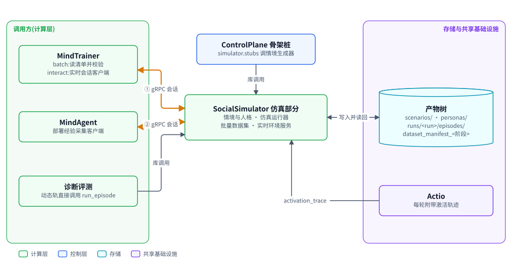
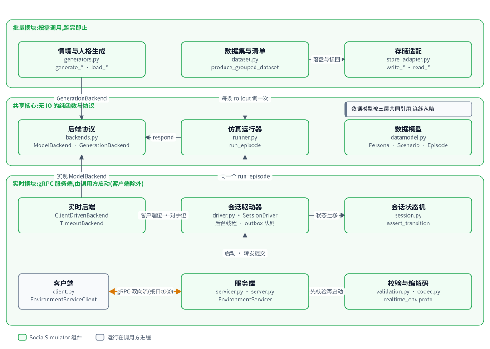
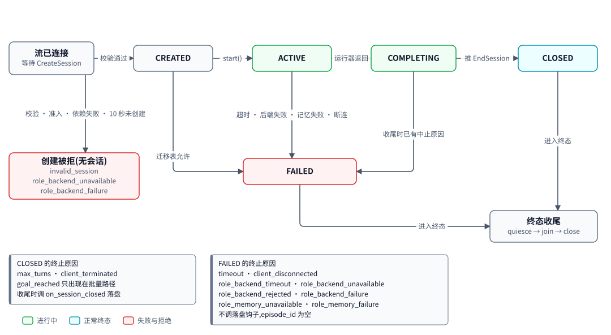
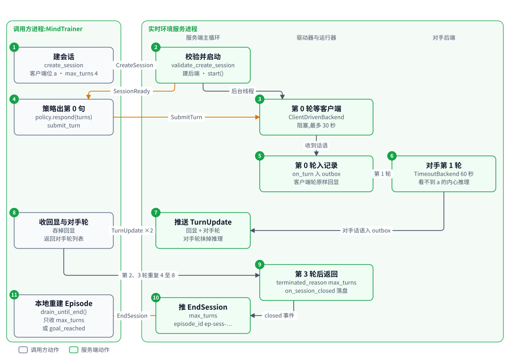

# SocialSimulator:情境仿真与实时环境服务

| 项 | 内容 |
|---|---|
| 一句话 | 生成情境与人格,驱动多角色多轮交互产出 Episode,批量产出带哈希清单的数据集,并以 gRPC 实时环境服务支撑交互式训练与部署经验采集 |
| 状态 | 部分落地:数据模型、运行器、批量数据集、实时环境服务、激活轨迹打通,以及场景二接通所需的 interact 情境与人格两路来源、对手位三种驱动、`Scenario` 的可选字段 `opponent_script` [已落地];外部强模型生成后端、按目标维度生成情境与人格、episode 分片存储 [推迟];外部 API 对手超时归 `role_backend_timeout`、非 200 按 4xx、429 与 5xx 与连不上、形状不对三类分流,分别归 `role_backend_rejected`、`role_backend_unavailable`、`role_backend_failure` [已落地];会话资源与会话身份(资源对象、逻辑 episode id、准入、有序收尾、两个记忆失败终止原因)[已落地];对手位的记忆在记忆世界里:部署会话开部署世界的端口,训练会话按逻辑 episode id 加入 rollout 世界,改动全在组合根的工厂里,模拟器代码不变 [已落地] |
| 所在层 | 计算层 |
| 代码位置 | `src/simulator`(诊断评测在 `src/diagnostic`,本文不展开) |
| 基线提交 | `b826440`(2026-10-21) |
| 依赖 | ControlPlane 的 `controlplane.envelope`、`controlplane.gitstore`、`controlplane.paths`;第三方 `grpcio`、`protobuf` |
| 被依赖 | MindTrainer(`mindtrainer`)、诊断评测(`diagnostic`)、ControlPlane 骨架桩(`controlplane.daemon`);已落地:SimpleActio、MindAgent、factory |
| 对应实施计划 | 工作包 6(任务 70 至 72)[已落地];其余已落地部分无待施工任务;场景二接通在本篇的范围是 `opponent_script` 与对手三驱动,已随 `--interact` 接通落地 [已落地];记忆按情境世界组织在本篇的范围是对手位端口从哪个世界开、何时关,改动落在组合根 [已落地];接 Starling 记忆服务在本篇没有代码改动,对手位端口改由组合根在共用的服务会话里开 [计划中] |

## 0. 系统速览

<!-- shared:begin context-block -->
**系统是什么。** Rise(Recursive Interactive Social mind Evolution)是一套"AI 驱动的社会心智后训练工厂":输入通用开源基础模型,输出社会心智能力显著增强的模型,代号 **ZenGen**。工厂自己决定每一轮练什么、怎么练。训练决策可以交给外部更强的闭源模型(经命令行调用),关键决策点设人工审核门,其余环节自动。

**七个子系统。** 六个能力子系统加一个协调层 ControlPlane。

| 子系统 | 职责 | 所在层 | 现状 |
|---|---|---|---|
| ControlPlane | 协调层:git 版本化产物树、状态机、调和循环、三个审核门 | 控制层 | [已落地] |
| SocialSimulator | 情境与人格生成、多智能体仿真、实时环境服务、诊断评测 | 计算层 | [已落地];诊断默认用 mock 后端,`--evaluator someval` 装配 vLLM 加 SoMEval 的真实运行器 [已落地],真机只验证到预测阶段 |
| MindTrainer | 权重级训练:BatchTrain(SFT 后接 GRPO 加 OPD)与 InteractTrain | 计算层 | [已落地],默认入口的训练执行器是 mock;ROLL LoRA SFT 真实执行器 [已落地],由 `--executor roll` 装配,已在真实主机上端到端跑通一次 |
| MindAgent | 部署态智能体的技能与记忆自进化,不改权重 | 计算层 | [已落地],闭环里经 `--enable agent` 装配;部署驱动用的仍是罐头后端,真实模型后端未接 |
| RecipeStore | 验证有效的训练配方的版本化仓库 | 控制层 | [已落地] |
| TrainScheduler | 决策执行器:装配上下文、校验决策、构造训练指令、提名配方 | 控制层 | [已落地],含策略经验(默认关) |
| TrainPlanner | 决策学习者:经可插拔后端给出下一轮训练决策 | 控制层 | [已落地],默认后端经桥接调用命令行模型 |

共享基础设施有五个。**SimpleActio** 是带技能库与显式记忆的智能体框架,每次响应附带激活轨迹;它是 Actio 的简化版,功能完备的正式版 Actio 完成后再接入 [计划中]。记忆由内嵌的 **Starling** 提供,可选 extra `memory`,一个模拟世界一个树外 SQLite 库,人格是其中的主体(部署一个情境一个世界,训练一条 rollout 一个世界)[已落地];改为经纯 Python 客户端 `starling_client` 连 Starling 记忆服务(缺省是本机已在跑的看板服务),世界、快照与分叉都按名字交给服务,rise 不再打开库文件 [计划中]。**外部推理桥接**用命令行调用外部强模型。**远端计算层** `compute` 经 SSH 在远端 GPU 主机上跑作业 [已落地]。**ROLL** 是分布式训练引擎,**vLLM** 是推理引擎。V1 经远端计算层接入 ROLL 的 LoRA SFT [已落地](由 `--executor roll` 装配,已在真实主机上从指令跑到候选一次)与 vLLM 推理服务 [已落地](命令拼装、SSH 隧道、服务生命周期;真机端到端待补)。已落地部分仍由确定性 mock 顶替。真实 GRPO 加 OPD 训练与真实 judge [推迟]。

**状态标记。** **[已落地]** 表示代码在主干上且有测试。**[计划中]** 表示设计与实施计划已定,代码还没写。**[推迟]** 表示明确不在 V1 范围内。图只画目标系统,不标进展,进展只看正文的状态标记。

**六条贯穿全系统的机制。**

| 机制 | 规则 |
|---|---|
| 产物树 | 所有协作数据是 git 树里的 YAML 产物,统一信封:`id`、`type`、`version`、`created_at`、`created_by`(含 `owner` 与 `visibility`)、`status`、`schema_version`、`links`、`payload`。checkpoint 等大体量内容只存引用 `{uri, sha256, size_bytes}`;V1 的数据集逐条 episode 进 git,只适合小规模 mock。git 树是唯一真相,读取时先经迁移器链再消费。 |
| 状态机 | 需审核类:`draft → pending_review → approved → effective`,之后可到 `deprecated` 或 `superseded`,`pending_review` 也可到 `rejected`,`approved` 只在门② 记忆收录一条都没提交成时到 `rejected`。非审核类:`pending → executed → consumed`,`pending` 也可到 `failed`。被拒绝与失败的产物保留;被拒绝的候选进入下一轮规划的输入,失败只留痕、等人处理。 |
| 调和循环 | 纯函数 `reconcile(树视图) → 动作列表`,守护进程按间隔轮询并执行动作。循环无状态、动作幂等,进程崩溃后从 git 树续接。子系统之间不直接调用,只读写产物。 |
| 审核门 | 三道人工门:① checkpoint 晋级,② 技能与记忆增量纳入,③ 配方入库。证据不在场就不能批准:门①要诊断报告,门②要验证结果,门③要可复现性校验报告。门②与门③ [已落地]。 |
| 受限直连 | 两处高频实时调用绕过 ControlPlane:① MindTrainer 与 SocialSimulator 之间的 InteractTrain rollout,② MindAgent 与 SocialSimulator 之间的部署经验采集。两处都走 gRPC 双向流,发生在计算层内部。是否开会话仍由 ControlPlane 决策。 |
| 失败分类 | T1 瞬态:有限次指数退避重试,耗尽升为 T3。T2 确定性:不重放,按所属子系统的校验链处理,LLM 的随机输出可有限次重采样。T3 需人工:写失败记录,不自动重跑。失败是数据,不是异常。 |

**核心术语。**

| 术语 | 含义 |
|---|---|
| Run | 一轮迭代,对应产物树里的 `runs/run-<编号>/` 目录,该轮所有产物都挂在其下 |
| Directive(训练指令) | TrainScheduler 或人写入的 `directive.yaml`,调和循环据此下发训练 |
| Candidate(候选 checkpoint) | MindTrainer 产出的 `candidate_checkpoint.yaml`,经诊断评测与门①才能晋级 |
| ZenGen 版本 | 晋级后写入 `models/zengen-v<N>.yaml`;下一轮训练的基座取最新的 effective 版本 |
| Episode | 一次多轮交互的完整记录:情境、角色分配、逐轮话语、终止原因 |
| Scenario、Persona、RoleAssignment | 社会情境、人格模板,以及把角色位绑定到具体人格与模型后端的分配 |
| Recipe(配方) | 验证有效的完整训练方案,分 batch、interact、agent_rsi 三类 |
| DiagnosticReport | 诊断评测产出的报告:维度、分数、置信区间、错误类型、退化标记 |
| Activation trace(激活轨迹) | SimpleActio 每次响应附带的记录:命中的技能候选、选中的技能、命中的记忆 |
| Evidence grade(证据等级) | 诊断报告的可信等级 `stub`、`mock`、`real`,决定它能否驱动规划与提名;缺标记一律判 `stub`,失败关闭 |
<!-- shared:end context-block -->

## 1. 定位

SocialSimulator 的仿真部分是工厂的"社会情境发生器":它把情境、人格与模型后端组合成一次多轮交互,产出可复现、可审计的 Episode。

它解决三件事。其一,训练需要大量多角色对话数据,且要能精确复现。其二,InteractTrain 要求被训模型与对手实时多轮对话,不能经 git 提交中转。其三,诊断评测的动态轨与部署经验采集要复用同一套交互语义。三件事共用一个纯函数运行器 `run_episode`,差别只在外层包装。

<!-- figure:begin 20-socialsimulator-context -->


**图 1　SocialSimulator 仿真部分的上下文**　仿真部分居中。MindTrainer 经清单读批量数据集,经接口①跑实时会话;诊断评测与 ControlPlane 骨架桩以库调用复用它;它把情境、人格、Episode 与清单写进产物树。MindAgent 经接口②连入会话,SimpleActio 的激活轨迹随每轮回传。

<details>
<summary>文字版:图中的节点与连线</summary>

**节点**

- MindTrainer:batch:读清单并校验 / interact:实时会话客户端
- MindAgent:部署经验采集客户端
- 诊断评测:动态轨直接调用 run_episode
- SocialSimulator 仿真部分:情境与人格 · 仿真运行器 / 批量数据集 · 实时环境服务
- ControlPlane 骨架桩:simulator.stubs 调情境生成器
- 产物树:scenarios/ · personas/ / runs/<run>/episodes/ / dataset_manifest_<阶段>
- SimpleActio:每轮附带激活轨迹

**连线**

- MindTrainer ↔ SocialSimulator 仿真部分:① gRPC 会话
- MindAgent ↔ SocialSimulator 仿真部分:② gRPC 会话
- 诊断评测 → SocialSimulator 仿真部分:库调用
- ControlPlane 骨架桩 → SocialSimulator 仿真部分:库调用
- SocialSimulator 仿真部分 ↔ 产物树:写入并读回
- SimpleActio → SocialSimulator 仿真部分:activation_trace

</details>
<!-- figure:end 20-socialsimulator-context -->

读图说明。MindTrainer 在 batch 模式下读数据集清单并逐条校验,在 interact 模式下经接口①作为客户端跑实时会话。诊断评测的动态轨与 ControlPlane 骨架桩以库调用复用它。它把情境、人格、Episode 与清单写进产物树。MindAgent 的接口② [已落地],SimpleActio 的激活轨迹 [已落地]。

## 2. 目标、非目标与约束

结论:V1 的目标是"交互语义唯一、数据可复现、实时会话失败可分类";按目标维度定制数据与外部生成后端不在 V1。

| 编号 | 目标 | 验收方式 |
|---|---|---|
| G1 | 情境与人格解耦,经角色分配组合 | `RoleAssignment` 只引用 slot 与 persona id;`tests/test_sim_datamodel.py` |
| G2 | 调用方为每个角色位显式指定模型后端 | `RoleBinding.model_backend` 必填,运行器不写死后端 |
| G3 | 批量与实时共用同一运行器 | 驱动器在后台线程调用 `run_episode`;`tests/test_realtime_runner_on_turn.py` |
| G4 | 数据集可精确复现 | 清单按 sha256 锚定每条 episode;`tests/test_sim_dataset.py` |
| G5 | 每一轮完成后立即推送,不攒批 | `TurnUpdate` 在 `on_turn` 回调后入队即发 |
| G6 | 失败可分类,半截会话不落盘 | 终止原因十一种,加两种记忆失败原因共十三种 [已落地];FAILED 不调落盘钩子;落盘失败另报 `persistence_failed` |
| G7 | 会话之间不共享可变状态 | 工厂每会话返回新后端;`tests/test_realtime_servicer_e2e.py`。记忆世界例外:部署世界跨会话共享,rollout 世界与客户端共享,都由组合根管 [已落地] |
| G8 | 会话资源有身份并有序关闭 [已落地] | 每条会话一个资源对象;终态按 quiesce、join、close 收尾;回环集成测试覆盖正常、超时、断开三条路径 |
| G9 | 记忆失败有自己的终止原因 [已落地] | `role_memory_unavailable`(T1)与 `role_memory_failure`(T2)不并入 `role_backend_failure`;驱动器单元测试 |

| 项 | 状态 | V1 的处理 |
|---|---|---|
| 按目标维度定制情境与人格 | [推迟] | 模板池加种子取模,与目标维度无关 |
| 外部强模型生成后端 | [推迟] | 只有 `GenerationBackend` 协议与模板实现 |
| 激活轨迹随 `SubmitTurn` 上行 | [已落地] | 客户端 `submit_turn` 带 `activation_trace`;不带轨迹的后端仍是 None |
| 一个会话多个客户端驱动的角色位 | [推迟] | 每会话恰好一个 `client_driven_slot` |
| 断线续接 | [推迟] | 失败会话整条重跑,不续接 |
| episode 与清单分片存储 | [推迟] | V1 每条 episode 一个文件一次提交;接真实训练之前改成分片文件加引用 |
| 鉴权与 TLS | [推迟] | 服务端只绑 `127.0.0.1`,不加密不鉴权 |
| 数据生产器自身做评测集隔离 | [推迟] | 模板生产器不调用隔离校验器。桥接生产器接入之前,训练数据上传前已经有最后一道:执行器把整份 `train.jsonl` 交给组合根注入的污染准入检查,对照 SoMBench 的 20 字滑窗哈希索引,命中即整条指令失败(见 MindTrainer 的 MT-15)。生产器自己再查一遍能更早失败、能给出更细的原因,但不是必需 |
| 开发者交互调试接口 | [推迟] | 人工经命令行直接发起交互会话、实时观察模型表现,不是流水线一环,V1 没有 |
| 多样性防护与按用途调难度分布 | [推迟] | 模板池加种子取模,不做聚类惩罚、多样性奖励,也不因情境用途调难度 |
| interact 的情境与人格来源:点名或按种子生成,两路不混用 | [已落地] | 点名路由 `interact` 段的 `scenario_ids` 与 `persona_ids` 给出,生成路由 `data_spec` 在派发时生成;默认训练配置没有 `interact` 段,此时 `new` 仍写不出 interact 指令 |
| 对手位三种驱动:固定对话、站内 vLLM、外部 OpenAI 兼容 API | [已落地] | 默认驱动按 `model_backend` 取(`frozen_reference` 走站内 vLLM,`external_api` 走外部 API),固定对话只在角色位写 `driver: scripted` 时用;模拟器内部仍只认 `ModelBackend` 协议,驱动由组合根选 |
| 对手 `model_ref` 的哈希锚定 | [推迟] | `model_ref` 只是名字,不锚定它指向的权重;同名引用换了权重,`config_hash` 不变 |
| 在场者共享感知;跨情境共享一个人格的记忆 | [推迟] | 每个实例只把他人的发言写在自己主体名下;同一人格在两个情境里是两个世界的两个主体 |
| 对手位接 Starling 记忆服务 | [计划中] | 组合根在同一个服务会话里给对手位开句柄;模拟器代码不变,仍不导入 `simple_actio`、`starling` 与 `starling_client` |

| 约束 | 内容 | 影响 |
|---|---|---|
| 纯函数核心 | `run_episode` 不做 IO,同输入同输出 | 批量重跑写出逐字节相同的文件 |
| 信息隔离 | 后端只看到自己角色位的内心推理与激活轨迹 | 对手无法偷看被训模型的独白 |
| 只经产物树持久化 | 情境、人格、Episode、清单都是信封产物 | 实时服务落盘要靠调用方注入钩子 |
| 实时资源边界 | 默认值见下表 | 单个异常客户端拖不垮服务进程 |
| 本机回环 | `create_server` 只绑 `127.0.0.1` 的明文端口 | 跨机部署前必须补鉴权与 TLS |
| 逻辑 episode_id 白名单与活动唯一 [已落地] | `CreateSession.episode_id` 只许 `[A-Za-z0-9._-]`、1 到 128 字节、不是 `.` 或 `..`,不合以 `invalid_session` 拒绝;同 id 已有活动会话以 `role_backend_unavailable`(T1)拒绝 | 客户端给的 id 会进目录名与事件主键:无白名单会穿越目录,不唯一会让两个会话写同一个 id |

| 实时服务默认值 | 数值 | 来源 |
|---|---|---|
| 单会话最多轮次 `max_turns_cap` | 200 | `EnvironmentServicer.__init__` |
| 等待 `CreateSession` | 10 秒 | `create_timeout_s` |
| 等客户端提交一轮 | 30 秒 | `turn_timeout_s` |
| 服务端后端单次调用 | 默认 60 秒;`--interact` 下组合根经 `AgentRuntime(backend_timeout_s=)` 传 90 秒(`factory.wire.INTERACT_BACKEND_TIMEOUT_S`),含记忆的一轮对手发言最坏 80 秒,低于它;部署路不传,保持 60 秒 [已落地] | `backend_timeout_s` |
| 客户端提交一轮的上限 | 服务端默认 30 秒;组合根给 `AgentRuntime` 默认传 5 秒,`--interact` 下传 150 秒,否则真模型一轮就超时 [已落地] | `turn_timeout_s` |
| 客户端等相邻两条服务端消息的间隔 | 客户端默认不设限;`--interact` 下组合根传 120 秒,整条流按 `max_turns × 150` 兜底 [已落地] | 客户端 `message_timeout_s`,由 `_next_msg` 执行 |
| 并发会话上限 | 16 | `max_workers`,与 `maximum_concurrent_rpcs` 对齐;活动会话加滞留会话不得超过它 [已落地] |
| 终态收尾等在途线程退出 | 60 秒,`--interact` 下也不跟着后端上限放宽:两个客户端的准入退避预算 `ADMISSION_WAIT_S` 取 65 秒,以 join 加 5 秒为前提;等不到的在途线程进滞留表,由回收线程重试 [已落地];部署驱动器与训练客户端等世界端口全关的上限 70 秒(`SESSION_CLOSE_WAIT_S`)以它加 10 秒为前提 [已落地] | `resource_join_timeout_s`,传给 `join` 的 `timeout_s` |
| 滞留表重试间隔 | 60 秒 [已落地] | `linger_retry_s`,零等待 `join` 的重试周期 |
| keepalive 间隔与超时 | 30000 / 10000 毫秒 | `create_server` |

## 3. 架构

结论:三层组件,共享核心无 IO;批量模块按需调用、跑完即止;实时模块是由调用方启动的 gRPC 服务端。

<!-- figure:begin 20-socialsimulator-architecture -->


**图 2　SocialSimulator 仿真部分的组件**　三层组件。共享核心是数据模型、后端协议与纯函数运行器。批量模块按需运行,生成情境与人格、产出数据集与清单并落盘;实时模块是由调用方启动的 gRPC 服务端,驱动器在后台线程调用同一个运行器。客户端运行在调用方进程。

<details>
<summary>文字版:图中的节点与连线</summary>

**节点**

- 情境与人格生成:generators.py / generate_* · load_*
- 数据集与清单:dataset.py / produce_grouped_dataset
- 存储适配:store_adapter.py / write_* · read_*
- 后端协议:backends.py / ModelBackend · GenerationBackend
- 仿真运行器:runner.py / run_episode
- 数据模型:datamodel.py / Persona · Scenario · Episode
- 实时后端:ClientDrivenBackend / TimeoutBackend
- 会话驱动器:driver.py · SessionDriver / 后台线程 · outbox 队列
- 会话状态机:session.py / assert_transition
- 客户端:client.py / EnvironmentServiceClient
- 服务端:servicer.py · server.py / EnvironmentServicer
- 校验与编解码:validation.py · codec.py / realtime_env.proto

**连线**

- 情境与人格生成 → 后端协议:GenerationBackend
- 数据集与清单 → 仿真运行器:每条 rollout 调一次
- 数据集与清单 → 存储适配:落盘与读回
- 仿真运行器 → 后端协议:respond
- 会话驱动器 → 仿真运行器:同一个 run_episode
- 会话驱动器 → 实时后端:客户端位 · 对手位
- 会话驱动器 → 会话状态机:状态迁移
- 实时后端 → 后端协议:实现 ModelBackend
- 服务端 → 会话驱动器:启动 · 转发提交
- 服务端 → 校验与编解码:先校验再启动
- 客户端 ↔ 服务端:gRPC 双向流(接口①②)

</details>
<!-- figure:end 20-socialsimulator-architecture -->

读图说明。中间一层是共享核心:数据模型、后端协议与运行器。批量模块生成情境与人格,对每条 rollout 调一次运行器,经存储适配落盘。实时模块的会话驱动器在后台线程调用同一个 `run_episode`,客户端位用 `ClientDrivenBackend`,对手位用套了期限的服务端后端。客户端运行在调用方进程,经 gRPC 双向流与服务端通信,即受限直连的接口①与接口②。

| 模块 | 职责 | 依赖 | 行数 | 状态 |
|---|---|---|---|---|
| `src/simulator/datamodel.py` | `Persona`、`Scenario`、`RoleSlot`、`RoleBinding`、`RoleAssignment`、`TurnRecord`、`Episode` | 无 | 208 | [已落地] |
| `src/simulator/backends.py` | `ModelBackend`、`GenerationBackend` 协议;`ScriptedBackend`、`TemplateGenerationBackend` | datamodel | 102 | [已落地] |
| `src/simulator/runner.py` | `run_episode`,`RoleSlotMismatchError` | datamodel、backends | 99 | [已落地] |
| `src/simulator/generators.py` | `generate_*` 自动生成路,`load_*` 外部配置路 | backends | 29 | [已落地] |
| `src/simulator/store_adapter.py` | 情境、人格、Episode 的信封读写 | controlplane | 77 | [已落地] |
| `src/simulator/dataset.py` | 清单、摘要、分组键、`produce_grouped_dataset` | runner、store_adapter、controlplane | 197 | [已落地] |
| `src/simulator/stubs.py` | ControlPlane 骨架桩:情境池、候选、诊断占位 | generators、controlplane | 86 | [已落地] |
| `src/simulator/realtime/session.py` | 会话状态与迁移表 | 无 | 39 | [已落地] |
| `src/simulator/realtime/backend.py` | `ClientDrivenBackend`,`TurnTimeoutError` | datamodel | 62 | [已落地] |
| `src/simulator/realtime/backend_timeout.py` | `TimeoutBackend`,`RoleBackendTimeoutError`;`TimeoutBackend` 构造时收会话资源,每次调用在调用方线程里先登记进它、后端线程结束时移出;记忆失败的两个异常基类 RoleMemoryUnavailableError(T1)与 RoleMemoryFailureError(T2) | backends、resources | 58 | [已落地] |
| `src/simulator/realtime/resources.py` | 会话信息 SessionInfo、会话资源 SessionResources 与异常 SessionClosingError:资源持有未套期限的 `backends`、在途线程计数与收尾动作,提供 `quiesce`、`join`、`close` | backends | — | [已落地] |
| `src/simulator/realtime/driver.py` | `SessionDriver`:后台线程、outbox 队列、收尾分类,含两个记忆失败分支 | runner、session、两种实时后端、backend_timeout | 162 | [已落地] |
| `src/simulator/realtime/validation.py` | `validate_create_session` 纯函数校验;`validate_episode_id` 校验 `episode_id` 白名单 | datamodel | 52 | [已落地] |
| `src/simulator/realtime/codec.py` | 数据模型与 protobuf 互转 | proto | 84 | [已落地] |
| `src/simulator/realtime/servicer.py` | `EnvironmentServicer.Interact` 主循环;准入检查、给资源的后端套 `TimeoutBackend`、终态收尾、滞留表 | driver、validation、codec、resources | 339 | [已落地] |
| `src/simulator/realtime/server.py` | `create_server` 组装,不启动;`BackendsFactory` 收会话信息、返回会话资源 | servicer | 60 | [已落地] |
| `src/simulator/realtime/client.py` | `EnvironmentServiceClient` 同步客户端;构造参数 `message_timeout_s` 给 `_next_msg` 加相邻两条消息之间的等待上限,`create_session` 加可选 `episode_id` | codec、proto | 242 | [已落地] |
| `src/simulator/realtime/proto/realtime_env.proto` | 协议定义,生成物由 `scripts/gen_realtime_proto.sh` 产出并入库;`CreateSession` 带可选 `episode_id` | protobuf | 102 | [已落地] |

依赖方向规则。

| 规则 | 内容 |
|---|---|
| 可以导入 | `controlplane` 的 `envelope`、`gitstore`、`paths`;`grpc`、`google.protobuf` |
| 不得导入 | `mindtrainer`、`diagnostic`、`simple_actio`、`mindagent` 及任何闭环新包 |
| 核心无 IO | `datamodel`、`backends`、`runner`、`generators`、`validation`、`session` 不读写文件与网络 |
| 已知回指 | `controlplane.daemon` 导入 `simulator.stubs`,包级循环,运行时不成环,骨架桩移出前保留 |
| 对记忆世界保持不透明 [已落地] | 会话资源对它持有的每个智能体直接调可选 `close()`,只关本会话开的端口,不删世界:rollout 世界由客户端删,部署世界长期保留;模拟器不导入 `simple_actio` 与 `starling`,不认识世界与主体。接服务后客户端对 rollout 世界只关不删,模拟器一侧照旧只关端口 [计划中] |

对手位的三种驱动 [已落地]。对手位后端由调用方按角色位传入,模拟器本身只认 `ModelBackend` 协议。不传 `--interact` 时组合根的 `AgentRuntime._backends` 仍一律给全局罐头台词的 `ScriptedBackend`;传了 `--interact`,同一个函数对登记给训练 run 的会话按角色位在三种驱动里选,实现全在组合根,模拟器不新增依赖。默认驱动来自 `model_backend`:`frozen_reference` 走站内 vLLM,`external_api` 走外部 API;固定对话只在角色位写了 `driver: scripted` 时才用。部署会话(没登记给训练 run 的)不判绑定,沿用原来的罐头后端,显式写了 `driver: scripted` 的除外。

| 驱动 | 实现 | 来源 | 状态 |
|---|---|---|---|
| 固定对话(角色位写 `driver: scripted`) | `ScriptedBackend` | 情境自带的 `opponent_script` 优先;情境没带时用全局台词。`--interact` 下两样都没有时,派发时判 `failed`(T2),不让对手一直说“(无更多发言)” | [已落地] |
| `frozen_reference`(默认驱动 vllm) | 站内 vLLM,挂对手模型的 LoRA | `model_ref` 经树里的模型产物解析成 `checkpoint_ref` | [已落地] |
| `external_api`(默认驱动 external_api) | OpenAI 兼容 HTTP 客户端 | `training_defaults.yaml` 的 `opponent` 段:端点、模型名、存凭证的环境变量名 | [已落地] |

`model_ref` 在组合根里由 `resolve_model_ref` 解析成权重引用 [已落地]。解析不到,或指到的不是适配器导出,派发时确定性失败,不静默退回脚本台词。外部 API 客户端是一个极小的实现 [已落地],用标准库 `urllib`,与 `src/compute/tunnel.py` 的 HTTP 探测同一手法。凭证只从环境变量读,异常信息只报变量名。站内对手与训练位共用一个 vLLM 进程,最多挂两个 LoRA [已落地]。

对手位包成带记忆的智能体 [已落地]。工厂为每个对手位返回一个智能体实例,里面包着原来的驱动后端,不套期限。期限由服务端拿到资源后套上。模拟器只认 `ModelBackend`,不导入 `simple_actio`,也不知道里面有记忆。固定对话的台词与三种驱动的请求都不变。

记忆失败靠一层转换后端跨过包边界 [已落地]。组合根给每个 SimpleActio 实例外套一层转换后端,把 simple_actio 的记忆失败异常按 `transient` 标记改抛 RoleMemoryUnavailableError 或 RoleMemoryFailureError 的子类。这两个基类定义在 `backend_timeout.py`,驱动器只认它们,按它们分出两个终止原因,所以 simulator 与 mindtrainer 都不导入 simple_actio。转换后端只接 simple_actio 的记忆失败总基类一个类,它的子类也一并映射。

`ExternalApiBackend` 每个会话新造一个,不共享同一个实例 [已落地]。部署会话的对手位同样包成智能体 [已落地]。对手位的激活轨迹随落盘的 episode 保存,下行时照旧抹掉(不变量 3)。

对手位的记忆从记忆世界里开 [已落地]。世界是记忆的单位:替身里是一份账本,Starling 里今天是一个库,接服务后是服务里的一个具名世界 [计划中]。一个情境一个部署世界,一条 rollout 一个世界,人格是世界里的主体。端口绑定(世界,主体),召回只返回本主体名下的记忆。下表按会话类别列出对手位的记忆从哪来。

| 会话 | 怎么认出 | 对手位的记忆 | 会话资源收尾时 | 状态 |
|---|---|---|---|---|
| 训练会话 | 情境 id 在 `register_session` 的登记表里 | 按 `info.episode_id` 经 `TrainingWorlds.join_rollout` 加入客户端已建的 rollout 世界;表里没有这个世界则工厂抛异常。接服务后查表拿到世界名,在当前服务会话里开对手位句柄 [计划中] | 只关对手位端口,世界由客户端删(接服务后由客户端关) | [已落地] |
| 部署会话 | 情境 id 不在登记表里,按 episode id 在部署登记表里查到轮次 id | 经组合根传给 `AgentRuntime` 的可选 `deployment_store`,开这个情境部署世界里本人格的端口,跨会话积累。接服务后 `open` 先确保部署世界已建 [计划中] | 随 `SessionResources.close` 关端口 | [已落地] |
| 部署会话,查不到轮次 id | 绕过部署驱动器直接开会话 | 一份空 `TupleMemory`,记一条 warning | 关端口 | [已落地] |

部署对手位靠登记表拿到轮次 id [已落地]。`CreateSession.episode_id` 只许 `[A-Za-z0-9._-]`,装不下 `<round_id>/`。部署驱动器每次尝试开会话前经 `register_deployment_episode` 登记 episode id 到轮次 id,尝试结束在 `finally` 里经 `unregister_deployment_episode` 注销。工厂查到轮次 id,拼成 `<round_id>/<episode_id>` 作对手位实例的前缀。部署提交时按这个前缀放弃 pending 行,对手位留下的行一并放弃。

事件 key 带主体 [已落地]。SimpleActio 实例只写他人的发言,key 是 `<前缀>#<turn_index>@<主体>`,两个角色位时也加。角色位数没有上限,运行器按 `turn_index % n_roles` 轮流发言。三个及以上角色位时,同一世界的同一轮被两个主体各写一次,不带主体 key 会撞。

## 4. 数据模型与状态机

结论:情境与人格是独立实体,角色分配把它们与模型后端绑在一起;Episode 是唯一的交互产物,实时会话另有一台五状态的状态机。

| 实体 | 字段与含义 | 约束 |
|---|---|---|
| `Persona` | `id`、`traits`、`motivation`、`speech_style`、`values`、`source` | `source` 为 `auto` 或 `external` |
| `Scenario` | `id`、`background`、`role_slots`、`conflict`、`norms`、`purpose`、`source`;可选 `opponent_script` [已落地] | `purpose` 为 `training` 或 `deployment_simulation`;`opponent_script` 为空时不进序列化 [已落地] |
| `RoleSlot` | `slot_id`、`description` | 情境里的抽象角色位 |
| `RoleBinding` | `slot_id`、`persona_id`、`model_backend`、`model_ref` | `self_play` 不得带 `model_ref`;为 None 时不进序列化 |
| `RoleAssignment` | `scenario_id`、`bindings`、`max_turns` | `bindings` 的顺序就是发言轮转顺序;同一人格占两个角色位由训练配置与部署配置拒绝,模拟器本身不判 [已落地] |
| `TurnRecord` | `turn_index`、`speaker_slot`、`utterance`、`inner_thought`、`activation_trace` | 后两项可为 None |
| `Episode` | `id`、`scenario_id`、`role_assignment`、`turns`、`terminated_reason` | 一次交互的完整记录 |
| `DatasetManifest` | `id`、`run_id`、`name`、`episode_refs`、`manifest_hash` | `name` 匹配 `[a-z0-9_]+` |

`model_backend` 的取值是 `self_play`、`frozen_reference`、`external_api`。运行器不解释这个字段,真正的后端由调用方按 slot 传入。

`opponent_script` 可选字段 [已落地]。它给对手位一串固定台词,形如 `{b: ["台词一", "台词二"]}`,键是角色位。台词按序消耗,用完后从头循环。`ScriptedBackend` 默认用完台词后返回固定文本“(无更多发言)”(`src/simulator/backends.py`),不循环;循环由默认关闭的 `loop=True` 开启,只有 `AgentRuntime` 的固定对话驱动传它。

读写兼容:`to_dict` 只在字段非空时写这个键,`from_dict` 用 `d.get` 读;条件写入的先例是 `RoleBinding.model_ref`(`src/simulator/datamodel.py:98-100`),而 `source` 是无条件写入的,不属同类。旧产物读得出,既有情境的序列化与哈希不变。默认配置不写它,所以默认仍用全局台词。字段形状以 `Scenario.to_dict` 与 `Scenario.from_dict` 为准。

interact 的情境与人格来源 [已落地]。场景二的情境与人格有两路来源,一次配置只走一路,不混用。混用会产出无法追溯的混合语料。

| 来源 | 配置写法 | 情境与人格从哪来 | 约束 |
|---|---|---|---|
| 点名 | `scenario_ids` 加 `persona_ids`(按角色位给人格 id) | 产物树里已有的 | 情境 `purpose` 必须是 `training`,人格不限;两者必须成对,只写一半是配置错误;点名的 id 都要在树里 |
| 生成 | `data_spec`:`scenario_count`、`seed`、`purpose` | 生成器按种子生成,写进树 | `scenario_count` 个情境;每个角色位一个人格,所有情境共用 |

点名情境的 `purpose` 必须是 `training`。组合根装入的默认部署素材里,三个情境都是 `deployment_simulation`(`src/factory/defaults.py:50`),拿它们训练等于把部署素材混进训练数据。人格没有这条限制。

派发时回写。生成路的指令进派发器时,`training_config.scenario_ids` 为空。派发器用生成器生成并写入情境与人格,再把最终的情境 id 与带人格 id 的 `bindings` 回写进指令的 `training_config`,只在 `scenario_ids` 为空时写这一次。此后 `config_hash` 覆盖这些 id,续训与复现在**配置层面**按回写后的这一份;它不是轨迹层面的等价保证。点名路的指令本来就带 id,不回写。

| 产物类型 | 路径 | 状态机种类 | 写方 | 状态 |
|---|---|---|---|---|
| `persona` | `control-plane/personas/<id>.yaml` | 直接写 `effective`,不经审核门 | `write_persona` | [已落地] |
| `scenario` | `control-plane/scenarios/<id>.yaml` | 直接写 `effective`,不经审核门 | `write_scenario` | [已落地] |
| `episode` | `control-plane/runs/<run>/episodes/<id>.yaml` | 非审核类,写 `executed` | `write_episode` | [已落地] |
| `dataset_manifest` | `control-plane/runs/<run>/dataset_manifest_<阶段>.yaml` | 非审核类,写 `executed` | `write_manifest` | [已落地] |
| `scenario_pool` | `control-plane/runs/<run>/scenario_pool.yaml` | 非审核类,写 `executed` | 骨架桩 `execute_dispatch` | [已落地] |

清单放在 run 目录顶层,因为 `GitStore.list_products` 不递归,顶层文件才能被追溯命令扫到。一份清单的载荷如下,数值来自第 6 章批量走查的实跑。

```yaml
id: dsm-run-001-grpo_opd
run_id: run-001
name: grpo_opd
episode_refs:            # 按 id 排序
  - {id: run-001-grpo_opd-scen-auto-0-r0, sha256: <64 位十六进制>}
  - {id: run-001-grpo_opd-scen-auto-0-r1, sha256: <64 位十六进制>}
manifest_hash: <64 位十六进制>   # 对排序后的 episode_refs 规范化 JSON 取 sha256,随话语内容变
```

实时会话状态机定义在 `src/simulator/realtime/session.py`,迁移由驱动器执行。

<!-- figure:begin 20-socialsimulator-states -->


**图 3　实时会话状态机**　创建请求校验通过才建驱动器,随即进入 ACTIVE;校验、准入或依赖失败时不建会话,直接以 EndSession 拒绝。运行器返回后进入 COMPLETING 再到 CLOSED 并落盘;超时、后端失败、记忆失败、断连转入 FAILED,不落盘。CLOSED 与 FAILED 之后,服务端按 quiesce、join、close 的顺序收尾会话资源。

<details>
<summary>文字版:图中的节点与连线</summary>

**节点**

- 流已连接:等待 CreateSession
- CREATED
- ACTIVE
- COMPLETING
- CLOSED
- 创建被拒(无会话):invalid_session / role_backend_unavailable / role_backend_failure
- FAILED
- 终态收尾:quiesce → join → close

**连线**

- 流已连接 → CREATED:校验通过
- CREATED → ACTIVE:start()
- ACTIVE → COMPLETING:运行器返回
- COMPLETING → CLOSED:推 EndSession
- 流已连接 → 创建被拒(无会话):校验 · 准入 · 依赖失败 · 10 秒未创建
- CREATED → FAILED:迁移表允许
- ACTIVE → FAILED:超时 · 后端失败 · 记忆失败 · 断连
- COMPLETING → FAILED:收尾时已有中止原因
- CLOSED → 终态收尾:进入终态
- FAILED → 终态收尾:进入终态

</details>
<!-- figure:end 20-socialsimulator-states -->

读图说明。创建请求先校验,通过才建驱动器,随即从 CREATED 进入 ACTIVE。校验、准入或依赖失败时不建会话,直接以 `EndSession` 拒绝。运行器正常返回后经 COMPLETING 到 CLOSED 并落盘;超时、后端失败、记忆失败、断连转入 FAILED,不落盘。CLOSED 与 FAILED 之后,服务端按 quiesce、join、close 的顺序收尾会话资源 [已落地]。CREATED 到 FAILED 在迁移表里允许,但代码不走这条边。

终止原因共十三种,含两种记忆失败原因 [已落地]。

| 终止原因 | 去向 | 产生者 | 失败类 |
|---|---|---|---|
| `max_turns` | CLOSED | 运行器跑满轮次 | 正常 |
| `goal_reached` | 只出现在批量路径 | `stop_predicate` 返回真 | 正常 |
| `client_terminated` | CLOSED | 客户端发 `EndSession` | 正常 |
| `timeout` | FAILED | 客户端超时未提交:`--interact` 下服务端等 150 秒;或客户端等相邻两条服务端消息超过 120 秒,由客户端本地判定 | T1 |
| `role_backend_timeout` | FAILED | 服务端后端 60 秒未返回(`--interact` 下 90 秒) | T1 |
| `role_backend_unavailable` | FAILED;准入已满或逻辑 episode_id 撞上活动会话时创建被拒 | 对手 API 暂时不可用:408、425、429、5xx、连不上、连接中途断开;准入时活动加滞留会话数已达上限、同 `episode_id` 已有活动会话 | T1 [已落地] |
| `role_backend_rejected` | FAILED | 对手 API 明确拒绝:4xx,408、425、429 除外 | T2 [已落地] |
| `role_backend_failure` | FAILED 或创建被拒 | 后端抛其余异常(含对手 API 的回复形状不对;记忆异常已分出去 [已落地]),或工厂、解析器故障 | T1 或 T2,协议上不区分 |
| `role_memory_unavailable` | FAILED | 对手位后端抛出瞬态的记忆失败:调用超时、传输失败 | T1 [已落地] |
| `role_memory_failure` | FAILED | 对手位后端抛出确定性的记忆失败:瞬态以外的一切 | T2 [已落地] |
| `client_disconnected` | FAILED | 请求流结束而未发 `EndSession` | T1 |
| `persistence_failed` | CLOSED,但树里没有 episode | 运行器正常结束,落盘钩子抛异常 | T1 [已落地] |
| `invalid_session` | 创建被拒 | 校验失败(含 `episode_id` 格式不合白名单 [已落地])、协议违规、10 秒未创建 | T2 |

不变量。

1. Episode 只由已真实完成的轮次组成,唤醒哨兵不会被写成一轮。
2. 交给后端的 `history` 里,其他角色位的 `inner_thought` 与 `activation_trace` 为 None;自己角色位的轮次是深拷贝。
3. 下行给客户端的对手轮同样抹掉这两项;服务端落盘的 Episode 保留完整记录。
4. 同一条 gRPC 流只承载一次会话,`episode_id` 取 `CreateSession.episode_id`,没给时为 `ep-<session_id>` [已落地]。
5. FAILED 的会话不调用 `on_session_closed`,`EndSession.episode_id` 为空。
6. 中止原因以第一个为准,后续 `request_abort` 不覆盖。
7. 清单里每条 episode 的 sha256 与产物树里的内容一致,否则 `verify_manifest` 抛错,不静默跳过。
8. 外部配置路加载的情境与人格,`source` 一律被强制为 `external`。
9. 会话进入 CLOSED 或 FAILED 后,资源按 quiesce、join、close 收尾;join 超时的资源整个保留,不关不删 [已落地]。

## 5. 接口契约

结论:对内是三个库函数入口,对外是一个 gRPC 双向流;签名以代码为准,激活轨迹相关的字段与参数 [已落地];会话资源与会话身份带来的新签名 [已落地]。标 [计划中] 的签名来自设计,施工时可能微调。

库入口[已落地]:

```python
def run_episode(scenario, assignment, personas, backends, episode_id,
                stop_predicate=None, on_turn=None) -> Episode
def produce_grouped_dataset(store, run_id, name, *, scenarios, personas,
                            backends_for_rollout, group_size) -> DatasetManifest
def verify_manifest(store, manifest) -> list[Episode]
def read_manifest(store, run_id, name) -> DatasetManifest
def episode_group_id(episode) -> str        # 16 位十六进制
def episode_digest(episode) -> str          # sha256
class ModelBackend(Protocol):
    def respond(self, persona, scenario, history, speaker_slot) -> tuple[str, str | None]
```

实时服务入口[已落地]:

```python
def create_server(backends_factory, *, port=0, turn_timeout_s=30.0,
                  on_session_closed=None, max_workers=16, scenario_resolver=None,
                  max_turns_cap=200, create_timeout_s=10.0, backend_timeout_s=60.0,
                  keepalive_time_ms=30_000, keepalive_timeout_ms=10_000,
                  resource_join_timeout_s=60.0, linger_retry_s=60.0) -> grpc.Server
class EnvironmentServiceClient:
    def create_session(self, *, scenario_id, role_assignment, personas,
                       purpose, client_driven_slot) -> str
    def submit_turn(self, utterance, inner_thought=None, *,
                    activation_trace: dict | None = None) -> list[TurnRecord]
    def drain_until_end(self) -> Episode
    def end_session(self, reason="client_terminated") -> Episode
    def abort(self) -> None
```

会话资源与会话身份的新签名 [已落地]。工厂改为收会话信息、返回会话资源,落盘钩子多带 `session_id`,`create_server` 另加 `resource_join_timeout_s`、`linger_retry_s` 两个参数(滞留表的 join 等待与重试间隔,默认都是 60 秒),`max_workers` 透传给 servicer 算名额。

```python
BackendsFactory = Callable[[SessionInfo], SessionResources]
class SessionInfo: ...      # 字段:scenario、assignment、personas、client_slot、session_id、episode_id
class SessionResources:
    backends: dict[str, ModelBackend]            # 角色位 -> 未套期限的后端;期限由 servicer 套
    def quiesce(self) -> None: ...               # 拒绝新调用;之后的 respond 抛 SessionClosingError
    def join(self, timeout_s: float) -> bool: ...    # 等所有在途后端调用退出
    def close(self) -> None: ...                 # 对每个智能体直调可选 close(),删登记的目录
on_session_closed(session_id, episode)           # 落盘钩子的新参数
EnvironmentServiceClient.create_session(..., episode_id: str | None = None)
EnvironmentServiceClient(stub, *, message_timeout_s=None)   # 相邻两条服务端消息的最长间隔;None 不设限
```

SessionInfo、SessionResources、SessionClosingError 三个类型都放在 `src/simulator/realtime/resources.py` [已落地]。

协议 `Interact` 一条流一次会话,消息如下。

| 消息 | 方向 | 内容 |
|---|---|---|
| `CreateSession` | 客户端到服务端 | `scenario_id`、角色分配、人格映射、`purpose`、`client_driven_slot`、可选 `episode_id` [已落地] |
| `SessionReady` | 服务端到客户端 | `session_id`,会话已进入 ACTIVE |
| `SubmitTurn` | 客户端到服务端 | `utterance`、可选 `inner_thought`、可选 `activation_trace` |
| `TurnUpdate` | 服务端到客户端 | 一条 `TurnRecordProto`,含客户端自己轮的回显 |
| `EndSession` | 双向 | `reason`、`episode_id`、可选 `failure_detail` |

产物读写约定。

| 约定 | 内容 |
|---|---|
| 批量写序 | 先写全部 episode,最后写清单;清单在即代表数据集完整 |
| episode id | 批量为 `<run>-<阶段>-<情境 id>-r<k>`;实时取 `CreateSession.episode_id`,没给时为 `ep-sess-<12 位十六进制>` [已落地] |
| 逻辑 episode id | 由客户端定,同一条 rollout 的重试不变:训练是 `{run_id}-grpo{step}-{scenario_id}-r{k}`(同一情境在不同 GRPO step 反复出现,id 里带 step 才不撞),部署是 `deploy-{model}-{scenario}-{k}`。服务端落盘的 episode 用它当 id [已落地] |
| `episode_id` 校验 | 空串当作没给,服务端用 `ep-<session_id>` 命名;非空的只许 `[A-Za-z0-9._-]`,1 到 128 字节,不是 `.` 或 `..`,不合以 `invalid_session`(T2)拒绝。同 id 已有活动会话以 `role_backend_unavailable`(T1)拒绝:客户端 abort 后旧会话要等收尾,立刻重试会撞上它,这是暂时的。活动指从准入登记起,到 servicer 收尾完或移交滞留表为止 [已落地] |
| 实时落盘 | 服务端不自己写产物树,由调用方注入 `on_session_closed`,钩子须线程安全。新签名带 `session_id`,调用方据此而不是按情境 id 找会话归属 [已落地] |
| 钩子异常 | 只记日志,不中断流,客户端仍收到 `EndSession` |
| 情境来源 | 注入 `scenario_resolver` 时按 id 读完整情境;未注入时退回只有角色位的空情境 |

触发条件。批量模块没有自己的触发器,由调用方在需要时调用。实时会话由客户端建流触发,"是否启动该会话"由 ControlPlane 经训练指令决策。

| 邻居 | 本文依赖它什么 | 它依赖本文什么 | 状态 |
|---|---|---|---|
| ControlPlane | `Envelope`、`GitStore`、路径函数 | 骨架桩 `execute_dispatch`、`diagnostic_evaluator_stub` | [已落地] |
| MindTrainer | 无 | batch:`read_manifest`、`verify_manifest`、`episode_group_id`;interact:`EnvironmentServiceClient`、`ModelBackend` 协议 | [已落地] |
| 诊断评测 | 无 | 动态轨直接调 `run_episode` 并传 `stop_predicate` | [已落地] |
| MindTrainer 数据合成 | 无 | `produce_grouped_dataset`、`TemplateGenerationBackend`;生产器 `TemplateDataProducer` 属工作包 2 [已落地] | [已落地] |
| SimpleActio | 无 | 运行器接受后端返回三元组,`SubmitTurn` 携带轨迹,工作包 6 [已落地] | [已落地] |
| MindAgent | 无 | 接口②,复用客户端"客户端后说"能力,工作包 7 [已落地] | [已落地] |
| factory | 无 | 组合根调 `create_server` 并注入 `scenario_resolver`,工作包 9 [已落地] | [已落地] |
| factory 组合根(场景二接通) | 无 | `Scenario.opponent_script` 与 `ModelBackend` 协议:组合根据此按角色位选对手驱动 [已落地] | [已落地] |
| factory 组合根(会话资源) | 智能体的可选 `close()`:会话资源收尾时对它持有的每个智能体直接调用一次,不经 `TimeoutBackend` 转发,没有就跳过;工厂返回未套期限的会话资源,并保证自己抛异常时不留半开的库;工厂造资源时把 `session_id` 到 run id 的对应记进第二张登记表,终态删除,落盘只查它 | 新的工厂签名与 `on_session_closed` 带 `session_id`;组合根在取到仓库排他锁之后、起任何会话之前,只清扫记忆根目录下 `runs/` 的子项;`--interact` 装配给 `AgentRuntime` 传 `turn_timeout_s` 150 秒、`backend_timeout_s` 90 秒,并给每个 SimpleActio 实例外套记忆异常转换后端 | [已落地] |
| MindTrainer 与 MindAgent 的客户端(会话身份) | 无 | `create_session` 的可选 `episode_id`;客户端相邻两条消息之间的等待上限 120 秒,由 `--interact` 装配的运行时给客户端;`role_memory_unavailable` 进各自的瞬态集合,`role_memory_failure` 不进;创建被拒按终止原因查各自的瞬态集合,不再一律判不可重跑,所以准入满与 `episode_id` 撞上活动会话的两种 `role_backend_unavailable` 会按条重跑 | [已落地] |
| MindTrainer 派发器(场景二接通) | 无 | 生成器与 `write_scenario`、`write_persona`:生成路据此写入情境与人格,再回写指令 [已落地] | [已落地] |
| factory 组合根(记忆世界) [已落地] | 工厂造资源时按会话类别开世界端口:训练会话经 `TrainingWorlds.join_rollout` 按 `info.episode_id` 加入,部署会话经部署记忆管理面开情境世界里本人格的端口;closers 只关端口 | `SessionInfo.episode_id` 就是客户端给的逻辑 episode id;会话终态必走 `SessionResources.close`;收尾 join 上限 60 秒不放宽 | [已落地] |
| MindAgent 部署驱动器与训练客户端(记忆世界) [已落地] | 无 | 服务端在会话终态后关端口,最长是 join 的 60 秒;双方据此等世界端口全关,上限 70 秒(`SESSION_CLOSE_WAIT_S`),再恢复、开下一次尝试、提交或删世界 | [已落地] |

工作包 6 对本文接口的改动如下。

| 改动 | 内容 | 状态 |
|---|---|---|
| 协议 | `SubmitTurn` 增加 `optional google.protobuf.Struct activation_trace = 3` | [已落地] |
| 运行器 | 新增 `_unpack_reply`,后端可返回二元组或三元组,签名不变;长度不是 2 或 3 抛 `TypeError`,第三项必须是字典或空,写进记录的是深拷贝 | [已落地] |
| 实时后端与驱动器 | `submit` 与 `submit_turn` 增加 keyword-only 的 `activation_trace` | [已落地] |
| 客户端 | `submit_turn(utterance, inner_thought=None, *, activation_trace=None)` | [已落地] |
| 抹除规则 | 不变:对手的轨迹不进 `history`,不下行 | [已落地] |

## 6. 关键流程

结论:典型实时会话是 11 步,客户端每提交一轮,服务端在一次往返里推回回显与对手轮;批量流程是对每个情境连续跑 `group_size` 条 rollout。

<!-- figure:begin 20-socialsimulator-interact-flow -->


**图 4　一次 InteractTrain 会话的消息流程**　MindTrainer 的客户端建会话,服务端校验后启动驱动器。每一轮客户端提交话语,驱动器经运行器记一轮并立即推送,对手轮由服务端后端产生且抹掉内心推理。跑满 4 轮后服务端落盘 Episode 并推 EndSession,客户端在本地重建同一条 Episode。

<details>
<summary>文字版:图中的节点与连线</summary>

**节点**

- 建会话:create_session / 客户端位 a · max_turns 4
- 校验并启动:validate_create_session / 建后端 · start()
- 第 0 轮等客户端:ClientDrivenBackend / 阻塞,最多 30 秒
- 策略出第 0 句:policy.respond(turns) / submit_turn
- 第 0 轮入记录:on_turn 入 outbox / 客户端轮原样回显
- 对手第 1 轮:TimeoutBackend 60 秒 / 看不到 a 的内心推理
- 推送 TurnUpdate:回显 + 对手轮 / 对手轮抹掉推理
- 收回显与对手轮:吞掉回显 / 返回对手轮列表
- 第 3 轮后返回:terminated_reason max_turns / on_session_closed 落盘
- 推 EndSession:max_turns / episode_id ep-sess-…
- 本地重建 Episode:drain_until_end() / 只收 max_turns / 或 goal_reached

**连线**

- 建会话 → 校验并启动:CreateSession
- 校验并启动 → 第 0 轮等客户端:后台线程
- 校验并启动 → 策略出第 0 句:SessionReady
- 策略出第 0 句 → 第 0 轮等客户端:SubmitTurn
- 第 0 轮等客户端 → 第 0 轮入记录:收到话语
- 第 0 轮入记录 → 对手第 1 轮:第 1 轮
- 对手第 1 轮 → 推送 TurnUpdate:对手话语入 outbox
- 推送 TurnUpdate → 收回显与对手轮:TurnUpdate ×2
- 收回显与对手轮 → 第 3 轮后返回:第 2、3 轮重复 4 至 8
- 第 3 轮后返回 → 推 EndSession:closed 事件
- 推 EndSession → 本地重建 Episode:EndSession

</details>
<!-- figure:end 20-socialsimulator-interact-flow -->

读图说明。图中客户端占角色位 a,先说,对手位 b 由服务端后端驱动,`max_turns` 为 4。橙色线是跨进程的 gRPC 消息,其余是服务端进程内的调用。第 4 到 8 步是一个回合,第 2、3 轮重复一次。下表与图中编号一一对应。

| 步 | 动作 | 执行者 | 关键代码 |
|---|---|---|---|
| 1 | 发 `CreateSession`,指定客户端位与 `max_turns` | 客户端 | `EnvironmentServiceClient.create_session` |
| 2 | 结构校验,解析情境,调工厂建后端并套期限,启动驱动器 | 服务端主循环 | `validate_create_session`、`_handle_create` |
| 3 | 运行器第 0 轮轮到客户端位,阻塞等提交,最多 30 秒 | 驱动器 | `ClientDrivenBackend.respond` |
| 4 | 收到 `SessionReady` 后,策略据 `turns` 出第 0 句并提交 | 客户端 | `policy.respond`、`submit_turn` |
| 5 | 话语入记录,`on_turn` 把该轮放进 outbox | 驱动器 | `SessionDriver._on_turn` |
| 6 | 对手第 1 轮,单次调用最多 60 秒,`history` 里看不到 a 的内心推理 | 对手后端 | `TimeoutBackend.respond` |
| 7 | 抽干 outbox,推两条 `TurnUpdate`,对手轮抹掉推理 | 服务端主循环 | `_drain_ready_events` |
| 8 | 吞掉自己轮的回显并核对序号,返回对手轮列表 | 客户端 | `submit_turn` |
| 9 | 第 3 轮后运行器返回 `max_turns`,驱动器发 closed 事件,服务端调落盘钩子 | 驱动器、服务端 | `SessionDriver._run`、`on_session_closed` |
| 10 | 推 `EndSession`,带 `reason` 与 `episode_id` | 服务端主循环 | `_drain_ready_events` |
| 11 | 本地用逐轮记录重建 Episode;调用方只收 `max_turns` 与 `goal_reached` 的 episode | 客户端、MindTrainer | `drain_until_end`、`_ACCEPTED_REASONS` |

第 11 步的筛选在 `src/mindtrainer/trajectory_source.py` 里,`_ACCEPTED_REASONS` 为 `max_turns` 与 `goal_reached`。

第 10 步推完 `EndSession` 之后,流结束的 `finally` 按序对会话资源做 quiesce、join、close [已落地]。

失败与恢复路径。

| 场景 | 服务端行为 | 客户端看到 | 恢复 |
|---|---|---|---|
| 校验不过(含 `max_turns` 超过上限 200)、未知情境;`episode_id` 格式不合白名单 [已落地] | 不启动驱动器 | `SessionRejectedError`,`invalid_session` | 修输入,重试无益 |
| 准入时活动加滞留会话数已达上限 [已落地] | 不调工厂,不启动驱动器 | `SessionRejectedError`,`role_backend_unavailable` | 客户端先在同一次尝试里退避重建(总等待 65 秒,不计入重跑次数),仍被拒再按条整条重跑,有上限;滞留不解除则重跑用尽后上抛 |
| 同 `episode_id` 已有活动会话 [已落地] | 不调工厂,不启动驱动器 | `SessionRejectedError`,`role_backend_unavailable` | 客户端同样先退避重建;旧会话收尾完后重建成功 |
| 同一条流上第二次 `CreateSession` | 已在跑的第一个会话判 FAILED、不落盘,整条流以 `invalid_session` 结束 | 原始协议客户端收到 `invalid_session`;库客户端一条流只发一次创建,碰不到这种情况 | 一次会话用一条新流 |
| 创建前就提交或结束会话,或连上后 10 秒内没有 `CreateSession` | 不启动驱动器,以 `invalid_session` 结束 | 原始协议客户端收到 `invalid_session`;库客户端的 `submit_turn` 在创建前调用是用法错误,不保证给出 `SessionRejectedError` | 先创建,再提交 |
| 工厂或解析器抛非 `LookupError` 异常 | 不启动驱动器 | `SessionRejectedError`,`role_backend_failure` | 调用方决定是否重试 |
| 客户端超时未提交(`--interact` 下服务端等 150 秒) | FAILED,不落盘 | `EndSession(timeout)` | MindTrainer 整条重跑,有上限 |
| 对手后端 60 秒未返回(`--interact` 下 90 秒) | FAILED,底层线程跑完后结果丢弃;线程登记在会话资源里,终态收尾等它退出,等不到则资源滞留 [已落地] | `EndSession(role_backend_timeout)` | 整条重跑,有上限 |
| 对手位后端抛出瞬态的记忆失败 [已落地] | FAILED,不落盘 | `EndSession(role_memory_unavailable)` | 整条重跑,有上限;用尽后抛 `RolloutFailedError` |
| 对手位后端抛出确定性的记忆失败 [已落地] | FAILED,不落盘 | `EndSession(role_memory_failure)` | 不重跑,抛 `RolloutFailedError`;MindTrainer 把指令判 `failed`,不进延后通道 |
| 客户端相邻两条服务端消息的间隔超过 120 秒(`--interact`) [已落地] | 客户端 abort 后,服务端按断连判 FAILED | 客户端自判 `timeout` | 整条重跑,有上限 |
| 对手 API 回 408、425、429、5xx,或连不上、连接中途断开 | FAILED | `EndSession(role_backend_unavailable)` | 整条重跑,有上限;用尽后抛 `RolloutFailedError` |
| 对手 API 回其余 4xx | FAILED | `EndSession(role_backend_rejected)` | 不重跑,抛 `RolloutFailedError`;MindTrainer 把训练记录写 `failed` |
| 对手后端抛其余异常(含回复形状不对) | FAILED | `EndSession(role_backend_failure)` | MindTrainer 不重试,抛 `RolloutFailedError` |
| 客户端断连或 `abort()` | `request_abort`,FAILED | 无 | 不落盘;半截 episode 不污染数据 |
| 策略自身抛异常 | 同断连 | 异常原样上抛 | 客户端先 `abort()`,不发 `EndSession` |
| 落盘钩子抛异常 | 记日志,推 `EndSession(persistence_failed)`,不给 `episode_id`,`failure_detail` 只写异常类名(异常文字可能带远端地址或凭证,留在服务端日志里) | 不是正常收尾,MindTrainer 与 MindAgent 都按瞬态失败整条重跑,不收下这条 episode | 有上限的重跑;重跑都失败时上抛,排查落盘 [已落地] |

interact 会话前的准备 [已落地]。下表是派发器与组合根在起会话之前做的事,会话本身仍是上面的 11 步。

| 步 | 动作 | 执行者 | 失败时 |
|---|---|---|---|
| 1 | 读指令的 `training_config`:`scenario_ids` 非空走点名路,为空走生成路 | 派发器 | 无 |
| 2 | 生成路按 `data_spec` 的种子生成情境与人格并写进树;点名路的情境与人格已在树里 | 派发器、生成器 | 生成失败判 T2,指令 `failed`,不留半套 |
| 3 | 生成路把情境 id 与带人格 id 的 `bindings` 回写进指令 | 派发器 | 回写失败判 T1,指令仍 `pending`,重跑内容相同不提交 |
| 4 | 每个角色位选后端:被训位交给客户端,对手位按驱动选 | 组合根的 `AgentRuntime._backends` | `model_ref` 解析不到判 T2,指令 `failed` |
| 5 | 起会话 | MindTrainer 的客户端 | 同上面的失败与恢复路径 |

走查例子一:一次实时会话。数值来自在仓库里用 `create_server`、`ScriptedBackend` 与模板生成器实跑。

| 项 | 数值 |
|---|---|
| 情境 | `scen-auto-0`,背景"两位同事就项目方向产生分歧",冲突"资源有限下的方案取舍" |
| 角色分配 | `role_a`:`pers-auto-0`、`self_play`;`role_b`:`pers-auto-1`、`frozen_reference`、`zengen-v1`;`max_turns` 为 4 |
| 客户端位 | `role_a`,先说,`opening_turns` 为空 |
| 第 0 轮 | 客户端提交"先听听你的想法",内心推理"我想先摸底" |
| 第 1 轮 | 对手罐头话语"我不同意",`submit_turn` 返回这一条,推理为 None |
| 第 2 轮 | 客户端提交"我们看数据" |
| 第 3 轮 | 对手"那就各退一步";返回后 `closed` 已为真 |
| 结果 | `ep-sess-<12 位十六进制>`,`max_turns`,4 轮 |
| 服务端落盘的推理 | `["我想先摸底", None, None, None]`,保留客户端自己的推理 |

批量流程不经实时服务,由 `produce_grouped_dataset` 一次做完:

| 步 | 做什么 | 失败时 |
|---|---|---|
| 1 | 校验 `group_size` 不小于 1、情境列表非空 | 抛 `ValueError`,不写任何东西 |
| 2 | 对每个情境连续跑 `group_size` 条 rollout,每条用 `backends_for_rollout(情境, k)` 给出的后端;episode id 是 `<run>-<阶段>-<情境>-r<k>` | 某条 rollout 抛异常:前面已跑完的 episode 留在树里,没有清单 |
| 3 | 每条 episode 跑完立即写进 run 目录的 `episodes/` | 同上 |
| 4 | 全部写完后组清单:`episode_refs` 按 id 排序,算 `manifest_hash`,最后写清单 | 清单缺失即这一阶段没完成;重跑同一 run 与阶段时 episode id 相同,原地覆盖,内容相同则不提交 |

清单最后写,是"这一阶段已完成"的唯一标记:消费方只认清单,不扫 `episodes/` 目录,所以半截的 episode 不会被当成数据集。

走查例子二:一份分组数据集。同一情境与角色分配,`group_size` 为 2,两条 rollout 的话语不同(批量路径没有客户端位,两个角色位都由 `backends_for_rollout` 给的后端驱动)。

| 项 | 数值 |
|---|---|
| 调用 | `produce_grouped_dataset(store, "run-001", "grpo_opd", group_size=2, …)` |
| episode | `run-001-grpo_opd-scen-auto-0-r0`、`run-001-grpo_opd-scen-auto-0-r1`,各 4 轮,`max_turns` |
| 分组键 | 两条都是 `3967e55968f712c1` |
| 清单 | `dsm-run-001-grpo_opd`;`manifest_hash` 取决于两条 episode 的全部话语,本例不给具体值 |
| run 目录 | `dataset_manifest_grpo_opd.yaml`、`episodes/` |
| 校验 | `verify_manifest` 按清单顺序返回两条 episode |

### 会话资源的生命周期 [已落地]

结论:每条会话一个会话资源 SessionResources,由工厂造、servicer 持有;终态时先停调用、再等线程、再关库、再删文件。

资源对象把后端、在途线程与要清理的目录收在一起。模拟器只调它的三个方法 quiesce、join、close,不认识里面装的是什么。下表是它从准入到清扫的八个阶段。

| 阶段 | 动作 | 执行者 | 失败时 |
|---|---|---|---|
| 1 准入 [已落地] | 在服务端的一把锁里做完三件事:检查活动数加滞留数小于 `max_workers`,检查 `episode_id` 没有活动会话,登记会话。之后才调工厂 | servicer | 名额满或 `episode_id` 有活动会话:`role_backend_unavailable`(T1) |
| 2 造资源 [已落地] | 工厂按会话信息造全部后端并返回资源,在锁外跑 | 工厂 | 工厂抛异常:在同一把锁里撤销登记,以 `role_backend_failure` 拒绝。工厂保证不留半开的库:先建全部再返回,中途失败先关已开的 |
| 3 启动 [已落地] | servicer 用资源给每个后端套 `TimeoutBackend`,期限取 `backend_timeout_s`,再把套好的字典交给驱动器,自己持有资源到流结束。驱动器只调后端,不持有资源 | servicer | 工厂返回之后、驱动器启动之前的任何失败(缺后端、`start` 抛),由 servicer 在 `Interact` 的 `finally` 里对资源做 quiesce、join、close;校验在调工厂之前,失败时不造资源 |
| 4 运行 [已落地] | `TimeoutBackend` 在调用方线程里先登记(quiesce 之后直接抛 SessionClosingError,不起线程),daemon 线程退出时再移出。超时只是调用方放弃等待,线程仍在集合里 | TimeoutBackend | 集合的操作持一把锁;join 不持锁等待 |
| 5 终态收尾 [已落地] | 驱动器进入 CLOSED 或 FAILED(含断开)后,流结束的 `finally` 按序调 quiesce、join(超时 60 秒)、close | servicer | quiesce 之后的 `respond` 抛 SessionClosingError |
| 6 join 超时 [已落地] | 不 close、不删。资源移交滞留表,继续占一个会话名额;滞留数可由 servicer 的 lingering_count() 读,每分钟一行日志 | servicer | 准入检查把滞留数算进名额 |
| 7 滞留重试 [已落地] | 滞留表每 60 秒对每个资源做一次零等待的 join,成功后 close,关掉本会话的端口 | servicer | 关端口失败记日志 |
| 8 清扫 [已落地] | 取到仓库排他锁之后、起任何会话之前,删掉记忆根目录下 `runs/` 的每个子项(其中符号链接只删链接本身),不碰 `deploy/`、`seeds/`、`snapshots/`。此时本进程没有会话。别的进程被仓库锁挡在外面。记忆根目录只属于这个仓库,所以不会误删在途世界。运行中不扫目录:rollout 世界由客户端在服务端端口关完后删 | 组合根 | 无 |

滞留表由 servicer 持有,所以回环服务端不经组合根就能测准入与滞留。资源对象对记忆保持不透明:close 只对每个后端调一次可选的 `close`,没有就跳过。

阶段 5 到 8 对记忆世界的含义如下,模拟器的动作与上表相同 [已落地]。

| 阶段 | 对记忆世界做什么 | 失败时 | 状态 |
|---|---|---|---|
| 5 终态收尾 | closers 只关本会话的世界端口,不删世界;rollout 世界由客户端删,部署世界长期保留 | 无 | [已落地] |
| 6 join 超时 | 资源滞留,端口一直开着;外面等端口全关的一方等满 70 秒(`SESSION_CLOSE_WAIT_S`)后放弃 | 部署恢复判 `RestoreFailedError`;部署下一次尝试判瞬态;训练客户端把世界留进保留表,同名重试先有界等待(默认 70 秒)端口关上,仍没关上才判瞬态;文件留给同名重试或启动清扫 | [已落地] |
| 7 滞留重试 | join 成功后关端口,世界的打开端口数随之归零 | 无 | [已落地] |
| 8 清扫 | 仍只删 `runs/` 的子项,rollout 世界 `runs/<run>/<episode>.db` 一并删掉;记忆根是旧布局时装配期拒绝启动,退出码 2,不迁移 | 无 | [已落地] |

并发上界。每条会话最多 `len(bindings) - 1` 个在途后端线程,加驱动器线程与泄流线程各一个。滞留的资源也占会话名额,所以进程里的线程总数不超过 `max_workers × (len(bindings) + 1)`。代价是挂死的后端一直占名额:滞留数达到 `max_workers` 时拒绝所有新会话,由人重启进程。Python 的 daemon 线程杀不掉,这是能给出的最强保证。

时间预算。外层的上限高于内层一轮的最坏耗时,外层不先于内层超时。

| 预算 | 改前 | 改后 | 为什么够用 |
|---|---|---|---|
| 客户端等相邻两条服务端消息的间隔(`_next_msg`) | 无,只有整条流的 deadline | 120 秒(`--interact` 装配传入;客户端默认不设限),整条流按 `max_turns × 150` 兜底 [已落地] | 每条对手发言是一条消息,间隔以单个对手轮为界:对手一轮上限 90 秒,加推送往返仍低于 120 秒 |
| 服务端后端单次调用 | 60 秒 | `--interact` 下 90 秒(`INTERACT_BACKEND_TIMEOUT_S`);默认与部署路仍 60 秒 [已落地] | 对手一轮最坏 80 秒:HTTP 60 秒加记忆最坏 20 秒,低于 90 秒 |
| 对手 HTTP | 25 秒 | 60 秒 [已落地] | 低于服务端的 90 秒,线程在服务端放弃之前自己结束 |
| 记忆单次网络调用 | 无 | 4 秒,不重试 [已落地] | 一轮五次:召回嵌入查询词一次,写入抽取三次,嵌入一批;最坏合计 20 秒 |
| 训练位策略 HTTP | 60 秒 | 120 秒 [已落地] | 训练位一轮最坏 140 秒:HTTP 120 秒加记忆最坏 20 秒,低于服务端等提交的 150 秒 |
| 终态等在途线程的 `join` | 无 | 60 秒,`--interact` 下也不改 [已落地] | 等不到就滞留,收尾不会无限阻塞;滞留重试间隔同为 60 秒。不随后端上限放宽:准入退避预算 `ADMISSION_WAIT_S` 65 秒以 join 加 5 秒为前提,被放弃的对手调用跑满 80 秒时它的线程进滞留表,由回收线程收走。滞留只占名额、不占 episode id(同 id 判重只看活动表),所以同 id 的重跑不被它挡住 |
| 部署驱动器与训练客户端等世界端口全关 | 无 | 70 秒(`SESSION_CLOSE_WAIT_S`)[已落地] | 服务端收尾 join 上限 60 秒,关端口在 join 之后,留 10 秒余量;join 等不到的资源滞留,70 秒也等不到,按等待方的失败路径处理 |
| 服务端等客户端提交一轮(`turn_timeout_s`) | 90 秒(`--interact`) | 150 秒 [已落地] | 训练位一轮最坏 140 秒,低于 150 秒 |

2026-11-02 这组 `--interact` 值整体放宽过一次(改前:训练位 60 秒、对手 25 秒、后端 60 秒、等提交与相邻消息都是 90 秒)。真机在 161 上用 eager、两个适配器、关思考跑场景二,8 条 episode 每轮 20 到 65 秒,最慢的贴着训练位 60 秒的上限,没有余量。可选的还有在 system 里限发言长度(会改训练数据的分布)与开图优化(两个适配器时 vLLM 起不来),选了放宽。代价:会话更慢时也照样等,卡死的会话发现得更晚、占名额更久。

记忆最坏值按调用次数算。一次写入顺序发三次抽取。语义召回要嵌入一次查询词。所以一轮五次网络调用,每次 4 秒。

服务端等提交的 150 秒与客户端等相邻消息的 120 秒方向相反,互不嵌套。服务端等的是客户端的一次提交。客户端等的是相邻两条服务端消息之间的间隔,每条对手发言都是一条消息,所以一轮里有几个对手都不叠加。

客户端限时的做法。收消息的 `_next_msg` 在接收线程里用带超时的队列取消息,计的是相邻两条服务端消息之间的间隔。超时视作 `timeout`(T1,按条重跑)并 abort 会话(客户端本地合成 `EndSession(reason="timeout")`,由既有收尾处理;不抛异常,否则会被分类成不可重跑的 `client_protocol_error`)。

## 7. 关键决策

结论:核心决策都服务于"同一套交互语义、可复现的数据、可分类的失败"。

| 编号 | 决策 | 备选 | 理由 | 判错的代价 |
|---|---|---|---|---|
| SS-1 | 批量与实时共用纯函数 `run_episode`,差别只在外层 | 实时服务自写轮次循环 | 交互语义只有一份,诊断、训练、部署行为一致 | 实时侧要靠线程与队列把阻塞后端接进纯函数,驱动器复杂 |
| SS-2 | 情境与人格解耦,经 `RoleAssignment` 组合 | 人格写进情境 | 同一情境可换人格与对手做对照 | 组合数大,需调用方自己挑组合 |
| SS-3 | 调用方为每个角色位指定后端,内部不写死 | 按 `model_backend` 字符串在内部建后端 | 运行器不感知模型,测试可全用罐头后端 | 调用方漏传某 slot 的后端时 `KeyError`;实时侧在启动前拦下 |
| SS-4 | 后端只看到自己角色位的内心推理与激活轨迹 | 共享完整历史 | 否则对手偷看被训模型独白,学到的是作弊条件下的策略 | 需要"知己知彼"的场景必须另设字段 |
| SS-5 | 清单由生产方产出,按 sha256 锚定每条 episode | 只记 episode id | 配方要精确复现数据集;篡改、丢失都能发现 | 改一个字就要重建清单 |
| SS-6 | 分组键含 `model_ref`,不含 `max_turns` | 只按情境分组 | 换了对手模型就不是同一上下文,组内基线不可比;`max_turns` 是预算 | 同情境不同对手被拆成多组,组数变多 |
| SS-7 | 一条流一次会话,校验通过直接 ACTIVE | 一条流多会话;创建后再确认 | 状态简单,延迟低 | 每次 rollout 新建一条流 |
| SS-8 | 客户端输入错误判 `invalid_session`,服务端依赖故障判 `role_backend_failure` | 统一判 `invalid_session` | 让调用方区分"重试无益"与"可能瞬态" | `role_backend_failure` 同时覆盖后端确定性异常,调用方只能保守不重试。记忆异常拆给 `role_memory_unavailable` 与 `role_memory_failure`,准入满另报 `role_backend_unavailable`,不再混进这一桶 [已落地] |
| SS-9 | FAILED 不落盘;`abort()` 不发 `EndSession` | 半截会话也落盘并标原因 | 半截 episode 进训练数据会污染梯度 | 失败会话的对话内容只在客户端内存里,事后不能复盘 |
| SS-10 | `EndSession` 只带 episode 引用,客户端用逐轮记录重建 | 协议内联整条 Episode | 不重复传输;逐轮推送本已给全 | 客户端重建与服务端落盘若分歧,需对照两边 |
| SS-11 | 服务端后端调用套 `TimeoutBackend`,每次一个 daemon 线程 | 线程池;不设期限 | 挂死的对手不拖住会话;daemon 线程不阻止进程退出 | 超时后底层调用继续占资源直到自然结束。线程登记进会话资源,终态等它退出;等不到就让资源滞留并占一个名额,不关端口 [已落地] |
| SS-12 | 外部配置路强制 `source="external"` | 信任输入里的标记 | 来源可追溯,不被外部数据冒充 | 无法从外部导入标为 `auto` 的定义 |
| SS-13 | V1 保持每条 episode 一个产物文件、一次提交,清单逐条锚定 sha256;分片文件加引用推迟到接真实训练之前 [推迟] | 现在就分片 | 小规模 mock 下逐条足够;分片要同时改清单格式、读取与校验 | 万条级数据集写入要数小时,仓库膨胀 |
| SS-14 | interact 的情境与人格走两路来源:配置点名树里已有的,或按种子生成;一次配置只走一路,不混用 [已落地] | 允许点名一部分、生成其余 | 混用会产出无法追溯的混合语料 | 使用者要多写几行配置 |
| SS-15 | 点名的情境 `purpose` 必须是 `training`,人格不限 [已落地] | 不限 `purpose` | 默认部署素材的情境是 `deployment_simulation`,拿它们训练等于污染训练数据 | 部署素材不能顺手拿来训练 |
| SS-16 | 对手位三种驱动:固定对话(角色位写 `driver: scripted`)、站内 vLLM、外部 OpenAI 兼容 API;驱动由组合根选,模拟器只认 `ModelBackend` [已落地] | 只做一种驱动 | 场景二要求三种都支持;驱动在组合根里选,模拟器协议不用改 | 三种驱动的失败分类与超时口径各要成立 |
| SS-17 | 固定对话优先用情境自带的 `opponent_script`,情境没带时用全局台词;`Scenario` 加一个可选字段 [已落地] | 只有全局台词 | 固定对话要能按情境区分对手说什么 | `Scenario` 多一个可选字段;旧产物读回不变 |
| SS-18 | 后端工厂改收 SessionInfo、返回 SessionResources;`ModelBackend` 协议不加方法 [已落地] | 给协议加会话参数;工厂签名不动 | SimpleActio 实例本来就满足 `respond`;会话身份是服务端本来缺的,原先工厂拿不到 session id,落盘登记表只能按情境 id 索引 | 工厂签名改一次,`AgentRuntime` 与测试跟着改 |
| SS-19 | 每条会话一个 SessionResources,持有该会话全部对手位的后端;终态按 quiesce、join、close 收尾;join 超时的资源整个保留,占住一个会话名额,不关不删 [已落地] | 终态直接关库删目录;超时后强关 | 超时线程还在跑时关库或删库会写坏文件;daemon 线程杀不掉 | 挂死的后端永久占用会话名额,直到进程重启 |
| SS-20 | 准入检查、会话登记、滞留计数在同一把锁里完成;工厂在锁外跑,失败时在同一把锁里撤销登记;`episode_id` 过白名单,同一时刻只许一个活动会话用它 [已落地] | 检查与登记分开加锁;信任客户端给的 id | 不在一把锁里,并发 `CreateSession` 会突破上限;客户端给的 id 会进目录名与主键 | 多一把锁 |
| SS-21 | 记忆失败拆成 `role_memory_unavailable`(T1,按条重跑)与 `role_memory_failure`(T2,不重跑);驱动器只认两个异常基类并按它们分支,基类定义在 `backend_timeout.py`;组合根的转换后端接 simple_actio 的记忆失败总基类,子类一并映射,按 `transient` 改抛继承这两个基类的异常 [已落地] | 并入 `role_backend_failure` | 并入后会被译成延后反复重试;记忆端点的网络抖动不该升人工;模拟器不导入 `simple_actio`,只认异常基类 | 瞬态与确定性的映射由后端侧维护,新的瞬态类别出现前按 T2 处理 |
| SS-22 | 对手位的记忆库是会话私有副本,路径含 `session_id`;每个库同一时刻只有一个写者:驱动器一个线程,每个角色位至多一次在途调用 | 同一人格的对手位共用一个库 | 两个会话或两个位同时写一个库,互相覆盖;个体隔离靠文件,不靠过滤 | 同一人格在两个位同时出现时开两份副本,磁盘多占;已由 SS-29 取代 |
| SS-23 | 进程里的后端线程总数以会话名额约束:不超过 `max_workers × (len(bindings) + 1)`;滞留资源占名额,滞留数达到 `max_workers` 时拒绝所有新会话,日志每分钟报一次滞留数 [已落地] | 滞留不占名额;强杀线程 | Python 的 daemon 线程杀不掉,名额是能给出的最强上界 | 挂死的后端一直占名额,由人重启进程 |
| SS-24 | `--interact` 的时间预算逐层递增:客户端等相邻两条消息 120 秒、服务端等客户端提交 150 秒(两者方向相反、互不嵌套)、服务端后端 90 秒、对手 HTTP 60 秒、记忆单次网络调用 4 秒、训练位策略 HTTP 120 秒;收尾 join 仍 60 秒 [已落地] | 客户端只有整条流的 deadline;保持 2026-11-02 之前的 90/90/60/25/60;在 system 里限发言长度 | 真机(eager、两个适配器)每轮 20 到 65 秒,原先训练位 60 秒的上限没有余量;放宽后训练位一轮最坏 140 秒低于 150 秒,对手一轮最坏 80 秒低于 90 秒。限发言长度会改训练数据的分布。没有相邻消息限时,服务端失联时客户端只能等整条流 deadline | 慢的真模型一轮若超时,判 T1 按条重跑,训练变慢;卡死的会话要多等才被发现,占名额更久 |
| SS-25 | 逻辑 episode id 由客户端经 `CreateSession.episode_id` 传入,服务端落盘的 episode 用它当 id,没给时仍是 `ep-<session_id>`;落盘归属按 `session_id` 查,不按情境 id [已落地] | 沿用服务端生成的 id;按情境 id 路由落盘 | 重试会换 `session_id`,而下游需要一个跨重试不变的身份;情境被注销时仍在跑的会话要能落到自己的 run | 客户端要自己保证 id 合法且唯一,服务端靠白名单与活动唯一兜底 |
| SS-26 | 同一逻辑 episode_id 撞上活动会话判 `role_backend_unavailable`(T1),格式不合白名单才判 `invalid_session`(T2)。活动从准入登记起,到 servicer 收尾完或移交滞留表为止 [已落地] | 撞上也判 `invalid_session` | 客户端 abort 后旧会话要等泄流线程与在途调用退出才进终态,立刻重试必撞上它,这是暂时的;判 T2 会让按条重跑的重试直接失败 | 客户端要把这条 T1 加进瞬态集合,否则不会重跑 |
| SS-27 | `TimeoutBackend` 由 servicer 用会话资源套,工厂返回的后端未套期限;`close` 由资源对它持有的每个智能体直接调,不经包装层转发 [已落地] | 工厂返回时已套期限;`TimeoutBackend` 转发 `close` | 现状 `servicer.py` 就在服务端套;在途线程登记在资源里,套的人必须拿着资源;包装层转发 `close` 会让收尾依赖包装层的实现 | 工厂的测试看不到期限;资源要持有未套的智能体引用 |
| SS-28 | 启动清扫只删记忆根目录下 `runs/` 的子项,在取到仓库排他锁之后、起任何会话之前,由组合根做;模拟器不做 [已落地] | 清空整个记忆根目录;由 servicer 在构造时清 | `deploy/`、`seeds/`、`snapshots/` 存着不可再生的记忆;模拟器对记忆保持不透明 | 清扫的位置由组合根保证,漏调则崩溃遗留的世界只占磁盘;rollout 世界也在 `runs/` 下,规则相同 |
| SS-29 | 对手位的记忆是世界里本人格的端口:部署会话开情境部署世界的端口,跨会话积累;训练会话加入客户端建的 rollout 世界。同一世界多个主体,召回只返回本主体名下的记忆 | 部署会话每会话一份空记忆;训练对手位每位一份会话私有副本 | 同一情境里的人在同一个世界里,才能表达在场与共识;对手位的人格也应记得以前的相遇 | 部署对手的行为随部署次数漂移,轮次之间比较行为多一个变量;验证重放按存档回放对手的话,不受影响 |
| SS-30 | 部署对手位的轮次 id 靠 `AgentRuntime` 里按 episode id 的部署登记表拿到,查不到时用空记忆并记 warning | 放宽 `CreateSession.episode_id` 白名单允许 `/`;提交时只匹配 `<eid>#` 前缀 | 白名单拼进落盘路径,不能放宽;只匹配 `<eid>#` 会误伤下一轮同名的 episode | `AgentRuntime` 多维护一张登记表;绕过部署驱动器开的会话没有部署记忆 |
| SS-31 | 事件 key 是 `<前缀>#<turn_index>@<主体>`,角色位数不论多少都加 | key 不变,按主体分事件表;只在三个及以上角色位时加 | 运行器按 `turn_index % n_roles` 轮转,位数无上限;三位时同一轮被两个主体各写一次,替身当成幂等重写吞掉第二条,Starling 主键冲突 | 历史轨迹与旧库的 key 格式不同;旧数据不迁移 |
| SS-32 | 服务端收尾的 join 上限仍是 60 秒;部署驱动器与训练客户端在恢复、下一次尝试、提交、删世界之前,等这个世界的端口全关,上限 70 秒(`SESSION_CLOSE_WAIT_S`) | 不等,直接恢复或删;放宽 join | 服务端关端口在另一个线程里,晚于客户端看到 `EndSession`;端口开着时恢复或删世界会退掉或删掉正在写的库 | 每条部署尝试与 rollout 收尾可能多等;滞留的资源让等待方超时,部署恢复判 `RestoreFailedError`,训练重试判瞬态 |
| SS-33 | 训练对手位按 `info.episode_id` 查进程内的表加入 rollout 世界,查不到就让工厂抛异常、会话被拒;世界由客户端建、删 | 服务端建世界;各位各开一份 | 客户端先知道 episode id,且策略上下文包住整条 rollout;两端在同一进程,一张表够用 | 模拟器搬到 GPU 主机后,这张表要换成按名字找世界 |
| SS-34 | 接记忆服务后,对手位与训练位在同一个服务会话里开句柄,表逻辑不变:服务端仍按 episode id 查表拿世界名 [计划中] | 对手位另开一个会话 | 服务按会话算写占用,另一个会话开可写句柄会被拒;同一个会话可以在一个世界里开多个句柄 | 服务会话过期时两位的调用都失败,当前尝试重跑 |
| R12 | 打通激活轨迹:`SubmitTurn` 加可选字段,运行器接受三元组 [已落地] | 轨迹走单独通道 | 原设计未记录别的理由,施工计划表现为改动最小、既有二元组后端不改 | 改协议,要重新生成并入库 pb2 文件 |
| R14 | 指令带 `data_spec`,派发器缺清单时调注入的生产器,生产器复用 `produce_grouped_dataset` [已落地] | 数据集只能预先生产 | 闭环能自己补数据 | V1 模板生成与目标维度无关,只证明流程跑通 |

## 8. 失败处理与可观测

结论:每个失败点都带 T1、T2、T3 标签;实时侧的失败只以终止原因留痕,批量侧的失败以异常上抛,由调用方写失败记录。

| 失败点 | 类 | 处理 | 留痕产物 |
|---|---|---|---|
| 角色分配引用不存在的 slot,或 bindings 为空 | T2 | `RoleSlotMismatchError` | 无,调用方记录 |
| binding 引用缺失人格 | T2 | 批量侧 `KeyError`;实时侧 `invalid_session` | 无 |
| 清单名非法、空、重复 id | T2 | `ValueError` | 无 |
| 清单哈希不符、episode 被改或丢失 | T2 | `DatasetIntegrityError` | MindTrainer 把指令判 failed |
| `group_size` 小于 1 或情境为空 | T2 | `ValueError` | 无 |
| 创建请求校验失败、协议违规 | T2 | `EndSession(invalid_session)` | `failure_detail` 写明原因 |
| 工厂或解析器故障 | T1 或 T2,协议上不区分 | `EndSession(role_backend_failure)` | 服务端日志 `logger.exception` |
| 客户端提交超时、对手后端超时 | T1 | FAILED | `EndSession` 的 `reason` |
| 对手后端抛其余异常 | T1 或 T2,协议上不区分 | FAILED | `EndSession(role_backend_failure)` |
| 客户端断连 | T1 | FAILED,不落盘 | 无 |
| 对手位后端抛出瞬态的记忆失败 [已落地] | T1 | FAILED,不落盘 | `EndSession(role_memory_unavailable)` |
| 对手位后端抛出确定性的记忆失败 [已落地] | T2 | FAILED,不落盘;客户端不重跑 | `EndSession(role_memory_failure)` |
| 准入时活动加滞留会话数达上限 [已落地] | T1 | 不调工厂,以 `role_backend_unavailable` 拒绝 | 日志每分钟报一次滞留数 |
| `episode_id` 格式不合白名单 [已落地] | T2 | 以 `invalid_session` 拒绝 | `failure_detail` 写明原因 |
| 同 `episode_id` 已有活动会话 [已落地] | T1 | 不调工厂,以 `role_backend_unavailable` 拒绝 | 客户端的失败尝试记录 |
| 终态 `join` 超时 [已落地] | 不分类 | 资源进滞留表,不关不删,占一个会话名额 | 滞留数每分钟一行日志;每 60 秒重试一次零等待的 `join` |
| 会话关端口失败 [已落地] | 不分类 | 记日志,继续收尾 | 服务端日志;rollout 世界留在保留表,下次 `run` 或 `reconcile` 启动时清扫。接服务后没有本地文件可扫,世界留在服务里 [计划中] |
| 客户端相邻两条服务端消息的间隔超过 120 秒(`--interact`) [已落地] | T1 | 客户端判 `timeout` 并 abort,服务端按断连判 FAILED | 客户端的失败尝试记录 |
| 第 N+1 个并发会话 | T1 | gRPC `RESOURCE_EXHAUSTED` | 客户端看到传输错误 |
| T1 重试耗尽 | 仍是 T1 | MindTrainer 抛 `RolloutFailedError`,训练记录与指令保持 `pending` | 无失败记录;下一次派发续训,续训次数耗尽后才升级为 T3 |
| 点名的情境 `purpose` 不是 `training`;点名的情境或人格不在树里;点名只写了一半 [已落地] | 配置错误 | 组合根装配期退出码 2,不进派发 | 无产物,启动即退出 |
| 训练会话按 `episode_id` 找不到 rollout 世界 [已落地] | 延后,续训上限用完升 T3 | 工厂抛异常,以 `role_backend_failure` 拒绝;轨迹源不重跑,组合根把它译成延后,指令留 `pending` | 服务端日志 |
| 部署会话按 episode id 查不到轮次 id [已落地] | 不分类 | 对手位用空 `TupleMemory`,会话照常跑 | 服务端一条 warning |
| 训练重试撞上仍被服务端端口占着的 rollout 世界 [已落地] | T1 | 拒绝重建,抛瞬态的 `FactoryMemoryUnavailableError`,记为 `role_memory_unavailable` 再重跑;用尽后走延后通道,指令保持 `pending` | 客户端的失败尝试记录 |
| 部署驱动器等世界端口全关超过 70 秒 [已落地] | 恢复时 T3;开下一次尝试或提交时延后(`DeferredError`) | 恢复时抛 `RestoreFailedError`,库与快照保留;其余情形轮次留 `pending`,重入时先恢复快照 | 轮次失败或延后记录 |
| 一个情境的绑定里同一人格占两个角色位 [已落地] | 配置错误 | 训练配置判 T2;部署配置装配期退出码 2;派发器合成的绑定判 T2 | 失败记录或启动即退出 |
| 记忆根是旧布局 [已落地] | 配置错误 | 装配期抛 `FactoryConfigError`,退出码 2,文字列出可疑条目,提示移回配置或移出记忆根;不迁移 | 一行 `factory: error: ...` |
| 对手 `model_ref` 解析不到,或不是适配器导出 [已落地] | T2 | 指令 `failed`,不退回脚本台词 | 失败原因点名这条引用 |
| 生成路合成情境或人格失败 [已落地] | T2 | 指令 `failed`,不留半套情境与人格 | 失败记录 |
| 回写 `training_config` 失败 [已落地] | T1 | 上抛,指令仍 `pending`;重跑内容相同不提交 | 无 |
| 外部 API 对手单次调用超时 [已落地] | T1 | `post_chat` 的两处超时分支抛 `OpponentTimeoutError`(`src/factory/opponents.py`),它同时是 `OpponentApiError` 与 `RoleBackendTimeoutError`;驱动在通用异常之前先接后者,归 `role_backend_timeout`,轨迹源按 `max_retries_per_episode` 整条重跑,有上限。站内 vLLM 对手与外部 API 共用 `post_chat`,一并归到这里。训练位策略超时时它仍是 `OpponentApiError`,策略上下文照旧译成延后 | `EndSession` 的 `reason` |
| 外部 API 对手返回 4xx(408、425、429 除外),如 400、401、403、404 [已落地] | T2 | `post_chat` 抛 `OpponentRejectedError`(`src/factory/opponents.py`),它同时是 `OpponentApiError` 与 `RoleBackendRejectedError`;驱动在通用异常之前先接后者,归 `role_backend_rejected`。轨迹源不重跑(它不在瞬态集合里),抛 `RolloutFailedError`;编排器把训练记录写 `failed`(category T2),策略上下文原样放行,派发器把指令判 `failed`(T2),不进延后通道。部署同样不重跑。训练位策略自己撞上时它仍是 `OpponentApiError`,策略上下文译成延后:训练位是本 run 自己起的 vLLM,4xx 多半是服务配置坏了,但这和起服务的瞬态失败区分不开,先按延后处理 | `EndSession(role_backend_rejected)` |
| 外部 API 对手返回 408、425、429 或 5xx,连不上(非超时),连接中途断开 [已落地] | T1 | `post_chat` 抛 `OpponentUnavailableError`,它同时是 `OpponentApiError` 与 `RoleBackendUnavailableError`;驱动先接后者,归 `role_backend_unavailable`,轨迹源按 `max_retries_per_episode` 整条重跑,有上限(与超时同路)。重跑用尽后抛 `RolloutFailedError`,策略上下文译成 `RolloutDeferredError`,指令保持 `pending` 按退避重试;续训次数到 `max_resume_attempts` 后升 T3 | `EndSession(role_backend_unavailable)` |
| 外部 API 对手的回复不是约定的形状:非 JSON、缺字段、超长,或 3xx、204 之类读不懂的状态码 [已落地] | T1 或 T2,协议上不区分 | `post_chat` 抛普通的 `OpponentApiError`,归 `role_backend_failure`;轨迹源不按条重跑(`role_backend_failure` 不在它的瞬态集合里),抛 `RolloutFailedError`,策略上下文译成 `RolloutDeferredError`,指令保持 `pending` 按退避重试;续训次数到 `max_resume_attempts` 后升 T3 | `EndSession(role_backend_failure)` |
| 外部 API 对手缺凭证 [已落地] | 配置错误,装配期 | 不进会话:factory 的 `--interact` 装配期解析凭证,缺则退出码 2,异常只报环境变量名 | 一行 `factory: error: ...` |

只读观测手段。

| 手段 | 能看到什么 |
|---|---|
| `controlplane.observe.trace` | run 目录顶层产物,含数据集清单 |
| 读 `episodes/` 下的 yaml | 完整轮次,含双方内心推理 |
| `read_manifest` 后 `verify_manifest` | 数据集是否完整、未被篡改 |
| 服务端日志 | 工厂、解析器、落盘钩子的异常栈;滞留资源数每分钟一行 [已落地] |
| MindTrainer 的 `failed_attempts` | 每次失败会话的原因与次数 |

## 9. 测试策略

结论:294 个用例全部在本机跑,不需要 GPU、真实模型或外网;实时测试起真实的回环 gRPC 服务端。

| 层次 | 对象 | 替身 |
|---|---|---|
| 单元 | 数据模型往返、生成器、运行器、状态机、校验、编解码 | `ScriptedBackend`、`TemplateGenerationBackend` |
| 组件 | 驱动器收尾分类、两种实时后端、清单校验 | 罐头后端、慢后端、抛异常后端 |
| 回环集成 | 服务端与客户端全流程、资源边界、断连、落盘钩子 | 端口 0 的本机服务端,临时 git 仓库 |
| 跨包 | 骨架桩、MindTrainer interact 轨迹源 | 同上 |
| 单元 | `Scenario.opponent_script` 的读写兼容、按序消耗与循环 [已落地] | 无 |
| 单元 | 点名与生成两路来源:互斥、成对、`purpose` 校验、生成后回写、重跑逐字节相同 [已落地] | 临时仓库 |
| 单元 | SessionResources:quiesce 后 `respond` 抛 SessionClosingError;join 等到超时线程退出;close 删目录;join 超时则进滞留表、目录仍在、名额被占(测试里的 closer 是假的,生产 closer 只关端口)[已落地] | 阻塞的假后端 |
| 单元 | 驱动器的两个记忆失败分支:瞬态异常归 `role_memory_unavailable`,确定性异常归 `role_memory_failure`,都不落盘 [已落地] | 抛异常的假后端 |
| 单元 | 客户端相邻两条消息的间隔超时译成 `timeout` 并 abort [已落地] | 不回消息的假服务端 |
| 单元 | `episode_id` 白名单:非法字符、过长、`.` 与 `..` 都被拒 [已落地] | 无 |
| 回环集成 | 服务端会话终态的三条路径(正常、超时、断开)都走 quiesce、join、close,副本目录被删(测试里的 closer 是假的,生产 closer 只关端口)[已落地] | 端口 0 的本机服务端,可解除阻塞的假后端 |
| 回环集成 | 准入在一把锁里:并发 `CreateSession` 不突破上限;同一 `episode_id` 的第二个会话被拒为 `role_backend_unavailable`;滞留数达上限时被拒为 `role_backend_unavailable`,滞留线程退出后名额释放 [已落地] | 端口 0 的本机服务端,可解除阻塞的假后端 |
| 回环集成 | 落盘钩子带 `session_id`,情境被注销后仍在跑的会话落到自己的 run [已落地] | 端口 0 的本机服务端 |
| 回环集成 | 三类对手驱动各一条;外部 API 客户端的成功、超时、4xx、429 与 5xx 与连不上、形状不对、缺凭证只报变量名;真实服务端对着慢桩收尾为 `role_backend_timeout`、对着 404 桩收尾为 `role_backend_rejected`、对着 429 与 5xx 桩及关着的端口收尾为 `role_backend_unavailable`、对着坏回复桩收尾为 `role_backend_failure` [已落地] | 端口 0 的本机服务端,本地 HTTP 替身 |

按世界组织的测试 [已落地]。用例落在 SimpleActio、MindAgent 与组合根的测试文件里,模拟器的测试文件不变。

| 层次 | 对象 | 替身 |
|---|---|---|
| 组件 | 部署对手位写进情境世界、记在自己人格名下;某次尝试失败后两个主体的写入都回滚;对手位的 pending 行在提交时被放弃 [已落地] | 替身部署世界,登记轮次 id 的假会话工厂 |
| 回环集成 | 真实服务端上跑一轮部署,对手位按驱动器登记的轮次 id 写进情境世界,key 以 `@<对手人格>` 结尾 [已落地] | 进程内 loopback 服务端,替身部署世界 |
| 单元 | 三个角色位的同一轮被两个主体各写一次,两条记忆都在,key 不撞 [已落地] | 替身世界 |
| 组件 | 训练会话按 episode id 加入 rollout 世界,对手位写进训练位所在的世界;服务端找不到世界时造后端失败;客户端在会话关完之后才删世界 [已落地] | 替身与 Starling 两个训练世界实现 |

| 测试文件 | 用例数 | 状态 |
|---|---|---|
| `tests/test_simple_actio_instance.py` | 81 | [已落地] |
| `tests/test_ma_deployment.py` | 79 | [已落地] |
| `tests/test_factory_handlers.py` | 93 | [已落地] |
| `tests/test_factory_training_worlds.py` | 55 | [已落地] |

| 测试文件 | 用例数 | 状态 |
|---|---|---|
| `tests/test_sim_datamodel.py` | 12 | [已落地] |
| `tests/test_sim_backends.py` | 8 | [已落地] |
| `tests/test_sim_generators.py` | 5 | [已落地] |
| `tests/test_sim_runner.py` | 6 | [已落地] |
| `tests/test_runner_stop_predicate.py` | 4 | [已落地] |
| `tests/test_sim_store_adapter.py` | 5 | [已落地] |
| `tests/test_sim_paths.py` | 5 | [已落地] |
| `tests/test_sim_dataset.py` | 24 | [已落地] |
| `tests/test_sim_integration.py` | 2 | [已落地] |
| `tests/test_realtime_session.py` | 7 | [已落地] |
| `tests/test_realtime_validation.py` | 26 | [已落地] |
| `tests/test_realtime_codec.py` | 7 | [已落地] |
| `tests/test_realtime_proto_smoke.py` | 3 | [已落地] |
| `tests/test_realtime_backend.py` | 8 | [已落地] |
| `tests/test_realtime_backend_timeout.py` | 4 | [已落地] |
| `tests/test_realtime_runner_on_turn.py` | 5 | [已落地] |
| `tests/test_realtime_driver.py` | 12 | [已落地] |
| `tests/test_realtime_servicer_e2e.py` | 7 | [已落地] |
| `tests/test_realtime_servicer_limits.py` | 28 | [已落地] |
| `tests/test_realtime_client.py` | 2 | [已落地] |
| `tests/test_realtime_client_order.py` | 5 | [已落地] |
| `tests/test_realtime_client_abort.py` | 7 | [已落地] |
| `tests/test_realtime_client_transport.py` | 22 | [已落地] |
| `tests/test_realtime_persistence.py` | 1 | [已落地] |
| `tests/test_realtime_proto_submit_trace.py` | 5 | [已落地] |
| `tests/test_runner_activation_trace.py` | 10 | [已落地] |
| `tests/test_realtime_activation_trace.py` | 11 | [已落地] |
| `tests/test_realtime_session_resources.py` | 39 | [已落地] |
| `tests/test_realtime_resources.py` | 14 | [已落地] |

合计:批量侧 81 个,实时侧 213 个。不依赖的外部服务:GPU、ROLL、vLLM、任何外部模型 API、网络。

## 10. 现状、局限与未核实项

结论:批量与实时两条路径、激活轨迹都已落地并有测试;外部生成后端与按目标维度生成是空白;场景二接通需要的两路来源与对手三驱动也已落地并有测试;外部 API 对手的单次调用超时已归 `role_backend_timeout`(整条重跑),非 200 分三类:4xx(408、425、429 除外)归 `role_backend_rejected`(T2,不重跑)、408、425、429 与 5xx 与连不上归 `role_backend_unavailable`(T1,按条重跑)、形状不对归 `role_backend_failure`,处理链都有测试钉住 [已落地];会话资源与会话身份 [已落地],含资源对象、有序收尾、准入与滞留、逻辑 episode id、两个记忆失败原因、客户端逐轮限时;对手位的记忆在记忆世界里 [已落地];要真机或真端点才能核实的几项仍是 [计划中],见下面的未核实项。

| 能力 | 状态 | 说明 |
|---|---|---|
| 情境与人格的两路输入 | [已落地] | 模板生成与外部配置加载 |
| 纯函数运行器与信息隔离 | [已落地] | 含 `stop_predicate`、`on_turn` |
| 分组数据集与 sha256 清单 | [已落地] | MindTrainer batch 已消费 |
| 实时环境服务与客户端 | [已落地] | MindTrainer interact 已消费 |
| 激活轨迹上行与入记录 | [已落地] | 工作包 6 |
| 接口②部署经验采集 | [已落地] | 工作包 7 由 MindAgent 侧的部署驱动器消费 |
| 组合根启动服务端 | [已落地] | 工作包 9,`factory.agent.AgentRuntime` |
| 外部强模型生成后端 | [推迟] | 只有协议 |
| interact 情境与人格的两路来源 | [已落地] | 点名或按种子生成,不混用;点名情境 `purpose` 必须是 `training` |
| 对手位三种驱动 | [已落地] | 固定对话、站内 vLLM、外部 OpenAI 兼容 API;不传 `--interact` 时闭环只有全局罐头台词一种 |
| `Scenario` 的可选字段 `opponent_script` | [已落地] | 旧产物与既有哈希不变 |
| 会话资源 SessionResources 与有序收尾 | [已落地] | 工厂造、servicer 持有;终态 quiesce、join(60 秒)、close |
| 准入同锁、滞留表、启动清扫 | [已落地] | 活动加滞留不超过 `max_workers`;滞留数每分钟一行日志;清扫只删记忆根目录下 `runs/` 的子项 |
| `CreateSession.episode_id` 与白名单 | [已落地] | 落盘 episode 用逻辑 id;同 id 活动唯一,撞上判 `role_backend_unavailable`(T1) |
| 两个记忆失败终止原因 | [已落地] | `role_memory_unavailable`(T1)、`role_memory_failure`(T2) |
| 客户端相邻两条消息的等待上限 120 秒;`--interact` 的 `turn_timeout_s` 传 150 秒、`backend_timeout_s` 传 90 秒 | [已落地] | 超时译成 `timeout`(T1) |
| 对手位的记忆进记忆世界;事件 key 带主体;部署登记表;等世界端口全关 70 秒 | [已落地] | 部署对手跨会话积累,训练对手与训练位同一 rollout 世界;改动在组合根,模拟器代码不变 |

| 局限 | 影响 | 缓解 |
|---|---|---|
| 模板池各只有 3 项,按种子取模 | 情境与人格多样性极低 | V1 只为流程跑通 |
| 发言严格按 bindings 轮转 | 不能表达插话、沉默、多方抢话 | 场景设计时按轮转建模 |
| `role_backend_failure` 不区分 T1 与 T2 | 调用方只能保守不重试;对手 API 的 4xx 与 429、5xx、连不上已分出去,剩下的是后端抛说不清的异常、回复形状不对、工厂或解析器故障;记忆异常也已分出去,归 `role_memory_unavailable` 与 `role_memory_failure` [已落地] | 看服务端日志判断 |
| 失败会话不落盘 | 事后无法复盘失败对话 | 客户端可在 `abort` 前自行保存 |
| 产物的 `created_at` 是写死的常量 | 不能据此判断真实生成时间 | 以 git 提交时间为准 |
| 每条 episode 一次 git 提交 | 本机实测一次写入约 40 毫秒,单阶段 1024 条约 40 秒且阻塞循环;万条级数据集要数小时并撑大仓库 | V1 保持并如实写明;接真实训练之前改成分片文件加引用,清单引用分片 [推迟] |
| 服务端无鉴权、无 TLS,只绑本机 | 不能跨机部署 | 跨机前补安全层 |
| 超时的后端调用不能强杀 | 慢后端持续占线程 | 按会话上限 16 控制总量;等不到退出的资源滞留并占名额,线程总数有上界;挂死的后端靠重启进程释放 [已落地] |
| 部署对手位跨会话积累记忆 [已落地] | 一个情境部署得越多,对手越"认识"智能体;轮次之间比较行为多一个变量 | 验证重放只跑智能体位,对手的话按存档回放,不受影响 |
| 接记忆服务后,服务会话过期时对手位的记忆调用失败 [计划中] | 过期判瞬态,对手位归 `role_memory_unavailable`,当前尝试重跑;下一次需要服务时组合根换新会话 | 心跳在客户端后台线程里跑,只有服务卡死、退出或 rise 进程整个停住 30 秒才会过期 |
| 接记忆服务后服务卡住 [计划中] | 对手位的记忆调用在客户端超时 30 秒时判瞬态返回,早于会话收尾 join 的 60 秒(90 篇 FC-46) | 端口照常在收尾期内关上;当前尝试按瞬态重跑 |
| 不传 `--interact` 时,闭环里对手位只有一种驱动:`AgentRuntime._backends` 给全局罐头台词 | 对手不能按情境区分,也接不了真实模型;被训模型只对付一个固定对手 | 三种驱动与 `opponent_script` 随 `--interact` 落地 [已落地] |

| 未核实项 | 影响 | 核实办法 |
|---|---|---|
| 16 个并发会话在真实模型延迟下是否够用 | InteractTrain 吞吐 | 接入真实后端后压测 |
| keepalive 30 秒能否及时发现跨网段死连接 | 断连判定延迟 | 跨机部署时拔网线实测 |
| pb2 生成物与当前 protobuf 版本兼容 | 实时服务能否启动 | 已在本地跑通 `tests/test_realtime_proto_smoke.py`;升级 protobuf 后重跑 |
| 客户端重建与服务端落盘的 Episode 是否逐字节一致 | 对账 | 比较两边 `episode_digest` |
| 驱动选择的配置键 [已落地] | `model_backend` 只有三个合法值,没有「固定对话」 | 已定:角色位加可选 `driver`(`vllm` / `external_api` / `scripted`),缺省按 `model_backend` 推;`scripted` 必须显式写,且可与 `frozen_reference` 并存,此时 `model_ref` 只作身份标签 |
| 固定对话循环的实现位置 [已落地] | 循环是新行为,现有用法依赖「(无更多发言)」 | 已定:`ScriptedBackend` 加默认关闭的 `loop` 参数,只有本次装配处传 `loop=True` |
| 外部 API 对手的速率上限与成本 [已落地] | 限流表现为超时时,`role_backend_timeout` 的按条重跑次数会耗尽;表现为 429 或 5xx 时走 `role_backend_unavailable`,同样按条重跑,次数耗尽后整条训练延后、续训次数耗尽后升 T3。按条重跑之间指数退避,2 秒起、单次至多 16 秒(缺省两次重跑共多等 6 秒);限流持续得比这段退避更久时,次数仍会耗尽 | 按实际供应商压测 |
| 站内 vLLM 同时服务训练位与对手位时的单次延迟 [已落地] | 能否稳在 `backend_timeout_s` 内 | 2026-11-01/02 真机已测:161 上一个 vLLM 进程挂训练位与对手两个适配器(eager、关思考段),场景二 8 条 episode、38 个请求全 200,每轮 20 到 65 秒;据此把 `--interact` 的后端上限放宽到 90 秒、训练位 HTTP 到 120 秒(见 SS-24) |
| 每条 rollout 开一个世界对一个 GRPO 步总时长的影响 [计划中] | 每条 rollout 复制一次种子(接服务后是分叉一次),收尾多等服务端端口关完,拖长训练步 | 跑一步 `groups_per_step × group_size` 条 rollout,统计开库、复制、等端口关完、删除的总耗时 |
| 服务端关端口的耗时分布:正常收尾是否远低于 70 秒 [计划中] | 等世界端口全关的 70 秒上限依赖它;贴着上限时部署恢复判 T3、训练重试走延后 | 跑 100 条部署 episode,记每条从客户端结束到服务端端口关完的耗时 |
| 部署对手位积累记忆后,智能体位的行为是否随部署次数漂移 [计划中] | 轮次之间的发现集合能否直接比较 | 同一模型连续部署 5 轮,比较每轮的发现集合 |
| 真抽取与真嵌入的单次延迟是否在 4 秒内 [计划中] | 对手一轮最坏 80 秒(HTTP 60 秒加记忆 20 秒)的估算依赖它;超时的抽取落成抽取失败,超时的召回落成 `role_memory_unavailable` | 接真端点跑 10 轮,记每次记忆调用的耗时 |

明确不做的事:SocialSimulator 不决定"是否启动会话",那是 ControlPlane 的决策;不写训练奖励;不做诊断打分;不在实时服务内部持久化。

## 附 本文术语

| 术语 | 含义 |
|---|---|
| 角色位 | 情境里的抽象角色,`RoleSlot`,由角色分配绑定人格与后端 |
| 客户端位 | 实时会话里由客户端驱动的那个角色位,`client_driven_slot` |
| 自博弈 | `self_play`,角色位由被训模型自己驱动 |
| rollout | 同一上下文下的一次交互采样,产出一条 Episode |
| 分组键 | `episode_group_id`,GRPO 判断"同一上下文"的依据 |
| 数据集清单 | 按 sha256 锚定一组 episode 的产物 |
| 驱动器 | `SessionDriver`,在后台线程跑运行器并经 outbox 转发事件 |
| outbox | 驱动器到服务端主循环的事件队列 |
| 落盘钩子 | `on_session_closed`,调用方注入的 Episode 持久化函数 |
| 唤醒哨兵 | 让阻塞的 `respond` 退出的内部对象,不作为话语 |
| 客户端后说 | 客户端位排在对手之后,建会话时已收到对手开场轮 |
| 点名路、生成路 | interact 情境与人格的两种来源:配置点名树里已有的,或按种子生成 [已落地] |
| 对手驱动 | 对手位后端的三种实现:固定对话、站内 vLLM、外部 OpenAI 兼容 API [已落地] |
| 情境剧本 | `Scenario` 的可选字段 `opponent_script`,情境自带的对手固定台词 [已落地] |
| 会话资源 | SessionResources,一条会话的全部对手位后端、在途线程与要清理的目录,由工厂造、servicer 持有 [已落地] |
| 滞留 | 终态 `join` 等不到在途线程退出时,资源整个保留在滞留表里,不关不删并继续占一个会话名额 [已落地] |
| 世界 | 记忆的单位:替身里是一份账本,Starling 里是一个库。部署世界按情境,rollout 世界按逻辑 episode id |
| 主体 | 世界里的一个人格;端口绑定(世界,主体),召回只返回本主体名下的记忆 |
| 逻辑 episode id | 客户端定的 episode 身份,重试不变,经 `CreateSession.episode_id` 传给服务端并作落盘 episode 的 id;区别于每次重试都新生成的 `session_id` [已落地] |
