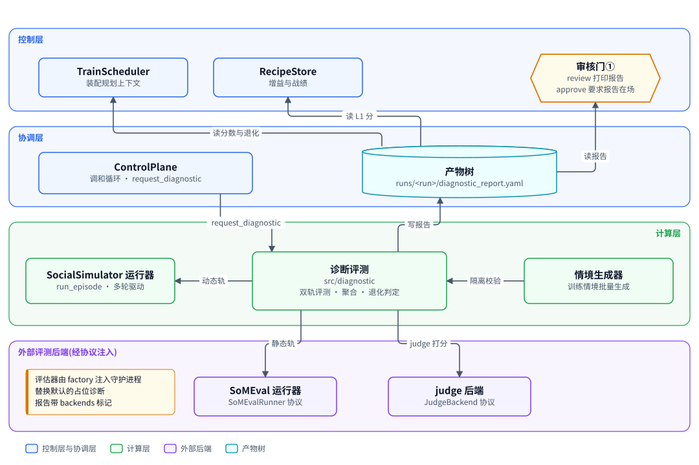
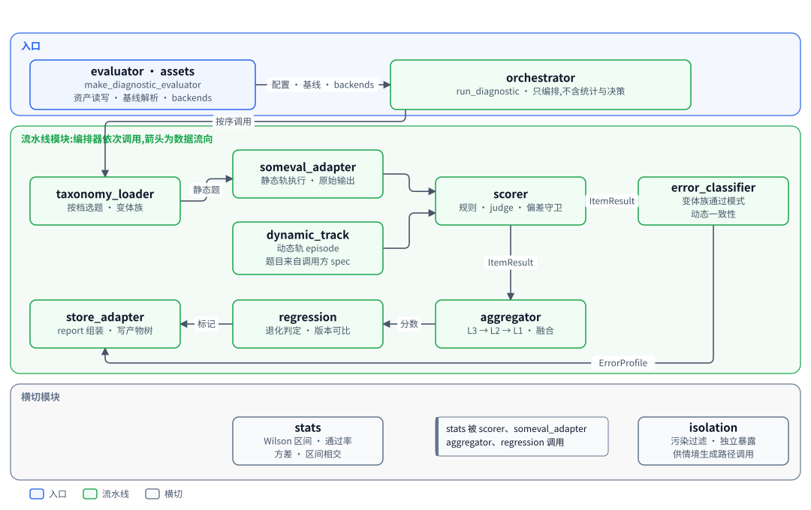
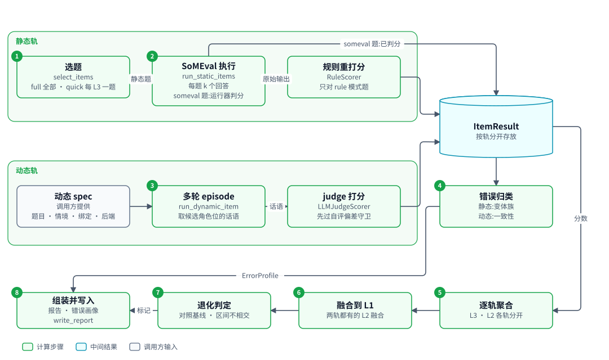
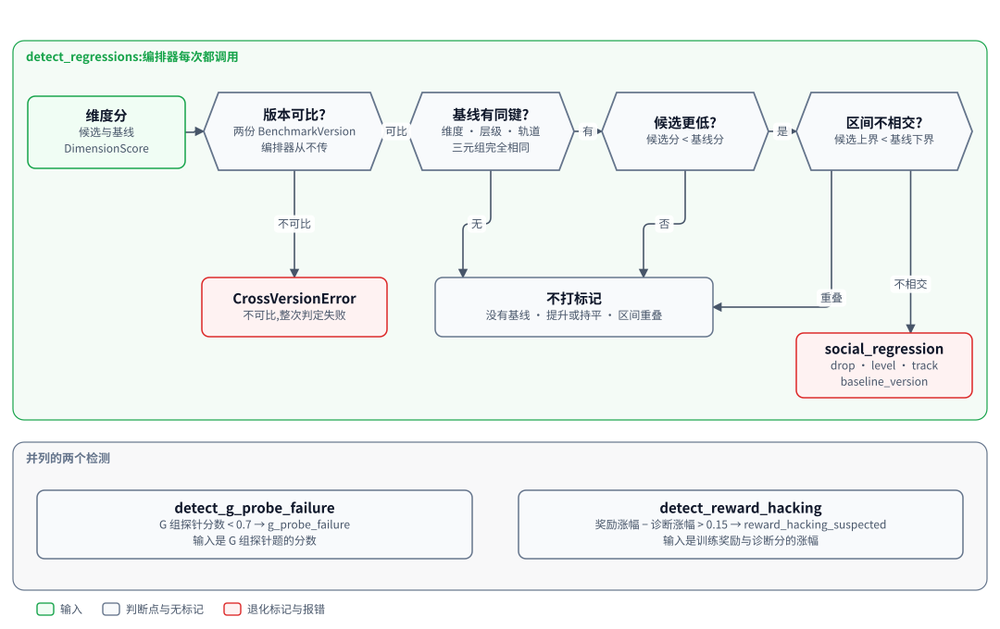

# 诊断评测:给候选 checkpoint 打带置信区间的分并标出退化

| 项 | 内容 |
|---|---|
| 一句话 | 对候选 checkpoint 跑静态轨与动态轨评测,逐层聚合成带置信区间的维度分,对照基线标出退化,写成诊断报告 |
| 状态 | 部分落地:评测流水线与编排器 [已落地];接入调和循环的评估器与资产读写 [计划中] |
| 所在层 | 计算层,属于 SocialSimulator 的评测部分 |
| 代码位置 | `src/diagnostic`;评估器 `src/diagnostic/evaluator.py` 与资产 `src/diagnostic/assets.py` [计划中] |
| 基线提交 | `8dd295b`(2026-10-10) |
| 依赖 | ControlPlane 的产物树与信封(`controlplane.gitstore`、`controlplane.envelope`、`controlplane.paths`);SocialSimulator 的仿真运行器(`simulator.runner`) |
| 被依赖 | ControlPlane 审核门①(读报告);RecipeStore 增益与战绩、TrainScheduler 规划上下文、factory 组合根 [计划中] |
| 对应实施计划 | 工作包 8(任务 94 至 95)[计划中];工作包 9(任务 103,评估器装配与默认资产)[计划中] |

## 0. 系统速览

<!-- shared:begin context-block -->
**系统是什么。** RismForge 是一套"AI 驱动的社会心智后训练工厂":输入通用开源基础模型,输出社会心智能力显著增强的模型,代号 **ZenGen**。工厂自己决定每一轮练什么、怎么练。训练决策可以交给外部更强的闭源模型(经命令行调用),关键决策点设人工审核门,其余环节自动。

**七个子系统。** 六个能力子系统加一个协调层 ControlPlane。

| 子系统 | 职责 | 所在层 | 现状 |
|---|---|---|---|
| ControlPlane | 协调层:git 版本化产物树、状态机、调和循环、三个审核门 | 控制层 | 核心 [已落地],闭环扩展 [计划中] |
| SocialSimulator | 情境与人格生成、多智能体仿真、实时环境服务、诊断评测 | 计算层 | [已落地],诊断用 mock 后端;vLLM 加 SoMEval 的真实运行器 [计划中] |
| MindTrainer | 权重级训练:BatchTrain(SFT 后接 GRPO 加 OPD)与 InteractTrain | 计算层 | [已落地],默认入口的训练执行器是 mock;ROLL LoRA SFT 真实执行器 [已落地],由 `--executor roll` 装配,已在真实主机上端到端跑通一次 |
| MindAgent | 部署态智能体的技能与记忆自进化,不改权重 | 计算层 | [计划中] |
| RecipeStore | 验证有效的训练配方的版本化仓库 | 控制层 | [计划中] |
| TrainScheduler | 决策执行器:装配上下文、校验决策、构造训练指令、提名配方 | 控制层 | [计划中] |
| TrainPlanner | 决策学习者:经可插拔后端给出下一轮训练决策 | 控制层 | [计划中] |

共享基础设施有五个。**Actio** 是带技能库与显式记忆的智能体框架,每次响应附带激活轨迹。**外部推理桥接**用命令行调用外部强模型。**远端计算层** `compute` 经 SSH 在远端 GPU 主机上跑作业 [已落地]。**ROLL** 是分布式训练引擎,**vLLM** 是推理引擎。V1 经远端计算层接入 ROLL 的 LoRA SFT [已落地](由 `--executor roll` 装配,已在真实主机上从指令跑到候选一次)与 vLLM 推理服务 [计划中]。已落地部分仍由确定性 mock 顶替。真实 GRPO 加 OPD 训练与真实 judge [推迟]。

**状态标记。** **[已落地]** 表示代码在主干上且有测试。**[计划中]** 表示设计与实施计划已定,代码还没写。**[推迟]** 表示明确不在 V1 范围内。图只画目标系统,不标进展,进展只看正文的状态标记。

**六条贯穿全系统的机制。**

| 机制 | 规则 |
|---|---|
| 产物树 | 所有协作数据是 git 树里的 YAML 产物,统一信封:`id`、`type`、`version`、`created_at`、`created_by`(含 `owner` 与 `visibility`)、`status`、`schema_version`、`links`、`payload`。checkpoint 等大体量内容只存引用 `{uri, sha256, size_bytes}`;V1 的数据集逐条 episode 进 git,只适合小规模 mock。git 树是唯一真相,读取时先经迁移器链再消费。 |
| 状态机 | 需审核类:`draft → pending_review → approved → effective`,之后可到 `deprecated` 或 `superseded`,`pending_review` 也可到 `rejected`。非审核类:`pending → executed → consumed`,`pending` 也可到 `failed`。被拒绝与失败的产物保留;被拒绝的候选进入下一轮规划的输入,失败只留痕、等人处理。 |
| 调和循环 | 纯函数 `reconcile(树视图) → 动作列表`,守护进程按间隔轮询并执行动作。循环无状态、动作幂等,进程崩溃后从 git 树续接。子系统之间不直接调用,只读写产物。 |
| 审核门 | 三道人工门:① checkpoint 晋级,② 技能与记忆增量纳入,③ 配方入库。证据不在场就不能批准:门①要诊断报告,门②要验证结果,门③要可复现性校验报告。门②与门③ [计划中]。 |
| 受限直连 | 两处高频实时调用绕过 ControlPlane:① MindTrainer 与 SocialSimulator 之间的 InteractTrain rollout,② MindAgent 与 SocialSimulator 之间的部署经验采集。两处都走 gRPC 双向流,发生在计算层内部。是否开会话仍由 ControlPlane 决策。 |
| 失败分类 | T1 瞬态:有限次指数退避重试,耗尽升为 T3。T2 确定性:不重放,按所属子系统的校验链处理,LLM 的随机输出可有限次重采样。T3 需人工:写失败记录,不自动重跑。失败是数据,不是异常。 |

**核心术语。**

| 术语 | 含义 |
|---|---|
| Run | 一轮迭代,对应产物树里的 `runs/run-<编号>/` 目录,该轮所有产物都挂在其下 |
| Directive(训练指令) | TrainScheduler 或人写入的 `directive.yaml`,调和循环据此下发训练 |
| Candidate(候选 checkpoint) | MindTrainer 产出的 `candidate_checkpoint.yaml`,经诊断评测与门①才能晋级 |
| ZenGen 版本 | 晋级后写入 `models/zengen-v<N>.yaml`;下一轮训练的基座取最新的 effective 版本 |
| Episode | 一次多轮交互的完整记录:情境、角色分配、逐轮话语、终止原因 |
| Scenario、Persona、RoleAssignment | 社会情境、人格模板,以及把角色位绑定到具体人格与模型后端的分配 |
| Recipe(配方) | 验证有效的完整训练方案,分 batch、interact、agent_rsi 三类 |
| DiagnosticReport | 诊断评测产出的报告:维度、分数、置信区间、错误类型、退化标记 |
| Activation trace(激活轨迹) | Actio 每次响应附带的记录:命中的技能候选、选中的技能、命中的记忆 |
| Evidence grade(证据等级) | 诊断报告的可信等级 `stub`、`mock`、`real`,决定它能否驱动规划与提名 [计划中] |
<!-- shared:end context-block -->

## 1. 定位

诊断评测是工厂的导航仪:它回答"这个候选 checkpoint 在每个能力维度上多强,比基座退步了没有"。审核门①靠它决定是否晋级。规划下一轮练什么、配方战绩好不好,也都读它的报告。它只产出分数、错误画像和退化标记,不做任何晋级或规划决定。

<!-- figure:begin 21-diagnostic-context -->


**图 1　诊断评测的上下文**　ControlPlane 在候选待审时请求诊断,由注入的评估器调用诊断评测并写报告。诊断评测调 SoMEval 运行器与 judge 后端,动态轨复用 SocialSimulator 的运行器。报告写进产物树,由审核门①、规划与配方增益读取。

<details>
<summary>文字版:图中的节点与连线</summary>

**节点**

- TrainScheduler:装配规划上下文
- RecipeStore:增益与战绩
- 审核门①:review 打印报告 / approve 要求报告在场
- ControlPlane:调和循环 · request_diagnostic
- 产物树:runs/<run>/diagnostic_report.yaml
- SocialSimulator 运行器:run_episode · 多轮驱动
- 诊断评测:src/diagnostic / 双轨评测 · 聚合 · 退化判定
- 情境生成器:训练情境批量生成
- SoMEval 运行器:SoMEvalRunner 协议
- judge 后端:JudgeBackend 协议

**连线**

- 产物树 → TrainScheduler:读分数与退化
- 产物树 → RecipeStore:读 L1 分
- 产物树 → 审核门①:读报告
- ControlPlane → 诊断评测:request_diagnostic
- 诊断评测 → 产物树:写报告
- 诊断评测 → SocialSimulator 运行器:动态轨
- 情境生成器 → 诊断评测:隔离校验
- 诊断评测 → SoMEval 运行器:静态轨
- 诊断评测 → judge 后端:judge 打分

</details>
<!-- figure:end 21-diagnostic-context -->

今天守护进程遇到 `request_diagnostic` 时,写的是 `simulator.stubs` 的占位报告,不调用编排器。编排器 `run_diagnostic(...)` 已实现并有测试,接入循环的评估器在工作包 8 [计划中]。评测执行经两个协议注入:SoMEval 运行器负责静态轨,judge 后端负责动态轨打分,V1 都注入 mock。报告写进 `runs/<run>/diagnostic_report.yaml`,下游只读产物,不调用诊断代码。

## 2. 目标、非目标与约束

诊断评测保证分数带不确定性、两轨分数留痕、同版本才比较。真实评测后端与动态轨的接入不在 V1。

| 编号 | 目标 | 验收方式 | 状态 |
|---|---|---|---|
| G1 | 静态轨:按档选题,经 SoMEval 运行器取每题 k 个回答,规则式重打分 | `tests/test_diag_someval_adapter.py`、`tests/test_diag_orchestrator.py` | [已落地] |
| G2 | 动态轨:跑多轮 episode,judge 给候选话语打分 | `tests/test_diag_dynamic_track.py`、`tests/test_diag_orchestrator.py` | [已落地] |
| G3 | 按变体族通过模式归类错误类型 | `tests/test_diag_error_classifier.py` | [已落地] |
| G4 | L3 到 L2 到 L1 逐层聚合,每个分数带 Wilson 置信区间与轨道标注 | `tests/test_diag_aggregator.py`、`tests/test_diag_stats.py` | [已落地] |
| G5 | 对照基线,只在区间不相交时标退化 | `tests/test_diag_regression.py` | [已落地] |
| G6 | 评估器从产物树读资产与基线,报告带 `backends` 标记 | 工作包 8 的两个新测试文件 | [计划中] |

| 非目标或推迟项 | 状态 | V1 的处理 |
|---|---|---|
| 真实 SoMEval 子进程,经远端 vLLM 服务推理 | [计划中] | 今天注入 `MockSoMEvalRunner`,报告标 `backends: mock` |
| 真实 judge | [推迟] | 注入 `MockJudgeBackend`;含 mock judge 的报告等级仍是 `mock`,不升 `real` |
| 评估器跑动态轨 | [推迟] | 评估器传空的动态 spec,只跑静态轨;没有情境与绑定的来源 |
| G 组探针与 reward hacking 检测进报告 | [推迟] | 检测函数已实现,编排器不调用,报告里只有社会能力退化 |
| 一致性信号 | [推迟] | 报告里恒为空映射与 0.0 |
| 隔离校验器接入情境生成 | [推迟] | 函数已实现并独立暴露,没有调用方 |
| 晋级决定 | 非目标 | 只产标记与证据,决定归审核门①的人 |

| 约束 | 内容 | 影响 |
|---|---|---|
| 分数必带不确定性 | 每个维度分带 95% Wilson 区间与样本量 | 区间重叠的下降不算退化 |
| 两轨不可无痕合并 | 每个分数标 `static`、`dynamic` 或 `fused` | 退化比较按轨道配对 |
| 跨版本不可比 | 报告带 `benchmark_version`,基线版本不同就不比较 | 换版本后第一轮没有退化标记 |
| judge 不能是候选的近亲 | judge 与候选的模型 id 互为前缀即拒绝 | 构造 judge 打分器时抛 `SelfEvalBiasError` |
| 不需要 GPU 与外部服务 | 执行与打分全经协议注入 | 全部测试用固定输出跑 |
| 不导入 MindTrainer | `diagnostic` 不导入 `mindtrainer` | 训练奖励拿不到,reward hacking 检测无输入 |

## 3. 架构

诊断评测由一个薄编排器加一组纯函数模块组成。编排器只决定调用顺序,统计与判定逻辑都在各模块里。模块之间不互相调用,数据经编排器传递。

<!-- figure:begin 21-diagnostic-architecture -->


**图 2　诊断评测的组件**　评估器从产物树取资产与基线后调用编排器。编排器是薄协调层,依次调用流水线模块,模块之间不互相调用,箭头是数据流向。统计模块被多处调用,隔离校验器独立暴露,供情境生成路径调用。

<details>
<summary>文字版:图中的节点与连线</summary>

**节点**

- evaluator · assets:make_diagnostic_evaluator / 资产读写 · 基线解析 · backends
- orchestrator:run_diagnostic · 只编排,不含统计与决策
- taxonomy_loader:按档选题 · 变体族
- someval_adapter:静态轨执行 · 原始输出
- dynamic_track:动态轨 episode / 题目来自调用方 spec
- scorer:规则 · judge · 偏差守卫
- error_classifier:变体族通过模式 / 动态一致性
- store_adapter:report 组装 · 写产物树
- regression:退化判定 · 版本可比
- aggregator:L3 → L2 → L1 · 融合
- stats:Wilson 区间 · 通过率 / 方差 · 区间相交
- isolation:污染过滤 · 独立暴露 / 供情境生成路径调用

**连线**

- evaluator · assets → orchestrator:配置 · 基线 · backends
- orchestrator → taxonomy_loader:按序调用
- taxonomy_loader → someval_adapter:静态题
- someval_adapter → scorer
- dynamic_track → scorer
- scorer → error_classifier:ItemResult
- scorer → aggregator:ItemResult
- aggregator → regression:分数
- regression → store_adapter:标记
- error_classifier → store_adapter:ErrorProfile

</details>
<!-- figure:end 21-diagnostic-architecture -->

| 模块 | 职责 | 依赖 | 行数 | 状态 |
|---|---|---|---|---|
| `orchestrator` | `run_diagnostic(...)`:八步流水线,写报告 | 下列全部流水线模块 | 240 | [已落地] |
| `taxonomy_loader` | `ItemPool`、按档选题、选出完整的变体族 | `datamodel` | 72 | [已落地] |
| `someval_adapter` | `SoMEvalRunner` 协议与 mock,原始输出转 `ItemResult` | `stats` | 103 | [已落地] |
| `dynamic_track` | 跑一道动态题的 episode,带关键词早停 | `simulator.runner` | 75 | [已落地] |
| `scorer` | 规则打分器、judge 协议与 mock、自评偏差守卫 | `stats` | 165 | [已落地] |
| `error_classifier` | 变体族错误归类、动态一致性、按 L2 汇总分布 | `datamodel` | 108 | [已落地] |
| `aggregator` | L3、L2、L1 聚合与两轨融合 | `stats` | 89 | [已落地] |
| `regression` | 退化判定;G 组探针与 reward hacking 检测 | `stats`、`benchmark_version` | 105 | [已落地] |
| `report`、`store_adapter` | 组装报告;信封读写 | `controlplane` | 38、30 | [已落地] |
| `stats` | Wilson 区间、通过率、总体方差、区间相交 | 标准库 `math` | 98 | [已落地] |
| `benchmark_version` | 五段式版本记录与可比判定 | 无 | 52 | [已落地] |
| `isolation` | 训练情境与题库的污染判定与过滤 | 无 | 137 | [已落地] |
| `evaluator`、`assets` | 接入调和循环;分类表与题库的信封读写 | 编排器、`controlplane.evidence` | 111、74 | [计划中] |

依赖方向规则:

| 规则 | 现状 |
|---|---|
| `diagnostic` 可以导入 `controlplane` 与 `simulator` | 已满足 |
| `diagnostic` 不导入 `mindtrainer`、`trainscheduler`、`recipestore`、`factory` | 已满足;工作包 8 加一条语法树扫描测试,只强制不导入 `mindtrainer`,其余包靠约定 [计划中] |
| 下游只读报告产物,不导入 `diagnostic` | RecipeStore 与 TrainScheduler 的施工计划照此执行 [计划中] |
| 评估器的返回类型写成可调用对象,不导入守护模块 | 工作包 8 的约定 [计划中] |

## 4. 数据模型与状态机

所有实体都是带 `to_dict`、`from_dict` 的数据类,定义在 `src/diagnostic/datamodel.py`。报告是非审核类产物,写入即 `executed`,没有自己的状态流转。

| 实体 | 字段与含义 | 约束 |
|---|---|---|
| `DiagnosticTaxonomy` | `version`;`l1_dimensions`;`l2_dimensions` 从 L1 到 L2 列表;`l3_tasks` 从 L2 到 L3 列表;`g_probes` | 维度枚举是配置,不写死 |
| `DiagnosticItem` | `id`、`l3_task`、`item_type`、`scoring_mode`(`rule` 或 `judge`)、`track`、`reference_answer`、`rubric`、`family_id` | 动态题的 `rubric` 可带 `goal_keyword` |
| `VariantFamily` | `family_id`、`base_item_id`、`variant_item_ids` | 诊断的最小单元 |
| `ItemResult` | 每题 k 个原始输出、各次得分、通过率、总体方差、轨道 | 得分是 0 或 1,judge 分可为小数 |
| `DimensionScore` | `dimension`、`level`、`score`、`ci_low`、`ci_high`、`sample_size`、`track_provenance` | 每个分数都带区间与轨道 |
| `ErrorProfile` | `l2_dimension`、`error_type_distribution`、`track` | 分布和为 1;空标签 `""` 表示没有错误 |
| `RegressionFlags`、`ConsistencySignals` | 退化标记列表;规则与 judge 分歧、诊断与奖励分歧 | 一致性信号 V1 恒为空 |
| `DiagnosticReport` | 头部(`id`、`candidate_ref`、`baseline_ref`、`benchmark_version`、`run_tier`、`sampling_k`)加以上全部与 `links` | 载荷就是 `to_dict()` |

| 产物 | 路径 | 状态机 | 写方 | 状态 |
|---|---|---|---|---|
| 诊断报告 | `runs/<run>/diagnostic_report.yaml` | 非审核类,写入即 `executed` | 编排器或占位桩 | [已落地] |
| 分类表 | `diagnostics/taxonomy_<版本>.yaml` | 写入即 `effective`,不走审核门 | `factory install-defaults` | 路径 [已落地],读写 [计划中] |
| 题库 | `diagnostics/item_pool_<版本>.yaml` | 写入即 `effective`,不走审核门 | `factory install-defaults` | 路径 [已落地],读写 [计划中] |

真实报告的载荷形状如下。`backends` 键由评估器写入 [计划中],今天编排器写的报告没有这个键。

```yaml
id: run-002              # 信封 id 与报告 id 都等于 run id
candidate_ref: cand-run-002
baseline_ref: zengen-v1  # 基线模型 id;无基线时为 none
benchmark_version: bench-v1
run_tier: full           # full 或 quick
sampling_k: 4
dimension_scores:        # L3、L2、L1 各一条起
  - {dimension: belief, level: l2, score: 0.25, ci_low: 0.071, ci_high: 0.591, sample_size: 8, track_provenance: static}
error_profiles: [{l2_dimension: belief, error_type_distribution: {unstable: 1.0}, track: static}]
regression_flags: {flags: [...]}
consistency_signals: {rule_vs_judge_divergence: {}, diagnostic_vs_reward_divergence: 0.0}
links: [run-002]
backends: mock           # [计划中] mock 或 real,必写;缺失的报告一律判 stub
```

证据等级由 `controlplane.evidence.diagnostic_grade` 判定 [计划中],诊断评测自己不判等级。

| 载荷 | 证据等级 |
|---|---|
| `stub` 为真(占位桩写的报告) | `stub` |
| `backends` 等于 `mock` | `mock`,不看分数 |
| `dimension_scores` 非空,且 `backends` 等于 `real` | `real` |
| 其余,含没有 `backends`、`backends` 为未知值或没有分数 | `stub`,判不出来按最弱算 |

不变量:

1. 每个 `DimensionScore` 都有区间与轨道标注,聚合过程不丢轨道。
2. 同一个 L2 两轨都有分时,先各自出分,再出一条 `fused` 分,三条都进报告。
3. 退化标记只在同键(维度、层级、轨道)且区间不相交时产生。
4. 报告重写时内容逐字节相同就不产生新提交,信封时间戳是固定常量。
5. 编排器不读产物树,只写报告;资产与基线由调用方传入。

## 5. 接口契约

编排器是唯一的已落地入口。调用方准备好分类表、题库、两个后端和基线分数,编排器跑完并写报告。

```python
@dataclass
class DiagnosticConfig:
    run_id: str; candidate_ref: str; candidate_model_id: str
    baseline_ref: str; tier: str; sampling_k: int; benchmark_version: str

def run_diagnostic(cfg, taxonomy, pool, someval_runner, judge_backend, store, *,
                   baseline_scores: list[DimensionScore],
                   dynamic_specs: list[dict]) -> DiagnosticReport: ...

class SoMEvalRunner(Protocol):
    def evaluate(self, items, candidate_ref: str, k: int) -> dict[str, list[str]]: ...
class JudgeBackend(Protocol):
    model_id: str
    def judge(self, item, response: str, sample_index: int) -> float: ...
```

每条动态 spec 是一个字典,带 `item`、`scenario`、`assignment`、`personas`、`backends`,可选 `episode_id`。`assignment` 里必须恰有一个 `model_backend == "self_play"` 的绑定,它就是候选角色位。

接入调和循环的评估器 [计划中],签名来自工作包 8,施工时可能微调:

```python
# diagnostic.evaluator [计划中]
def make_diagnostic_evaluator(*, taxonomy_version, item_pool_version, someval_runner,
        judge_backend, benchmark_version, tier="full", sampling_k=4,
        backends="mock") -> Callable[[GitStore, str, str], None]: ...
def resolve_baseline(store, run_id, benchmark_version, *,
        backends: str) -> tuple[str, list[DimensionScore]]: ...
# diagnostic.store_adapter 与 orchestrator 扩展 [计划中]
def write_report(store, run_id, report, *, backends: str) -> None: ...
def run_diagnostic(..., *, baseline_scores, dynamic_specs, backends: str): ...
```

`backends` 是必填的关键字参数,载荷里一定有这个键;取值不在 `BACKENDS_VALUES` 里时写之前抛 `ValueError` [计划中]。既有测试里 `write_report` 与 `run_diagnostic` 的调用点(存储适配与编排器两个测试文件,共七处)补传 `backends="mock"`,这是工作包 8 唯一放宽的既有测试约束 [计划中]。

评估器的行为 [计划中]:

| 项 | 规则 |
|---|---|
| 资产 | 每次调用时用 `read_taxonomy(...)` 与 `read_item_pool(...)` 从树里读,缺失或版本不符抛 `DiagnosticAssetError` [计划中] |
| `backends` | 构造时校验,只接受 `BACKENDS_VALUES` 里的 `mock`、`real` [计划中] |
| 配置 | `candidate_model_id` 取候选 id,动态 spec 为空 |
| 基线 | 版本号最大的 `effective` zengen 模型,取其 `links` 第二项那个 run 的报告 |
| 无基线 | 没有模型、`links` 不足两项、基线 run 就是本 run、没有报告、报告是 `stub`、没有分数、`benchmark_version` 不同、证据等级与本次 `backends` 不同;返回 `NO_BASELINE` 即 `none` 与空列表 [计划中] |

诊断资产的读写 [计划中]:`write_taxonomy`、`write_item_pool` 与常量 `TAXONOMY_TYPE`、`ITEM_POOL_TYPE` 放在 `diagnostic.assets`。产物类型是 `diagnostic_taxonomy` 与 `diagnostic_item_pool`,状态 `effective`,登记即生效,题库变更本身不走审核门。信封 id 为 `taxonomy-<版本>` 与 `item-pool-<版本>`。读取时校验信封类型与载荷里的版本号,路径上放错东西会明确报错。组合根的 `install-defaults` 调这两个写函数。

`candidate_ref` 在 V1 是候选 id,mock 运行器忽略它。真实 SoMEval 运行器 [计划中] 的协议签名不变,仍收候选 id:它按候选 id 读 `candidate_checkpoint.yaml`,从里面取 `checkpoint_ref` 的 `BigRef`,再由 `fetch_hint` 的 `type` 与 `format` 判断存点是真实导出还是 mock。取不到或解不出,抛确定性错误,走下面的失败落点。

触发条件:候选为 `pending_review` 或 `approved` 且没有诊断报告时,调和循环产生 `request_diagnostic`。今天执行它的是占位桩,工作包 9 的组合根在闭环模式下换成评估器 [计划中]。

| 邻居 | 本文依赖它什么 | 它依赖本文什么 |
|---|---|---|
| ControlPlane | `GitStore` 的幂等写入;信封;路径函数;`request_diagnostic` 触发 | 报告文件存在即"有诊断";审核门①的 `review` 打印分数与退化标记 |
| SocialSimulator 运行器 | `run_episode` 的 `stop_predicate` 早停与 `terminated_reason` | 无 |
| RecipeStore [计划中] | 无 | 读 L1 分算增益;读 `regression_flags.flags` 判战绩退化 |
| TrainScheduler [计划中] | 无 | 读 L1 分、退化标记、错误画像装配规划上下文;丢掉空标签 `""` |
| factory [计划中] | 写入默认资产;装配 mock 后端 | 评估器构造函数 |

## 6. 关键流程

一次诊断是一条八步流水线,两轨在归类与聚合处汇合。步骤编号与图中徽标一一对应。

<!-- figure:begin 21-diagnostic-dataflow -->


**图 3　一次诊断的双轨数据流**　静态轨从题库按档选题,经 SoMEval 运行器取 k 个回答,规则式题目重打分。动态轨由调用方给 spec,跑多轮 episode 后由 judge 给候选话语打分。两轨的 ItemResult 分开存放,分别送入错误归类与逐轨聚合,L2 融合后聚到 L1,再与基线比较,最后写报告。

<details>
<summary>文字版:图中的节点与连线</summary>

**节点**

- 选题:select_items / full 全部 · quick 每 L3 一题
- 动态 spec:调用方提供 / 题目 · 情境 · 绑定 · 后端
- SoMEval 执行:run_static_items / 每题 k 个回答
- 多轮 episode:run_dynamic_item / 取候选角色位的话语
- 规则重打分:RuleScorer / 只对 rule 模式题
- judge 打分:LLMJudgeScorer / 先过自评偏差守卫
- ItemResult:按轨分开存放
- 错误归类:静态:变体族 / 动态:一致性
- 逐轨聚合:L3 · L2 各轨分开
- 融合到 L1:两轨都有的 L2 融合
- 退化判定:对照基线 · 区间不相交
- 组装并写入:报告 · 错误画像 / write_report

**连线**

- 选题 → SoMEval 执行:静态题
- SoMEval 执行 → 规则重打分:原始输出
- 动态 spec → 多轮 episode
- 多轮 episode → judge 打分:话语
- 规则重打分 → ItemResult
- judge 打分 → ItemResult
- ItemResult → 错误归类
- ItemResult → 逐轨聚合:分数
- 逐轨聚合 → 融合到 L1
- 融合到 L1 → 退化判定
- 退化判定 → 组装并写入:标记
- 错误归类 → 组装并写入:ErrorProfile

</details>
<!-- figure:end 21-diagnostic-dataflow -->

| 步 | 做什么 | 关键规则 |
|---|---|---|
| 1 | `select_items(...)` 按档选题,只留静态题 | `full` 取全部;`quick` 每个 L3 取第一道;其余档位抛 `ValueError` |
| 2 | 静态轨执行,规则式题用 `RuleScorer` 重打分 | 重打分前后去空白、忽略大小写;judge 模式的静态题保留精确匹配分 |
| 3 | 动态轨:每条 spec 跑一个 episode,judge 给候选话语打分 | 话语带 `goal_keyword` 时早停;先过自评偏差守卫 |
| 4 | 错误归类,按 L2 汇总分布 | 只用两轨都完整入选的变体族 |
| 5 | 每轨各自做 L3、L2 聚合 | 按样本量合并通过次数,再算 Wilson 区间 |
| 6 | 两轨都有的 L2 融合为 `fused`,再聚到 L1 | L1 成员轨道不一时标 `fused` |
| 7 | 与基线分逐键比较,产出退化标记 | 无基线时不打标记 |
| 8 | 组装报告,一致性信号置空,写入产物树 | 写入幂等 |

变体族错误归类按固定优先级取第一个命中的标签。编排器不传格式校验器与拒答检测器,所以前两条在 V1 不会命中。

| 优先级 | 标签 | 条件 |
|---|---|---|
| 1 | `refusal` | 拒答检测器对基题任一输出为真 |
| 2 | `format_fail` | 格式校验器对基题任一输出为真 |
| 3 | `unstable` | 基题方差大于 0.2 |
| 4 | `surface_match` | 基题通过率不低于 0.5,且有变体低于 0.5 |
| 5 | `reasoning_break` | 基题通过率低于 0.5 |
| 6 | `""` | 都不满足,即没有错误 |

退化判定只产生一种标记。另外两个检测函数已实现,编排器不调用。

<!-- figure:begin 21-diagnostic-regression -->


**图 4　退化判定**　每个候选维度分按维度、层级、轨道三元组找基线。找到、候选更低且两个置信区间不相交,才打一条社会能力退化标记。两份基准版本都给出且不可比时直接报错。G 组探针与 reward hacking 的检测函数与退化判定并列。

<details>
<summary>文字版:图中的节点与连线</summary>

**节点**

- 维度分:候选与基线 / DimensionScore
- 版本可比?:两份 BenchmarkVersion / 编排器从不传
- 基线有同键?:维度 · 层级 · 轨道 / 三元组完全相同
- 候选更低?:候选分 < 基线分
- 区间不相交?:候选上界 < 基线下界
- CrossVersionError:不可比,整次判定失败
- 不打标记:没有基线 · 提升或持平 · 区间重叠
- social_regression:drop · level · track / baseline_version
- detect_g_probe_failure:G 组探针分数 < 0.7 → g_probe_failure / 输入是 G 组探针题的分数
- detect_reward_hacking:奖励涨幅 − 诊断涨幅 > 0.15 → reward_hacking_suspected / 输入是训练奖励与诊断分的涨幅

**连线**

- 维度分 → 版本可比?
- 版本可比? → 基线有同键?:可比
- 基线有同键? → 候选更低?:有
- 候选更低? → 区间不相交?:是
- 版本可比? → CrossVersionError:不可比
- 基线有同键? → 不打标记:无
- 候选更低? → 不打标记:否
- 区间不相交? → 不打标记:重叠
- 区间不相交? → social_regression:不相交

</details>
<!-- figure:end 21-diagnostic-regression -->

| 检测 | 判据 | 标记 | 状态 |
|---|---|---|---|
| `detect_regressions(...)` | 同键、候选更低、区间不相交 | `social_regression`,带 `drop`、`level`、`track`、`baseline_version` | 每次调用 |
| `detect_g_probe_failure(...)` | 探针分数低于 0.7 | `g_probe_failure` | 未调用 |
| `detect_reward_hacking(...)` | 奖励涨幅减诊断涨幅大于 0.15 | `reward_hacking_suspected` | 未调用 |

标记随聚合层级向上传播,标记数不等于独立问题数。一次 L3 下降若让所属 L2、L1 的区间也不相交,会产出三条标记,它们是同一次退化在三个层级上的证据,不是三次退化。产出侧不去重;只想看某一层的消费方按 `level` 筛选。

失败与恢复路径:

| 情形 | 结果 | 恢复 |
|---|---|---|
| 任一步抛异常 | 不写报告,异常上抛给调用方 | 修好原因后重跑;报告缺失时调和循环下一轮再请求 |
| 两份基准版本都给出且不可比 | `CrossVersionError` | 编排器不传版本记录,V1 不会发生 |
| 基线版本不同或等级不同 | 评估器按无基线处理 [计划中] | 无需恢复;本轮没有退化标记 |
| 同一 run 重跑且结果相同 | 不产生新提交 | 无需恢复 |

走查例子。一个一级维度 `mental_representation`,一个二级 `belief`,一个三级 `false_belief_transfer`。一个变体族:基题 `i1` 答案 `B`,变体 `i1v` 答案 `C`。`k` 为 4,`full` 档,只跑静态轨。数值由编排器实跑得出。

| 量 | 基线 run(`run-1`) | 候选 run(`run-2`) |
|---|---|---|
| `i1` 的 4 个回答 | `B B B B` | `B B X X` |
| `i1v` 的 4 个回答 | `C C C C` | `X X X X` |
| L3、L2、L1 分(样本量 8) | 1.0 | 0.25 |
| 95% Wilson 区间 | 0.676 至 1.0 | 0.071 至 0.591 |
| 错误画像 | `{"": 1.0}`,没有错误 | `{"unstable": 1.0}`:基题通过率 0.5,方差 0.25 大于 0.2 |
| 退化标记 | 无基线,0 条 | 3 条 `social_regression`,L3、L2、L1 各一条,`drop` 0.75 |

候选区间上界 0.591 低于基线下界 0.676,所以下降算数。三条标记是同一次退化,不是三次。同一套题改用 `quick` 档时只选出基题,样本量降为 4,变体族不完整,错误画像为空。

## 7. 关键决策

| 编号 | 决策 | 备选 | 理由 | 判错的代价 |
|---|---|---|---|---|
| R17 | 诊断报告带 `backends` 标记,默认不接受 `mock` 证据驱动规划与提名 [计划中] | 不标记,mock 分数当真 | mock 分数在默认配置下不会让闭环自己转起来 | 开发时要显式打开开关 |
| R21 | 错误画像里的空标签 `""` 表示没有错误,规划上下文装配前丢掉 | 诊断侧不写空标签 | 诊断侧原样计数,分布和为 1,信息不丢 | 丢掉后规划器看不到二级维度答对的比例 |
| DX-1 | 编排器是薄协调层,统计与判定都在纯函数模块里 | 一个大函数 | 每个模块能单独用合成数据测 | 编排器的调用顺序只有端到端测试覆盖 |
| DX-2 | 置信区间用标准库手写 Wilson 区间,z 为 1.96 | 正态近似;引入统计库 | 小样本与 0、1 边界下 Wilson 不越界,零新依赖 | 置信水平写死,改要动默认参数 |
| DX-3 | 上层聚合按样本量合并通过次数,不对下层分取平均 | 下层分等权平均 | 区间宽度如实反映总样本量 | 题多的 L3 主导 L2 分 |
| DX-4 | 退化要求区间不相交,不设固定下降阈值 | 下降超过固定值就标 | 区间内的波动不当作信号 | 样本小时区间宽,真实下降可能漏标 |
| DX-5 | 退化比较按维度、层级、轨道三元组配对 | 只按维度配对 | 两轨分数不能互相比较 | 基线只有静态分、候选有融合分时,该 L2 不比较 |
| DX-6 | judge 与候选的模型 id 互为前缀即拒绝 | 只拒绝相同 id | 微调版与其基座互评都有偏差 | 名字恰好共享前缀的无关模型也被拒绝 |
| DX-7 | 评估器缺资产时抛 `DiagnosticAssetError`,不写空报告 [计划中] | 写一份没有分数的报告 | 空报告会被判 `stub`,候选卡在门前且看不出原因 | 资产缺失时守护进程每次启动都在同一处退出 |
| DX-8 | 基线是最新 `effective` 模型所在 run 的报告;版本或等级不同就视为无基线 [计划中] | 跨版本也比较 | 跨版本、跨等级的分数不可比 | 换版本或切到真实后端后的第一轮没有退化标记 |
| DX-9 | 评估器只跑静态轨,`candidate_model_id` 取候选 id [计划中] | 接入动态轨 | V1 没有动态轨的情境与绑定来源 | 接入动态轨时要换成真实模型 id,否则自评偏差守卫形同虚设 |
| DX-10 | `backends` 作为 `write_report` 的参数一次写入 [计划中] | 写完后再改信封 | 两次提交之间会有一份无标记、被判 `real` 的 mock 报告 | `run_diagnostic` 多一个参数 |
| DX-11 | 退化标记在 L3、L2、L1 各层独立产出,产出侧不去重;只看某一层时在消费侧按 `level` 筛选 | 只在最低层标记;产出侧合并 | 标记是随聚合层级向上传播的证据,审核门①与 RecipeStore 战绩回看都消费它 | 消费方若数标记条数,会把一次退化读成三次 |
| DX-12 | 证据等级失败关闭:只有 `backends` 为 `real` 才判 `real`,缺失一律判 `stub`;`run_diagnostic`、`write_report`、`resolve_baseline` 的 `backends` 必填 [计划中] | 失败开放:有分数就判 `real` | 直接调用编排器写出的 mock 报告不会被当作真证据,默认不接受 mock 的规则无法被绕过 | 七个既有调用点要补传参数;手写的无标记报告永远不可接受,要人补标记 |

## 8. 失败处理与可观测

诊断评测内部不重试,也不写失败记录。所有异常原样上抛,由调用方决定分类;报告缺失本身就是重新请求的条件。

| 失败点 | 类 | 处理 | 留痕 |
|---|---|---|---|
| SoMEval 运行器或 judge 后端瞬时出错 | T1 | 原样上抛;接入循环后守护进程退出,重启后重新请求 | 无报告 |
| 资产缺失、类型不对、版本不符 [计划中] | T1 | 抛 `DiagnosticAssetError`,写明路径,补齐资产后重启 | 无报告 |
| judge 是候选近亲 | T2 | 构造打分器时抛 `SelfEvalBiasError` | 无报告 |
| 未知档位、mock 缺题目的固定输出、judge 缺固定分 | T2 | 抛 `ValueError` 或 `KeyError` | 无报告 |
| 基准版本不可比 | T2 | 抛 `CrossVersionError`;V1 不触发 | 无报告 |
| 报告分数可疑或画像异常 | T3 | 不自动处理,审核门①的人读报告判断 | 报告本身 |
| 真实 SoMEval 的确定性失败:题库条目没有对应的 SoMBench 样本、候选存点解不出、某题输出条数不等于 k [计划中] | T2 | 评估器内部捕获,写一份 `stub: true` 的报告,载荷带 `failure_reason` 与缺失清单;`request_diagnostic` 动作正常结束,该候选此后不再触发评测 | 报告本身,等级为 `stub` |
| 真实 SoMEval 的瞬态失败:服务启动超时、隧道建立失败、GPU 被占用 [计划中] | 延后 | 抛 `DeferredError` 的子类,守护进程不写树、按退避重试;不写报告,租约在失败时释放 | 守护进程结构化日志 |

写 `stub` 报告而不是让动作一直失败:报告是评测的结论载体,`diagnostic_grade` 对 `stub: true` 已经失败关闭,闭环里记录、提名、规划下一轮都要求证据可接受,所以不推进。晋级本身只看对应报告是否在场、不看等级,这条语义不变,拦它的是人工审核门:`review` 对 `stub` 报告标 `[STUB]` [计划中] 并打印 `failure_reason`,批准的人能区分「占位」和「评测没跑成」。判错的代价:把确定性错误当瞬态,守护进程会无限重试同一个必然失败的评测。

**含 mock 组件的真实评测不升级。** 真实 SoMEval 加 mock judge 的报告,`backends` 仍写 `mock`,`diagnostic_grade` 与下游门控一行不改。报告载荷另加一个只作记录、不参与判级的字段 `component_backends`,形如 `{executor: real, converter: real, someval: real, judge: mock}`,让人看出缺口只剩 judge。`executor` 与 `converter` 两项由候选存点引用的 `fetch_hint.type` 推出(`roll_ssh` 即训练与转换都是真实的,`mock` 即都是 mock),`someval` 与 `judge` 两项由评估器装配时声明。该字段与 `backends` 在同一次 `write_report` 里落盘。

只读观测手段:

| 手段 | 看什么 |
|---|---|
| `review <候选 id>` 命令 | 报告头部、各级分数、退化标记;占位报告标 `[STUB]`;mock 报告标 `[MOCK BACKENDS]` [计划中] |
| 读 `runs/<run>/diagnostic_report.yaml` | 完整载荷,含错误画像与区间 |
| `git log` 该文件 | 每次重写的提交;内容相同不提交 |

## 9. 测试策略

全部测试用固定题目和罐头输出,不需要 GPU、真实 SoMEval、真实 judge 或 gRPC。已落地 15 个测试文件,共 81 个用例。

| 层次 | 对象 | 替身 | 测试文件与用例数 |
|---|---|---|---|
| 数据模型 | 九个实体的往返 | 无 | `tests/test_diag_datamodel.py` 10 |
| 统计 | Wilson 区间、通过率、方差、区间相交 | 无 | `tests/test_diag_stats.py` 9 |
| 版本 | 五段式版本与可比判定 | 无 | `tests/test_diag_benchmark_version.py` 4 |
| 路径与读写 | 路径函数;报告信封往返与幂等 | 临时 git 仓库 | `tests/test_diag_paths.py` 4;`tests/test_diag_store_adapter.py` 4 |
| 选题 | 档位、按 L2 取题、完整变体族 | 无 | `tests/test_diag_taxonomy_loader.py` 6 |
| 执行 | 静态轨适配;动态轨早停 | `MockSoMEvalRunner`;`ScriptedBackend` | `tests/test_diag_someval_adapter.py` 4;`tests/test_diag_dynamic_track.py` 3 |
| 打分 | 规则打分、judge 打分、自评偏差守卫 | `MockJudgeBackend` | `tests/test_diag_scorer.py` 7 |
| 归类与聚合 | 六种标签;逐层聚合与融合 | 构造好的通过模式与分数 | `tests/test_diag_error_classifier.py` 8;`tests/test_diag_aggregator.py` 4 |
| 判定与报告 | 退化、探针、reward hacking;报告组装 | 合成分数 | `tests/test_diag_regression.py` 8;`tests/test_diag_report.py` 1 |
| 隔离 | 相似与不相似样本对 | 无 | `tests/test_diag_isolation.py` 6 |
| 端到端 | 双轨跑完并写报告 | 上述全部 mock 与临时仓库 | `tests/test_diag_orchestrator.py` 3 |
| 资产与标记 [计划中] | 资产信封读写、`backends` 参数、证据等级 | 临时仓库 | 工作包 8 新增 15 个 |
| 评估器 [计划中] | 基线解析、注入调和循环、不导入 `mindtrainer` | mock 后端与 `reconcile_once` | 工作包 8 新增 21 个 |

## 10. 现状、局限与未核实项

编排器与全部流水线模块已落地,但还没有任何生产路径调用它。闭环要等工作包 8 的评估器与工作包 9 的组合根。

| 能力 | 状态 | 说明 |
|---|---|---|
| 静态轨、规则打分、错误归类、聚合、退化判定、报告写入 | [已落地] | 经编排器端到端测试 |
| 动态轨与 judge 打分 | [已落地] | 只有编排器测试调用;评估器不跑 |
| 隔离校验器、G 组探针检测、reward hacking 检测 | [已落地] | 没有调用方 |
| 评估器、资产读写、`backends` 标记、基线解析 | [计划中] | 工作包 8 |
| 默认资产 `factory-tax-v1`、`factory-pool-v1` 与 mock 装配 | [计划中] | 工作包 9 |
| 真实 SoMEval | [计划中] | 子进程运行,推理经远端 vLLM 服务;样本与题库条目之间靠一份 `item_map.json` 对应 |
| 真实 judge | [推迟] | 接入后报告才可能标 `backends: real`;切换后的头几轮基线等级不同,没有可比增益 |

| 已知局限 | 影响 | 缓解 |
|---|---|---|
| 动态一致性的立场函数恒返回真 | 动态轨永远不会出 `inconsistency`,动态错误画像恒为空 | 接入真实立场判别前,动态画像不作依据 |
| 一致性信号恒为空 | 规则与 judge 分歧、诊断与奖励分歧都看不到 | 审核人不以此判断 reward hacking |
| G 组探针没有题目来源,检测函数也不被调用 | 报告里不会出现 `g_probe_failure`,OPD 是否失效无法从报告看出 | 下游已按"可能出现"处理,不依赖它出现 |
| 报告只带 `benchmark_version` 字符串,不带五段式版本 | 换题库或 judge 提示而不换该字符串,会跨版本比较 | 换任何资产都同时换 `benchmark_version` |
| RecipeStore 与 TrainPlanner 的施工说明对标记种类说法不一,一处两种、一处三种 | 下游按不同假设写读取逻辑 | 以代码为准:今天只产出 `social_regression`,下游对另两种按"可能出现"处理 |
| 一次下降在 L3、L2、L1 各标一条 | 标记数不等于独立问题数,单个 L3 下降会产出三条标记 | 消费侧按 `level` 筛选,不在产出侧去重 |
| `quick` 档只取每个 L3 的第一道题 | 变体族不完整,错误画像为空 | 审核门①前用 `full` 档 |
| judge 模式的静态题按精确匹配打分 | 这类题的分数没有意义 | V1 题库只放规则式静态题 |
| 占位报告的信封 id 是 `diag-<run>`,真实报告是 `<run>` | 按信封 id 找报告的工具要兼容两种写法 | 按路径找报告,不按 id |
| 不检测目标维度的显著提升 | 增益由 RecipeStore 用 L1 分直接相减 [计划中],不看区间 | 审核人对照报告里的区间读增益 |

下表第 1、2、4 项都要接入真实后端才能核实,mock 输出给不出答案。

| 未核实项 | 影响 | 核实办法 |
|---|---|---|
| 真实 SoMEval 的输出格式能否直接映射到每题 k 个回答 | 适配层要改 | 接入时用 SoMEval 固定输出样本写适配测试 |
| 默认阈值 0.5、0.2、0.7、0.15 是否合适 | 归类与探针判定偏松或偏严 | 用真实报告分布与人工标注校准 |
| judge 与人工的一致率 | judge 漂移无监控 | 建小型人工标注校准集,定期比对 |
| k 为 4 时区间宽度是否足以检出真实退化 | 真实退化漏标 | 用真实后端对已知退化的 checkpoint 做灵敏度试验 |

明确不做:晋级、规划与配方决定;动态轨的情境与对手人格池生成;隔离校验器之外的数据去重;按目标维度定制题库;多租户与鉴权。

## 附 本文术语

| 术语 | 含义 |
|---|---|
| 静态轨 | 固定题库上的选择题评测,经 SoMEval 运行器执行 |
| 动态轨 | 多轮仿真里的过程性评测,复用 SocialSimulator 运行器,judge 打分 |
| 变体族 | 一道基题加若干扰动变体,按整族的通过模式归类错误 |
| 档位 | `full` 跑全部题,`quick` 每个 L3 取一道 |
| 轨道标注 | 分数的来源:`static`、`dynamic` 或两轨融合的 `fused` |
| Wilson 区间 | 二项比例的置信区间,小样本与 0、1 边界下不越界 |
| 错误画像 | 每个 L2 下各错误类型的占比 |
| 退化标记 | 候选相对基线在某维度上的显著下降,附证据 |
| 基线 | 被比较的已晋级模型所在 run 的报告 |
| 评估器 | 注入调和循环、执行 `request_diagnostic` 的可调用对象 [计划中] |
| 自评偏差守卫 | 拒绝用候选本身或其近亲做 judge |
| 分类表、题库 | 诊断资产:维度树与题目池,都是版本化产物 |
