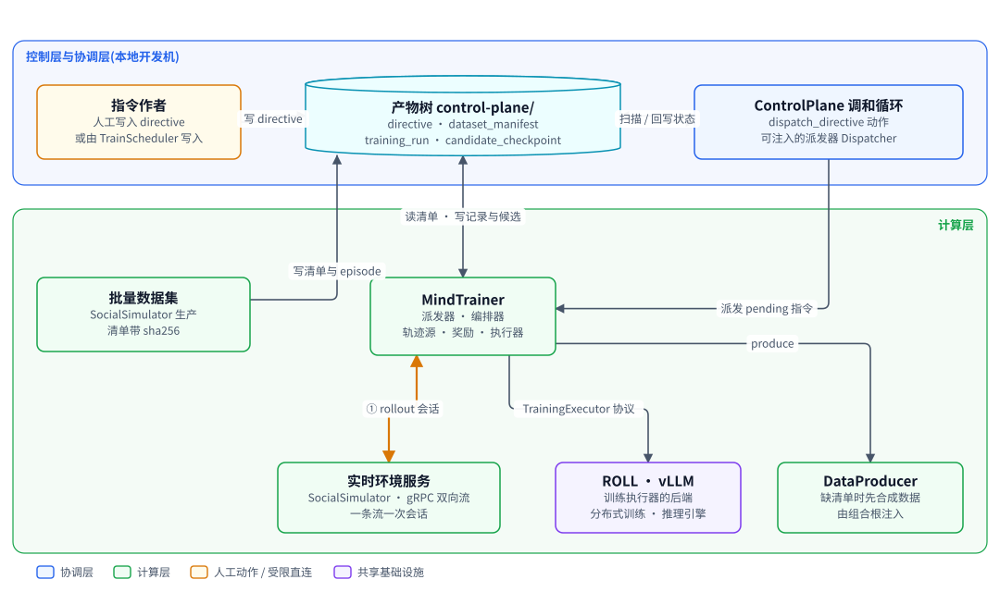
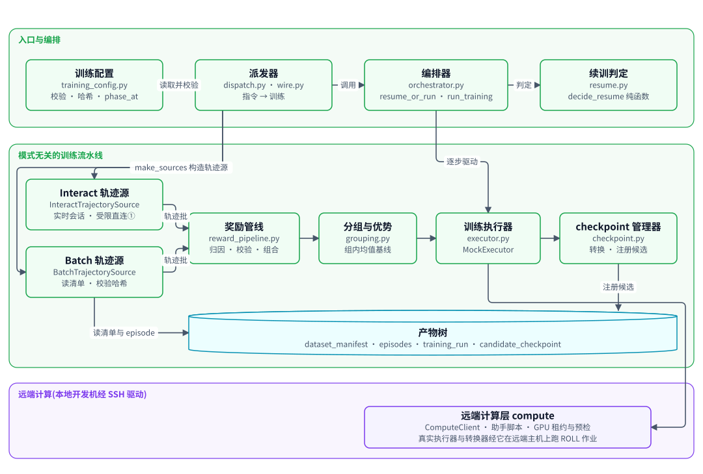
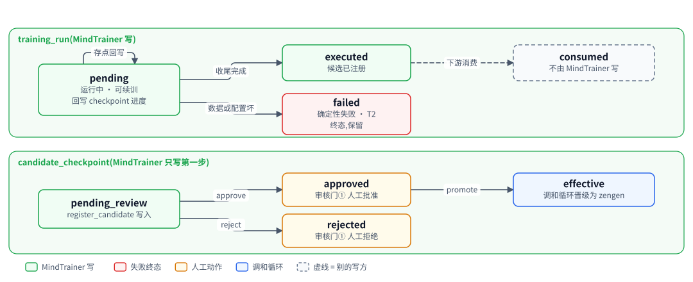
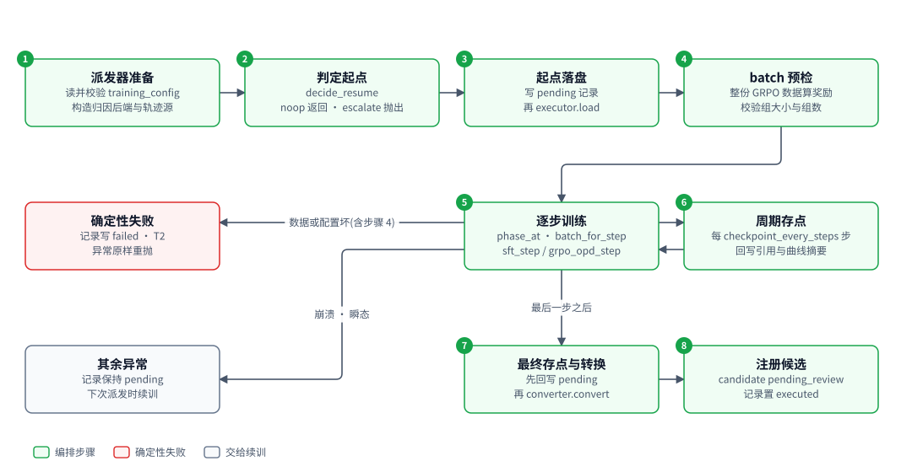
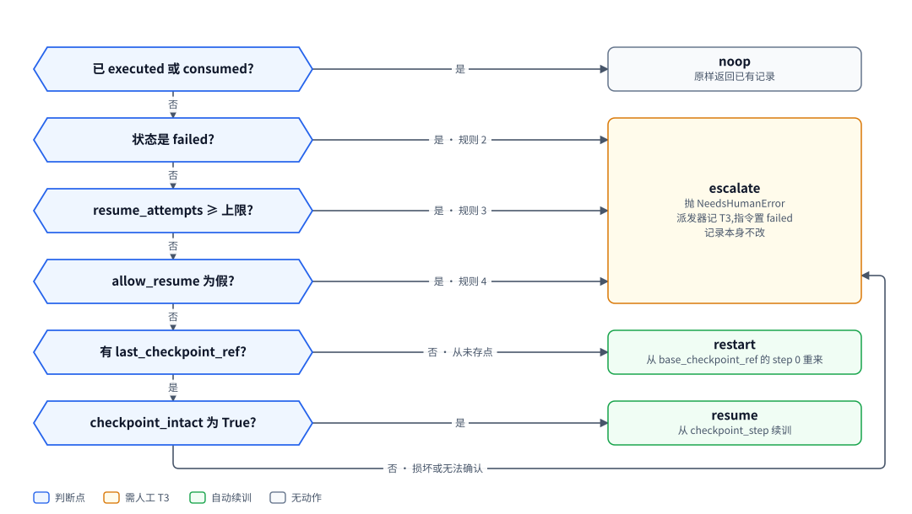

# MindTrainer:把一条训练指令跑成一个待审的候选 checkpoint

| 项 | 内容 |
|---|---|
| 一句话 | 权重级训练子系统:读训练指令与数据集清单,跑 SFT 与 GRPO 加 OPD,产出候选 checkpoint,崩溃后从存点续训 |
| 状态 | 部分落地:配置、两种轨迹源、奖励管线、分组、mock 执行器、续训、编排、派发器、数据合成接线 [已落地];ROLL LoRA SFT 真实执行器与适配器导出转换器 [已落地],已由 `factory run --executor roll` 装配,已在真实主机上从训练指令端到端跑到待审候选:单段两步(2026-11-02、11-06)、两段四步(2026-11-14,第二段带 `--resume`)与崩溃后由新进程收尾的跨进程续训(2026-11-14);数据合成的失败留痕仍只有指令的 `failure` 字段,没有独立的失败记录产物(统一写入函数不在本包);场景二接通 [已落地]:interact 指令经 `--interact` 在真实入口跑完,训练位由 vLLM 上的真实模型说话,训练仍是 mock(策略工厂、一个 vLLM 进程挂最多两个 LoRA、按指令起停、`policy_backend` 训练记录块),端到端测试用本机 HTTP 替身代替 vLLM,真机未跑;服务停不掉时的收尾判 T2、不开 `--interact` 时失败原因点名该开关 [已落地];带记忆的场景二 [已落地]:训练位是带记忆的智能体,起点记忆摘要与记忆运行时身份进 `config_hash`,每条 rollout 从同一起点出发,`--interact` 下服务端等提交 150 秒、客户端等相邻消息 120 秒(按真机延迟定);记忆后端缺省是替身,设了记忆配置才装配 Starling,真端点的延迟与每条 rollout 分叉世界的耗时未核实;Starling 一侧连记忆服务、rollout 世界从种子分叉 [已落地];真实 GRPO 加 OPD 训练 [推迟] |
| 所在层 | 计算层 |
| 代码位置 | `src/mindtrainer`;`src/mindtrainer/data_spec.py`、`src/mindtrainer/data_producer.py`;真实执行器与转换器在 `src/mindtrainer/roll_executor.py` 与 `src/mindtrainer/roll_converter.py`,经 `src/compute` 调远端主机 |
| 基线提交 | `b826440`(2026-10-21) |
| 依赖 | ControlPlane(`controlplane` 的信封、GitStore、路径、状态机、派发缝);SocialSimulator(`simulator` 的数据模型、数据集清单、实时环境服务客户端);真实执行器另依赖远端计算层(`compute`) |
| 被依赖 | ControlPlane 调和循环经注入的派发器调用它;`scripts/run_controlplane.py`;factory 与 TrainScheduler |
| 对应实施计划 | 工作包 2(任务 30 至 34);真实执行器与转换器另由计算层计划交付;带记忆的场景二另有两个施工步:训练路换成 SimpleActio 实例、训练配置的 `memory` 块与哈希 [已落地];记忆按情境世界组织另有一个施工单元:训练路一条 rollout 一个世界、起点摘要按情境、拒绝同一人格占两个角色位 [已落地];接 Starling 记忆服务的本篇部分:第 4 步派发器让解析器的瞬态失败原样延后,第 5 步 `bind` 收起点摘要(改在组合根)[已落地] |

## 0. 系统速览

<!-- shared:begin context-block -->
**系统是什么。** Rise(Recursive Interactive Social mind Evolution)是一套"AI 驱动的社会心智后训练工厂":输入通用开源基础模型,输出社会心智能力显著增强的模型,代号 **ZenGen**。工厂自己决定每一轮练什么、怎么练。训练决策可以交给外部更强的闭源模型(经命令行调用),关键决策点设人工审核门,其余环节自动。

**七个子系统。** 六个能力子系统加一个协调层 ControlPlane。

| 子系统 | 职责 | 所在层 | 现状 |
|---|---|---|---|
| ControlPlane | 协调层:git 版本化产物树、状态机、调和循环、三个审核门 | 控制层 | [已落地] |
| SocialSimulator | 情境与人格生成、多智能体仿真、实时环境服务、诊断评测 | 计算层 | [已落地];诊断默认用 mock 后端,`--evaluator someval` 装配 vLLM 加 SoMEval 的真实运行器 [已落地],真机只验证到预测阶段 |
| MindTrainer | 权重级训练:BatchTrain(SFT 后接 GRPO 加 OPD)与 InteractTrain | 计算层 | [已落地],默认入口的训练执行器是 mock;ROLL LoRA SFT 真实执行器 [已落地],由 `--executor roll` 装配,已在真实主机上端到端跑通一次 |
| MindAgent | 部署态智能体的技能与记忆自进化,不改权重 | 计算层 | [已落地],闭环里经 `--enable agent` 装配;部署驱动用的仍是罐头后端,真实模型后端未接 |
| RecipeStore | 验证有效的训练配方的版本化仓库 | 控制层 | [已落地] |
| TrainScheduler | 决策执行器:装配上下文、校验决策、构造训练指令、提名配方 | 控制层 | [已落地],含策略经验(默认关) |
| TrainPlanner | 决策学习者:经可插拔后端给出下一轮训练决策 | 控制层 | [已落地],默认后端经桥接调用命令行模型 |

共享基础设施有五个。**SimpleActio** 是带技能库与显式记忆的智能体框架,每次响应附带激活轨迹;它是 Actio 的简化版,功能完备的正式版 Actio 完成后再接入 [计划中]。记忆由 **Starling** 记忆服务提供,可选 extra `memory`:rise 经纯 Python 客户端 `starling_client` 连它(缺省是本机已在跑的看板服务),一个模拟世界是服务里的一个具名世界,人格是其中的主体(部署一个情境一个世界,训练一条 rollout 一个世界);世界、快照与分叉都按名字交给服务,rise 不打开库文件 [已落地]。**外部推理桥接**用命令行调用外部强模型。**远端计算层** `compute` 经 SSH 在远端 GPU 主机上跑作业 [已落地]。**ROLL** 是分布式训练引擎,**vLLM** 是推理引擎。V1 经远端计算层接入 ROLL 的 LoRA SFT [已落地](由 `--executor roll` 装配,已在真实主机上从指令跑到候选一次)与 vLLM 推理服务 [已落地](命令拼装、SSH 隧道、服务生命周期;真机端到端待补)。已落地部分仍由确定性 mock 顶替。真实 GRPO 加 OPD 训练与真实 judge [推迟]。

**状态标记。** **[已落地]** 表示代码在主干上且有测试。**[计划中]** 表示设计与实施计划已定,代码还没写。**[推迟]** 表示明确不在 V1 范围内。图只画目标系统,不标进展,进展只看正文的状态标记。

**六条贯穿全系统的机制。**

| 机制 | 规则 |
|---|---|
| 产物树 | 所有协作数据是 git 树里的 YAML 产物,统一信封:`id`、`type`、`version`、`created_at`、`created_by`(含 `owner` 与 `visibility`)、`status`、`schema_version`、`links`、`payload`。checkpoint 等大体量内容只存引用 `{uri, sha256, size_bytes}`;V1 的数据集逐条 episode 进 git,只适合小规模 mock。git 树是唯一真相,读取时先经迁移器链再消费。 |
| 状态机 | 需审核类:`draft → pending_review → approved → effective`,之后可到 `deprecated` 或 `superseded`,`pending_review` 也可到 `rejected`,`approved` 只在门② 记忆收录一条都没提交成时到 `rejected`。非审核类:`pending → executed → consumed`,`pending` 也可到 `failed`。被拒绝与失败的产物保留;被拒绝的候选进入下一轮规划的输入,失败只留痕、等人处理。 |
| 调和循环 | 纯函数 `reconcile(树视图) → 动作列表`,守护进程按间隔轮询并执行动作。循环无状态、动作幂等,进程崩溃后从 git 树续接。子系统之间不直接调用,只读写产物。 |
| 审核门 | 三道人工门:① checkpoint 晋级,② 技能与记忆增量纳入,③ 配方入库。证据不在场就不能批准:门①要诊断报告,门②要验证结果,门③要可复现性校验报告。门②与门③ [已落地]。 |
| 受限直连 | 两处高频实时调用绕过 ControlPlane:① MindTrainer 与 SocialSimulator 之间的 InteractTrain rollout,② MindAgent 与 SocialSimulator 之间的部署经验采集。两处都走 gRPC 双向流,发生在计算层内部。是否开会话仍由 ControlPlane 决策。 |
| 失败分类 | T1 瞬态:有限次指数退避重试,耗尽升为 T3。T2 确定性:不重放,按所属子系统的校验链处理,LLM 的随机输出可有限次重采样。T3 需人工:写失败记录,不自动重跑。失败是数据,不是异常。 |

**核心术语。**

| 术语 | 含义 |
|---|---|
| Run | 一轮迭代,对应产物树里的 `runs/run-<编号>/` 目录,该轮所有产物都挂在其下 |
| Directive(训练指令) | TrainScheduler 或人写入的 `directive.yaml`,调和循环据此下发训练 |
| Candidate(候选 checkpoint) | MindTrainer 产出的 `candidate_checkpoint.yaml`,经诊断评测与门①才能晋级 |
| ZenGen 版本 | 晋级后写入 `models/zengen-v<N>.yaml`;下一轮训练的基座取最新的 effective 版本 |
| Episode | 一次多轮交互的完整记录:情境、角色分配、逐轮话语、终止原因 |
| Scenario、Persona、RoleAssignment | 社会情境、人格模板,以及把角色位绑定到具体人格与模型后端的分配 |
| Recipe(配方) | 验证有效的完整训练方案,分 batch、interact、agent_rsi 三类 |
| DiagnosticReport | 诊断评测产出的报告:维度、分数、置信区间、错误类型、退化标记 |
| Activation trace(激活轨迹) | SimpleActio 每次响应附带的记录:命中的技能候选、选中的技能、命中的记忆 |
| Evidence grade(证据等级) | 诊断报告的可信等级 `stub`、`mock`、`real`,决定它能否驱动规划与提名;缺标记一律判 `stub`,失败关闭 |
<!-- shared:end context-block -->

## 1. 定位

MindTrainer 把一条 `pending` 的训练指令变成一个 `pending_review` 的候选 checkpoint,并留下可续训的训练记录。它解决两件事:训练配置与数据被哈希锚定,训练可复现;训练中途崩溃不丢进度,也不无限重跑。

它不决定练什么,也不评价练得好不好。练什么由指令作者决定(人工,或 TrainScheduler),好不好由诊断评测与审核门①判断。

<!-- figure:begin 30-mindtrainer-context -->


**图 1　MindTrainer 的上下文**　调和循环把 pending 的训练指令交给 MindTrainer 派发器。MindTrainer 从产物树读数据集清单,InteractTrain 经受限直连①向实时环境服务要 rollout,训练由执行器协议完成,结果以训练记录与候选 checkpoint 写回产物树。

<details>
<summary>文字版:图中的节点与连线</summary>

**节点**

- 指令作者:人工写入 directive / 或由 TrainScheduler 写入
- 产物树 control-plane/:directive · dataset_manifest / training_run · candidate_checkpoint
- ControlPlane 调和循环:dispatch_directive 动作 / 可注入的派发器 Dispatcher
- 批量数据集:SocialSimulator 生产 / 清单带 sha256
- MindTrainer:派发器 · 编排器 / 轨迹源 · 奖励 · 执行器
- 实时环境服务:SocialSimulator · gRPC 双向流 / 一条流一次会话
- ROLL · vLLM:训练执行器的后端 / 分布式训练 · 推理引擎
- DataProducer:缺清单时先合成数据 / 由组合根注入

**连线**

- 指令作者 → 产物树 control-plane/:写 directive
- ControlPlane 调和循环 ↔ 产物树 control-plane/:扫描 / 回写状态
- ControlPlane 调和循环 → MindTrainer:派发 pending 指令
- MindTrainer ↔ 产物树 control-plane/:读清单 · 写记录与候选
- 批量数据集 → 产物树 control-plane/:写清单与 episode
- MindTrainer ↔ 实时环境服务:① rollout 会话
- MindTrainer → ROLL · vLLM:TrainingExecutor 协议
- MindTrainer → DataProducer:produce

</details>
<!-- figure:end 30-mindtrainer-context -->

调和循环发现 `pending` 指令,调用注入的 MindTrainer 派发器。MindTrainer 从产物树读数据集清单与 episode,InteractTrain 经受限直连接口①向实时环境服务要 rollout。训练由 `TrainingExecutor` 协议完成,今天是 mock;ROLL 的 LoRA SFT 真实执行器经远端计算层在远端 GPU 主机上跑 [已落地]。结果以训练记录与候选 checkpoint 写回产物树,之后的审核与晋级不归 MindTrainer。带记忆的场景二 [已落地]:训练位是带记忆的 SimpleActio 实例,MindTrainer 把起点记忆的摘要钉进 `config_hash`。记忆按世界分库:一条 rollout 一个世界,各位的人格是其中的主体 [已落地]。

## 2. 目标、非目标与约束

目标是"编排正确、失败可分类、续训可证明",不是"训练效果好"。

| 编号 | 目标 | 验收方式 |
|---|---|---|
| G1 | batch 与 interact 两种模式共用同一条下游流水线 | 两种轨迹源都产出 `TrajectoryBatch`,奖励、分组、执行器、checkpoint 代码无模式分支 |
| G2 | 配置与数据可锚定 | 记录与候选都带 `config_hash`;数据集清单逐条校验 sha256 |
| G3 | 崩溃后从存点续训,batch 下与一次跑完逐字节等价 | `test_mt_orchestrator.py` 在 6 个 step 各注入一次崩溃,终态哈希相同 |
| G4 | 失败分类明确,确定性失败不重放 | 每类失败点有测试钉住 `failed` 或 `pending` |
| G5 | 续训有上限,不会无限循环 | `resume_attempts` 触顶后升级为 T3。资源暂时不可用走延后通道,预检在 `run_training` 之前,`ComputeBusyError` 不耗 `resume_attempts`;通道自己有连续延后上限(CP-14),G5 对真正的失败仍成立 |
| G6 | 候选能走完审核门①并成为下一轮的基座 | `test_mt_integration.py` 两个用例。只对 mock 成立:真实后端的候选是适配器导出,不是训练起点,第二轮由真实执行器拒绝(见已知局限) |
| G7 | 带 `data_spec` 的指令缺清单时能自补数据并训练成候选 [已落地] | 派发器合成分支的测试:合成后训练、缺生产器判 `failed`、合成中途崩溃重入收敛 |
| G8 | interact 指令在真实入口跑完:发言经 vLLM 服务的接口落盘,奖励管线在这些发言上跑通,候选走到 `pending_review` [已落地] | 端到端测试 `tests/test_factory_interact_e2e.py` 经 `factory reconcile --once --interact`:假 vLLM(本地 HTTP 回固定文本)加 mock 执行器,episode 都在产物树里。证明的是接线与落盘成立,不是模型变好,也不是真实发言:vLLM 只用本机 HTTP 替身代替过,真机没跑过,奖励管线没对真实发言验证(见第 10 章) |
| G9 | 记忆参与训练时可复现 [已落地]:起点记忆的摘要与记忆运行时身份进 `config_hash`,每条 rollout 从同一起点出发 | 续训时种子库、Starling 版本、抽取或嵌入模型任一变了,哈希不同,升 T3;同组 rollout 的起点摘要相同。证明的是起点被锚定,不是记忆内容变好。起点摘要按情境,同组 rollout 从同一个种子世界复制 |

| 非目标或推迟项 | 状态 | V1 的处理 |
|---|---|---|
| ROLL LoRA SFT 真实执行器与 vLLM LoRA 适配器导出 | [已落地] | 默认入口仍装配 `MockExecutor` 与 `MockConverter`,`--executor roll` 才装配真实的一对(FC-15);真实执行器只声明 `supported_phases = {"sft"}` |
| 真实 GRPO 加 OPD 训练、把适配器合并回完整 HF 权重 | [推迟] | `grpo_steps > 0` 与真实执行器混用在配置校验期失败 |
| 异步派发 | [推迟] | 派发器同步返回;接真实 LoRA SFT 的这一轮作为有限定的例外接受同步阻塞(CP-15),异步派发留给下一轮 |
| 缺清单时先合成数据 | [已落地] | 指令带 `data_spec` 且本 run 名下的清单缺失时,派发器调注入的生产器先合成;缺清单又不带 `data_spec` 的指令仍判 `failed` |
| judge 归因 | 代码已有,入口不提供 judge | judge 归因的指令在派发器里判 `failed` |
| interact 的实时服务端 | 入口不启动 | `scripts/run_controlplane.py` 下 interact 指令判 `failed`;注入 `client_factory` 与 `policy` 的调用方可以跑。`factory run` 与 `factory reconcile` 的 `--interact` 在组合根起进程内实时服务端并注入策略工厂,让 interact 指令从真实入口跑通 [已落地] |
| 成本记账、完整失败记录产物 | [计划中] | 由工作包 1 的统一写入函数负责,MindTrainer 现在不写 |
| interact 的真实策略模型(真推理加 mock 训练) | [已落地] | 训练位经 vLLM 服务本轮基座说话,权重更新仍由 mock 执行器完成;由 `--interact` 装配。接线只用本机 HTTP 替身代替 vLLM 验证过,真机没跑过,奖励管线也没对真实发言验证(见第 10 章) |
| 批量数据集生产(`simulator.dataset`)换成带记忆的智能体 | [推迟] | 仍用裸后端;batch 配置不许带 `memory`。interact 的角色位已是带记忆的实例,见目标 G9 |
| 记忆的共享感知(在场的人都记住同一句话)、一个人格跨情境共享记忆 | [推迟] | 每个主体只写他人的发言、只召回自己名下的记忆;同一人格在两个情境里是两个世界里的两个主体 |
| 接 Starling 记忆服务 | [已落地] | Starling 一侧经客户端连服务,训练语义不变,本包只多一条:解析器的瞬态失败延后 |
| 随训练更新的 interact 策略、并行 rollout | [推迟] | 顺序 rollout;服务的权重整轮不变,真实 GRPO 落地后换执行器并同步权重 |
| 读诊断结果调整训练 | 不做 | MindTrainer 只记录 OPD 系数与损失 |

| 约束 | 内容 | 影响 |
|---|---|---|
| 分层 | `mindtrainer` 可导入 `controlplane` 与 `simulator`,不导入 `diagnostic`、`simple_actio` 与 `starling`;`controlplane` 不导入 `mindtrainer` | 派发器住在 `mindtrainer` 侧,调和循环只见到一个 Callable;训练位的记忆实例由组合根造好交进来,`mindtrainer` 只认 `ModelBackend` |
| 产物读写 | 一律经 `GitStore` 与信封;大体量内容只存 `BigRef` | checkpoint 不进 git,只进引用 |
| 时间戳 | 记录与候选的 `created_at` 固定为 `2026-10-03T00:00:00Z` | 产物是输入的纯函数,重放写入是空操作 |
| 可测性 | 不依赖 GPU 与外部服务 | 执行器、转换器、judge 都有确定性 mock |
| 凭证 | 配置里不含凭证字段 | judge 只存模型标识与 rubric 版本 |

## 3. 架构

MindTrainer 分两层:入口与编排一层决定"从哪跑、跑不跑",模式无关的流水线一层负责"每一步怎么算"。两种模式只在轨迹源处分叉。

<!-- figure:begin 30-mindtrainer-architecture -->


**图 2　MindTrainer 的组件**　上层是入口与编排:派发器读配置并构造轨迹源工厂,编排器读训练记录交给续训判定,再逐步驱动训练。下层是模式无关的流水线:两种轨迹源产出同一种轨迹批,之后的奖励、分组、执行器与 checkpoint 管理器完全共享。真实执行器与转换器经远端计算层在远端主机上跑 ROLL 作业。

<details>
<summary>文字版:图中的节点与连线</summary>

**节点**

- 训练配置:training_config.py / 校验 · 哈希 · phase_at
- 派发器:dispatch.py · wire.py / 指令 → 训练
- 编排器:orchestrator.py / resume_or_run · run_training
- 续训判定:resume.py / decide_resume 纯函数
- Interact 轨迹源:InteractTrajectorySource / 实时会话 · 受限直连①
- Batch 轨迹源:BatchTrajectorySource / 读清单 · 校验哈希
- 奖励管线:reward_pipeline.py / 归因 · 校验 · 组合
- 分组与优势:grouping.py / 组内均值基线
- 训练执行器:executor.py / MockExecutor
- checkpoint 管理器:checkpoint.py / 转换 · 注册候选
- 产物树:dataset_manifest · episodes · training_run · candidate_checkpoint
- 远端计算层 compute:ComputeClient · 助手脚本 · GPU 租约与预检 / 真实执行器与转换器经它在远端主机上跑 ROLL 作业

**连线**

- 派发器 → 训练配置:读取并校验
- 派发器 → 编排器:调用
- 编排器 → 续训判定:判定
- 派发器 → Interact 轨迹源:make_sources 构造轨迹源
- 派发器 → Batch 轨迹源
- 编排器 → 训练执行器:逐步驱动
- Interact 轨迹源 → 奖励管线:轨迹批
- Batch 轨迹源 → 奖励管线:轨迹批
- 奖励管线 → 分组与优势
- 分组与优势 → 训练执行器
- 训练执行器 → checkpoint 管理器
- Batch 轨迹源 → 产物树:读清单与 episode
- checkpoint 管理器 → 产物树:注册候选
- 训练执行器 → 远端计算层 compute

</details>
<!-- figure:end 30-mindtrainer-architecture -->

| 模块 | 职责 | 依赖 | 状态 |
|---|---|---|---|
| `src/mindtrainer/training_config.py` | `TrainingConfig` 与 `RewardConfig`、校验、`config_hash`、`phase_at`;interact 必填 `memory` 块,batch 不许有;`bindings` 里人格重复判不合法 | `controlplane.envelope`、`simulator.datamodel` | [已落地] |
| `src/mindtrainer/datamodel.py` | `TrajectoryBatch`、`RewardedTrajectory`、`StepResult`、`TrainingRun`;`policy_backend` 带 `memory` 块 | `simulator.datamodel` | [已落地] |
| `src/mindtrainer/trajectory_source.py` | `BatchTrajectorySource`、`InteractTrajectorySource`、`batch_for_step`;interact 的策略参数是 `policy_for_rollout`,三元组上行,RoleMemoryUnavailableError 按条重跑、RoleMemoryFailureError 原样上抛,创建被拒按终止原因查瞬态集合;进入 `policy_for_rollout` 时抛的 RoleMemoryUnavailableError 也记一次瞬态失败尝试 `role_memory_unavailable` 并重跑 [已落地] | `simulator.dataset`、实时客户端 | [已落地] |
| `src/mindtrainer/reward_pipeline.py` | 归因、校验、组合,`run_reward_pipeline` | `simulator.dataset` | [已落地] |
| `src/mindtrainer/grouping.py` | 按 `group_id` 分组、组内均值基线、退化组判定 | 无 | [已落地] |
| `src/mindtrainer/executor.py` | `TrainingExecutor` 协议与 `MockExecutor` | `grouping`、`simulator.dataset` | [已落地] |
| `src/mindtrainer/checkpoint.py` | `CheckpointConverter` 协议、`MockConverter`、`register_candidate` | `controlplane` | [已落地] |
| `src/mindtrainer/resume.py` | `decide_resume` 纯函数 | `datamodel`、`training_config` | [已落地] |
| `src/mindtrainer/store_adapter.py` | 训练记录的读写与状态迁移检查 | `controlplane` | [已落地] |
| `src/mindtrainer/orchestrator.py` | `resume_or_run`、`run_training`;确定性异常集合 `_DETERMINISTIC` 含 RoleMemoryFailureError 与 RoleBackendRejectedError,确定性终止原因集合含 `role_memory_failure`,命中即写 `failed` 后重抛 | 上述全部 | [已落地] |
| `src/mindtrainer/dispatch.py` | `make_mindtrainer_dispatcher`:指令到训练,异常到失败类别;新增 `policy_factory` 参数,按 run 构造策略;进入策略上下文之前解析起点记忆、把摘要与运行时身份写进本次派发的配置 | `controlplane.daemon`、编排器 | [已落地] |
| `src/mindtrainer/wire.py` | 把调和循环接到派发器的入口 | `controlplane.daemon` | [已落地] |
| `src/mindtrainer/data_spec.py` | `data_spec` 严格解析、要合成哪些阶段、`DataProducer` 协议 | `training_config` | [已落地] |
| `src/mindtrainer/data_producer.py` | 默认数据生产器 `TemplateDataProducer` | `simulator` | [已落地] |
| `src/mindtrainer/roll_executor.py` | `RollExecutor`:把 ROLL 的整段 LoRA SFT 作业映射到执行器协议,远端数据渲染、作业控制与指标回收 | `compute`、`executor`、`datamodel` | [已落地] |
| `src/mindtrainer/roll_converter.py` | `RollLoraConverter`:经 `python3 -c` 调 ROLL 的 `convert_checkpoint_to_hf` 产出 vLLM 适配器,路径只经环境变量传,幂等 | `compute`、`checkpoint` | [已落地] |

依赖方向规则:

- `mindtrainer` 可以导入 `controlplane` 与 `simulator`。复用 `Episode`、`RoleBinding` 等数据结构是允许的,受限的是子系统间的运行时调用。真实执行器与转换器另可导入 `compute`;`compute` 反过来不认识训练,只导入标准库与 `controlplane.deferred`。
- interact 的 vLLM 服务上下文由组合根持有:组合根注入一个返回上下文管理器的可调用对象,`mindtrainer` 只把它当上下文管理器用,不导入 `compute`、也不决定端点 [已落地]。`model_ref` 的解析在策略工厂里、起服务之前完成,失败判 T2;放进运行时的后端工厂会被服务端归成 `role_backend_failure`,不按条重跑,整条训练延后、续训次数用尽后升 T3,也不会变好 [已落地]。
- `mindtrainer` 不导入 `diagnostic`。系统没有 MindTrainer 与诊断评测之间的直连;OPD 是否失效由诊断侧判定。另不导入 `simple_actio` 与 `starling`。起点记忆的解析和训练位的记忆实例由组合根注入。训练位的记忆失败经 simulator 的两个异常基类到达轨迹源。基类 RoleMemoryUnavailableError(瞬态)与 RoleMemoryFailureError(确定性)定义在 `src/simulator/realtime/backend_timeout.py`,组合根的转换后端按 `transient` 改抛它们的子类 [已落地]。
- 编排器只调下层纯函数和协议,不含判定逻辑。续训判定在 `resume.py`,失败到类别的映射在 `dispatch.py`。
- TrainScheduler 只可导入 `mindtrainer.data_spec` 与 `mindtrainer.training_config` 两个模块。factory 可以导入 `mindtrainer.dispatch` 与 `mindtrainer.data_producer`。

## 4. 数据模型与状态机

训练配置内联在指令里且不可变;运行期状态只有训练记录一份,候选在收尾时注册。

| 实体 | 字段与含义 | 约束 |
|---|---|---|
| `TrainingConfig` | `mode`、`trained_slot`、`base_checkpoint_ref`、`teacher_model_ref`、`reward`、`sft_steps`、`grpo_steps`、`sft_batch_size`、`groups_per_step`、`group_size`、`grpo_config`、`opd_coefficient`、`checkpoint_every_steps`、`allow_resume` | 冻结;`validate_training_config` 返回第一条违规原因 |
| `TrainingConfig` 可选字段 | `stage_manifest_refs`、`scenario_ids`、`bindings`、`max_turns_per_episode`、`max_retries_per_episode`、`min_group_size`、`max_resume_attempts` | 后三项默认 2、2、3;interact 专用字段在 interact 下必填 |
| `TrainingConfig` 的 `memory` 块 [已落地] | `seed`(种子 id,`null` 表示每个情境从空世界起)、`digests`(`{scenario_id: 起点世界摘要}`)、`runtime`(记忆运行时身份) | interact 必填,batch 不许有。`digests` 与 `runtime` 由派发器写进本次派发的配置,不回写 `directive.yaml`;调度器写入时留空(下称未解析)。续训要重新算,回写会盖掉 T3 比较用的原值。严格校验放行未解析的段,只填一半拒绝;解析后再校验一次 |
| `RewardConfig` | `components`、`attribution`、`combination`、`outcome_rules`、`gamma`、`judge_model_id`、`rubric_version` | `attribution` 取 `outcome_split` 或 `judge`;`combination` 取 `sum` 或 `product` |
| `TrajectoryBatch` | `episodes`、`metadata` | 两种轨迹源的统一输出 |
| `RewardedTrajectory` | `episode`、`group_id`、`per_turn_rewards`、`combined_reward` | 逐轮奖励与 turns 等长;非训练轮为 None |
| `StepResult` | `step`、`phase`、`metrics` | 指标名是契约,见第 5 章 |
| `TrainingRun` | `run_id`、`config_hash`、`checkpoint_step`、`last_checkpoint_ref`、`resume_attempts`、`curve_summary`、`metric_stream_refs`、`status`、`failure` | `failed` 必须带 `failure["category"]` |
| `TrainingRun` 可选字段 [已落地] | `policy_backend`:interact 运行里训练位与对手位实际用的是什么,字段见下表 | 缺省为空,只在非空时写键;`from_dict` 用 `d.get` 读(`src/mindtrainer/datamodel.py:139`),旧记录读回为空,batch 运行的记录与改动前逐字节相同 |

| 配置校验要点 | 规则 |
|---|---|
| 步数 | `sft_steps`、`grpo_steps` 不小于 0,合计不小于 1 |
| 分组 | `min_group_size` 不小于 2,`group_size` 不小于 `min_group_size` |
| 清单 | 配了 `sft_steps` 必须点 `sft` 清单;batch 配了 `grpo_steps` 必须点 `grpo_opd` 清单 |
| 引用 | 两个 `BigRef` 的 sha256 必须是 64 位小写十六进制。这条由 `BigRef` 自己在构造时保证 [已落地];从指令读配置时坏引用转成 `InvalidTrainingConfigError`,信息点名是哪个引用 |
| interact 角色位 | 训练位必须是 `self_play` 且不带 `model_ref`;非训练位不能是 `self_play`,必须带 `model_ref` |
| interact 人格 [已落地] | `bindings` 里 `persona_id` 不得重复,重复判 T2。一个人格在世界里是一个主体,两个位共用主体就共用记忆与事件 key |
| interact 起点摘要 [已落地] | `memory.digests` 的键必须恰好是 `scenario_ids` |
| interact 续训次数 [已落地] | `max_resume_attempts` 必须小于守护进程的连续延后上限(`MAX_CONSECUTIVE_DEFERRALS`,20);batch 不受此限 |
| OPD | `opd_coefficient` 是有限数且不小于 0 |

| 产物类型 | 路径 | 状态机种类 | 写方 | 状态 |
|---|---|---|---|---|
| 训练指令 | `runs/<run>/directive.yaml` | 非审核类 | 人工;TrainScheduler | [已落地] |
| 数据集清单 | `runs/<run>/dataset_manifest_<阶段>.yaml` | 非审核类,写 `executed` | SocialSimulator;数据生产器 | [已落地] |
| 训练记录 | `runs/<run>/training_run.yaml` | 非审核类 | MindTrainer | [已落地] |
| 候选 checkpoint | `runs/<run>/candidate_checkpoint.yaml` | 需审核类 | MindTrainer 只写 `pending_review` | [已落地] |
| checkpoint 本体 | `BigRef` 指向的外部存储 | 无 | 训练执行器 | mock 下是哈希链,无文件 |

<!-- figure:begin 30-mindtrainer-states -->


**图 3　训练记录与候选的状态**　训练记录走非审核类状态机:pending 期间可反复回写存点进度,确定性失败到 failed,收尾到 executed。候选由 MindTrainer 以 pending_review 注册,之后的审核与晋级归审核门①与调和循环。

<details>
<summary>文字版:图中的节点与连线</summary>

**节点**

- pending:运行中 · 可续训 / 回写 checkpoint 进度
- executed:候选已注册
- failed:确定性失败 · T2 / 终态,保留
- consumed:不由 MindTrainer 写
- pending_review:register_candidate 写入
- approved:审核门① 人工批准
- rejected:审核门① 人工拒绝
- effective:调和循环晋级为 zengen

**连线**

- pending → executed:收尾完成
- pending → failed:数据或配置坏
- executed → consumed:下游消费(虚线)
- pending_review → approved:approve
- pending_review → rejected:reject
- approved → effective:promote

</details>
<!-- figure:end 30-mindtrainer-states -->

训练记录的信封 id 是 `trainrun-<run>`,候选的 id 是 `cand-<run>`,`links` 是 run id 加各阶段清单 id。一份崩溃后待续训的记录:

```yaml
id: trainrun-run-1
type: training_run
status: pending
payload:
  run_id: run-1
  config_hash: <64 位十六进制>
  checkpoint_step: 2
  last_checkpoint_ref: {uri: "mock://ckpt/<state>@2", sha256: <state>, size_bytes: 0}
  resume_attempts: 0
  curve_summary: {sft_steps_done: 2, final_sft_loss: 0.5, failed_rollout_attempts: 0}
  metric_stream_refs: []
  failure: null
```

interact 运行的训练记录另带 `policy_backend` 块 [已落地],如实记录这一轮两个角色位实际用的是什么。读记录的人据此判断这一轮的数字怎么解读。

```yaml
policy_backend:
  trained: {ref: "file:///compute/checkpoints/initial-base.safetensors", kind: "base", endpoint: local-h800}
  opponents:
    b: {driver: "scripted", source: "zengen-v1"}
  real_inference_with_mock_training: true
```

| 键 | 取值与含义 |
|---|---|
| `trained.ref` | 训练位实际服务的权重引用。`kind` 为 `base` 时是指令 `base_checkpoint_ref` 的 `uri`,为 `adapter` 时是挂上的适配器导出的 `uri` |
| `trained.kind` | `base` 或 `adapter` |
| `trained.endpoint` | 承载 vLLM 服务的计算端点 id |
| `opponents` | 键是非训练角色位 id,值是 `{driver, source}` |
| `opponents.<位>.driver` | `scripted`(固定对话)、`vllm`(站内 vLLM 上的对手模型)、`external_api`(外部 OpenAI 兼容 API) |
| `opponents.<位>.source` | 驱动的来源说明。`source` 取绑定的 `model_ref`,没有则为空;`scripted` 驱动也可以带 `model_ref`,此时它只是身份标签 |
| `real_inference_with_mock_training` | `true` 表示训练位的发言来自真实推理,权重更新来自 mock 执行器 |
| `memory` [已落地] | 配置里 `memory` 块的原样拷贝:`seed`、`digests`,以及 `runtime`(后端种类、Starling 版本与安装来源、抽取与嵌入的端点、模型、超时与重试、轨迹模式)。读记录的人不必回到配置就知道记忆从哪来。`digests` 与配置一样按情境 |

按下表解读这一轮的数字:

| 记录里看到 | 数字怎么解读 |
|---|---|
| `real_inference_with_mock_training: true` | 发言是真的,`mean_reward` 在真实发言上算得。`grpo_loss` 等仍是 mock 的合成函数,服务的权重整轮不变,所以 `mean_reward` 随步数的变化不是学习证据 |
| `trained.kind` 为 `base`,而指令的 `base_checkpoint_ref` 是 `mock://` 引用 | 闭环里的候选是 `mock://` 引用,不是适配器导出,训练位退回基座,没有用上一轮的候选 |
| `opponents.<位>.driver` 为 `scripted` | 对手台词固定。已知风险:训练位学到专门对付这套台词的套路 |
| `opponents.<位>.driver` 为 `vllm` 或 `external_api` | 对手发言来自模型。版本只由 `model_ref` 字符串标识,没有哈希锚定 |
| `memory.runtime.backend` 为 `stand-in` [已落地] | 记忆来自替身(元组加词面检索),`digests` 是替身摘要。换成真 Starling 会改 `config_hash`,不会静默续训 |

不变量:

1. 训练阶段不另存,由 `phase_at(step, cfg)` 推出:`step < sft_steps` 是 `sft`,其余是 `grpo_opd`。
2. 每个 step 用的 batch 数据是 step 的纯函数(`batch_for_step` 按固定顺序轮转)。
3. `curve_summary` 只在存点时落盘,所以续训后的摘要与存点时一致,不重复计入崩溃前多跑的步。
4. `executed` 与 `failed` 的记录只接受内容相同的重放,内容不同抛 `ValueError`。
5. 每次 resume 或 restart 先把 `resume_attempts` 加一并落盘,再调用 `executor.load`。
6. 候选的 `checkpoint_ref` 是转换后的引用,调和循环晋级时原样带进 zengen 版本。该键名与形状是契约。
7. 本设计落地前写下的 pending interact run 没有 `memory` 块,在派发器的配置校验处判 T2,原因点名缺 `memory`。派发器在进入编排器之前先校验,所以它到不了编排器里的哈希比较(那里判 T3)。这是有意的:旧 run 的 rollout 没有记忆,续上去的有,不是同一个实验。
8. 一条 rollout 一个记忆世界 [已落地]:训练位与各对手位的人格都是这个世界的主体,每个主体只召回自己名下的记忆。世界从这个情境钉住的种子世界分叉,rollout 结束时收尾(替身删,Starling 只关不删)。同组 rollout 各有一个世界,互相看不见。
9. 起点摘要按情境 [已落地]:`memory.digests` 是 `{scenario_id: 世界摘要}`。按人格记键的 interact 训练记录续训时 `config_hash` 不同,判 T3。旧记录不迁移,要人工重开。

## 5. 接口契约

对外只有一个入口:派发器。编排器是库级入口,测试与组合根直接调用。标 [计划中] 的签名来自设计,施工时可能微调。

```python
def make_mindtrainer_dispatcher(
    *, executor_factory: Callable[[str], TrainingExecutor] = lambda run_id: MockExecutor(),
    converter: CheckpointConverter | None = None,
    client_factory: Callable[[], object] | None = None,
    policy: ModelBackend | None = None,
) -> Dispatcher: ...

def resume_or_run(
    cfg: TrainingConfig, *, store: GitStore, run_id: str,
    make_sources: Callable[[int], dict[str, TrajectorySource]],
    attribution: AttributionBackend, executor: TrainingExecutor,
    converter: CheckpointConverter,
    metric_stream_refs: list[BigRef] | None = None,
    on_step: Callable[[StepResult], None] | None = None,
) -> TrainingRun: ...
```

`Dispatcher` 的类型是 `Callable[[GitStore, Envelope], None]`。正常返回即派发成功;抛 `DirectiveFailedError` 表示确定性失败;抛 `DeferredError` 表示资源暂时不可用,由守护进程的延后通道接住;其余异常表示瞬态。

```python
class TrainingExecutor(Protocol):
    def load(self, checkpoint_ref: BigRef) -> None: ...
    def sft_step(self, episodes: list[Episode], *, trained_slot: str) -> StepResult: ...
    def grpo_opd_step(self, rewarded: list[RewardedTrajectory], *,
                      opd_coefficient: float, teacher_model_ref: BigRef) -> StepResult: ...
    def save_checkpoint(self, tag: str) -> BigRef: ...
    def checkpoint_intact(self, checkpoint_ref: BigRef) -> bool: ...

class TrajectorySource(Protocol):
    def collect(self) -> TrajectoryBatch: ...
```

真实执行器 [已落地] 在上面五个必选方法之外,可以实现下面这些可选成员。编排器用 `getattr` 探测,没有它们的执行器(`MockExecutor`)走原来的逐步路径,行为与今天字节级相同:

```python
class StagedExecutor(TrainingExecutor, Protocol):
    supported_phases: frozenset[str]          # 真实执行器只有 {"sft"}
    checkpoint_type: str                      # 存点 fetch_hint.type,真实执行器为 "roll_ssh"
    def run_sft_stage(self, batches: list[list[Episode]], *, first_step: int,
                      trained_slot: str, prior_batches: list[list[Episode]]) -> list[StepResult]: ...
    def stage_end(self, batches: list[list[Episode]], *, first_step: int, limit: int) -> int: ...
    def preflight(self) -> None: ...          # 资源不可用抛 ComputeBusyError(DeferredError 子类)
```

`run_sft_stage` 一次跑一段连续的 SFT 步:`batches[i]` 是全局第 `first_step + i` 步的数据,与逐步路径里 `batch_for_step` 取到的相同,返回的 `StepResult` 按步排列、`step` 连续且从 `first_step` 起,编排器仍按全局计数逐个对账。`prior_batches` 是 `[0, first_step)` 各步的数据:执行器不在这些步上训练,但必须把它们写进训练数据的前缀,因为 ROLL 续训按位置跳过已消费的批次,前缀缺失会让它从错误的数据位置接着跑而且不报错。`stage_end` 可选,让执行器把段切得更细,返回值是开区间终点且必须满足 `first_step < 返回值 <= limit`,否则编排器抛 `RuntimeError`。`preflight` 在 `resume_or_run` 里 `decide_resume` 判定之后、`run_training` 之前调用,`noop` 与 `escalate` 不触发。`supported_phases` 不覆盖配置要求的阶段时,在配置校验期判 T2。

行数与截断预检(执行器的可选方法 `validate_sft_data`,数据有问题时在动执行器之前确定性失败)属于真实后端设计,实施计划不含它,待主机验证之后再加 [计划中]。

**训练数据准入检查。** `RollExecutor` 在把 `train.jsonl` 上传到远端之前,把整份字节交给构造时注入的准入检查函数(可调用对象,收字节、返回有命中的行数与命中窗口数),命中数大于零就抛确定性异常,整条训练指令判 `failed`(T2),原因里只有命中行数与窗口数,不含任何文本。函数由组合根(组合根装配真实执行器时)从诊断评测的污染索引构造并注入,`mindtrainer` 不导入 `diagnostic`。这道检查是硬约束「评测题不进训练」的最后一道:不论数据是模板生成、桥接生成还是人工放入,都要经过它。检查范围是即将上传的全部行,包括续训时重传的前缀行。

准入检查的判定对象是逐字重叠的 20 字滑窗的哈希(见诊断评测文档的污染索引)。改写、释义后的内容抓不到,重跑同一个候选的评测结果也不会因内容变化而通过,这条限制写进已知局限。

真实执行器在 8 张 H800 上跑过一次两步训练(单段,`first_step` 为 0),以下三处不同于最初的设计假设,以实测为准:

- **指标取自存点,不取自日志。** 指标行混在 tqdm、NCCL 与各 worker 警告之间,第 0 步的指标行离日志末尾 40 行,而按步数取的日志尾巴只有 48 行,刚好踩线,步数一多会系统性丢掉早期步。训练器在每个存点里写 `pipeline/worker_state_pipeline.json`,其中 `log_history` 逐步记录完整指标,与日志里的损失逐位相同。执行器按 `system/step` 对账,不按下标;续训时全局步号是 `first_step` 加上作业内的 `system/step`。键保留 `@sum` 后缀(去后缀只作用于标准输出日志)。
- **存点位置取自训练脚本的 `completion.json`,不去猜。** ROLL 框架无条件在存点根目录下追加一层时间戳,实际位置是 `<输出目录>/checkpoints/<时间戳>/checkpoint-<N>`,调用方事先猜不到。执行器读脚本自己写的 `completion.json`;读不到、不是合法记录、或报出的位置落在作业目录之外,都抛 `MetricsMissingError`,绝不退化成猜目录名。
- **Ray 临时目录必须短。** Ray 用 Unix 域套接字,路径上限 107 字节,ROLL 因此要求 `ROLL_RAY_TEMP_DIR` 至多 37 个字符。`work_root` 可以很长,所以 Ray 临时目录不能放在它下面;执行器经 `JobSpec.env` 给每个作业一个 `/tmp/ray-<作业 id 前 8 位>`。

ROLL 一步实际消耗 `数据并行度 × 梯度累积 × 每卡批大小` 行(实测为 8×1×1,即 8 行)。训练脚本要求实际步数恰好等于 `max_steps`,凑不够整批时 `drop_last` 会静默丢行或直接拒绝;这里的「一步」(`sft_batch_size` 个剧集,每个展开成若干行)与 ROLL 的「一步」不是同一个概念,上文的行数预检就是为此而设,目前尚未实现 [计划中]。

**ROLL 的来源与运行环境 [已落地]。** ROLL4ZenGen 是本仓库的 git submodule(`third_party/ROLL4ZenGen`,钉在 `8b94504`),版本以 rise HEAD 里的 gitlink 为准:暂存而未提交的改动不算,submodule 工作树不在钉住的提交上或有改动时拒绝训练。远端的 ROLL 不再由人手工放:第一次派发时,组合根把钉住的提交按 `git archive` 打包(只含 `roll`、`mcore_adapter`、`scripts`、`setup.py`、`pyproject.toml`,约 7.5 MB;`data/` 与文档不上传),经宿主机解到 `<work_root>/deps/roll-<提交前 12 位>`,写完成标记后原子改名;标记对、目录指纹(`hash-tree full`,跳过 `__pycache__`)等于归档的指纹就跳过。主机连不上 GitHub 也没关系(181 就连不上),代码从本机推过去。

训练容器也由系统建,名字由 `docker run` 的完整参数算出(`forge-roll-<12 位>`),参数变了就是新容器,旧容器原样留着;系统只碰自己这个前缀的容器,从不停、不删。镜像钉住 id(`roll-lab:snap1`),Megatron-LM 与 fla 用主机上已经验证过的源码副本,只读挂进容器,每次部署前核对内容指纹。Megatron 副本是 ROLL 补丁清单的前 11 步,缺最后一步 `checkpoint_padding`(只影响优化器存点里的填充值),这是 181 上跑通单段训练的那一份,有意沿用。部署目录在容器里也只读挂载,作业的 cwd 是各自的作业目录(`sft_lora.yaml` 的 `logging_dir` 是相对路径,v3 之前 cwd 在 ROLL 树里,日志与缓存都写进了检出目录)。

部署的确定性失败(submodule 不对、镜像不在、依赖指纹不符、导入自检失败、挡路的目录)判指令 `failed`(T2);SSH 断开走延后通道。运行环境进作业身份(`LAUNCHER_VERSION` 为 v3,`job_id` 的哈希含环境摘要),换了 ROLL 版本就是另一个作业。存点与导出的 `fetch_hint` 带 `roll_commit` 与 `roll_env`,新建训练记录的 `policy_backend` 写下执行器、端点、ROLL 提交、环境摘要、镜像与两份依赖的指纹;续训时只记不拦,与 `code_versions` 一样。

转换器同样在真实主机上对一份真实存点(22 GB)跑过。导出是 `convert_checkpoint_to_hf` 的 Python 调用,ROLL4ZenGen 里没有命令行入口,最初假定的导出脚本(ROLL 仓库下 scripts 目录里的 export_lora_for_vllm.py)并不存在。转换器用 `python3 -c` 执行一段固定的程序文本,三个路径只经环境变量传入,所以 `argv` 里没有任何来自存点引用的字符串;`low_mem=False` 是适配器导出唯一合法的取值。ROLL 自带说明里直接构造 LoRAHFConverter 类的示例已经过时,它的构造函数现在要求 `verbose` 参数,照抄会抛 `TypeError`。作业身份包含程序文本的哈希,改了程序就是另一个作业,不会撞上旧程序留下的成功记录。实测:产物含 148,808 个 BF16 张量,`lora_A` 与 `lora_B` 各 74,404 个,布局标记为 `qwen4_exp_vllm_2d`,转换用时 22.9 秒,主机内存峰值 5.37 GiB,不创建 CUDA 上下文;经转换器整条流程(落到临时目录、算 `full` 哈希、写完成标记、原子改名)用时 47.8 秒,第二次调用 4.8 秒并返回同一个引用,没有重做导出。
GRPO 与 OPD 只有一个方法,因为两者在同一个训练 step 里联合更新。`StepResult.step` 是执行器自己的全局计数,编排器发现它与自己的 step 不一致时抛 `RuntimeError`。

| 指标 | 阶段 | 含义 |
|---|---|---|
| `sft_loss` | sft | mock 下为 `1/(1+step)`,不是学习证据 |
| `grpo_loss`、`opd_loss`、`total_loss` | grpo_opd | mock 下是 step 的合成函数;`total_loss = grpo_loss + opd_coefficient × opd_loss` |
| `opd_weight` | grpo_opd | 实际使用的 OPD 系数,系数为 0 时 OPD 未生效 |
| `mean_reward` | grpo_opd | 本步轨迹的 `combined_reward` 均值,来自输入,是真值 |
| `n_groups`、`n_degenerate_groups` | grpo_opd | 本步组数、组内奖励全相同的组数 |

| 产物读写 | 约定 |
|---|---|
| 读指令 | 取 `payload["training_config"]`,缺失或不是 dict 判 `failed` |
| 读清单 | 清单 id 形如 `dsm-<数据所在 run>-<阶段>`,数据所在 run 从 id 解出,允许复用前一轮的数据 |
| 写训练记录 | 开跑前、每次存点、最终存点后、置 `executed` 时各写一次;同内容重写是空操作 |
| 写候选 | `status=pending_review`,payload 含 `checkpoint_ref`、`train_curve_summary`、`training_run_ref`、`base_checkpoint_ref`、`config_hash` |
| 不写 | 指令的状态(归调和循环);episode(batch 由 SocialSimulator 写,interact 由服务端钩子写) |

触发条件:调和循环对每条 `pending` 指令产出 `dispatch_directive` 动作。指令保持 `pending` 时,下一轮 tick 会再次派发,续训靠这一点发生。

| 邻居 | 本文依赖它什么 | 它依赖本文什么 |
|---|---|---|
| ControlPlane | 派发缝、`DirectiveFailedError` 的 `category`、非审核类状态机、`GitStore.write_product` 对相同内容空操作 | 派发器签名;候选的 id、状态与 `checkpoint_ref` 形状 |
| SocialSimulator 数据集 | `verify_manifest` 逐条校验;`episode_group_id` 是分组键 | 无 |
| SocialSimulator 实时服务 | 一条流一次会话;终止原因;`on_session_closed` 落盘 episode;流 deadline 由轨迹源按 `max_turns_per_episode × 150 秒` 算 [已落地];`--interact` 下服务端等提交 150 秒、单次后端调用 90 秒、客户端等相邻两条服务端消息 120 秒,`CreateSession` 带可选 `episode_id`;创建被拒的终止原因在瞬态集合里就按条重跑(准入满额,或逻辑 episode id 撞上活动会话,都是 `role_backend_unavailable`) [已落地];服务端按 `episode_id` 加入客户端建好的 rollout 世界,会话终态时关掉对手位端口 [已落地] | 客户端放弃会话时调用 `abort()`,不发 EndSession;客户端先建世界再 `create_session` [已落地] |
| 审核门①与晋级 | 候选进入 `pending_review` 后由人审核 | `latest_promoted_checkpoint` 从晋级版本解析下一轮的 `base_checkpoint_ref` |
| TrainScheduler | 按 `dsm-<run>-<阶段>` 写 `stage_manifest_refs` 与 `data_spec` | `validate_training_config`、`load_config_from_directive` 与 `data_spec` 解析 |
| factory | 无 | 用 `make_mindtrainer_dispatcher` 组装,并注入数据生产器;`--interact` 时另注入 `client_factory` 与 `policy_factory`;造训练位 SimpleActio 实例并外套记忆异常转换后端,注入 `memory_resolver`;记忆根下没有 rollout 世界,不做启动清扫 [已落地] |
| 远端计算层 `compute` | `serve` 起停 vLLM 服务;租约被占的 `ComputeBusyError` 与起服务失败的 `ServeStartupError` 都是 `DeferredError` [已落地] | 无 |
| SimpleActio 与 Starling [已落地] | 无导入依赖:训练位的记忆实例由组合根造好,经 `policy_for_rollout` 交进来;记忆失败经 simulator 的两个异常基类到达 | `policy_for_rollout` 把逻辑 episode id 传给 `instantiate` 的 keyword-only 参数 `episode_id`,作事件 key 的前缀;key 末尾是 `@<主体>` [已落地] |

数据合成接线:`make_mindtrainer_dispatcher` 末尾有 keyword-only 的 `data_producer=None`,不传时行为与接线前逐字节相同;factory 的组合根传 `TemplateDataProducer()`。

```python
class DataProducer(Protocol):
    def produce(self, store: GitStore, run_id: str,
                cfg: TrainingConfig, data_spec: DataSpec) -> None: ...
```

派发器在读清单前检查三件事:清单文件缺失、指令带 `data_spec`、数据所在 run 就是本 run。三者都成立才调用生产器,其余情况与现在完全相同。`data_spec` 恰好四个键:`scenario_count`、`seed`、`purpose`、`stages`,缺键或多键都拒绝。

`data_spec` 的字段规则:

| 键 | 类型与范围 | 说明 |
|---|---|---|
| `scenario_count` | 整数,1 至 64 | 要合成的情境数;上限防止一条写错的指令在一个 tick 里写出成千上万个文件,每个文件都是一次 git 提交 |
| `seed` | 整数,0 至 2 的 31 次方减 1 | 第 i 个情境用 `seed + i` |
| `purpose` | `training` 或 `deployment_simulation` | 取自情境的用途字段 |
| `stages` | 阶段名到 `{group_size}` 的映射,阶段名只能是 `sft`、`grpo_opd` | `group_size` 整数,1 至 16;`grpo_opd` 的 `group_size` 不小于 2,否则组内奖励必然零方差 |

类型先于范围:整数字段排除布尔与浮点(含 `4.0`、`nan`)。任何不合规都只抛 `InvalidDataSpecError`,不让别的异常类型漏出守护循环。错误信息里的展示值经截断函数,超过 4300 位的整数也不会让信息拼接抛 `ValueError`。

交叉校验:要合成的阶段在 `data_spec.stages` 里都有条目;合成 `grpo_opd` 时 `group_size` 不小于 `min_group_size`,`scenario_count` 不小于 `groups_per_step`。

`mindtrainer.data_spec` 的对外名字:`DataSpec`、`StageSpec`、`parse_data_spec`、`data_spec_from_directive`(没有 `data_spec` 键或值为空时返回 `None`)、`InvalidDataSpecError`、`DataSynthesisError`、`required_stages`、`manifest_data_run`、`stages_to_synthesize`、`check_data_spec_against_config`。

生产器的错误契约:确定性做不成必须抛 `DataSynthesisError`,派发器把它判为 T2;其余异常原样上抛,指令保持 `pending`。替代生产器必须自己把确定性错误包成 `DataSynthesisError`,否则守护进程会每轮重派同一条指令并退出。

默认数据生产器:`TemplateDataProducer`,由组合根注入。
- 构造参数含 `rollout_factory`、生成后端、`max_turns`(默认 4,取值 1 至 200,与实时服务端的上限一致)与对手的 `model_ref`(默认 `template-opponent-v1`)。`max_turns` 不放进 `data_spec`,想改轮数只能在组合根构造时传参。
- 默认的 `keyword_alternating_rollouts`:训练位在偶数序号的 rollout 里每句都说各分量的第一个关键词,奇数序号只说不含任何关键词的中性话,对手位恒说中性话。因此每个组的奖励是高低混合,不会退化。
- 只支持 `outcome_split` 归因,其他归因抛 `DataSynthesisError`。第 i 个情境用种子 `seed + i`。
- **V1 训练数据里的奖励差异是人造的,只证明流程跑通,不代表任何社会能力。**
- 情境的角色位按训练配置改写:带 `bindings`(interact)就照它,训练位排第一;不带(batch)就配一个 `frozen_reference` 的对手位 `opponent`。
- 生产器的 `produce` 只写 episode 与清单,不写 `scenarios/` 与 `personas/`。interact 生成路的情境和人格另由它的 `world_for_interact` 按 `data_spec` 生成,派发器把它们写进产物树 [已落地]:生成路的情境 id 在写指令时还不存在,只能到派发时生成,再回写进指令的 `training_config`。点名路的情境与人格本来就在树里,生产器不碰。

### 5.1 策略工厂 [已落地]

策略工厂让训练位的策略随 run 构造。训练位必须用本轮基座,而只给 `policy=` 时派发器的策略是一个与 run 无关的固定后端,做不到这一点。

`policy` 是 `simulator.backends.ModelBackend`,即角色位的后端协议,产出话语和内心独白。只给 `policy=` 时所有 run 共用这一个;给 `policy_factory=` 时每条指令现构造一个。训练位的策略再细分一层:run 级的上下文交出的是每条 rollout 进出一次的 `policy_for_rollout`,不是一个后端。

```python
# make_mindtrainer_dispatcher 的 keyword-only 参数
policy_factory: Callable[[str, TrainingConfig], AbstractContextManager[PolicyForRollout]] | None = None

# 上面的上下文交出 policy_for_rollout,不是单个后端
PolicyForRollout = Callable[[str, str], AbstractContextManager[ModelBackend]]   # 入参是逻辑 episode id 与情境 id
# 起点记忆解析,入参是种子 id 与情境 id,返回 {scenario_id: 世界摘要} 与运行时身份
memory_resolver: Callable[[str | None, tuple[str, ...]], tuple[dict[str, str], dict]] | None = None
```

训练路的记忆世界由组合根持有(`src/factory/memory_runtime.py`),`mindtrainer` 不直接调用它。契约级签名如下 [已落地]:

```python
class TrainingWorlds(Protocol):
    def bind(self, run_id: str, seed: str | None, digests: Mapping[str, str]) -> None: ...
    def unbind(self, run_id: str) -> None: ...
    def seed_of(self, run_id: str) -> str | None: ...
    def open_rollout(self, run_id: str, scenario_id: str, episode_id: str, holder: str) -> MemoryBackend: ...
    def join_rollout(self, episode_id: str, holder: str) -> MemoryBackend: ...
    def close_rollout(self, episode_id: str, ports: Sequence[object], *,
                      wait_s: float = SESSION_CLOSE_WAIT_S) -> bool: ...
    def release_session(self, episode_id: str, ports: Sequence[object]) -> None: ...
```

`bind` 的 `digests` 是派发器解出的 `memory.digests` [已落地]:Starling 实现按它为每个情境钉住解析时那一版种子,替身只存不用。钉不住时,永久失败判 T2,瞬态失败延后。

| 项 | 规则 |
|---|---|
| 调用 | 派发 interact 指令时,以 run id 与回写后、严格校验过的 `TrainingConfig` 调用,返回一个上下文管理器;进入时交出本 run 的 `policy_for_rollout`,退出时收尾。基座引用取自 `cfg.base_checkpoint_ref` |
| 工厂拿不到的 | `resolve_action` 算出的 `base_model_id` 不进指令载荷;需要时由引用反查模型产物 |
| 实现方与旧参数 | 组合根(`src/factory/interact_policy.py`)构造并注入,`mindtrainer` 只认这个可调用对象。只给 `policy=` 时行为与加这个参数之前相同;两者同给是调用方的错,构造时 `ValueError`。固定后端由派发器用 `nullcontext` 包成 `policy_for_rollout` 再交给轨迹源 |
| 都没注入 [已落地] | interact 指令判 `failed`(T2),原因是 `interact mode needs a client_factory and a policy or policy_factory; start factory run or factory reconcile with --interact to run interact directives`:原文之后追加一句点名 `--interact`,告诉操作者该用哪个开关重启。冻结入口(`mindtrainer.wire`)与 factory 不带 `--interact` 的路径用的是同一个无参派发器,两边写出的文字相同,逐字节相同的保证(G1)不受影响 |
| 交出什么与轨迹源 [已落地] | run 级上下文照旧:起 vLLM、登记会话、退出时收尾。进入后交出 `policy_for_rollout`(上方代码块里的别名)。每条 rollout 进入一次,以逻辑 episode id 与情境 id 调用,建这条 rollout 的世界并造一个训练位 SimpleActio 实例。退出时关实例并删世界,关实例最多等 60 秒。`InteractTrajectorySource` 的参数名是 `policy_for_rollout`,不保留旧名 `policy`。`_attempt` 在 `create_session` 之前进入它,随 `with` 块退出,异常也一样。世界因此按逻辑 episode id 命名,此时还没有 session id。策略返回三元组时,第三项作为 `activation_trace` 随 `submit_turn` 上行,二元组照旧。续训不变:`make_sources(start)` 每次构造轨迹源,`policy_for_rollout` 在每条 rollout 内进出,与 `start` 无关。测试里的固定后端用 `nullcontext` 包一层传入。训练位实例不读技能库,库版本取 `{"skill": "0", "memory": "0"}` |
| 起点记忆解析 [已落地] | `mindtrainer` 不导入 `simple_actio`、`starling` 与 `starling_client`,起点摘要由组合根注入的 `memory_resolver` 取。派发器在生成路回写并复校之后调它,入参是 `memory.seed` 与按配置顺序去重的 `scenario_ids`。摘要取服务给的值:有种子的情境按总览的选取规则取最新一版种子的摘要,没有种子的取空种子的摘要;这个 `seed_id` 一个情境都没有种子时抛 `DirectiveFailedError`(T2),原因写种子 id;种子只覆盖部分情境仍合法。生成路的情境 id 在回写之后才齐,所以调用在回写之后。返回的摘要与身份只进本次派发的 `cfg`(`memory.digests`、`memory.runtime`),不回写指令;训练记录的 `policy_backend.memory` 记下它们。interact 指令没注入它时判 T2,原因点名 `--interact`;它抛 `DirectiveFailedError` 时保留它自己的原因(替身拒绝种子要说清原因),其余异常只报类名,一律 T2(`src/mindtrainer/dispatch.py:288-295`)。解析器遇到服务的瞬态失败抛 `DeferredError`,`_resolve_memory` 让它原样上抛,指令留 `pending`(MT-32) |
| rollout 世界 [已落地] | 进入 `policy_for_rollout` 时,组合根的 `open_rollout` 从这个 run 为该情境钉住的种子世界分叉出世界,登记进进程内的 `episode_id → 世界` 表,开训练位端口。服务端造会话资源时按 `episode_id` 用 `join_rollout` 开对手位端口,查不到就造后端失败、会话被拒。退出时 `close_rollout` 先关训练位端口,再等服务端端口全关(上限 `SESSION_CLOSE_WAIT_S`,70 秒),然后摘表、关世界(只关不删,可回收世界留给 Starling 清理)。等不到时世界进保留表:端口还开着时同名重试先有界等待(默认 70 秒)端口关上,仍没关上才判瞬态;同名重试分叉一个换了后缀的新世界,这条 rollout 照常结束。替身也走这条路:每条 rollout 一个内存世界,不落盘,起点是空世界,收尾即删 |
| 事件 key [已落地] | `<逻辑 episode id>#<turn_index>@<主体>`:三个及以上角色位时,同一轮会被两个主体各写一次,不带主体就撞键 |
| 逻辑 episode id [已落地] | 训练位是 `{run_id}-grpo{step}-{scenario_id}-r{k}`,同一条 rollout 的重试不变;同一情境在不同 GRPO step 反复出现,只写阶段名会撞。续训从同一 step 重跑时 id 与上次相同,同名 episode 文件被覆盖,批只认本次产出的 id。Starling 下训练位与对手位共用服务里的一个 rollout 世界,世界名是逻辑 episode id 加随机后缀,在产物树之外,rollout 结束只关不删 [已落地]。逻辑 episode id 只用 `[A-Za-z0-9._-]`,是单段名。轨迹源经 `create_session` 的可选字段 `episode_id` 交给服务端,服务端落盘的 episode 也用它当 id;服务端原先用的 `ep-<session_id>` 每次重试都变 |

### 5.2 一个 vLLM 进程,最多两个 LoRA [已落地]

训练位与站内对手共用一个 vLLM 进程,最多挂两个 LoRA。远端 GPU 租约是整机的,只有一个持有者,所以不能为两位各起一个进程(`src/compute/service.py:60-111`)。

服务命令按实际挂的适配器个数生成(`src/compute/vllm_service.py` 的 `_lora_args`),`VllmServeConfig.adapters` 超过 `MAX_ADAPTERS`(2)就抛 `ComputeError`。

| 项 | 规则 |
|---|---|
| `VllmServeConfig` 的适配器 | `adapters`:`(名字, 导出路径)` 元组的元组,至多 2 项 |
| `--max-loras` | 等于适配器个数 |
| `--lora-modules` | 按实际挂的适配器各一项 |
| 适配器列表为空 | 不加 `--enable-lora`,只服务基座 |
| 基座 | 来自端点的 `base_model_path` |

| 位 | 挂什么 |
|---|---|
| 训练位 | 指令的 `base_checkpoint_ref` 是 `roll_ssh` 适配器导出就挂它;否则不挂,直接用基座 |
| 站内对手(`vllm` 驱动) | `model_ref` 解析出的引用,同样必须是适配器导出。解析不到或不是适配器导出,派发时确定性失败(T2),不退回固定台词 |

闭环里的候选是 `mock://` 引用,不是适配器导出,所以闭环里训练位永远退回基座。这个事实记进训练记录的 `policy_backend`(`trained.kind` 为 `base`)。

适配器挂得上 vLLM,训练侧却不能从适配器接着训:`RollExecutor.load` 只接受起点基座或训练存点(`src/mindtrainer/roll_executor.py:104`)。这是这一轮只做单轮真推理的原因之一。

### 5.3 服务的生命周期 [已落地]

vLLM 服务按指令起停,不常驻。一条 interact 指令派发时起服务,它的整轮训练(含 `grpo_opd` 阶段)在服务句柄的上下文里跑,退出即停服务、放租约。

服务经 `compute.service.serve` 起停:取整机租约、起作业、开 SSH 隧道、等就绪,最长等 900 秒(`src/compute/service.py:67` 的 `startup_timeout_s`)。常驻会让租约长期被占,真实评测与训练作业都起不来。

| 情况 | 异常 | 处理 |
|---|---|---|
| 租约被占 | `ComputeBusyError`(`src/compute/errors.py:20`) | 延后通道 |
| 起服务阶段失败:启动超时、进程提前退出、隧道建不起来 | `ServeStartupError`(`src/compute/errors.py:42`) | 延后通道 |
| 收尾时发现服务仍在运行(停服务后作业仍是 `running`,租约保留) | `ServeStopError`(`src/compute/errors.py:53`),`ServeStartupError` 的子类 [已落地] | T2,指令 `failed`,不走延后通道。策略上下文(`src/factory/interact_policy.py`)在整个服务上下文之外接住它,译成 `DirectiveFailedError`,原因点名作业 id,写明要人工停掉占着显存的作业;不论它在进入、训练中还是退出时冒出来都这样处理 |

两者都是 `DeferredError`。守护进程接住它们,按退避重试;同一动作连续延后超过上限时抛 `DeferredExhaustedError`,它刻意不继承 `DeferredError`,守护进程带原因退出,由外部监督者重启(`src/controlplane/daemon.py:60-66` 与 `:97-103`)。起服务最长等 900 秒,反复起不来会走到这一步。服务在 `resume_or_run` 之前起,校验、数据合成与清单检查都在进入服务上下文之前,所以租约被占与起服务阶段的失败不写训练记录,不耗 `resume_attempts`,确定性失败的指令也不占租约。

`ServeStartupError` 不能整类归延后通道,它有一个例外:「收尾时发现服务仍在运行」。走到这一步时训练记录与候选已经写完,若按瞬态重派,下一轮会重新起服务,再次撞上同一处,反复起服务。所以这一种单独成类 `ServeStopError`(继承 `ServeStartupError`,`SomevalRunner` 等其他调用方仍按延后类处理,行为不变),在 interact 的策略上下文里判 T2、指令 `failed`,原因写明作业 id 与要人清掉占显存的作业;只有起服务阶段的失败才走延后通道 [已落地]。登记注销、deadline 还原、对手开关解绑各在自己的 `finally` 里,先于 `ServeStopError` 译成 `DirectiveFailedError` 完成,所以它不会跳过任何清理;训练体抛错之后退出又抛它,指令也判 `failed`:训练体的异常被它顶掉,失败原因里只补上被顶掉异常的类名(不带文字),训练记录停在 `pending`、续训次数已加一,人停掉作业后要重新下发这条指令,不能指望自动续训。代价:要人工停一次作业(租约在作业退出或丢失后会被助手判为陈旧,不需要另行放租约),换来不在已完成的训练上反复起服务。判回延后的代价则是守护进程在已完成的训练上空转到延后上限,每次重试白起一次 vLLM 服务;重派时 `resume_or_run` 读到已 `executed` 的训练记录,`decide_resume` 返回 `noop`,所以本来也不会出现第二条训练记录或第二个候选。

### 5.4 超时口径

真实模型的一次调用比罐头后端慢得多,默认超时是按罐头后端定的。`--interact` 下的口径如下表。记忆最坏值按调用次数算:一轮五次网络调用,每次 4 秒。这组值 2026-11-02 按真机延迟整体放宽过一次(改前:训练位 60 秒、对手 25 秒、后端 60 秒、等提交与相邻消息都是 90 秒):161 上 eager、两个适配器、关思考段,场景二 8 条 episode 每轮 20 到 65 秒,最慢的贴着训练位原先 60 秒的上限。

| 口径 | 默认 | `--interact` 下 |
|---|---|---|
| 单次角色后端调用 | 60 秒(`src/simulator/realtime/server.py` 的 `backend_timeout_s`) | 90 秒,由 `src/factory/wire.py` 的 `INTERACT_BACKEND_TIMEOUT_S` 经 `AgentRuntime(backend_timeout_s=)` 传入;部署路不传,仍是 60 秒 |
| 服务端等客户端提交一轮(`turn_timeout_s`) | `AgentRuntime` 默认传 5 秒 | 150 秒,由 `src/factory/wire.py` 的 `INTERACT_TURN_TIMEOUT_S` 传入,必须大于训练位一轮的最坏耗时 |
| 客户端等相邻两条服务端消息 | 不限,只有整条流的 deadline | 120 秒(`INTERACT_MESSAGE_TIMEOUT_S`),高于后端调用的 90 秒;超时视作 `timeout`(T1,按条重跑)并 abort 会话 |
| 整条 gRPC 流的 deadline | 固定 15 秒(`src/factory/agent.py` 的 `INTERACT_DEADLINE_S`) | 由轨迹源按 `max_turns_per_episode × 150 秒` 算(常量 `PER_TURN_DEADLINE_S` 取 150 秒,不低于等提交与后端调用两个上限),经 `client_factory(deadline_s=)` 传入;不改运行时的 `interact_deadline_s`,所以同开时部署会话不借用训练的值 |
| HTTP 上限:训练位策略、对手 | 不适用,只在 `--interact` 下用 | 训练位 120 秒(`src/factory/vllm_policy.py` 的 `POLICY_TIMEOUT_S`),对手 60 秒(`src/factory/interact_policy.py` 的 `OPPONENT_TIMEOUT_S`)[已落地] |
| 记忆单次网络调用 | 不适用 | 拉起模式 4 秒:Starling 的 `timeout_ms` 配 4000、`max_retries` 配 0;外部模式按看板端点的 `timeout_ms` 与 `max_retries`,由组合根推出各层(`factory.memory_budget`) |
| 创建会话 | 10 秒(`create_timeout_s`) | 不变 |
| 一轮的最坏耗时 | 不适用 | 对手位是 HTTP 60 秒加一轮记忆,训练位是 HTTP 120 秒加一轮记忆。一轮记忆的最坏按 Starling 的端点算:recall 嵌入 1 次,remember 2 次各抽取至多 7 次,embed_pending 嵌入 4 次。替身的后端调用 90 秒、等提交 150 秒;接记忆服务时(拉起与外部模式)由组合根按端点推出,严格包住这两项,拉起缺省配置是 146 秒与 206 秒 |
| 服务端收尾等在途线程的 `join` | 60 秒(`resource_join_timeout_s`) | 替身不变,接记忆服务时由组合根推出(拉起缺省配置 156 秒,准入退避与等端口全关随之放长):准入退避预算 `ADMISSION_WAIT_S` 65 秒以它加 5 秒为前提;被放弃的对手调用跑得比它久时,线程进滞留表,由回收线程收走 |
| 训练位端口 close 的等待 | 不适用 | 60 秒,与服务端 join 同值;超时抛 FactoryMemoryFailureError(RoleMemoryFailureError 的子类),编排器判 T2,这条 rollout 不重试。close 抛其他异常同样译成它、不重试,即使 rollout 本身已结束:close 失败说明世界状态不可信 |
| 收尾 rollout 世界前等服务端端口全关 [已落地] | 不适用 | `SESSION_CLOSE_WAIT_S` 70 秒,即服务端 join 的 60 秒加 10 秒余量;等不到时世界进保留表:端口还开着时同名重试先有界等待(默认 70 秒)端口关上,仍没关上才判瞬态;rollout 照常结束 |

等提交的 150 秒与等相邻消息的 120 秒方向相反,互不嵌套。服务端等的是客户端的一次提交。客户端等的是相邻两条服务端消息的间隔。每条对手发言都是一条消息,所以一轮里有几个对手都不叠加。外层上限高于内层最坏耗时,内层先超时,外层才看得到分类过的失败。

单次后端调用超时归 `role_backend_timeout`,是 T1,整条重跑,至多 `1 + max_retries_per_episode` 次。两次尝试之间指数退避:第 k 次重跑前等 `RETRY_FIRST_BACKOFF_S × 2^(k-1)` 秒(2 秒起),单次至多 `RETRY_MAX_BACKOFF_S`(16 秒),最后一次失败后不等,缺省两次重跑共多等 6 秒;确定性失败不等 [已落地]。对手 API 回 408、425、429、5xx 或连不上归 `role_backend_unavailable`,同样是 T1、同样重跑;回其余 4xx 归 `role_backend_rejected`,是 T2,不重跑、训练记录写 `failed`;回复形状不对仍归 `role_backend_failure`,不重跑、记录保持 `pending` [已落地]。对手位的记忆失败另有两个终止原因 [已落地]:瞬态的归 `role_memory_unavailable`(T1,按条重跑),确定性的归 `role_memory_failure`(T2,不重跑),见第 8 章。真机延迟已测过一次(见本节开头),上面的值据此定;会话轮数或上下文明显变长时要重测。第 5.1 至 5.4 节的签名、参数形状与默认值已按代码核实。

## 6. 关键流程

一次训练分八步。前三步决定起点并落盘,第 4 到 6 步训练,最后两步收尾。

<!-- figure:begin 30-mindtrainer-flow -->


**图 4　一次训练的编排**　派发器校验指令、算好起点记忆摘要并备好轨迹源。编排器读训练记录判定起点,落盘后加载权重。batch 先对整份 GRPO 数据集预检,再逐步训练并周期存点;最后一步之后存最终点、转换格式、注册候选、记录置 executed。确定性失败把记录写成 failed,其余异常让记录保持 pending。

<details>
<summary>文字版:图中的节点与连线</summary>

**节点**

- 派发器准备:读并校验 training_config / interact 算起点记忆摘要 / 构造归因后端与轨迹源
- 判定起点:decide_resume / noop 返回 · escalate 抛出
- 起点落盘:写 pending 记录 / 再 executor.load
- batch 预检:整份 GRPO 数据算奖励 / 校验组大小与组数
- 逐步训练:phase_at · batch_for_step / sft_step / grpo_opd_step
- 周期存点:每 checkpoint_every_steps 步 / 回写引用与曲线摘要
- 最终存点与转换:先回写 pending / 再 converter.convert
- 注册候选:candidate pending_review / 记录置 executed
- 确定性失败:记录写 failed · T2 / 异常原样重抛
- 其余异常:记录保持 pending / 下次派发时续训

**连线**

- 派发器准备 → 判定起点
- 判定起点 → 起点落盘
- 起点落盘 → batch 预检
- batch 预检 → 逐步训练
- 逐步训练 → 周期存点
- 周期存点 → 逐步训练
- 逐步训练 → 最终存点与转换:最后一步之后
- 最终存点与转换 → 注册候选
- 逐步训练 → 确定性失败:数据或配置坏(含步骤 4)
- 逐步训练 → 其余异常:崩溃 · 瞬态

</details>
<!-- figure:end 30-mindtrainer-flow -->

| 步 | 谁 | 做什么 | 写什么 |
|---|---|---|---|
| 1 | 派发器 | 读并校验配置,构造归因后端;interact 检查 `client_factory` 与 `policy`;batch 检查清单在场且 id 对得上。interact 改为 `policy` 与 `policy_factory` 至少给一个,都没有则判 `failed`;原因文字是 `interact mode needs a client_factory and a policy or policy_factory; start factory run or factory reconcile with --interact to run interact directives`,点名了 `--interact` [已落地] | 失败时不写记录,指令判 `failed` |
| 1a | 派发器 | 缺清单且指令带 `data_spec` 时先合成,插在客户端检查之后、读清单之前:先严格解析 `data_spec`(带了就解析,即便清单都在场),再检查不合成的其余阶段的清单在场,再交叉校验,最后调生产器。interact 指令只合成 `sft`。已在场的清单不重做 | 失败时不写记录,指令判 `failed` |
| 1b | 派发器 | interact:先等生成路的回写与复校完成,情境 id 此时才齐。再调注入的 `memory_resolver`,按 `memory.seed` 为每个情境算一个起点世界摘要,连同记忆运行时身份写进本次派发的配置(不回写指令),之后才算 `config_hash`;起点库打不开或摘要算不出判 T2,发生在起服务之前,不占租约。再由 `policy_factory` 按 run id 与训练配置构造策略,起 vLLM 服务并进入它的上下文,第 2 到 8 步都在其中;租约被占或起服务失败抛 `DeferredError` [已落地] | 失败时不写记录 |
| 2 | 编排器 | 读训练记录;已有记录时先比对存点的后端类型(不一致抛 `NeedsHumanError`,即便记录已是 `executed`),再交给 `decide_resume`;`noop` 直接返回,`escalate` 抛 `NeedsHumanError` | 无 |
| 3 | 编排器 | 新运行从 step 0 起;resume 从 `checkpoint_step` 起;restart 从 step 0 起。之后先写 `pending` 记录,再 `executor.load` | 训练记录 |
| 4 | 编排器 | batch 且有 GRPO 步:整份 GRPO 数据集一次算完奖励,校验组大小与组数 | 失败写 `failed` |
| 5 | 编排器 | 逐步训练:SFT 取 `sft_batch_size` 条 episode;GRPO 取 `groups_per_step` 个完整组。interact 的每条 rollout 进出一次 `policy_for_rollout`,同组每条 rollout 从同一个种子世界分叉出自己的世界,训练位与对手位都在里面 [已落地] | 无 |
| 6 | 编排器 | 每 `checkpoint_every_steps` 步存点(最后一步除外),回写引用、step 与曲线摘要 | 训练记录 |
| 7 | 编排器 | 存最终 checkpoint,先回写 `pending` 记录,再转换格式 | 训练记录 |
| 8 | 编排器 | 注册候选,记录置 `executed`;派发器返回,调和循环把指令置 `executed` | 候选、训练记录 |

interact 的生成路多一条「生成、写树、回写、复校」的链路 [已落地]。它由第 1a 步的同一个数据生产器完成,全部发生在第 1b 步起服务之前:

| 环节 | 做什么 | 理由与判错的代价 |
|---|---|---|
| 指令写出 | `training_config` 里 `scenario_ids` 为空,`bindings` 带完整的角色位布局但每条 `persona_id` 都是空串,另带 `data_spec`。写指令前的 `check_directive` 靠一个只给它用的宽口径放行:带 `data_spec`、`scenario_ids` 为空且 `persona_id` 全空时视为「待生成」 | 严格的 `validate_training_config` 要求 `scenario_ids` 非空且唯一,`RoleBinding.persona_id` 又是必填,照严格口径这条指令根本写不出来。派发器与训练入口照旧用严格口径。宽口径只在调度器按 `new` 构造、且带 `data_spec` 时成立;人写的指令没有 `data_spec`,必须自带 `scenario_ids`。宽口径若被别的入口用到,空的 `scenario_ids` 会绕过校验 |
| 生成并写树 | 派发器调数据生产器,按 `data_spec` 的 `seed` 生成 `scenario_count` 个情境、每个角色位一个人格,写进产物树的 `scenarios/` 与 `personas/` | 情境 id 与人格 id 到这一步才存在 |
| 回写 | 把情境 id 与各角色位的人格 id 回写进指令的 `training_config`(`scenario_ids` 填入,每条 `bindings` 的 `persona_id` 填入,`driver` 等其余键原样保留),只在待回写时写一次 | 此后 `config_hash` 覆盖它们,续训与复现都按这一份;写多次会让同一条指令的哈希前后不同 |
| 复校 | 回写后立刻跑严格的 `validate_training_config`;不合法判 T2,指令 `failed` | 此时情境与人格都已就位,再不合法就是数据错,重试不会变好 |

第 2 步的判定规则如下,先命中者生效。

<!-- figure:begin 30-mindtrainer-resume -->


**图 5　续训判定**　decide_resume 对已有的训练记录按六条规则依次判定,先命中者生效;未知状态直接抛 ValueError。结论只有四种:noop 原样返回,resume 从中间存点续,restart 从基座重来,escalate 交给人。

<details>
<summary>文字版:图中的节点与连线</summary>

**节点**

- 已 executed 或 consumed?
- 状态是 failed?
- resume_attempts ≥ 上限?
- allow_resume 为假?
- 有 last_checkpoint_ref?
- checkpoint_intact 为 True?
- noop:原样返回已有记录
- escalate:抛 NeedsHumanError / 派发器记 T3,指令置 failed / 记录本身不改
- restart:从 base_checkpoint_ref 的 step 0 重来
- resume:从 checkpoint_step 续训

**连线**

- 已 executed 或 consumed? → 状态是 failed?:否
- 状态是 failed? → resume_attempts ≥ 上限?:否
- resume_attempts ≥ 上限? → allow_resume 为假?:否
- allow_resume 为假? → 有 last_checkpoint_ref?:否
- 有 last_checkpoint_ref? → checkpoint_intact 为 True?:是
- 已 executed 或 consumed? → noop:是
- 状态是 failed? → escalate:是 · 规则 2
- resume_attempts ≥ 上限? → escalate:是 · 规则 3
- allow_resume 为假? → escalate:是 · 规则 4
- 有 last_checkpoint_ref? → restart:否 · 从未存点
- checkpoint_intact 为 True? → resume:是
- checkpoint_intact 为 True? → escalate:否 · 损坏或无法确认

</details>
<!-- figure:end 30-mindtrainer-resume -->

失败与恢复路径:

| 场景 | 路径 |
|---|---|
| 崩溃在第一次存点之前 | 记录 `pending` 且无引用,下一次派发 restart,从基座 step 0 重来 |
| 崩溃在存点之后 | 下一次派发 resume,从 `checkpoint_step` 续,`make_sources` 收到 `max(0, start - sft_steps)` |
| 崩溃在最终存点之后、注册之前 | 下一次派发 resume 到 `checkpoint_step = total`,不重训任何一步,直接转换并注册 |
| 注册之后、置 `executed` 之前被人批准 | 候选确属本 run、本配置、同一份权重,视为注册已完成,照常置 `executed`;否则抛 `NeedsHumanError`,派发器把指令判 T3 的 `failed`,交给人 [已落地] |
| 每次续训都在同一步崩溃 | `resume_attempts` 到 `max_resume_attempts` 后升级为 T3 |
| 续训时配置变了 | `config_hash` 不同,抛 `NeedsHumanError`(`src/mindtrainer/orchestrator.py:203-207`),记录不改。interact 的起点库内容、Starling 版本、抽取或嵌入模型变了,摘要或运行时身份就变,同样落在这一行。接服务之前开始的、记忆后端是 Starling 的 interact run 续训全部落在这一行:运行时身份变了(SYS-41)。按种子起步的 run 不因 `factory seed --new-version` 换起点:`bind` 钉住的是解析时那一版,新版本只影响之后新解析的指令 [已落地]。替身 run 不受影响 |
| interact 的 rollout | 失败的会话整条重跑(瞬态失败之间指数退避),不续接;续训时 `InteractTrajectorySource` 的 `start_step` 让情境轮转接着走 |
| 训练位的记忆失败 [已落地] | 瞬态的整条重跑,重跑时上一次尝试已随上下文退出,替身同名世界先删后建,Starling 换一个后缀新建。确定性的不重跑,训练记录停在 `failed`(T2),指令判 `failed`,不延后。训练位端口 close 超过 60 秒按确定性处理 |
| 重试撞上服务端端口还没关的世界 [已落地] | 表里还登记着同名世界,说明服务端端口 70 秒内没关上。拒绝重建,抛瞬态的 `FactoryMemoryUnavailableError`。它在进入 `policy_for_rollout` 时抛出,轨迹源把进入期的这类异常也记成一次瞬态失败尝试 `role_memory_unavailable` 再重跑;次数用完走延后通道,指令保持 `pending` |
| 合成中途崩溃 | 已在树里的清单不再合成;episode 写完而清单未写的阶段整段重跑覆盖,逐字节相同的文件不产生新提交 |

走查例子:batch 指令在进入 step 3 时崩溃,从 `@2`(已完成两步)的存点续训,共 6 步完成;step 从 0 计。数值来自 `tests/test_mt_orchestrator.py` 的同一套夹具,经 `uv run python` 在编排器层实跑。接入守护进程时,第一次崩溃是 T1,原样上抛让守护进程退出,指令全程是 `pending`;第二次派发发生在外部监督者重启之后。

| 配置项 | 值 |
|---|---|
| `sft_steps`、`grpo_steps` | 2、4,共 6 步 |
| `sft_batch_size`、`groups_per_step`、`group_size` | 1、1、2 |
| `checkpoint_every_steps` | 2 |
| `opd_coefficient` | 0.1 |
| 奖励 | `outcome_split`,分量 `goal`,关键词 `agreed`,`sum` 组合 |
| 数据 | 两个情境;sft 清单每组 1 条,grpo_opd 清单每组 2 条,一条含 `agreed`(奖励 1.0),一条不含(0.0) |

| 时刻 | 事件 | 训练记录 |
|---|---|---|
| 第一次派发 | 跑完 step 0、1,存点 `@2`;跑完 step 2;进入 step 3 时执行器崩溃 | `pending`,`checkpoint_step=2`,`resume_attempts=0`,摘要只含 2 个 SFT 步 |
| 第二次派发 | `decide_resume` 判 resume;`resume_attempts` 加到 1 并落盘;新执行器 load `@2`,重跑 step 2,再跑 step 3 到 5 | 完成四步后存点 `@4` |
| 收尾 | 最终存点 `@6`,转换为 `@6.hf`,注册候选 `cand-run-1` | `executed`,`checkpoint_step=6`,`resume_attempts=1` |

| step | 阶段 | 主要指标 |
|---|---|---|
| 0 | sft | `sft_loss=1.0` |
| 1 | sft | `sft_loss=0.5` |
| 2 | grpo_opd | `grpo_loss=0.3333`,`total_loss=0.35`,`mean_reward=0.5` |
| 3 | grpo_opd | `grpo_loss=0.25`,`total_loss=0.2625`,`mean_reward=0.5` |
| 4 | grpo_opd | `grpo_loss=0.2`,`total_loss=0.21`,`mean_reward=0.5` |
| 5 | grpo_opd | `grpo_loss=0.1667`,`total_loss=0.175`,`mean_reward=0.5` |

与一次跑完的对照(mock 执行器;真实执行器的续训等价没有证据):执行器终态哈希相同(前缀 `26c1ec45fa6f`),候选的 `checkpoint_ref` 相同,`curve_summary` 相同。唯一的差别是 `resume_attempts`,一次跑完为 0,续训为 1。step 2 在崩溃前后各跑一次,因为它在 `@2` 存点之后、崩溃之前。

## 7. 关键决策

| 编号 | 决策 | 备选 | 理由 | 判错的代价 |
|---|---|---|---|---|
| MT-1 | 派发器住在 `mindtrainer` 侧,经 ControlPlane 的派发缝注入 | 在 `controlplane` 里直接调用训练 | 依赖方向单向,调和循环不认识 MindTrainer | 每个入口都要自己组装派发器 |
| MT-2 | 训练配置内联在指令里,用规范化 JSON 的 sha256 锚定 | 配置单独成产物;引用配方 | 配方引用推迟到 RecipeStore 落地之后,不提前设计它的一部分 | 配方落地后要改成引用,配置结构不变 |
| MT-3 | batch 模式用离线分组 GRPO:数据集同一上下文至少 2 条,按 `group_id` 算优势 | 训练时在数据集上下文重采样;退化为奖励加权 SFT | 重采样会把 interact 搬进 batch;奖励加权 SFT 不是 GRPO,`grpo_config` 失去意义 | 不是 on-policy;ROLL 对离线分组数据的语义未核实 |
| MT-4 | 组内优势取均值基线,不除标准差 | 标准化优势 | 是否标准化交给真实执行器经 `grpo_config` 决定 | 换执行器时要确认它自己做了标准化 |
| MT-5 | `combined_reward` 取训练轮逐轮奖励的均值 | 取总和 | 总和随对话变长而变大,会奖励拖长对话 | `gamma<1` 时较长的 episode 均值偏低 |
| MT-6 | 成员不足 `min_group_size` 的组是错误;成员够但奖励全同只计数 | 两者都告警;两者都报错 | 一组 1 条时优势恒为 0,训练静默白跑;奖励恰好相同是数据的正常情形 | 奖励全同的组仍白跑,只能看 `degenerate_groups_total` |
| MT-7 | batch 的 GRPO 数据在训练开始前整份预检 | 训练到 GRPO 阶段才检查 | 数据有问题时一步都不浪费 | 预检多读一遍数据集 |
| MT-8 | 从未存点的 pending 记录判 restart,不判 T3 | 一律 T3 | 什么都没丢,从头跑等价于新运行 | 一条在第一次存点前反复崩溃的指令,靠 `resume_attempts` 上限挡住 |
| MT-9 | `resume_attempts` 先加一并落盘,再加载权重 | 训练成功后再计数 | load 本身反复失败也会触顶升级 | 无 |
| MT-10 | 曲线摘要只在存点时快照 | 每步写入 | 续训后摘要与一次跑完相同,不重复计入 | 崩溃前多跑的步在摘要里看不到 |
| MT-11 | `role_backend_failure` 不重试 | 按 T1 重试 | 服务端用它同时表示后端抛说不清的异常和工厂故障,分不出 T1 与 T2。对手 API 的 408、425、429、5xx、连不上已单列为 `role_backend_unavailable`(T1,重跑),4xx 单列为 `role_backend_rejected`(T2,写 `failed`) | 剩下的真瞬态后端故障(如后端抛的非对手 API 异常)仍会让本次 collect 失败 |
| MT-12 | judge 与被训模型相同或互为前缀时构造即拒绝 | 只在诊断侧防自评 | 训练会被直接优化去讨好自己的 judge | 前缀匹配不是真正的血缘判断,漏判与误判都有 |
| MT-13 | `allow_resume` 与 `max_resume_attempts` 计入 `config_hash` | 只哈希影响训练产物的字段 | 原设计未记录理由,代码表现为整份配置一起哈希 | 两项一旦改动,同一个 run 判"配置变了",无法续训,只能重跑;要支持放宽后续训,须把它们移出 `config_hash` |
| MT-14 | SFT 只以训练位的 `utterance` 为目标,不训练 `inner_thought` | 同时训练内心推理 | 原设计未记录理由,是实现者的选择 | 被训模型学不到内心推理 |
| R14 | 指令携带 `data_spec`,派发器缺清单时调用注入的数据生产器 | 由调度器先单独合成 | 合成与训练同一条指令,不多一种动作 | V1 模板生成器与目标维度无关,闭环只是流程跑通 |
| MT-15 | 训练数据在上传前过污染准入检查,命中即整条指令失败;检查函数由组合根注入,`mindtrainer` 不导入 `diagnostic` | 在数据生产器里查;在清单登记时查;只靠约定 | 数据可以从模板、桥接或人工三条路径来,只有上传前的最后一道覆盖全部;命中就整条失败而不是剔行,是因为 ROLL 要求每步的行数固定,剔行会让训练步与数据错位 | 逐字重叠之外的内容抓不到;索引缺失时真训练直接起不来 |
| MT-16 | 场景二这一轮做「真推理加 mock 训练」:训练位经 vLLM 说真话,权重更新仍由 mock 执行器完成 [已落地] | 只做替身;只做推理验证入口;等真实 GRPO 落地再接 | 真实执行器只支持 SFT(`supported_phases = {"sft"}`),开不了 interact 的实时会话;这一轮的设计目标是证明真模型能进会话、发言能落盘、奖励管线对真实发言成立;当前只用本机 HTTP 替身验证过会话接线与发言落盘,奖励管线没对真实发言验证 | 本轮证明不了学习效果;真实 GRPO 落地时要改装配开关,接入工作可原样复用 |
| MT-17 | 派发器新增 `policy_factory`,以 run id 与 `base_checkpoint_ref` 为入参,按 run 现构造策略;旧的 `policy=` 保留 [已落地] | 沿用一次派发一个 `policy` | 训练位必须用本轮基座,与 run 无关的固定策略做不到 | 派发器接口多一个参数,两个参数并存;这个上下文随后改交 `policy_for_rollout`,接口形态改了一次 |
| MT-18 | 训练位与站内对手共用一个 vLLM 进程,最多两个 LoRA [已落地] | 两个进程 | GPU 租约是整机的,只有一个持有者 | 服务命令与 `VllmServeConfig` 要从单适配器改成列表;两个 LoRA 的切换开销与显存余量未核实 |
| MT-19 | vLLM 按指令起停,覆盖整轮训练 [已落地] | 常驻 | 租约长期被占会让真实评测与训练作业都起不来 | 每条 interact 指令多付一次启动开销,上限 900 秒 |
| MT-20 | 训练记录新增 `policy_backend` 块,如实记录两个角色位实际用的是什么 [已落地] | 只靠日志 | 「谁在说话」决定这一轮的数字怎么解读 | 记录多一个块;旧记录读回时缺省为空 |
| MT-21 | interact 的起点记忆摘要与记忆运行时身份写进本次派发配置的 `memory` 块,与配置一起进 `config_hash`;interact 配置的 `memory` 必填,没有关掉记忆或关掉写入的开关;本设计落地前写下的 pending interact run 没有该块,在派发器的配置校验处判 T2,原因点名缺 `memory` [已落地] | `memory` 可选,缺省不用记忆;只哈希种子 id,不哈希摘要;缺 `memory` 的旧配置退回无记忆路径或判 T3 | 记忆变了行为就变,换 Starling 或换抽取模型行为也变,同一个哈希必须对应同一个起点;每个 interact 角色位都是带记忆的实例、每轮读写,可选字段会留出不用记忆的出口。派发器在进入编排器之前先校验,所以旧 run 到不了编排器里的哈希比较;旧 run 的 rollout 没有记忆,续上去的有,不是同一个实验 | 摘要在派发时算,起点库打不开就判 T2;同名模型在外部端点上换了向量,摘要会变,续训升 T3,旧向量不能复现;旧 run 要人工重开 |
| MT-22 | 每条 rollout 的每个角色位在起点库的私有副本上跑,用完即弃;同组 `group_size` 条 rollout 从同一份记忆出发 | 一个 run 共用一个库,记忆在 run 内累积 | 同组 rollout 的起点相同,组内优势才只反映策略;累积会让后一条 rollout 的起点依赖前一条,续训也无法复现 | 记忆不在一条 run 内累积;每条 rollout 多一次开库、备份、删除,对一步总时长的影响未核实。"每位一份副本"已由 MT-27 取代 |
| MT-23 | 训练位的副本目录与事件 key 用逻辑 episode id,经 `CreateSession` 的可选字段 `episode_id` 传给服务端;`InteractTrajectorySource` 的参数 `policy` 因此改名 `policy_for_rollout`,入参是逻辑 episode id,不保留旧参数名,`_attempt` 在 `create_session` 之前进入它、随 `with` 块退出,固定后端用 `nullcontext` 包一层 | 用服务端的 `session_id`;同时接受 `policy` 与 `policy_for_rollout` | 重试会换 `session_id`,而副本目录要在 `create_session` 之前确定;逻辑 id 在重试间不变,事件 key 才稳定。两个入口并存,调用方一不小心就让训练位绕过每条 rollout 的记忆副本,而且不报错 | 客户端给的 id 会进目录名与事件主键,服务端校验字符、长度并拒绝同一 id 的第二个活动会话;传固定后端的调用点都用 `nullcontext` 包一层。副本目录的部分已由 MT-28 取代;`PolicyForRollout` 的入参另加情境 id |
| MT-24 | 训练位的记忆失败经 simulator 的两个异常基类 RoleMemoryUnavailableError 与 RoleMemoryFailureError 到达轨迹源;组合根给训练位 SimpleActio 实例外套一层转换后端,按 `transient` 改抛;瞬态的按条重跑,确定性的判 T2、不延后 [已落地] | `mindtrainer` 导入 `simple_actio` 的异常类;把记忆失败并进 `role_backend_failure` | 分层不许 `mindtrainer` 导入 `simple_actio`;并进 `role_backend_failure` 会被策略上下文译成延后,确定性的记忆故障反复重试直到升 T3,抽取端点的网络抖动又不该升人工 | 组合根多一层转换后端;分类依赖 Starling 的类别名,它改名要跟着改 |
| MT-25 | 轨迹源对 `create_session` 被拒,按终止原因查瞬态集合,不再一律判不可重跑;瞬态集合加 `role_memory_unavailable` [已落地] | 保持一律不可重跑 | 轨迹源此前对 `SessionRejectedError` 一律判不可重跑。服务端准入检查满额时以 `role_backend_unavailable` 拒绝创建,它是 T1;客户端若一律不重跑,这条 T1 实际变成整条失败 | 轨迹源的瞬态集合与部署侧的副本要保持相等,由现有的一致性测试钉住 |
| MT-26 | `--interact` 下服务端等客户端提交一轮 150 秒、客户端等相邻两条服务端消息 120 秒、服务端单次后端调用 90 秒;训练位策略 HTTP 上限 120 秒、对手 60 秒;记忆单次网络调用 4 秒、不重试 [已落地] | 沿用 30 秒;只放宽一个方向;保持 2026-11-02 之前的 90/90/60/60/25;在 system 里限发言长度 | 真机(eager、两个适配器)每轮 20 到 65 秒,原先训练位 60 秒的上限没有余量;训练位一轮最坏约 140 秒(HTTP 120 秒加记忆 20 秒),对手约 80 秒(HTTP 60 秒加记忆 20 秒);外层上限高于内层最坏耗时,内层先超时,外层才看得到分类过的失败。限发言长度会改训练数据的分布 | 慢策略要等到 150 秒才被判超时,T1 重跑的单次代价变大;卡死的会话占名额更久 |
| MT-27 | 一条 rollout 一个记忆世界,训练位与各对手位的人格都是其中的主体,各自只召回自己名下的记忆;世界从情境的种子世界分叉,用完即收尾(替身删,Starling 只关不删);事件 key 带 `@<主体>` | 保持每位一份副本;同组 rollout 共用一个世界 | 同一情境里的几个人在同一个世界里,才有地方表达在场与共识,看板也能按世界看一条 rollout 的全貌。同组共用一个世界会让组内起点不同。三个及以上角色位时同一轮被两个主体各写一次,key 不带主体就撞 | 主体之间互不召回,召回结果与每位一份副本相同,没有新的训练信号;key 格式与历史轨迹不同 |
| MT-28 | 客户端的 `policy_for_rollout` 建、删 rollout 世界;服务端按 `episode_id` 查进程内的表加入,只开不建;删世界前等服务端端口全关,上限 `SESSION_CLOSE_WAIT_S` 70 秒 | 服务端建;两端各建各的 | 客户端先于服务端知道 episode id,且 `policy_for_rollout` 包住整条 rollout;服务端建则训练位要等会话建成才能开端口。服务端收尾最长 join 60 秒,早删会删掉还在写的世界 | 服务端开端口依赖一张进程内的表,模拟器搬到别的主机后要换成按名字找世界;删世界最多多等 70 秒 |
| MT-29 | 起点摘要按情境:`memory.digests` 是 `{scenario_id: 世界摘要}`,解析器入参改为情境 id,种子按 `(seed_id, scenario_id)` 组织(种子世界的标签);旧 interact 记录不迁移 | 保留按人格的摘要;自动迁移 | 起点的单位是世界,世界按情境。键的含义变了,续训哈希不同就判 T3,不会把两种起点当成同一个实验 | 已有的 interact run 续训全部判 T3,要人工重开 |
| MT-30 | `bindings` 里同一人格占两个角色位,`validate_training_config` 判 T2 | 允许,两个位共用一个主体 | 共用主体就共用记忆与事件 key,与"两个位各开一份、互不可见"不同,也没有使用场景。现有配置与测试里没有这种绑定 | 想让一个人格同时扮两个位的配置写不出来 |
| MT-31 | 重试时表里还登记着同名 rollout 世界,拒绝重建并判瞬态(`role_memory_unavailable`),次数用完走延后通道 | 判确定性 T2 | 客户端与服务端共用一个世界后,服务端最长收尾 60 秒,滞留得更久;重试常紧跟一次瞬态失败,正是收尾最慢的时候。判 T2 会让一次慢收尾毁掉整个 run | 服务端端口一直关不上时,每次重试都白跑一次;延后通道连续延后的上限兜底 |
| MT-32 | 解析器遇到记忆服务的瞬态失败时抛 `DeferredError`,派发器原样上抛,指令留 `pending`;其余异常照旧译成 `DirectiveFailedError` [已落地] | 一律译成 T2 | 服务连不上、超时是瞬态,判 T2 会让一次网络抖动废掉整条指令 | 服务长期不可用时指令一直延后,到守护进程连续延后上限才退出 |

## 8. 失败处理与可观测

失败的类别在派发器里定:确定性失败变成带类别的 `DirectiveFailedError`,其余异常原样上抛。

| 失败点 | 类 | 处理 | 留痕产物 |
|---|---|---|---|
| 配置缺字段、类型错、校验不过 | T2 | 指令判 `failed`,不写训练记录 | 指令 `payload["failure"]` |
| 清单缺失、id 形状不对、读不出、id 不符 | T2 | 指令判 `failed` | 指令 `payload["failure"]` |
| `data_spec` 解析不过(`InvalidDataSpecError`) | T2 | 指令判 `failed`,不写训练记录 | 指令 `payload["failure"]` |
| 需要合成清单却没注入生产器 | T2 | 同上 | 同上 |
| `data_spec` 与训练配置交叉校验不过 | T2 | 同上 | 同上 |
| 生产器抛 `DataSynthesisError` | T2 | 同上,原因前缀 `data synthesis failed` | 同上 |
| 生产器的其余异常(`OSError` 等) | T1 | 原样上抛,指令保持 `pending`,下一轮重入时已在场的清单不再合成 | 无 |
| 数据集哈希不符(`DatasetIntegrityError`) | T2 | 记录写 `failed`,指令判 `failed` | 训练记录 `failure`、指令 `failure` |
| 组不足(`DegenerateGroupError`)、组数不够(`NotEnoughGroupsError`) | T2 | 同上 | 同上 |
| 归因不合法(`AttributionError`)、judge 归因而入口无 judge | T2 | 同上;无 judge 时不写记录 | 同上 |
| interact 会话被拒(`invalid_session`) | T2 | 记录写 `failed`,当轮把指令判 `failed` | 同上 |
| interact 配置缺 `memory`,或 batch 配置带 `memory`;起点库或种子库打不开、迁移失败、摘要算不出 [已落地] | T2 | 配置校验给出原因,指令判 `failed`,不写训练记录;本设计落地前写下的 pending interact run 属于前者,原因点名缺 `memory`。起点库的失败发生在进入策略上下文之前,解析器抛的 `DirectiveFailedError` 保留原因,其余只报类名,不起服务,不占租约 | 指令 `payload["failure"]` |
| 续训时起点摘要或记忆运行时身份变了 [已落地] | T3 | 重算后 `config_hash` 不同,现有的哈希门抛 `NeedsHumanError`,记录不改。按人格记键的 interact 记录续训同样落在这一行 | 指令 `failure.category = T3` |
| 不可续:记录已 `failed`、续训次数耗尽、禁止续训、存点损坏或无法确认、配置变了 | T3 | 抛 `NeedsHumanError`,指令判 `failed`,记录不改 | 指令 `failure.category = T3` |
| 跨模式续训:mock 存点配真实执行器,或反过来 | T3 | 在 `checkpoint_intact` 之前比对存点的 `fetch_hint.type` 与执行器的 `checkpoint_type`,不一致抛 `NeedsHumanError`,理由写「后端模式不一致」,记录不改 | 指令 `failure.category = T3` |
| `supported_phases` 不覆盖配置要求的阶段 | T2 | 配置校验期记录写 `failed`,指令判 `failed`,一步都不动执行器 | 训练记录 `failure`、指令 `failure` |
| 资源暂时不可用:`ComputeBusyError` | 延后 | 预检在 `run_training` 之前,不写记录,不耗 `resume_attempts`;守护进程接住并按退避重试 | 守护进程结构化日志 |
| interact 起 vLLM 服务:租约被占 `ComputeBusyError`,或起服务阶段失败 `ServeStartupError` [已落地] | 延后 | 服务在 `resume_or_run` 之前起,不写记录,不耗 `resume_attempts`;经延后通道按退避重试 | 守护进程结构化日志 |
| interact 收尾时发现服务仍在运行(`ServeStopError`) [已落地] | T2 | 训练记录与候选已写完,重派会反复起服务,所以不走延后通道:指令判 `failed`,原因点名作业 id,要人工停掉占显存的作业。训练记录保持 `executed`、候选留在树里;代价是要人工停一次作业,换来不在已完成的训练上反复起服务 | 指令 `payload["failure"]`(`category = T2`) |
| 传输层故障 `TransportError`、远端作业超时 `RemoteJobTimeoutError` | 延后 | 同上,经延后通道重试;进入 `run_training` 之后抛出的,`resume_attempts` 已加一,重试仍受 G5 的上限约束 | 同上 |
| 远端作业非零退出 `RemoteJobFailedError` | 延后 | 同上;它是真失败,计入 `resume_attempts`,耗尽后升级为 T3 | 训练记录 `resume_attempts` |
| 远端作业成功但指标解析不出 `MetricsMissingError` | T1 | 记录保持 `pending`,计入 `resume_attempts`;重试时作业命中已成功退出的那次尝试,只重新解析,不重训 | 训练记录 `resume_attempts` |
| 执行器崩溃、转换器故障、读清单时 `OSError` | T1 | 原样上抛,记录与指令保持 `pending`,下一次派发续训 | 训练记录的存点进度 |
| interact 的 `timeout`、`role_backend_timeout`、`role_backend_unavailable`(对手 API 回 408、425、429、5xx,或连不上)、`persistence_failed`、传输层 UNAVAILABLE | T1 | 原地重跑,至多 `1 + max_retries_per_episode` 次,两次尝试之间指数退避(2 秒起、单次至多 16 秒);耗尽后上抛,记录保持 `pending`(经 `--interact` 入口时的去向见下方「真推理的 rollout 失败」一行) | `curve_summary["failed_rollout_attempts"]` |
| interact 的 `role_backend_rejected`(对手 API 回 4xx,408、425、429 除外) [已落地] | T2 | 不重试,记录写 `failed`(category T2)并重抛,当轮把指令判 `failed`;与 `invalid_session` 同属编排器的 `DETERMINISTIC_ROLLOUT_REASONS` | 训练记录 `failure`;指令 `payload["failure"]` |
| interact 的 `role_memory_unavailable`(对手位记忆失败,瞬态类别)与 `role_memory_failure`(其余类别) [已落地] | 前者 T1,后者 T2 | 前者在轨迹源的瞬态集合里,原地重跑,次数与耗尽后的去向同 `role_backend_timeout`;后者在 `DETERMINISTIC_ROLLOUT_REASONS`(编排器与策略上下文共用)里:不重跑,记录写 `failed`,指令判 `failed`,不延后 | 前者 `curve_summary["failed_rollout_attempts"]`;后者训练记录 `failure` 与指令 `payload["failure"]` |
| 训练位的 recall 或 embed_pending 失败、remember 抛出的异常,瞬态类别(转换后端改抛 RoleMemoryUnavailableError;`remember` 的 `failure_category` 只计数、不按它分类) [已落地] | T1 | 轨迹源在 `_attempt` 里接住,译成瞬态的失败尝试,会话 abort,原地重跑。remember 返回 failed(含 timeout)只计数、不抛,不进这一行与下一行 | `curve_summary["failed_rollout_attempts"]` |
| 训练位策略自己的对端回 4xx(408、425、429 除外),`post_chat` 抛 `OpponentRejectedError` [已落地] | T2 | 服务已过就绪探测,这时的 4xx 是本 run 的 vLLM 明确拒绝(适配器名、密钥、请求体不对),重试无益。它是 `RoleBackendRejectedError` 的子类;轨迹源不包装策略异常,会话 abort 后原样上抛;编排器的 `_DETERMINISTIC` 含 `RoleBackendRejectedError`,把记录写 `failed`(category T2)后重抛;策略上下文原样放行,派发器见记录已 `failed` 判 `DirectiveFailedError`,不延后。408、425、429、5xx、超时与回复形状不对仍走下方「真推理的 rollout 失败」一行的延后 | 训练记录 `failure`、指令 `payload["failure"]` |
| 训练位的记忆失败,其余类别(改抛 RoleMemoryFailureError) [已落地] | T2 | 会话 abort。编排器把训练记录写 `failed` 后重抛,策略上下文原样放行,派发器见记录已 `failed` 就判 `DirectiveFailedError`,不延后。端口 close 超过 60 秒同样判这一类,不重试;世界留在服务里 | 训练记录 `failure`、指令 `payload["failure"]` |
| 解析起点时记忆服务连不上或超时 [已落地] | 延后 | 解析器抛 `DeferredError`,派发器原样上抛,指令留 `pending`,守护进程退避重试 | 无;不写树 |
| 这个 `seed_id` 一份种子都没有;没有一版种子的摘要等于本 run 解出的起点摘要;种子落后于当前 schema;分叉出的摘要不等于钉住的摘要 [已落地] | T2 | 第一条在解析时判,原因写种子 id;第二条在进策略上下文 `bind` 时判,原因写种子 id 与情境 id;后两条在建 rollout 世界时判,训练位记忆失败,原因写需要在看板里升级种子或摘要不符 | 指令 `payload["failure"]` |
| 重试时同名 rollout 世界还被服务端端口占着 [已落地] | T1 | 不重建,抛 `FactoryMemoryUnavailableError`,轨迹源记为 `role_memory_unavailable` 原地重跑;耗尽后的 `RolloutFailedError` 由策略上下文译成延后,指令保持 `pending` | `curve_summary["failed_rollout_attempts"]` |
| 服务端按 `episode_id` 找不到 rollout 世界 [已落地] | 延后,续训上限用完升 T3 | 会话以 `role_backend_failure` 被拒,轨迹源不重跑;组合根把它译成延后,指令留 `pending`。只有绕过 `policy_for_rollout` 直接开会话的调用方会落到这里 | 同上 |
| 收尾 rollout 世界前服务端端口 70 秒内没关 [已落地] | 不算失败 | 世界进保留表:端口还开着时同名重试先有界等待(默认 70 秒)端口关上,仍没关上才判瞬态;这条 rollout 的轨迹已拿到,照常结束。Starling 不删世界,世界留给 Starling 第 6 期清理 | warning 日志 |
| `bindings` 里人格重复 [已落地] | T2 | `validate_training_config` 给出原因,指令判 `failed`,不写训练记录 | 指令 `payload["failure"]` |
| 创建会话被拒,终止原因在瞬态集合里(准入满额,或逻辑 episode id 撞上活动会话,都是 `role_backend_unavailable`) [已落地] | T1 | 准入满额先在同一次尝试里退避重建(总等待 `ADMISSION_WAIT_S` 65 秒,不计入重试次数),仍被拒再按终止原因查瞬态集合、按条重跑;`invalid_session` 仍不重跑 | `curve_summary["failed_rollout_attempts"]` |
| interact 的 `role_backend_failure` 等其余原因(含对手 API 的回复形状不对) | T1 或 T2,协议上不区分(与 20 篇一致) | 不按条重跑(它不在轨迹源的瞬态集合里),上抛,记录保持 `pending`,由续训上限兜底(经 `--interact` 入口时的去向见下一行) | 同上 |
| 经 `--interact` 入口时,真推理的 rollout 失败:上几行里上抛的 `RolloutFailedError`(`invalid_session` 与 `role_backend_rejected` 除外),以及训练位策略自己撞上的 `OpponentApiError`(`OpponentRejectedError` 除外) [已落地] | 延后 | 策略上下文把它们译成 `RolloutDeferredError`(`DeferredError` 的子类):指令保持 `pending`,守护进程按退避重试而不退出;原因只写异常类名与 reason 码,不带异常文字(文字里可能有远端地址)。每次重派耗一次 `resume_attempts`,到 `max_resume_attempts` 由 `decide_resume` 升级为 T3。这条结论靠一条配置校验兜住:interact 下 `max_resume_attempts`(默认 3)必须小于守护进程的连续延后上限 `MAX_CONSECUTIVE_DEFERRALS`(20,`DeferralBook` 的缺省值,`src/controlplane/daemon.py`),不小于就在构造期与派发期被拒,信息形如 `max_resume_attempts must be < 20 in interact mode (the daemon's consecutive-deferral limit), got 20`。同一条指令最多连续延后 `max_resume_attempts + 1` 次就升 T3,所以一直失败的 run 最终是 T3,不会无限退避,也不会先撞上连续延后上限让守护进程因 `DeferredExhaustedError` 退出。batch 不走延后通道,不受这条限制。`invalid_session`、`role_backend_rejected` 与训练位策略自己抛的 `OpponentRejectedError` 不在此列,仍是上面的 T2 | 守护进程结构化日志;终局时指令 `failure.category = T3` |

T1 的上抛异常会让 `run_daemon` 退出,需要外部监督者重启。重启后同一条指令再次派发,`resume_attempts` 上限保证它最终升级为 T3,不会无限空转。`DeferredError` 的子类不在此列:守护进程接住它们,进程不退出;同一动作连续延后超过上限才带原因退出(CP-14)。经 `--interact` 入口的真推理 rollout 失败属于这一类例外:策略上下文已把它译成延后类,见上表。

interact 的 `config_hash` 覆盖配置层的东西 [已落地]:情境 id、人格 id、角色位、`bindings`、`base_checkpoint_ref` 与 `memory` 块(种子 id、各情境的起点摘要、记忆运行时身份)。它不含 `driver` 实际连到哪个端点、`opponent_script` 的台词内容,也不含 `policy_backend`。所以只保证「同一份配置重跑得出同一份指令」,不保证重跑得出同样的轨迹;要知道某一轮实际是谁在说话,读训练记录的 `policy_backend`。

只读观测手段:

| 手段 | 看什么 |
|---|---|
| 读 `runs/<run>/training_run.yaml` | 状态、存点进度、续训次数、曲线摘要、失败原因 |
| `controlplane.observe.trace` | run 目录下各产物的状态与 `links`,以及 `metric_stream_refs` 是否可达 |
| `on_step` 回调 | 逐步指标;逐步序列不进 git,只有调用方能看到 |
| git 历史 | 每次记录回写都是一次提交,提交信息带 `training_run: <run> [<状态>]` |

## 9. 测试策略

全部测试不依赖 GPU 与外部服务;interact 的测试在本进程里起真实的实时环境服务端。

| 层次 | 对象 | 替身 |
|---|---|---|
| 纯函数 | 配置校验与哈希、分组与优势、归因与组合、续训判定、`batch_for_step` | 无 |
| 组件 | 两种轨迹源、执行器、转换器与注册、记录读写 | `ScriptedBackend` 驱动的数据集;`MockTurnJudge` |
| 编排 | 一次跑完、6 处崩溃注入后续训、升级、各类确定性失败 | `MockExecutor(crash_at_step=…)`、可失败的转换器 |
| interact | rollout 轮转、续训接着轮转、各终止原因的分类 | 本进程的实时环境服务端 |
| interact(带记忆) | `policy_for_rollout` 在每条 rollout 进出一次,在 `create_session` 之前进入、随 `with` 块退出,瞬态重试时再进再出一次;三元组的第三项作为 `activation_trace` 随 `submit_turn` 上行,二元组照旧;训练位记忆失败的两个基类分别按条重跑与判 T2;创建被拒按终止原因查瞬态集合,`role_backend_unavailable` 重跑、`invalid_session` 不重跑 | 本进程的实时环境服务端、记录调用的假策略、抛异常的假记忆端口 |
| 派发与接线 | 指令到候选、失败到类别、坏指令不挡后面的指令 | 临时 git 仓库 |
| 派发与接线(带记忆) | 起点摘要与运行时身份在进入策略上下文之前写进本次派发的配置,哈希覆盖它们,改种子、任一摘要或身份的任一键,哈希即变;interact 缺 `memory` 与 batch 带 `memory` 都由 `validate_training_config` 给出原因;续训时种子或模型变了升 T3;起点库打不开判 T2 且不起服务;本设计落地前写下的 pending interact 指令在派发器判 T2,原因点名缺 `memory`;同组 rollout 的起点摘要相同 | 临时 git 仓库、替身记忆(元组加词面检索) |
| 端到端 | 候选走完未修改的调和循环到晋级,再成为下一轮基座 | 占位诊断 |
| 端到端 [已落地] | `factory reconcile --once --interact` 走到候选 `pending_review`,episode 都在产物树里 | 假 vLLM(本地 HTTP 回固定文本)、mock 执行器 |
| 端到端(带记忆) | `factory reconcile --once --interact` 与装配出的派发器各跑一条 run:训练位与对手位都是带记忆的 SimpleActio,episode 每轮带激活轨迹,训练记录的 `policy_backend` 带 `memory` 块 | 假 vLLM(本地 HTTP 回固定文本)、替身记忆、mock 执行器 |
| rollout 世界 [已落地] | 训练世界的替身实现与 Starling 实现过同一套契约(`tests/test_factory_training_worlds.py`):同一 rollout 的训练位与对手位在同一世界、互不召回;同组两条 rollout 起点相同、互不可见;服务端找不到世界时是非瞬态记忆失败,会话被拒;客户端在服务端端口关完之后才删世界;三个角色位的同一轮被两个主体各写一次,key 不撞(`tests/test_simple_actio_instance.py`) | 本进程的实时环境服务端、替身记忆;Starling 一侧是真 Starling 加本机回环的假抽取与嵌入端点 |
| 配置(世界) [已落地] | `bindings` 人格重复判 T2;`memory.digests` 的键必须恰好是情境集合;进入 `policy_for_rollout` 时的瞬态记忆失败按条重跑,每次都失败时重试耗尽 | 无 |
| 派发(记忆服务) [已落地] | 解析器抛 `DeferredError` 时派发器原样上抛、指令留 `pending`;其余异常仍判 T2 | 抛 `DeferredError` 的假解析器 |

默认测试套件不依赖的外部服务:ROLL、vLLM、真实 LLM judge、远程 GPU、SSH。真实后端的测试用假传输和假客户端,远端助手脚本在本机真跑 [已落地];真起子进程的那个文件标 `slow`,`-m 'not slow'` 可跳。连真实主机的冒烟用例标 `remote`、默认跳过 [计划中]:这个标记还没有注册,也还没有这样的用例。

| 测试文件 | 用例数 | 状态 |
|---|---|---|
| `tests/test_mt_config.py` | 321 | [已落地] |
| `tests/test_mt_reward_pipeline.py` | 59 | [已落地] |
| `tests/test_mt_dispatch.py` | 105 | [已落地] |
| `tests/test_mt_orchestrator.py` | 67 | [已落地] |
| `tests/test_mt_executor.py`、`tests/test_mt_grouping.py`、`tests/test_mt_trajectory_interact.py` | 26、26、58 | [已落地] |
| `tests/test_mt_training_run.py` | 39 | [已落地] |
| `tests/test_mt_resume.py` | 19 | [已落地] |
| `tests/test_mt_trajectory_batch.py` | 17 | [已落地] |
| `tests/test_mt_checkpoint.py` | 14 | [已落地] |
| `tests/test_mt_datamodel.py` | 10 | [已落地] |
| `tests/test_mt_wire.py`、`tests/test_mt_paths.py`、`tests/test_mt_integration.py`、`tests/test_mt_packaging.py` | 5、3、2、2 | [已落地] |
| 合计 | 773 | [已落地] |
| `tests/test_daemon_dispatcher.py`(ControlPlane 侧的派发缝) | 14 | [已落地] |
| `tests/test_mt_data_spec.py`、`tests/test_mt_data_spec_stages.py` | 70、17 | [已落地] |
| `tests/test_mt_data_producer.py`、`tests/test_mt_dispatch_synthesis.py` | 31、55 | [已落地] |
| `tests/test_mt_roll_executor.py`、`tests/test_mt_roll_converter.py`、`tests/test_mt_roll_gate.py` | 30、20、5 | [已落地] |
| `tests/test_daemon_deferred.py`(ControlPlane 侧的延后通道) | 10 | [已落地] |

用例数由 `uv run pytest --collect-only -q` 逐文件得出。

## 10. 现状、局限与未核实项

编排、续训与失败分类是真的;训练本身是 mock,损失值不是学习证据。

| 能力 | 状态 | 说明 |
|---|---|---|
| 配置校验与哈希锚定 | [已落地] | |
| batch 轨迹源与清单校验 | [已落地] | |
| interact 轨迹源 | [已落地] | `scripts/run_controlplane.py` 不提供实时服务端与策略;`factory run|reconcile --interact` 装配 [已落地] |
| 规则归因与 judge 归因 | [已落地] | 入口不提供 judge |
| 离线分组 GRPO 的分组契约 | [已落地] | 算法语义未在 ROLL 上核实 |
| 续训判定与崩溃续训 | [已落地] | 逐字节等价只在 mock 下有证据 |
| 调和循环接线 | [已落地] | `scripts/run_controlplane.py` 用 mock 执行器与转换器 |
| 数据合成接线 | [已落地] | 工作包 2 |
| ROLL LoRA SFT 真实执行器、适配器导出转换器、阶段协议 | [已落地] | 远端计算层 `compute` 是它们的前置,已先于执行器与转换器落地;已在真实主机上跑通单段、两段续训与跨进程续训(2026-11-14) |
| interact 在真实入口跑通:策略工厂、一个 vLLM 进程挂最多两个 LoRA、按指令起停、超时口径、`policy_backend` 记录 | [已落地] | 真推理加 mock 训练;目前用本机 HTTP 替身代替 vLLM 验证了推理链路的接线与发言落盘,奖励管线未对真实发言验证,真机没跑过,不证明模型变好 |
| 真实 GRPO 加 OPD 训练、适配器合并回完整权重 | [推迟] | |
| 带记忆的 interact:训练位 SimpleActio 实例、`memory` 块与哈希、`policy_for_rollout`、三元组上行、记忆失败分类、创建被拒按终止原因重跑、新时间预算 | [已落地] | 缺省走替身记忆,设了记忆配置才装配 Starling;训练记录带 `memory` 块。真端点延迟与每条 rollout 分叉世界的耗时未核实,见下方未核实项 |
| 记忆按情境世界组织:一条 rollout 一个世界、事件 key 带主体、起点摘要按情境、拒绝人格重复、重试撞上被占世界判瞬态 | [已落地] | 替身也走 rollout 世界,世界在内存里,从空世界起,不落盘 |
| 接 Starling 记忆服务:解析器瞬态延后、rollout 世界从种子分叉 | [已落地] | 本包只改 `_resolve_memory` 一处;其余在组合根。Starling run 续训判 T3 |

| 已知局限 | 影响 | 缓解 |
|---|---|---|
| 派发器不传 `metric_stream_refs` 与 `on_step` | 接线路径下没有逐步指标,只有存点时的摘要 | 组合根调用编排器时自行传入 |
| interact 的 T1 重试没有退避间隔 | 服务端持续不可用时,重试在瞬间耗尽 | 续训上限兜底;需要时在客户端工厂里加退避。经 `--interact` 入口时,耗尽后上抛的失败走延后通道,重派之间有守护进程的退避 |
| interact 失败的 collect 会在产物树留下不属于任何 batch 的 episode | 按情境扫描取数据会取错 | 下游只按 `metadata["episode_ids"]` 取数据 |
| 续训次数耗尽后无法通过放宽配置救回 | 人只能写一条新指令 | 改为只哈希影响训练产物的字段 |
| `gamma<1` 时较长的 episode 均值偏低 | batch 数据集长度不一时奖励有长度偏置 | 默认 `gamma=1.0`;interact 下 episode 都跑满 `max_turns`,不受影响 |
| 训练同步阻塞调和循环 | 训练期间审核与晋级动作排队,一轮可达数小时 | 异步派发:指令加 `submitted` 状态,派发器拆成提交与轮询,训练记录里的 `remote_job_ref` 作幂等键 [推迟];接真实 LoRA SFT 的这一轮作为有限定的例外接受阻塞(CP-15) |
| 真实后端只支持单轮 [已落地] | 真实转换器产出适配器导出,晋级把它原样复制进模型产物,下一轮基座解析得到它,真实执行器 `load` 拒绝它:第二轮必然确定性失败。G6 在真实后端下不成立。拒绝由 `RollExecutor.load` 实现,`tests/test_mt_roll_executor.py` 钉住 | 候选多带一个训练格式引用,晋级与基座解析随之改 [推迟];本轮由 `RollExecutor.load` 响亮失败,理由写明原因 |
| 服务端 `turn_timeout_s` 小于策略最坏延迟时,慢策略被当作 T1 重试 | 推理成本按重试次数放大 | 组合根配置时保证超时大于策略延迟 |
| batch 合成的情境与人格不落盘(interact 生成路的会写进 `scenarios/` 与 `personas/`) | 想按 id 查 batch 合成的情境,只能看 episode 里的 `scenario_id` 与 `role_assignment` | 无 [计划中] |
| 默认生产器的奖励差异是人造的 | 合成数据只证明流程跑通 | 换桥接生成器 [计划中] |
| judge 归因用的 `trained_model_id` 没有锚定 | 它不是训练配置字段,也不进 `config_hash` | 接入 judge 时取晋级基座的 `model_id` |
| interact 的客户端工厂每次新建通道 | 并发会话多时连接数增长 | 工厂里复用同一个 gRPC 通道,每次只新建存根与客户端;已在真实服务端上验证过 4 个客户端共用 1 个通道,含一次中止之后再收集 |
| interact 的 sft 合成不用 `bindings` 点名的人格 | 合成 episode 的人格与实时会话里的不同 | 无 [计划中] |
| 接通后的 interact 是真推理加 mock 训练 [已落地] | 损失值与候选不证明模型变好;服务的权重整轮不变,`mean_reward` 随步数的变化不是学习证据 | 训练记录的 `policy_backend.real_inference_with_mock_training` 如实标出;真实 GRPO 落地后换执行器 |
| 训练位只在指令的 `base_checkpoint_ref` 本身是适配器导出时才挂适配器 [已落地] | 闭环的候选是 `mock://` 引用,下一轮的训练位用不上上一轮的候选 | `trained.kind` 记在 `policy_backend` 里,读记录的人看得出 |

| 未核实项 | 影响 | 核实办法 |
|---|---|---|
| ROLL 对离线分组 GRPO 数据的语义 | 算法正确性无保证 | 接入 ROLL 前对照其文档与源码 |
| 多段训练与续训:`--resume` 的路径层级、`completion.json` 里 `last_step` 在续训时是全局下标还是作业内下标、`prior_batches` 前缀是否真能让 ROLL 按位置跳过已消费的批次 | 崩溃恢复设计的核心 | 2026-11-14 在 171 上跑通(树 `s1-ms`、`run-s1-2`:4 步、每 2 步一段,第二段带 `--resume`):指令 `executed`、候选 `pending_review`、导出 `exports/5d42ae5b`,修好后整轮 553 秒。四条 loss 4.588、4.207、3.866、3.068 连续下降,第二段确实接上了第一段的存点。实测结论:`--resume` 要给存点目录本身(`.../checkpoints/<时间戳>/checkpoint-<N>`);续训作业接过之前的 `log_history` 再追加,`system/step` 与 `completion.json` 的 `first_step`、`last_step` 都是全局步号;前缀批次被 ROLL 按位置跳过(第二段 `updates: 2`)。跑的过程中查出并修了两处缺陷:同一进程内的后续段 `--resume` 回落到起点基座(第二段 `FileNotFoundError`);按作业内步号换算 `log_history`,会把第 0、1 步的 loss 记成第 2、3 步(不报错,只是记错数)。跨进程续训同日也在 171 上跑通(树 `s1-xp`、`run-s1-3`):第一段存点提交进树后 `kill -9` 本机的 reconcile,远端第二段作业脱离会话继续跑完;新进程在它跑着的时候以 `ComputeBusyError` 延后(租约持有者就是这个作业,但执行器调 `preflight()` 时不传 `own_holder`),作业退出后再调一次,`_pick_attempt` 认出已成功的尝试、不重跑训练,直接读结果、导出(`exports/373d85d3`)、登记候选,`resume_attempts: 1`,最终 loss 3.068 记对了。代价是重启后的进程要等远端作业跑完才能收尾,中间这段 `run_job` 的超时不在任何人手里 |
| 一步的行数:`数据并行度 × 梯度累积 × 每卡批大小` 与 `sft_batch_size` 个剧集展开后的行数是否对得上 | 对不上时 `drop_last` 静默丢行,或训练脚本以「实际步数不等于 max_steps」拒绝 | 实现 `validate_sft_data` 预检;真机上已确认恰好 8 行一步时通过 |
| 存点与导出产物的属主 | 容器内是 root,存点与导出目录里的权重文件权限为 `-rw-------`,宿主机上的普通用户读不了;若 vLLM 服务以别的用户或在别的容器里运行,读不到适配器 | 起 vLLM 服务时核对运行用户;或用 `docker run --user` 让容器以宿主机用户运行,并核对镜像内路径的写权限 |
| 远端 Python 版本 | 助手按 3.8 语法写,实际版本更低则无法运行 | 在验证主机上跑一次助手的 `probe` |
| `8b94504` 的 ROLL 在真机上训练 | 181 上跑通的是 `759de0e`;`8b94504` 多 4 个提交,其中 SFT 遇到 `<think>` 时拆开监督目标、验证集不够一个批时提前报错。我们的训练数据没有 `<think>`,留出集 256 行够单机 8 卡一个批,按说不受影响 | 2026-11-02 已在 181 上测过:系统部署的 `8b94504`、系统建的容器,单机 8 卡 LoRA SFT 两步(每步 8 行,loss 4.59 → 4.35)、存点、导出、候选 `pending_review` 全部走通,整轮 676 秒;已部署时再调一次部署只做查询(约 19 秒),不解包、不建容器。只覆盖单段 SFT,续训见「多段训练与续训」一行 |
| 真实执行器下续训是否逐字节等价 | 取决于优化器与随机数状态是否存点、浮点归约顺序 | 真实执行器上做崩溃注入 |
| 长跑 rollout 的 keepalive | 死连接可能不被及时发现 | 构造断连场景压测 |
| 对手模型只以 `model_ref` 字符串记录 | 对手版本没有制品锚定 | 要锚定就得给 `model_ref` 加带 sha256 的引用形式;RecipeStore 的校验目前只要求它是具体 id,不校验哈希 [计划中] |
| interact 的 episode 不会以 `goal_reached` 结束 | 依赖目标达成的奖励规则恒为 0 | 实时服务支持早停时重新评估 |
| 真模型的单轮推理延迟 | 决定提交上限够不够 [已落地];不够时慢策略被当作 T1 重试,推理成本按重试次数放大 | 2026-11-01/02 已在真机测过:eager、两个适配器、关思考段,每轮 20 到 65 秒,38 个请求全 200;据此放宽到训练位 HTTP 120 秒、等提交 150 秒(见 5.4 节)。轮数或上下文明显变长时重测 |
| 真抽取与真嵌入的单次延迟是否在 4 秒内 [计划中] | 超时的抽取落成抽取失败、记忆变少;超时的召回落成按条重跑,训练吞吐下降 | 接真实端点跑 10 轮,记录每次召回、三段抽取与嵌入的耗时 |
| 每条 rollout 开一个世界对 GRPO 一步总时长的影响 [计划中] | 一步有 `groups_per_step × group_size` 条 rollout,每条从种子分叉一次、各位开句柄、等服务端端口关完再关世界;第 6 期之前分叉出的世界堆在服务的数据目录里 | 跑一步,统计分叉、开句柄、等端口关完、关世界的总耗时 |
| 服务端关端口的耗时分布:正常收尾是否远低于 70 秒 [计划中] | 收尾 rollout 世界前要等服务端端口全关;常常贴近 70 秒时,世界频繁进保留表,重试常撞上被占的世界 | 跑 100 条 rollout,记录每条从客户端结束到服务端端口关完的耗时 |
| 一个 vLLM 进程挂两个 LoRA 的切换开销与显存余量 | 按 `--max-loras 2` 设计;切换慢或显存不足时,两位共用一个进程不成立 | 真机上同时挂两个适配器,测切换延迟与显存 |
| `VllmServeConfig` 改成适配器列表后,真实评测运行器的调用点(`src/factory/sombench_runner.py:176`)能否原样工作 | 改坏会让 `--evaluator someval` 起不来 | 改完后跑涉及 `VllmServeConfig` 的测试,并核对该调用点 |
| `policy_backend` 里 `trained.ref` 在 `kind` 为 `base` 时的具体形态 | 记录的可读性 | 已定:只写引用的 `uri`,不写 `sha256` [已落地] |

明确不做:MindTrainer 不读诊断结果,不决定练什么,不改指令状态,不写成本记录,不并行 rollout。

## 附 本文术语

| 术语 | 含义 |
|---|---|
| 训练记录 | `training_run.yaml`,一个 run 的运行状态与断点 |
| 存点 | 训练中途保存的 checkpoint,引用写进训练记录 |
| 轨迹源 | 产出 `TrajectoryBatch` 的组件,batch 读清单,interact 跑实时会话 |
| 归因 | 把一条 episode 的奖励分到训练角色位的每一轮 |
| 离线分组 GRPO | 在静态数据集上按同一上下文分组算优势的 GRPO |
| 退化组 | 成员不足 `min_group_size` 的组(报错),或奖励全同的组(计数) |
| 续训 | 从存点(resume)或基座(restart)接着跑同一个 run |
| `group_id` | GRPO 分组键,由情境 id 与各角色位的人格、后端、`model_ref` 推出 |
| `data_spec` | 指令里描述要合成什么数据的载荷 |
| 策略工厂 | `policy_factory`,按 run id 与训练配置现构造训练位策略的上下文管理器 [已落地] |
| 真推理加 mock 训练 | 训练位的发言来自 vLLM 上的真实模型,权重更新来自 mock 执行器 [已落地] |
| `policy_backend` | 训练记录里的可选块,记录 interact 运行两个角色位实际用的驱动与权重 [已落地] |
| 起点记忆 | 一条 interact run 里每个情境的记忆起点:种子世界或空种子。每条 rollout 从它分叉出一个世界,用完即收尾;起点摘要按情境进 `config_hash` |
| rollout 世界 | 一条 rollout 的记忆世界:从情境的种子世界分叉,训练位与对手位的人格都是它的主体,rollout 结束即收尾(替身删,Starling 只关不删) |
| 主体 | 记忆世界里的一个人格。端口绑定世界与主体,召回只返回本主体名下的记忆 |
| 记忆运行时身份 | 一个字典:记忆后端种类、Starling 版本与安装来源、抽取与嵌入的端点、模型、超时与重试、激活轨迹模式。与起点摘要一起进 `config_hash` [已落地] |
| 逻辑 episode id | 客户端定的 episode 身份,训练是 `{run_id}-grpo{step}-{scenario_id}-r{k}`,重试不变。rollout 世界与事件 key 用它,经 `CreateSession` 的可选字段传给服务端 [已落地] |
