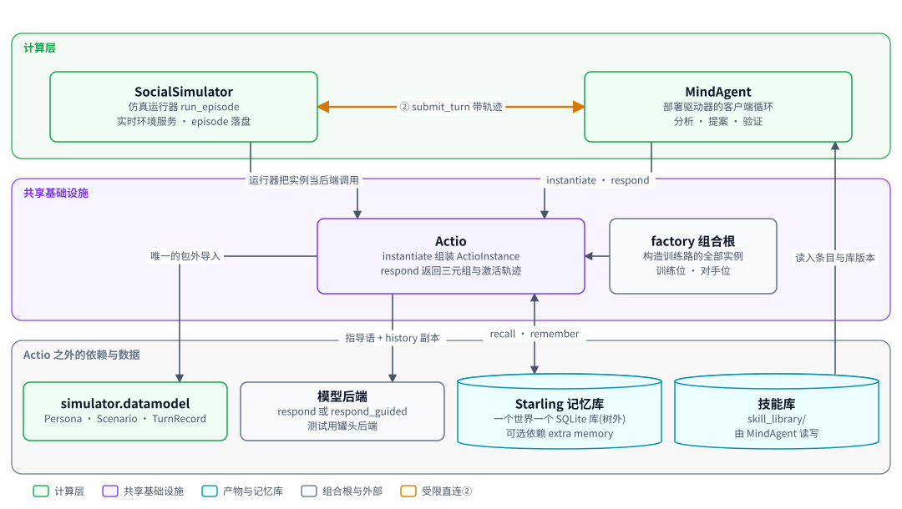
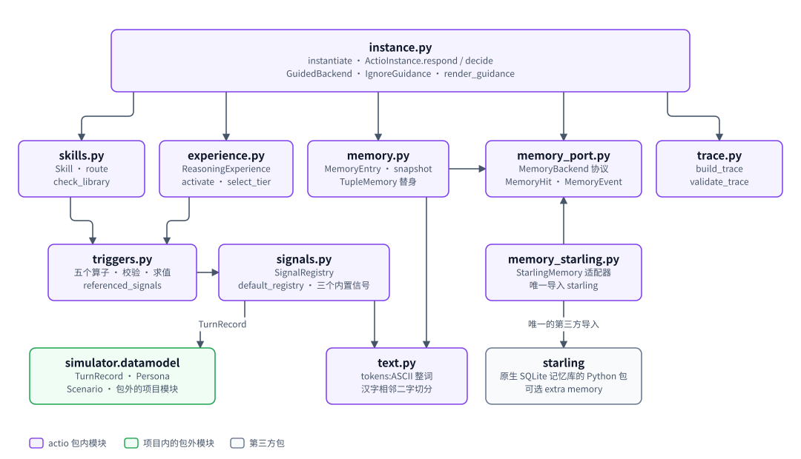
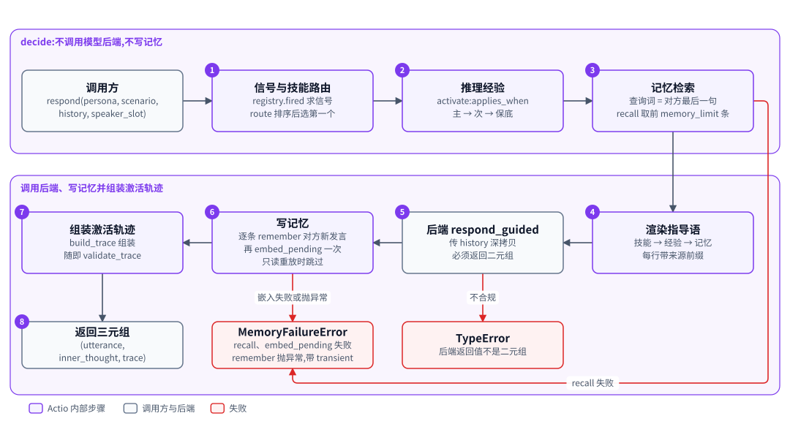
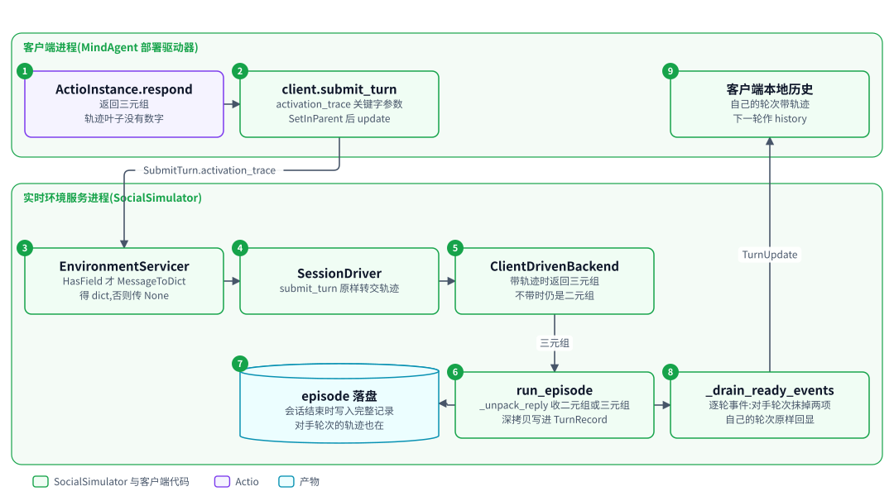

# Actio:带技能库与显式记忆的智能体框架

| 项 | 内容 |
|---|---|
| 一句话 | 把技能、推理经验与记忆渲染成指导语交给模型后端,每次响应附带激活轨迹 |
| 状态 | [已落地]:技能、推理经验、记忆、激活轨迹与协议打通,十三个源文件,408 个用例;MindAgent 部署驱动器已装配实例,但默认入口用的仍是罐头后端,真实模型是否遵循指导语未核实,见「现状」。设计二 [已落地]:记忆改经记忆端口访问,生产实现是 Starling 适配器(可选 extra `memory`),替身是内存元组;每轮回复前 recall、回复后 remember 再只做嵌入;激活轨迹升到 actio.trace.v2;部署记忆另有只给 MindAgent 的管理面,同样有替身与 Starling 两个实现;新增 `memory_port`、`memory_starling` 两个源文件 |
| 所在层 | 共享基础设施 |
| 代码位置 | `src/actio` [已落地];协议改动在 `src/simulator/realtime` 与 `src/simulator/runner.py`;记忆端口 `src/actio/memory_port.py` 与 Starling 适配器 `src/actio/memory_starling.py` [已落地] |
| 基线提交 | `b826440`(2026-10-21) |
| 依赖 | `simulator.datamodel`、Python 标准库;Starling 包(可选 extra `memory`,只有适配器导入)[已落地] |
| 被依赖 | SocialSimulator(运行器把实例当后端)、MindAgent(部署驱动器、分析器、收录处理器)、factory(组合根构造训练路的全部实例)[已落地] |
| 对应实施计划 | 工作包 6(任务 70 至 78)[已落地]。设计二的 Actio 部分:替身路径施工计划(agent-memory-standin,第 1 到 5 步中属于 Actio 的第 1 步:记忆端口、替身、每轮读写、轨迹 actio.trace.v2)[已落地];Starling 路径施工计划(agent-memory-starling,第 7 步:Starling 适配器与树外记忆配置)[已落地] |

## 0. 系统速览

<!-- shared:begin context-block -->
**系统是什么。** RismForge 是一套"AI 驱动的社会心智后训练工厂":输入通用开源基础模型,输出社会心智能力显著增强的模型,代号 **ZenGen**。工厂自己决定每一轮练什么、怎么练。训练决策可以交给外部更强的闭源模型(经命令行调用),关键决策点设人工审核门,其余环节自动。

**七个子系统。** 六个能力子系统加一个协调层 ControlPlane。

| 子系统 | 职责 | 所在层 | 现状 |
|---|---|---|---|
| ControlPlane | 协调层:git 版本化产物树、状态机、调和循环、三个审核门 | 控制层 | [已落地] |
| SocialSimulator | 情境与人格生成、多智能体仿真、实时环境服务、诊断评测 | 计算层 | [已落地];诊断默认用 mock 后端,`--evaluator someval` 装配 vLLM 加 SoMEval 的真实运行器 [已落地],真机只验证到预测阶段 |
| MindTrainer | 权重级训练:BatchTrain(SFT 后接 GRPO 加 OPD)与 InteractTrain | 计算层 | [已落地],默认入口的训练执行器是 mock;ROLL LoRA SFT 真实执行器 [已落地],由 `--executor roll` 装配,已在真实主机上端到端跑通一次 |
| MindAgent | 部署态智能体的技能与记忆自进化,不改权重 | 计算层 | [已落地],闭环里经 `--enable agent` 装配;部署驱动用的仍是罐头后端,真实模型后端未接 |
| RecipeStore | 验证有效的训练配方的版本化仓库 | 控制层 | [已落地] |
| TrainScheduler | 决策执行器:装配上下文、校验决策、构造训练指令、提名配方 | 控制层 | [已落地],含策略经验(默认关) |
| TrainPlanner | 决策学习者:经可插拔后端给出下一轮训练决策 | 控制层 | [已落地],默认后端经桥接调用命令行模型 |

共享基础设施有五个。**Actio** 是带技能库与显式记忆的智能体框架,每次响应附带激活轨迹;记忆由内嵌的 **Starling** 提供,一个人格一个树外 SQLite 库,可选 extra `memory` [已落地]。**外部推理桥接**用命令行调用外部强模型。**远端计算层** `compute` 经 SSH 在远端 GPU 主机上跑作业 [已落地]。**ROLL** 是分布式训练引擎,**vLLM** 是推理引擎。V1 经远端计算层接入 ROLL 的 LoRA SFT [已落地](由 `--executor roll` 装配,已在真实主机上从指令跑到候选一次)与 vLLM 推理服务 [已落地](命令拼装、SSH 隧道、服务生命周期;真机端到端待补)。已落地部分仍由确定性 mock 顶替。真实 GRPO 加 OPD 训练与真实 judge [推迟]。

**状态标记。** **[已落地]** 表示代码在主干上且有测试。**[计划中]** 表示设计与实施计划已定,代码还没写。**[推迟]** 表示明确不在 V1 范围内。图只画目标系统,不标进展,进展只看正文的状态标记。

**六条贯穿全系统的机制。**

| 机制 | 规则 |
|---|---|
| 产物树 | 所有协作数据是 git 树里的 YAML 产物,统一信封:`id`、`type`、`version`、`created_at`、`created_by`(含 `owner` 与 `visibility`)、`status`、`schema_version`、`links`、`payload`。checkpoint 等大体量内容只存引用 `{uri, sha256, size_bytes}`;V1 的数据集逐条 episode 进 git,只适合小规模 mock。git 树是唯一真相,读取时先经迁移器链再消费。 |
| 状态机 | 需审核类:`draft → pending_review → approved → effective`,之后可到 `deprecated` 或 `superseded`,`pending_review` 也可到 `rejected`。非审核类:`pending → executed → consumed`,`pending` 也可到 `failed`。被拒绝与失败的产物保留;被拒绝的候选进入下一轮规划的输入,失败只留痕、等人处理。 |
| 调和循环 | 纯函数 `reconcile(树视图) → 动作列表`,守护进程按间隔轮询并执行动作。循环无状态、动作幂等,进程崩溃后从 git 树续接。子系统之间不直接调用,只读写产物。 |
| 审核门 | 三道人工门:① checkpoint 晋级,② 技能与记忆增量纳入,③ 配方入库。证据不在场就不能批准:门①要诊断报告,门②要验证结果,门③要可复现性校验报告。门②与门③ [已落地]。 |
| 受限直连 | 两处高频实时调用绕过 ControlPlane:① MindTrainer 与 SocialSimulator 之间的 InteractTrain rollout,② MindAgent 与 SocialSimulator 之间的部署经验采集。两处都走 gRPC 双向流,发生在计算层内部。是否开会话仍由 ControlPlane 决策。 |
| 失败分类 | T1 瞬态:有限次指数退避重试,耗尽升为 T3。T2 确定性:不重放,按所属子系统的校验链处理,LLM 的随机输出可有限次重采样。T3 需人工:写失败记录,不自动重跑。失败是数据,不是异常。 |

**核心术语。**

| 术语 | 含义 |
|---|---|
| Run | 一轮迭代,对应产物树里的 `runs/run-<编号>/` 目录,该轮所有产物都挂在其下 |
| Directive(训练指令) | TrainScheduler 或人写入的 `directive.yaml`,调和循环据此下发训练 |
| Candidate(候选 checkpoint) | MindTrainer 产出的 `candidate_checkpoint.yaml`,经诊断评测与门①才能晋级 |
| ZenGen 版本 | 晋级后写入 `models/zengen-v<N>.yaml`;下一轮训练的基座取最新的 effective 版本 |
| Episode | 一次多轮交互的完整记录:情境、角色分配、逐轮话语、终止原因 |
| Scenario、Persona、RoleAssignment | 社会情境、人格模板,以及把角色位绑定到具体人格与模型后端的分配 |
| Recipe(配方) | 验证有效的完整训练方案,分 batch、interact、agent_rsi 三类 |
| DiagnosticReport | 诊断评测产出的报告:维度、分数、置信区间、错误类型、退化标记 |
| Activation trace(激活轨迹) | Actio 每次响应附带的记录:命中的技能候选、选中的技能、命中的记忆 |
| Evidence grade(证据等级) | 诊断报告的可信等级 `stub`、`mock`、`real`,决定它能否驱动规划与提名;缺标记一律判 `stub`,失败关闭 |
<!-- shared:end context-block -->

## 1. 定位

Actio 是部署态智能体的运行框架:不改模型权重,靠技能库与记忆改变模型的行为。

它解决两个问题。其一,让同一个模型在不同技能库下给出不同的回应,技能库可以审核、可以版本化。其二,每一轮都留下"为什么这样回应"的结构化记录,即激活轨迹,供 MindAgent 跨 episode 分析行为缺口。

设计二把 Actio 的用法扩到场景二(实时交互训练)。每个角色位都是一个 Actio 实例:训练位包着正在训练的模型,对手位包着原来的三种驱动。记忆属于个体:一个人格一个 Starling 库文件,库在仓库之外。Actio 经记忆端口访问记忆,每轮回复前读、回复后写。没设记忆配置时用内存元组替身。

Actio 不读写产物树。技能库由 MindAgent 读出来传给它,记忆端口由调用方构造好传给它,轨迹由调用方带走。它站在共享基础设施层。上游是实例化并调用它的一方:运行器、MindAgent,以及构造训练路实例的 factory 组合根。下游是模型后端与记忆库。

<!-- figure:begin 40-actio-context -->


**图 1　Actio 的上下文**　SocialSimulator 的运行器把实例当后端调用,MindAgent 的客户端循环实例化 Actio 并调用 respond,factory 组合根构造训练路的实例。Actio 把技能、经验与记忆渲染成指导语交给模型后端,包外只导入 simulator.datamodel。技能库由 MindAgent 读入后传给 Actio,Actio 自己不读产物树。记忆经记忆端口读写 Starling 的树外 SQLite 库,Starling 是可选依赖。

<details>
<summary>文字版:图中的节点与连线</summary>

**节点**

- SocialSimulator:仿真运行器 run_episode / 实时环境服务 · episode 落盘
- MindAgent:部署驱动器的客户端循环 / 分析 · 提案 · 验证
- Actio:instantiate 组装 ActioInstance / respond 返回三元组与激活轨迹
- simulator.datamodel:Persona · Scenario · TurnRecord
- 模型后端:respond 或 respond_guided / 测试用罐头后端
- Starling 记忆库:每个人格一个 SQLite 库(树外) / 可选依赖 extra memory
- 技能库:skill_library/ / 由 MindAgent 读写
- factory 组合根:构造训练路的全部实例 / 训练位 · 对手位

**连线**

- SocialSimulator → Actio:运行器把实例当后端调用
- MindAgent → Actio:instantiate · respond
- MindAgent ↔ SocialSimulator:② submit_turn 带轨迹
- Actio → 模型后端:指导语 + history 副本
- Actio ↔ Starling 记忆库:recall · remember
- Actio → simulator.datamodel:唯一的包外导入
- factory 组合根 → Actio
- 技能库 → MindAgent:读入条目与库版本

</details>
<!-- figure:end 40-actio-context -->

读图说明:

- MindAgent 读入技能库的条目和库版本,调用 `instantiate` 组装实例,再逐轮调用 `respond` [已落地]。
- SocialSimulator 的运行器 `run_episode` 把实例当后端调用,因为 `respond` 的参数与 `ModelBackend` 相同。训练路的实例由 factory 组合根构造。
- Actio 只向模型后端输出指导语列表与 history 的深拷贝;项目内的包外导入只有 `simulator.datamodel` 一处。
- 记忆经记忆端口读写:每轮 recall 在回复前,remember 在回复后。生产实现是 Starling 适配器,库文件在仓库之外,Starling 是可选 extra。
- MindAgent 与 SocialSimulator 之间的受限直连接口②经 `submit_turn` 携带轨迹,不经过 Actio。

## 2. 目标、非目标与约束

Actio 的 V1 按规则选技能、经记忆端口取记忆、把选择写进轨迹,不做学习。词面检索只留在替身里,语义检索由 Starling 提供。

### 2.1 目标

| 编号 | 目标 | 验收方式 |
|---|---|---|
| G1 | 实例的 `respond` 返回三元组 `(utterance, inner_thought, trace)` [已落地] | runner 直接把实例当后端跑完一个 episode |
| G2 | 选中的技能改变模型输出 | 罐头后端回显指导语,有技能与无技能的输出不同 |
| G3 | 激活轨迹经 gRPC 往返与落盘后逐字段、逐类型相等 | 端到端测试经真实 loopback 服务端比对 |
| G4 | 路由、快照、检索、三级回退都是纯函数 | 同输入同输出;结果与输入顺序无关 |
| G5 | 坏数据构造不出来 | 直接构造与 `from_dict` [已落地] 走同一套校验,报错指出字段 |
| G6 | 包的依赖边界可机器检查 | 静态测试用 `ast` 扫描全部导入 |
| G7 | 记忆端口的两种实现过同一套契约测试与规范样例 | 固定事件序列下,替身与 Starling 给出同样的命中顺序与摘要变化曲线 |
| G8 | 每轮读写可复现 | 同一起点副本、同一输入序列,`decide` 的结果相同;记忆的逻辑摘要与文件字节无关 |

### 2.2 非目标与推迟项

| 项 | 状态 | V1 的处理 |
|---|---|---|
| 技能库的产物读写、`library_state` | 不在本包 | 由 MindAgent 的收录处理器读写,本包只给字典形状 |
| 记忆库文件的创建、副本、清扫 | 不在本包 | 由 factory 与 MindAgent 管,MindAgent 经本包的部署记忆管理面操作部署库,实例只持有端口并在 `close` 时转发 |
| 语义检索、近义词匹配 | 由 Starling 提供 | 替身仍只做词面重叠与二字切分 |
| 记忆按主体过滤 | [推迟] | 替身的 `retrieve` 支持 `subjects` 参数,实例不传;Starling 路径一个人格一个库,靠文件隔离 |
| `profile` 参与决策 | [推迟] | 只深拷贝保存 |
| 记录"后端是否照做指导语" | [推迟] | 轨迹只记录路由决定 |
| MindTrainer 的 InteractTrain 接 Actio 实例 | [已落地] | 训练位与对手位都是实例;轨迹源接受二元组或三元组,MindTrainer 不导入 Actio |

### 2.3 质量属性与硬约束

| 约束 | 内容 | 影响 |
|---|---|---|
| 依赖边界 | 只导入 `actio` 自身、`simulator.datamodel` 与标准库;唯一例外是 `actio/memory_starling.py` 导入 `starling` | 后端协议在本包按结构重新声明;没设记忆配置就用替身并在启动日志里写明;设了配置,未装 Starling 时适配器不可导入,装配期拒绝 |
| 轨迹无数字 | 轨迹叶子只有 `str`、`None`、`bool` | 库版本整数在入口处转成十进制字符串;记忆计数同样是十进制字符串 |
| 无全局可变状态 | 信号注册表是实例,`default_registry()` [已落地] 每次新建 | 并发会话互不影响 |
| 新参数 keyword-only | `instantiate` 除后端外、三处 `activation_trace` 参数;新增的 `memory`、`episode_id`、`interlocutors`、`replay_read_only` 同样 | 位置传入抛 `TypeError` |
| 既有测试不改 | 二元组后端与既有用例照旧通过;`memories=` 保留为替身记忆的简写 | 不带轨迹时 `ClientDrivenBackend` 仍返回二元组;断言 actio.trace.v1 的用例随升级改写 |
| 记忆调用的时间上限 | 每次网络调用至多 4 秒、不重试,一轮最坏合计 20 秒 | 一轮五次:召回嵌入查询词一次,写入抽取三次(信念、一般事实、情节),嵌入一批 |
| 脱离真实环境可测 | 不需要 GPU、外部网络、真实模型 | 用罐头后端与 loopback gRPC |

## 3. 架构

Actio 是十三个源文件的纯 Python 包,`instance` 在顶,`text` 在底,依赖只朝下。其中两个是设计二加的:记忆端口 `memory_port` 与 Starling 适配器 `memory_starling`。

<!-- figure:begin 40-actio-architecture -->


**图 2　Actio 的模块组成**　instance 在顶层编排技能路由、推理经验、记忆端口与轨迹组装。技能与经验共用触发谓词语言,谓词语言从信号注册表取信号,信号与替身记忆共用一处词面切分。记忆端口 memory_port 只定义协议与数据类型;memory 里的 TupleMemory 与 memory_starling 里的 StarlingMemory 是它的两个实现,starling 包只被 memory_starling 导入。箭头指向被导入的模块。errors 与 _check 被各模块导入,不画线。

<details>
<summary>文字版:图中的节点与连线</summary>

**节点**

- instance.py:instantiate · ActioInstance.respond / decide / GuidedBackend · IgnoreGuidance · render_guidance
- skills.py:Skill · route / check_library
- experience.py:ReasoningExperience / activate · select_tier
- memory.py:MemoryEntry · snapshot / TupleMemory 替身
- memory_port.py:MemoryBackend 协议 / MemoryHit · MemoryEvent
- trace.py:build_trace / validate_trace
- triggers.py:五个算子 · 校验 · 求值 / referenced_signals
- signals.py:SignalRegistry / default_registry · 三个内置信号
- memory_starling.py:StarlingMemory 适配器 / 唯一导入 starling
- simulator.datamodel:TurnRecord · Persona / Scenario · 包外的项目模块
- text.py:tokens:ASCII 整词 / 汉字相邻二字切分
- starling:原生 SQLite 记忆库的 Python 包 / 可选 extra memory

**连线**

- instance.py → skills.py
- instance.py → experience.py
- instance.py → memory.py
- instance.py → memory_port.py
- instance.py → trace.py
- skills.py → triggers.py
- experience.py → triggers.py
- triggers.py → signals.py
- signals.py → simulator.datamodel:TurnRecord
- signals.py → text.py
- memory.py → text.py
- memory.py → memory_port.py
- memory_starling.py → memory_port.py
- memory_starling.py → starling:唯一的第三方导入

</details>
<!-- figure:end 40-actio-architecture -->

读图说明:

- `instance.py` 编排一次响应,它导入技能、经验、记忆、记忆端口、轨迹五个模块。
- 技能与经验共用 `triggers.py` 的谓词语言,谓词里的信号来自 `signals.py`。
- `signals.py` 与 `memory.py` 都用 `text.py` 切词面。
- `memory_port.py` 只定义协议与数据类型,不依赖任何实现。`memory.py` 里的 TupleMemory 与 `memory_starling.py` 里的 StarlingMemory 是端口的两个实现。部署记忆管理面也有两个实现:FileTupleStore 在 `memory.py`,StarlingDeploymentStore 在 `memory_starling.py`。
- 只有 `memory_starling.py` 导入第三方包 `starling`。图里 `memory_starling` 只画了导入 `memory_port` 与 `starling` 两条线,它对 `errors` 的导入与其他模块一样从略。
- `errors.py` 与 `_check.py` 被各模块导入,图里不画连线。项目内的包外依赖只有 `simulator.datamodel`,已落地。`signals`、`triggers`、`skills`、`experience`、`instance` 五个模块都导入它,图里只画了 `signals` 一条,其余从略。
- 第三方依赖只有 `starling`,只被 `memory_starling.py` 导入。

### 3.1 模块表

| 模块 | 职责 | 依赖 | 状态 |
|---|---|---|---|
| `actio/errors.py` | `ActioDataError`,本包数据错误的基类 | 无 | [已落地] |
| `actio/_check.py` | 构造与 `from_dict` 共用的字段校验 | `errors` | [已落地] |
| `actio/text.py` | 词面切分 `tokens` | 标准库 `re` | [已落地] |
| `actio/signals.py` | `SignalRegistry` 与三个内置信号 | `text`、`simulator.datamodel` | [已落地] |
| `actio/triggers.py` | 五算子谓词语言:校验、求值、`referenced_signals` | `signals`、`simulator.datamodel` | [已落地] |
| `actio/skills.py` | `Skill`、`route`、`check_library` | `triggers`、`_check`、`simulator.datamodel` | [已落地] |
| `actio/memory.py` | `MemoryEntry`、`snapshot`、`retrieve`;TupleMemory:包 `MemoryEntry` 元组与 `retrieve` 的替身记忆,召回给出的 id 一律是内容 id,不用条目自带的 `id`;FileTupleStore:部署记忆管理面的替身实现,条目与事件表存成 JSON 文件 | `text`、`_check`;替身另依赖 `memory_port` | [已落地] |
| `actio/memory_port.py` | 记忆端口:MemoryBackend 协议、MemoryHit、MemoryEvent、RememberOutcome、MemoryFailureError、MemoryEventConflict、MemoryClosedError,以及部署记忆管理面协议 DeploymentMemoryStore。放独立文件而不是并进 `memory.py`,因为适配器与替身都依赖它,并进去会让适配器导入 `MemoryEntry` 的校验链 | `errors` | [已落地] |
| `actio/memory_starling.py` | StarlingMemory:包一个 `starling.Memory`,把 Starling 的行渲染成 MemoryHit,把 Starling 的失败按穷举映射成 MemoryFailureError;StarlingDeploymentStore:部署记忆管理面的 Starling 实现。唯一导入 `starling` 的文件 | `memory_port`、`errors`、第三方包 `starling` | [已落地] |
| `actio/experience.py` | `ReasoningExperience`、三级回退 | `triggers`、`_check`、`simulator.datamodel` | [已落地] |
| `actio/trace.py` | 轨迹模式:`build_trace`、`validate_trace`;升到 actio.trace.v2,校验接受 actio.trace.v1 与 actio.trace.v2 | `errors` | [已落地] |
| `actio/instance.py` | `instantiate`、`ActioInstance`、后端协议与适配器;实例持记忆端口,每轮读写 | 除 `memory_starling` 外的以上全部、`simulator.datamodel` | [已落地] |

### 3.2 协议改动涉及的已落地文件

| 文件 | 现状 | 改动 | 状态 |
|---|---|---|---|
| `src/simulator/realtime/proto/realtime_env.proto` | `SubmitTurn` 有 `utterance`、`inner_thought` 与可选的 `Struct activation_trace = 3` | 加 `optional google.protobuf.Struct activation_trace = 3` | [已落地] |
| `src/simulator/runner.py` | 115 行,`_unpack_reply` 接受二元组或三元组,轨迹深拷贝进 `TurnRecord` | 新增 `_unpack_reply` 接受二元组或三元组 | [已落地] |
| `src/simulator/realtime/backend.py`、`driver.py`、`client.py` | 73、168、256 行,提交入口都收 keyword-only 的 `activation_trace` | 各加 keyword-only 的 `activation_trace` | [已落地] |
| `src/simulator/realtime/servicer.py` | 344 行,`_drain_ready_events` 已只抹对手轮次;`submit_turn` 分支按 HasField 解出轨迹 | `submit_turn` 分支解出轨迹;回显规则不改 | [已落地] |
| `src/simulator/realtime/codec.py` | 编码时先 SetInParent 再写入,保留空轨迹;解码用 MessageToDict 转回 dict | 不改 | [已落地] |

三个生成文件 `realtime_env_pb2.py`、`realtime_env_pb2.pyi`、`realtime_env_pb2_grpc.py` 只由 `scripts/gen_realtime_proto.sh` 产生,不手改。

### 3.3 依赖方向规则

| 包 | 可以导入 | 不得导入 |
|---|---|---|
| `actio` [已落地] | 自身、`simulator.datamodel`、标准库 `__future__`、`copy`、`dataclasses`、`re`、`typing`;替身与摘要另用 `datetime`、`hashlib`、`json`、`pathlib`。依赖边界测试 `tests/test_actio_instance.py` 的白名单与此一致 | `controlplane`、`simulator.backends`、`simulator.realtime`、任何第三方包 |
| `actio/memory_starling.py` [已落地] | 上一行允许的全部,加标准库 `os`、`tempfile`、`shutil`、`contextlib`、`collections.abc`、`functools`,加第三方包 `starling` | 其余文件一律不得导入 `starling`;适配器不得被 `actio` 的其他模块导入,装配方在组合根按需导入它 |
| `simulator` | 不变 | `actio`、`starling`(运行器按结构调用后端,不导入) |
| `mindtrainer` | 不变 | `actio`、`starling`(轨迹源只认策略返回的二元组或三元组) |

## 4. 数据模型与状态机

Actio 管四类实体:技能、记忆条目、推理经验、激活轨迹。前三者是冻结数据类,后者是纯字典。设计二再加记忆端口的几个类型。

### 4.1 实体表

| 实体 | 字段与含义 | 约束 |
|---|---|---|
| `Skill` [已落地] | `id`、`version`、`level`(`macro` 宏观 / `micro` 微观)、`priority`、`trigger` 触发条件、`policy_instructions` 指令、`description` | id 以 `skill-` 开头且前缀后非空;`version` 是不小于 1 的整数;`priority` 默认 0,越大越优先 |
| `MemoryEntry` [已落地] | `id`、`version`、`subject` 主体、`content`、`timestamp`、`confidence`、`source_episode`、`keywords` | id 以 `mem-` 开头;时间戳严格为 `YYYY-MM-DDTHH:MM:SSZ`;置信度在 [0, 1],整数转 `float`。设计二里它只是替身记忆的条目 |
| MemoryHit [已落地] | `id`、`text` | `id` 是内容 id:Starling 一侧是 `mem-` 加规范化语句行(不含 UUID 与簿记列)sha256 的前 16 位;替身是 `mem-` 加 `[subject, content]` 的 JSON 的 sha256 前 16 位,以 `mem-` 开头所以过轨迹校验;`text` 是渲染好的一句 |
| MemoryEvent [已落地] | `key`、`text`、`interlocutor` 对话方 | `key` 是 `<逻辑 episode id>#<turn_index>`;部署的 key 前面再加轮次 id,写成 `<round_id>/deploy-...#<turn_index>`,否则下一轮同名 episode 撞上已 `committed` 的 key。没有 `seq` 字段:事件序号由库在写事件行时分配,决定写入时钟,实例不计数 |
| RememberOutcome [已落地] | `stored`、`failed`、`category` | `category` 取 Starling 的 `failure_category` |
| DeploymentMemoryStore [已落地] | 按人格 id 操作的七个方法:`open`、`remember_event`、`abandon_event`、`pending_events`、`backup_to`、`restore_from`、`digest` | 只给 MindAgent 的部署记忆管理面,放在 `actio`,所以 MindAgent 不导入 `starling`。两个实现:StarlingDeploymentStore 与 FileTupleStore(JSON 落盘,替身也有提交点)。`restore_from` 在该人格还有打开的端口时抛 MemoryFailureError,`transient` 为假。人格 id 须匹配 `^[A-Za-z0-9][A-Za-z0-9._-]{0,127}$`,两个实现拼路径前都校验,不合法抛 `ActioDataError` |
| MemoryRuntimeIdentity [已落地] | 字典:`backend`、`starling_version`、`extraction`、`embedding`、`trace_schema` | 记录记忆行为由什么决定;换其中任一项,记忆行为就变。由组合根写进训练记录与部署轮次产物,Actio 自己只在轨迹里写 `trace_schema` |
| `ReasoningExperience` [已落地] | `id`、`version`、`pattern`、`applies_when`、三级 `primary`、`secondary`、`fallback` | `fallback.when` 必须为 `None`,另两级必须有触发条件;id 不受前缀约束 |
| `Tier` [已落地] | `when` 触发条件、`instructions` | 指令是非空字符串元组 |
| 触发条件 | 恰好一个键的字典 | 算子只有 `signal`、`all`、`any`、`not`、`turn_at_least` 五种 |
| 激活轨迹 | 八个键(actio.trace.v1)或九个键(actio.trace.v2),形状见 4.3 | 叶子没有数字 |
| `RouteResult` [已落地] | `candidates`(技能 id 元组,已按路由次序排好)、`selected`(`Skill` 或空)、`signals`;`conflict` 是由 `candidates` 数量派生的布尔属性,不是构造字段,与激活轨迹里的同名字典键不同 | `selected` 恒为 `candidates[0]` |
| `ExperienceActivation` [已落地] | `experience_id`、`tier`、`instructions` | `tier` 取 `primary`、`secondary`、`fallback` 之一 |

所有数据类 `frozen=True`,校验放在 `__post_init__`。字符串序列字段只接受 `tuple`,拒绝 `str`,否则一个字符串会被逐字当成多条指令。整数字段拒绝 `bool` 与浮点数。

记忆端口的三个异常:

| 异常 | 何时抛 | 说明 |
|---|---|---|
| MemoryFailureError | `recall`、`embed_pending` 失败,或 `remember` 抛出异常 | 带布尔属性 `transient`,由适配器按穷举映射给出,见第 8 章 |
| MemoryEventConflict、MemoryClosedError | 前者:同 `key` 已存在且文本不同,或该 key 已放弃。后者:`close` 之后再调用除 `close` 外的任何方法(再调 `close` 是空操作) | 都是 MemoryFailureError 的子类,`transient` 为假;适配器把 Starling 的同类异常译成冲突。已关闭的实例不能复用 |

逻辑摘要的算法。`digest()` 对本租户下的三张表算同一个 sha256:

| 项 | 规则 |
|---|---|
| 进摘要 | 语句表、向量表、事件表的全部列(全行,不按状态过滤),减去下一行的排除清单。向量进摘要,因为同一个模型名在外部端点上不保证给出同一个向量;事件表里已放弃的行只计 `key` 与 `state` |
| 排除清单 | `id`、`stmt_id`、`created_at`、`updated_at`、`last_accessed`、`access_count`、`last_replayed`、`replay_count`、`last_replay_batch_id`、`retry_count`、`last_attempt_at`、`embedded_at`、`inferred_at`;`confidence_history_json` 里每个条目的 `ts`(规范化时去掉);engram 的 UUID 换成 `engram:<content_hash>`;`observed_at` 在写入端改取 engram 的 `created_at`,不随墙钟变;其他所有表 |
| 规范化 | 引用语句 UUID 的列(`supersedes_id`、`derived_from_json`、事件表的 `statement_ids_json`、向量表 `stmt_id` 的归属)一律换成被指向语句的内容 id。指向不存在的语句时换成固定串 `missing`。每行按列名排序后写成 JSON,行之间按内容 id 排序,整体算 sha256;空库的摘要是固定值 |
| 替身 | TupleMemory 对 `snapshot(entries)` 的结果(召回实际看到的条目,不是原始列表)逐条 `to_dict()` 去掉 `id` 后的排序列表,加事件表,算同样形状的 sha256。Starling 一侧按全行:被取代的行改为 `archived` 仍是召回候选,`volatile` 与 `pending_review` 行影响后续写入的冲突探测,所以都进摘要。两边原则一致:影响召回或后续写入的行进摘要 |

### 4.2 触发条件的谓词语言

| 算子 | 写法 | 为真的条件 |
|---|---|---|
| `signal` | `{"signal": "emotion_high"}` | 该已注册信号此刻为真 |
| `all` | `{"all": [节点, ...]}`,非空 | 全部子节点为真 |
| `any` | `{"any": [节点, ...]}`,非空 | 任一子节点为真 |
| `not` | `{"not": 节点}` | 子节点为假 |
| `turn_at_least` | `{"turn_at_least": n}`,n 为非负整数 | `len(history) >= n` |

三个内置信号的签名都是 `(history, speaker_slot) -> bool`,只看对方说的话:

| 信号 | 为真的条件 |
|---|---|
| `emotion_high` | 对方最后一句含情绪词典任一词,或含两个及以上感叹号(半角或全角) |
| `no_new_information` | 对方至少说过两句,且最后一句的词面全都在它此前的话里出现过 |
| `first_turn` | 说话者此前一句都没说过 |

词面切分 `tokens` 只有一处定义:ASCII 词按小写整词;连续汉字按相邻二字切分;单字汉字串保留单字;标点丢弃。

### 4.3 激活轨迹模式

轨迹的 `schema` 是字符串 actio.trace.v1 或 actio.trace.v2。actio.trace.v1 的键集合恰好八个。设计二升到 actio.trace.v2,在八个键之外加一个 `memory`,键集合恰好九个。下面先给 actio.trace.v1 的八个键。

```yaml
schema: actio.trace.v1
signals: [emotion_high, first_turn]      # 此刻为真的信号名,严格升序
candidates: [skill-calm, skill-firm]     # 命中的技能,按路由次序
selected: skill-calm                     # == candidates[0];无候选时为 null
conflict:                                # 候选多于一个时为字典,否则为 null
  skills: [skill-calm, skill-firm]
  rule: priority_desc,version_desc,id_asc
memory_hits: [mem-temper]                # 检索到的记忆 id
experience: null                         # 或 {id, tier}
library_version: {skill: "4", memory: mem-lib-1}  # 两个非空字符串
```

| 规则 | 内容 |
|---|---|
| 无数字 | 叶子只有 `str`、`None`、`bool`;`bool` 目前没有用到,预留 |
| 不重复 | 三个列表都不得有重复项 |
| 前缀 | `candidates` 每项以 `skill-` 开头,`memory_hits` 每项以 `mem-` 开头 |
| 自洽 | `selected == candidates[0]`;`conflict.skills == candidates` |
| 没有轨迹 | `TurnRecord.activation_trace is None`:裸模型的轮次,以及下发给客户端的对手轮次回显。对手位换成 Actio 实例后,落盘 episode 里的对手轮次带轨迹,只是不下发 |
| 空轨迹 | Actio 的每一轮都有完整轨迹;一个技能都没命中时 `candidates == []`、`selected is None` |

actio.trace.v2 多出的 `memory` 键:

```yaml
schema: actio.trace.v2
memory: {digest_before: <sha256>, remembered: "2", extraction_failed: "0"}
```

| 规则 | 内容 |
|---|---|
| 三个值 | `memory` 恰好三个键,值都是非空字符串;`digest_before` 是这一轮 recall 之前记忆的逻辑摘要 |
| 计数是字符串 | `remembered`、`extraction_failed` 是实例构造以来的累计数,写成 ASCII 十进制串,与 `library_version` 同一规矩,经 `Struct` 往返不失真;计数随轨迹落盘,`Episode` 不加元数据字段 |
| 新旧并存 | 凡是带记忆端口构造的实例都产出 actio.trace.v2,包括 `memories=` 简写的替身;actio.trace.v1 只剩旧的落盘 episode。消费方(分析器、`_reusable`)两者都接受;`memory_hits` 的校验不变 |

### 4.4 产物与路径

| 产物类型 | 路径 | 状态机种类 | 写方 | 状态 |
|---|---|---|---|---|
| 激活轨迹 | episode 里每个 `TurnRecord` 的 `activation_trace` 字段 | 无,随 episode 一次写入 | SocialSimulator 的运行器 | [已落地] |
| 技能条目 | `skill_library/` 下的 `skill` 产物 | 由 MindAgent 管 | MindAgent 收录处理器 | [已落地] |
| 记忆条目 | `memory_library/` 下的 `memory` 产物 | 由 MindAgent 管 | 无:已废弃,记忆不再写这里,目录必须为空 | [已落地] |
| 记忆库文件 | 仓库之外的 `<root>/…/<persona_id>.db`,每个人格一个 Starling SQLite 库 | 无,文件内部有 `pending/committed/abandoned` 事件状态(见 4.5) | 训练副本由 factory 创建,部署库由 MindAgent 经管理面创建、备份与覆盖;Actio 实例经端口读写 | [已落地] |

Actio 自身不写任何产物。技能的 `to_dict()` 原样作为产物的 `payload`;`MemoryEntry` 的 `to_dict()` 现在只供替身记忆与摘要使用。记忆库文件不进 git 树,因为原生 SQLite 带预写日志,文件字节不稳定。

### 4.5 状态机

Actio 自己没有状态机,所以本文没有状态机图。实例是冻结的:组装后技能、经验、库版本都不变,换库就重新 `instantiate`。替身记忆的"版本演进"由快照规则表达:每个 id 取 `timestamp <= at` 的最高版本。

记忆端口背后有一套事件状态,存在库内的事件表里,由端口实现维护。五个方法里 `remember` 推进它;`close` 只关库,不放弃任何事件(放弃是终态,同 key 再写会抛冲突,放早了就堵死重试)。一次事件写入分三段,不是同一段提交:

| 段 | 动作 | 崩在这一段时,再调同 key 同文本 |
|---|---|---|
| ① | 短事务写 `pending` 事件行,含原文与 `interlocutor`;库在此刻分配序号 | 行与原文都在,用行里的原文再抽 |
| ② | 事务之外调 Starling 的 `remember`,抽取走网络 | 语句可能已落库而收据没填:按 `engram_ref` 查已有语句补收据,不二次抽取 |
| ③ | 短事务改 `committed`,填 `engram_ref` 与语句 id | 已是终态,返回首次的语句 id,幂等 |

| 状态 | 含义 | 进入 | 出口 |
|---|---|---|---|
| `pending` | 第一段已提交:事件行(含原文)已写,抽取还没成功 | 新 key 的第一次 `remember` | 同 key 同文本再调:按 `engram_ref` 查到已有语句就补成 `committed`,否则用行里的原文再抽;被放弃转 `abandoned` |
| `committed` | 第三段已提交:收据(`engram_ref` 与语句 id)已填 | `pending` 抽取成功 | 终态,不许放弃;同 key 同文本再调返回幂等结果和首次相同的语句 id |
| `abandoned` | 调用方放弃,以后任何路径都不推进它 | `pending` 被放弃 | 终态;同 key 再调抛 MemoryEventConflict;放弃未知 key 抛 MemoryFailureError(`transient` 为假),已放弃再放弃为空操作 |

`pending` 行没有自动恢复,只在调用方再次对同一 key 调用时推进。训练副本用完即弃,不会带着 `pending` 行进下一条 rollout。部署库里的 `pending` 行各有主人:对话事件归产生它的 episode,门② 事件归提案。放弃不进端口签名,也不在 `close()` 里做:要等调用方知道这条 episode 最终成功还是失败。部署库由 MindAgent 经管理面放弃:episode 成功提交后对它留下的 `pending` 行逐个 `abandon_event`,最终失败前先用起点副本 `restore_from`,回滚后库里本来就没有这条 episode 的事件行。门② 的事件不经实例,由管理面写与放弃。

### 4.6 不变量

1. 同一实例、同一输入,`decide` [已落地] 的结果恒定,且与技能输入顺序无关。
2. 快照检测损坏(同 id 同版本内容不同)先于 `at` 过滤,所以与输入顺序无关。
3. 后端拿到的是 history 的深拷贝,改它不影响调用方。
4. 运行器写进 `TurnRecord` 的轨迹是深拷贝,后端事后改自己的字典不污染 episode。
5. 轨迹只能由 Actio 产生:带指导语的后端返回三元组时抛 `TypeError`。
6. 同一起点副本、同一输入序列,`decide` 的结果恒定。`decide` 只读记忆,不改记忆。训练副本每轮只做嵌入,不做后台维护:后台维护有随机性和负载门控,会让同一起点得到不同状态。新写的语句在 Starling 里是 `volatile`,向量召回只取 `consolidated`、`archived`,只有 `tick` 的回放会巩固它;所以适配器的 `recall` 显式放宽到 `volatile`(review 与 holder 守卫不变),代价是这些行没经回放去重,召回里可能有近重复。Starling 的 top-k 用零分行补满 k 条,适配器丢掉 `score <= 0.0` 的命中。
7. 记忆 id 是内容 id:同样内容在任何库里得到同一个 id。所以 id 进了 prompt,相同的逻辑状态也产生相同的输入。
8. 实例关闭后不再读写:`close` 只关库,不放弃事件;Starling 一侧先等门面在途调用返回,再合并 WAL 并关连接。之后任何调用抛 MemoryClosedError。

## 5. 接口契约

入口都在主干上,签名以代码为准。

### 5.1 入口签名

```python
# actio.instance
class ActioInstance:
    def respond(self, persona, scenario, history, speaker_slot
                ) -> tuple[str, str | None, dict]: ...
    def decide(self, history, speaker_slot
               ) -> tuple[RouteResult, ExperienceActivation | None, list[MemoryHit]]: ...

class GuidedBackend(Protocol):
    def respond_guided(self, persona, scenario, history, speaker_slot,
                       guidance: list[str]) -> tuple[str, str | None]: ...
```

设计二新增的签名:

```python
# actio.memory_port:记忆端口,一个端口实例只属于一个智能体,所以没有 holder
class MemoryBackend(Protocol):
    def recall(self, query: str, *, limit: int) -> list[MemoryHit]: ...
    def remember(self, event: MemoryEvent) -> RememberOutcome: ...
    def embed_pending(self) -> int: ...      # 只做嵌入,返回成功条数;有失败就抛瞬态 MemoryFailureError
    def digest(self) -> str: ...             # 逻辑摘要,sha256 十六进制
    def close(self) -> None: ...             # 只关库,不放弃事件

# actio.instance.instantiate:memories 与 memory 恰好给一个,其余是 keyword-only
def instantiate(model_backend, *, skills, library_version, profile,
                memories=None, memory=None, episode_id=None, interlocutors=None, replay_read_only=None,
                experiences=(), registry=None, memory_limit=3) -> ActioInstance: ...
```

```python
class DeploymentMemoryStore(Protocol):   # actio.memory_port;只给 MindAgent 用,按人格 id 操作
    def open(self, persona_id: str) -> MemoryBackend: ...
    def remember_event(self, persona_id, key, text, *, interlocutor) -> RememberOutcome: ...
    def abandon_event(self, persona_id, key) -> None: ...
    def pending_events(self, persona_id) -> list[str]: ...
    def backup_to(self, persona_id, path) -> str: ...      # 返回副本的逻辑摘要
    def restore_from(self, persona_id, path) -> str: ...   # 端口未全关则抛 MemoryFailureError
    def digest(self, persona_id) -> str: ...
```

| 入口 | 行为 | 状态 |
|---|---|---|
| `instantiate` | 校验技能库、记忆与经验类型、经验 id 不重复、信号已注册;库版本规范成字符串;`profile` 深拷贝 | [已落地] |
| `instantiate` 的记忆参数 | `memory` 与 `memories` 恰好给一个,`memories` 保留为 TupleMemory 的简写,只给它时默认只读。`interlocutors` 是角色位到人格 id 的映射,事件文本用它写说话方。`episode_id` 是调用方在构造时给出的逻辑 episode id(部署时带轮次前缀 `<round_id>/deploy-...`),一个实例对应一条 episode,事件 key 以它为前缀。`memory` 可写(`replay_read_only` 为假)而没给 `episode_id` 时,`instantiate` 抛 `ActioDataError`(它是 `ValueError` 的子类):没有 key 就写不了事件,静默跳过会让训练少写记忆而不自知 | [已落地] |
| `ActioInstance.respond` | 七步流程,返回三元组 | [已落地] |
| `ActioInstance.respond` 的记忆步 | 在后端回复与组装轨迹之间加写记忆,成八步。自己上一次发言之后的每句他人发言按顺序 remember,再 `embed_pending` 一次。`replay_read_only` 为真时整步跳过 | [已落地] |
| `ActioInstance.decide` | 只做路由、经验、记忆,不调后端 | [已落地] |
| `ActioInstance.decide` 的记忆项 | 经端口 recall 取命中,返回值里的记忆项是 MemoryHit 列表;只读,不改记忆 | [已落地] |
| `ActioInstance.close` | 转发给端口的 close:只关库,不放弃事件;之后任何读写抛 MemoryClosedError | [已落地] |
| `as_guided` | 有 `respond_guided` 原样返回;只有 `respond` 套 `IgnoreGuidance` [已落地];都没有抛 `TypeError` | [已落地] |
| `render_guidance` | 固定顺序"技能 → 经验 → 记忆",每行带来源前缀 | [已落地] |
| `render_guidance` 的记忆行 | 收 MemoryHit 列表,记忆行写成 `[memory:<内容 id>] <text>` | [已落地] |
| `build_trace`、`validate_trace` | 组装后立即校验;MindAgent 读落盘轨迹时再校验一次 | [已落地] |
| 轨迹 actio.trace.v2 | 带记忆端口的实例产出的轨迹多一个 `memory` 键;`validate_trace` 同时接受 actio.trace.v1 与 actio.trace.v2 | [已落地] |
| `normalize_library_version` | 整数库版本转十进制字符串,`3 → "3"` | [已落地] |
| `route`、`retrieve`、`snapshot`、`activate` | 纯函数,供 MindAgent 离线重放 | [已落地] |

对外名字:

| 模块 | 名字 |
|---|---|
| `actio.errors` | `ActioDataError`,本包所有数据错误的基类 [已落地] |
| `actio.signals` | `SignalRegistry`(`register`、`get`、`names`、`fired`)、`default_registry`、`DEFAULT_EMOTION_LEXICON`、`make_emotion_high`、`no_new_information`、`first_turn` [已落地] |
| `actio.triggers` | `InvalidTriggerError`、`validate_trigger`、`evaluate_trigger`、`referenced_signals`(只计偶数层 `not` 之下的信号,所以 `{"not": {"signal": X}}` 不算针对 X,分析器据此判断技能是否针对某信号) [已落地] |
| `actio.skills` | `SKILL_ID_PREFIX`、`Skill`、`RouteResult`、`route_order`、`check_library`、`route` [已落地] |
| `actio.memory` | `MEMORY_ID_PREFIX`、`MemoryEntry`、`snapshot`、`overlap`、`retrieve`、`content_id`、TupleMemory、FileTupleStore [已落地] |
| actio.memory_port | MemoryBackend、MemoryHit、MemoryEvent、RememberOutcome、MemoryFailureError、MemoryEventConflict、MemoryClosedError、DeploymentMemoryStore、`PERSONA_ID_PATTERN` [已落地] |
| actio.memory_starling | StarlingMemory、StarlingDeploymentStore [已落地],前者构造时收一个已打开的 `starling.Memory` |
| `actio.experience` | `ReasoningExperience`、`Tier`、`ExperienceActivation`、`select_tier`、`activate` [已落地] |
| `actio.trace` | `TRACE_SCHEMA_V1`、`TRACE_SCHEMA_V2`、`TIE_BREAK_RULE`、`TRACE_KEYS`、`TRACE_KEYS_V2`、`MEMORY_TRACE_KEYS`、`build_trace`、`validate_trace`、`normalize_library_version` [已落地] |
| `simulator.realtime.client` | `EnvironmentServiceClient.submit_turn(utterance, inner_thought=None, *, activation_trace=None)` [已落地] |

指导语每行的前缀:

| 来源 | 前缀格式 |
|---|---|
| 技能 | `[skill:<id>] <指令>` |
| 推理经验 | `[experience:<id>/<tier>] <指令>` |
| 记忆 | `[memory:<内容 id>] <text>`。替身的 text 是 `<subject>: <content>`,与迁移前的写法逐字相同,只是 id 换成内容 id;Starling 适配器渲染成 `<subject_id> <predicate> <object_value>(<modality>,置信度 <confidence>)`,否定语句在谓词前加「不」,不渲染嵌套层次 |

### 5.2 协议改动的接口

| 接口 | 改动 | 状态 |
|---|---|---|
| `SubmitTurn.activation_trace` | 新增可选 `Struct` 字段,编号 3 | [已落地] |
| `EnvironmentServiceClient.submit_turn`、`SessionDriver.submit_turn`、`ClientDrivenBackend.submit` | 各加 `*, activation_trace=None`;客户端非 `None` 时先 SetInParent 再 update;`respond` 带轨迹返回三元组,不带仍返回二元组 | [已落地] |
| `run_episode` | 签名不变;后端可返回长度 2 或 3 的 `tuple` 或 `list`,其余抛 `TypeError`;第三项必须是字典或空,写进 `TurnRecord` 的是深拷贝;协议层不对轨迹做数字规范化,取回什么存什么 | [已落地] |
| `CreateSession.episode_id` | 新增可选字段,调用方给出的逻辑 episode id。Actio 的事件 key 以它为前缀,服务端落盘的 episode 也用它当 id;部署的事件 key 另带轮次前缀,这个字段与落盘文件名仍是不带轮次的 `deploy-...`(白名单不含 `/`)。重试不换 id,所以同一句话重写是同一个事件 | [已落地] |
| 训练位的三元组上行 | InteractTrain 的轨迹源接受策略返回的二元组或三元组,第三项作为 `activation_trace` 随 `submit_turn` 上行;二元组照旧 | [已落地] |

### 5.3 产物读写约定

Actio 不读写产物树。技能、记忆、推理经验的 `to_dict()` 与 `from_dict()` [已落地] 是 MindAgent 写产物时的唯一形状。记忆条目不再写成产物,`MemoryEntry` 的字典形状只供替身记忆与摘要使用。

```yaml
# Skill.to_dict()
id: skill-calm
version: 2
level: macro
priority: 5                  # 可省略,默认 0
trigger: {all: [{signal: emotion_high}, {not: {signal: first_turn}}]}
policy: {instructions: [先回应对方的情绪, 再谈事情本身]}
description: 情绪优先         # 可省略,默认 ""
```

```yaml
# MemoryEntry.to_dict()
id: mem-budget                       # 以 mem- 开头,前缀后非空
version: 2                           # 整数,不小于 1;同一 id 可有多个版本
subject: pb                          # 非空字符串
content: 对方担心预算超支
keywords: [预算, 成本]                # 可省略,默认空列表
timestamp: "2026-10-01T00:00:00Z"    # 严格的 YYYY-MM-DDTHH:MM:SSZ
source_episode: ep-sess-1            # 非空字符串或空,可省略,默认空
confidence: 0.8                      # 0 到 1 的数;整数会被转成浮点
```

```yaml
# ReasoningExperience.to_dict()
id: exp-deescalate
version: 1
pattern: 情绪高时先降温
applies_when: {turn_at_least: 1}
tiers:
  primary:   {when: {signal: emotion_high}, instructions: [先共情]}
  secondary: {when: {signal: no_new_information}, instructions: [换个角度提问]}
  fallback:  {when: null, instructions: [复述对方的要点]}   # 兜底层的 when 必须为空
```

技能字典里的指令放在 `policy.instructions` 下。三种字典共用的规则:id 前缀大小写敏感,前缀之后必须还有内容;整数字段排除布尔与浮点。

`from_dict` 严格:缺键或多一个键都抛 `ActioDataError` [已落地],信息指出是哪个键。YAML 的 `list` 在 `from_dict` 里换成 `tuple`。

### 5.4 触发条件

| 调用 | 谁触发 | 时机 |
|---|---|---|
| `instantiate` | MindAgent 部署驱动器 | 每个部署轮次开始时,按绑定的库版本读好条目后 |
| `instantiate` 带记忆端口 | factory 的 `policy_for_rollout`(训练位)、后端工厂(对手位)、MindAgent 部署驱动器 | 训练位在每条 rollout 进入时;对手位在每个会话创建时;部署在每条 episode 每次尝试开始前,由实例工厂 make_instance(episode_id, memory) 造出。三处都把逻辑 episode id 传进 `episode_id` |
| `respond` | MindAgent 客户端循环,或 SocialSimulator 运行器 | 轮到实例所占角色位说话时 |
| `ActioInstance.close` | 上一行的同一调用方 | rollout、会话、episode 结束时。训练位在上下文退出时关;对手位随会话资源有序关闭;部署先关实例与端口,之后才能覆盖部署库 |
| `validate_trace` | MindAgent 经验分析器 | 读落盘 episode,对每个 `activation_trace is not None` 的轮次 |

### 5.5 对邻居的假设

| 邻居 | 本文依赖它什么 | 它依赖本文什么 |
|---|---|---|
| `simulator.datamodel` | `Persona`、`Scenario`、`TurnRecord`(`activation_trace: dict \| None` 已存在) | 无 |
| SocialSimulator 运行器 | 按 `ModelBackend` 的参数调用 `respond`;接受三元组 | `respond` 返回三元组,第三项是 `dict` 或 `None` |
| SocialSimulator 实时环境服务 | 不对轨迹做数字规范化;对手轮次的轨迹与内心推理不下行;`CreateSession.episode_id` 把逻辑 episode id 带到服务端 | 轨迹没有数字,往返后相等;对手位换成 Actio 实例后,落盘 episode 里的对手轮次带轨迹 |
| MindAgent | 按库版本读好技能再传入;每轮带轨迹调用 `submit_turn`;每条 episode 的每次尝试经管理面新造实例,先关实例与端口、后覆盖部署库 | 轨迹模式(actio.trace.v1 与 actio.trace.v2 并存)、条目字典形状、id 前缀、`normalize_library_version`;Actio 只要求库版本是非空字符串,但 MindAgent 的收录要按整数加一,只接受十进制数字串。部署记忆管理面 DeploymentMemoryStore:两个实现 StarlingDeploymentStore 与 FileTupleStore,所以 MindAgent 不导入 `starling`;`restore_from` 在该人格还有打开的端口时抛 MemoryFailureError |
| factory 与 MindTrainer | 构造训练路的全部实例并传入记忆端口;给每个实例外套一层转换后端,接住 MemoryFailureError,按 `transient` 改抛 simulator 的两个基类。所以 simulator 与 MindTrainer 都不导入 `actio`,MindTrainer 只认策略返回的二元组或三元组 | 实例满足 `ModelBackend` 的 `respond`;关闭实例会关闭它持有的端口(不放弃事件);Actio 只抛 MemoryFailureError |
| Starling | 公开接口,经 PR 补齐:`Memory.recall`(带 `holder`、`strict`、`include_volatile`)、`Memory.remember_event`(带 `epoch`)、`Memory.embed_pending`、`Memory.digest`、`Memory.close`、`Memory.pending_events`、`Memory.abandon_event`。训练副本由 factory 用文件复制从种子取(`copy_library`),部署副本由管理面经 `Memory.backup_to` 做出,Actio 拿到的是已打开的副本。Actio 不碰它的私有接口与表结构 | 无;Starling 不知道 Actio。未装 Starling 时适配器不可导入,没设记忆配置就用替身,设了配置而没装则装配期拒绝 |
| 模型后端 | 实现 `respond_guided`,或只实现 `respond` | 指导语列表与 history 深拷贝 |

## 6. 关键流程

两条主流程:一次 `respond` 的内部八步,与一条轨迹从客户端到落盘的九步。八步里的第 6 步是设计二新增的写记忆,其余七步是原有流程。

### 6.1 一次 respond

<!-- figure:begin 40-actio-respond -->


**图 3　一次 respond 的内部流程**　前三步是 decide:求信号并路由技能、激活推理经验、从记忆端口 recall。第四步按固定顺序渲染指导语,第五步把 history 副本与指导语交给后端,第六步把对方新发言逐条写进记忆再只做嵌入,第七步组装并校验激活轨迹,第八步返回三元组。后端返回值不合规时抛 TypeError;recall 或 embed_pending 失败、remember 抛异常时抛 MemoryFailureError。

<details>
<summary>文字版:图中的节点与连线</summary>

**节点**

- 调用方:respond(persona, scenario, / history, speaker_slot)
- 信号与技能路由:registry.fired 求信号 / route 排序后选第一个
- 推理经验:activate:applies_when / 主 → 次 → 保底
- 记忆检索:查询词 = 对方最后一句 / recall 取前 memory_limit 条
- 渲染指导语:技能 → 经验 → 记忆 / 每行带来源前缀
- 后端 respond_guided:传 history 深拷贝 / 必须返回二元组
- 写记忆:逐条 remember 对方新发言 / 再 embed_pending 一次 / 只读重放时跳过
- 组装激活轨迹:build_trace 组装 / 随即 validate_trace
- 返回三元组:(utterance, / inner_thought, trace)
- TypeError:后端返回值不是二元组
- MemoryFailureError:recall、embed_pending 失败 / remember 抛异常,带 transient

**连线**

- 调用方 → 信号与技能路由
- 信号与技能路由 → 推理经验
- 推理经验 → 记忆检索
- 记忆检索 → 渲染指导语
- 渲染指导语 → 后端 respond_guided
- 后端 respond_guided → 写记忆
- 写记忆 → 组装激活轨迹
- 组装激活轨迹 → 返回三元组
- 后端 respond_guided → TypeError:不合规
- 写记忆 → MemoryFailureError:嵌入失败或抛异常
- 记忆检索 → MemoryFailureError:recall 失败

</details>
<!-- figure:end 40-actio-respond -->

| 步 | 动作 | 产出 |
|---|---|---|
| 1 | 信号与技能路由:`registry.fired` 求此刻为真的信号;`route` 对命中的技能按 `(-priority, -version, id)` 排序,取第一个 | `RouteResult` [已落地] |
| 2 | 推理经验:`activate` 按 `applies_when` 筛出适用经验,取 `(版本降序, id)` 第一条,再按主 → 次 → 保底选一级 | `ExperienceActivation` [已落地] 或 `None` |
| 3 | 记忆召回:查询词是对方最后一句,为空串时不调 `recall`;经端口 `recall` 取前 `memory_limit` 条。替身沿用快照、词面重叠打分、丢掉 0 分;Starling 做语义召回 | 记忆条目列表;端口形态下是 MemoryHit 列表 |
| 4 | 渲染指导语:`render_guidance` 按技能 → 经验 → 记忆的顺序拼行,每行带来源前缀 | 指导语列表 |
| 5 | 后端 `respond_guided`:传 history 深拷贝与指导语 | 二元组 |
| 6 | 写记忆:上次失败留下的几句加自己上一次发言之后的每句他人发言,按顺序 `remember`,key 是 `<episode_id>#<turn_index>`;再 `embed_pending` 一次。`replay_read_only` 为真时整步跳过 | 写入条数与抽取失败条数 |
| 7 | 组装激活轨迹:`build_trace` 组装,随即 `validate_trace` | 八键轨迹;带记忆端口的实例是九键 actio.trace.v2 |
| 8 | 返回 `(utterance, inner_thought, trace)` | 三元组 |

第 1 至 3 步就是 `decide`,不调后端,也不写记忆。第 5 步后端返回值不是二元组时抛 `TypeError`,图中的红色分支即此。`recall`(第 3 步)与 `embed_pending`(第 6 步)失败、`remember` 抛出异常时包成 MemoryFailureError 上抛,图中另外两条红色分支即此。`remember` 返回 `failed` 不抛,只计数。

写记忆放在后端回复之后、组装轨迹之前,有两个理由。第一,第 3 步的查询词正是对方刚说的这句;若先写入并嵌入再召回,这句会命中它自己,指导语里只剩对方原话的复述。第二,轨迹里的 `remembered` 与 `extraction_failed` 两个计数来自这一步,所以它必须先于组装。`turn_index` 取自 history 里那条他人发言的 `TurnRecord.turn_index`,所以同一句话在重试里得到同一个 key。

### 6.2 激活轨迹经协议落盘

<!-- figure:begin 40-actio-trace-path -->


**图 4　激活轨迹如何经协议落盘**　客户端把 respond 产出的轨迹放进 SubmitTurn 的 Struct 字段。服务端解出字典,经驱动器与客户端驱动后端交给 runner,runner 写进 TurnRecord,会话结束时整份 episode 落盘。逐轮回显时只抹掉对手轮次的轨迹与内心推理,客户端自己的轮次原样回显。

<details>
<summary>文字版:图中的节点与连线</summary>

**节点**

- ActioInstance.respond:返回三元组 / 轨迹叶子没有数字
- client.submit_turn:activation_trace 关键字参数 / SetInParent 后 update
- 客户端本地历史:自己的轮次带轨迹 / 下一轮作 history
- EnvironmentServicer:HasField 才 MessageToDict / 得 dict,否则传 None
- SessionDriver:submit_turn 原样转交轨迹
- ClientDrivenBackend:带轨迹时返回三元组 / 不带时仍是二元组
- run_episode:_unpack_reply 收二元组或三元组 / 深拷贝写进 TurnRecord
- episode 落盘:会话结束时写入完整记录 / 对手轮次的轨迹也在
- _drain_ready_events:逐轮事件:对手轮次抹掉两项 / 自己的轮次原样回显

**连线**

- ActioInstance.respond → client.submit_turn
- client.submit_turn → EnvironmentServicer:SubmitTurn.activation_trace
- EnvironmentServicer → SessionDriver
- SessionDriver → ClientDrivenBackend
- ClientDrivenBackend → run_episode:三元组
- run_episode → episode 落盘
- run_episode → _drain_ready_events
- _drain_ready_events → 客户端本地历史:TurnUpdate

</details>
<!-- figure:end 40-actio-trace-path -->

| 步 | 位置 | 动作 | 状态 |
|---|---|---|---|
| 1 | 客户端进程 | `ActioInstance.respond` 返回三元组,轨迹叶子没有数字 | [已落地] |
| 2 | 客户端进程 | `client.submit_turn` 收 keyword-only 的轨迹,SetInParent 后 update 进 `SubmitTurn.activation_trace` | [已落地] |
| 3 | 服务进程 | `EnvironmentServicer` 在 HasField 为真时用 MessageToDict 得 dict,否则传 `None` | [已落地] |
| 4 | 服务进程 | `SessionDriver.submit_turn` 原样转交轨迹 | [已落地] |
| 5 | 服务进程 | `ClientDrivenBackend` 带轨迹时返回三元组,不带时仍是二元组 | [已落地] |
| 6 | 服务进程 | `run_episode` 的 `_unpack_reply` 收二元组或三元组,深拷贝写进 `TurnRecord` | [已落地] |
| 7 | 服务进程 | 会话结束时,驱动器的完整记录落盘为 episode,对手轮次的轨迹也在 | [已落地] |
| 8 | 服务进程 | `_drain_ready_events` 逐轮下发事件:对手轮次抹掉轨迹与内心推理,自己的轮次原样回显 | [已落地] |
| 9 | 客户端进程 | 客户端本地历史收到 `TurnUpdate`,自己的轮次带轨迹,下一轮作 history | [已落地] |

第 8 步的抹除规则已在代码里,本工作包不改,只用测试锁住。服务端落盘来自驱动器自己的记录,不受抹除影响。

### 6.3 失败与恢复路径

| 失败点 | 表现 | 恢复 |
|---|---|---|
| 条目字段不合规 | 构造或 `from_dict` 抛 `ActioDataError` [已落地],指出字段 | 改条目;收录前就会暴露 |
| 技能引用未注册信号 | `instantiate` 抛错 | 传入含该信号的注册表,或改技能 |
| 带指导语的后端返回三元组或其他形状 | 第 5 步抛 `TypeError` | 修后端 |
| 运行器收到长度不是 2 或 3、或第三项不是 `dict` 或 `None` 的返回值 | 抛 `TypeError`,信息分别含 `2- or 3-tuple`、`activation_trace` | 修后端 |
| `recall`、`embed_pending` 失败,或 `remember` 抛异常 | 包成 MemoryFailureError 上抛,带 `transient` 标记;信息只含异常类名与失败类别 | 调用方按 `transient` 分类,见第 8 章 |
| `remember` 返回 `failed` 为真(含类别 `timeout`) | 不抛:这一轮不留该条记忆,`extraction_failed` 加一,计数进轨迹 | 事件行留在 `pending`;同 key 同文本再调会再抽一次 |

Actio 内部没有重试。抽取失败的事件在同一次 `respond` 里不重试,留 `pending` 并计数;同一 episode 的下一次 `respond` 把上次失败的几句连同新发言一起再交给 `remember`,同 key 同文本推进 `pending` 行。episode 最终结束时由 MindAgent 经管理面放弃仍未推进的,`close()` 不放弃。其余失败向上抛给调用方。

### 6.4 走查例子

场景取自工作包 6 端到端测试:对手 `b` 先说,Actio 扮演 `a` 后说,共 4 轮,对手台词依次是"我真的很生气!!"与"好吧"。

实例的输入:

| 项 | 值 |
|---|---|
| 技能 `skill-calm` | 版本 2,`micro`,优先级 1,触发 `{"signal": "emotion_high"}`,指令"先回应对方的情绪" |
| 技能 `skill-firm` | 版本 1,`macro`,优先级 1,同一触发条件,指令"坚持立场" |
| 记忆 `mem-temper` | 主体 `pb`,内容"对方一急就会生气",置信度 0.9,关键词"生气" |
| 库版本 | `{"skill": 4, "memory": "mem-lib-1"}` |
| 后端 | 罐头后端,话语是指导语用 `\|` 拼接 |

第 1 轮 Actio 说话时的计算,下表的步号对应原有的七步(设计二新增的写记忆在表后单列):

| 步 | 计算 | 结果 |
|---|---|---|
| 1 | 对方最后一句是「我真的很生气!!」,含情绪词「生气」与两个半角感叹号,`emotion_high` 为真;两条技能都命中 | 排序键 `skill-calm` 为 `(-1, -2, skill-calm)`,`skill-firm` 为 `(-1, -1, skill-firm)` |
| 1 | 同优先级比版本,版本 2 先于版本 1 | `candidates = [skill-calm, skill-firm]`,`selected = skill-calm`,写入 `conflict` |
| 2 | 没有推理经验 | `experience = null` |
| 3 | 查询词面:"我真""真的""的很""很生""生气" | 与记忆共有的只有"生气",重叠数 1 |
| 3 | 重叠数大于 0 | `memory_hits = [mem-668cb1f3f540ced3]`,这是 `pb` 加该内容算出的内容 id,不是条目自己的 `mem-temper` |
| 4 | 渲染 | 两行:`[skill:skill-calm] 先回应对方的情绪`、`[memory:mem-668cb1f3f540ced3] pb: 对方一急就会生气` |
| 7 | 库版本整数 4 规范成字符串 | `library_version = {"skill": "4", "memory": "mem-lib-1"}` |

第 3 轮(`turn_index` 3,第二条客户端轨迹)前对方说"好吧",不触发 `emotion_high`,`selected` 为 `null`;第 2 轮是对手轮,没有客户端轨迹。换成空技能库时,第 1 轮话语只剩记忆那一行,证明输出随技能改变。

同一个测试还走完 6.2 的落盘半程:服务端落盘的 episode 里,对手轮的轨迹是 `[None, None]`,客户端轮的轨迹经 gRPC 往返后与提交时逐字段相等、类型相同,客户端本地重建的 episode 与服务端落盘的一致。

轨迹不放数字的原因可以实测:`Struct.update({"skill": 3})` 经 MessageToDict 取回是 `{"skill": 3.0}`。若库版本保持整数,往返后 `4` 变成 `4.0`,与客户端提交的值类型不同。`SubmitTurn` 现在有 `utterance = 1`、`inner_thought = 2` 与可选的 `activation_trace = 3`;轨迹取 3 号字段,因为前两个编号已被占用。

设计二在同一个场景上多出写记忆这一步。数值按设计规则推出,不是测试输出。设定:轮次 `agent-round-zengen-v2` 的部署 episode `deploy-zengen-v2-s1-1`,Actio 扮演 `a`(人格 `pa`),对手 `b`(人格 `pb`)先说;部署库 `deploy/pa.db` 里已有的事件序号是 40。

| 时刻 | 动作 | 结果 |
|---|---|---|
| 第 1 轮 Actio 说话前 | 第 3 步 `recall`,查询词「我真的很生气!!」 | 回复前库里没有这句,不会命中它 |
| 第 1 轮回复后 | 第 6 步 `remember` 对手第 0 轮的话,再 `embed_pending` | key `agent-round-zengen-v2/deploy-zengen-v2-s1-1#0`;写进 Starling 的是 `[agent-round-zengen-v2/deploy-zengen-v2-s1-1#0] pb：我真的很生气!!`;库分配序号 41,写入时钟 `2026-01-01T00:00:41Z`;嵌入返回 1,此后它才能被放宽到 `volatile` 的 `recall` 命中 |
| 第 1 轮轨迹 | 第 7 步组装 actio.trace.v2 轨迹 | `memory = {digest_before: <这一轮 recall 之前的摘要>, remembered: "1", extraction_failed: "0"}` |
| 第 3 轮回复后 | 自己上次发言是第 1 轮,之后只有对手第 2 轮的话 | key `agent-round-zengen-v2/deploy-zengen-v2-s1-1#2`,序号 42,时钟 `2026-01-01T00:00:42Z`;累计 `remembered` 为 `"2"` |
| 假设第 3 轮的抽取失败 | `remember` 返回 `failed` | 事件行留在 `pending`;第 3 轮轨迹的 `remembered` 仍是 `"1"`,`extraction_failed` 是 `"1"`;这一句不进记忆 |

同一条 episode 重试时 key 不变,因为逻辑 episode id 不随传输层的会话 id 变化;所以已 `committed` 的事件再写是幂等的,不会二次抽取。

## 7. 关键决策

| 编号 | 决策 | 备选 | 理由 | 判错的代价 |
|---|---|---|---|---|
| R12 | 打通激活轨迹:`SubmitTurn` 加可选字段,运行器接受后端返回三元组 | 轨迹走单独的产物通道 | 轨迹与轮次一起走,落盘的 episode 自带证据 | 改协议,重新生成已入库的 pb2 文件 |
| AC-1 | 轨迹里不放任何数字,库版本改成字符串 | 协议层把 `3.0` 规范回 `3` | Struct 只有 double;规范化会误伤真正的浮点数 `1.0` | 非 Actio 客户端带数字的轨迹,落盘为浮点数 |
| AC-2 | 轨迹加 `schema`、`signals`、`conflict` 三键,`experience` 记 `{id, tier}` | 只记候选与选中 | 能看出按什么规则裁决;分析器不必重放信号;三级回退落在哪级是经验唯一有信息量的输出 | 模式多三个键,消费方用 `validate_trace` 一次校验 |
| AC-3 | `selected` 恒等于 `candidates[0]` | 允许"命中但不选" | 选中谁与为什么在数据上自洽 | 将来引入冷却等机制要先升 `schema` 版本 |
| AC-4 | 路由排序键 `(-priority, -version, id)`,优先级是整数、越大越优先 | 只按版本 | 人工可显式压过新版本;最后按 id 保证确定 | 无 |
| AC-5 | 词面切分只有一处:ASCII 整词、汉字二字切分 | 引入分词库 | 无新依赖,V1 的检索与"无新信息"判断够用 | 近义表达检不到 |
| AC-6 | 记忆查询词是对方最后一句,`limit` 默认 3,0 分不返回 | 全部历史作查询 | 与当前话题相关;指导语长度可控 | 无关的高置信记忆检不出 |
| AC-7 | 信号注册表是实例,`default_registry()` [已落地] 每次新建 | 全局注册表 | 并发会话不共享可变状态 | 追加信号要把注册表传进 `instantiate` |
| AC-8 | 指导语固定"技能 → 经验 → 记忆",每行带来源前缀 | 无前缀纯文本 | 罐头后端回显即可断言;人工看 episode 知道哪句受哪条影响 | 真实模型的提示里出现前缀,去掉只改 `render_guidance` |
| AC-9 | 带指导语的后端只能返回二元组 | 允许后端附加轨迹 | 轨迹只能由 Actio 产生,后端不得冒充 | 无 |
| AC-10 | 数据类冻结,校验在 `__post_init__`,`from_dict` 只查键 | 宽松解析 | 技能库与记忆库是审核过的产物,坏数据不能悄悄进库 | 手写 YAML 多一个键就被拒 |
| AC-11 | id 前缀 `skill-`、`mem-` 强制 | 不约束 | id 直接作产物文件名,不带前缀会落到库目录规则之外 | 无 |
| AC-12 | 回显规则不改代码,测试锁住 | 在 Actio 一侧再过滤 | 现有 `_drain_ready_events` 已是"对手抹掉、自己原样" | 无 |
| AC-13 | 记忆经记忆端口访问,端口是五个方法的协议;只有 `actio/memory_starling.py` 导入 `starling` | 实例直接持有 `starling.Memory`;`simulator` 或 factory 持有记忆,经参数递给 Actio | 记忆属于个体,不属于环境,所以放在 Actio 内部;`simulator` 与 `mindtrainer` 因此不用知道记忆的存在,依赖边界仍可用 `ast` 扫描检查 | Actio 多一个可选依赖;未装 Starling 的环境只测得到替身路径 |
| AC-14 | 一个智能体一个 Starling 库文件,端口实例只属于一个智能体,签名里没有 holder | 多个人格共用一个库,靠 holder 过滤 | 个体隔离靠文件而不靠过滤条件;同时打开多个文件已实测互不干扰,所以不会串记忆 | 库文件数等于人格数乘副本数,文件多;清扫和备份要逐个文件做 |
| AC-15 | 记忆状态的身份是逻辑摘要。语句表、向量表、事件表的全部列,按排除清单去掉纯簿记列后算 sha256,与文件字节无关 | 算库文件的字节哈希;按包含清单只列召回相关的字段 | 库文件字节不稳定:每次新建空库字节都不同。包含清单会漏字段,例如情感重排器用语句的 `activation` 列打分。排除清单的方向相反:新增列默认进摘要,漏掉只会让摘要过敏感,不会让它漏变化 | 摘要要读三张表;Starling 加列时要维护排除清单。向量进摘要,所以外部端点换了向量,摘要就变 |
| AC-16 | 召回、指导语与轨迹里的记忆 id 是内容 id:`mem-` 加规范化语句行 sha256 的前 16 位,不是库里的 UUID | 直接用 Starling 的语句 UUID | UUID 不进摘要却会进 prompt,会让摘要相同而 prompt 不同,破坏"同一起点同一输入同一输出"。内容 id 以 `mem-` 开头,过现有轨迹校验 | 同一内容的两条语句得到同一个 id,替身与 Starling 一致;`memories=` 简写实例的 `memory_hits` 与今天不同,断言 `mem-1` 之类字面量的测试随之改写;规范化规则一改,历史轨迹里的 id 与新 id 对不上 |
| AC-17 | 每轮都读写:回复前 recall,回复后对他人新发言逐条 remember,再 `embed_pending` 一次;不调 `tick`,不写自己的话 | 只读不写;每若干轮批量写;写后跑 `tick` 做后台维护 | 后台维护有随机性且受运行时负载门控,同一起点会得到不同状态,训练不可复现。自己的话已在对话历史里,再写一遍只会重复。读在前、写在后:写入嵌入后再召回,会命中对方刚说的这句本身 | 训练里没有 TTL、回放与巩固;承诺、共同点等分区不更新,对召回质量的影响未核实,见 10.3 |
| AC-18 | 事件 key 是 `<逻辑 episode id>#<turn_index>`,部署的 key 另加轮次前缀 `<round_id>/`(部署库跨轮次持久),文本是 `<说话方人格 id>：<原话>`,key 作为前缀写进 Starling 的文本;写入时钟由库在写事件行时分配的单调序号 `seq` 推出(MemoryEvent 没有 `seq` 字段,实例不计数):`2026-01-01T00:00:00Z` 加 `seq` 秒 | key 用传输层 session id;时钟用固定时间或墙钟 | session id 每次重试都换,部署库会把重试的同一句话当新事件重复记忆;逻辑 id 重试不变,同 key 同文本是幂等的。key 进文本前缀,所以不同 episode 的同一句话是不同事件。固定时钟在持久库里会倒退,墙钟让同一起点得到不同状态 | `seq` 要和事件行在同一事务里递增;训练副本从 0 起,部署库跨轮次单调 |
| AC-19 | 实例构造时收 keyword-only 的 `episode_id`,可写端口没有它就在 `instantiate` 抛 `ActioDataError`;`turn_index` 取自 history 里那条他人发言的 `TurnRecord.turn_index` | 事件 key 由端口自己生成;从 `CreateSession` 的回包里取 id;缺 id 时静默不写 | `respond` 的参数与 `ModelBackend` 相同,没有地方传 episode id;逻辑 episode id 只有调用方知道:训练位由 `policy_for_rollout` 传入,对手位由服务端工厂从会话信息传入,部署由驱动器传入。缺 id 静默不写,会让训练少写记忆而不自知 | 每个调用方都要把 episode id 传进构造;一个实例只对应一条 episode,不能跨 episode 复用 |
| AC-20 | 激活轨迹升到 actio.trace.v2:八个键之外加 `memory`,内含 `digest_before`、`remembered`、`extraction_failed` 三个非空字符串,两个计数是 ASCII 十进制串;`validate_trace` 同时接受 actio.trace.v1 与 actio.trace.v2 | 在 `Episode` 上加元数据字段;计数用整数;只接受 actio.trace.v2 | `Episode` 没有元数据字段,轨迹是抽取失败计数随 episode 落盘的唯一通道。整数经 `Struct` 往返变浮点,所以与 `library_version` 同一规矩用字符串。落盘的旧 episode 是 actio.trace.v1,分析器与 `_reusable` 要继续能读 | 键集合从八个变九个,断言旧键集合的用例要改;消费方多一个分支 |
| AC-21 | 端口的两种实现过同一套契约测试与规范样例,端口语义与样例先定后实现 | 先做替身,再接 Starling 时补测试 | 先做替身再接 Starling 会长出两套语义。样例是一份 YAML。内容:固定事件序列;每步之后的召回命中 id 顺序与摘要;同 key 同文本重写的结果;同 key 异文本抛 MemoryEventConflict;`close` 后再调抛 MemoryClosedError。两边必须给出同样的命中顺序与摘要变化曲线,摘要值本身两边不同 | 契约测试要先写;命中顺序依赖 Starling 的排序,Starling 升级后样例要重新对齐 |
| AC-22 | 记忆调用的失败映射是穷举的。只有 `recall` 查询词嵌入失败、`embed_pending` 有嵌入失败是瞬态(两者都不静默);Starling 抛的其余异常、`sqlite3` 异常、`OSError`、任何其他异常都是确定性。MemoryEventConflict、MemoryClosedError 是 MemoryFailureError 的子类,`transient` 为假。适配器只报异常类名与类别,不带端点地址与密钥 | 一律当瞬态重试;一律当确定性;按异常类型逐个列入 | 映射不穷举,新情形会落进错误的桶。误判瞬态会反复重试一个永远失败的调用,误判确定性会把一次网络抖动升成人工。未知情形保守当确定性:确定性失败不重试,代价是停下来而不是空转 | 出现新的瞬态情形前,它先按确定性处理;Starling 改异常类型时要跟着改 |
| AC-23 | 抽取失败不抛:`remember` 返回 `failed` 为真(含类别 `timeout`)只计数,这一轮不留该条记忆,`extraction_failed` 加一进轨迹;事件行只在抽取成功后才变成 `committed`,失败的事件留在 `pending`。只有 `recall`、`embed_pending` 的失败与 `remember` 抛出的异常才抛 MemoryFailureError | 抽取失败就抛 MemoryFailureError 中断会话;失败的事件也记成已提交 | 写失败只少一条记忆,回复照样成立;读失败或库坏了,这一轮的指导语已经不可信,所以读失败才抛。失败的事件若被记成已提交,下次重试会被当成幂等丢掉,这句话就永远没进记忆;留在 `pending`,下一次 `respond` 把它连同新发言再交给 `remember`,同 key 同文本推进该行 | 一轮会少一条记忆,序列因此和无故障时不同;失败多时只能看轨迹里的计数发现 |
| AC-24 | 部署记忆管理面 DeploymentMemoryStore 放在 `actio`,按人格 id 操作,有 StarlingDeploymentStore 与 FileTupleStore 两个实现;`restore_from` 在该人格还有打开的端口时抛 MemoryFailureError | MindAgent 直接持有 `starling.Memory` 并自己备份;替身不落盘 | 部署库要备份、覆盖,门② 要写事件与放弃,都碰库文件。放在 `actio`,MindAgent 就不导入 `starling`,依赖边界仍可检查。替身也落盘,所以备份起点、成功后删副本的提交点协议在两种实现上一样成立。覆盖正被打开的 SQLite 文件会写坏库,所以端口没关就拒绝 | 管理面多七个方法,两个实现各要有用例钉住同样的语义;MindAgent 必须先关实例与端口再覆盖 |

## 8. 失败处理与可观测

Actio 自己的失败是 T2 确定性:同样输入必然再失败,不重放。记忆调用的失败例外:Actio 不替调用方分类,只在 MemoryFailureError 上带 `transient` 标记,由调用方按标记走 T1 或 T2。

| 失败点 | 类 | 处理 | 留痕产物 |
|---|---|---|---|
| 条目构造或 `from_dict` 不合规 | T2 | 抛 `ActioDataError` [已落地],信息含 id 与字段 | 无;由调用方 MindAgent 记失败 |
| `instantiate` 校验失败 | T2 | 抛 `ActioDataError` [已落地] | 同上 |
| 后端返回值形状不对 | T2 | 抛 `TypeError` | 同上 |
| 轨迹不合模式 | T2 | `build_trace` 内的 `validate_trace` 抛错 | 同上 |
| 后端超时、网络错误、实时会话断开 | 不在 Actio | 原样上抛,由调用方分类 | 由调用方决定 |
| `recall`、`embed_pending` 失败,或 `remember` 抛异常 | T1 或 T2,由调用方分类 | 包成 MemoryFailureError 上抛;`transient` 为真调用方按条重跑(T1),为假不重跑(T2)。端口抛出的其他异常由实例包成 MemoryFailureError(类名,`transient` 为假),宁可 T2 不无限重试 | 无;由调用方记 |
| 抽取失败(`remember` 返回 `failed`,含类别 `timeout`) | 不分类 | 不抛;这一轮不留该条记忆,计数加一 | 轨迹 `memory.extraction_failed` |
| 可写端口没给 `episode_id` | T2 | `instantiate` 抛 `ActioDataError` | 同上 |
| 实例关闭后再调 | T2 | 抛 MemoryClosedError,它是 MemoryFailureError 的子类,`transient` 为假;本质是调用方的编程错误 | 同上 |

`MemoryFailureError.transient` 由适配器按穷举映射给出。映射不穷举,新情形会落进错误的桶,所以未知情形一律归确定性。`remember` 返回的 `failure_category` 不进这张表,它只计数、不变成异常:

| 来源 | `transient` | 后果 |
|---|---|---|
| `recall` 查询词嵌入失败(Starling 抛 RecallDegradedError);`embed_pending` 有嵌入失败 | 真 | 调用方当 T1,整条重跑 |
| Starling 抛的其余异常、`sqlite3` 异常、`OSError`、任何其他异常 | 假 | 调用方当 T2,不重跑;出现新的瞬态情形前先按 T2 处理 |
| MemoryEventConflict、MemoryClosedError | 假 | 同上;两个都是 MemoryFailureError 的子类,本来就是调用方的编程错误或数据冲突 |

异常信息不含端点地址与密钥(适配器只报异常类名与 `failure_category`),终止原因由调用方映射。组合根给每个 Actio 实例外套一层转换后端,按 `transient` 改抛 simulator 的两个基类,所以 simulator 与 MindTrainer 不导入 `actio`。转换后端只接 MemoryFailureError 一个基类,两个子类也被正确映射,不会落进驱动器的 `role_backend_failure`。对手位在服务端:瞬态译成 `role_memory_unavailable`(T1),确定性译成 `role_memory_failure`(T2);训练位在客户端:瞬态按条重跑,确定性判指令 `failed`。MindAgent 自己造部署实例,直接接 MemoryFailureError。

只读观测手段:

| 手段 | 能看到什么 |
|---|---|
| 读落盘 episode 的 `activation_trace` | 每轮命中的信号、候选技能、选中技能、冲突规则、记忆、经验级别、库版本;actio.trace.v2 另有 `memory.digest_before`、累计写入条数、累计抽取失败条数 |
| 对比两条轨迹的 `memory.digest_before` | 判断两条 rollout 或两条 episode 是否从同一份记忆出发 |
| 读 episode 的话语 | 指导语前缀表明哪句受了哪条技能或记忆影响(仅当后端保留前缀) |
| `ActioInstance.decide` | 离线重放:不调后端,算出某段 history 下的选择 |
| `validate_trace` | 判断一条落盘轨迹是否合模式 |

## 9. 测试策略

全部测试脱离真实环境:罐头后端替代模型,gRPC 用 `127.0.0.1` 上 `port=0` 的真实 loopback 服务端,落盘用 `tmp_path` 隔离的 `GitStore`。不依赖 GPU、外部网络、真实模型与外部命令行强模型。

| 层次 | 对象 | 替身 | 测试文件 | 用例数 | 状态 |
|---|---|---|---|---|---|
| 协议 | `SubmitTurn.activation_trace` 序列化往返 | 无 | `tests/test_realtime_proto_submit_trace.py` | 5 | [已落地] |
| 运行器 | 收三元组、深拷贝、拒绝坏形状 | 返回三元组的测试后端 | `tests/test_runner_activation_trace.py` | 10 | [已落地] |
| 实时链路 | 后端、驱动器、loopback 往返、回显规则 | `ScriptedBackend` | `tests/test_realtime_activation_trace.py` | 11 | [已落地] |
| 信号与谓词 | `tokens`、三个内置信号、五个算子 | 无 | `tests/test_actio_signals.py` | 38 | [已落地] |
| 技能与路由 | `Skill` 校验、`route`、`check_library` | 无 | `tests/test_actio_skills.py` | 39 | [已落地] |
| 记忆与经验 | 快照、检索、三级回退;TupleMemory、内容 id、事件状态机 | 无 | `tests/test_actio_memory_experience.py` | 66 | [已落地] |
| 实例 | 轨迹模式(含 actio.trace.v2)、`respond`、每轮读写、失败映射、重试与 `close` 不放弃、依赖边界与 `__future__` 静态检查 | 回显指导语的罐头后端、记录调用的假端口 | `tests/test_actio_instance.py` | 78 | [已落地] |
| 端到端 | Actio 作客户端经真实 gRPC 跑会话并落盘 | `ScriptedBackend` 作对手 | `tests/test_actio_realtime_e2e.py` | 2 | [已落地] |
| 端口 | 值类型冻结、异常继承与 `transient`、两个协议按方法名检查 | 无 | `tests/test_actio_memory_port.py` | 5 | [已落地] |
| 契约 | 同一份规范样例经五个方法跑每种实现:命中顺序、摘要变化曲线、同 key 同文本幂等、同 key 异文本抛 MemoryEventConflict、`close` 后抛 MemoryClosedError | TupleMemory、FileTupleStore 的端口;装了 extra `memory` 时再加 StarlingMemory | `tests/test_actio_memory_contract.py` | 15 | [已落地] |
| 落盘替身 | FileTupleStore 与它复用的事件账本:提交点、崩溃后重调、备份与恢复、人格 id 校验 | 无 | `tests/test_actio_file_tuple_store.py` | 44 | [已落地] |
| Starling 适配器 | 失败映射的穷举表、命中渲染、零分命中丢弃、`close` 的期限、空库摘要 | 假 Starling 与本机假 OpenAI 端点;装了 extra `memory` 才跑 | `tests/test_actio_memory_starling.py` | 46 | [已落地] |
| Starling 管理面 | StarlingDeploymentStore:短命连接、崩溃后重调、`restore_from` 的顺序与拒绝项、摘要不改被读的文件 | 本机假 OpenAI 端点;装了 extra `memory` 才跑 | `tests/test_actio_starling_store.py` | 49 | [已落地] |

合计 408 个用例,按上表的文件逐个实测照数;不装 extra `memory` 时 Starling 适配器与管理面两个文件整文件跳过,余 313 个。`tests/test_mt_packaging.py` 要求新包同时加进 `pyproject.toml` 的 wheel 包列表。

设计二的测试 [已落地]。上表已含的文件不再重述;下面几项在别处或需要真 Starling:

| 层次 | 对象 | 替身与测试位置 |
|---|---|---|
| 边界 | 全 `src/` 只有 `actio/memory_starling.py` 导入 `starling`(`tests/test_factory_cross_plan.py` 扫描),`actio` 的导入白名单在 `tests/test_actio_instance.py`。`mindtrainer` 与 `simulator` 不导入 `actio`:源码里确实没有,但没有专门的测试钉住 | 扫导入 |
| 契约 | 部署记忆管理面:`backup_to` 与 `restore_from` 往返后摘要相同;端口未关时 `restore_from` 抛 MemoryFailureError;写事件与放弃的提交点行为一致。两个实现各有对应用例,不是同一份参数化用例 | FileTupleStore(`tests/test_actio_file_tuple_store.py`)与 StarlingDeploymentStore(`tests/test_actio_starling_store.py`);未装 Starling 时只跑前者 |
| 单元 | 摘要:同一逻辑内容在不同文件字节下相同;改任一进摘要的字段即变;对事件表里语句 UUID 的变化不敏感 | Starling 自己的摘要测试;本仓库用 `tests/test_actio_starling_store.py` 核管理面与端口摘要一致 |
| 单元 | 事件状态:抽取失败的事件行留 `pending`,同 key 同文本再调再抽;语句已落库而第三段没写成时再调不再抽取,按 `engram_ref` 补成 `committed`;`committed` 之后再调幂等;`abandoned` 之后再调抛冲突 | Starling 自己的事件测试;本仓库用 `tests/test_actio_starling_store.py` 钉住适配器转发 |
| 集成 | 重试与回滚:每次失败后 `restore_from` 起点副本,用尽重试时库停在起点摘要;重入后各次尝试从同一起点出发。没有单独断言“同一输入序列下 `decide` 结果恒定”的用例 | 假实时客户端;`tests/test_ma_deployment.py` 用 FileTupleStore,`tests/test_ma_deployment_starling.py` 用真 Starling |

需要真 Starling 的用例按可选 extra 缺失跳过。真抽取与真嵌入不进测试,因为延迟和输出都不确定。

## 10. 现状、局限与未核实项

`src/actio` 十三个源文件全部在主干上,协议一侧的 `SubmitTurn.activation_trace`、客户端与驱动器的参数、运行器的三元组解包也已落地;第 9 章列出的 408 个用例按文件逐个实测照数。装配位置是 MindAgent 部署驱动器的轮次处理器,它经 `factory` 的 `agent.yaml` 取罐头后端 `CannedGuidedBackend`;真实模型后端还没有接上,真实模型是否遵循指导语仍未核实,见 10.3。设计二的记忆端口、部署记忆管理面、Starling 适配器与 actio.trace.v2 都已落地:没设记忆配置时用替身,设了配置就用 Starling,没装 extra `memory` 则装配期拒绝;真端点的延迟与召回质量未核实,见 10.3。

### 10.1 已落地

| 能力 | 状态 | 说明 |
|---|---|---|
| `TurnRecord.activation_trace` 字段与 proto 编解码 | [已落地] | `dict \| None`;`codec` 已区分 `None` 与 `{}` |
| 对手轮次抹除规则 | [已落地] | `_drain_ready_events` 与运行器的 history 同一规则 |
| `SubmitTurn.activation_trace` | [已落地] | 可选 `Struct`,字段编号 3;HasField 区分空轨迹与没有轨迹 |
| 客户端、驱动器、客户端驱动后端带轨迹 | [已落地] | keyword-only 参数 |
| `actio` 包全部模块 | [已落地] | 十三个源文件,含 `__init__.py` |
| 记忆端口、替身与契约测试 | [已落地] | `memory_port.py`、TupleMemory 与管理面的 FileTupleStore;实例持端口,每轮读写,带 `episode_id` 与关闭语义(`close()` 只关库);替身与 Starling 过同一份规范样例;只用替身即可跑通 |
| 激活轨迹 actio.trace.v2 | [已落地] | 九个键,`memory` 块三个字符串值;actio.trace.v1 与 actio.trace.v2 都接受 |
| Starling 适配器 `memory_starling.py` | [已落地] | StarlingMemory 与 StarlingDeploymentStore;依赖 Starling 补齐的公开接口,钉在 `pyproject.toml` 的 extra `memory`;唯一导入 `starling` 的文件 |

### 10.2 已知局限

| 局限 | 影响 | 缓解 |
|---|---|---|
| 信号词典、阈值、检索参数无数据支持;`emotion_high` 是子串匹配,"不生气"也命中 | 命中率不可知 | 词典与注册表可按实例替换 |
| 没设记忆配置时用替身;替身的二字切分检不到近义表达 | 相关记忆漏检;训练与部署的记忆行为是词面检索(训练位内存元组,部署落盘的 FileTupleStore),和 Starling 的语义召回不同 | Starling 路径做语义召回;记忆运行时身份里 `backend` 记 `stand-in`,换成真 Starling 会改摘要和 `config_hash`;启动日志写 `memory backend: stand-in` |
| 训练里不做后台维护 | 没有 TTL、回放与巩固;召回含未巩固的 `volatile` 行(适配器放宽),可能有近重复 | 换来同一起点可复现;影响程度未核实,见 10.3 |
| 抽取失败的那一句不进记忆 | 一轮的记忆少一条,与无故障时的序列不同 | 计数进轨迹;失败的事件留 `pending`,同 key 同文本再调还会再抽 |
| 轨迹只记录路由决定 | `IgnoreGuidance` [已落地] 包装的后端忽略指导语,轨迹照写 `selected` | 分析器把轨迹当"决定",不当"行为" |
| 重新生成依赖锁定的 `grpcio-tools 1.84.0` | 升级会改生成物版本头 | 升级时先做不改 proto 的重新生成并比对 |

### 10.3 未核实项

| 项 | 影响 | 核实办法 |
|---|---|---|
| 真实模型是否遵循指导语 | 技能对真实输出的效果未知 | 真实后端上对比有无技能的输出 |
| 轨迹模式是否满足 MindAgent 经验分析器 | 分析器施工时可能要加键 | MindAgent 工作包施工时用 `validate_trace` 读真实 episode |
| 其他机器上重新生成 pb2 是否逐字节一致 | 生成物出现无关差异 | 不改 proto 时重新生成并 `diff` |
| 真抽取与真嵌入的单次延迟是否在 4 秒内 [计划中] | 超时的抽取失败,记忆变少;超时的召回按记忆失败上抛 | 接真端点跑 10 轮,记录每次 `recall`、`remember` 与 `embed_pending` 的耗时 |
| 真嵌入下 `recall` 的命中质量 [计划中] | 召回无关句,指导语被带偏 | 用 SoMBench 之外的手写情境,看召回句是否相关 |
| 不跑 `tick` 时承诺、共同点等分区不更新,对召回质量的影响 [计划中] | 召回质量低于带维护的 Starling | 同一组对话分别跑 `tick` 与只嵌入,比较召回 |
| 外部端点同模型名换了向量时,摘要会变 [计划中] | 续训升 T3,但旧向量复现不了 | 先观察一个月内同一端点的向量是否稳定,再决定要不要加向量缓存 |

### 10.4 明确不做

Actio 不读写产物树,不决定用哪个库版本,不对轨迹做数字规范化,不重试后端调用,不改 MindTrainer。设计二再明确不做:

| 不做 | 原因 |
|---|---|
| 不迁移 `memory_library/` | 它现在为空,MindAgent 从不生成记忆提案;装配期检查为空,非空则拒绝启动,要人工处理 |
| 不把记忆库放进 git 产物树 | 原生 SQLite 带预写日志,文件字节不稳定,不适合当 git 产物 |
| 不做跨租户共享记忆 | 记忆是个体的,一个人格一个库 |
| 不用 Starling 的语义检索做诊断评测 | 诊断评测的动态轨与批量数据集生产仍用裸后端,不经过 Actio |
| 不兼容 Actio-RSI | 设计二不接外部的同名项目 |

## 附 本文术语

| 术语 | 含义 |
|---|---|
| 技能 | 带触发条件、优先级、版本与指令的条目;命中且排第一时其指令进入指导语 |
| 推理经验 | 带主、次、保底三级指令的条目,三级回退按触发条件逐级尝试 |
| 显式记忆 | 带主体、内容、关键词、时间戳与置信度的条目,按词面重叠检索;设计二里它是替身记忆的条目 |
| 记忆端口 | Actio 访问记忆的统一协议:召回、写入、只做嵌入、算摘要、关闭。一个端口实例只属于一个智能体;部署记忆另有只给 MindAgent 的管理面,按人格 id 操作 |
| 替身记忆 | TupleMemory,把现有 `MemoryEntry` 元组与词面检索包成端口的实现,没设记忆配置时用它;管理面的替身是 FileTupleStore,条目与事件表存成 JSON 文件 |
| 内容 id | 记忆命中的 id:`mem-` 加规范化语句行 sha256 的前 16 位;同样内容在任何库里得到同一个 id |
| 逻辑摘要 | 记忆库内容的 sha256:语句、向量、事件三张表的全部列去掉纯簿记列后算出,与文件字节无关 |
| 事件 key | 一次写记忆的稳定身份,`<逻辑 episode id>#<turn_index>`,部署的另带轮次前缀;同 key 同文本重写是幂等的 |
| 逻辑 episode id | 调用方给出的 episode 标识,重试不变,区别于每次重试都换的传输层会话 id |
| 信号 | 注册表里的纯函数 `(history, speaker_slot) -> bool` |
| 触发条件 | 五个算子组成的谓词,引用信号或轮次数 |
| 指导语 | Actio 渲染给模型后端的文本行列表,每行带来源前缀 |
| 冲突 | 命中的技能多于一个;轨迹写明裁决规则 |
| 快照 | 某一时刻每个记忆 id 的最高可见版本 |
| 罐头后端 | 测试用的固定输出后端,回显指导语以证明技能改变输出 |
