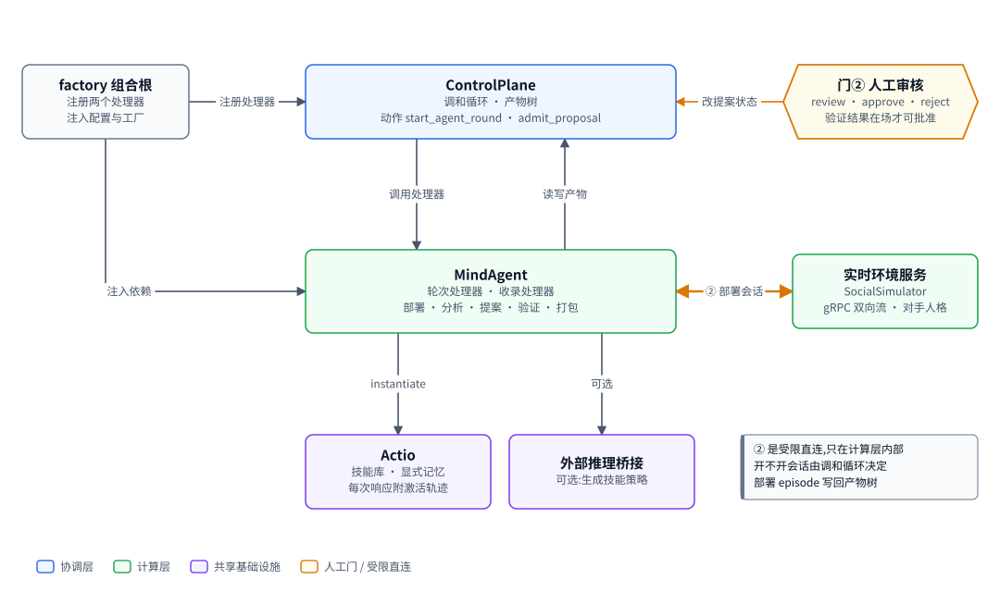
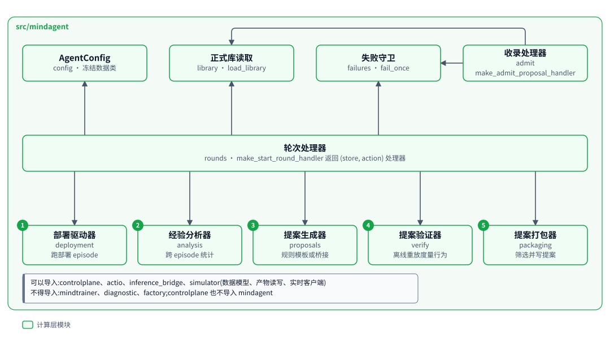
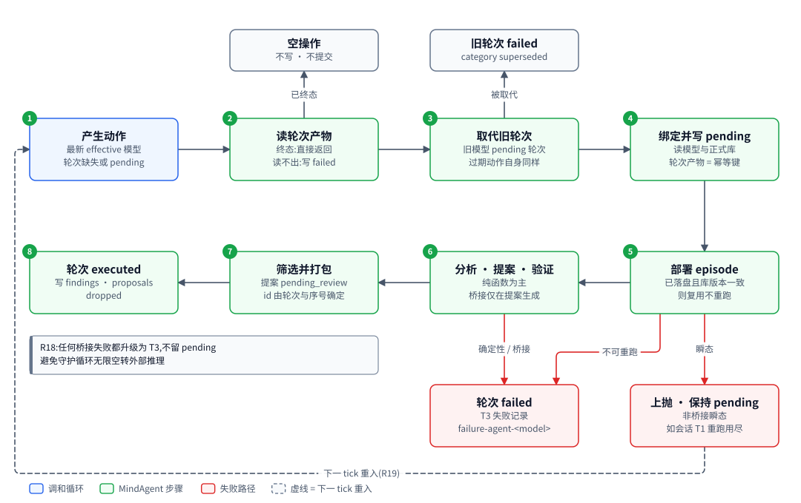
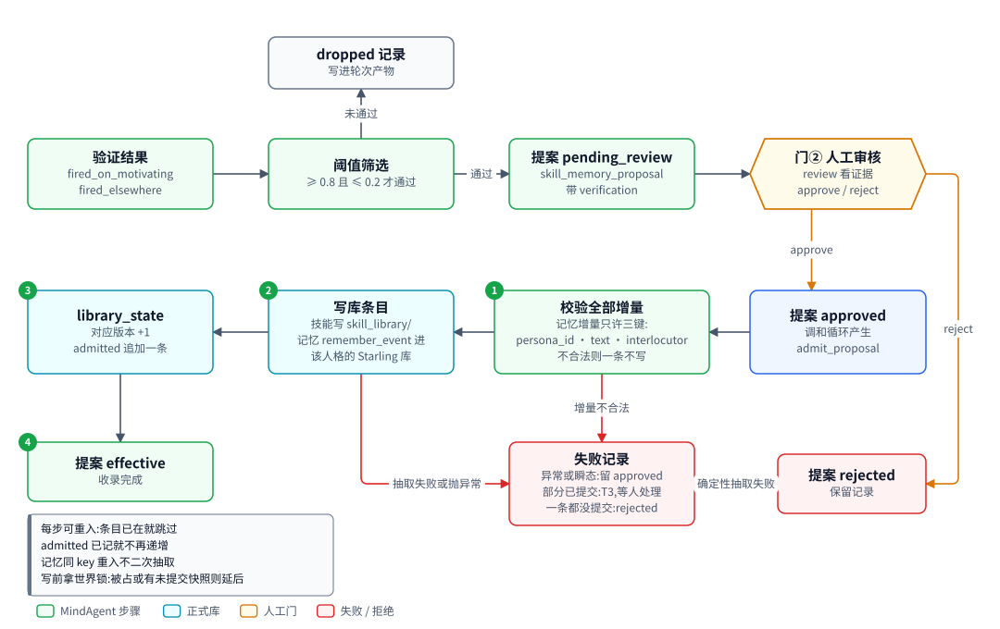

# MindAgent:部署态智能体的技能与记忆自进化

| 项 | 内容 |
|---|---|
| 一句话 | 新模型晋级后,部署 Actio 实例采集经验,分析行为缺口,生成并验证技能提案,经审核门②收录进正式库 |
| 状态 | 部分落地:配置、库读取、失败守卫、部署、分析、提案、验证、打包、轮次与收录两个处理器、调和循环触发与组合根装配 [已落地],已由 `factory run --enable agent,admit` 经 `reconcile_once` 端到端跑通;闭环里的模型后端是罐头实现(`factory.agent.CannedGuidedBackend`,不加载 checkpoint),轮次产物不记后端来源;部署记忆换成 Starling(经部署记忆管理面访问)、部署实例按 episode 新造、门② 的记忆收录改路 [计划中] |
| 所在层 | 计算层 |
| 代码位置 | `src/mindagent` [已落地] |
| 基线提交 | `b826440`(2026-10-21) |
| 依赖 | ControlPlane(`controlplane`)、Actio(`actio`,含记忆端口、管理面与 Starling 适配器 [计划中])、外部推理桥接(`inference_bridge`)、SocialSimulator(`simulator` 的数据模型、产物读写、实时环境服务客户端) |
| 被依赖 | factory 组合根(注册两个处理器);调和循环经注入调用处理器;命令行读提案载荷 |
| 对应实施计划 | 工作包 7(任务 80 至 89)与工作包 8、9 的触发与装配 [已落地];智能体记忆设计的第 7 步(部署记忆、轮次摘要、快照重放、门② 改路)[计划中] |

## 0. 系统速览

<!-- shared:begin context-block -->
**系统是什么。** RismForge 是一套"AI 驱动的社会心智后训练工厂":输入通用开源基础模型,输出社会心智能力显著增强的模型,代号 **ZenGen**。工厂自己决定每一轮练什么、怎么练。训练决策可以交给外部更强的闭源模型(经命令行调用),关键决策点设人工审核门,其余环节自动。

**七个子系统。** 六个能力子系统加一个协调层 ControlPlane。

| 子系统 | 职责 | 所在层 | 现状 |
|---|---|---|---|
| ControlPlane | 协调层:git 版本化产物树、状态机、调和循环、三个审核门 | 控制层 | [已落地] |
| SocialSimulator | 情境与人格生成、多智能体仿真、实时环境服务、诊断评测 | 计算层 | [已落地];诊断默认用 mock 后端,`--evaluator someval` 装配 vLLM 加 SoMEval 的真实运行器 [已落地],真机只验证到预测阶段 |
| MindTrainer | 权重级训练:BatchTrain(SFT 后接 GRPO 加 OPD)与 InteractTrain | 计算层 | [已落地],默认入口的训练执行器是 mock;ROLL LoRA SFT 真实执行器 [已落地],由 `--executor roll` 装配,已在真实主机上端到端跑通一次 |
| MindAgent | 部署态智能体的技能与记忆自进化,不改权重 | 计算层 | [已落地],闭环里经 `--enable agent` 装配;部署驱动用的仍是罐头后端,真实模型后端未接 |
| RecipeStore | 验证有效的训练配方的版本化仓库 | 控制层 | [已落地] |
| TrainScheduler | 决策执行器:装配上下文、校验决策、构造训练指令、提名配方 | 控制层 | [已落地],含策略经验(默认关) |
| TrainPlanner | 决策学习者:经可插拔后端给出下一轮训练决策 | 控制层 | [已落地],默认后端经桥接调用命令行模型 |

共享基础设施有五个。**Actio** 是带技能库与显式记忆的智能体框架,每次响应附带激活轨迹;记忆由内嵌的 **Starling** 提供,一个人格一个树外 SQLite 库,可选 extra `memory` [计划中]。**外部推理桥接**用命令行调用外部强模型。**远端计算层** `compute` 经 SSH 在远端 GPU 主机上跑作业 [已落地]。**ROLL** 是分布式训练引擎,**vLLM** 是推理引擎。V1 经远端计算层接入 ROLL 的 LoRA SFT [已落地](由 `--executor roll` 装配,已在真实主机上从指令跑到候选一次)与 vLLM 推理服务 [已落地](命令拼装、SSH 隧道、服务生命周期;真机端到端待补)。已落地部分仍由确定性 mock 顶替。真实 GRPO 加 OPD 训练与真实 judge [推迟]。

**状态标记。** **[已落地]** 表示代码在主干上且有测试。**[计划中]** 表示设计与实施计划已定,代码还没写。**[推迟]** 表示明确不在 V1 范围内。图只画目标系统,不标进展,进展只看正文的状态标记。

**六条贯穿全系统的机制。**

| 机制 | 规则 |
|---|---|
| 产物树 | 所有协作数据是 git 树里的 YAML 产物,统一信封:`id`、`type`、`version`、`created_at`、`created_by`(含 `owner` 与 `visibility`)、`status`、`schema_version`、`links`、`payload`。checkpoint 等大体量内容只存引用 `{uri, sha256, size_bytes}`;V1 的数据集逐条 episode 进 git,只适合小规模 mock。git 树是唯一真相,读取时先经迁移器链再消费。 |
| 状态机 | 需审核类:`draft → pending_review → approved → effective`,之后可到 `deprecated` 或 `superseded`,`pending_review` 也可到 `rejected`。非审核类:`pending → executed → consumed`,`pending` 也可到 `failed`。被拒绝与失败的产物保留;被拒绝的候选进入下一轮规划的输入,失败只留痕、等人处理。 |
| 调和循环 | 纯函数 `reconcile(树视图) → 动作列表`,守护进程按间隔轮询并执行动作。循环无状态、动作幂等,进程崩溃后从 git 树续接。子系统之间不直接调用,只读写产物。 |
| 审核门 | 三道人工门:① checkpoint 晋级,② 技能与记忆增量纳入,③ 配方入库。证据不在场就不能批准:门①要诊断报告,门②要验证结果,门③要可复现性校验报告。门②与门③ [已落地]。 |
| 受限直连 | 两处高频实时调用绕过 ControlPlane:① MindTrainer 与 SocialSimulator 之间的 InteractTrain rollout,② MindAgent 与 SocialSimulator 之间的部署经验采集。两处都走 gRPC 双向流,发生在计算层内部。是否开会话仍由 ControlPlane 决策。 |
| 失败分类 | T1 瞬态:有限次指数退避重试,耗尽升为 T3。T2 确定性:不重放,按所属子系统的校验链处理,LLM 的随机输出可有限次重采样。T3 需人工:写失败记录,不自动重跑。失败是数据,不是异常。 |

**核心术语。**

| 术语 | 含义 |
|---|---|
| Run | 一轮迭代,对应产物树里的 `runs/run-<编号>/` 目录,该轮所有产物都挂在其下 |
| Directive(训练指令) | TrainScheduler 或人写入的 `directive.yaml`,调和循环据此下发训练 |
| Candidate(候选 checkpoint) | MindTrainer 产出的 `candidate_checkpoint.yaml`,经诊断评测与门①才能晋级 |
| ZenGen 版本 | 晋级后写入 `models/zengen-v<N>.yaml`;下一轮训练的基座取最新的 effective 版本 |
| Episode | 一次多轮交互的完整记录:情境、角色分配、逐轮话语、终止原因 |
| Scenario、Persona、RoleAssignment | 社会情境、人格模板,以及把角色位绑定到具体人格与模型后端的分配 |
| Recipe(配方) | 验证有效的完整训练方案,分 batch、interact、agent_rsi 三类 |
| DiagnosticReport | 诊断评测产出的报告:维度、分数、置信区间、错误类型、退化标记 |
| Activation trace(激活轨迹) | Actio 每次响应附带的记录:命中的技能候选、选中的技能、命中的记忆 |
| Evidence grade(证据等级) | 诊断报告的可信等级 `stub`、`mock`、`real`,决定它能否驱动规划与提名;缺标记一律判 `stub`,失败关闭 |
<!-- shared:end context-block -->

## 1. 定位

MindAgent 是 AgentRSI 路径的执行者:不改权重,只让技能库与记忆库变好。

它回答三个问题:部署态智能体哪里做得不对,怎么改,改了是否生效。答案以增量提案交人审,批准后才进正式库。它站在计算层。上游是调和循环,下游是正式技能库与各人格的部署记忆库 [计划中]。它经受限直连接口②向 SocialSimulator 的实时环境服务采集部署经验,经 Actio 建出被部署的实例。

<!-- figure:begin 50-mindagent-context -->


**图 1　MindAgent 上下文**　调和循环产生 start_agent_round 与 admit_proposal 两个动作,交给组合根注册的 MindAgent 处理器。MindAgent 读模型与正式库、写轮次与提案,经受限直连②向实时环境服务采集部署经验,用 Actio 建实例,可选经外部推理桥接生成技能策略。门②由人工批准提案。

<details>
<summary>文字版:图中的节点与连线</summary>

**节点**

- factory 组合根:注册两个处理器 / 注入配置与工厂
- ControlPlane:调和循环 · 产物树 / 动作 start_agent_round · admit_proposal
- 门② 人工审核:review · approve · reject / 验证结果在场才可批准
- MindAgent:轮次处理器 · 收录处理器 / 部署 · 分析 · 提案 · 验证 · 打包
- 实时环境服务:SocialSimulator / gRPC 双向流 · 对手人格
- Actio:技能库 · 显式记忆 / 每次响应附激活轨迹
- 外部推理桥接:可选:生成技能策略

**连线**

- factory 组合根 → ControlPlane:注册处理器
- 门② 人工审核 → ControlPlane:改提案状态
- factory 组合根 → MindAgent:注入依赖
- ControlPlane → MindAgent:调用处理器
- MindAgent → ControlPlane:读写产物
- MindAgent ↔ 实时环境服务:② 部署会话
- MindAgent → Actio:instantiate
- MindAgent → 外部推理桥接:可选

</details>
<!-- figure:end 50-mindagent-context -->

调和循环产生 `start_agent_round` 与 `admit_proposal` 两个动作,交给 MindAgent 的两个处理器。factory 组合根在启动时注册处理器,并注入配置与各类工厂。MindAgent 读模型产物与正式库,写轮次产物与提案。部署会话经接口②走 gRPC 双向流,对手由实时环境服务扮演。外部推理桥接是可选的,V1 只用于生成技能策略;验证函数支持可选的 judge 附注,V1 的轮次处理器不装配它。

智能体记忆设计(下称设计二)[计划中] 给部署实例加上记忆。Starling 是内嵌的 SQLite 记忆库,每个绑定人格在仓库之外有一个库文件。记忆跨轮次持久累积。本包经 Actio 的部署记忆管理面 DeploymentMemoryStore 访问人格库,不导入 Starling。门② 批准的记忆增量写进同一个人格库,不再写进产物树。

## 2. 目标、非目标与约束

结论:V1 只做"技能提案 → 行为验证 → 人工审核 → 收录"这一条环路,其余能力推迟。

**目标**

| 编号 | 目标 | 验收方式 |
|---|---|---|
| MA-G1 | 每个新晋级的 effective 模型自动开一轮 agent 轮次 | 轮次产物 `agent-round-<model>` 走到 `executed` 或 `failed` |
| MA-G2 | 从部署 episode 中统计出"选中的技能不针对当前信号"的缺口 | 分析器在构造数据上给出确定的发现,同一批数据重跑同一 id |
| MA-G3 | 每条发现产出一份技能增量草案 | 草案能被 Actio 的技能解析读回 |
| MA-G4 | 用离线重放证明候选技能按预期改变行为(R13) | 提案载荷带 `fired_on_motivating`、`fired_elsewhere` |
| MA-G5 | 批准的提案收录进正式库,库版本加一 | `library_state` 版本递增,`admitted` 记下来源提案 |
| MA-G6 | 两个处理器在任一崩溃点重入都收敛 | 故障注入测试:不重复部署、不重复写提案、不重复递增 |
| MA-G7 | [计划中] 部署记忆跨轮次累积;episode 失败重试不重复记忆;验证重放的基线与候选看到同一份记忆 | 故障注入测试:重试前部署库摘要回到 episode 起点;轮次判 `failed` 后在途 episode 的半截记忆被回滚;记忆增量重入不二次抽取 |

**非目标与推迟项**

| 项 | 状态 | V1 的处理 |
|---|---|---|
| 记忆增量生成器 | [推迟] | 生成器只产出 `kind: skill`;记忆增量的数据模型与收录路径可用,靠人手写提案;收录改走 Starling 库 [计划中] |
| 迁移旧 `memory_library/` | [计划中] | 不迁移。生成器从不产出记忆提案,所以该目录现在为空;施工前核对为空,非空则组合根在装配期拒绝启动,要人工处理 |
| 接入真实生产日志 | [推迟] | 经验只来自模拟部署 |
| 本包自己读树内配置 | [推迟] | 配置由组合根从 `config/agent.yaml` 读出,构造冻结的 `AgentConfig` 后注入;实际取值写进轮次产物 |
| 对话质量评审 | [推迟] | 只度量行为;验证函数支持可选 judge 附注,V1 不装配,也不参与筛选 |
| 留出集验证 | [推迟] | 验证用触发提案的同一批 episode,过拟合说明写进 `notes` |
| AgentRSI 配方自动提名 | [推迟] | 轮次产物记下锚定字段,人工写配方候选 |
| 运行中轮次被新模型打断 | [推迟] | 轮次同步执行,下次触发时才置 superseded |

**质量属性与硬约束**

| 约束 | 内容 | 影响 |
|---|---|---|
| 依赖方向 | 只导入 `controlplane`、`actio`、`inference_bridge`、`simulator`、`grpc`、`yaml` 与标准库;记忆只经 `actio` 的记忆端口与部署记忆管理面访问 [计划中] | 失败分类与信号视图规则要在本包另写一份;本包不导入 `starling`;不设记忆配置时部署路用 FileTupleStore,它把条目与事件表存成 JSON 文件 |
| 记忆的唯一权威 [计划中] | 部署记忆存在仓库之外的 Starling 库里,产物树不存记忆内容 | 记忆不能从产物树追溯,只靠轮次产物里的起点摘要与运行时身份补 |
| 反向隔离 | `controlplane` 不导入 `mindagent` | 处理器类型写成字面 `Callable`,不引用调和循环的别名 |
| 产物读写 | 一律经 `GitStore` 与信封 | 写入内容不变时不提交,重入可用 HEAD 不变来判定空操作 |
| 不碰凭证 | 桥接只经注入对象调用 | 测试一律用脚本化桥接 |
| 脱离真实环境可测 | 无 GPU、无外网、无真实模型 | gRPC 用 loopback 服务端,模型后端用罐头实现 |

## 3. 架构

结论:两个处理器,一个驱动五段流水线,一个独立负责收录;三个支撑模块被二者共用。

<!-- figure:begin 50-mindagent-architecture -->


**图 2　MindAgent 模块组成**　轮次处理器按编号顺序调用五段流水线,读配置与正式库,失败经统一守卫留痕。收录处理器独立运行,只用正式库与失败守卫。全部模块都在 src/mindagent 下。

<details>
<summary>文字版:图中的节点与连线</summary>

**节点**

- AgentConfig:config · 冻结数据类
- 正式库读取:library · load_library
- 失败守卫:failures · fail_once
- 收录处理器:admit / handle_admit_proposal
- 轮次处理器:rounds · make_start_round_handler 返回 (store, action) 处理器
- 部署驱动器:deployment / 跑部署 episode
- 经验分析器:analysis / 跨 episode 统计
- 提案生成器:proposals / 规则模板或桥接
- 提案验证器:verify / 离线重放度量行为
- 提案打包器:packaging / 筛选并写提案

**连线**

- 轮次处理器 → AgentConfig
- 轮次处理器 → 正式库读取
- 轮次处理器 → 失败守卫
- 收录处理器 → 失败守卫
- 收录处理器 → 正式库读取
- 轮次处理器 → 部署驱动器
- 轮次处理器 → 经验分析器
- 轮次处理器 → 提案生成器
- 轮次处理器 → 提案验证器
- 轮次处理器 → 提案打包器

</details>
<!-- figure:end 50-mindagent-architecture -->

轮次处理器按编号 1 到 5 依次调用部署、分析、提案、验证、打包。它读 `AgentConfig` 与正式库,失败一律经失败守卫留痕。收录处理器不经过流水线,只用正式库读取与失败守卫。全部模块都在 `src/mindagent` 下 [已落地]。

**模块表**

| 模块 | 职责 | 依赖 | 状态 |
|---|---|---|---|
| `config` | 冻结配置 `AgentConfig`,找出 Actio 占的角色位 | `simulator.datamodel` | [已落地] |
| `library` | 读正式库与库版本,推出收录后的条目 id;`LibraryState` 不再含 `memories`,不再读 `memory_library/` [计划中] | `actio`、`controlplane.paths` | [已落地] |
| `failures` | 判"读不出"、校验 run id、只记一次失败记录 | `controlplane.ledger` | [已落地] |
| `deployment` | 流水线 1:经接口②跑部署 episode 并落盘;改收 make_instance,每次尝试开端口、造实例、跑、关实例;每条 episode 开始前备份起点,重试前 `restore_from` 回滚 [计划中] | 实时环境服务客户端、`store_adapter`、`actio` 部署记忆管理面 [计划中] | [已落地] |
| `analysis` | 流水线 2:跨 episode 统计行为缺口 | `actio.signals`、`actio.triggers` | [已落地] |
| `proposals` | 流水线 3:规则模板或桥接生成技能草案 | `actio.skills`、`inference_bridge` | [已落地] |
| `verify` | 流水线 4:离线重放度量行为改变;在部署库的快照副本上只读重放 [计划中] | `analysis`、Actio 实例 | [已落地] |
| `packaging` | 流水线 5:按阈值筛选,写提案产物 | `controlplane.paths` | [已落地] |
| `rounds` | 轮次处理器工厂,取代旧轮次;轮次开始拿人格库锁,写 `memory_runtime` 与 `episode_digests`;判 `failed`(T3)时先回滚在途 episode [计划中] | 以上全部 | [已落地] |
| `admit` | 收录处理器;记忆增量经部署记忆管理面调 `remember_event`,写前拿库锁。锁被占或有未提交起点副本抛 `DeferredError`。抽取失败时提案改为 `rejected` [计划中] | `library`、`failures`、`controlplane.deferred`、`actio` 部署记忆管理面 [计划中] | [已落地] |
| `errors` | 本包异常:数据错误、解析耗尽、轮次失败 | 无 | [已落地] |

**依赖方向规则**

| 规则 | 内容 |
|---|---|
| 可以导入 | `controlplane`、`actio`(含记忆端口与部署记忆管理面 [计划中])、`inference_bridge`、`simulator.datamodel`、`simulator.store_adapter`、`simulator.realtime.client` |
| 不得导入 | `mindtrainer`、`diagnostic`、`recipestore`、`trainplanner`、`trainscheduler`、`factory`;`starling` 只有 `actio` 的 Starling 适配器可以导入 [计划中] |
| 反向 | `controlplane` 不出现 `mindagent`;静态测试强制 [已落地] |

## 4. 数据模型与状态机

结论:MindAgent 写五类产物;轮次走非审核类状态机,提案走审核类状态机。部署记忆放在产物树之外的 Starling 库里 [计划中]。

**实体表**

| 实体 | 字段与含义 | 约束 |
|---|---|---|
| `AgentConfig` [已落地] | 情境清单、角色绑定、每情境 episode 数、重跑上限、分析阈值、验证阈值、解析重试上限 | 冻结;情境非空不重复;绑定恰好一个 `self_play`;比例在 0 到 1 |
| `LibraryState` [已落地] | `skills`、`version{skill, memory}`;`memories` 字段删除 [计划中] | 只收 `effective` 条目,按 id 排序;版本为十进制数字串;记忆不再从产物树读 [计划中] |
| `BehaviorFinding` [已落地] | `id`、`signal`、`pattern`、`support`、`ratio`、`episode_refs` | `id` 由信号与排序后的 episode id 求 sha256 前 12 位 |
| `ProposalDraft` [已落地] | `finding_id`、`increments`、`generator` | V1 只有一个 `kind: skill` 增量 |
| `Verification` [已落地] | `method`、`episodes`、`fired_on_motivating`、`fired_elsewhere`、`notes`、可选 `quality_notes` | `method` 固定为 `replay_behavior` |
| 部署记忆库 [计划中] | 每个绑定人格一个树外 Starling 库文件;库内事件表的 `seq` 是持久的单调时钟 | 轮次独占;库不进产物树,不能从 git 历史追溯 |
| 起点快照 [计划中] | 某条部署 episode 开始前的人格库副本,加它的逻辑摘要 | 摘要记进轮次产物;副本在 episode 成功后删 |
| 部署记忆管理面 [计划中] | DeploymentMemoryStore:按人格 id 开端口、写与放弃门② 事件、列 `pending` 事件、备份、覆盖、算摘要 | 在 `actio`,本包只调它;两个实现 StarlingDeploymentStore、FileTupleStore;`restore_from` 在该人格还有打开的端口时抛 MemoryFailureError |

| `AgentConfig` 字段 [已落地] | `max_turns` | `episodes_per_scenario` | `max_retries_per_episode` | `min_support` / `min_ratio` | 验证阈值 | `max_parse_retries` |
|---|---|---|---|---|---|---|
| 默认值 | 6 | 1 | 1 | 3 / 0.5 | 0.8 / 0.2 | 2 |

**产物与路径表**(产物树,即 git 仓库里的 `control-plane/` 目录)

| 产物类型 | 路径 | 状态机种类 | 写方 | 状态 |
|---|---|---|---|---|
| `agent_round` | `control-plane/agent_rounds/agent-round-<model>.yaml` | 非审核类 | 轮次处理器 | [已落地] |
| 部署 episode | `control-plane/runs/<run>/episodes/deploy-<model>-<scenario>-<k>.yaml` | 无 | 部署驱动器;技能版本变后的重跑加后缀 `-s<技能版本>` [计划中] | [已落地] |
| `skill_memory_proposal` | `control-plane/skill_memory_proposals/proposal-<round>-<n>/proposal.yaml` | 审核类 | 打包器;人改状态 | [已落地] |
| `skill` | `control-plane/skill_library/<id>.yaml` | 直接 `effective`;`deprecated` 在 V1 没有自动写方,人工改成它后 `load_library` 不再读到 | 收录处理器 | [已落地] |
| `memory` | `control-plane/memory_library/<id>.yaml` | 无。设计二起废弃:记忆的唯一权威是树外 Starling 库,产物树不再存记忆条目,该目录必须为空 | 现有收录处理器仍写它,改路后无写方 | [已落地];设计二起废弃 [计划中] |
| `library_state` | `control-plane/library_state.yaml` | 恒为 `executed` | 收录处理器 | [已落地] |
| 失败记录 | `control-plane/runs/<run>/failure-<task>.yaml` | 无 | 失败守卫 | [已落地] |

**部署记忆库布局** [计划中]:记忆根目录在仓库之外,由本机记忆配置的 `root` 给出。下表只列本包用到的路径。

| 路径(相对记忆根目录) | 内容 | 写方 | 生命周期 | 状态 |
|---|---|---|---|---|
| `deploy/<persona_id>.db` | 部署记忆;`seq` 与事件表在库内 | 部署实例经记忆端口;收录处理器 | 持久,跨轮次累积 | [计划中] |
| `deploy/<persona_id>.lock` | 人格库的独占文件锁 | 轮次处理器;门② 收录处理器 | 轮次开始拿,结束放;门② 写该人格库前也拿同一把 | [计划中] |
| `snapshots/<round_id>/<episode_id>-<persona_id>.db` | 某条 episode 的起点副本 | 部署驱动器 | episode 落盘后删,删除是提交点;重试与崩溃重入前用它 `restore_from` 覆盖部署库;门② 收录前查有无该人格的未提交副本 | [计划中] |
| `snapshots/<round_id>/verify-<persona_id>.db` | 验证快照,基线与候选各开一份副本 | 验证器 | 轮次结束即删 | [计划中] |

库文件名用人格 id,因为人格才是个体。对手位的实例每会话一份空记忆,不读写部署库 [计划中]。

**轮次状态**:`pending → executed | failed`。终态再触发是空操作。`failed` 用 `payload.failure.category` 区分三种:`T3` 是真失败,`superseded` 是被新模型取代。

**提案状态**:`pending_review → approved | rejected`,`approved → effective`。现有审核类状态机里 `approved` 只能去 `effective`,所以收录失败时提案原样留在 `approved`。

设计二在 `controlplane.states` 新增一条边 `approved → rejected` [计划中]。只许收录处理器走它,用于门② 的记忆抽取失败。`rejected` 是终态,调和循环不再为它产生 `admit_proposal`。迁移表对所有审核类产物共用,所以这条边对它们都合法。约束靠“只有收录处理器走”,代码层没有限制。

命令行 `cli/src/commands.ts` 的 `REVIEW_TRANSITIONS` 不加这条边 [计划中]。人不能把已批准的提案改回拒绝,命令行的 `reject` 仍只能从 `pending_review` 出发。两份迁移表因此有意不同,`controlplane.states` 里注明这条边只在 Python 里。

正式库状态产物 `library_state` [已落地]:id 为 `library-state`,类型 `library_state`,状态恒为 `executed`。载荷是 `skill_version`、`memory_version`、`admitted` 三个键,两个版本都是十进制数字串,`admitted` 是收录记录的列表,每条含 `proposal_id`、`skill_version`、`memory_version` 与 `entries`(该次收录写入的条目 id 列表)。信封 `version` 每次收录加一,`links` 是最近一次收录的提案 id。文件不存在时等价于两个版本都是 `"0"`。版本不是十进制数字串(如 `lib-3`、空串、`3.0`、布尔、负数)时读取方抛 `MindAgentDataError`:收录处理器当作确定性失败,轮次处理器判 T3。空库不需要这份产物,预置初始技能时由人手写技能产物与这份产物。

设计二下 `memory_version` 仍然递增 [计划中],但它计的是门② 记忆收录的次数,不再对应 `memory_library/` 里的条目。它仍是 Actio 实例 `library_version` 的一部分,但 episode 复用只比较其中的技能版本:记忆收录不让已提交的 episode 重跑。

候选技能与桥接输出的形状 [已落地]:规则模板生成的候选技能 id 为 `skill-candidate-<信号名>`,版本 1,层级 `micro`,优先级 100,触发条件是单个信号,指令取模板文本。桥接路径下外部模型只写 `instructions` 与 `description`,必须恰好输出这两个键,多一个键也不合格;不合格带着原因重问,总次数 `1 + max_parse_retries`,耗尽抛 `ProposalParseError`。传了桥接而 `run_id` 为空时,调用桥接之前就抛 `MindAgentDataError`。规则生成器标识 `rule_template.v1`,桥接生成器标识 `bridge.v1`,提示模板版本 `mindagent-skill-v1`。每次尝试的 task id 带尝试序号,所以每次尝试各记一条成本。

`dropped` 有两种条目 [已落地]:被阈值筛掉的草案,含 `finding_id`、原因、两个验证比例;重入后留下的过期提案,含 `proposal_id` 与原因,原因写明它是更早一次重入留下的。

轮次产物载荷 [已落地]:

```yaml
id: agent-round-zengen-v2
type: agent_round
links: [zengen-v2, run-002]
payload:
  model_id: zengen-v2
  model_version: 2
  run_id: run-002
  library_version: {skill: "1", memory: "0"}
  scenario_ids: [s1, s2, s3]
  analyzer_config: {min_support: 3, min_ratio: 0.5}
  verifier_config: {method: replay_behavior, min_fired_on_motivating: 0.8, max_fired_elsewhere: 0.2}
  generator_version: rule_template.v1
  uses_bridge: false
  episode_ids: [deploy-zengen-v2-s1-1, deploy-zengen-v2-s2-1, deploy-zengen-v2-s3-1]
  findings: [...]; proposals: [proposal-agent-round-zengen-v2-1]; dropped: []; failure: null
```

载荷还含 `persona_ids`、`bindings`、`checkpoint_ref`(模型有时)、`prompt_template_version`(仅用桥接时)。重入时整份按当前绑定重写,保留首次的 `created_at`。

设计二给轮次载荷加两个键 [计划中]:

| 键 | 内容 | 状态 |
|---|---|---|
| `memory_runtime` | 记忆运行时身份:后端(`starling` 或 `stand-in`)、Starling 版本与安装来源、抽取与嵌入的端点和模型、重试与超时、轨迹模式 | [计划中] |
| `episode_digests` | `{episode_id: {persona_id: 起点摘要}}`;每条 episode 开始前写回一次,轮次产物本来就逐步回写 | [计划中] |

读轮次产物的人不必翻库文件,就知道每条 episode 的记忆从哪来。库不在产物树里,这两个键是记忆身份在树里的唯一留痕。

记忆增量的 `definition` 是 `persona_id`、`text`、`interlocutor` 三个必填键,不再是 `MemoryEntry` [计划中]。`persona_id` 指明写进哪个人格的库,`text` 原样作事件文本,`interlocutor` 是这条记忆关于谁,空串表示一般事实。收录前严格校验,多键少键都是 T2。收录处理器把写成功的语句 id 记进提案载荷的 `admitted_statements`,只作证据,不作幂等依据。

**不变量**

| 编号 | 不变量 |
|---|---|
| MA-I1 | 每个模型至多一个轮次产物,id 为 `agent-round-<model>` |
| MA-I2 | 部署 episode id 为 `deploy-<model>-<scenario>-<k>`,`k` 从 1 起,是幂等键;技能版本变后的重跑加后缀 `-s<技能版本>` [计划中] |
| MA-I3 | 提案 id 为 `proposal-<round>-<n>`,`n` 按通过顺序连续编号,被筛掉的不占号 |
| MA-I4 | 收录后的技能 id 为 `skill-<提案 id 去掉 proposal->-<k>`,`k` 是增量位置;记忆增量不再写 `memory_library/` 条目,它的身份是事件 key `<提案 id>#<k>` [计划中] |
| MA-I5 | 同一提案在 `admitted` 里至多出现一次,库版本因它至多加一 |
| MA-I6 | 已不是 `pending_review` 的提案,打包器不改写;收录处理器只改它的状态,记忆收录时另追加证据键 `admitted_statements` [计划中] |
| MA-I7 | 同一 `(run, task)` 的失败记录只写一次 |
| MA-I8 | [计划中] 一个轮次独占它绑定的每个人格库:轮次开始拿文件锁,结束放;拿不到锁的轮次判 `failed` |
| MA-I9 | [计划中] 一条部署 episode 结束后,部署库里没有它留下的 `pending` 事件行 |
| MA-I10 | [计划中] 事件 key `<提案 id>#<k>` 只由收录处理器推进;`abandoned` 的 key 不再被任何路径写进记忆 |
| MA-I11 | [计划中] 某条部署 episode 的起点副本还在,它就未提交;副本不在而 episode 文件在,它已提交 |
| MA-I12 | [计划中] 门② 往某人格库写记忆时,该人格的库锁空闲且没有未提交的起点副本;否则不写 |

## 5. 接口契约

结论:对外只有两个处理器入口,形状都是 `Callable[[GitStore, Action], None]`;以下签名 [已落地]。设计二新增的记忆契约落在 Actio 一侧,本包一侧的签名变化列在后面 [计划中],施工时可能微调。

**入口**

```python
# mindagent.rounds —— 组合根先调工厂,再把返回值注册为 start_agent_round 的处理器
def make_start_round_handler(*, config: AgentConfig, client_factory, backend_factory,
                             personas_loader, bridge=None) -> Callable[[GitStore, Action], None]: ...
# backend_factory(model_id, checkpoint_ref) -> 新的模型后端
# personas_loader(store, persona_ids) -> {persona_id: Persona}

# mindagent.admit —— 直接注册为 admit_proposal 的处理器
def handle_admit_proposal(store: GitStore, action: Action) -> None: ...
```

轮次处理器的 `action.target_id` 是模型 id `zengen-vN`,收录处理器的是提案 id;两者都不读 `detail` [已落地]。

三个注入的工厂 [已落地]:`client_factory()` 零参数,每条会话新建一个客户端;`backend_factory` 取 `model_id` 与 `checkpoint_ref`,每次新建模型后端,部署一份、验证时基线与候选各一份;`base_instance_factory` 取 `extra_skills`,每次返回新的 Actio 实例,传空元组得到基线。部署实例的 `profile` 是 `{model_id, round_id}`。

设计二下,部署驱动器与处理器工厂的签名这样变 [计划中],施工时可能微调:

```python
# 驱动器不再收现成的实例,改收实例工厂与部署记忆管理面
def run_deployment_episodes(store, make_instance, client_factory, *, memory_store, run_id,
                            scenario_ids, personas, bindings, model_id, max_turns, ...) -> list[Episode]: ...
# make_instance(episode_id, memory) -> ActioInstance:每次尝试新造,episode_id 是逻辑 id

class DeploymentMemoryStore(Protocol):   # 在 actio,一个人格一个库,按人格 id 打开
    def open(self, persona_id: str) -> MemoryBackend: ...
    def remember_event(self, persona_id, key, text, *, interlocutor) -> RememberOutcome: ...
    def abandon_event(self, persona_id, key) -> None: ...
    def pending_events(self, persona_id) -> list[str]: ...
    def backup_to(self, persona_id, path) -> str: ...     # 返回副本的逻辑摘要
    def restore_from(self, persona_id, path) -> str: ...  # 先确认没有打开的端口,再覆盖
    def digest(self, persona_id) -> str: ...
```

轮次处理器工厂多收 `memory_store` [计划中]。验证重放的基线与候选仍由 `base_instance_factory` 造。

**流水线函数**

```python
def run_deployment_episodes(store, instance, client_factory, *, run_id, scenario_ids, personas,
                            bindings, model_id, max_turns, episodes_per_scenario=1,
                            max_retries_per_episode=1) -> list[Episode]: ...
def analyze(episodes, *, min_support, min_ratio, skills=(), registry=None,
            signals=None) -> list[BehaviorFinding]: ...
def propose(findings, *, bridge=None, run_id="", task_id="mindagent-propose",
            max_parse_retries=2) -> list[ProposalDraft]: ...
def verify(draft, findings, episodes, *, base_instance_factory, personas, scenarios,
           judge=None, run_id="", task_id="mindagent-judge") -> Verification: ...
def package(store, round_id, findings, drafts, verifications, *, thresholds, run_id,
            bound_model_id) -> list[Envelope]: ...
def load_library(store) -> LibraryState: ...
```

与闭环集成设计签名的偏差:部署驱动器多 `model_id` 等四个参数;分析器多 `skills`、`registry`、`signals`;提案生成器与验证器多记账用的 `run_id`、`task_id`;轮次处理器改成闭包工厂。理由都是统一签名只有 `(store, action)`,其余依赖只能从外面注入。

**触发条件**由调和循环判定 [已落地]:`start_agent_round` 在最新 effective 模型没有轮次产物、轮次 `pending` 或读不出时产生;`admit_proposal` 在存在 `approved` 提案时产生。

**提案载荷:命令行读取的键**

提案载荷是命令行 `review` 与 `approve` 的契约,打包器是唯一写方,键名与层次不得改动。

| 键 | 类型 | 用途 |
|---|---|---|
| `payload.round_id` | str | `review` 首行 |
| `payload.finding.{id, pattern, support, ratio, episode_refs}` | str、str、int、float、list | `review` |
| `payload.increments[].{kind, definition}` | `skill` 或 `memory`、dict | `review` 逐条打印 |
| `payload.verification` | 非空 dict | `approve` 缺它就拒绝 |
| `payload.verification.{method, fired_on_motivating, fired_elsewhere, episodes, notes}` | str、float、float、list、str | `review` |

额外写、命令行不读的键:`run_id`、`bound_model_id`、`generator`、`verification.quality_notes`;`links = [round_id, finding_id]`。记忆增量的 `definition` 是 `persona_id`、`text`、`interlocutor` 三个必填键,收录后提案载荷另带证据键 `admitted_statements`,命令行都不读它们 [计划中]。

**对邻居的假设**

| 邻居 | 本文依赖它什么 | 它依赖本文什么 |
|---|---|---|
| ControlPlane | 路径函数、`ledger.record_failure`、状态迁移检查、`GitStore` 写入内容不变不提交 [已落地] | 两个处理器的名字、位置与形状;终态由处理器自己写回 |
| Actio | `instantiate`、`respond` 返回三元组、`library_version`、`validate_trace`、`referenced_signals`、内置信号、技能与记忆的 id 前缀 `skill-`、`mem-` [已落地]。`instantiate` 多收逻辑 `episode_id`,实例多 `close()` [计划中] | 正式库里的技能条目格式;库版本为字符串;`persona_id` 对应的人格库在记忆根目录下 [计划中] |
| Actio 的部署记忆管理面 [计划中] | DeploymentMemoryStore 七个方法按人格 id 管库,实现是 StarlingDeploymentStore 与 FileTupleStore。`remember_event` 按事件 key 幂等,收据是三段写入的事件行。`backup_to` 备份出自洽的单文件副本,`restore_from` 在该人格还有打开的端口时抛 MemoryFailureError | 只经它访问人格库;FileTupleStore 也落盘,提交点协议在两个实现上一样成立 |
| Actio 的记忆失败 [计划中] | `recall`、`embed_pending` 的失败与 `remember` 抛出的异常是 MemoryFailureError,`transient` 分真假。MemoryEventConflict、MemoryClosedError 是它的子类,`transient` 为假。`remember` 返回 `failed` 只计数、不抛 | 本包直接接这个异常类:瞬态按条回滚重跑,确定性判轮次 `failed`(T3) |
| SocialSimulator | 实时环境服务客户端的"客户端后说"、`submit_turn` 带激活轨迹、回显自己轮次时保留轨迹、`write_episode` [已落地]。`CreateSession` 的可选 `episode_id` 字段:部署的逻辑 episode id `deploy-<model>-<scenario>-<k>` 重试不变,服务端据此落盘。同一个 `episode_id` 仍有活动会话时,创建被拒为瞬态 `role_backend_unavailable`;格式不合白名单才是 `invalid_session`。“活动”从准入登记起,到 servicer 收尾完或移交滞留表为止 [计划中] | 部署会话的 `purpose` 固定为 `deployment_simulation`;Actio 占 `self_play` 位;对手位的 Actio 实例每会话一份空记忆 [计划中];创建被拒按终止原因查瞬态集合,不再一律不可重跑。`role_backend_unavailable`(准入满或 episode id 撞上活动会话)按条重跑 [计划中] |
| 外部推理桥接 | `complete(prompt, *, run_id, task_id)`、`BridgeError` 带 `category` 与 `attempts`、每次成功调用记一条成本 [已落地] | 传入非空 `run_id`;每次尝试用不同 `task_id` |
| factory 组合根 | 注入配置、客户端工厂、模型后端工厂、人格加载器、可选桥接 [已落地];读树外记忆配置,把部署记忆管理面交给本包:配置在场用 StarlingDeploymentStore,不在场用 FileTupleStore,根目录取 `control-plane/` 之外的临时目录;部署会话的时间预算随配置在场与否取值 [计划中] | 按名字 `mindagent.rounds.make_start_round_handler` 取工厂 [已落地];启动时 `memory_library/` 必须为空 [计划中] |
| 命令行 | 无 | 上表的提案载荷键 |

## 6. 关键流程

结论:一轮 agent 轮次分 8 步,写 `pending` 产物在部署之前,所以任一步之后崩溃都能从同一处续跑。部署记忆的动作插在第 4 到 8 步之间,单列一张表 [计划中]。

<!-- figure:begin 50-mindagent-round-flow -->


**图 3　一轮 agent_round 的处理**　调和循环为最新 effective 模型产生 start_agent_round。处理器先判终态,再取代旧轮次,写 pending 轮次产物作幂等键,然后部署、分析、提案、验证、打包,最后置 executed。确定性错误与任何桥接失败置 failed 并记 T3;非桥接瞬态上抛,轮次保持 pending,守护进程退出,重启后的 tick 重入。

<details>
<summary>文字版:图中的节点与连线</summary>

**节点**

- 产生动作:最新 effective 模型 / 轮次缺失或 pending
- 读轮次产物:终态:直接返回 / 读不出:写 failed
- 取代旧轮次:旧模型 pending 轮次 / 过期动作自身同样
- 绑定并写 pending:读模型与正式库 / 轮次产物 = 幂等键
- 部署 episode:技能版本一致 · 起点副本已删 / digest_before 对得上 / 则复用不重跑
- 分析 · 提案 · 验证:纯函数为主 / 桥接仅在提案生成
- 筛选并打包:提案 pending_review / id 由轮次与序号确定
- 轮次 executed:写 findings · proposals / dropped
- 空操作:不写 · 不提交
- 旧轮次 failed:category superseded
- 上抛 · 保持 pending:非桥接瞬态 / 如会话 T1 重跑用尽
- 轮次 failed:先回滚在途 episode / T3 失败记录 / failure-agent-<model>

**连线**

- 产生动作 → 读轮次产物
- 读轮次产物 → 取代旧轮次
- 取代旧轮次 → 绑定并写 pending
- 绑定并写 pending → 部署 episode
- 部署 episode → 分析 · 提案 · 验证
- 分析 · 提案 · 验证 → 筛选并打包
- 筛选并打包 → 轮次 executed
- 读轮次产物 → 空操作:已终态
- 取代旧轮次 → 旧轮次 failed:被取代
- 部署 episode → 上抛 · 保持 pending:瞬态
- 分析 · 提案 · 验证 → 轮次 failed:确定性 / 桥接
- 部署 episode → 轮次 failed:不可重跑
- 上抛 · 保持 pending → 产生动作:下一 tick 重入(R19)(虚线)

</details>
<!-- figure:end 50-mindagent-round-flow -->

调和循环为最新 effective 模型产生动作,处理器先看轮次是否已在终态。随后取代旧模型的 `pending` 轮次,绑定模型与正式库并写 `pending`。部署、分析、提案、验证、打包依次执行,最后置 `executed`。红色是两条失败出口,虚线是 R19 的重入。

**轮次处理步骤表**(与图中编号一一对应)

| 步 | 名称 | 做什么 | 出口 |
|---|---|---|---|
| 1 | 产生动作 | 调和循环发现最新 effective 模型缺轮次或轮次 `pending`,产生 `start_agent_round` | 进入 2 |
| 2 | 读轮次产物 | 终态直接返回;文件在但读不出,整份重写为 `failed`(T3) | 已终态:空操作 |
| 3 | 取代旧轮次 | 版本低于最新 effective 的 `pending` 轮次置 `failed`,类别 `superseded`;过期动作本身同样处理 | 被取代:不记失败记录 |
| 4 | 绑定并写 pending | 读模型产物(须 `effective`、`links` 至少两项)与正式库,写 `pending` 轮次产物;随后对每个绑定人格拿人格库文件锁,写 `memory_runtime` [计划中] | 模型不合法:`failed`,无失败记录;拿不到锁:`failed`(T3) [计划中] |
| 5 | 部署 episode | 已落盘且每个 agent 轮次轨迹的技能版本一致的 episode 直接复用,其余新建会话;每次尝试新造实例;复用只比技能版本,另看起点副本是否已删、`digest_before` 是否等于记录的摘要 [计划中] | 瞬态:上抛;不可重跑:`failed`;起点副本做不出或覆盖失败:`failed`(T3);确定性的记忆失败:`failed`(T3) [计划中] |
| 6 | 分析 · 提案 · 验证 | 求发现,出草案,离线重放;桥接只出现在提案生成;重放在人格库的快照副本上只读进行 [计划中] | 确定性错误或任何桥接失败:`failed` |
| 7 | 筛选并打包 | 按阈值筛选,通过的写 `pending_review` 提案 | 被筛掉的记进 `dropped` |
| 8 | 轮次 executed | 写 `episode_ids`、`findings`、`proposals`、`dropped`,置 `executed`;删验证快照,放人格库锁 [计划中] | 终态 |

**episode 复用的新判据** [计划中]:已落盘的 episode 除技能版本外,还要两项同时成立才复用。它的起点副本已不在,说明它已提交。首个智能体轮次轨迹的 `memory.digest_before` 等于 `episode_digests` 里该人格的摘要。不比较部署库当前的摘要,因为已提交的 episode 写过记忆,库摘要本来就变了。两项不全成立就重跑。

**已提交的 episode 不随记忆收录重跑** [计划中]:记忆版本不参与复用判断。已提交 episode 的事件已是 `committed`,同一逻辑 id 重跑会让对手的新发言撞上 MemoryEventConflict,召回还会看到自己“未来”的记忆。只有技能版本变了才重跑。重跑用新的逻辑 id `deploy-{model}-{scenario}-{k}-s{技能版本}`,事件 key 随之不同。

**部署记忆在一轮里的动作** [计划中]

部署记忆放在仓库之外的人格库里,不进产物树。动作按时间顺序列在下表。

| 时刻 | 动作 | 失败时 |
|---|---|---|
| 第 4 步写 `pending` 之后 | 对每个绑定人格拿 `deploy/<persona_id>.lock` 的独占文件锁;轮次到终态或上抛时释放 | 拿不到锁:轮次 `failed`,T3 |
| 轮次重入,逐条 episode 检查 | 起点副本还在,说明它在途时进程崩溃,不论 episode 文件有没有落盘。先用起点副本 `restore_from` 覆盖部署库(此时没有打开的端口),核对摘要等于 `episode_digests` 里记的值。再重跑,不重新备份起点。副本不在而 episode 文件在,说明已提交 | 覆盖失败(文件系统错误、摘要对不上):轮次判 `AgentRoundFailedError`,T3;部署库与起点副本都保留,等人处理 |
| 每条 episode 开始前(没有起点副本时) | 库里有上次留下的未嵌入语句就先嵌完;再 `backup_to` 到 `snapshots/<round_id>/<episode_id>-<persona_id>.db` 作起点副本;摘要写进 `episode_digests` | 起点副本做不出:轮次 `failed`,T3 |
| 每次尝试 | 开该人格的端口,用 make_instance(episode_id, memory) 新造实例,跑会话,`close()` 实例,端口随之关闭。`episode_id` 是逻辑 id,重试不变 | 实例抛 MemoryFailureError 的处理见下文失败分类 |
| 每个智能体轮次 | 回复前召回,回复后把对方发言逐条写成事件,再只做嵌入;首个智能体轮次的轨迹 `memory.digest_before` 记起点摘要 | `remember` 返回 `failed` 只计数。`recall`、`embed_pending` 失败与 `remember` 抛异常是 MemoryFailureError,按下文失败分类走 |
| episode 的某次尝试失败要重试 | 先关本次尝试的实例与端口,再用起点副本 `restore_from` 覆盖部署库,重开端口,新造实例,再重试 | 覆盖失败的处理同上:T3,库与副本都保留 |
| episode 成功 | 先落盘 episode,再删它的起点副本;删起点副本是这条 episode 的提交点 | 副本没删掉:重入时这条 episode 按未提交处理,先覆盖再重跑 |
| episode 结束 | 对自己留下的 `pending` 事件行调 `abandon_event` | 无 |
| 轮次判 `failed`(T3) | 先对在途 episode 用起点副本 `restore_from` 回滚部署库,再删副本,再写失败记录。失败的轮次不把半截记忆留给下一轮 | 覆盖失败:库与副本都保留,照写失败记录 |
| 第 6 步验证 | 每个人格 `backup_to` 到 `snapshots/<round_id>/verify-<persona_id>.db`;基线与候选各开一份副本,`replay_read_only` 为真 | 快照做不出:同起点副本做不出,轮次 `failed`,T3 |

回滚安全靠独占:轮次拿着人格库锁,episode 在一个线程里顺序跑,覆盖部署库时没有别的写者。覆盖只在端口关闭之后做。`restore_from` 在该人格还有打开的端口时抛错,因为覆盖正被打开的库会写坏它。固定时钟在持久库里会倒退,所以事件时间取库内单调递增的事件序号 `seq`,序号由库在写事件行时分配,实例不计数。两条 episode 的同一句话是不同事件,因为事件 key 是 `<逻辑 episode id>#<轮次序号>`,逻辑 episode id 重试不变。

**部署会话的失败分类**(第 5 步,[已落地])

| 终止原因或状态 | 处理 |
|---|---|
| `max_turns`、`goal_reached` | 接受,落盘 |
| `timeout`、`role_backend_timeout`、`role_backend_unavailable`(准入满,或逻辑 episode id 撞上活动会话 [计划中])、`persistence_failed`、传输层 `UNAVAILABLE`;加上 `role_memory_unavailable` [计划中] | T1:整条重跑,至多 `max_retries_per_episode` 次,重跑前先回滚人格库 [计划中];用尽后轮次保持 `pending` 并上抛 |
| `invalid_session`、`role_backend_rejected`、`role_backend_failure`、`client_disconnected`、其他状态码、协议错乱;加上 `role_memory_failure` [计划中] | 不重跑,轮次 `failed`(T3);部署路沿用轮次的 T3 口径,与训练侧指令判 T2 不冲突 |
| Actio 实例自身抛异常(MemoryFailureError 除外,见下一行) | 先 `abort()` 会话,原异常原样上抛,不重跑、不包装;到了轮次处理器,`ActioDataError` 与 `MindAgentDataError` 一族收成轮次 `failed`(T3),其余异常上抛,轮次保持 `pending` |
| 实例抛 MemoryFailureError(`recall`、`embed_pending` 失败,或 `remember` 抛异常)[计划中] | 先 `abort()` 会话。`transient` 为真:按条回滚重跑,至多 `max_retries_per_episode` 次,用尽后上抛,轮次保持 `pending`。`transient` 为假(含 MemoryEventConflict、MemoryClosedError):不重跑,轮次 `failed`(T3)。`remember` 返回 `failed`(含 `failure_category` 为 `timeout`)只计数、不抛 |

**部署路的时间预算** [计划中]

部署会话的两个时限按记忆配置是否在场取值。接上记忆后一轮最坏多 20 秒:`recall` 嵌入查询词 1 次,`remember` 抽取 3 次,`embed_pending` 嵌入 1 批,每次至多 4 秒。罐头后端 1 秒内返回,放宽到 40 秒只放宽、不拖慢现有测试。

| 记忆配置 | 服务端等一轮提交 | 整条流的 deadline |
|---|---|---|
| 在场(Starling) [计划中] | 40 秒 | `max_turns` × 40 秒 |
| 不设(FileTupleStore) [计划中] | 5 秒(现值) | 15 秒(现值) |

组合根按配置在场与否传值。真实模型接进部署路时再按它的延迟加。

**分析器的判定**(第 6 步,[已落地])

| 项 | 规则 |
|---|---|
| 信号求值 | 按 agent 每次发言前能看到的历史重新求值,不读轨迹里记下的信号;默认只看 `emotion_high`、`no_new_information` |
| 受影响 | 某 agent 轮次信号为真、`selected` 非空、选中技能的触发条件不引用该信号;奇数层 `not` 包住的不算引用 |
| 出发现 | `ratio = 受影响数 / 有 agent 轮次的 episode 数`;`support ≥ min_support` 且 `ratio ≥ min_ratio` |

**验证器的口径**(第 6 步,[已落地])

| 量 | 定义 |
|---|---|
| 重放对象 | 发现引用的动机 episode;对手原话照抄,agent 轮次由实例重新生成 |
| 基线实例 | 当前库;记忆是人格库快照的一份副本,`replay_read_only` 为真,不写记忆 [计划中] |
| 候选实例 | 当前库加草案技能(优先级 100);记忆是同一份快照的另一份副本,所以基线与候选看到同一份记忆 [计划中] |
| 动机轮次 | 重放中该信号在 agent 发言前为真的 agent 轮次 |
| `fired_on_motivating` | 候选在动机轮次上选中草案技能的比例,分母为 0 记 0.0 |
| `fired_elsewhere` | 候选在动机 episode 其余 agent 轮次上选中草案技能的比例 |

**提案到收录**

<!-- figure:begin 50-mindagent-admission -->


**图 4　提案到入库的审核链**　验证结果先按阈值筛选,未过的写进轮次的 dropped。通过的打包成 pending_review 提案,人工在门②批准或拒绝。批准后收录处理器先校验全部增量,再写库条目、递增 library_state,最后置 effective。技能写 skill_library/,记忆经 remember_event 进该人格的 Starling 库。增量不合法或写记忆抛异常记 T2 失败记录,提案留在 approved。记忆抽取失败则提案改为 rejected。

<details>
<summary>文字版:图中的节点与连线</summary>

**节点**

- 验证结果:fired_on_motivating / fired_elsewhere
- 阈值筛选:≥ 0.8 且 ≤ 0.2 才通过
- 提案 pending_review:skill_memory_proposal / 带 verification
- 门② 人工审核:review 看证据 / approve / reject
- dropped 记录:写进轮次产物
- 提案 approved:调和循环产生 / admit_proposal
- 校验全部增量:记忆增量只许三键: / persona_id · text · interlocutor / 不合法则一条不写
- 写库条目:技能写 skill_library/ / 记忆 remember_event 进 / 该人格的 Starling 库
- library_state:对应版本 +1 / admitted 追加一条
- 提案 effective:收录完成
- T2 失败记录:不合法或异常:留在 approved / 记忆抽取失败:提案 rejected / failure-admit-<提案>
- 提案 rejected:保留记录

**连线**

- 验证结果 → 阈值筛选
- 阈值筛选 → 提案 pending_review:通过
- 阈值筛选 → dropped 记录:未通过
- 提案 pending_review → 门② 人工审核
- 门② 人工审核 → 提案 approved:approve
- 门② 人工审核 → 提案 rejected:reject
- 提案 approved → 校验全部增量
- 校验全部增量 → 写库条目
- 写库条目 → library_state
- library_state → 提案 effective
- 校验全部增量 → T2 失败记录:增量不合法
- 写库条目 → T2 失败记录:抽取失败或抛异常
- T2 失败记录 → 提案 rejected:抽取失败

</details>
<!-- figure:end 50-mindagent-admission -->

验证结果先过阈值,通过的成为 `pending_review` 提案,人在审核门②看证据后批准或拒绝。批准后收录处理器按编号 1 到 4 执行。每一步都可重入:条目已在就跳过,`admitted` 已记就不再递增。

技能增量写进 `skill_library/`。记忆增量改走人格的部署库 [计划中]:收录处理器经 DeploymentMemoryStore.remember_event 写库,事件 key 是 `<提案 id>#<k>`。收据是三段写入留下的事件行 [计划中]:① 短事务写 `pending` 事件行,含原文与 `interlocutor`,序号加一;② 事务之外调 `remember` 抽取;③ 短事务改 `committed`,填 `engram_ref` 与语句 id。崩在 ③ 之前,重入时按 `engram_ref` 查已有语句补收据,查不到就用行里存的原文再抽一次。语句 id 记进提案载荷的 `admitted_statements`,只作证据,不作幂等依据。

| 步 | 名称 | 做什么 | 重入时 |
|---|---|---|---|
| 1 | 校验全部增量 | 每个增量按技能或记忆格式解析;任一不合法则一条不写;记忆增量的 `definition` 恰好是 `persona_id`、`text`、`interlocutor` 三个键,多键少键都不合法,且对应人格库能打开 [计划中] | 再校验一次 |
| 2 | 写库条目 | 按增量顺序写入:技能写 `skill_library/`,状态 `effective`,`links = [提案 id]`;记忆先拿该人格的库锁,再经 DeploymentMemoryStore.remember_event 写库,key 为 `<提案 id>#<k>` [计划中] | 技能条目已存在就跳过;记忆同 key 再调得到 `idempotent` 与事件行里存的同一批语句 id,不二次抽取 [计划中] |
| 3 | 更新 `library_state` | 有技能增量时技能版本加一,有记忆增量时记忆版本加一(计的是门② 记忆收录次数 [计划中]),追加一条 `admitted` | `admitted` 已有该提案则跳过 |
| 4 | 提案 effective | `approved → effective` | 已 `effective`:空操作 |

**门② 与在途轮次** [计划中]:收录写某人格的库之前,先拿该人格的库锁。再查 `snapshots/` 下有没有该人格未提交的起点副本。锁被占或有未提交副本,就抛 `DeferredError`:守护进程不写树、提案留在 `approved`、按退避重试。否则轮次重入时会用起点副本覆盖部署库,把刚收录的记忆抹掉,而提案已是 `effective`,不会再收录。

记忆增量在第 2 步的失败有三条出口 [计划中]:

| 第 2 步的结果 | 处理 | 提案状态 |
|---|---|---|
| `remember_event` 返回抽取失败 | 先对该 key 调 `abandon_event`,事件行进终态 `abandoned`,以后不会被任何路径推进;再写一条 T2 失败记录 | `approved → rejected`,带原因 |
| `remember_event` 抛异常(库打不开、③ 的提交失败) | 不放弃事件,只写失败记录 | 留在 `approved`,下一个 tick 重入 |
| 库锁被占或有未提交起点副本 | 抛 `DeferredError`,不写树、不写失败记录、不动事件 | 留在 `approved`,退避后重试 |

重入时再调同 key 的 `remember_event`,按 `engram_ref` 查已有语句补收据 [计划中],既不二次抽取,也不留下没有收据的语句。被拒的提案不会复活,因为它的事件行已是 `abandoned`,同 key 再调会被拒。`approved → rejected` 这条边只有收录处理器走,命令行不走。

**失败与恢复路径**

| 情形 | 结果 | 恢复 |
|---|---|---|
| 部署会话 T1 重跑用尽 | 上抛,轮次 `pending`,守护进程退出 | 外部监督者重启后的 tick 重入,复用已落盘 episode,只补跑缺的会话 |
| 打包后、置 `executed` 前崩溃 | 轮次 `pending`,提案已写 | 重入得到同一提案 id,载荷相同不提交 |
| 重入时通过的草案变少 | 编号超出本次数目的旧提案仍为 `pending_review` | 写进 `dropped`,标为 stale,审核前核对 |
| 收录在第 2、3、4 步之间崩溃 | 提案仍 `approved` | 重入收敛:版本只加一,条目只一份 |
| 增量不合法或库版本非数字 | T2 失败记录 `failure-admit-<提案>`,提案留在 `approved` | 人改提案;此后每次触发只读不写 |
| 记忆抽取失败 [计划中] | 事件先 `abandoned`,T2 失败记录,提案 `rejected` | 终态;要重新收录需人重写一份提案 |
| 记忆收录抛异常 [计划中] | 事件行留 `pending`,提案留 `approved`,写失败记录 | 下一个 tick 重入,同 key 补收据 |
| 轮次拿不到人格库锁 [计划中] | 轮次 `failed`,T3 失败记录 | 人确认另一个轮次已结束后删轮次产物重开 |
| episode 重试 [计划中] | 失败的尝试已经写下一部分记忆 | 重试前关实例与端口,用起点副本 `restore_from` 覆盖部署库,重开端口,新造实例 |
| episode 中途崩溃 [计划中] | 起点副本还在,部署库里有半截记忆与 `pending` 事件行 | 重入时先用起点副本覆盖、核对摘要,再重跑,不重新备份起点 |
| episode 已落盘、起点副本没删时崩溃 [计划中] | 副本还在,episode 文件也在 | 同样先覆盖再重跑,因为删副本才是提交点 |
| 覆盖部署库失败 [计划中] | 文件系统错误或摘要对不上 | 轮次 `failed`(T3),库与副本都保留,等人处理 |
| 收录门② 记忆时库锁被占或有未提交起点副本 [计划中] | 抛 `DeferredError`,不写树,提案留 `approved` | 退避后重试;轮次放锁、副本删掉后收录成功 |
| 轮次判 `failed`(T3)时有在途 episode [计划中] | 先 `restore_from` 回滚,再删副本,再写失败记录 | 下一轮从干净的人格库开始 |

**走查例子**

数值取自工作包 7 的端到端测试,与 `tests/test_ma_e2e.py` 一致。配置:情境 `s1`、`s2`、`s3`,`max_turns=4`,每情境 1 个 episode,对手脚本备了"我真的很生气!!""好吧,你说说看""那就这样吧"三句;4 轮里对手只说两次,第三句用不上。

| 轮 | 前置 | 结果 |
|---|---|---|
| 一 | `zengen-v1` 晋级,库为空 | 3 个 episode、6 个 agent 轮次,`selected` 全为 `None`;零发现、零提案;轮次 `executed` |
| — | 人放基线技能 `skill-goal`(不处理情绪),库版本 `"1"` | — |
| 二 | `zengen-v2` 晋级 | 一条 `emotion_high` 发现,`support=3`、`ratio=1.0`;提案 `proposal-agent-round-zengen-v2-1`,验证 1.0 / 0.0 |
| 门② | 人把提案置 `approved` | 收录 `skill-agent-round-zengen-v2-1-1`,库版本变 `{"skill": "2", "memory": "0"}` |
| 三 | `zengen-v3` 晋级 | 对方怒语后的轮次选中新技能,`candidates` 为新技能与 `skill-goal`,`conflict` 非空;其余轮次仍选 `skill-goal`;零新发现 |

第二轮 3 个 episode 都受影响,`ratio = 3 / 3 = 1.0`。第一轮库为空,没有 `selected`,不受影响。

## 7. 关键决策

结论:决策的共同取向是"宁可停在 `failed` 等人,也不让守护循环空转";幂等键全部由确定性 id 承担。

| 编号 | 决策 | 备选 | 理由 | 判错的代价 |
|---|---|---|---|---|
| R11 | 正式技能库放 `skill_library/`,记忆库放 `memory_library/`,版本记在 `library_state.yaml` | 技能与记忆混放在提案目录 | 库是版本化产物,要经审核门进入产物树 | 无;其中记忆库放 `memory_library/` 的部分已由 MA-17 取代 [计划中] |
| R13 | 验证只度量"行为是否按预期改变",质量评审可选接 judge | 用对话质量打分筛选 | 质量评分没有可靠来源;行为改变可确定地重放 | 审核人看到的是行为证据,不是质量证据 |
| R18 | 任何 `BridgeError` [已落地] 都让轮次 `failed` 并记 T3;非桥接瞬态原样上抛 | 桥接 T1 也留 `pending` | 桥接自己已退避重试,留 `pending` 会让守护循环无限空转外部推理 | 外部工具短暂不可用也让这一轮 `failed`,要人删轮次产物重开 |
| R19 | `start_agent_round` 在"无轮次或轮次 `pending`"时都触发,处理器负责写终态,重入必须幂等 | 只在无轮次时触发 | 否则瞬态失败或进程被杀留下的 `pending` 永不再派发 | 处理器会被连续唤醒,全靠幂等键挡重复长任务 |
| MA-1 | 部署 episode 由驱动器用客户端重建的 Episode 改 id 落盘 | 服务端关闭钩子落盘 | 钩子拿不到模型 id、情境内序号与 run;确定性 id 就是幂等键 | 落盘 episode 没有对手内心独白;要它得改成服务端按会话 id 关联 |
| MA-2 | 已落盘 episode 只在每个 agent 轮次轨迹的库版本与当前实例一致时复用;设计二起只比技能版本,另看起点副本已删与 `digest_before` 等于记录的摘要 [计划中] | 有就复用;记忆版本也参与比较 | 两次重入之间若有技能收录,旧 episode 会把已修好的缺口再报一遍;记忆收录不让已提交的 episode 重跑,理由见 MA-25 | 技能库在轮次中途变化时多跑一遍部署;判错则起点副本还在的 episode 多跑一遍 |
| MA-3 | 配置是注入的冻结数据类,实际取值写进轮次产物 | 本包自己读树内配置 | 本包不读树,`config/agent.yaml` 由组合根读出并注入;轮次产物里的取值足够复现 | 改阈值要重启守护进程 |
| MA-4 | 缺口定义为"选中的技能不针对该信号";`selected` 为空不算 | 没有选中也算缺口 | 没有路由谈不上路由错 | 空库永远长不出第一条技能,要人放 |
| MA-5 | 候选技能触发条件、层级、优先级由发现决定,桥接只写指导语与描述 | 外部模型写完整技能 | 否则无法保证候选针对这个信号 | 库里有优先级高于 100 的同类技能时,候选会被筛掉 |
| MA-6 | 桥接输出严格解析,失败把原因拼进下一次提示,总次数 `1 + max_parse_retries` | 宽松解析 | 严格解析才能保证外部模型只改指导语 | 外部模型输出不稳时整轮 `failed` |
| MA-7 | 每次桥接尝试用 `<task_id>-<i>-attempt<n>` | 复用同一 task_id | 账本对同一 `(task_id, cost_type)` 只记一次,复用会丢成本 | 重入时编号从 1 重来,重跑成本被去重 |
| MA-8 | 打包按阈值 0.8 / 0.2 筛选,两端含等号,审过的提案不被改写 | 全部提案交给人 | 减少人审负担;人的决定不能被机器覆盖 | 阈值没有数据支持,误筛时有效提案进不了审核 |
| MA-9 | 收录先校验全部增量,再写条目、递增版本、改状态,`admitted` 作幂等键 | 边校验边写 | 半写入的库无法恢复;崩溃后重跑收敛 | 一条坏提案让 `admit_proposal` 每个 tick 空转 |
| MA-10 | 收录的确定性错误记 T2,轮次的记 T3 | 统一记 T3 | T2 表示处理器空操作只记一次;T3 表示闭环停在 `failed` 等人 | 只影响留痕分类,不改行为 |
| MA-11 | 库版本必须是十进制数字串 | 允许任意字符串标识 | 收录要按整数加一;不在入口挡住会在 `int()` 处崩守护进程 | 想用非数字版本标识要改校验与递增规则 |
| MA-12 | 轮次产物读不出时处理器自己重写为 `failed`,不抛 | 抛出由人处理 | 抛出会让守护进程退出、重启再触发,形成崩溃循环 | 人手改坏的轮次产物被整份覆盖,原文只在 git 历史里 |
| MA-13 | 写失败记录前校验 run id 为单个路径段且 run 目录存在 | 直接写 | run id 来自树内数据;含斜杠会抛错,不存在会凭空建目录 | 这类失败只在产物上可见,观测命令看不到 |
| MA-14 | [计划中] 部署记忆持久,跨轮次累积;事件时间取库内单调递增的事件序号,不取固定时钟;每条 episode 记一份起点摘要;验证重放在人格库的快照副本上只读,基线与候选各开一份 | 每轮从空库开始;固定时钟;重放直接读部署库 | 固定时钟在持久库里会倒退;重放要让基线与候选看到同一份记忆,又不能改部署库 | 重放与线上行为不完全一致,因为线上记忆还在随 episode 变 |
| MA-15 | [计划中] 事件 key 用逻辑 episode id(重试不变),不用传输层的会话 id;episode 的某次尝试失败要重试时,先用起点副本覆盖人格库 | key 用会话 id;重试不回滚 | 重试会换会话 id,按会话 id 记的事件在重试里全是新事件,部署库会重复记忆;回滚让重试从同一个起点开始 | 每条 episode 多一次备份,失败时多一次覆盖 |
| MA-16 | [计划中] 一个轮次独占它绑定的每个人格库:轮次开始对 `deploy/<persona_id>.lock` 拿独占文件锁,结束释放;拿不到锁的轮次判 `failed`(T3);episode 在一个线程里按情境、序号顺序跑 | 不加锁;episode 并行 | 两条 episode 同时写一个人格库,回滚会抹掉对方的写入;回滚覆盖只有在没有别的写者时才安全 | 两个轮次不能并行,现状本就如此;锁没释放时要人确认后重开轮次 |
| MA-17 | [计划中] 记忆的唯一权威是树外的 Starling 库;`memory_library/` 废弃,不再存记忆条目,不迁移,施工前必须为空,非空则装配期拒绝启动 | 把旧目录的条目迁进 Starling;两处并存 | 生成器从不产出记忆提案,所以旧目录现在为空,没有可迁的内容;两处并存会让同一条记忆有两个来源 | 记忆不能从产物树追溯,靠轮次产物里的起点摘要与运行时身份补 |
| MA-18 | [计划中] 门② 的记忆增量经 DeploymentMemoryStore.remember_event 写该人格的库,key 为 `<提案 id>#<k>`。收据是三段写入留下的事件行:① 短事务写 `pending` 行,② 事务之外 `remember` 抽取,③ 短事务改 `committed` 并填 `engram_ref` 与语句 id。崩在 ③ 之前按 `engram_ref` 查已有语句补收据;`admitted_statements` 只作证据,不作幂等依据 | 收据记在产物树里,用提案载荷判断是否已写;语句与事件行放同一个事务 | 写成功但收据没落树的崩溃,会让重入把同一条增量再抽取一次。抽取走网络,不能放进 SQLite 事务,所以拆成三段。事件行先于抽取落库,崩在任一段之后都能凭事件行与 `engram_ref` 补齐 | 收据在树外的库里,树里只有证据;崩在 ③ 之前、语句已落库时,要多查一次 `engram_ref` 才补上收据 |
| MA-19 | [计划中] 门② 记忆抽取失败:先对该 key 调 `abandon_event`,再写一条 T2 失败记录,提案改为 `rejected`。`remember_event` 抛异常(库打不开、补收据的提交失败):不放弃事件,只写失败记录,提案留在 `approved` 等下个 tick 重入 | 抽取失败也留在 `approved`;抛异常也改 `rejected` | 抽取失败是确定性的,留在 `approved` 会每个 tick 重抽一次;抛异常多半是瞬态,重入补收据即可,不会二次抽取。放弃事件让被拒的提案不会复活 | 被拒的记忆增量要人重写一份提案才能再收录 |
| MA-20 | [计划中] 审核类状态机在 Python 的 `controlplane.states` 新增 `approved → rejected` 一条边,只许收录处理器走;命令行的 `REVIEW_TRANSITIONS` 不加 | 抽取失败留在 `approved`;给 `approved` 加一个失败态;两份迁移表保持一致 | 现有的 `approved` 只能去 `effective`,没有出口放一个确定性失败的提案;一条专用边不扩大状态集。命令行不加这条边,所以人不能把已批准的提案改回拒绝 | 迁移表对所有审核类产物共用,这条边对它们都合法,约束靠只有收录处理器走;两份迁移表从此有意不同 |
| MA-21 | [计划中] 部署库里的 `pending` 事件行各有主人:对话事件归产生它的 episode,门② 事件归提案;谁写的谁处理。对话事件在 episode 内重试一次,仍失败则留 `pending`,episode 结束时对自己留下的行调 `abandon_event` | 每条 episode 开始前统一补齐所有 `pending` 行 | 统一补齐会替别人的事件再抽一次,或把别人的事件放弃;主人明确,起点快照里就没有别人的 `pending` 行 | 进程在 episode 中途崩溃后,它留下的 `pending` 行由重入时的覆盖清掉。MA-22 规定用起点副本覆盖部署库,库回到没有这些行的状态 |
| MA-22 | [计划中] 删起点副本是 episode 的提交点:成功时先落盘 episode,再删起点副本。轮次重入时按 episode 顺序检查。起点副本还在,就说明它在途时崩溃。先关实例与端口,再用起点副本 `restore_from` 覆盖部署库,核对摘要等于 `episode_digests` 记的值,再重跑,不重新备份起点。复用只看副本已删与 `digest_before`,不比较部署库当前摘要。覆盖失败判 `AgentRoundFailedError`(T3),库与副本都保留 | 用 episode 文件是否存在判提交;复用时比较部署库当前摘要;崩溃后直接重跑不覆盖 | episode 文件与记忆写入不在一个事务里,需要一个单点判这条 episode 提交没有。已提交的 episode 写过记忆,库摘要本来就变了,比较当前摘要会让每条已提交的 episode 都不可复用。直接重跑会把半截记忆带进新的起点 | 落盘后、删副本前崩溃,已落盘的 episode 会重跑一遍;覆盖失败要人处理 |
| MA-23 | [计划中] 部署记忆的管理面 DeploymentMemoryStore 放在 `actio`,按人格 id 提供 `open`、`remember_event`、`abandon_event`、`pending_events`、`backup_to`、`restore_from`、`digest`。实现有 StarlingDeploymentStore 与 FileTupleStore(JSON 落盘)。`restore_from` 在该人格还有打开的端口时抛 MemoryFailureError。本包不导入 `starling` | MindAgent 直接导入 Starling;替身只在内存里 | 管理面在 Actio 里,依赖方向才不破。替身也落盘,提交点与回滚在两种实现上一样成立,契约测试能覆盖崩溃重入。覆盖正被打开的 SQLite 文件会写坏库,所以先确认没有打开的端口 | Actio 多出一个协议,两个实现要过同一套契约测试 |
| MA-24 | [计划中] 部署实例按 episode 新造:驱动器改收 make_instance(episode_id, memory),每次尝试开该人格的端口、造实例、跑会话、`close()` 实例。覆盖部署库的顺序是关实例与端口、`restore_from`、重开端口、新造实例 | 驱动器收一个现成的实例,所有 episode 共用;覆盖时不关端口 | 事件 key 的前缀是逻辑 episode id,实例构造时就要定。实例持有打开的端口,覆盖前必须先关;新造的实例才不带着上次尝试的状态 | 每次尝试多一次开关端口与造实例 |
| MA-25 | [计划中] 已提交的 episode 不随记忆收录重跑,只有技能版本变了才重跑。重跑用新的逻辑 id `deploy-{model}-{scenario}-{k}-s{技能版本}` | 记忆版本变也重跑;重跑沿用原逻辑 id | 已提交 episode 的事件已是 `committed`,同一逻辑 id 重跑会让对手的新发言撞上 MemoryEventConflict,召回还会看到自己“未来”的记忆。新 id 让事件 key 不同 | 技能收录后重跑的 episode 以新 id 落盘,多一份文件 |
| MA-26 | [计划中] 轮次判 `failed`(T3)时,先对在途 episode 用起点副本 `restore_from` 回滚部署库,再删副本,再写失败记录;覆盖失败时库与副本都保留 | 只写失败记录,把半截记忆留在库里 | 在途 episode 的半截记忆留在人格库里,下一轮的起点就带着它,而这些记忆没有一条完整的 episode 对应。回滚让失败的轮次不污染下一轮 | 失败路径多一次覆盖;覆盖也失败时要人处理 |
| MA-27 | [计划中] 门② 往某人格库写记忆前,先拿该人格的库锁,并检查 `snapshots/` 下有没有该人格未提交的起点副本。锁被占或有未提交副本就抛 `DeferredError`,守护进程不写树、按退避重试 | 不加锁直接写;只靠提案状态挡住 | 在途轮次重入时会用起点副本覆盖部署库,把刚收录的记忆抹掉,而提案已是 `effective`、不会再收录。锁被占对应轮次在跑,副本在而锁空对应轮次崩溃后还没重入 | 收录被推迟到轮次结束或崩溃重入完成之后 |
| MA-28 | [计划中] 部署路的时间预算随记忆配置取值:配置在场时服务端等提交 40 秒、整条流 `max_turns` × 40 秒;不设配置(FileTupleStore)时保持现值 5 秒与 15 秒 | 一律放宽到 40 秒;一律保持现值 | 接上记忆后一轮最坏多 20 秒(`recall` 嵌入 1 次、`remember` 抽取 3 次、`embed_pending` 嵌入 1 批,每次至多 4 秒),现值是按罐头后端定的。罐头后端 1 秒内返回,放宽只放宽、不拖慢 | 真实模型接进部署路时要再按它的延迟加;设小会让正常的记忆调用被判超时、整条重跑 |
| MA-29 | [计划中] 部署实例抛 MemoryFailureError 时按 `transient` 分类:为真先 `abort()` 会话,再按条回滚重跑,用尽后上抛、轮次保持 `pending`;为假轮次 `failed`(T3)。MemoryEventConflict、MemoryClosedError 是子类,`transient` 为假。`remember` 返回 `failed`(含 `failure_category` 为 `timeout`)只计数、不抛 | 一律上抛;一律判 T3;`timeout` 的写失败也抛 | 瞬态的嵌入抖动不该升人工,确定性失败重跑也不会好。写失败只少一条记忆,回复照样成立;读失败或库坏了,这一轮的指导语已不可信 | 误判瞬态会反复重跑一个永远失败的调用;误判确定性会把一次网络抖动升成人工 |
| MA-30 | [计划中] 记忆增量的 `definition` 是 `persona_id`、`text`、`interlocutor` 三个必填键,不再是 `MemoryEntry`。收录前严格校验,多键少键都是 T2 | 沿用 `MemoryEntry`(含 id、版本、置信度、关键词) | 事件文本原样进抽取,不需要条目的 id、版本与关键词。`persona_id` 指明写进哪个人格库,`interlocutor` 为空串表示一般事实 | 手写提案要按新形状写;旧形状的记忆提案收录时判 T2 |

## 8. 失败处理与可观测

结论:轮次的确定性失败都是 T3;收录的确定性失败是 T2;只有非桥接的瞬态是 T1,靠上抛加 R19 重入恢复。部署记忆新增的失败点列在表尾 [计划中]。

| 失败点 | 类 | 处理 | 留痕产物 |
|---|---|---|---|
| 部署会话超时、后端超时、传输不可用 | T1 | 整条重跑;用尽后上抛,轮次 `pending`,守护进程退出 | 无;重启后的 tick 重入 |
| 人格加载器等非桥接异常 | T1 | 原样上抛,轮次 `pending` | 无 |
| 不可重跑的会话失败、会话被拒 | T3 | 轮次 `failed` | `failure-agent-<model>.yaml` |
| 情境或人格不在树里、库条目不合法、轨迹引用库外技能 | T3 | 轮次 `failed`,不建会话或中止 | `failure-agent-<model>.yaml` |
| `BridgeError` [已落地](T1 已用尽或 T2) | T3 | 轮次 `failed`,`retries = attempts - 1` | `failure-agent-<model>.yaml` |
| 桥接输出解析耗尽 | T3 | 轮次 `failed`,`retries` 为已重试次数 | `failure-agent-<model>.yaml` |
| 轮次产物读不出 | T3 | 整份重写为 `failed` | `failure-agent-<model>.yaml`(run 可得时) |
| 模型产物缺失、非 `effective`、`links` 不足 | T3 | 轮次 `failed` | 只在轮次产物 `payload.failure` 上 |
| 旧模型的 `pending` 轮次 | superseded | 置 `failed` | 只在轮次产物上 |
| 提案增量不合法、库版本非数字 | T2 | 提案留在 `approved`,库不变 | `failure-admit-<提案>.yaml` |
| run id 坏掉或 run 目录不存在 | — | 不写失败记录 | 只在轮次产物或提案上 |
| 拿不到人格库锁 [计划中] | T3 | 轮次 `failed`,不部署 | `failure-agent-<model>.yaml` |
| 起点副本或验证快照做不出、覆盖部署库失败 [计划中] | T3 | 轮次 `failed`;覆盖失败时库与副本都保留 | `failure-agent-<model>.yaml` |
| 部署会话的记忆瞬态失败:终止原因 `role_memory_unavailable`,或实例抛 `transient` 为真的 MemoryFailureError [计划中] | T1 | 整条重跑,重试前关实例与端口、用起点副本覆盖人格库;用尽后上抛,轮次 `pending` | 无;重启后的 tick 重入 |
| 部署会话的记忆确定性失败:终止原因 `role_memory_failure`,或实例抛 `transient` 为假的 MemoryFailureError(含 MemoryEventConflict、MemoryClosedError)[计划中] | T3 | 不重跑;先回滚在途 episode,再轮次 `failed` | `failure-agent-<model>.yaml` |
| 门② 记忆抽取失败 [计划中] | T2 | 事件先 `abandoned`,提案 `approved → rejected` | `failure-admit-<提案>.yaml` |
| 门② 记忆收录的其他异常 [计划中] | T2 | 事件不放弃,提案留在 `approved`,下个 tick 重入补收据 | `failure-admit-<提案>.yaml` |
| 门② 写记忆时库锁被占或有未提交起点副本 [计划中] | 延后 | 抛 `DeferredError`:不写树、状态不动,提案留在 `approved`,按退避重试 | 无 |
| 部署库里的 `pending` 事件行 [计划中] | 不分类 | 对话事件由 episode 结束时放弃;门② 事件由提案处理;抽取失败的计数进轨迹 | 部署 episode 的轨迹 `memory.extraction_failed`;库里的事件表 |

轮次的失败记录挂在绑定模型所在 run 下,task id 为 `agent-<model>`。收录的失败记录挂在提案载荷里的 `run_id` 下,task id 为 `admit-<提案 id>` [已落地]。

本包的异常 [已落地]:`errors` 模块里有 `MindAgentDataError`(数据不合法的基类,库版本不是十进制数字串也抛它)、`ProposalParseError`、`AgentRoundFailedError`;`deployment` 模块里有 `DeploymentFailedError`。

**只读观测手段**

| 手段 | 看什么 |
|---|---|
| 轮次产物 | 绑定的模型与库版本、用过的配置、`findings`、`proposals`、`dropped`、`failure` |
| 命令行 `review` | 提案的发现、增量、验证比例与 `notes` |
| 部署 episode | 每个 agent 轮次的激活轨迹:信号、候选、选中技能、冲突、库版本 |
| 失败记录 | 失败点、类别、重试次数、原因 |
| 成本台账 | 每次桥接尝试一条 `external_inference` |
| 轮次产物的 `episode_digests` [计划中] | 每条 episode 开始时每个人格的记忆摘要,和 `memory_runtime` 一起说明记忆从哪来 |
| 部署 episode 轨迹的 `memory` 键 [计划中] | 首个智能体轮次的 `digest_before`、写入条数、抽取失败条数;计数是十进制字符串 |

## 9. 测试策略

结论:全部测试脱离真实环境可跑,gRPC 用真实 loopback 服务端,桥接用脚本化替身;共 152 个用例。部署记忆的测试对象列在下表后半 [计划中],不含用例数。

| 层次 | 对象 | 替身 |
|---|---|---|
| 单元 | 配置校验、库读取、分析、提案、验证、打包 | 罐头模型后端、构造的 Episode |
| 组件 | 部署驱动器与两个处理器 | 真实 loopback 服务端、替身客户端、`ScriptedBridge` [已落地]、故障注入 |
| 端到端 | 三轮 AgentRSI 环路加一次收录 | 真实 loopback 服务端,对手为脚本化后端 |
| 静态 | 依赖方向、`__future__` 首行;本包不导入 `starling` [计划中] | 无 |
| 组件 [计划中] | 门② 改路:记忆增量走 `remember_event`;重入补收据不二次抽取,崩在 ③ 之前按 `engram_ref` 补;抽取失败后事件 `abandoned`、提案 `rejected`,且之后任何路径都不会把它写进记忆;抛异常后提案留 `approved` | FileTupleStore、故障注入 |
| 组件 [计划中] | episode 重试回滚:第二次尝试前关实例与端口、`restore_from` 后人格库回到起点,摘要相同;`restore_from` 在端口未关时抛错;第二条 episode 的事件 key 前缀是它自己的逻辑 id | 真 Starling 或 FileTupleStore、故障注入 |
| 组件 [计划中] | 部署崩溃重入:episode 中途崩溃(起点副本在)重入时先覆盖再重跑;episode 已落盘但起点副本没删时同样重跑;已提交的 episode 被复用、不重跑,记忆收录后也不重跑,技能版本变了才以新逻辑 id 重跑;覆盖失败判轮次 `failed`,库与副本都保留;轮次判 `failed` 时在途 episode 被回滚 | 真 Starling 或 FileTupleStore、故障注入 |
| 组件 [计划中] | 人格库锁:第二个轮次拿不到锁判 `failed`;起点副本做不出判 `failed` | 临时目录 |
| 组件 [计划中] | episode 结束后部署库里没有它的 `pending` 行,下一条 episode 的起点快照也没有别人的 | 真 Starling 或 FileTupleStore |
| 组件 [计划中] | 验证重放:基线与候选各开快照副本,`replay_read_only` 为真,部署库摘要不变 | FileTupleStore |
| 组件 [计划中] | 门② 与在途轮次:该人格有未提交起点副本或库锁被占时,收录抛 `DeferredError`、库不变、提案留 `approved`;副本删掉后下一 tick 收录成功 | FileTupleStore、故障注入 |
| 组件 [计划中] | 部署实例抛 MemoryFailureError:瞬态按条回滚重跑,确定性判轮次 `failed`;`remember` 返回 `failed` 只计数、不抛 | 抛异常的 FileTupleStore、故障注入 |
| 单元 [计划中] | 部署路时间预算:记忆配置在场时服务端等提交 40 秒、整条流 `max_turns` × 40 秒,不设时 5 秒与 15 秒 | 组合根的装配单元测试 |
| 状态机 [计划中] | `approved → rejected` 这条边存在,且只有收录处理器走;其余审核类转移不变;命令行的 `REVIEW_TRANSITIONS` 不含这条边 | 无 |

**用例数**

| 测试文件 | 用例数 | 覆盖 |
|---|---|---|
| `tests/test_ma_config_library.py` [已落地] | 27 | 配置校验、库版本 8 个反例、静态检查 |
| `tests/test_ma_deployment.py` [已落地] | 22 | 落盘 id、轨迹校验、复用、T1 重跑、实例异常 |
| `tests/test_ma_analysis.py` [已落地] | 19 | 判定、阈值等号、`not` 包裹、库外技能 |
| `tests/test_ma_proposals.py` [已落地] | 20 | 规则模板、严格解析、重试、成本条数 |
| `tests/test_ma_verify.py` [已落地] | 8 | 精准命中、触发过宽、优先级压不过 |
| `tests/test_ma_packaging.py` [已落地] | 8 | 筛选、编号、重入不改写 |
| `tests/test_ma_admit.py` [已落地] | 22 | 三个崩溃点、T2、5 种坏 run id、记忆增量 |
| `tests/test_ma_rounds.py` [已落地] | 28 | 空库沉默、R18、R19 重入、取代、读不出、过期提案 |
| `tests/test_ma_e2e.py` [已落地] | 1 | 第 6 章走查例子 |

部署记忆的用例按 extra 缺失跳过需要真 Starling 的部分;真抽取与真嵌入不进测试。服务端夹具沿用 `tests/test_mt_trajectory_interact.py` 的搭法。gRPC 测试给每条流加 15 秒 deadline,收尾等服务端停止,防止挂住套件。

**不依赖的外部服务**:GPU、外部网络、真实模型 checkpoint、真实外部推理工具、远程计算服务器。

## 10. 现状、局限与未核实项

结论:`src/mindagent` 十一个模块 [已落地],两个处理器由组合根按 `--enable agent,admit` 装配,并经 `reconcile_once` 端到端跑通;闭环里的模型后端是罐头实现,不加载 checkpoint,轮次产物也不记后端来源。

**能力现状**

| 能力 | 状态 | 说明 |
|---|---|---|
| 实时环境服务的 `deployment_simulation` 用途 | [已落地] | 数据模型与协议已有该取值 |
| 激活轨迹字段 | [已落地] | `TurnRecord.activation_trace` 已存在,运行器接受后端返回的三元组并写进该轮 |
| `submit_turn` 携带激活轨迹 | [已落地] | 工作包 6 |
| 产物路径函数与失败台账 | [已落地] | 工作包 1 |
| 部署、分析、提案、验证、打包 | [已落地] | 工作包 7 |
| 轮次处理器与收录处理器 | [已落地] | 工作包 7 |
| 调和循环触发与注入、组合根装配与端到端 | [已落地] | 工作包 8、工作包 9 |
| 记忆端口、部署记忆管理面 DeploymentMemoryStore 与 Starling 适配器(Actio 一侧) | [计划中] | 设计二第 1、6 步;本包依赖它们,不实现它们 |
| 部署记忆:人格库、文件锁、起点快照、摘要、episode 复用新判据 | [计划中] | 设计二第 7 步 |
| 部署实例按 episode 新造、轮次失败先回滚、已提交 episode 不随记忆收录重跑、部署路时间预算 | [计划中] | 设计二第 7 步 |
| 验证重放在快照副本上只读 | [计划中] | 设计二第 7 步 |
| 门② 记忆增量改走 `remember_event`、写前拿库锁并在锁被占时抛 `DeferredError`、抽取失败 `approved → rejected` | [计划中] | 设计二第 7 步,同时改 `controlplane.states`;命令行的迁移表不改 |
| 轮次载荷加 `memory_runtime`、`episode_digests`;记忆增量的 `definition` 改为 `persona_id`、`text`、`interlocutor` 三个必填键 | [计划中] | 设计二第 7 步 |

**三条必须知道的设计取舍**

| 取舍 | 内容 |
|---|---|
| 版本绑定策略 | 每轮绑定"最新 effective 模型 + 当前正式库",绑定值写进轮次产物。旧模型的 `pending` 轮次被置 superseded。已落盘 episode 只在库版本一致时复用;设计二起只比技能版本 [计划中]。正在跑的轮次不会被新模型中途打断 |
| 第一轮沉默是预期行为 | 正式库没有任何技能时,轨迹 `selected` 恒为 `None`,分析器不产出发现,轮次 `executed` 且零提案、无失败记录。第一条技能要人放 |
| AgentRSI 配方不自动提名 | 配方提名只由训练 run 的候选触发,轮次结果没有对应触发。`recipe_type: agent_rsi` 只在校验与检索里存在。需要时人工写配方候选,锚定字段从轮次产物取,须含 `uses_bridge` |

**已知局限**

| 局限 | 影响 | 缓解 |
|---|---|---|
| 轮次同步执行 | 一轮期间调和循环不转 | 部署 episode 数与轮数由配置控制 |
| 瞬态上抛让守护进程退出 | 外部服务一直不可用时每次启动在同处退出 | 外部进程管理;重启后按 R19 续跑 |
| 验证无留出集 | `fired_elsewhere` 低估误触发 | `notes` 写明过拟合说明 |
| 候选优先级固定 100 | 高优先级同类技能存在时候选被筛掉 | 记进 `dropped`,人调优先级 |
| 默认只分析两个信号 | 新注册信号不被分析 | 经 `signals` 参数显式传入 |
| 重入时外部推理成本被去重 | 成本被低估 | V1 接受;修法是 task id 加重入序号 |
| 库条目、模型、提案读不出时不兜底 | 守护进程退出 | 与现有读取层一致;只有轮次产物有兜底 |
| 过期提案仍为 `pending_review` | 审核人会误批 | 审核前核对 `dropped` 与 `round_id` |
| 部署记忆不在产物树里 [计划中] | 不能从 git 历史追溯记忆内容 | 轮次产物记 `memory_runtime` 与每条 episode 的起点摘要 |
| 部署记忆只做嵌入、不跑后台维护 [计划中] | 没有 TTL、回放与巩固,承诺与共同点等分区不更新 | 保持可复现;对召回质量的影响列入未核实项 |
| 两个轮次不能并行 [计划中] | 人格库锁挡住第二个轮次 | 现状本就串行 |
| 被 `rejected` 的记忆提案不能复活 [计划中] | 抽取失败的记忆增量要人重写提案 | 事件已 `abandoned`,这是有意的 |
| 门② 收录可能被在途轮次推迟 [计划中] | 库锁被占或有未提交起点副本时 `DeferredError` 延后,守护进程退避重试 | 轮次结束放锁后收录成功;连续延后有上限,达到上限守护进程带原因退出 |
| 验证重放与线上行为不完全一致 [计划中] | 快照冻结在轮次内的某一刻,线上记忆还在变 | 重放只度量行为是否按预期改变 |

**未核实项**

| 项 | 影响 | 核实办法 |
|---|---|---|
| 累计通过数 | 九个测试文件共 152 个用例,数目已按 `--collect-only` 实测;在主干上的全量通过数没有单独记录 | 在主干跑全量测试取基线,逐任务核对增量 |
| gRPC 用例稳定性 | 只在 macOS 上连跑三次 | 在 Linux 与 CI 上重复运行三个 gRPC 测试文件 |
| 外部模型能否稳定只输出一个 JSON 对象 | 解析耗尽频繁时轮次大量 `failed` | 接真实外部工具后统计解析失败率 |
| 真实模型后端按 `checkpoint_ref` 加载并支持带指导语响应 | 部署与验证无法接真实模型 | 计算层接入时用真实 checkpoint 跑一轮 |
| 提案生成走本地的外部推理桥接,而 MindAgent 属于计算层 | 整体放到计算层需要把外部命令行的登录态与凭证带过去,与「凭证只留在控制层」冲突 | 部署时定下提案生成留在控制层,或为跨层调用设计接口 |
| 信号词典与阈值 | 0.8 / 0.2、`min_support=3`、`min_ratio=0.5`、优先级 100 都是拟定值 | 积累部署 episode 后回看误报与漏报 |
| 处理器经调和循环注入 | 只在 mock 训练与罐头模型后端下跑通 | 工作包 9 的端到端经 `reconcile_once` 跑通;真实执行器与闭环处理器暂不能同时启用(`--executor roll` 与 `--enable` 互斥) |
| 生产客户端没有流 deadline | 服务端失联时轮次挂住 | 组合根用 `DeadlineStub` 给每条流加 15 秒 deadline,不改生产客户端 [已落地];失联场景未压测 |
| 真抽取与真嵌入的延迟是否在一轮记忆预算内 [计划中] | 超时让部署 episode 按 `role_memory_unavailable` 重跑 | 接真端点跑 10 轮,记每次写入与嵌入的耗时 |
| `backup_to` 的副本与原库在 Starling 迁移版本不同时能否打开 [计划中] | 打不开则起点副本不能用,轮次 `failed` | 在 Starling 的 PR 里加用例:旧版本库备份后用新版本打开 |
| 不跑后台维护时,承诺与共同点等分区不更新,对召回质量的影响 [计划中] | 召回质量低于带维护的 Starling,换来可复现 | 同一组对话分别跑后台维护与只做嵌入,比较召回 |
| 外部端点同模型名换了向量时,新写入的语句与旧语句的向量不在同一分布 [计划中] | 召回排序会变,不能复现旧向量;已存的向量不重算,所以起点摘要的核对不受影响 | 观察一个月内同一端点的向量是否稳定,再决定要不要缓存向量 |

**明确不做**:不改模型权重;不在运行中打断轮次;不从生产日志采集经验;不自动生成记忆增量;不自动提名 AgentRSI 配方;不让机器改写人审过的提案;`memory_library/` 废弃,不迁移,它必须为空 [计划中]。

## 附 本文术语

| 术语 | 含义 |
|---|---|
| agent 轮次 | 绑定一个晋级模型的一次完整 MindAgent 运行,对应一份 `agent_round` 产物 |
| 部署 episode | 部署驱动器经接口②跑出、以 `deploy-` 开头落盘的会话记录 |
| 行为缺口 | 某信号为真时,选中的技能触发条件不引用该信号 |
| 发现 | 分析器对一个信号统计出的缺口,含支持数与占比 |
| 草案 | 一条发现对应的增量,尚未验证 |
| 增量 | 提案里的一条技能或记忆定义,`kind` 为 `skill` 或 `memory` |
| 动机 episode / 动机轮次 | 发现引用的 episode;其中信号在 agent 发言前为真的轮次 |
| 正式库 | `skill_library/` 下状态为 `effective` 的技能条目;记忆条目不再在产物树里 [计划中] |
| 库版本 | `library_state` 里技能库与记忆库的十进制数字串版本 |
| superseded | 轮次因更新的模型晋级而被取代,记在 `failure.category` |
| 过期提案 | 重入后编号超出本次通过数、仍为 `pending_review` 的旧提案 |
| 部署记忆 [计划中] | 每个绑定人格一个树外 Starling 库,持久,跨轮次累积 |
| 起点快照 [计划中] | 某条部署 episode 开始前人格库的副本及其逻辑摘要;重试与崩溃重入前用它覆盖部署库;删它是这条 episode 的提交点 |
| 事件收据 [计划中] | 人格库事件表里的一行,由三段写入留下:先以 `pending` 记下事件 key 与原文,抽取后改 `committed` 并填 `engram_ref` 与语句 id。同 key 再写时据此返回同一批 id,不再抽取;崩在改 `committed` 之前,按 `engram_ref` 补 |
| 人格库锁 [计划中] | `deploy/<persona_id>.lock` 的独占文件锁;轮次开始拿,结束放,保证轮次独占人格库;门② 写该人格库前也拿同一把 |
| 部署记忆管理面 [计划中] | DeploymentMemoryStore:Actio 里按人格 id 管库的协议。本包经它开端口、写门② 事件、备份、覆盖与算摘要;实现是 StarlingDeploymentStore 与 FileTupleStore |
