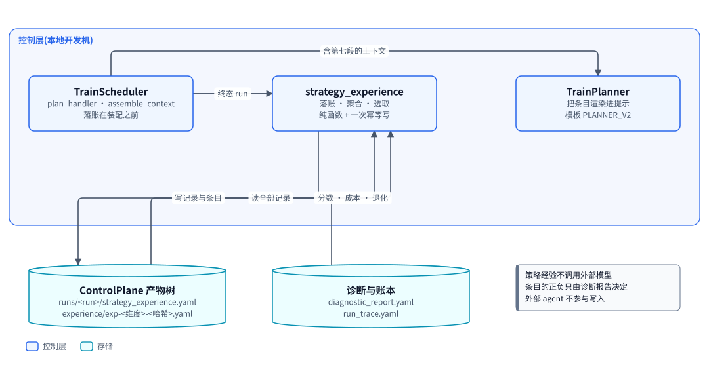
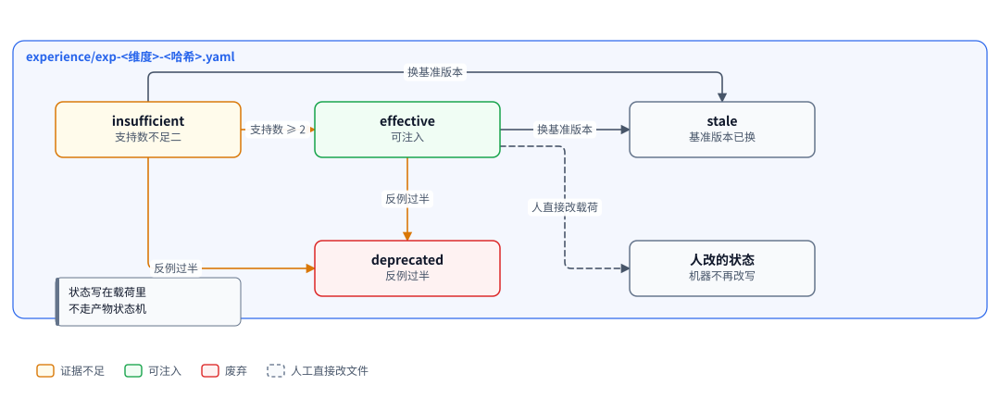
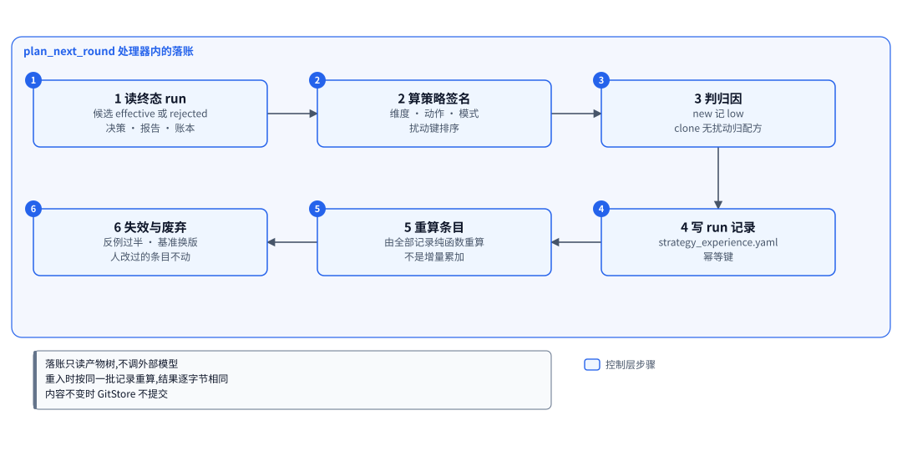
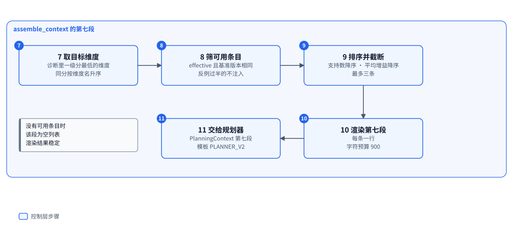

# 策略经验:把每一轮的策略与结果沉淀成可注入的长期条目

| 项 | 内容 |
|---|---|
| 一句话 | 规划处理器在装配上下文之前把一轮压成一条带策略签名的记录,再由全部记录与当前基座重算出可按维度检索的条目,注入规划上下文的第七段 |
| 状态 | [计划中],`src/trainscheduler` 内尚无该模块 |
| 所在层 | 控制层,作为 TrainScheduler 的一个模块 |
| 代码位置 | `src/trainscheduler/experience.py` [计划中]、`src/trainscheduler/experience_port.py` [计划中];读路径落在 `src/trainscheduler/assemble.py`,产物路径落在 `src/controlplane/paths.py` |
| 基线提交 | `8dd295b`(2026-10-10) |
| 依赖 | ControlPlane(信封、`GitStore`、路径函数、证据等级、失败记录)、RecipeStore 的增益实现(经 `recipes_port`)、TrainPlanner(`PlanningContext` 第七段的类型) |
| 被依赖 | TrainScheduler 的规划处理器(落账)、`assemble_context`(第七段)、factory 组合根(配置注入) |
| 对应实施计划 | 尚无工作包;施工顺序排在闭环九个工作包之后 |

## 0. 系统速览

<!-- shared:begin context-block -->
**系统是什么。** RismForge 是一套"AI 驱动的社会心智后训练工厂":输入通用开源基础模型,输出社会心智能力显著增强的模型,代号 **ZenGen**。工厂自己决定每一轮练什么、怎么练。训练决策可以交给外部更强的闭源模型(经命令行调用),关键决策点设人工审核门,其余环节自动。

**七个子系统。** 六个能力子系统加一个协调层 ControlPlane。

| 子系统 | 职责 | 所在层 | 现状 |
|---|---|---|---|
| ControlPlane | 协调层:git 版本化产物树、状态机、调和循环、三个审核门 | 控制层 | 核心 [已落地],闭环扩展 [计划中] |
| SocialSimulator | 情境与人格生成、多智能体仿真、实时环境服务、诊断评测 | 计算层 | [已落地];诊断默认用 mock 后端,`--evaluator someval` 装配 vLLM 加 SoMEval 的真实运行器 [已落地],真机只验证到预测阶段 |
| MindTrainer | 权重级训练:BatchTrain(SFT 后接 GRPO 加 OPD)与 InteractTrain | 计算层 | [已落地],默认入口的训练执行器是 mock;ROLL LoRA SFT 真实执行器 [已落地],由 `--executor roll` 装配,已在真实主机上端到端跑通一次 |
| MindAgent | 部署态智能体的技能与记忆自进化,不改权重 | 计算层 | [计划中] |
| RecipeStore | 验证有效的训练配方的版本化仓库 | 控制层 | [计划中] |
| TrainScheduler | 决策执行器:装配上下文、校验决策、构造训练指令、提名配方 | 控制层 | [计划中] |
| TrainPlanner | 决策学习者:经可插拔后端给出下一轮训练决策 | 控制层 | [计划中] |

共享基础设施有五个。**Actio** 是带技能库与显式记忆的智能体框架,每次响应附带激活轨迹。**外部推理桥接**用命令行调用外部强模型。**远端计算层** `compute` 经 SSH 在远端 GPU 主机上跑作业 [已落地]。**ROLL** 是分布式训练引擎,**vLLM** 是推理引擎。V1 经远端计算层接入 ROLL 的 LoRA SFT [已落地](由 `--executor roll` 装配,已在真实主机上从指令跑到候选一次)与 vLLM 推理服务 [计划中]。已落地部分仍由确定性 mock 顶替。真实 GRPO 加 OPD 训练与真实 judge [推迟]。

**状态标记。** **[已落地]** 表示代码在主干上且有测试。**[计划中]** 表示设计与实施计划已定,代码还没写。**[推迟]** 表示明确不在 V1 范围内。图只画目标系统,不标进展,进展只看正文的状态标记。

**六条贯穿全系统的机制。**

| 机制 | 规则 |
|---|---|
| 产物树 | 所有协作数据是 git 树里的 YAML 产物,统一信封:`id`、`type`、`version`、`created_at`、`created_by`(含 `owner` 与 `visibility`)、`status`、`schema_version`、`links`、`payload`。checkpoint 等大体量内容只存引用 `{uri, sha256, size_bytes}`;V1 的数据集逐条 episode 进 git,只适合小规模 mock。git 树是唯一真相,读取时先经迁移器链再消费。 |
| 状态机 | 需审核类:`draft → pending_review → approved → effective`,之后可到 `deprecated` 或 `superseded`,`pending_review` 也可到 `rejected`。非审核类:`pending → executed → consumed`,`pending` 也可到 `failed`。被拒绝与失败的产物保留;被拒绝的候选进入下一轮规划的输入,失败只留痕、等人处理。 |
| 调和循环 | 纯函数 `reconcile(树视图) → 动作列表`,守护进程按间隔轮询并执行动作。循环无状态、动作幂等,进程崩溃后从 git 树续接。子系统之间不直接调用,只读写产物。 |
| 审核门 | 三道人工门:① checkpoint 晋级,② 技能与记忆增量纳入,③ 配方入库。证据不在场就不能批准:门①要诊断报告,门②要验证结果,门③要可复现性校验报告。门②与门③ [计划中]。 |
| 受限直连 | 两处高频实时调用绕过 ControlPlane:① MindTrainer 与 SocialSimulator 之间的 InteractTrain rollout,② MindAgent 与 SocialSimulator 之间的部署经验采集。两处都走 gRPC 双向流,发生在计算层内部。是否开会话仍由 ControlPlane 决策。 |
| 失败分类 | T1 瞬态:有限次指数退避重试,耗尽升为 T3。T2 确定性:不重放,按所属子系统的校验链处理,LLM 的随机输出可有限次重采样。T3 需人工:写失败记录,不自动重跑。失败是数据,不是异常。 |

**核心术语。**

| 术语 | 含义 |
|---|---|
| Run | 一轮迭代,对应产物树里的 `runs/run-<编号>/` 目录,该轮所有产物都挂在其下 |
| Directive(训练指令) | TrainScheduler 或人写入的 `directive.yaml`,调和循环据此下发训练 |
| Candidate(候选 checkpoint) | MindTrainer 产出的 `candidate_checkpoint.yaml`,经诊断评测与门①才能晋级 |
| ZenGen 版本 | 晋级后写入 `models/zengen-v<N>.yaml`;下一轮训练的基座取最新的 effective 版本 |
| Episode | 一次多轮交互的完整记录:情境、角色分配、逐轮话语、终止原因 |
| Scenario、Persona、RoleAssignment | 社会情境、人格模板,以及把角色位绑定到具体人格与模型后端的分配 |
| Recipe(配方) | 验证有效的完整训练方案,分 batch、interact、agent_rsi 三类 |
| DiagnosticReport | 诊断评测产出的报告:维度、分数、置信区间、错误类型、退化标记 |
| Activation trace(激活轨迹) | Actio 每次响应附带的记录:命中的技能候选、选中的技能、命中的记忆 |
| Evidence grade(证据等级) | 诊断报告的可信等级 `stub`、`mock`、`real`,决定它能否驱动规划与提名 [计划中] |
<!-- shared:end context-block -->

## 1. 定位

策略经验是工厂的长期策略记忆:它回答"过去哪些打法在哪个维度上真的有效、证据有多厚、有效的扰动值是多少"。

它解决一个具体的缺口。规划上下文已有近因窗口:最近五条决策及其结果、最近五轮成本与增益。窗口之外的历史没有归宿。规划器因此只能在最近几轮里试错,无法积累"这条路线试过三次、两次变好、一次社交退化"这类判断,也看不到当时有效的那个扰动值是多少。

它同时补上配方战绩的两处空白:战绩以配方为单位,新配置与被拒候选都不在它的记账范围里。

<!-- figure:begin 55-strategy-experience-context -->


**图 1　策略经验的上下文**　TrainScheduler 的规划处理器在装配上下文之前先落账,把一轮的决策与结果压成一条经验记录,再由全部记录重算出长期条目;随后装配的规划上下文带上选中的条目,交给 TrainPlanner 渲染。策略经验只读写产物树,不调用外部模型,也不碰外部推理桥接。

<details>
<summary>文字版:图中的节点与连线</summary>

**节点**

- TrainScheduler:plan_handler · assemble_context / 落账在装配之前
- strategy_experience:落账 · 聚合 · 选取 / 纯函数 + 一次幂等写
- TrainPlanner:把条目渲染进提示 / 模板 PLANNER_V2
- ControlPlane 产物树:runs/<run>/strategy_experience.yaml / experience/exp-<维度>-<哈希>.yaml
- 诊断与账本:diagnostic_report.yaml / run_trace.yaml

**连线**

- TrainScheduler → strategy_experience:终态 run
- strategy_experience → ControlPlane 产物树:写记录与条目
- ControlPlane 产物树 → strategy_experience:读全部记录
- 诊断与账本 → strategy_experience:分数 · 成本 · 退化
- TrainScheduler → TrainPlanner:含第七段的上下文

</details>
<!-- figure:end 55-strategy-experience-context -->

TrainScheduler 的规划处理器调用它落账与重算,再调 `assemble_context` 取第七段;TrainPlanner 只负责把第七段渲染进提示。它不调用外部模型,不碰外部推理桥接,因此外部命令行 agent 无法写入策略经验。

### 1.1 边界与真实覆盖面

结论:V1 只覆盖"编号最大的 run 第一次进入规划"的那一轮,不覆盖历史 run、不覆盖训练失败。这是刻意收窄,不是遗漏。

| 已有机制 | 覆盖什么 | 策略经验补什么 |
|---|---|---|
| 近因窗口(最近五条决策、最近五轮成本增益) | 最近几轮发生了什么 | 窗口之外的长期统计与有效扰动值 |
| 配方战绩(`track_record.yaml`) | 已入库配方的每次复用 | 未入库的新配置、被拒候选、扰动值 |
| 诊断报告 | 单个候选的分数与退化 | 按策略签名聚合后的可比证据 |
| 失败记录 | 失败点、类别、重试次数 | 不覆盖:失败轮没有终态候选,落账不会为它触发 |
| Actio 的推理经验 | 回合内的三级回退指令 | 与部署态智能体的行为无关,互不共享 |

覆盖面由 `plan_next_round` 的触发条件决定:它只为编号最大的 run 产生,且该 run 的规划决策一旦是终态,处理器直接返回。因此落账只发生在"最大 run 第一次进入规划"的时刻。历史 run、功能关闭期间的 run、决策已终态的 run 都不会补账。补账需要一个独立的扫描动作,V1 不做。

## 2. 目标、非目标与约束

结论:只做确定性聚合,不做 LLM 抽取,不设独立的审核门。

| 编号 | 目标 | 验收方式 |
|---|---|---|
| G1 | 每个被规划过的终态 run 至多留下一条可追溯的记录 | 同一 run 连续落账两次,树里只有一份、不产生新提交 |
| G2 | 记录到条目的重算是纯函数,同输入同输出 | 给定记录集合与基座 id,两次重算结果逐字节相同 |
| G3 | 证据不足的条目不会被当作规则注入 | 可比记录少于二、或证据跨级的条目状态为 `insufficient`,不进入提示 |
| G4 | 基准与基座变化能让条目失效 | 换 `benchmark_version` 或换基座模型后,条目不被选中 |
| G5 | 规划上下文在无可用条目时逐字节稳定 | 空条目与无该功能两种情况渲染结果相同 |
| G6 | 外部 agent 无法写入 | 写入路径只从产物读取,模块不导入外部推理桥接 |
| G7 | 损坏的输入不被静默吞掉 | 跳过的记录数与原因出现在上下文摘要里 |

| 项 | 状态 | V1 的处理 |
|---|---|---|
| LLM 抽取的经验文本与对抗性校验 | [推迟] | 只做确定性统计,散文理由不参与决策 |
| 跨维度迁移 | [推迟] | 条目键含维度,不跨维度复用 |
| 历史 run 回填与失败轮记账 | [推迟] | 只记最大 run 进入规划的那一次 |
| 按代码差异的多样性结构 | [推迟] | 不维护种群,只按策略签名分桶 |
| 经验回灌成配方候选 | [推迟] | 经验只读给规划器,不进入提名 |
| 独立的审核门 | [推迟] | 条目由重算决定状态,人可经 `overrides` 改写 |
| 独立子系统与包 | 不做 | 作为 TrainScheduler 的一个模块,见决策 SE-1 |

| 约束 | 内容 | 影响 |
|---|---|---|
| 无状态 | 不缓存,每次从记录重算 | 进程重启后结果一致 |
| 幂等 | 记录以 run 目录下的信封 id 为幂等键;条目按内容比较,相同不提交 | 重入不产生第二份 |
| 增益唯一实现 | 只用 `compute_gain`,经 `recipes_port` 转导 | 基线、证据、跨版本规则与提名、战绩完全一致 |
| 只读诊断 | 正负只由诊断报告与账本决定 | 记忆的评分信号不在外部 agent 可编辑范围内 |
| 依赖方向 | 只用 `controlplane`、RecipeStore(经 `recipes_port`)、标准库 | 不导入 `trainplanner`;上下文类型由调用方拼装 |
| 无新第三方依赖 | 只用标准库 `hashlib`、`json`、`re` | 签名用摘要,不引外部库 |
| 开关在配置里 | `scheduler.yaml` 加布尔键 `strategy_experience`,默认假 | `_SCHEDULER_KEYS` 由数据类字段导出,新字段自动被严格解析接受 |
| 开关与模板必须配套 | 开关为真而 `template_version` 不是 `v2` 时构造即抛 `SchedulerConfigError` | v1 模板不含第七段占位符,允许这个组合等于让功能静默空转 |
| 写入不改变既有语义 | 关闭时 `PlanningContext` 与现状逐字节相同 | 旧模板照常可用 |

## 3. 架构

结论:两个模块,一个负责写与重算,一个负责读与选取;对外只暴露四个函数;增益经 `recipes_port` 转导。

| 模块 | 职责 | 依赖 | 状态 |
|---|---|---|---|
| `trainscheduler.experience` | `strategy_key`、`build_record`、`recompute_entries`、`EntryState`、覆盖表处理、路径安全校验 | 标准库 | [计划中] |
| `trainscheduler.experience_port` | `record_and_recompute`、`select_entries`、`StrategyExperienceSummary`;对增益的唯一导入点 | `experience`、`recipes_port`、`controlplane` | [计划中] |
| `trainscheduler.assemble`(改) | `assemble_context` 增第七段,调 `select_entries` | 上述两模块 | 改动 [计划中] |
| `trainscheduler.plan_handler`(改) | 装配之前调 `record_and_recompute` | 上述两模块 | 改动 [计划中] |
| `trainscheduler.config`(改) | `SchedulerConfig` 加 `strategy_experience: bool = False` | 无 | 改动 [计划中] |
| `controlplane.paths`(改) | `SUBDIRS` 加 `experience`;加两个路径函数 | 无 | 改动 [计划中] |
| `tests/test_paths.py`(改) | `SUBDIRS` 的精确断言同步加一项 | 无 | 改动 [计划中] |

依赖方向规则:

| 规则 | 内容 |
|---|---|
| 可以导入 | `controlplane`(`envelope`、`evidence`、`gitstore`、`paths`)、`recipes_port`(只为增益)、标准库 |
| 不得导入 | `trainplanner`、RecipeStore 的其他模块、`mindagent`、`actio`、`diagnostic`、`simulator`、`factory` |
| 反向 | `controlplane` 不导入本模块;`trainplanner` 不导入本模块 |

对 RecipeStore 的导入收口到 `recipes_port`,与 TrainScheduler 的既有做法一致:改一处只改一个文件。增益必须复用 `compute_gain`,不另写一份,否则基线与证据规则会漂移。

## 4. 数据模型与状态机

结论:两类产物,都是标准信封;记录每轮一份、只在内容变化时重写;条目全局、由全部记录加当前基座重算。

| 实体 | 字段与含义 | 约束 |
|---|---|---|
| 策略签名 | `dimension`、`action`、`mode`、`perturbation`(键到值的映射)、`source_recipe_id` | 键排序、值按类型规范化;记录用它区分"试了哪个值",分桶只用键名 |
| 记录 | `run_id`、`strategy_key`、`outcome`、`evidence`、`attribution`、`ignored` | 一个 run 至多一条;`attribution` 取 `high`、`medium`、`low` |
| 结果 | `gain`、`promoted`、`regressions`、`cost`、`perturbation` | `gain` 可为空;`regressions` 是退化标记种类列表 |
| 证据 | `grade`、`baseline_ref`、`baseline_model_id`、`benchmark_version` | `baseline_model_id` 就是报告的 `baseline_ref`,即这一轮的对照基线;`grade` 只接受 `mock`、`real`;桩报告永不落账 |
| 条目 | `id`、`strategy_key`、`support`、`wins`、`losses`、`mean_gain`、`contradictions`、`value_examples`、`status`、`evidence_scope`、`baseline_model_id`、`benchmark_version`、`overrides` | 条目的 `strategy_key` 只存扰动键名(`perturbation_keys`),值在 `value_examples`;id 为 `exp-<维度>-<桶摘要前八位>`,桶是(维度、动作、模式、扰动键名、源配方、对照基线) |
| `value_examples` | 扰动键到"值 → 出现次数"的映射 | 只在聚合记录里出现过的值;已排序 |
| `overrides` | 人写过的字段名到值的映射 | 重算跳过其中列出的字段;身份与出处(`entry_id`、`bucket`、`baseline_model_id`、`benchmark_version`)不可覆盖 |
| 反例 | `run_id`、`gain`、`regression_kinds` | 按 run 编号数值序保留最近五条;废弃阈值用全部反例计数,不数截断后的五条 |

| 产物类型 | 路径(`control-plane/` 下) | 信封 | 写方 | 状态 |
|---|---|---|---|---|
| 经验记录 | `runs/<run>/strategy_experience.yaml`,id `strategy-<run>`,type `strategy_experience_note` | `executed`,`links` 为 `[run]` | 规划处理器 | [计划中] |
| 策略条目 | `experience/exp-<维度>-<哈希>.yaml`,id 同文件名,type `strategy_entry` | `executed`,`links` 为来源 run | 规划处理器 | [计划中] |

信封字段齐备:`id`、`type`、`version`、`created_at`、`created_by`、`status`、`schema_version`、`links`、`payload`。信封 schema 不枚举 `type`,新增两种类型不需要改 schema。`experience/` 追加在 `SUBDIRS` 末尾,`tests/test_paths.py` 的精确断言同步加一项;记录放 run 目录顶层,`list_products` 的非递归扫描能扫到。

路径安全:维度取自诊断载荷,拼进文件名前必须整串匹配 `^[A-Za-z0-9][A-Za-z0-9_.-]{0,63}$`(整串匹配,不是行首匹配,否则末尾换行会被放过)、不含 `..`、不是 `.`;不合法时条目 id 退回只用签名摘要,并在记录里记一条 `ignored`。

载荷示例:

```yaml
# runs/run-003/strategy_experience.yaml 的 payload
run_id: run-003
strategy_key: {dimension: tom, action: clone, mode: batch,
               perturbation: {opd_coefficient: 0.2}, source_recipe_id: recipe-run-002}
outcome: {gain: 0.05, promoted: true, regressions: [], cost: {calls: 6}}
evidence: {grade: real, baseline_ref: zengen-v2, baseline_model_id: zengen-v2,
           benchmark_version: bench-v1}
attribution: medium
ignored: []
```

```yaml
# experience/exp-tom-3f9c1a2b.yaml 的 payload
strategy_key: {dimension: tom, action: clone, mode: batch,
               perturbation_keys: [opd_coefficient], source_recipe_id: recipe-run-002}
support: 3
wins: 2
losses: 1
mean_gain: 0.027
contradictions: [{run_id: run-011, gain: -0.02, regression_kinds: [social_regression]}]
value_examples: {opd_coefficient: {"0.2": 3}}
status: effective
evidence_scope: real
baseline_model_id: zengen-v2
overrides: {}
```

<!-- figure:begin 55-strategy-experience-states -->


**图 2　策略条目的生命周期**　条目首次写出时证据不足,支持数到二且平均增益为正才转为可用;反例过半即废弃,基准版本变更则整体失效。状态写在条目载荷里,由重算决定;人直接改写过的条目不再被机器改写。

<details>
<summary>文字版:图中的节点与连线</summary>

**节点**

- 条目 insufficient:支持数不足二
- 条目 effective:可注入
- 条目 deprecated:反例过半
- 条目 stale:基准版本已换
- 人工保留:机器不再改写

**连线**

- 条目 insufficient → 条目 effective:支持数 ≥ 2
- 条目 insufficient → 条目 deprecated:反例过半
- 条目 effective → 条目 deprecated:反例过半
- 条目 effective → 条目 stale:换基准版本
- 条目 insufficient → 条目 stale:换基准版本
- 条目 effective → 人工保留:人直接改载荷(虚线)

</details>
<!-- figure:end 55-strategy-experience-states -->

条目状态由重算决定,不走产物状态机。人改状态的方式是写 `overrides`:重算看到 `status` 在 `overrides` 里就不再改写它。这样人工结论与纯函数重算不冲突,也不需要靠"内容指纹"猜谁改过。

不变量:

1. 一个 run 至多一条经验记录,信封 id 固定。
2. 记录只由规划处理器写;模块不读桥接、不读外部 agent 输出。
3. 条目由全部记录加当前基座纯函数重算,同输入同输出。
4. `attribution` 为 `low` 的记录不进入聚合。
5. `overrides` 里列出的字段不被机器改写。
6. 选中条目上限三条,渲染后不超过 900 个字符。
7. 反例按 run 编号数值序保留最近五条,与输入顺序无关。
8. 正例与反例的判定只取 `regression_kinds` 是否非空与增益符号,不取散文理由。

## 5. 接口契约

结论:两个入口函数,一个冻结摘要类型与一个冻结状态类型;全部 [计划中],签名施工时可能微调。

```python
def record_and_recompute(store, run_id, *, config) -> None: ...
def select_entries(store, *, dimension, benchmark_version, base_model_id,
                   limit=3) -> StrategyExperienceSummary: ...
def recompute_entries(records, existing, *, benchmark_version) -> list[EntryState]: ...
def strategy_key(dimension, action, mode, perturbation, source_recipe_id) -> dict: ...
def bucket_key(key, baseline_model_id) -> tuple: ...
```

| 入口 | 行为 | 失败时 |
|---|---|---|
| `record_and_recompute` | 沿指令的 `planner_decision_ref` 找到产出这一轮的决策,再读候选、报告与账本;记录内容变化才重写;随后由全部记录重算条目 | 坏记录计入 `ignored` 并在摘要里可见,不上抛 |
| `select_entries` | 筛 `effective`、同 `benchmark_version`、同 `baseline_model_id` 的条目,按支持数与平均增益排序,截断 | 返回空摘要,不抛 |
| `recompute_entries` | 纯函数;输入全部记录、既有条目与基准版本,按各自对照基线分组输出条目状态 | 不抛;坏记录被跳过并计数 |

`StrategyExperienceSummary` 是冻结数据类 [计划中],字段为 `entries`、`rendered`、`truncated`、`ignored_records`。`rendered` 是拼好的文本行元组,每条含"策略 · 扰动值 · 证据数 · 平均增益 · 反例数";`ignored_records` 让损坏输入不会被静默吞掉。

触发条件:落账挂在 `plan_next_round` 的处理器里,在 `assemble_context` 之前执行,且仅当 `config.strategy_experience` 为真。关闭时该段为空元组,上下文与现状逐字节相同。

| 邻居 | 本文依赖它什么 | 它依赖本文什么 |
|---|---|---|
| ControlPlane | `GitStore` 的幂等写入、`Envelope`、路径函数、`diagnostic_grade`、`evidence_acceptable` | 处理器在自己的步骤里调用落账;不新增动作、不改迁移表 |
| RecipeStore | `compute_gain` 的基线、证据与跨版本规则 | 无;经 `recipes_port` 单点转导 |
| TrainPlanner | `PlanningContext` 接受第七段;模板 `{{strategy_experience}}` 占位符 | 冻结摘要与渲染好的文本行 |
| TrainScheduler 的 `assemble_context` | 装配顺序与窗口规则 | 一段摘要 |
| factory 组合根 | 不新增处理器键;开关经 `SchedulerConfig` 读取 | 无 |

## 6. 关键流程

### 6.1 落账

<!-- figure:begin 55-strategy-experience-record -->


**图 3　一次落账的六个步骤**　规划处理器在装配上下文之前先跑落账:读终态 run 的决策与结果,算策略签名,判定归因,写一条 run 级经验记录;再由全部记录重算出长期条目,并判定失效与废弃。每一步都可重入,记录与条目内容不变时不产生提交。

<details>
<summary>文字版:图中的节点与连线</summary>

**节点**

- 1 读终态 run:候选 effective 或 rejected / 决策 · 报告 · 账本
- 2 算策略签名:维度 · 动作 · 模式 / 扰动键排序
- 3 判归因:new 记 low / clone 无扰动归配方
- 4 写 run 记录:strategy_experience.yaml / 幂等键
- 5 重算条目:由全部记录纯函数重算 / 不是增量累加
- 6 失效与废弃:反例过半 · 基准换版 / 人改过的条目不动

**连线**

- 1 读终态 run → 2 算策略签名
- 2 算策略签名 → 3 判归因
- 3 判归因 → 4 写 run 记录
- 4 写 run 记录 → 5 重算条目
- 5 重算条目 → 6 失效与废弃

</details>
<!-- figure:end 55-strategy-experience-record -->

| 步 | 动作 | 产出 | 失败时 |
|---|---|---|---|
| 1 | 沿指令的 `planner_decision_ref` 找到产出本轮的决策,再读候选、诊断报告与 `run_trace` | 四份输入 | 报告是桩:不落账,记一条 `ignored` |
| 2 | 由维度、动作、模式、扰动键值与源配方算签名 | `strategy_key` | 没有产出本轮的决策(人写的指令):记 `ignored`,不落账 |
| 3 | 判归因:单键扰动的 `clone` 记 `medium`;多键扰动、`replay`、无扰动 `clone`、`new` 记 `low` | `attribution` | 无 |
| 4 | 写或重写 `runs/<run>/strategy_experience.yaml` | 记录 | 内容相同不提交 |
| 5 | 读全部记录,加当前基座重算条目 | 条目集合 | 坏记录计入 `ignored` |
| 6 | 改写状态有变化的条目;`overrides` 里的字段不动 | 条目 | 写失败上抛 |

归因分档的依据:只有单键扰动的 `clone` 能把结果归到一个变量上。多键扰动无法隔离变量;`replay` 与无扰动 `clone` 的原样复跑已被 RecipeStore 的战绩条目记账,再记一次会让同一份证据算两遍;`new` 每轮改十几项配置。四类都不聚合,只留痕。

训练失败轮不产生记录:它们没有终态候选,`plan_next_round` 也不会为它们触发。这是覆盖面缺口,已在定位一章的覆盖面表里写明。

落账的决策来源是指令里的 `planner_decision_ref`,不是 `runs/<run>/planner_decision.yaml`。
后者是"这一轮结束后为下一轮做的规划",在规划这一轮的当下按构造还不存在;读它会让落账在真实运行里恒为空。
人写的指令没有这个引用,因此人工发起的轮次不进记忆——它本来也没有可归因的策略。

### 6.2 注入

<!-- figure:begin 55-strategy-experience-inject -->


**图 4　条目如何进入规划上下文**　装配上下文时按目标维度与当前基准版本筛出可用条目,按支持数与平均增益排序,截断到最多三条并受字符预算约束,再渲染成规划上下文的第七段。没有可用条目时该段渲染为空列表,提示逐字节稳定。

<details>
<summary>文字版:图中的节点与连线</summary>

**节点**

- 7 取目标维度:诊断里一级分最低的维度 / 同分按维度名升序
- 8 筛可用条目:effective 且基准版本相同 / 反例过半的不注入
- 9 排序并截断:支持数降序 · 平均增益降序 / 最多三条
- 10 渲染第七段:每条一行 / 字符预算 900
- 11 交给规划器:PlanningContext 第七段 / 模板 PLANNER_V2

**连线**

- 7 取目标维度 → 8 筛可用条目
- 8 筛可用条目 → 9 排序并截断
- 9 排序并截断 → 10 渲染第七段
- 10 渲染第七段 → 11 交给规划器

</details>
<!-- figure:end 55-strategy-experience-inject -->

| 步 | 动作 | 产出 |
|---|---|---|
| 7 | 取诊断里一级分最低的维度,同分按维度名升序 | 目标维度 |
| 8 | 筛 `effective`、同基准版本、同基座、未被反例推翻的条目 | 候选条目 |
| 9 | 按支持数降序、平均增益降序排列,截断到三条 | 选中条目 |
| 10 | 渲染"策略 · 扰动值 · 证据数 · 平均增益 · 反例数",受 900 字符预算 | 文本行 |
| 11 | 放进 `PlanningContext` 第七段,由 `PLANNER_V2` 的占位符渲染 | 提示 |

扰动值必须进提示:只说"改过 `opd_coefficient`"而不给值,规划器无法复现有效动作,长期记忆就退化成相关性噪声。

### 6.3 聚合资格

| 条件 | 是否聚合 |
|---|---|
| `attribution` 为 `medium` | 唯一可能聚合的一类 |
| `gain` 为空 | 不聚合(没有可比基线),原因写进 `ignored` |
| 证据等级为 `mock` | 不聚合;条目的 `evidence_scope` 记 `real` |
| 带 `social_regression` 标记 | 聚合,但同时计一条反例 |
| `overrides` 指定了 `status` | 状态取人写的值 |

### 6.4 走查

数值取自拟定的测试用例,施工时以测试为准。

| 时刻 | 发生的事 | 条目状态 |
|---|---|---|
| run-003 | 单键扰动 `opd_coefficient: 0.2`,tom 增益 0.05,晋级 | `support=1`,记 `insufficient` |
| run-005 | 同签名同值再来一次,增益 0.03,晋级 | `support=2`、`wins=2`、`mean_gain=0.04`,转 `effective` |
| 规划 run-006 | 取最低维度 tom,选中该条目,提示带扰动值 0.2 | 三条以内,未截断 |
| run-008 | 同签名,增益 −0.06 且带社交退化 | `support=3`、`losses=1`,反例一条 |
| 规划 run-009 | 该条目仍 `effective`,提示带"反例 1" | 反例未达一半 |
| run-011 | 同签名再次退化 | 反例两条,达到半数,转 `deprecated` |

阈值固定为「反例数不低于支持数的一半」,反例按全部记录计数,不按载荷里存下的五条:`support=3` 时两条即废弃。

未达阈值但平均增益不为正(含零)的条目也不转 `effective`。它属于"没有变好",不是"证据不足"或"被推翻",所以以 `deprecated` 结束,不再注入。

## 7. 关键决策

| 编号 | 决策 | 备选 | 理由 | 判错的代价 |
|---|---|---|---|---|
| SE-1 | 作为 TrainScheduler 的模块,不设独立子系统与包 [计划中] | 新建第八个子系统 | 它没有独立入口、独立审核门与独立生命周期,全部接口都长在规划处理器与上下文装配上 | 将来加 LLM 抽取与门④时要拆包,拆包只是移动文件 |
| SE-2 | 只有单键扰动的 `clone` 聚合;`new`、`replay`、无扰动 `clone` 只留痕 | 所有轮次都聚合 | 后三者无法把结果归到一个变量,或已被配方战绩记账 | 可聚合样本变少,达到 `support=2` 更慢 |
| SE-3 | 正负只由诊断报告与账本决定,外部 agent 不参与写入 | 让外部 agent 写经验文本 | 外部 agent 可被诱导改评测口径,也看不到评测器 | 表达力受限,只能表达统计量 |
| SE-4 | 增益经 `recipes_port` 复用 `compute_gain` | 自己算一遍 | 基线、证据等级与跨版本规则必须与提名、战绩同口径 | 多一处导入,与既有收口约定一致 |
| SE-5 | 由全部记录加当前基座重算条目,不用增量累加 | 每写一条就累加 | 重入与崩溃恢复下增量会重复计;全量重算是纯函数 | 记录变多后每次规划多一次全量读 |
| SE-6 | 条目带 `baseline_model_id`,只选同基座的条目 | 跨基座沿用 | 基座换了,同一策略的增益不可比 | 换基座后头几轮没有经验可用 |
| SE-7 | 人改状态写 `overrides`,重算跳过其中字段 | 用内容指纹判断是否人改 | 纯函数与人工覆盖靠指纹共存不稳定 | 人手改文件而不写 `overrides` 时会被重算覆盖 |
| SE-8 | 注入上限三条、900 字符,且必须带扰动值 | 全量注入,或只给键名 | 上下文越长规划质量越差;不带值则经验无法复现 | 证据很足时可能挤掉一条更相关的 |
| SE-9 | 开关做成 `scheduler.yaml` 的布尔键,不新增处理器键 | 新增 `remember` 开关 | 处理器键要与真实动作一一对应,而落账没有独立动作;配置字段由数据类自动进入严格解析 | 关闭态要改配置而不是少传参数 |
| SE-10 | 记录与条目都是信封,type 为 `strategy_experience_note` 与 `strategy_entry` | 裸载荷 | 写入只收信封,读取要走迁移与 schema 校验 | 每种新产物类型要维护读取契约 |

## 8. 失败处理与可观测

| 失败点 | 类 | 处理 | 留痕产物 |
|---|---|---|---|
| 记录或条目文件读不出、载荷不合法 | 不分类 | 跳过并计入 `ignored`;摘要里可见 | 坏文件留在树里,原因写进摘要 |
| 报告是桩或证据等级不可接受 | 不分类 | 不落账,记 `ignored` 原因 | 同上 |
| 记录或条目写入遇到 `OSError` | T1 | 原样上抛,规划处理器退出,下次 tick 重入 | 已提交的部分 |
| 决策缺失但候选到终态 | 不分类 | 记 `ignored`,不落账 | 同上 |
| 维度名不合法 | 不分类 | 条目 id 退回签名摘要 | 记录里一条 `ignored` |
| 反例超过保留上限 | 不分类 | 只留最近五条 | 记录仍在 run 目录里 |

本模块不产生 T2 与 T3。记录先写、条目后写:崩在两者之间时,条目完全由记录推导,下一次重算收敛,读取方不会看到"有记录无条目"的错误状态。

只读观测手段:

| 想知道 | 看哪里 |
|---|---|
| 某轮被压成了什么 | `runs/<run>/strategy_experience.yaml` |
| 某个策略的证据厚度与有效值 | `experience/exp-<维度>-<哈希>.yaml` 的 `support`、`value_examples` |
| 某条目为什么失效 | 条目的 `status`、`contradictions`、`overrides` |
| 有哪些输入被跳过 | 摘要的 `ignored_records` 与记录里的 `ignored` |

## 9. 测试策略

| 层次 | 对象 | 替身 | 计划用例数 |
|---|---|---|---|
| 纯函数 | 签名(含值规范化)、归因、重算、排序、截断、路径安全 | 无 | 44 |
| 写路径 | 幂等、内容不变不提交、损坏输入计入 `ignored`、信封形状 | 临时仓库 | 26 |
| 读路径 | 筛基座与基准版本、反例阈值、空摘要、`overrides` 生效 | 临时仓库 | 22 |
| 上下文集成 | 第七段、关闭时逐字节稳定、严格反序列化 | 临时仓库 | 12 |
| 配置 | `strategy_experience` 键的解析、未知键仍被拒 | 临时仓库 | 6 |
| 边界 | 依赖方向、`__future__` 首行、`SUBDIRS` 断言 | 扫导入语句 | 4 |
| 合计 | | | 114 |

不依赖的外部服务:GPU、网络、真实模型、外部命令行工具、真实诊断后端。

## 10. 现状、局限与未核实项

| 能力 | 状态 | 说明 |
|---|---|---|
| 模块与两类产物 | [计划中] | 设计与本文件同时定稿,代码未写 |
| 落账挂进规划处理器 | [计划中] | 不新增动作,不改迁移表 |
| 上下文第七段与模板 `PLANNER_V2` | [计划中] | 关闭时旧模板不受影响 |
| 配置开关 | [计划中] | `scheduler.yaml` 的布尔键,默认假 |

| 局限 | 影响 | 缓解 |
|---|---|---|
| 不回填历史 run | 上线前的经验永久缺失 | 明确写进覆盖面 |
| 不记训练失败轮 | 失败模式不进长期记忆 | 失败记录仍在,只是不聚合 |
| 只记最大 run 进入规划的那一次 | 同一 run 后续再规划不刷新记录 | 记录按 run 幂等,内容变化才重写 |
| 只按维度分桶 | 同维度不同情境的经验混在一起 | 签名含动作、模式、扰动与源配方 |
| 新配置几乎不沉淀 | `new` 只留痕不聚合 | 新配置的价值由配方入库接手 |
| 反例只保留五条 | 长期失效细节丢失 | `status` 已能表达结论 |
| 全量重算 | 记录到数百条后规划变慢 | 与配方检索同为全量扫描,量级相同 |

| 未核实项 | 影响 | 核实办法 |
|---|---|---|
| 三条上限与 900 字符是否合适 | 可能挤掉相关条目,或提示仍偏长 | 积累二十轮真实记录后回看注入条目的利用率 |
| 反例阈值(半数) | 过早或过晚废弃 | 用真实记录分布校准 |
| 策略签名粒度 | 过粗则混桶,过细则样本永远不足 | 观察 `support` 分布,小于二的桶占比过高就加粗 |
| 单键扰动的归因是否真的成立 | 训练与评测噪声可能盖过扰动效果 | 同签名同值重复两轮,比较增益方差 |
| 换基座即失效是否过严 | 换基座后长时间无经验可用 | 观察换基座后的 `support` 恢复速度 |

明确不做:LLM 抽取经验文本、跨维度迁移、历史回填、失败轮记账、多样性种群、经验回灌成配方候选、独立审核门、独立子系统、外部 agent 写入。

## 附 本文术语

| 术语 | 含义 |
|---|---|
| 策略签名 | 维度、动作、模式、扰动值与源配方组成的桶标识 |
| 记录 | 一轮的决策、结果与证据,每轮至多一条 |
| 条目 | 同一策略签名下全部可聚合记录的聚合结果,可被注入 |
| 归因 | 结果能否归到一个变量上的分档:`high`、`medium`、`low` |
| 扰动值 | `clone` 时对配方配置的点路径改写值,进条目、进提示 |
| 反例 | 与条目总体结论相反的一条记录,保留其退化种类 |
| 覆盖表 | `overrides`,人写过的字段,重算不改写它们 |
| 失效 | 基准版本或基座变更导致条目不再参与比较与注入 |
