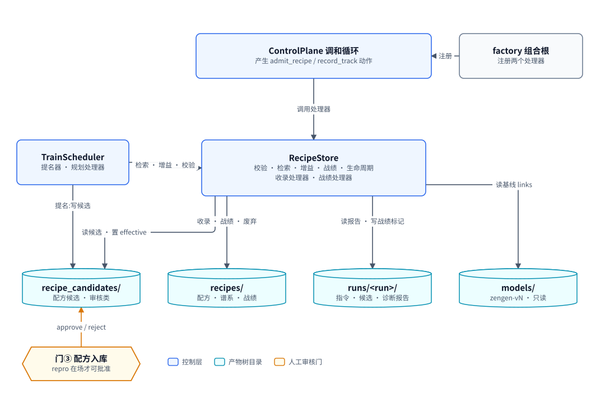
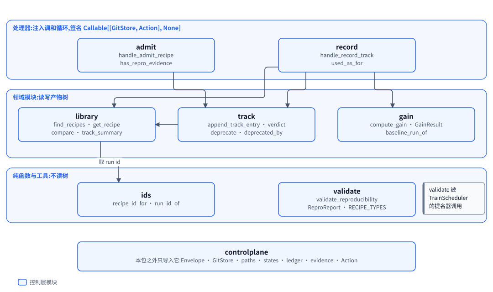
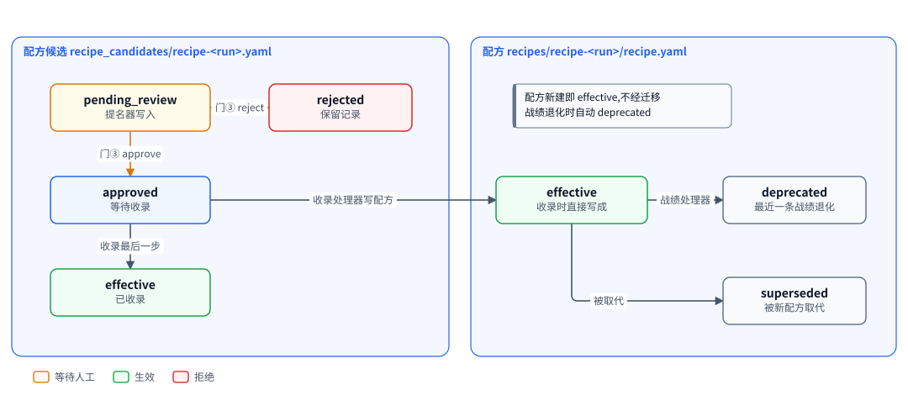
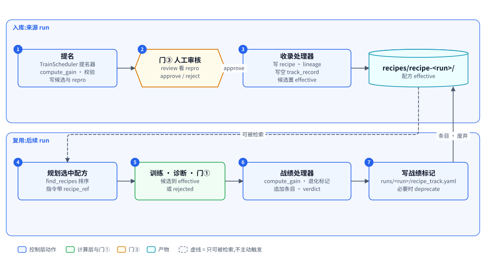

# RecipeStore:验证有效的训练配方的版本化仓库

| 项 | 内容 |
|---|---|
| 一句话 | 校验配方能否复现,收录经门③批准的配方,按战绩检索,并在战绩退化时自动废弃 |
| 状态 | [计划中] |
| 所在层 | 控制层 |
| 代码位置 | `src/recipestore` [计划中] |
| 基线提交 | `8dd295b`(2026-10-10) |
| 依赖 | ControlPlane(`controlplane` 包:信封、GitStore、路径函数、状态机、失败记录、证据等级、动作) |
| 被依赖 | TrainScheduler(检索、增益、校验)、factory 组合根(注册两个处理器)、ControlPlane 调和循环(经注入调用处理器) |
| 对应实施计划 | 工作包 3(任务 40 至 48)[计划中] |

## 0. 系统速览

<!-- shared:begin context-block -->
**系统是什么。** RismForge 是一套"AI 驱动的社会心智后训练工厂":输入通用开源基础模型,输出社会心智能力显著增强的模型,代号 **ZenGen**。工厂自己决定每一轮练什么、怎么练。训练决策可以交给外部更强的闭源模型(经命令行调用),关键决策点设人工审核门,其余环节自动。

**七个子系统。** 六个能力子系统加一个协调层 ControlPlane。

| 子系统 | 职责 | 所在层 | 现状 |
|---|---|---|---|
| ControlPlane | 协调层:git 版本化产物树、状态机、调和循环、三个审核门 | 控制层 | 核心 [已落地],闭环扩展 [计划中] |
| SocialSimulator | 情境与人格生成、多智能体仿真、实时环境服务、诊断评测 | 计算层 | [已落地];诊断默认用 mock 后端,`--evaluator someval` 装配 vLLM 加 SoMEval 的真实运行器 [已落地],真机只验证到预测阶段 |
| MindTrainer | 权重级训练:BatchTrain(SFT 后接 GRPO 加 OPD)与 InteractTrain | 计算层 | [已落地],默认入口的训练执行器是 mock;ROLL LoRA SFT 真实执行器 [已落地],由 `--executor roll` 装配,已在真实主机上端到端跑通一次 |
| MindAgent | 部署态智能体的技能与记忆自进化,不改权重 | 计算层 | [计划中] |
| RecipeStore | 验证有效的训练配方的版本化仓库 | 控制层 | [计划中] |
| TrainScheduler | 决策执行器:装配上下文、校验决策、构造训练指令、提名配方 | 控制层 | [计划中] |
| TrainPlanner | 决策学习者:经可插拔后端给出下一轮训练决策 | 控制层 | [计划中] |

共享基础设施有五个。**Actio** 是带技能库与显式记忆的智能体框架,每次响应附带激活轨迹。**外部推理桥接**用命令行调用外部强模型。**远端计算层** `compute` 经 SSH 在远端 GPU 主机上跑作业 [已落地]。**ROLL** 是分布式训练引擎,**vLLM** 是推理引擎。V1 经远端计算层接入 ROLL 的 LoRA SFT [已落地](由 `--executor roll` 装配,已在真实主机上从指令跑到候选一次)与 vLLM 推理服务 [计划中]。已落地部分仍由确定性 mock 顶替。真实 GRPO 加 OPD 训练与真实 judge [推迟]。

**状态标记。** **[已落地]** 表示代码在主干上且有测试。**[计划中]** 表示设计与实施计划已定,代码还没写。**[推迟]** 表示明确不在 V1 范围内。图只画目标系统,不标进展,进展只看正文的状态标记。

**六条贯穿全系统的机制。**

| 机制 | 规则 |
|---|---|
| 产物树 | 所有协作数据是 git 树里的 YAML 产物,统一信封:`id`、`type`、`version`、`created_at`、`created_by`(含 `owner` 与 `visibility`)、`status`、`schema_version`、`links`、`payload`。checkpoint 等大体量内容只存引用 `{uri, sha256, size_bytes}`;V1 的数据集逐条 episode 进 git,只适合小规模 mock。git 树是唯一真相,读取时先经迁移器链再消费。 |
| 状态机 | 需审核类:`draft → pending_review → approved → effective`,之后可到 `deprecated` 或 `superseded`,`pending_review` 也可到 `rejected`。非审核类:`pending → executed → consumed`,`pending` 也可到 `failed`。被拒绝与失败的产物保留;被拒绝的候选进入下一轮规划的输入,失败只留痕、等人处理。 |
| 调和循环 | 纯函数 `reconcile(树视图) → 动作列表`,守护进程按间隔轮询并执行动作。循环无状态、动作幂等,进程崩溃后从 git 树续接。子系统之间不直接调用,只读写产物。 |
| 审核门 | 三道人工门:① checkpoint 晋级,② 技能与记忆增量纳入,③ 配方入库。证据不在场就不能批准:门①要诊断报告,门②要验证结果,门③要可复现性校验报告。门②与门③ [计划中]。 |
| 受限直连 | 两处高频实时调用绕过 ControlPlane:① MindTrainer 与 SocialSimulator 之间的 InteractTrain rollout,② MindAgent 与 SocialSimulator 之间的部署经验采集。两处都走 gRPC 双向流,发生在计算层内部。是否开会话仍由 ControlPlane 决策。 |
| 失败分类 | T1 瞬态:有限次指数退避重试,耗尽升为 T3。T2 确定性:不重放,按所属子系统的校验链处理,LLM 的随机输出可有限次重采样。T3 需人工:写失败记录,不自动重跑。失败是数据,不是异常。 |

**核心术语。**

| 术语 | 含义 |
|---|---|
| Run | 一轮迭代,对应产物树里的 `runs/run-<编号>/` 目录,该轮所有产物都挂在其下 |
| Directive(训练指令) | TrainScheduler 或人写入的 `directive.yaml`,调和循环据此下发训练 |
| Candidate(候选 checkpoint) | MindTrainer 产出的 `candidate_checkpoint.yaml`,经诊断评测与门①才能晋级 |
| ZenGen 版本 | 晋级后写入 `models/zengen-v<N>.yaml`;下一轮训练的基座取最新的 effective 版本 |
| Episode | 一次多轮交互的完整记录:情境、角色分配、逐轮话语、终止原因 |
| Scenario、Persona、RoleAssignment | 社会情境、人格模板,以及把角色位绑定到具体人格与模型后端的分配 |
| Recipe(配方) | 验证有效的完整训练方案,分 batch、interact、agent_rsi 三类 |
| DiagnosticReport | 诊断评测产出的报告:维度、分数、置信区间、错误类型、退化标记 |
| Activation trace(激活轨迹) | Actio 每次响应附带的记录:命中的技能候选、选中的技能、命中的记忆 |
| Evidence grade(证据等级) | 诊断报告的可信等级 `stub`、`mock`、`real`,决定它能否驱动规划与提名 [计划中] |
<!-- shared:end context-block -->

## 1. 定位

RecipeStore 把一次被证明有效的训练沉淀成可复现、可检索、带战绩的配方。它解决两个问题:有效方案散落在各个 run 里无法复用;复用之后效果变差也没人知道。

它站在控制层,只经 ControlPlane 的产物树与别人交互。上游是 TrainScheduler 的提名器与审核门③;下游是 TrainScheduler 的规划处理器,它按战绩挑配方。

<!-- figure:begin 60-recipestore-context -->


**图 1　RecipeStore 的上下文**　TrainScheduler 写配方候选并调用 RecipeStore 的检索、增益与校验函数;调和循环经两个处理器驱动收录与战绩回写;RecipeStore 只读写产物树里的四类目录。

<details>
<summary>文字版:图中的节点与连线</summary>

**节点**

- TrainScheduler:提名器 · 规划处理器
- ControlPlane 调和循环:产生 admit_recipe / record_track 动作
- factory 组合根:注册两个处理器
- RecipeStore:校验 · 检索 · 增益 · 战绩 · 生命周期 / 收录处理器 · 战绩处理器
- recipe_candidates/:配方候选 · 审核类
- recipes/:配方 · 谱系 · 战绩
- runs/<run>/:指令 · 候选 · 诊断报告
- models/:zengen-vN · 只读
- 门③ 配方入库:repro 在场才可批准

**连线**

- TrainScheduler → RecipeStore:检索 · 增益 · 校验
- TrainScheduler → recipe_candidates/:提名:写候选
- factory 组合根 → ControlPlane 调和循环:注册
- ControlPlane 调和循环 → RecipeStore:调用处理器
- RecipeStore → recipe_candidates/:读候选 · 置 effective
- RecipeStore → recipes/:收录 · 战绩 · 废弃
- RecipeStore → runs/<run>/:读报告 · 写战绩标记
- RecipeStore → models/:读基线 links
- 门③ 配方入库 → recipe_candidates/:approve / reject

</details>
<!-- figure:end 60-recipestore-context -->

读图要点如下。本包接口全部 [计划中],施工时可能微调。TrainScheduler 写配方候选,并调本包的检索、增益与校验。人在门③批准或拒绝候选。调和循环产生 `admit_recipe` 与 `record_track` 两种动作,调用 factory 注册的两个处理器。处理器读 `runs/` 与 `models/`,只往 `recipes/`、配方候选与战绩标记三处写。

| 邻居 | 它给 RecipeStore | RecipeStore 给它 |
|---|---|---|
| TrainScheduler | 配方候选(含 `repro` 校验结果) | 配方列表、增益、校验报告 |
| ControlPlane 调和循环 | `admit_recipe`、`record_track` 动作 | 写回的产物,作为下一轮的状态事实 |
| 审核门③ | 候选的 `approved` 或 `rejected` | 候选里的 `repro`,供人判断 |
| 诊断评测 | 每个 run 的诊断报告 | 无 |
| factory 组合根 | 把两个处理器注册进处理器表 | 两个处理器函数 |

## 2. 目标、非目标与约束

V1 的目标是让配方从提名到废弃的全程自动记账,只在入库时停一次等人。

| 编号 | 目标 | 验收方式 |
|---|---|---|
| G1 | 三类配方都有可复现性校验,错误与警告写进候选 | 校验器对三类完整载荷无错误,缺任一锚点各有一条错误 |
| G2 | 增益只有一处实现,提名与战绩共用 | 提名与战绩回写都调 `compute_gain` [计划中,施工时可能微调] |
| G3 | 批准的候选被收录为 `effective` 配方 | 收录处理器写出配方、谱系、空战绩,候选置 `effective` |
| G4 | 每次复用追加一条战绩,最近一条退化就废弃 | 端到端用例:收录、复用两轮、第三轮退化、配方 `deprecated` |
| G5 | 两个处理器崩在任意一步后重跑都收敛 | 逐步故障注入测试,重跑后树与一次跑通相同 |
| G6 | 检索按战绩排序,供规划器挑选 | `find_recipes` 按 `mean_gain` 降序 [计划中,施工时可能微调] |

| 项 | 状态 | V1 的处理 |
|---|---|---|
| `superseded` 自动迁移 | [推迟] | 状态机允许,但没有写方;被取代的旧配方仍显示 `effective` |
| 评测基准修订时配方的状态迁移 | [推迟] | 基准版本变了,战绩里的增益不可比,V1 只靠最近一条战绩退化来废弃配方,不按基准修订废弃 |
| SQLite 或其他索引 | [推迟] | 每次检索扫描 `recipes/` 目录 |
| 提名判定 | 不归本文 | TrainScheduler 的提名器判定,调本包的 `compute_gain` |
| 命令行门③的证据规则 | 不归本文 | TypeScript 命令行执行;本包提供同一规则的 Python 版兜底 |
| 配方跨工厂导入导出 | [推迟] | 引用自描述,预留 `fetch_hint` |
| agent_rsi 配方自动提名 | [推迟] | 校验、检索、战绩照常支持;候选只能人工写 |
| 一个 run 产出多条配方 | 不做 | id 与 run 一一对应 |

| 约束 | 内容 | 影响 |
|---|---|---|
| 依赖方向 | 只导入 `controlplane` 与自己 | 读诊断报告按字段名读字典,不反序列化 |
| 产物读写 | 读走 `GitStore.read_product`,写走 `Envelope` 加 `GitStore.write_product` | 目录扫描只用来列 id |
| 处理器失败约定 | 确定性失败写记录或标记,不抛;瞬态异常原样上抛 | 坏动作不会让守护进程卡死 |
| 幂等 | 调和循环的幂等键放在最后一步写 | 每一步都"不在才写" |
| 不建新目录 | 处理器不新建 `runs/<run>/` | 避免多出一个"最大 run"挡住规划 |
| 无新依赖 | 不加第三方包 | 只改 wheel 包列表一行 |
| 首行导入 | 每个源文件以 `from __future__ import annotations` 开头 | 有测试强制 |

## 3. 架构

RecipeStore 是七个模块组成的单层包,按"处理器、领域、纯函数"三层组织,依赖只向下、向外指向 `controlplane`。

<!-- figure:begin 60-recipestore-architecture -->


**图 2　RecipeStore 的模块**　七个模块分三层:两个处理器在上,检索、增益、战绩与生命周期在中间,id 与校验器在底层;整个包只导入 controlplane。

<details>
<summary>文字版:图中的节点与连线</summary>

**节点**

- admit:handle_admit_recipe / has_repro_evidence
- record:handle_record_track / used_as_for
- library:find_recipes · get_recipe / compare · track_summary
- track:append_track_entry · verdict / deprecate · deprecated_by
- gain:compute_gain · GainResult / baseline_run_of
- ids:recipe_id_for · run_id_of
- validate:validate_reproducibility / ReproReport · RECIPE_TYPES
- controlplane:本包之外只导入它:Envelope · GitStore · paths · states · ledger · evidence · Action

**连线**

- admit → track
- record → track
- record → gain
- record → library
- track → library
- library → ids:取 run id

</details>
<!-- figure:end 60-recipestore-architecture -->

两个处理器在最上层,它们调领域模块读写战绩与谱系。领域模块共用 `ids` 互转配方 id 与 run id。`validate` 是纯函数,不读树,由 TrainScheduler 在提名时调用。整个包对外只导入 `controlplane`。下表的接口全部 [计划中],施工时可能微调。

| 模块 | 职责 | 依赖 | 状态 |
|---|---|---|---|
| `recipestore.ids` | `recipe_id_for`、`run_id_of`:配方 id 与来源 run id 互转 | 无 | [计划中] |
| `recipestore.validate` | `validate_reproducibility`、`ReproReport`、`is_relative_ref` | 无 | [计划中] |
| `recipestore.gain` | `compute_gain`、`GainResult`、`baseline_run_of`、读报告的小函数 | `controlplane` | [计划中] |
| `recipestore.library` | `find_recipes`、`get_recipe`、`compare`、`read_track_entries`、`track_summary` | `ids`、`controlplane` | [计划中] |
| `recipestore.track` | `append_track_entry`、`verdict`、`deprecate`、`deprecated_by` | `library`、`ids`、`controlplane` | [计划中] |
| `recipestore.admit` | 收录处理器 `handle_admit_recipe`、`has_repro_evidence` | `track`、`ids`、`controlplane` | [计划中] |
| `recipestore.record` | 战绩处理器 `handle_record_track`、`used_as_for` | `gain`、`library`、`track`、`controlplane` | [计划中] |

依赖方向规则如下。

| 规则 | 内容 |
|---|---|
| 可以导入 | `controlplane` 的 `envelope`、`gitstore`、`paths`、`states`、`reconcile`、`ledger`、`evidence` |
| 不得导入 | `diagnostic`、`simulator`、`mindtrainer`、`trainscheduler`、`trainplanner`、`factory` |
| 谁可以导入本包 | `trainscheduler`、`factory` |
| 反向禁止 | `controlplane` 不导入 `recipestore` |
| 测试例外 | 测试可以导入 `diagnostic`,只为用它自己的写法造报告,钉住字段名 |

## 4. 数据模型与状态机

RecipeStore 管四种产物,全部是信封,放在产物树里。配方候选与配方共用一份载荷和同一个 id `recipe-<来源 run>`。

| 实体 | 字段与含义 | 约束 |
|---|---|---|
| 配方载荷 | `recipe_type`、`dimension`、`source_run_id`、`eval_anchor`、`result`、`repro`、`nondeterministic`,加类型专有键 | `recipe_type` 只能是 `batch`、`interact`、`agent_rsi` |
| `eval_anchor` | 分类表、题库、基准、judge 提示、打分配置五项版本 | 暂无的填 `null`;batch 强制前两项 |
| `result` | `gain`、`baseline_ref`、`candidate_ref`、`promoted` | 提名时写入 |
| `repro` | `errors`、`warnings` 两个字符串列表 | 校验器输出;缺了门③不能批准 |
| 战绩条目 | `run_id`、`gain`、`promoted`、`regressed`、`used_as` | 恰好五个键;`gain` 可为空;`used_as` 只能是 `clone` 或 `replay` |
| 战绩记录载荷 | `recipe_id`、`entries` | `entries` 是战绩条目列表,`n_reuse` 是它的总数,含 `gain` 为空的条目;同一 `run_id` 先写者为准,不覆盖,记错只能人工改文件 |
| 谱系载荷 | `recipe_id`、`source_run_id`、`admitted_from`、`events` | 事件形如 `{event, run_id, reason?}`,`event` 是 `admitted` 或 `deprecated`,每种至多一条 |
| 战绩标记载荷 | `recipe_id`、`result`、`reason`、`entry`、`verdict`、`deprecated` | `result` 是 `recorded` 或 `skipped` |

类型专有键按配方类型划分。

| 类型 | 专有键 |
|---|---|
| batch | `training_config`、`stage_manifests`(每阶段的清单 id 与哈希)、`code_version.repo_commit` |
| interact | `training_config`、`scenario_ids`、`bindings`、`code_version` |
| agent_rsi | `bound_model_id`、`scenario_ids`、`persona_ids`、`analyzer_config`、`verifier_config`、`generator_version`、`uses_bridge`、`prompt_template_version` |

`repro` 的错误与警告规则 [计划中]:

| 类型 | 错误 | 警告 |
|---|---|---|
| batch | `training_config` 缺失或缺无默认值的必填键;`mode` 与类型不一致;两个 checkpoint 引用不带合法 `sha256`;`stage_manifests` 为空、某阶段缺 `id`,或 `manifest_hash` 不是 64 位十六进制;`training_config.stage_manifest_refs` 点名的阶段未锚定或 id 不一致;`code_version.repo_commit` 不是提交号;`eval_anchor` 缺分类表或题库版本 | 无 |
| interact | `training_config` 同上;`scenario_ids` 为空;`bindings` 为空;非 `self_play` 的绑定没有具体的 `model_ref`;`code_version` 同上;`nondeterministic` 不是 `true` | 恒有一条交互不可复现的警告 |
| agent_rsi | 缺 `bound_model_id`、`scenario_ids`、`persona_ids`、`analyzer_config`、`verifier_config`、`generator_version` 之一;`uses_bridge` 为真时缺 `prompt_template_version`;`uses_bridge` 不是布尔 | 无 |

相对引用扫描覆盖全载荷,只排除 `repro` 自身与 `training_config.reward.outcome_rules`(奖励关键词不是引用),每个命中给出点分路径。校验是纯函数,不读树、不改入参,未知类型或载荷不是字典也只返回错误、不抛。

产物与路径如下,路径都在 `control-plane/` 下。

| 产物类型 | 路径 | 状态机种类 | 写方 | 状态 |
|---|---|---|---|---|
| `recipe_candidate` | `recipe_candidates/recipe-<run>.yaml` | 审核类 | 提名器写;命令行改状态;收录处理器置 `effective` | [计划中] |
| `recipe` | `recipes/recipe-<run>/recipe.yaml` | 审核类 | 收录处理器写;战绩处理器废弃 | [计划中] |
| `recipe_lineage` | `recipes/recipe-<run>/lineage.yaml` | 非审核类,`executed` | 收录处理器、战绩处理器 | [计划中] |
| `recipe_track_record` | `recipes/recipe-<run>/track_record.yaml` | 非审核类,`executed` | 收录处理器写空表;战绩处理器追加 | [计划中] |
| `recipe_track_note` | `runs/<run>/recipe_track.yaml` | 非审核类,`executed` | 战绩处理器 | [计划中] |
| `failure_record` | `runs/<run>/failure-admit_recipe.yaml` | 非审核类,`executed` | 收录处理器,经统一的失败写入函数 | [计划中] |

<!-- figure:begin 60-recipestore-states -->


**图 3　配方的生命周期**　配方候选由提名器写成 pending_review,经门③批准后由收录处理器写出 effective 的配方,候选随之置 effective;配方在战绩退化时被战绩处理器废弃,被取代时置 superseded。

<details>
<summary>文字版:图中的节点与连线</summary>

**节点**

- 候选 pending_review:提名器写入
- 候选 approved:等待收录
- 候选 effective:已收录
- 候选 rejected:保留记录
- 配方 effective:收录时直接写成
- 配方 deprecated:最近一条战绩退化
- 配方 superseded:被新配方取代

**连线**

- 候选 pending_review → 候选 approved:门③ approve
- 候选 pending_review → 候选 rejected:门③ reject
- 候选 approved → 配方 effective:收录处理器写配方
- 候选 approved → 候选 effective:收录最后一步
- 配方 effective → 配方 deprecated:战绩处理器
- 配方 effective → 配方 superseded:被取代

</details>
<!-- figure:end 60-recipestore-states -->

候选走审核类状态机的前半段,配方走后半段。两者的迁移都受 `controlplane.states.REVIEW_TRANSITIONS` 约束。配方新建时直接写成 `effective`,不算迁移。V1 里只有 `effective → deprecated` 自动发生。

载荷示例(batch 配方,节选):

```yaml
recipe_type: batch
dimension: tom
source_run_id: run-003
eval_anchor: {taxonomy_version: tax-v1, item_pool_version: pool-v1,
              benchmark_version: bench-v1, judge_prompt_version: null,
              scoring_config_version: null}
result: {gain: 0.05, baseline_ref: zengen-v1, candidate_ref: cand-run-003, promoted: true}
repro: {errors: [], warnings: []}
nondeterministic: false
training_config: {mode: batch, trained_slot: a, ...}
stage_manifests:
  sft: {id: dsm-run-003-sft, manifest_hash: "<64 位十六进制>"}
code_version: {repo_commit: "0385004"}
```

不变量:

1. 一个来源 run 至多产出一条配方,id 恒为 `recipe-<run>`。
2. `recipes/` 只有两个写方,即收录处理器与战绩处理器。
3. 配方的 `payload` 与 `links` 照抄批准时的候选,收录后不再改载荷。
4. 战绩按 `run_id` 幂等,先写者为准,不覆盖。
5. 谱系里 `deprecated` 事件至多一条,标记的 `deprecated` 字段以它记下的触发 run 为准。
6. 候选置 `effective` 是收录的最后一步;战绩标记是回写的最后一步。
7. 任何处理器都不新建 `runs/<run>/` 目录。

## 5. 接口契约

本章全部接口都是 [计划中],签名来自工作包 3 的施工单,施工时可能微调。

校验与增益两个入口(施工时可能微调):

```python
def validate_reproducibility(recipe_payload: dict) -> ReproReport: ...
class ReproReport:            # errors、warnings 都是元组;ok 为"没有错误"
    errors: tuple[str, ...]; warnings: tuple[str, ...]
def compute_gain(store: GitStore, run_id: str, dimension: str) -> GainResult: ...
class GainResult:             # gain 为 None 时 reason 写明原因
    gain: float | None; baseline_run_id: str | None; reason: str
```

增益的唯一实现是 `compute_gain(store, run_id, dimension)`,返回 `GainResult(gain, baseline_run_id, reason)`,成功时 `reason` 为 `ok`。链路是:候选报告取该维度一级分,经报告的 `baseline_ref`(`zengen-vN`)找到基线模型,再经模型的 `links` 找到基线 run,取基线报告的同维度一级分相减。任何一环缺失都返回空增益,`reason` 写明缺什么:候选无报告、候选报告是桩、候选缺该维度一级分、没有 `baseline_ref`、`baseline_ref` 不是模型 id、基线模型不在、模型 `links` 认不出 run、基线就是自己、基线 run 无报告、基线报告是桩、real 候选对非 real 基线、基准版本不可比、基线缺该维度、分数不是数字、分数不是有限数或重复。基线 run 已找到时 `baseline_run_id` 照填,便于审核人追查 [计划中]。

检索、战绩与生命周期(施工时可能微调):

```python
def find_recipes(store, *, dimension=None, recipe_type=None,
                 states=("effective",), order="track") -> list[RecipeView]: ...
def get_recipe(store, recipe_id) -> Envelope: ...            # 不在抛 RecipeNotFoundError
def compare(store, a, b) -> dict: ...                        # 配置差异加战绩对比
def append_track_entry(store, recipe_id, entry) -> None: ... # 按 run_id 幂等
def verdict(entries) -> str: ...                             # "keep" 或 "deprecate"
def deprecate(store, recipe_id, *, reason, run_id) -> bool: ...
# RecipeView: id, recipe_type, dimension, status, payload, mean_gain, n_reuse
```

检索与战绩的取值细节 [计划中]:`order` 取 `track` 或 `id`,其他值抛 `ValueError`;`track` 序下没有增益数据的配方排在所有有数据的配方之后,含负增益。`compare` 只比配置,排除 `result`、`repro`、`source_run_id`,差异按点分路径展开,列表整体比较,一侧缺失记 `<missing>`。`append_track_entry` 严格校验条目恰好五个键,同一 `run_id` 已存在时先写者为准,不覆盖。`deprecate` 先写谱系事件再改配方状态,同一配方只记一次 `deprecated`。

两个处理器,签名即 `Callable[[GitStore, Action], None]`(施工时可能微调):

```python
def handle_admit_recipe(store: GitStore, action: Action) -> None: ...  # target_id 是配方候选 id
def handle_record_track(store: GitStore, action: Action) -> None: ...  # target_id 是 run id
def has_repro_evidence(payload: dict) -> bool: ...  # 门③"证据在场"规则的 Python 版
```

触发条件由 ControlPlane 调和循环的扩展判定(施工时可能微调):

| 动作 | `target_id` | 触发条件 | 幂等键 |
|---|---|---|---|
| `admit_recipe` | 配方候选 id | 审核门视图的种类是 `recipe_candidate` 且状态 `approved` | 候选变为 `effective` |
| `record_track` | run id | 指令 `recipe_ref` 非空;候选 `effective` 或 `rejected`;证据可接受;没有战绩标记 | `runs/<run>/recipe_track.yaml` |

产物读写约定:

| 读或写 | 产物 | 约定 |
|---|---|---|
| 读 | `runs/<run>/directive.yaml` | 取 `recipe_ref` 与 `planner_decision_ref` |
| 读 | `runs/<run>/candidate_checkpoint.yaml` | 取状态,判 `promoted` |
| 读 | `runs/<run>/diagnostic_report.yaml` | 按 `DiagnosticReport` 序列化后的字段名读字典 |
| 读 | `models/zengen-vN.yaml` | 从 `links` 找产出基线的 run |
| 读 | `runs/<源 run>/planner_decision.yaml` | 取 `decision.action` 作 `used_as` |
| 写 | 第 4 章产物表里的五种产物 | 一律"不在才写"或按 `run_id` 幂等 |

对邻居的假设:

| 邻居 | 本文依赖它什么 | 它依赖本文什么 |
|---|---|---|
| ControlPlane | 晋级写 `links=[cand-<run>, <run>]`;`GitStore.write_product` 对相同内容不产生提交;路径函数与 `SUBDIRS` 已含配方目录 | 两个处理器不抛确定性异常 |
| 诊断评测 | 报告含 `baseline_ref`、`benchmark_version`、`dimension_scores`(一级维度 `level` 为 `l1`)、`regression_flags` | 无 |
| TrainScheduler | 候选载荷符合第 4 章;指令带 `planner_decision_ref`;决策 id 形如 `planner-<源 run>` | 检索的排序、增益的唯一实现、校验器的错误文本;并要求这些名字存在:`find_recipes`、`get_recipe`、`RecipeNotFoundError`、`RecipeView`、`compute_gain`、`GainResult`、`read_report_payload`、`regression_flags`、`recipe_id_for`、`run_id_of`、`validate_reproducibility`、`ReproReport`、`has_repro_evidence` [计划中] |
| TypeScript 命令行 | `approve` 配方候选时执行与 `has_repro_evidence` 相同的规则 | 无 |
| factory 组合根 | 把处理器注册到 `handlers['admit_recipe']` 与 `handlers['record_track']` | 两个处理器函数 |

## 6. 关键流程

主流程分两段:来源 run 入库,后续 run 复用并回写战绩。图中七步与下表一一对应,表中接口全部 [计划中],施工时可能微调。

<!-- figure:begin 60-recipestore-flow -->


**图 4　提名到入库到战绩回写**　来源 run 晋级后提名器写配方候选,门③批准后收录处理器写入 recipes/;之后某个 run 复用该配方,走完门①后战绩处理器追加战绩条目,最近一条退化就废弃配方。

<details>
<summary>文字版:图中的节点与连线</summary>

**节点**

- 提名:TrainScheduler 提名器 / compute_gain · 校验 / 写候选与 repro
- 门③ 人工审核:review 看 repro / approve / reject
- 收录处理器:写 recipe · lineage / 写空 track_record / 候选置 effective
- recipes/recipe-<run>/:配方 effective
- 规划选中配方:find_recipes 排序 / 指令带 recipe_ref
- 训练 · 诊断 · 门①:候选到 effective / 或 rejected
- 战绩处理器:compute_gain · 退化标记 / 追加条目 · verdict
- 写战绩标记:runs/<run>/recipe_track.yaml / 必要时 deprecate

**连线**

- 提名 → 门③ 人工审核
- 门③ 人工审核 → 收录处理器:approve
- 收录处理器 → recipes/recipe-<run>/
- recipes/recipe-<run>/ → 规划选中配方:可被检索(虚线)
- 规划选中配方 → 训练 · 诊断 · 门①
- 训练 · 诊断 · 门① → 战绩处理器
- 战绩处理器 → 写战绩标记
- 写战绩标记 → recipes/recipe-<run>/:条目 · 废弃

</details>
<!-- figure:end 60-recipestore-flow -->

步骤 1 由 TrainScheduler 完成,步骤 2 由人完成,步骤 5 由计算层与门①完成,其余由 RecipeStore 完成。第 4 步的虚线表示配方只是"可被检索",并不主动触发复用。第 7 步把条目写回配方目录,必要时废弃配方。

| 步 | 名称 | 执行者 | 读 | 写 |
|---|---|---|---|---|
| 1 | 提名 | TrainScheduler 提名器 | 候选 checkpoint、指令、诊断报告;调 `compute_gain` 与校验器 | 配方候选(`pending_review`,含 `repro`) |
| 2 | 门③ 人工审核 | 人,经命令行 `review`、`approve`、`reject` | 候选的 `repro` | 候选状态 `approved` 或 `rejected` |
| 3 | 收录处理器 | `handle_admit_recipe` | 配方候选 | 配方、谱系、空战绩;候选置 `effective` |
| 4 | 规划选中配方 | TrainScheduler 规划处理器 | `find_recipes` 的排序结果 | 指令的 `recipe_ref` |
| 5 | 训练 · 诊断 · 门① | MindTrainer、诊断评测、人 | 指令 | 候选 checkpoint 到 `effective` 或 `rejected`,诊断报告 |
| 6 | 战绩处理器 | `handle_record_track` | 指令、候选、报告、基线模型、规划决策 | 战绩条目 |
| 7 | 写战绩标记 | `handle_record_track` | 战绩 | `runs/<run>/recipe_track.yaml`;必要时废弃配方并记谱系 |

收录处理器(第 3 步)的四次写,每次都可重入:

| 次 | 写什么 | 跳过条件 |
|---|---|---|
| 1 | `recipe.yaml`,状态 `effective`,载荷与 `links` 照抄候选 | 文件已在 |
| 2 | `lineage.yaml`,事件 `admitted` | 文件已在 |
| 3 | `track_record.yaml`,条目为空 | 文件已在 |
| 4 | 候选 `approved → effective` | 入口处候选已是 `effective` 就返回 |

战绩处理器(第 6、7 步)按顺序判定,每一步的结局如下。

| 判定 | 不满足时 | 留痕 |
|---|---|---|
| 战绩标记已在 | 返回 | 无 |
| 指令在 | 返回 | 无,避免新建 run 目录 |
| `recipe_ref` 非空 | 写 `skipped` 标记 | 标记 |
| 配方存在 | 写 `skipped` 标记 | 标记 |
| 候选在且为终态 | 返回,留给以后 | 无 |
| 有诊断报告 | 返回,留给以后 | 无 |
| 报告不是 stub | 写 `skipped` 标记 | 标记 |
| 全部满足 | 追加条目,判 `verdict`,必要时废弃,最后写 `recorded` 标记 | 条目、谱系、配方状态、标记 |

失败与恢复路径:

| 场景 | 处理 | 恢复 |
|---|---|---|
| 收录崩在第 1 至 3 次写之后 | 候选仍是 `approved` | 下一 tick 再触发,已写的跳过 |
| 战绩崩在条目写入之后 | 标记未写 | 重跑时条目按 `run_id` 幂等,不重复 |
| 废弃崩在谱系与配方状态之间 | 谱系已有 `deprecated` 事件 | 重跑补改状态,触发 run 仍以谱系为准 |
| 候选已批准但没有 `repro` | 不收录,写一次 T2 失败记录 | 人修好候选,或拒绝它 |
| 增益无法计算 | 条目照记,`gain` 为空 | 不需要;`mean_gain` 只统计非空条目 |

走查例子。数值来自工作包 3 的端到端用例 `test_admit_then_reuse_then_deprecate` [计划中]。

| 时刻 | 动作 | 报告的 tom 一级分 | 增益 | 结果 |
|---|---|---|---|---|
| 准备 | run-001 晋级为 zengen-v1 | 0.5 | 无 | 基线 |
| 收录 | run-002 的候选 `approved`,收录 | 无 | 无 | `recipe-run-002` 为 `effective` |
| 复用一 | run-003 克隆,候选 `effective` | 0.6 | 0.1 | 条目 1,`keep` |
| 复用二 | run-004 克隆,候选 `rejected` | 0.7 | 0.2 | 条目 2,`promoted` 为假,`keep` |
| 检索 | `find_recipes` | 无 | 无 | `n_reuse` 2,`mean_gain` 0.15 |
| 复用三 | run-005 克隆,报告带社交退化标记 | 0.2 | -0.3 | 条目 3,`deprecate` |
| 结果 | 默认检索不再返回它 | 无 | 无 | `n_reuse` 3,`mean_gain` 0.0;谱系事件为 `admitted`、`deprecated` |

## 7. 关键决策

决策沿用闭环集成阶段的 R 编号,本文新增的用 RS 加序号。

| 编号 | 决策 | 备选 | 理由 | 判错的代价 |
|---|---|---|---|---|
| R6 | 候选放 `recipe_candidates/`,批准后由 RecipeStore 写入 `recipes/` | 候选与配方同目录,靠状态区分 | `recipes/` 只有两个写方,边界清楚 | 多一个目录 |
| R8 | 生命周期只自动 `deprecated`,`superseded` 推迟 | 同时自动判取代 | "取代"需要定义比较规则,V1 没有依据 | 被更优配方取代的旧配方仍显示 `effective` |
| R9 | 不建 SQLite 索引,按目录扫描 | SQLite 或内存索引 | 产物树是唯一事实,索引会成为第二份状态 | 配方到数百条以上检索变慢 |
| R10 | 审核门记录就是候选自己的状态与原因 | 另建门记录产物 | 与已落地的候选 checkpoint 一致 | 无独立的审核日志 |
| RS-1 | 候选与配方共用 id `recipe-<来源 run>` | 独立编号 | 路径函数只收 run id,互转由 `ids` 一处负责 | 一个 run 只能产出一条配方 |
| RS-2 | 校验只报错误与警告,不硬拒绝 | 校验不过就不提名 | 是否可复现由门③的人判断 | 有错误的候选也会进门③ |
| RS-3 | 相对引用扫描覆盖全载荷,只排除 `repro` 与 `outcome_rules` | 只扫已知引用字段 | 引用可能出现在任何位置;`outcome_rules` 是自然语言关键词 | 恰好取 `best` 之类值的普通字段会误报 |
| RS-4 | `training_config` 只核对必填键在场,不校验类型 | 导入 MindTrainer 校验 | 依赖方向禁止导入 `mindtrainer` | 类型错的配置到复用派发时才失败 |
| RS-5 | 基线 run 取模型 `links` 里"`cand-<它>` 也在"的那一项 | 取 `links[1]` | 不靠位置猜 | 晋级写法改了就找不到基线,增益为空 |
| RS-6 | 跨基准版本、重复一级分、非有限数、自比较都返回空增益 | 照常相减 | 这些情况的差值没有意义;NaN 会被当成达标 | 换题库后第一轮没有可比增益 |
| RS-7 | `regressed` 取任意退化标记,含 G 探针失败 | 只看社交退化 | 两种都是诊断写入的退化信号 | G 探针失败也会废弃配方 |
| RS-8 | `used_as` 以指令的 `planner_decision_ref` 为准,退路扫 `executed` 决策,都没有记 `clone` | 只扫 `runs/` | 失败决策分配过的 run id 会被再分配 | 人工指令一律记成 `clone` |
| RS-9 | 处理器把调和循环的幂等键放在最后写 | 先写标记 | 崩在任一步之后重跑都收敛 | 无 |
| RS-10 | 废弃先写谱系事件,再改配方状态 | 先改状态 | 崩在两步之间时,只看"这次改没改"会记错触发者 | 无 |
| RS-11 | 收录处理器对坏动作一律空操作,不抛 | 抛异常 | 调和循环不接处理器异常,抛了守护进程会在同一动作上反复退出 | 形状不对的动作不留痕迹 |
| RS-12 | 排序时没有增益数据的配方排最后,含负增益之后 | 视为 0 | 没有证据不能排在负证据之前 | 新配方永远排末尾,规划器不会先选它 |
| RS-13 | `compare` 排除 `result`、`repro`、`source_run_id` | 全载荷比较 | 它们是结果与来源,不是配置 | 两条 `new` 配方的差异里恒有清单 id 与哈希 |
| RS-14 | 证据等级只走 `diagnostic_grade`,real 候选不减非 real 基线 | 照常相减 | 真分数对假分数的差值看起来正常,却没有意义 | 后端切到 real 后头几轮没有可比增益 |
| RS-15 | 增益是点差,不检查置信区间 | 要求超出置信区间才算提升 | 报告里的一级分不带区间,提名与战绩只看点差加 `min_gain` 阈值 | 噪声内的差异可能被当作提升,接真实后端后要补区间判断 |

## 8. 失败处理与可观测

处理器按 T1、T2、T3 分类,确定性失败写记录或标记,瞬态异常原样上抛。

| 失败点 | 类 | 处理 | 留痕产物 |
|---|---|---|---|
| 读写产物时 `OSError` 等瞬态异常 | T1 | 原样上抛,守护循环退出,重启后同一动作再来 | 无 |
| 收录:候选 `approved` 但没有合法 `repro` | T2 | 不收录,只记一次 | `runs/<run>/failure-admit_recipe.yaml`,`point` 为 `recipestore.admit` [计划中] |
| 收录:候选 id 形状对但文件不在 | T2 | 只记一次;run 目录不在时什么都不写 | 同上 |
| 收录:`target_id` 不是 `recipe-<run>` 或含路径分隔符 | T2 | 空操作 | 无 |
| 战绩:`recipe_ref` 为空、配方不在、报告是 stub | T2 | 写 `skipped` 标记,调和循环不再触发 | `runs/<run>/recipe_track.yaml` |
| 战绩:没有基线或不可比 | 不算失败 | 条目照记,`gain` 为空,原因写进标记 | 同上 |
| 战绩最近一条退化 | 不算失败 | 废弃配方 | 谱系事件、配方状态、标记 `deprecated: true` |

V1 里本包不产生 T3。处理器内的瞬态异常会让守护循环退出,与派发器的已知限制相同。

只读观测手段:

| 手段 | 看什么 |
|---|---|
| 命令行 `status` | 只列 `pending_review` 的待审产物与待确认指令,看不到挂着的 `approved` 候选;发现收录卡住要看收录失败记录,或直接看配方候选的状态 |
| 命令行 `review <候选 id>` | 候选的 `repro` 错误与警告 |
| `recipes/recipe-<run>/track_record.yaml` | 每次复用的增益、是否晋级、是否退化 |
| `recipes/recipe-<run>/lineage.yaml` | 收录与废弃事件及触发 run |
| `runs/<run>/recipe_track.yaml` | 该 run 的战绩回写结局与原因 |
| `git log -- control-plane/recipes` | 每次写入的提交信息,前缀 `recipestore:` |

## 9. 测试策略

测试全部离线,用临时目录里的 GitStore 与手工构造的产物,不依赖任何外部服务。

| 层次 | 对象 | 替身 |
|---|---|---|
| 纯函数 | id 互转、校验器、`verdict`、`track_summary` | 无 |
| 读树函数 | 增益、检索、比较、战绩追加、废弃 | 临时 GitStore,手工写报告、模型、配方 |
| 处理器 | 收录、战绩回写,含逐步故障注入 | 在第 N 次写时抛 `OSError` 的包装 |
| 串联 | 收录、复用、退化、废弃 | 同上,不经调和循环 |
| 守卫 | 依赖方向、`__future__` 首行 | 解析源文件 |
| 字段名钉 | 诊断报告字段名 | 用 `diagnostic` 自己的写法造一份报告 |

计划的测试文件与用例数(全部 [计划中],施工时可能微调):

| 文件 | 用例数 |
|---|---|
| `tests/test_rs_ids.py` [计划中] | 9 |
| `tests/test_rs_validate.py` [计划中] | 62 |
| `tests/test_rs_gain.py` [计划中] | 30 |
| `tests/test_rs_library.py` [计划中] | 20 |
| `tests/test_rs_track.py` [计划中] | 24 |
| `tests/test_rs_admit.py` [计划中] | 23 |
| `tests/test_rs_record.py` [计划中] | 26 |
| `tests/test_rs_flow.py` [计划中] | 3 |
| 合计 | 197 |

测试用的构造函数放 `tests/rs_fixtures.py` 与 `tests/rs_recipes.py` [计划中],不建 `conftest.py`,以免影响全部测试的收集。不依赖的外部服务:真实诊断后端、训练引擎、推理引擎、外部推理桥接、网络。

## 10. 现状、局限与未核实项

RecipeStore 整体 [计划中]:代码一行没写,`src/recipestore` 不存在,设计与施工单已定。

| 能力 | 状态 | 说明 |
|---|---|---|
| 配方目录 `recipes/` | [已落地] | 已在 `SUBDIRS` 里,目前为空 |
| 配方候选目录、配方路径函数、失败记录、证据等级 | [计划中] | 由工作包 1 产出,本包只消费 |
| 可复现性校验 | [计划中] | 纯函数 |
| 增益 | [计划中] | 全系统唯一实现 |
| 检索、比较、战绩、废弃 | [计划中] | 按目录扫描 |
| 收录与战绩两个处理器 | [计划中] | 可脱离调和循环直接调用 |
| 调和循环产生两种动作 | [计划中] | 由调和循环扩展完成,不在本包 |
| `superseded` 自动迁移 | [推迟] | R8 |

已知局限:

| 局限 | 影响 | 缓解 |
|---|---|---|
| 不建 SQLite 索引(R9),检索与 `used_as` 退路都扫目录 | 配方或 run 到数百个以上才会慢 | 产物树是唯一事实,不维护第二份状态;慢了再加只读缓存 |
| `superseded` 推迟(R8) | 被更优配方取代的旧配方仍显示 `effective`,仍会被检索到 | 检索按战绩排序,更优的排在前面 |
| V1 提名器给 `eval_anchor` 的分类表与题库版本填 `null` | 每个 batch 候选的 `repro` 恒有两条错误:`eval_anchor.taxonomy_version: missing` 与 `eval_anchor.item_pool_version: missing` | 它们是真缺口,不是误判;后续让诊断评估器把两个版本写进报告,由提名器回填 |
| 常驻 `repro` 错误 | 审核人容易对错误列表脱敏,漏看新增的真错误 | 门③审核时先排除这两条再看其余 |
| 第一次闭环没有基线模型 | 没有已晋级模型时 `compute_gain` 返回空增益,不会提名;mock 诊断给每个候选同样的分,也需要更低分的基线才有正增益 | 首轮前人工登记一个已晋级的基线模型及其报告 |
| 生命周期只自动 `deprecated` | 只看最近一条战绩,一次退化即废弃,一次好结果也能保住长期变差的配方 | 门③与 `compare` 供人复核;误废弃只能人工改回 |
| 直接调用战绩处理器不检查证据可接受 | mock 候选对 mock 基线的增益会记进战绩 | 经调和循环触发时,触发条件已要求证据可接受 |
| 校验不核对 `training_config` 类型与清单哈希是否真实 | 坏配置能通过校验 | 复用派发时由派发器判 `failed` |
| 处理器瞬态异常让守护循环退出 | 存储抖动会中断闭环 | 重启后同一动作重来,处理器可重入 |
| 形状不对的 `admit_recipe` 动作不留痕迹 | 每 tick 空转一次,只能直接查看配方候选目录里长期停在 `approved` 的候选发现,`status` 命令不列它 | 人改好候选的文件名或 id |
| `regressed` 含 G 探针失败 | 通用能力退化也会废弃配方 | 只想看社交退化时改成按标记种类过滤 |
| 提交号只认 7 到 40 位小写十六进制 | SHA-256 对象格式的仓库会被误报 | 需要时把上限放宽到 64 |

未核实项:

| 项 | 影响 | 核实办法 |
|---|---|---|
| 真实诊断评估器写的 `baseline_ref` 形如 `zengen-vN` | 形状不同时增益恒为空,不会算错 | 诊断评估器落地后,读一份它写的报告 |
| 命令行门③规则与 `has_repro_evidence` 一致 | 不一致时人能批准缺 `repro` 的候选,处理器兜底写失败记录 | 命令行落地后,对同一组载荷跑两边的判定 |
| "模型 → 产出 run"两种判法结果一致 | 不一致时增益与调和循环选的基线不同 | 组合根的跨包一致性测试钉住 |
| 用例数 197 | 施工时可能变化 | 落地后用 `uv run pytest --collect-only -q` 收集 `tests/test_rs_*.py` |
| `RECIPE_TYPES` 与规划器上下文的同名常量相等 | 不等时规划器会跳过某类配方 | 组合根的跨包一致性测试钉住 |

明确不做:

- 不建索引,不维护目录之外的任何状态。
- 不自动判 `superseded`,不合并或改写已收录配方的载荷。
- 不做提名判定,不写配方候选。
- 不在校验不过时硬拒绝候选。
- 不让一个 run 产出多条配方。
- 不导入 `diagnostic`、`mindtrainer` 等计算层包。

## 附 本文术语

| 术语 | 含义 |
|---|---|
| 配方 | 一次被证明有效的训练的完整、可复现描述,产物类型 `recipe` |
| 配方候选 | 提名器写出、等待门③审核的配方,产物类型 `recipe_candidate` |
| 来源 run | 刚结束、被提名产出配方的那一轮;配方 id 为 `recipe-<来源 run>` |
| 锚点 | 让复现结果确定的具体值,如清单哈希、提交号、题库版本 |
| 相对引用 | 随时间漂移的软引用,如 `latest`、`current_best`,校验时算错误 |
| 增益 | 目标维度一级分数减去基线 run 同维度分数 |
| 基线 run | 产出诊断报告里 `baseline_ref` 那个模型的 run |
| 战绩 | 配方每次被复用时的结果条目序列 |
| 谱系 | 配方的收录与废弃事件记录,产物类型 `recipe_lineage` |
| 战绩标记 | 某个 run 的战绩回写结局,也是 `record_track` 的幂等键 |
| `mean_gain` | 战绩中 `gain` 非空条目的平均值,一条都没有时为空 |
| `n_reuse` | 战绩条目总数,含 `gain` 为空的条目 |
| `used_as` | 该次复用的方式,`clone` 或 `replay` |
