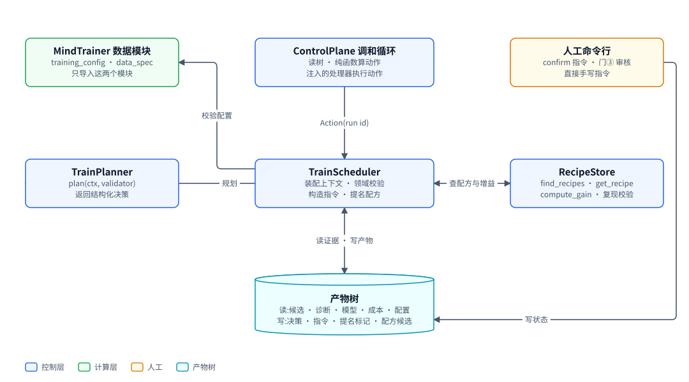
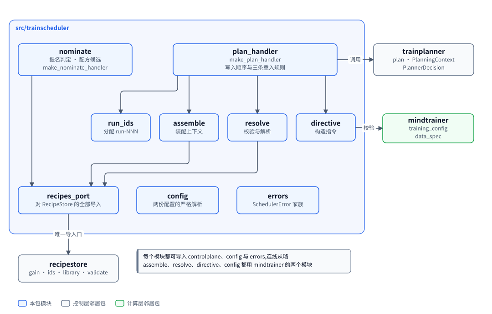
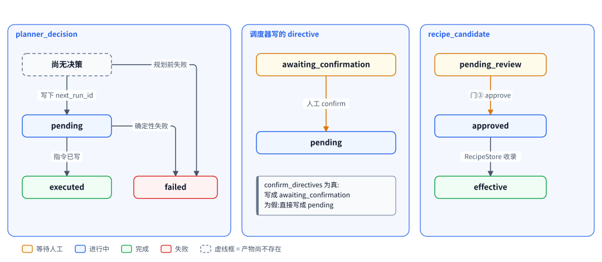
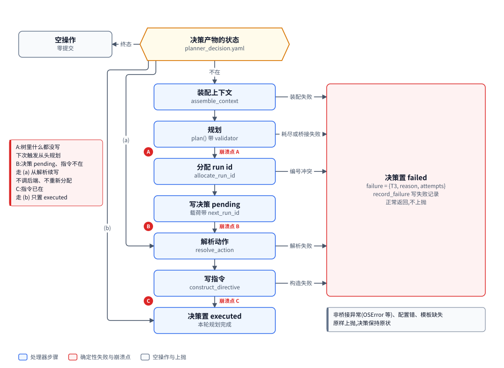
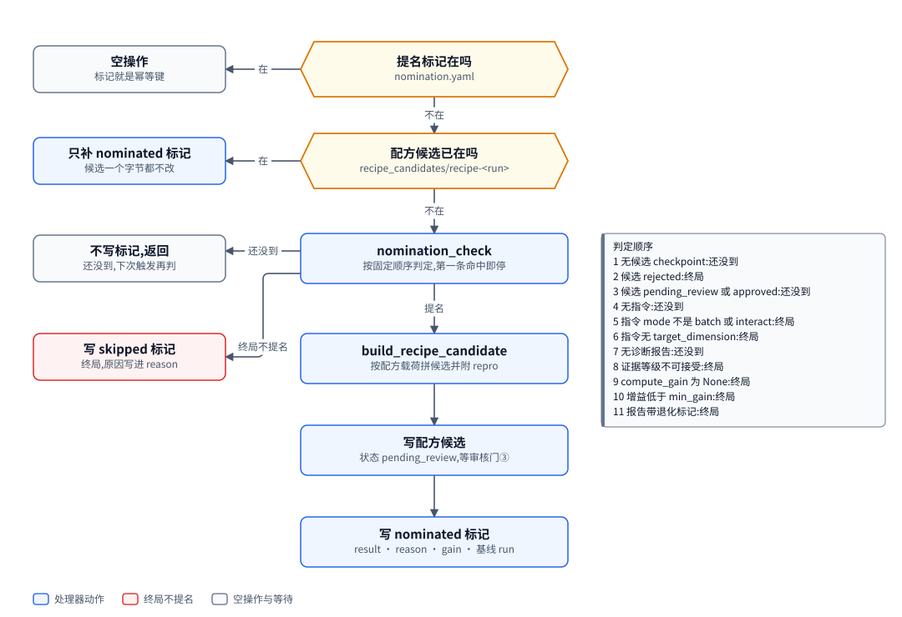

# TrainScheduler:把一轮的结果变成下一条指令与配方候选

| 项 | 内容 |
|---|---|
| 一句话 | 两个可注入调和循环的处理器:一轮结束后规划并写出下一条训练指令;一轮成功后判定是否提名配方候选 |
| 状态 | [计划中],整个包尚未存在 |
| 所在层 | 控制层 |
| 代码位置 | `src/trainscheduler` [计划中] |
| 基线提交 | `8dd295b`(2026-10-10) |
| 依赖 | ControlPlane(产物树、信封、路径、账本、证据等级)、TrainPlanner、RecipeStore、外部推理桥接(只取 `BridgeError`)、MindTrainer 的 `training_config` 与 `data_spec` 两个模块 [计划中] |
| 被依赖 | ControlPlane 调和循环(注入两个处理器)、factory 组合根 |
| 对应实施计划 | 工作包 5(任务 60 至 68)[计划中] |

## 0. 系统速览

<!-- shared:begin context-block -->
**系统是什么。** RismForge 是一套"AI 驱动的社会心智后训练工厂":输入通用开源基础模型,输出社会心智能力显著增强的模型,代号 **ZenGen**。工厂自己决定每一轮练什么、怎么练。训练决策可以交给外部更强的闭源模型(经命令行调用),关键决策点设人工审核门,其余环节自动。

**七个子系统。** 六个能力子系统加一个协调层 ControlPlane。

| 子系统 | 职责 | 所在层 | 现状 |
|---|---|---|---|
| ControlPlane | 协调层:git 版本化产物树、状态机、调和循环、三个审核门 | 控制层 | 核心 [已落地],闭环扩展 [计划中] |
| SocialSimulator | 情境与人格生成、多智能体仿真、实时环境服务、诊断评测 | 计算层 | [已落地],诊断用 mock 后端 |
| MindTrainer | 权重级训练:BatchTrain(SFT 后接 GRPO 加 OPD)与 InteractTrain | 计算层 | [已落地],训练执行器是 mock |
| MindAgent | 部署态智能体的技能与记忆自进化,不改权重 | 计算层 | [计划中] |
| RecipeStore | 验证有效的训练配方的版本化仓库 | 控制层 | [计划中] |
| TrainScheduler | 决策执行器:装配上下文、校验决策、构造训练指令、提名配方 | 控制层 | [计划中] |
| TrainPlanner | 决策学习者:经可插拔后端给出下一轮训练决策 | 控制层 | [计划中] |

共享基础设施有四个。**Actio** 是带技能库与显式记忆的智能体框架,每次响应附带激活轨迹。**外部推理桥接**用命令行调用外部强模型。**ROLL** 是分布式训练引擎,**vLLM** 是推理引擎。ROLL 与 vLLM 在 V1 里没有接入真实服务,训练与推理由确定性 mock 顶替。

**状态标记。** **[已落地]** 表示代码在主干上且有测试。**[计划中]** 表示设计与实施计划已定,代码还没写。**[推迟]** 表示明确不在 V1 范围内。图只画目标系统,不标进展,进展只看正文的状态标记。

**六条贯穿全系统的机制。**

| 机制 | 规则 |
|---|---|
| 产物树 | 所有协作数据是 git 树里的 YAML 产物,统一信封:`id`、`type`、`version`、`created_at`、`created_by`(含 `owner` 与 `visibility`)、`status`、`schema_version`、`links`、`payload`。checkpoint 等大体量内容只存引用 `{uri, sha256, size_bytes}`;V1 的数据集逐条 episode 进 git,只适合小规模 mock。git 树是唯一真相,读取时先经迁移器链再消费。 |
| 状态机 | 需审核类:`draft → pending_review → approved → effective`,之后可到 `deprecated` 或 `superseded`,`pending_review` 也可到 `rejected`。非审核类:`pending → executed → consumed`,`pending` 也可到 `failed`。被拒绝与失败的产物保留;被拒绝的候选进入下一轮规划的输入,失败只留痕、等人处理。 |
| 调和循环 | 纯函数 `reconcile(树视图) → 动作列表`,守护进程按间隔轮询并执行动作。循环无状态、动作幂等,进程崩溃后从 git 树续接。子系统之间不直接调用,只读写产物。 |
| 审核门 | 三道人工门:① checkpoint 晋级,② 技能与记忆增量纳入,③ 配方入库。证据不在场就不能批准:门①要诊断报告,门②要验证结果,门③要可复现性校验报告。门②与门③ [计划中]。 |
| 受限直连 | 两处高频实时调用绕过 ControlPlane:① MindTrainer 与 SocialSimulator 之间的 InteractTrain rollout,② MindAgent 与 SocialSimulator 之间的部署经验采集。两处都走 gRPC 双向流,发生在计算层内部。是否开会话仍由 ControlPlane 决策。 |
| 失败分类 | T1 瞬态:有限次指数退避重试,耗尽升为 T3。T2 确定性:不重放,按所属子系统的校验链处理,LLM 的随机输出可有限次重采样。T3 需人工:写失败记录,不自动重跑。失败是数据,不是异常。 |

**核心术语。**

| 术语 | 含义 |
|---|---|
| Run | 一轮迭代,对应产物树里的 `runs/run-<编号>/` 目录,该轮所有产物都挂在其下 |
| Directive(训练指令) | TrainScheduler 或人写入的 `directive.yaml`,调和循环据此下发训练 |
| Candidate(候选 checkpoint) | MindTrainer 产出的 `candidate_checkpoint.yaml`,经诊断评测与门①才能晋级 |
| ZenGen 版本 | 晋级后写入 `models/zengen-v<N>.yaml`;下一轮训练的基座取最新的 effective 版本 |
| Episode | 一次多轮交互的完整记录:情境、角色分配、逐轮话语、终止原因 |
| Scenario、Persona、RoleAssignment | 社会情境、人格模板,以及把角色位绑定到具体人格与模型后端的分配 |
| Recipe(配方) | 验证有效的完整训练方案,分 batch、interact、agent_rsi 三类 |
| DiagnosticReport | 诊断评测产出的报告:维度、分数、置信区间、错误类型、退化标记 |
| Activation trace(激活轨迹) | Actio 每次响应附带的记录:命中的技能候选、选中的技能、命中的记忆 |
| Evidence grade(证据等级) | 诊断报告的可信等级 `stub`、`mock`、`real`,决定它能否驱动规划与提名 [计划中] |
<!-- shared:end context-block -->

## 1. 定位

TrainScheduler 是决策执行器:它把 TrainPlanner 的结构化决策落成一条合法的训练指令,并把有效的一轮整理成配方候选。

它解决两个问题。第一,规划器只给出"练哪个维度、新开还是复用哪条配方"这样的意图,意图要变成一份能被 MindTrainer 读回、通过校验的指令。第二,一轮训练出了有效候选之后,要有人按证据判定它值不值得成为配方,再交给审核门③。

<!-- figure:begin 70-trainscheduler-context -->


**图 1　TrainScheduler 的上下文**　调和循环把 plan_next_round 与 nominate_recipe 两种动作交给 TrainScheduler 的处理器。处理器调 TrainPlanner 拿决策,查 RecipeStore 的配方与增益,借 MindTrainer 的两个数据模块校验指令,结果全部写回产物树。人工经命令行确认指令、审核配方候选,也可以直接写指令。

<details>
<summary>文字版:图中的节点与连线</summary>

**节点**

- MindTrainer 数据模块:training_config · data_spec / 只导入这两个模块
- ControlPlane 调和循环:读树 · 纯函数算动作 / 注入的处理器执行动作
- 人工命令行:confirm 指令 · 门③ 审核 / 直接手写指令
- TrainPlanner:plan(ctx, validator) / 返回结构化决策
- TrainScheduler:装配上下文 · 领域校验 / 构造指令 · 提名配方
- RecipeStore:find_recipes · get_recipe / compute_gain · 复现校验
- 产物树:读:候选 · 诊断 · 模型 · 成本 · 配置 / 写:决策 · 指令 · 提名标记 · 配方候选

**连线**

- ControlPlane 调和循环 → TrainScheduler:Action(run id)
- TrainScheduler ↔ TrainPlanner:规划
- TrainScheduler ↔ RecipeStore:查配方与增益
- TrainScheduler → MindTrainer 数据模块:校验配置
- TrainScheduler ↔ 产物树:读证据 · 写产物
- 人工命令行 → 产物树:写状态

</details>
<!-- figure:end 70-trainscheduler-context -->

调和循环判定触发条件,产生 `plan_next_round` 与 `nominate_recipe` 两种动作,交给本包的处理器。处理器重读产物树取证据,调 TrainPlanner 拿决策,向 RecipeStore 查配方与增益。指令写出前借 MindTrainer 的两个数据模块做校验,保证坏指令不进树。人工经命令行确认指令、审核配方候选,也可以绕过规划直接手写指令。

## 2. 目标、非目标与约束

本包只做"判定与写产物",不做训练、不做评测、不判触发条件。

| 编号 | 目标 | 验收方式 |
|---|---|---|
| G1 | 一条 `new batch` 决策经默认配置走到训练出候选 | 端到端用例 `test_a_new_batch_round_is_planned_confirmed_synthesized_and_trained` [计划中] |
| G2 | `clone` 复用配方锚定的数据清单,不再合成 | 端到端用例 `test_promote_nominate_admit_then_clone_reuses_the_manifests` [计划中] |
| G3 | 规划处理器崩在任意一步之后重跑都收敛 | 三个崩溃点各有重入测试 [计划中] |
| G4 | 领域违规带原因回给规划器重采样,而不是直接判失败 | `validate_decision` 作为 `plan()` 的 validator [计划中] |
| G5 | 提名不改已审核的候选,判定可追查 | 四种候选状态的测试;提名标记带原因与增益 [计划中] |

| 非目标或推迟项 | 状态 | V1 的处理 |
|---|---|---|
| 判定触发条件(候选终态、证据可接受、最大 run、在途轮) | 不做 | 由调和循环判,处理器不重复判断 |
| 构造 AgentRSI 指令、提名 agent_rsi 配方 | 不做 | 只处理 batch 与 interact |
| `new` 构造 interact 指令 | 不做 | `training_defaults.yaml` 只有一份 batch 配置 |
| 并行多轮在途 | [推迟] | 同一时间只有一轮在途 |
| 异步规划 | [推迟] | 规划同步执行,外部推理期间调和循环被阻塞 |
| 按目标维度定制合成数据 | [推迟] | `new` 指令的 `data_spec` 每轮相同(种子 0) |

| 约束 | 内容 | 影响 |
|---|---|---|
| 无状态 | 处理器不持有内存状态,每次重读树 | 重启后从树续接 |
| 幂等 | 规划的幂等键是决策产物的终态;提名的幂等键是提名标记 | 同一动作重复调用不产生第二份产物 |
| 指令先校验后写 | 写前过 `validate_training_config` 与 `data_spec` 交叉校验 [计划中] | 坏指令不进树 |
| 只读函数 | 装配、校验、解析、提名判定、候选构造都不写树 | 可单独测试;有测试比对 HEAD |
| 依赖收口 | 对 RecipeStore 的导入只在 `recipes_port` 一个文件 | RecipeStore 改名只改一处 |
| 无新第三方依赖 | 只用标准库 `copy`、`dataclasses`、`math`、`re`、`collections` | 无 |

## 3. 架构

本包由九个模块组成,两个处理器是对外入口,其余模块各管一件事。

<!-- figure:begin 70-trainscheduler-architecture -->


**图 2　TrainScheduler 的模块**　两个处理器是对外入口。规划处理器串起 run id 分配、上下文装配、动作解析与指令构造;提名处理器只经 recipes_port 用 RecipeStore。对 RecipeStore 的导入全部集中在 recipes_port,对 MindTrainer 只用 training_config 与 data_spec 两个模块。

<details>
<summary>文字版:图中的节点与连线</summary>

**节点**

- nominate:提名判定 · 配方候选 / make_nominate_handler
- plan_handler:make_plan_handler / 写入顺序与三条重入规则
- trainplanner:plan · PlanningContext / PlannerDecision
- run_ids:分配 run-NNN
- assemble:装配上下文
- resolve:校验与解析
- directive:构造指令
- mindtrainer:training_config / data_spec
- recipes_port:对 RecipeStore 的全部导入
- config:两份配置的严格解析
- errors:SchedulerError 家族
- recipestore:gain · ids · library · validate

**连线**

- plan_handler → trainplanner:调用
- plan_handler → run_ids
- plan_handler → assemble
- plan_handler → resolve
- plan_handler → directive
- directive → mindtrainer:校验
- assemble → recipes_port
- resolve → recipes_port
- nominate → recipes_port
- recipes_port → recipestore:唯一导入口

</details>
<!-- figure:end 70-trainscheduler-architecture -->

规划处理器按顺序调用 run id 分配、上下文装配、动作解析与指令构造,中间调 TrainPlanner。提名处理器自成一条线。两条线都只经 `recipes_port` 使用 RecipeStore。

| 模块 | 职责 | 依赖 | 状态 |
|---|---|---|---|
| `errors` | `SchedulerError` 及四个子类 `ContextAssemblyError`、`ResolveError`、`DirectiveConstructionError`、`RunIdOrderError`;`SchedulerConfigError` 是 `ValueError` 的子类,不属于 `SchedulerError` | 无 | [计划中] |
| `recipes_port` | 对 RecipeStore 的全部导入 | `recipestore` | [计划中] |
| `config` | 两份配置的字段表、严格解析、读取、安装 | `controlplane.config`、MindTrainer 两模块 | [计划中] |
| `run_ids` | 按数值序分配下一个 `run-NNN` | `controlplane.paths` | [计划中] |
| `assemble` | `assemble_context`:从树里装配 `PlanningContext` | `recipes_port`、`trainplanner.context`、`controlplane.evidence` | [计划中] |
| `resolve` | `validate_decision` 领域校验,`resolve_action` 动作解析 | `recipes_port`、`controlplane.models`、`training_config` | [计划中] |
| `directive` | `construct_directive`:写指令前校验,绝不覆盖 | MindTrainer 两模块 | [计划中] |
| `plan_handler` | `make_plan_handler`:规划的写入顺序与重入 | 以上全部、`trainplanner`、`BridgeError` | [计划中] |
| `nominate` | `nomination_check`、`build_recipe_candidate`、`make_nominate_handler` | `recipes_port`、`controlplane.evidence` | [计划中] |

依赖方向规则 [计划中],由 `tests/test_ts_boundaries.py` 扫描导入语句强制:

| 规则 | 内容 |
|---|---|
| 可以导入 | `controlplane`(`config`、`envelope`、`evidence`、`gitstore`、`ledger`、`models`、`paths`、`reconcile` 只取 `Action`、`states`) |
| 可以导入 | `trainplanner`(`backends` 只取类型、`context`、`decision`、`planner`、`templates`) |
| 可以导入 | `inference_bridge` 只取 `BridgeError`;`recipestore` 只经 `recipes_port` [计划中] |
| 可以导入 | `mindtrainer` 恰好 `training_config` 与 `data_spec` 两个模块 |
| 不得导入 | `mindtrainer` 的其他模块(`dispatch`、`orchestrator`、`executor`、`data_producer`)、`diagnostic`、`simulator`、`actio`、`mindagent`、`factory` |
| 反方向 | `controlplane`、`recipestore`、`trainplanner`、`mindtrainer`、`inference_bridge` 都不导入 `trainscheduler` |

测试文件不受此限,可以导入 `mindtrainer.dispatch` 与 `mindtrainer.data_producer` 跑端到端。 [计划中]

## 4. 数据模型与状态机

本包写四种产物,读两份配置;配置严格解析,未知键、类型错、范围错一律拒绝。

| 实体 | 字段与含义 | 约束 |
|---|---|---|
| `SchedulerConfig` [计划中] | 九个键,见下表 | 冻结;`scheduler.yaml` 缺失取全部默认值 |
| `TrainingDefaults` [计划中] | `training_config`:完整 batch 配置,不含 `stage_manifest_refs`;`data_spec`:合成规格 | `training_defaults.yaml` 缺失抛 `SchedulerConfigError` |
| `ResolvedAction` [计划中] | `target_dimension`、`action`、`recipe_ref`、`training_config`、`data_spec`、`base_model_id` | 冻结;只有 `new` 带 `data_spec`;`new` 的 `recipe_ref` 是空串 |
| `NominationVerdict` [计划中] | `nominate`、`reason`、`gain`、`baseline_run_id`、`not_yet` | 冻结;`not_yet` 为真表示前置条件还没到 |

`scheduler.yaml` 的字段 [计划中]:

| 键 | 类型与范围 | 默认 | 含义 |
|---|---|---|---|
| `confirm_directives` | bool | `true` | 写出的指令是 `awaiting_confirmation` 还是 `pending` |
| `allow_interact` | bool | `false` | 是否放行 interact 配方的 clone 与 replay |
| `accept_mock_evidence` | bool | `false` | 提名是否接受 `mock` 证据。`make_nominate_handler` 与 `nomination_check` 的同名参数不为空时覆盖它;经组合根运行时参数恒不为空,所以这个键在组合根里不起作用 [计划中] |
| `perturbable` | 点路径列表,不重复 | `opd_coefficient`、`sft_steps`、`grpo_steps`、`grpo_config.learning_rate` | 扰动白名单 |
| `min_gain` | 有限数 | `0.01` | 提名阈值 |
| `cost_gain_window`、`recent_decision_window` | int,1 至 100 | `5`、`5` | 上下文里近几轮的成本增益、近几条决策 |
| `max_plan_attempts`、`template_version` | int 1 至 10;非空 str | `3`、`"v1"` | 规划总尝试次数;规划模板版本 |

`training_defaults.yaml` 的默认值 [计划中]:被训角色位是 `zengen`,`sft_steps`、`grpo_steps`、`groups_per_step`、`group_size` 都是 2,`sft_batch_size` 与 `checkpoint_every_steps` 是 1,允许续训,`opd_coefficient` 是 0.1,学习率 1.0e-5,奖励是单分量 `goal` 的 `outcome_split`(关键词 `agreed`、`同意`)。初始基座与教师是 `file:///compute/checkpoints/` 下的占位引用,哈希为 64 个 0。这份默认配置里 `mode` 必须是 `batch`,且不得写 `stage_manifest_refs`,清单 id 每轮由指令构造按新 run id 写。默认 `data_spec` 是 4 个情境、种子 0、用途 `training`,`sft` 组大小 1,`grpo_opd` 组大小 2。`sft` 取 1,是因为默认 rollout 下同组奇数序号的样本是无内容的中性话,组大小大于 1 会让一半 SFT 数据没有信息 [计划中]。

| 产物类型 | 路径 | 状态机种类 | 写方 | 状态 |
|---|---|---|---|---|
| `planner_decision` | `runs/<run>/planner_decision.yaml` | 非审核 | 规划处理器 | [计划中] |
| `directive` | `runs/<新 run>/directive.yaml` | 非审核 | 规划处理器(也可人工) | 路径 [已落地],本包写入 [计划中] |
| `failure_record` | `runs/<run>/failure-plan-<run>.yaml` | 非审核 | 规划处理器经 `record_failure` | [计划中] |
| `nomination_note` | `runs/<run>/nomination.yaml` | 非审核 | 提名处理器 | [计划中] |
| `recipe_candidate` | `recipe_candidates/recipe-<run>.yaml` | 审核 | 提名处理器写,命令行改状态,RecipeStore 收录 | [计划中] |
| `config` | `config/scheduler.yaml`、`config/training_defaults.yaml` | 非审核 | 人工、`install_default_configs` | [计划中] |

失败记录的 id 为 `failure-<run>-<task>`,这里 `task_id` 是 `plan-<来源 run>`,`links` 是来源 run;同一 `(run, task)` 只写一次 [计划中]。`stage_manifest_refs` 只写训练配置需要的阶段:`new` 指令按新 run id 写 `sft` 与 `grpo_opd` 两个清单 id,形如 `dsm-<新 run>-<阶段>`;`clone` 与 `replay` 沿用来源配方里的清单 id,所以 clone 出的指令点名来源 run 的清单,新 run 下不合成任何清单 [计划中]。

<!-- figure:begin 70-trainscheduler-states -->


**图 3　调度器产物的状态**　规划决策从 pending 走到 executed 或 failed,规划前就失败时直接以 failed 写出。调度器写的指令按 confirm_directives 取初始状态。配方候选以 pending_review 写出,之后由人与 RecipeStore 推进。

<details>
<summary>文字版:图中的节点与连线</summary>

**节点**

- 尚无决策
- 决策 pending
- executed
- failed
- awaiting_confirmation
- 指令 pending
- pending_review
- approved
- effective

**连线**

- 尚无决策 → 决策 pending:写下 next_run_id
- 决策 pending → executed:指令已写
- 决策 pending → failed:确定性失败
- 尚无决策 → failed:规划前失败
- awaiting_confirmation → 指令 pending:人工 confirm
- pending_review → approved:门③ approve
- approved → effective:RecipeStore 收录

</details>
<!-- figure:end 70-trainscheduler-states -->

规划决策先以 `pending` 写下新 run id,指令写出后置 `executed`。规划前就失败(装配不出、规划耗尽、桥接失败、编号冲突)时直接以 `failed` 写出。配方候选写出后不再由本包推进。

规划决策的载荷 [计划中],id 为 `planner-<来源 run>`,`links` 为来源 run 与新 run:

```yaml
payload:
  source_run_id: run-001
  next_run_id: run-002          # 先于指令写入
  template_version: v1
  backend: scripted             # bridge | heuristic | scripted
  decision: {target_dimension: tom, action: new, mode: batch, source_recipe_id: null, perturbation: {}, data_synthesis_hint: ""}
  rationale: "..."
  failure: null                 # 失败时 {category: T3, reason, attempts}
```

本包写的指令比人工指令多两个键:`planner_decision_ref`(决策 id),以及 `new` 才有的 `data_spec`。`recipe_ref` 在 clone 与 replay 时是配方 id。指令 id 等于新 run id,`links` 是决策 id,clone 与 replay 再加配方 id。目标位置已有指令时,`planner_decision_ref` 相同视为已完成,原样返回,不同则确定性失败,绝不覆盖人手写的指令 [计划中]。提名标记的载荷是 `{result, reason, gain, baseline_run_id, recipe_candidate_id}`,`result` 为 `nominated` 或 `skipped`。

不变量 [计划中]:

1. 一个来源 run 至多一份规划决策,决策到终态后同一动作是空操作。
2. 新 run id 先进决策,再有指令;树里不存在"有指令而无决策"的调度器指令。
3. `construct_directive` 绝不覆盖已有指令。已有指令的 `planner_decision_ref` 相同视为已完成,不同就失败。
4. 写进树的每条指令都能被 `load_config_from_directive` 读回,并通过 `validate_training_config`。
5. 提名标记一旦写出,该 run 永不再提名;已存在的配方候选一个字节都不改。
6. `clone` 的基座是最新已晋级模型的 checkpoint;`replay` 一个字段都不换。

## 5. 接口契约

对外只有两个处理器工厂与一个安装函数;其余函数供测试与组合根使用。以下签名全部 [计划中],来自工作包 5,施工时可能微调。

```python
Handler = Callable[[GitStore, Action], None]

make_plan_handler(*, backend, template_loader=load_template,
                  config_loader=load_scheduler_config,
                  defaults_loader=load_training_defaults) -> Handler
make_nominate_handler(*, config_loader=load_scheduler_config,
                      accept_mock_evidence: bool | None = None,
                      repo_commit: str | None = None) -> Handler
install_default_configs(store) -> list[str]   # 缺失才写,返回写过的路径
```

```python
assemble_context(store, run_id, *, config=None) -> PlanningContext
validate_decision(store, decision, *, config) -> str | None
resolve_action(store, decision, *, config, defaults) -> ResolvedAction
construct_directive(store, resolved, *, new_run_id, confirm, planner_decision_id) -> str
nomination_check(store, run_id, *, config, accept_mock_evidence=None) -> NominationVerdict
build_recipe_candidate(store, run_id, *, config, repo_commit=None,
                       accept_mock_evidence=None) -> Envelope
```

| 触发动作 | `target_id` | 调和循环判定的条件 | 处理器自己判的 |
|---|---|---|---|
| `plan_next_round` | 来源 run id | 候选 `effective` 或 `rejected`;证据可接受;决策为空或 `pending`;没有在途轮;该 run 是编号最大的 run | 决策状态、重入路径 |
| `nominate_recipe` | run id | 候选 `effective`;证据可接受;没有提名标记 | 提名判定的全部十一条 |

处理器签名写成字面的 `Callable[[GitStore, Action], None]` [计划中],可以脱离调和循环直接调用。三个 loader 每次调用各读一次,人改了配置,下一次规划就生效。

| 邻居 | 本文依赖它什么 | 它依赖本文什么 |
|---|---|---|
| ControlPlane | `GitStore`、`Envelope`、路径函数、`latest_promoted_checkpoint`、`record_failure`、`diagnostic_grade`、`evidence_acceptable`、`read_config`、`write_config`;`Action` 已落地,其余多数 [计划中] | 注入两个处理器;处理器只写自己的产物 |
| TrainPlanner | `plan(ctx, validator)`、`PlanningContext`、`PlannerDecision`、`load_template`、`DecisionBackend` [计划中] | 装配好的上下文;`validate_decision` 作 validator |
| RecipeStore | `find_recipes`、`get_recipe`、`compute_gain`、`read_report_payload`、`regression_flags`、`recipe_id_for`、`validate_reproducibility` [计划中] | 配方候选以 `pending_review` 写出,载荷带 `repro` |
| MindTrainer | `TrainingConfig`、`validate_training_config`、`load_config_from_directive` [已落地];`parse_data_spec`、`required_stages`、`check_data_spec_against_config`、`manifest_data_run` [计划中] | 指令能被派发器读回;`new` 指令点名本 run 的清单 id,clone 点名配方来源 run 的清单 |
| 外部推理桥接 | `BridgeError` 的 `category`、`reason`、`attempts`、`log_ref` [计划中] | 无 |
| 人工命令行 | `reject` 把驳回原因写进候选的 `payload.reject_reason` [已落地] | `confirm` 把 `awaiting_confirmation` 改为 `pending`;审核门③审配方候选 |

## 6. 关键流程

### 6.1 规划处理器

规划处理器按固定写入顺序工作,任何一处崩溃,下次触发都能从树里看出走到了哪一步。

<!-- figure:begin 70-trainscheduler-plan-flow -->


**图 4　规划处理器的步骤与重入**　处理器先看决策产物的状态:已终态就空操作,pending 就按记下的 run id 续写,不在才完整规划。run id 先落进 pending 决策,再写指令,最后把决策置 executed。任何一步确定性失败都把决策置 failed 并写 T3 失败记录。

<details>
<summary>文字版:图中的节点与连线</summary>

**节点**

- 决策产物的状态:planner_decision.yaml
- 空操作:零提交
- 装配上下文:assemble_context
- 规划:plan() 带 validator
- 分配 run id:allocate_run_id
- 写决策 pending:载荷带 next_run_id
- 解析动作:resolve_action
- 写指令:construct_directive
- 决策置 executed:本轮规划完成
- 决策置 failed:failure = {T3, reason, attempts} / record_failure 写失败记录 / 正常返回,不上抛

**连线**

- 决策产物的状态 → 空操作:终态
- 决策产物的状态 → 装配上下文:不在
- 决策产物的状态 → 解析动作:(a)
- 决策产物的状态 → 决策置 executed:(b)
- 装配上下文 → 规划
- 规划 → 分配 run id
- 分配 run id → 写决策 pending
- 写决策 pending → 解析动作
- 解析动作 → 写指令
- 写指令 → 决策置 executed
- 装配上下文 → 决策置 failed:装配失败
- 规划 → 决策置 failed:耗尽或桥接失败
- 分配 run id → 决策置 failed:编号冲突
- 解析动作 → 决策置 failed:解析失败
- 写指令 → 决策置 failed:构造失败

</details>
<!-- figure:end 70-trainscheduler-plan-flow -->

| 步 | 动作 | 失败时 |
|---|---|---|
| 0 | 读决策产物。终态就空操作;`pending` 且指令已在,走 (b);`pending` 而指令不在,走 (a) | 无 |
| 1 | `assemble_context` 装配上下文;缺候选或报告、stub 证据、报告形状不对都拒绝 | 决策以 `failed` 写出 |
| 2 | `plan()` 带 validator,总尝试 `max_plan_attempts` 次 | 耗尽或任何 `BridgeError`:决策以 `failed` 写出 [计划中] |
| 3 | `allocate_run_id` 按数值序取最大编号加一,三位补零 | 编号冲突:决策以 `failed` 写出 |
| 4 | 写决策 `pending`,载荷带 `next_run_id` | 无 |
| 5 | `resolve_action` 解析动作 | 决策置 `failed`,`next_run_id` 保留 |
| 6 | `construct_directive` 校验并写指令 | 同上 |
| 7 | 决策置 `executed` | 无 |

上下文装配的取材规则 [计划中]:

| 段 | 取材规则 |
|---|---|
| `recipes` | `find_recipes(store)` 的结果,只含 `effective`,按战绩排序,去掉 `payload`;`recipe_type` 不认识或 `dimension` 为空的配方跳过;不开窗口 [计划中] |
| `recent_decisions` | 只看排序键不大于来源 run 的 run,`run-<数字>` 按数值排,其他名字排在最前,按窗口取最后 K 条。决策为 `pending` 且 `next_run_id` 的指令已在,按 `executed` 收录;`failed` 的决策与指令未写的不收。重入时同一来源 run 因此看到同样的上下文 [计划中] |
| `cost_gain` | 窗口规则同上,只收有指令且 `target_dimension` 非空的 run;增益一律用 `compute_gain` [计划中] |
| 成本 | 一个 run 的 `gpu_hours`、`tokens` 是 `run_trace.cost_records` 里带该键的记录之和,`tokens` 求和后转整数;一条都没有就是 `None`,键必须在场,不得写 0 [计划中] |
| 退化标记 | `social_regression` 归一化成(维度,降幅),`g_probe_failure` 成(探针,分数),`reward_hacking_suspected` 成(`reward`,奖励涨幅减诊断涨幅);不认识的 `kind` 取 `dimension`、`probe` 或 `kind` 作主体,取 `drop`、`score` 或 0.0 作幅度;认识的 `kind` 缺字段抛 `ContextAssemblyError` [计划中] |
| 驳回原因 | 取候选载荷的 `reject_reason`;缺失或为空是 `None`;`effective` 候选恒为 `None` [计划中] |

装配只读,不写任何产物。数据类构造时抛的 `InvalidContextError` 统一包成 `ContextAssemblyError`,按确定性失败处理 [计划中]。

每个确定性失败都把 `failure` 写成 `{category: T3, reason, attempts}`,并写 `task_id` 为 `plan-<来源 run>` 的失败记录,处理器正常返回。

| 崩溃点 | 树里的状态 | 下次触发 |
|---|---|---|
| A,第 3 步之前 | 什么都没写 | 从第 1 步重新规划 |
| B,第 4 步之后、第 6 步之前 | 决策 `pending`,指令不在 | 走 (a):按已记下的 run id 从第 5 步续写,不调后端,不重新分配。续写前先防御被改坏的载荷:`next_run_id` 必须是 `run-<数字>`,空值、空串、`../escape` 判确定性失败(`ResolveError`);决策载荷读不回也判同样失败;解析动作时先再跑一次领域校验,覆盖「决策写下后配方被废弃」的情形 [计划中] |
| C,第 6 步之后、第 7 步之前 | 决策 `pending`,指令已在 | 走 (b):只把决策置 `executed`。新指令已是最大 run,调和循环也不会再为来源 run 触发 |

动作解析的三种结果 [计划中]:

| 动作 | 训练配置来源 | 基座 | `data_spec` | 清单 |
|---|---|---|---|---|
| `new` | `training_defaults.yaml` 的完整默认配置 | 最新已晋级模型;没有就用默认配置自带的初始基座 | 默认 `data_spec` | 本 run 的 `dsm-<新 run>-<阶段>`,由派发器合成 |
| `clone` | 配方的配置套上扰动 | 最新已晋级模型;没有就保留配方原值 | 无 | 配方锚定的清单,不再合成 |
| `replay` | 配方的配置原样 | 配方原值 | 无 | 配方锚定的清单 |

领域校验按顺序返回第一条违规,违规原因回给规划器重采样,计入同一重试预算:

| 顺序 | 违规 |
|---|---|
| 1 | `new` 加 `interact`:`allow_interact` 关时提示改用 batch;开着也拒绝,因为默认配置没有 `scenario_ids` 与 `bindings` |
| 2 | 配方不存在,或不是 `effective` |
| 3 | 配方类型不是 batch 或 interact;interact 配方而 `allow_interact` 关 |
| 4 | 配方维度不等于决策的 `target_dimension`;配方没有 `training_config` |
| 5 | 扰动键不在 `perturbable` 白名单;扰动后的配置套不上或过不了 `validate_training_config` |

### 6.2 提名处理器

提名处理器以提名标记为幂等键,把"还没到"与"终局不提名"分开处理。

<!-- figure:begin 70-trainscheduler-nominate -->


**图 5　提名处理器的判定**　提名标记 nomination.yaml 是幂等键。候选已在时只补标记、不改候选。nomination_check 按固定顺序判定:还没到的情形不写标记,终局不提名写 skipped,通过才构造配方候选并写 nominated。

<details>
<summary>文字版:图中的节点与连线</summary>

**节点**

- 提名标记在吗:nomination.yaml
- 空操作:标记就是幂等键
- 配方候选已在吗:recipe_candidates/recipe-<run>
- 只补 nominated 标记:候选一个字节都不改
- nomination_check:按固定顺序判定,第一条命中即停
- 不写标记,返回:还没到,下次触发再判
- 写 skipped 标记:终局,原因写进 reason
- build_recipe_candidate:按配方载荷拼候选并附 repro
- 写配方候选:状态 pending_review,等审核门③
- 写 nominated 标记:result · reason · gain · 基线 run

**连线**

- 提名标记在吗 → 空操作:在
- 提名标记在吗 → 配方候选已在吗:不在
- 配方候选已在吗 → 只补 nominated 标记:在
- 配方候选已在吗 → nomination_check:不在
- nomination_check → 不写标记,返回:还没到
- nomination_check → 写 skipped 标记:终局不提名
- nomination_check → build_recipe_candidate:提名
- build_recipe_candidate → 写配方候选
- 写配方候选 → 写 nominated 标记

</details>
<!-- figure:end 70-trainscheduler-nominate -->

提名判定共十一条,顺序固定,第一条命中的写进 `reason` [计划中]:

| 序 | 条件 | 结果 |
|---|---|---|
| 1 | 没有候选 checkpoint | 还没到 |
| 2 | 候选 `rejected` | 终局 |
| 3 | 候选是 `pending_review` 或 `approved` | 还没到 |
| 4 | 没有指令 | 还没到 |
| 5 | 指令的 `mode` 不是 batch 或 interact | 终局 |
| 6 | 指令没有 `target_dimension` | 终局 |
| 7 | 没有诊断报告 | 还没到 |
| 8 | 证据等级不可接受 | 终局 |
| 9 | `compute_gain` 为 `None`,没有可比增益 | 终局 |
| 10 | 增益低于 `min_gain` | 终局 |
| 11 | 报告带退化标记 | 终局 |

证据等级不可接受记为终局:之后打开接受 mock 证据的开关,也不会回头补提名已判 `skipped` 的 run,要人删掉 `nomination.yaml` 才会重判。

"还没到"的四种情形会自己变好,所以不写标记,下次触发再判。终局判定写 `skipped` 标记,原因写进 `reason`。判定通过时先写配方候选,再写 `nominated` 标记。崩在两者之间时,下次只补标记,候选不重写。配方候选的载荷 [计划中]:

| 键 | 取值 |
|---|---|
| `recipe_type`、`dimension`、`source_run_id` | 指令的 `training_config.mode`、`target_dimension`、本 run |
| `eval_anchor` | 只填报告里的 `benchmark_version`,其余四个版本为 `None` |
| `result` | `{gain, baseline_ref, candidate_ref, promoted: true}` |
| `nondeterministic` | interact 为真,batch 为假 |
| `training_config`、`code_version` | 指令里配置的深拷贝;`{repo_commit}` 由处理器参数传入 |
| `stage_manifests` 或 `scenario_ids`、`bindings` | batch 记各阶段清单 id 与哈希;interact 记情境与绑定 |
| `repro` | `validate_reproducibility` 的结果,`{errors, warnings}` |

### 6.3 走查:一轮 new,一轮 clone

数值来自工作包 5 的端到端测试 `tests/test_ts_e2e.py` [计划中]。初始树里有 `run-001`,候选已晋级为 `zengen-v1`,mock 报告 tom 得 0.40。

| 步 | 发生的事 | 树里的结果 |
|---|---|---|
| 1 | 罐头后端回答 `new batch tom`;run id 分配得 `run-002` | `planner-run-001` 为 `executed`;`run-002` 指令为 `awaiting_confirmation`,基座是 `run-001` 的 checkpoint |
| 2 | 调和循环扫描,对 `awaiting_confirmation` 不产生动作;人工 `confirm` | 指令变 `pending` |
| 3 | MindTrainer 派发器合成 `sft`、`grpo_opd` 两份清单并训练 | 候选 `pending_review`,退化组数 0 |
| 4 | 候选晋级为 `zengen-v2`;mock 报告 tom 得 0.48,基线 `zengen-v1` | 增益 0.48 − 0.40 = 0.08,不低于 0.01 |
| 5 | 提名处理器(接受 mock、`repo_commit` 为 `0385004`) | `recipe-run-002` 为 `pending_review`,`sft` 清单哈希与树里一致;标记 `nominated` |
| 6 | 审核门③批准,RecipeStore 收录 | 配方 `recipe-run-002` 为 `effective` |
| 7 | 后端回答 `clone recipe-run-002`,扰动 `opd_coefficient` 为 0.2 | `run-003` 指令 `recipe_ref` 为 `recipe-run-002`,无 `data_spec`,`sft` 清单 id 为 `dsm-run-002-sft`,基座是 `run-002` 的 checkpoint |
| 8 | 确认后训练 | 候选 `pending_review`;`run-003` 下没有合成任何清单 |

## 7. 关键决策

决策都来自闭环集成阶段的裁决与工作包 5 的细则。

| 编号 | 决策 | 备选 | 理由 | 判错的代价 |
|---|---|---|---|---|
| R1 | 事件就是树里的状态事实,幂等键是 run 目录里的标记产物 | 事件总线 | 崩溃后免重放 | 每个触发多一个小文件 |
| R3 | 指令确认默认开启,调度器写的指令是 `awaiting_confirmation` | 全自动 | 先建立信任 | 闭环每轮停一次等人 |
| R7 | 提名阈值默认 `min_gain=0.01` 且无退化标记,可配置 | 固定阈值 | 审核门③兜底 | 阈值是拍的 |
| R18 | 任何 `BridgeError`(T1 与 T2)都升级为 T3:决策 `failed`,写失败记录;非桥接异常原样上抛 | T1 保持 `pending` 重试 | 桥接已退避重试过,留 `pending` 会让守护循环无限空转外部推理 | 外部工具短暂不可用,闭环也停在 `failed` 等人 [计划中] |
| R20 | `nomination_check` 加 `accept_mock_evidence`,`build_recipe_candidate` 加 `repo_commit`,都是 keyword-only | 塞进配置 | 它们是运行期输入,不是配置内容 | 组合根不传 `repo_commit` 时,每个候选的 `repro` 多一条错误 |
| R21 | 装配上下文前丢掉错误分布里的空标签 `""`,不重新归一化 | 保留空标签 | `PlanningContext` 拒绝空键,保留会让全答对的候选卡在规划 | 分布和可以小于 1,规划器看不到二级维度的答对比例 [计划中] |
| TS-1 | 先写 `pending` 决策带 `next_run_id`,再解析与写指令,最后置 `executed` | 先写指令后记决策 | 解析失败与崩溃走同一条重入路径,run id 不重复分配 | 失败决策可能带着已分配但没用的 run id |
| TS-2 | `clone` 换上最新已晋级基座;`replay` 一字不换 | `clone` 沿用配方旧基座 | 克隆是"在当前最好的模型上再用一次";复现换了基座就不是复现 | `clone` 的战绩混合配方与基座两种贡献,`mean_gain` 偏乐观 |
| TS-3 | `new` 只构造 batch,`new` 加 interact 判领域违规 | 凭空构造 interact | interact 要点名情境与绑定,默认配置没有;违规还能重采样 | 规划器开不了新的 interact 训练线 |
| TS-4 | 扰动键是点路径,首段必须是 `TrainingConfig` 字段;多段时首段只能是 `grpo_config` 或 `reward`;锚定身份的字段永不可扰动 | 任意键 | 设计只说"在白名单内";防止扰动改掉基座、清单、模式 | 合法的新扰动要先改白名单 |
| TS-5 | 配置错与模板缺失不算 `SchedulerError`,原样上抛,决策保持原状 | 判决策 `failed` | 失败的规划不会自动恢复,配置写错是人改一下就好的事 | 配置写错时守护循环每个 tick 都抛同一异常并退出 [计划中] |
| TS-6 | `max_plan_attempts` 是总尝试次数,传给 `plan()` 的是减一后的重试次数 | 配置写重试次数 | 人读配置不用做减法;失败记录的尝试数等于配置值 | 无 [计划中] |
| TS-7 | 提名的"还没到"四种情形不写标记 | 一律写 `skipped` | 标记是幂等键,写了就永不再提名 | 过早的动作每次触发都会重判一次 |
| TS-8 | 候选已在而标记不在时只补 `nominated` 标记,不改候选 | 重写候选 | 重写会把 `approved` 改回 `pending_review` | 人手放的候选也会被标为 `nominated` |
| TS-9 | 配方候选的 `eval_anchor` 只填有的版本,缺口如实进 `repro.errors` | 编造或省略 | 校验结果不硬拒绝,由审核门③参考 | V1 每个 batch 候选都带两条锚点错误,审核人容易脱敏 |
| TS-10 | run id 按 `^run-[0-9]+$` 的数值序分配,与调和循环判最大 run 同一口径 | 字典序 | 超过 999 轮仍正确;非规范名不挡路 | 人手建了编号更大的目录时判编号冲突 |

## 8. 失败处理与可观测

规划失败一律落成 `failed` 决策加一条 T3 失败记录;提名不写失败记录,原因写进提名标记。

| 失败点 | 类 | 处理 | 留痕产物 |
|---|---|---|---|
| 上下文装配失败(缺候选或报告、stub 证据、报告形状不对) | T3 | 决策以 `failed` 写出,正常返回 | `planner_decision.yaml`、`failure-plan-<run>.yaml` [计划中] |
| 规划耗尽(解析失败或领域违规用完预算) | T3 | 同上,`failure.attempts` 为总尝试次数 | 同上 |
| `BridgeError`,T1 或 T2 | T3 | 同上,`reason` 写明桥接类别与桥接内部尝试次数,带 `log_ref` | 同上 [计划中] |
| run id 编号冲突 | T3 | 同上 | 同上 |
| 最新晋级模型缺 checkpoint 引用(`MissingCheckpointRefError`) | T3 | 包成 `ResolveError`,决策置 `failed` | 同上 [计划中] |
| 解析或构造指令失败 | T3 | 决策置 `failed`,保留 `next_run_id` | 同上 |
| 非桥接异常(`OSError` 等)、`SchedulerConfigError`、模板缺失 | 不分类 | 原样上抛,决策保持原状 | 无;守护循环退出,需外部监督 [计划中] |
| 提名终局不通过 | 不分类 | 写 `skipped` 标记 | `nomination.yaml` [计划中] |

只读观测手段:

| 想知道 | 看哪里 |
|---|---|
| 某轮规划了什么、为什么 | `runs/<run>/planner_decision.yaml` 的 `decision` 与 `rationale` |
| 规划为什么失败 | 决策的 `failure`,以及同目录的失败记录 |
| 某轮为什么没提名 | `runs/<run>/nomination.yaml` 的 `reason`、`gain`、`baseline_run_id` |
| 新指令来自哪个决策、哪条配方 | 指令的 `planner_decision_ref`、`recipe_ref` 与 `links` |
| 配方候选可复现性的缺口 | 候选的 `repro.errors` |

## 9. 测试策略

全部测试脱离外部服务:后端用罐头与启发式,训练用 `MockExecutor`,诊断报告用造数函数按真实写方的形状写。

| 层次 | 对象 | 替身 | 文件与用例数 [计划中] |
|---|---|---|---|
| 单元 | 两份配置的严格解析与安装 | 临时 git 树 | `tests/test_ts_config.py`,54 [计划中] |
| 单元 | run id 分配 | 临时 git 树 | `tests/test_ts_run_ids.py`,30 [计划中] |
| 单元 | 上下文装配 | 造数函数 | `tests/test_ts_assemble.py`,34 [计划中] |
| 单元 | 领域校验与动作解析 | 手工收录的配方 | `tests/test_ts_resolve.py`,25 [计划中] |
| 单元 | 指令构造 | 无 | `tests/test_ts_directive.py`,12 [计划中] |
| 处理器 | 规划处理器、三条重入、各类失败 | `ScriptedDecisionBackend` | `tests/test_ts_plan_handler.py`,38 [计划中] |
| 处理器 | 提名判定、候选构造、四种候选状态 | 造数函数 | `tests/test_ts_nominate.py`,34 [计划中] |
| 端到端 | new 一路到候选;提名、收录、clone 复用清单 | 罐头后端、`MockExecutor`、`TemplateDataProducer` | `tests/test_ts_e2e.py`,2 [计划中] |
| 边界 | 依赖方向与 `__future__` 头 | 扫导入语句 | `tests/test_ts_boundaries.py`,6 [计划中] |

共 235 个用例,共用 `tests/ts_fixtures.py` [计划中] 里的造数函数。不依赖外部命令行强模型、真实训练、真实诊断与网络。

## 10. 现状、局限与未核实项

整个包尚未存在,所依赖的 ControlPlane 扩展、TrainPlanner、RecipeStore 也大多尚未落地。

| 能力 | 状态 | 说明 |
|---|---|---|
| 两份配置与安装函数 | [计划中] | 工作包 5 任务 60 |
| run id 分配、上下文装配、领域校验与动作解析、指令构造 | [计划中] | 任务 61 至 64 |
| 规划处理器 | [计划中] | 任务 65 |
| 提名处理器 | [计划中] | 任务 66 |
| 端到端与边界测试 | [计划中] | 任务 67 |
| 被调和循环调用 | [计划中] | 要等工作包 8 扩展调和循环、工作包 9 的组合根注入 |

| 局限 | 影响 | 缓解 |
|---|---|---|
| 规划同步执行 | 外部推理期间调和循环被阻塞,审核动作被饿住 | 记录推理时长,必要时改异步 |
| 外部推理短暂不可用也判 T3 | 闭环停在 `failed`,要人写指令或删掉决策与失败记录重新触发 | 换来不会无限空转 |
| 配置写错、非桥接异常让守护循环退出 | 需要外部监督者 | 配置改对后重启即可 |
| 默认基座与教师是占位引用 | `MockExecutor` 不读文件,测试发现不了 | 真实部署前改 `training_defaults.yaml` |
| V1 配方候选必带 `repro` 错误 | 分类表与题库版本缺失;不传 `repo_commit` 再多一条 | 后续由诊断评估器写进报告,提名处理器回填 |
| 数据与目标维度无关 | 闭环能转,数据不针对所选维度 | 按维度生成需桥接后端的生成器 |
| `clone` 战绩混合配方与基座贡献 | `mean_gain` 偏乐观 | 对照实验用 `replay` |
| 失败决策里的 run id 会被复用 | 同一编号可能出现在两份决策里 | 分配只看目录,不影响正确性 |
| 重入时外部推理成本少记 | 账本按 `(task_id, cost_type)` 先到者为准,重跑的成本被去重 | 成本数字是下限 |
| 二级维度的答对比例不进上下文 | 规划器只能从一级分数看总体表现 | 无 |
| `HeuristicBackend` 只 clone batch 配方 | 开了 `allow_interact` 也不会选 interact 配方 | 用桥接后端 [计划中] |
| 规划处理器不判证据等级 | 绕过调和循环直接调用时会接受 mock 证据;装配只拒绝桩报告 | 证据由调和循环判 [计划中] |
| 证据不可接受记为终局 | `skipped` 之后打开接受 mock 证据的开关也不会补提名 | 人删掉 `nomination.yaml` 重判 [计划中] |
| 规划不等门③ | 同一 tick 里提名先于规划,配方候选还在 `pending_review`,规划看不到它,同一轮提名的配方最早在第 N+2 轮被 clone;端到端测试分两段开关才演示出 clone | 是否让规划等门③是未决的设计问题 |
| 第一次闭环没有基线模型 | 没有可比增益就不会提名 | 先登记一个已晋级的基线模型 |

| 未核实项 | 影响 | 核实办法 |
|---|---|---|
| 本文的签名与用例数(共 235)未实跑,全部来自工作包 5 的计划文本 | 施工时签名可能微调,用例数可能变化 [计划中] | 工作包 5 实跑后,按代码与 `pytest --collect-only` 复核 |
| 未落地工作包的符号名最终是否与本文同名 | 本文引用的名字可能对不上代码 [计划中] | 各前置工作包实跑后按代码复核;施工前跑工作包 5 的前置检查命令 |
| 本包处理器与扩展后的调和循环联动 | 动作形状与重入契约只按文本对齐 | 工作包 9 的端到端在同一棵树上跑 |
| 组合根如何传 `accept_mock_evidence` 与 `repo_commit` | 不传时提名默认拒 mock、候选缺代码版本 | 工作包 9 落地时核对 |
| 真实桥接后端下的规划 | 只用罐头与启发式后端测过 | 用真实 `claude`、`codex` 各规划一次 |
| mock 切到 real 之后的头几轮 | real 候选对非 real 基线无可比增益,提名会跳过 | 切换后观察提名标记的 `reason` |

明确不做:判定触发条件、构造 AgentRSI 指令、提名 agent_rsi 配方、为 `new` 构造 interact 指令、并行多轮在途、失败决策的自动恢复。

## 附 本文术语

| 术语 | 含义 |
|---|---|
| 规划决策 | `planner_decision` 产物,记一次规划的输入版本、决策、理由与新 run id |
| 来源 run | 刚结束的那一轮:规划以它为起点,决策 id 为 `planner-<来源 run>`;提名以它为对象,配方 id 为 `recipe-<来源 run>` |
| 领域违规 | 结构合法但在当前产物树里做不成的决策,例如引用了不存在的配方 |
| 动作解析 | 把决策变成完整训练配置、基座与数据规格 |
| 扰动 | `clone` 时对配方训练配置的点路径改写,键受白名单限制 |
| 提名标记 | `nomination_note` 产物,提名处理器的幂等键 |
| 还没到 | 提名的前置条件尚未满足、以后会自己变好的情形,不写标记 |
| 崩溃点 A、B、C | 规划处理器写入顺序中的三处中断位置,各有一条重入路径 |
