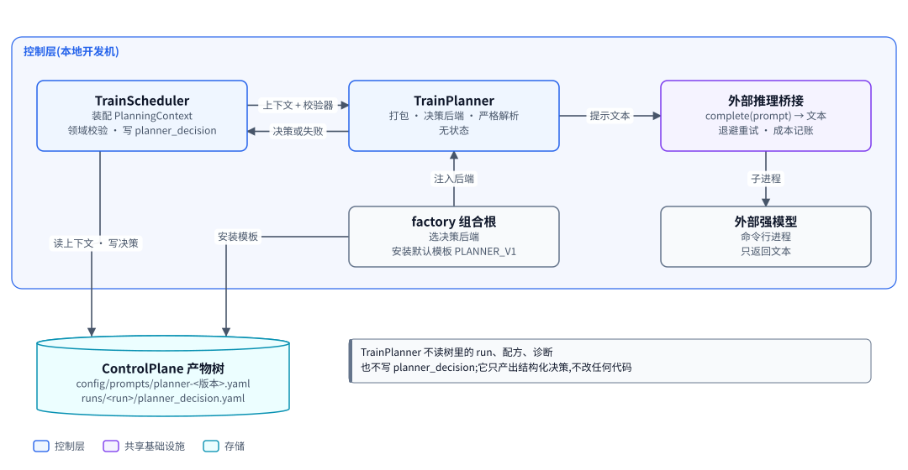
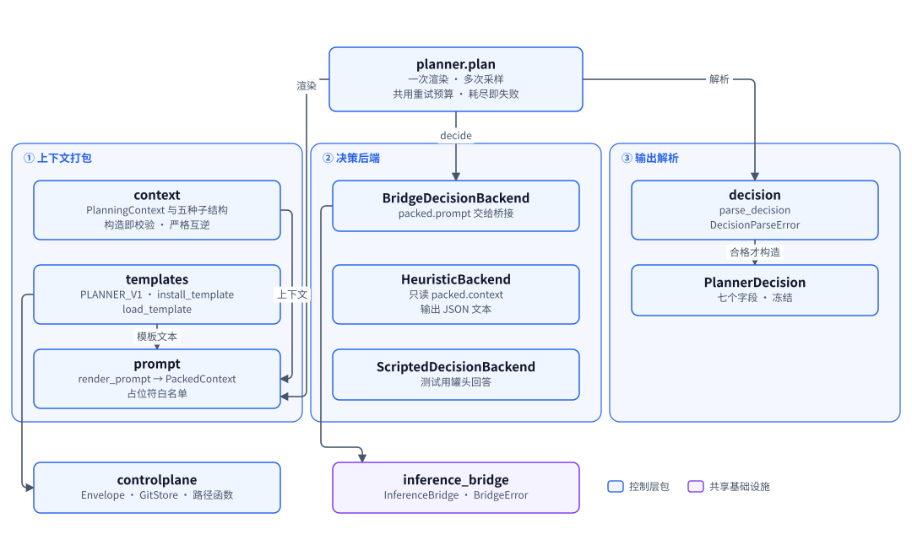
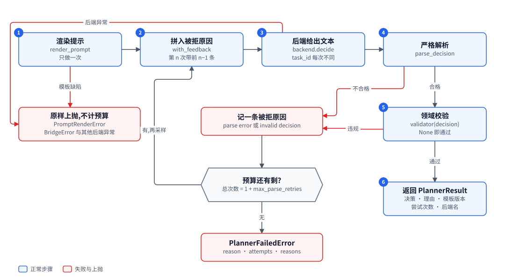

# TrainPlanner:把规划上下文变成一条结构化训练决策

| 项 | 内容 |
|---|---|
| 一句话 | 用版本化提示模板渲染规划上下文,交给可替换的决策后端,严格解析成 `PlannerDecision`,不合格就带原因重采样,耗尽即失败 [已落地] |
| 状态 | [已落地],七个模块与 190 条测试都在主干上;默认后端经外部推理桥接调用命令行模型,提示模板与决策质量尚未在真实命令行模型上实测 |
| 所在层 | 控制层 |
| 代码位置 | `src/trainplanner` [已落地] |
| 基线提交 | `b826440`(2026-10-21) |
| 依赖 | ControlPlane(信封、GitStore、路径函数)、外部推理桥接(`InferenceBridge` 协议与 `BridgeError`)[已落地] |
| 被依赖 | TrainScheduler(规划处理器)、factory 组合根(安装默认模板、选择后端) |
| 对应实施计划 | 工作包 4(任务 50 至 56)[已落地] |

## 0. 系统速览

<!-- shared:begin context-block -->
**系统是什么。** RismForge 是一套"AI 驱动的社会心智后训练工厂":输入通用开源基础模型,输出社会心智能力显著增强的模型,代号 **ZenGen**。工厂自己决定每一轮练什么、怎么练。训练决策可以交给外部更强的闭源模型(经命令行调用),关键决策点设人工审核门,其余环节自动。

**七个子系统。** 六个能力子系统加一个协调层 ControlPlane。

| 子系统 | 职责 | 所在层 | 现状 |
|---|---|---|---|
| ControlPlane | 协调层:git 版本化产物树、状态机、调和循环、三个审核门 | 控制层 | [已落地] |
| SocialSimulator | 情境与人格生成、多智能体仿真、实时环境服务、诊断评测 | 计算层 | [已落地];诊断默认用 mock 后端,`--evaluator someval` 装配 vLLM 加 SoMEval 的真实运行器 [已落地],真机只验证到预测阶段 |
| MindTrainer | 权重级训练:BatchTrain(SFT 后接 GRPO 加 OPD)与 InteractTrain | 计算层 | [已落地],默认入口的训练执行器是 mock;ROLL LoRA SFT 真实执行器 [已落地],由 `--executor roll` 装配,已在真实主机上端到端跑通一次 |
| MindAgent | 部署态智能体的技能与记忆自进化,不改权重 | 计算层 | [已落地],闭环里经 `--enable agent` 装配;部署驱动用的仍是罐头后端,真实模型后端未接 |
| RecipeStore | 验证有效的训练配方的版本化仓库 | 控制层 | [已落地] |
| TrainScheduler | 决策执行器:装配上下文、校验决策、构造训练指令、提名配方 | 控制层 | [已落地],含策略经验(默认关) |
| TrainPlanner | 决策学习者:经可插拔后端给出下一轮训练决策 | 控制层 | [已落地],默认后端经桥接调用命令行模型 |

共享基础设施有五个。**Actio** 是带技能库与显式记忆的智能体框架,每次响应附带激活轨迹。**外部推理桥接**用命令行调用外部强模型。**远端计算层** `compute` 经 SSH 在远端 GPU 主机上跑作业 [已落地]。**ROLL** 是分布式训练引擎,**vLLM** 是推理引擎。V1 经远端计算层接入 ROLL 的 LoRA SFT [已落地](由 `--executor roll` 装配,已在真实主机上从指令跑到候选一次)与 vLLM 推理服务 [已落地](命令拼装、SSH 隧道、服务生命周期;真机端到端待补)。已落地部分仍由确定性 mock 顶替。真实 GRPO 加 OPD 训练与真实 judge [推迟]。

**状态标记。** **[已落地]** 表示代码在主干上且有测试。**[计划中]** 表示设计与实施计划已定,代码还没写。**[推迟]** 表示明确不在 V1 范围内。图只画目标系统,不标进展,进展只看正文的状态标记。

**六条贯穿全系统的机制。**

| 机制 | 规则 |
|---|---|
| 产物树 | 所有协作数据是 git 树里的 YAML 产物,统一信封:`id`、`type`、`version`、`created_at`、`created_by`(含 `owner` 与 `visibility`)、`status`、`schema_version`、`links`、`payload`。checkpoint 等大体量内容只存引用 `{uri, sha256, size_bytes}`;V1 的数据集逐条 episode 进 git,只适合小规模 mock。git 树是唯一真相,读取时先经迁移器链再消费。 |
| 状态机 | 需审核类:`draft → pending_review → approved → effective`,之后可到 `deprecated` 或 `superseded`,`pending_review` 也可到 `rejected`。非审核类:`pending → executed → consumed`,`pending` 也可到 `failed`。被拒绝与失败的产物保留;被拒绝的候选进入下一轮规划的输入,失败只留痕、等人处理。 |
| 调和循环 | 纯函数 `reconcile(树视图) → 动作列表`,守护进程按间隔轮询并执行动作。循环无状态、动作幂等,进程崩溃后从 git 树续接。子系统之间不直接调用,只读写产物。 |
| 审核门 | 三道人工门:① checkpoint 晋级,② 技能与记忆增量纳入,③ 配方入库。证据不在场就不能批准:门①要诊断报告,门②要验证结果,门③要可复现性校验报告。门②与门③ [已落地]。 |
| 受限直连 | 两处高频实时调用绕过 ControlPlane:① MindTrainer 与 SocialSimulator 之间的 InteractTrain rollout,② MindAgent 与 SocialSimulator 之间的部署经验采集。两处都走 gRPC 双向流,发生在计算层内部。是否开会话仍由 ControlPlane 决策。 |
| 失败分类 | T1 瞬态:有限次指数退避重试,耗尽升为 T3。T2 确定性:不重放,按所属子系统的校验链处理,LLM 的随机输出可有限次重采样。T3 需人工:写失败记录,不自动重跑。失败是数据,不是异常。 |

**核心术语。**

| 术语 | 含义 |
|---|---|
| Run | 一轮迭代,对应产物树里的 `runs/run-<编号>/` 目录,该轮所有产物都挂在其下 |
| Directive(训练指令) | TrainScheduler 或人写入的 `directive.yaml`,调和循环据此下发训练 |
| Candidate(候选 checkpoint) | MindTrainer 产出的 `candidate_checkpoint.yaml`,经诊断评测与门①才能晋级 |
| ZenGen 版本 | 晋级后写入 `models/zengen-v<N>.yaml`;下一轮训练的基座取最新的 effective 版本 |
| Episode | 一次多轮交互的完整记录:情境、角色分配、逐轮话语、终止原因 |
| Scenario、Persona、RoleAssignment | 社会情境、人格模板,以及把角色位绑定到具体人格与模型后端的分配 |
| Recipe(配方) | 验证有效的完整训练方案,分 batch、interact、agent_rsi 三类 |
| DiagnosticReport | 诊断评测产出的报告:维度、分数、置信区间、错误类型、退化标记 |
| Activation trace(激活轨迹) | Actio 每次响应附带的记录:命中的技能候选、选中的技能、命中的记忆 |
| Evidence grade(证据等级) | 诊断报告的可信等级 `stub`、`mock`、`real`,决定它能否驱动规划与提名;缺标记一律判 `stub`,失败关闭 |
<!-- shared:end context-block -->

## 1. 定位

TrainPlanner 是工厂的决策学习者:给它一轮训练的结果摘要,它给出下一轮练哪个维度、怎么练。

它解决的问题是"一轮结束后下一轮做什么"。这件事要能交给外部强模型,又要在没有外部模型时可测、可兜底。所以它被做成一个纯流程:输入是数据,输出是数据,中间的决策者可以替换。

它不读产物树里的 run、配方、诊断,也不写决策产物。读树和写树都是 TrainScheduler 的事。它唯一碰树的地方是提示模板的安装与读取。

<!-- figure:begin 71-trainplanner-context -->


**图 1　TrainPlanner 的上下文**　TrainScheduler 装配规划上下文并带着领域校验器调用 TrainPlanner,拿回决策或明确的失败。TrainPlanner 只经外部推理桥接调用外部强模型;产物树里它只碰提示模板。组合根负责选后端和安装默认模板。

<details>
<summary>文字版:图中的节点与连线</summary>

**节点**

- TrainScheduler:装配 PlanningContext / 领域校验 · 写 planner_decision
- TrainPlanner:打包 · 决策后端 · 严格解析 / 无状态
- 外部推理桥接:complete(prompt) → 文本 / 退避重试 · 成本记账
- factory 组合根:选决策后端 / 安装默认模板 PLANNER_V1
- 外部强模型:命令行进程 / 只返回文本
- ControlPlane 产物树:config/prompts/planner-<版本>.yaml / runs/<run>/planner_decision.yaml

**连线**

- TrainScheduler → TrainPlanner:上下文 + 校验器
- TrainPlanner → TrainScheduler:决策或失败
- TrainPlanner → 外部推理桥接:提示文本
- 外部推理桥接 → 外部强模型:子进程
- factory 组合根 → TrainPlanner:注入后端
- TrainScheduler → ControlPlane 产物树:读上下文 · 写决策
- factory 组合根 → ControlPlane 产物树:安装模板

</details>
<!-- figure:end 71-trainplanner-context -->

TrainScheduler 装配好 `PlanningContext`(规划上下文)交给 TrainPlanner。TrainPlanner 从产物树读提示模板,渲染后交给决策后端。桥接后端经外部推理桥接调用命令行模型,启发式后端在本地确定性地给答案。TrainPlanner 把合格的决策和理由交回 TrainScheduler,由后者写 `planner_decision` 产物和下一条指令。 [已落地]

## 2. 目标、非目标与约束

结论:目标是"严格、可测、可替换";它不判断决策的质量,也不管决策之后的事。

| 编号 | 目标 | 验收方式 |
|---|---|---|
| G1 | 规划上下文有精确、可校验的形状 | `PlanningContext.from_dict` 对缺键、多键、类型不符一律拒绝,`to_dict` 与 `from_dict` 严格互逆。唯一例外是第七段 `strategy_experience`:可省,省了等于空列表,好让旧生产方继续可用 |
| G2 | 模型输出严格解析,不做宽容猜测 | 缺键、多键、重复键、非有限数、围栏外文字都判为解析失败 |
| G3 | 不合格输出带原因重采样,预算耗尽明确失败 | `plan()` 的重试与失败用例 [已落地] |
| G4 | 决策后端可替换,三种后端走同一条解析路径 | 三个后端都只返回文本 |
| G5 | 模板版本化,每个决策能对回当时的模板文本 | 同版本不同文本拒绝安装 |
| G6 | 全部测试脱离外部服务 | 测试只用罐头后端、罐头桥接与临时仓库 |

| 项 | 状态 | V1 的处理 |
|---|---|---|
| 改写子系统代码 | [推迟] | 输出限定为结构化决策,不需要代码沙箱 |
| 判断决策质量 | 不做 | 规划质量没有证据,外部模型未实测 |
| 写 `planner_decision` 产物、分配 run id、写失败记录 | 不做 | 归 TrainScheduler |
| 领域校验(配方是否有效、扰动键是否在白名单) | 不做 | 由调用方通过 `validator` 注入 |
| 截断过长的提示 | 不做 | 超出模型上下文时表现为桥接错误 |
| 异步调用 | 不做 | `plan()` 同步,外部推理期间调和循环被阻塞 [已落地] |

| 约束 | 内容 | 影响 |
|---|---|---|
| 依赖方向 | 只导入 `controlplane`、`inference_bridge` 与七个标准库模块 | 不能复用 `recipestore` 的配方类型常量,两份字面量要手工同步 |
| 无新增第三方依赖 | 只用 `json`、`re`、`math`、`copy`、`dataclasses`、`typing`、`collections` | 解析与渲染全部手写 |
| 读写走信封 | 模板经 `GitStore.write_product` 与 `read_product` | 模板改动留在 git 历史里 |
| 文件头 | 每个模块首条语句是 `from __future__ import annotations` | 有测试强制 |
| 凭证 | 本包不读任何凭证 | 凭证由外部推理桥接处理 |

## 3. 架构

结论:三段分离,由 `planner.plan` 串起来。上下文打包(`context`、`templates`、`prompt`)、决策后端(`backends`)、输出解析(`decision`)互不知道对方的内部。

<!-- figure:begin 71-trainplanner-architecture -->


**图 2　TrainPlanner 的三段分离**　planner.plan 串起三段:上下文打包把 PlanningContext 套进版本化模板,决策后端把打包结果变成文本,输出解析把文本严格变成 PlannerDecision。三种后端都返回文本,走同一条解析路径。包外只依赖 controlplane 与 inference_bridge。

<details>
<summary>文字版:图中的节点与连线</summary>

**节点**

- planner.plan:一次渲染 · 多次采样 / 共用重试预算 · 耗尽即失败
- context:PlanningContext 与五种子结构 / 构造即校验 · 严格互逆
- templates:PLANNER_V1 · install_template / load_template
- prompt:render_prompt → PackedContext / 占位符白名单
- BridgeDecisionBackend:packed.prompt 交给桥接
- HeuristicBackend:只读 packed.context / 输出 JSON 文本
- ScriptedDecisionBackend:测试用罐头回答
- decision:parse_decision / DecisionParseError
- PlannerDecision:七个字段 · 冻结
- controlplane:Envelope · GitStore · 路径函数
- inference_bridge:InferenceBridge · BridgeError

**连线**

- planner.plan → prompt:渲染
- planner.plan → BridgeDecisionBackend:decide
- planner.plan → decision:解析
- context → prompt:上下文
- templates → prompt:模板文本
- decision → PlannerDecision:合格才构造
- BridgeDecisionBackend → inference_bridge
- templates → controlplane

</details>
<!-- figure:end 71-trainplanner-architecture -->

`plan()` 先用模板把上下文渲染成提示,再调后端拿文本,最后解析成决策。模板文本来自 `templates`,它经 `controlplane` 读写树。只有桥接后端依赖外部推理桥接。 [已落地]

| 模块 | 职责 | 依赖 | 状态 |
|---|---|---|---|
| `trainplanner.context` | `PlanningContext` 与五种子结构,构造即校验,`to_dict` / `from_dict` 严格互逆;定义 `DECISION_ACTIONS` | 标准库 | [已落地] |
| `trainplanner.examples` | `example_context_dict()`:对外契约的完整示例 | 无 | [已落地] |
| `trainplanner.decision` | `PlannerDecision`、`parse_decision`、`DecisionParseError` | `context` | [已落地] |
| `trainplanner.prompt` | 占位符语法、`check_template`、`render_prompt`、`PackedContext` | `context` | [已落地] |
| `trainplanner.templates` | `PLANNER_V1`、`PLANNER_V2`(多一个 `{{strategy_experience}}` 段)、`PLANNER_V1_VERSION`、`PLANNER_V2_VERSION`、`STRATEGY_TEMPLATE_VERSIONS`、`install_template`、`install_default_template`、`load_template` | `prompt`、`controlplane` | [已落地] |
| `trainplanner.backends` | `DecisionBackend` 协议与三个后端 | `context`、`prompt`、`inference_bridge` | [已落地] |
| `trainplanner.planner` | `plan`、`PlannerResult`、`PlannerFailedError`、`attempt_task_id` | 上述各模块 | [已落地] |

依赖方向规则:

| 方向 | 规则 |
|---|---|
| `trainplanner` 可以导入 | `trainplanner`、`controlplane`、`inference_bridge`、七个标准库模块 |
| `trainplanner` 不得导入 | `recipestore`、`trainscheduler`、`simulator`、`diagnostic`、`mindtrainer` 等其他业务包 |
| 谁不得导入 `trainplanner` | `controlplane` |
| 机器检查 | 边界测试用 `ast` 读源码,不导入;标准库白名单显式列出 |

## 4. 数据模型与状态机

结论:本包只有不可变的数据类和一种产物(提示模板),没有自己的状态机。

### 4.1 实体

| 实体 | 字段与含义 | 约束 |
|---|---|---|
| `PlanningContext` | `run_id`、`candidate`、`diagnostic`、`recipes`、`recent_decisions`、`cost_gain`、`strategy_experience` | 冻结;构造即校验;缺键、多键、类型不符抛 `InvalidContextError`。第七段是渲染好的文本行列表,缺省为空列表:旧调用方不写这个键仍然可读 [已落地] |
| 子结构类 | `CandidateSummary`、`DiagnosticSummary`、`RecipeSummary`、`DecisionOutcome`、`CostGainEntry`,诊断里的 `regression_flags` 与 `error_profiles` 另用 `RegressionMark`、`ErrorProfileSummary` | 都冻结,各有严格的 `from_dict`;常量 `CANDIDATE_TERMINAL_STATES`、`PLANNABLE_GRADES`、`RECIPE_TYPES` [已落地] |
| `candidate` | `id`、`status`、`reject_reason` | `status` 只能是 `effective` 或 `rejected`;`effective` 时 `reject_reason` 必须为 `None` |
| `diagnostic` | `l1_scores`、`regression_flags`、`error_profiles`、`benchmark_version`、`grade` | `l1_scores` 至少一项;`grade` 只能是 `mock` 或 `real` |
| `regression_flags[]` | `kind`、`subject`、`magnitude`,可选 `level` | 三种退化标记归一化成同一形状;`level` 照抄诊断报告,同一次退化的三层证据靠它分辨,缺省时省略 |
| `error_profiles[]` | 每个维度一条,含 `error_type_distribution` | 分布必须是映射,键是非空字符串,值是有限数;空标签会被拒绝,装配方要先丢掉空键(R21) |
| `recipes[]` | `id`、`recipe_type`、`dimension`、`status`、`mean_gain`、`n_reuse` | `recipe_type` ∈ `batch / interact / agent_rsi`;`n_reuse` 非负整数 |
| `recent_decisions[]` | `decision_id`、`next_run_id`、`target_dimension`、`action`、`source_recipe_id`、`candidate_status`、`gain` | `action` ∈ `new / clone / replay` |
| `cost_gain[]` | `run_id`、`target_dimension`、`gpu_hours`、`tokens`、`gain` | 成本没有记录就写 `None`,不写 0,键不省略 |
| `PlannerDecision` | `target_dimension`、`action`、`mode`、`source_recipe_id`、`perturbation`、`data_synthesis_hint`、`rationale` | 冻结;七个字段都无默认值;直接构造不校验 [已落地] |
| `PackedContext` | `text`、`template_version`、`context`、`placeholders`、`feedback` | `prompt` 属性 = `text` + 被拒原因一节 [已落地] |
| `PlannerResult` | `decision`、`rationale`、`template_version`、`attempts`、`backend`、`rejected` | `attempts` 是总尝试次数 [已落地] |
| `PromptTemplate` | `version`、`text` | 冻结 [已落地] |

数值字段的通用规则:有限数,布尔一律拒绝;`int` 视为有限,不转 `float` 判断,超大整数不会溢出。所有非空字符串字段去掉首尾空白后判空。 [已落地]

退化标记的归一化,由 TrainScheduler 装配时完成:

| `kind` | `subject` 取 | `magnitude` 取 | 越大越差 |
|---|---|---|---|
| `social_regression` | `dimension` | `drop` | 是 |
| `g_probe_failure` | `probe` | `score` | 否,越小越差 |
| `reward_hacking_suspected` | 固定 `"reward"` | `reward_delta − diag_delta` | 是 |

决策字段的解析规则:

| 规则 | 来源 |
|---|---|
| `new` 必须有 `mode`;`clone` 与 `replay` 必须有 `source_recipe_id`;`replay` 不允许 `perturbation`;`rationale` 非空 | 闭环集成设计 |
| `new` 不能带 `source_recipe_id` 与 `perturbation` | 工作包 4 附加 |
| `clone` 与 `replay` 的 `mode` 必须为 `null` | 工作包 4 附加 |
| `perturbation` 的值只能是字符串、有限数或布尔 | 工作包 4 附加 |
| `mode` ∈ `batch / interact` | `MODES` 常量 |

### 4.2 产物

| 产物类型 | 路径 | 状态机种类 | 写方 | 状态 |
|---|---|---|---|---|
| `prompt_template` | `control-plane/config/prompts/planner-<version>.yaml` | 非审核,写入即 `executed` | `install_template`,由 factory 组合根调用 | [已落地] |

模板信封的形状:

```yaml
id: prompt-planner-v1
type: prompt_template
status: executed
version: 1
payload:
  version: v1
  text: "..."        # PLANNER_V1 的英文全文
```

`install_default_template` 同时装 `v1` 与 `v2` 两份,返回 `v1` 的路径:`v2` 是 `PLANNER_V1` 在 `## Your answer` 之前插入“策略经验”一节得到的,多一个 `{{strategy_experience}}` 占位符。两份各自独立校验,同版本不同文本照样拒绝。

### 4.3 不变量

1. 树里不会出现渲染不了的模板:写入前先过 `check_template`。
2. 同一个模板版本永远对应同一段文本:同版本同文本不动,同版本不同文本拒绝。
3. 模板版本号匹配 `^[A-Za-z0-9._-]+$`,且不是 `.`、`..`。
4. 同一上下文渲染两次,提示逐字节相同。
5. 进入规划的诊断证据等级永远不是 `stub`,候选永远是终态。
6. 解析器的一切失败都表现为 `DecisionParseError`,不漏出别的异常。 [已落地]

## 5. 接口契约

结论:对外只有一个主入口 `plan()`,加上模板的安装与读取。以下签名全部 [已落地],来自工作包 4。

```python
plan(ctx, template_text, template_version, backend, *, run_id,
     max_parse_retries=2, validator=None) -> PlannerResult
PlannerResult.record_fields() -> dict   # {template_version, backend, decision, rationale}
PlannerFailedError(reason, attempts, *, reasons=())
Validator = Callable[[PlannerDecision], str | None]

render_prompt(ctx, template_text, template_version) -> PackedContext
parse_decision(text: str) -> PlannerDecision
class DecisionBackend(Protocol):
    name: str
    def decide(self, packed, *, run_id, task_id) -> str: ...

install_template(store, version, text) -> str
install_default_template(store) -> str
load_template(store, version) -> PromptTemplate
```

| 后端 | 构造 | 行为 | 状态 |
|---|---|---|---|
| `BridgeDecisionBackend` | `(bridge, *, name="bridge")` | 发 `packed.prompt`,返回 `BridgeResult.text`;异常原样上抛 | [已落地] |
| `HeuristicBackend` | `()`,`name == "heuristic"` | 只读 `packed.context`,确定性地给 JSON 文本 | [已落地] |
| `ScriptedDecisionBackend` | `(responses, *, name="scripted")` | 按序返回字符串或抛出异常实例;用完抛 `AssertionError` | [已落地] |

提示模板的占位符:

| 占位符 | 渲染为 |
|---|---|
| `{{run_id}}` | 纯文本 |
| `{{candidate}}`、`{{diagnostic}}`、`{{recipes}}`、`{{recent_decisions}}`、`{{cost_gain}}`、`{{strategy_experience}}` | 对应段的 JSON |
| `{{context}}` | 整个上下文的 JSON |

渲染规则:JSON 一律 `indent=2, sort_keys=True, ensure_ascii=False`;值为 `None` 的 `gpu_hours`、`tokens` 渲染成 `"not recorded"`;只扫一遍,替换进去的值不再解释。未知名字、游离的 `{{`、一个占位符都没有的模板,都抛 `PromptRenderError`。`PLANNER_V1` 用到除 `{{context}}` 与 `{{strategy_experience}}` 外的六个,`PLANNER_V2` 七个全用。 [已落地]

触发条件:TrainPlanner 不自己触发。TrainScheduler 的规划处理器在调和循环发出 `plan_next_round` 动作时调用 `plan()`。 [已落地]

对邻居的假设:

| 邻居 | 本文依赖它什么 | 它依赖本文什么 |
|---|---|---|
| ControlPlane | `Envelope`、`OwnerRef`、`CURRENT_SCHEMA_VERSION`;`GitStore` 读写;`planner_prompt_file(version)` 返回 `control-plane/config/prompts/planner-<version>.yaml` [已落地] | 无;`controlplane` 不导入本包 |
| 外部推理桥接 | `InferenceBridge.complete(prompt, *, run_id, task_id) -> BridgeResult`;`BridgeError(category, reason)` [已落地] | 无 |
| TrainScheduler | 产出符合第 4 章形状的 `PlanningContext`;`validator` 只返回 `None` 或非空字符串;处理 `PlannerFailedError` 与 `BridgeError` | `plan`、`PlannerResult.record_fields`、`PlannerFailedError` 的 `reason` 与 `attempts`、`load_template`、`DecisionBackend`、`example_context_dict` [已落地] |
| factory 组合根 | 无 | `install_default_template`(同时装 `v1` 与 `v2`,返回 `v1` 路径)、`PLANNER_V1_VERSION == "v1"`、`BridgeDecisionBackend`、`HeuristicBackend` [已落地] |

重入续写时,TrainScheduler 要从已写的决策产物读回决策:`PlannerDecision.from_dict(d)` 规则同 `parse_decision`,失败抛 `DecisionParseError`;`decision_payload()` 还原载荷 [已落地]。

TrainScheduler 那一侧的配套约定:`scheduler.yaml` 的 `max_plan_attempts` 是总次数(默认 3),传进来的 `max_parse_retries` 是它减一。规划模板版本由 `scheduler.yaml` 的 `template_version` 选(默认 `v1`),后端配置里的 `prompt_template_version` 不参与。打开 `strategy_experience` 时必须选一个在 `STRATEGY_TEMPLATE_VERSIONS` 里的版本(当前是 `v2`),否则 TrainScheduler 构造配置时就报错——`v1` 不含第七段占位符,允许这个组合等于让经验落账了却从没进过提示。命令行 `--planner-backend bridge|heuristic` 选后端,默认 `bridge`。

## 6. 关键流程

结论:一次渲染,多次采样,解析失败与校验违规共用一个预算;模板缺陷和后端异常不进重试。

<!-- figure:begin 71-trainplanner-plan-flow -->


**图 3　plan() 的重采样流程**　模板只渲染一次。每次尝试把此前的被拒原因拼进提示交给后端,严格解析,再交校验器。解析失败与校验违规都记一条原因并消耗同一个预算,预算用完抛 PlannerFailedError。渲染错误与后端异常不进重试,原样上抛。

<details>
<summary>文字版:图中的节点与连线</summary>

**节点**

- 渲染提示:render_prompt / 只做一次
- 拼入被拒原因:with_feedback / 第 n 次带前 n−1 条
- 后端给出文本:backend.decide / task_id 每次不同
- 严格解析:parse_decision
- 领域校验:validator(decision) / None 即通过
- 返回 PlannerResult:决策 · 理由 · 模板版本 / 尝试次数 · 后端名
- 记一条被拒原因:parse error 或 invalid decision
- 预算还有剩?:总次数 = 1 + max_parse_retries
- PlannerFailedError:reason · attempts · reasons
- 原样上抛,不计预算:PromptRenderError / BridgeError 与其他后端异常

**连线**

- 渲染提示 → 拼入被拒原因
- 拼入被拒原因 → 后端给出文本
- 后端给出文本 → 严格解析
- 严格解析 → 领域校验:合格
- 领域校验 → 返回 PlannerResult:通过
- 严格解析 → 记一条被拒原因:不合格
- 领域校验 → 记一条被拒原因:违规
- 记一条被拒原因 → 预算还有剩?
- 预算还有剩? → 拼入被拒原因:有,再采样
- 预算还有剩? → PlannerFailedError:无
- 渲染提示 → 原样上抛,不计预算:模板缺陷
- 后端给出文本 → 原样上抛,不计预算:后端异常

</details>
<!-- figure:end 71-trainplanner-plan-flow -->

| 步 | 动作 | 失败时 |
|---|---|---|
| 1 | `render_prompt` 渲染一次模板 | `PromptRenderError` 原样上抛,不计预算 [已落地] |
| 2 | 第 n 次尝试在同一份 `text` 后拼入前 n−1 条被拒原因(`## Rejected attempts` 一节) | 无 |
| 3 | 后端 `decide`,`task_id` 为 `planner-attempt-<n>`,每次不同 | `BridgeError` 与其他异常原样上抛,后续尝试不再进行 [已落地] |
| 4 | `parse_decision` 严格解析 | 记 `attempt N: parse error: <原因>`,回到第 2 步 |
| 5 | 交 `validator` 做领域校验,返回 `None` 即通过 | 记 `attempt N: invalid decision: <原因>`,回到第 2 步;返回空串或非字符串抛 `TypeError` [已落地] |
| 6 | 返回 `PlannerResult` | 无 [已落地] |

预算:总尝试次数 = 1 + `max_parse_retries`。耗尽抛 `PlannerFailedError`,`reason` 是最后一条原因,`reasons` 是全部原因,`attempts` 是总次数。 [已落地]

解析检查的顺序:是否单个 JSON 对象 → 缺键 → 未知键 → 逐字段类型 → 跨字段规则。允许恰好一个代码围栏包住整段输出,开头只能是 ```` ``` ```` 或 ```` ```json ````。错误信息里回显的模型值,`repr` 超过 80 个字符就截断。

`HeuristicBackend` 的规则: [已落地]

| 步 | 规则 |
|---|---|
| 1 | 维度取 `l1_scores` 里分数最低的;同分按维度名升序 |
| 2 | 候选配方:该维度、`status == "effective"`、`recipe_type == "batch"` |
| 3 | 有候选就 `clone` 排第一的一条,不扰动。排序:`mean_gain` 降序(`None` 最后),`n_reuse` 降序,id 升序 |
| 4 | 没有候选就 `new`,`mode = "batch"` |
| 5 | `rationale` 写明维度、分数与理由 |

走查例子:`example_context_dict()` 配 `PLANNER_V1` 与 `HeuristicBackend`,数值来自工作包 4 的完成标准与测试。 [已落地]

| 量 | 值 |
|---|---|
| `l1_scores` | `empathy 0.71`、`pragmatics 0.64`、`tom 0.58` |
| 最低维度 | `tom` |
| `tom` 的有效 batch 配方 | `recipe-run-001`(`mean_gain 0.04`,`n_reuse 2`) |
| 决策 | `clone`,`source_recipe_id = recipe-run-001`,`perturbation = {}`,`mode = null` |
| `attempts` | 1 |
| `backend` / `template_version` | `heuristic` / `v1` |

重试走查(工作包 4 的用例):罐头后端依次回答 `"oops"`、一条 clone、`"{}"`,`validator` 一律拒绝 clone,`max_parse_retries` 为 2。

| 尝试 | 被拒原因 |
|---|---|
| 1 | `parse error`:不是 JSON |
| 2 | `invalid decision`:`no clones today` |
| 3 | `parse error`:七个键全缺 |
| 结果 | `PlannerFailedError`,`attempts == 3` [已落地] |

## 7. 关键决策

决策来自闭环集成设计与工作包 4 的细则。

| 编号 | 决策 | 备选 | 理由 | 判错的代价 |
|---|---|---|---|---|
| R5 | 只有终态候选、可接受证据才进入规划;`PlanningContext` 在数据层再挡一次 | 允许 `pending_review` 候选预规划 | 装配方的 bug 不会变成一次真实推理调用 | 想做预规划要放宽两个枚举 [已落地] |
| R18 | 后端抛 `BridgeError`,无论 T1 还是 T2,`plan()` 都原样上抛;由 TrainScheduler 升级为 T3 | 把 T2 当解析失败重采样 | 桥接的 T2 是确定性故障,换提示修不好;桥接已自行退避 | 偶发的桥接 T2 让本轮规划直接失败 [已落地] |
| TP-18 | 输出限定为结构化决策 | 允许改写代码并配沙箱 | 不需要沙箱,校验是严格解析加领域校验两道 | 决策空间受限 |
| TP-1 | 上下文子结构全部冻结,构造即校验,`from_dict` 拒绝缺键与多键 | 宽松字典 | TrainScheduler 独立撰写,形状漂移要在第一次构造时暴露 | 加一个上下文字段要改 `context` 与契约两处 |
| TP-2 | 解析严格:七键必填,重复键、非有限数、围栏外文字都拒绝 | 补默认值、截取像 JSON 的片段 | 设计要求不做宽容猜测 | 模型漏写一个 `null` 也耗一次重试 |
| TP-3 | 只容忍一个 ```` ``` ```` 或 ```` ```json ```` 围栏 | 拒绝一切围栏;容忍任意围栏 | 命令行模型习惯加围栏,拒掉白耗重试;前言文字说明模型没守指令 | 某模型稳定输出 ```` ```JSON ```` 时每轮多耗一次 |
| TP-4 | 超长整数、深层嵌套算解析失败,进重试 | 当程序错误上抛 | 它们来自模型输出;上抛会让决策卡在 `pending`,每个 tick 重问外部推理 | 未知的第三种异常仍会漏出 |
| TP-5 | 模板渲染失败立即上抛,不计重试 | 计入重试 | 模板缺陷不是模型缺陷,重采样修不好 | 无 |
| TP-6 | 占位符用 `{{name}}`,名字白名单固定,未知名字与游离 `{{` 报错 | `str.format`、`$name` | 前者误伤模板里的 JSON 示例,后者误伤提示文本 | 模板里写不了字面 `{{` |
| TP-7 | 模板至少用一个占位符,不必全用 | 强制全用 | 允许试验性精简模板 | 漏了 `{{diagnostic}}` 的模板也能装进树 |
| TP-8 | 未记录的成本写 `None`,渲染成 `"not recorded"` | 写 0;省略键 | 0 会被读成免费;省略键要给严格校验开例外 | 装配方必须显式写 `None` |
| TP-9 | 模板版本不可变,同版本不同文本拒绝 | 允许覆盖 | 决策里的 `template_version` 永远对回当时的文本 | 改一个字也要升版本 |
| TP-10 | 默认模板版本号是 `v1`,文件 `planner-v1.yaml` | `planner-v1` | 路径是 `planner-<version>.yaml`,否则成 `planner-planner-v1.yaml` | 照抄 `planner-v1` 的地方会对不上 |
| TP-11 | 模板信封状态是 `executed`,不走审核门 | 审核类 | 模板随代码发布 | 要求人审时要迁移已装模板 |
| TP-12 | 模板用英文 | 中文 | 目标是外部命令行模型,字段名本身是英文 | 中文审阅者读模板稍费力 |
| TP-13 | 三个附加解析规则(第 4.1 节) | 只用设计的四条 | 这些组合在 TrainScheduler 里无意义或与配方模式冲突 | 想让 `new` 以配方为起点要放宽解析 |
| TP-14 | `HeuristicBackend` 只 clone batch 配方,不看候选状态与退化标记 | 加更多规则 | `agent_rsi` 构造不成训练指令,`interact` 默认被拒;加规则就成了第二个规划器 | 被拒后可能反复 clone 同一条配方,直到战绩回写把它弃用 [已落地] |
| TP-15 | `max_parse_retries` 计重试次数,`attempts` 计总次数 | 两者同口径 | 参数名里的 retries 就是重试 | 调用方把 `attempts` 当重试次数会差一 |
| TP-16 | `validator` 返回空串或非字符串抛 `TypeError` | 空串当通过 | 空串在布尔上下文里是假,易被误写成通过 | 校验函数必须严格返回 `None` 或非空字符串 |
| TP-17 | `PlannerResult` 带 `rejected`,`PlannerFailedError` 带 `reasons` | 只留最后一条 | 事后能看出模型第一次为什么错 | 无,附加字段 [已落地] |

## 8. 失败处理与可观测

结论:TrainPlanner 只抛异常,不写失败记录;分类与落地由 TrainScheduler 完成。

| 失败点 | 类 | 处理 | 留痕产物 |
|---|---|---|---|
| 上下文形状不符 | 由调用方定 | 抛 `InvalidContextError`;TrainScheduler 判 T3 | `planner_decision.yaml` 置 `failed`、失败记录 [已落地] |
| 模板渲染失败 | 不分类 | 抛 `PromptRenderError`,不计预算 | 无 [已落地] |
| 模板读不到或形状不对 | 不分类 | 抛 `TemplateError`(带路径),不让 `FileNotFoundError` 被当成瞬态 | 无;TrainScheduler 原样上抛 [已落地] |
| 单次解析失败或校验违规 | T2 | 带原因重采样 | `PlannerResult.rejected` |
| 预算耗尽 | T3 | 抛 `PlannerFailedError(reason, attempts, reasons)` | 决策 `failed`,`failure.attempts` 为总次数 [已落地] |
| `BridgeError`,T1 或 T2 | T3 | 原样上抛,由 TrainScheduler 升级 | 决策 `failed`,带 `log_ref` [已落地] |
| 其他后端异常 | 不分类 | 原样上抛 | 无 |

只读观测手段:

| 手段 | 看什么 |
|---|---|
| `planner_decision.yaml` 的 `template_version`、`backend`、`rationale` | 这次决策用的模板、后端与理由 |
| `control-plane/config/prompts/planner-<version>.yaml` 的 git 历史 | 模板文本的每次变化 |
| 桥接的成本账本 | 每次尝试各记一条,`task_id` 为 `planner-attempt-<n>`;重入时同一 `task_id` 重复,重跑的成本被去重,账本数字是下限 |
| `PlannerFailedError.reasons` | 每次被拒的原因,按顺序 |

## 9. 测试策略

结论:七个测试文件共 190 个用例,全部脱离外部服务。用例数按 pytest 收集的参数化展开计。 [已落地]

| 层次 | 对象 | 测试文件 [已落地] | 用例数 | 替身 |
|---|---|---|---|---|
| 契约形状 | `PlanningContext` 与子结构 | `tests/test_tp_context.py` | 48 | 无 [已落地] |
| 严格解析 | `parse_decision` | `tests/test_tp_decision.py` | 61 | 无 [已落地] |
| 渲染 | 占位符与 `PackedContext` | `tests/test_tp_prompt.py` | 19 | 无 [已落地] |
| 模板读写 | 安装、读回、版本不可变 | `tests/test_tp_templates.py` | 24 | `tmp_path` 下的临时仓库 [已落地] |
| 后端 | 三个后端 | `tests/test_tp_backends.py` | 14 | `ScriptedBridge`、测试内的假桥接 [已落地] |
| 流程 | 重试、预算、异常上抛 | `tests/test_tp_planner.py` | 21 | `ScriptedDecisionBackend` [已落地] |
| 边界 | 依赖方向与文件头 | `tests/test_tp_boundaries.py` | 3 | `ast` 读源码,做一次变异检查 [已落地] |

不依赖的外部服务:GPU、网络、真实模型、命令行推理工具。需要"桥接抛错"的测试用测试文件里的假桥接,不依赖罐头桥接的耗尽行为。

## 10. 现状、局限与未核实项

结论:整个包都是 [已落地],七个模块与 190 条测试在主干上;`src/` 下现在有 12 个包,本包是其中之一。边界测试核验的正是"只导入 `controlplane`、`inference_bridge` 与标准库"。真实命令行模型的效果尚未实测。

| 能力 | 状态 | 说明 |
|---|---|---|
| 规划上下文与示例 | [已落地] | `context`、`examples`;含 `strategy_experience` 第七段,缺省空列表 |
| 严格解析 | [已落地] | `decision` 的 `parse_decision` 与 `PlannerDecision.from_dict` |
| 提示渲染 | [已落地] | `prompt` 的 `check_template`、`render_prompt`、`PackedContext` |
| 默认模板与模板信封 | [已落地] | `templates` 的 `PLANNER_V1`、`PLANNER_V2` 与安装/读取;依赖 `planner_prompt_file` |
| 三个决策后端 | [已落地] | `backends`;桥接后端经外部推理桥接调用命令行模型 |
| `plan()` | [已落地] | `planner.plan`、`PlannerResult`、`PlannerFailedError` |
| 边界测试 | [已落地] | `tests/test_tp_boundaries.py`,三例:导入白名单、`controlplane` 不反向导入、`__future__` 首行 |

| 局限 | 影响 | 缓解 |
|---|---|---|
| 规划质量没有证据 | 外部模型给的决策好不好不知道 | 审核门①确认指令;战绩回写淘汰无效配方 |
| 启发式很粗 | 不看退化标记、错误画像、候选状态与成本 | 只作兜底与端到端测试用 |
| 提示没有截断 | 配方多了提示会超出模型上下文,表现为桥接错误 | 配方段取全部 `effective` 配方、不开窗口;只有决策与成本两段按窗口截取,窗口由 TrainScheduler 的装配方控制 |
| 围栏容忍度固定 | 其他写法一律耗一次重试 | 改模板措辞 |
| 同步阻塞 | 外部推理期间调和循环停住 | 无,V1 接受 |
| 配方类型集合有两份字面量 | 本包与 RecipeStore 各一份,两个包互不导入 | 由工作包 9 的跨包核对测试钉住一致;改一处必须同步另一处 [已落地] |
| 扰动白名单不在模板里 | 人改了 `perturbable` 后模板不会跟着变 | 模型靠违规原因里列出的允许键纠正 |

| 未核实项 | 影响 | 核实办法 |
|---|---|---|
| `PLANNER_V1` 对真实命令行模型的效果 | 重试率与决策质量未知 | 接上真实桥接跑若干轮,统计 `attempts` 与 `rejected` |
| 病态 JSON 在各 Python 版本下的异常类型 | 若出现第三种异常会漏出 `plan()` | 解析用例 [已落地](超长整数、深层嵌套、非有限常量都在 `tests/test_tp_decision.py`),但只在当前解释器上跑过,尚未在 3.11 至 3.14 上逐一验证;`pyproject.toml` 只声明 `>=3.11`,没有多版本矩阵 |
| 工作包 1 的四条最小假设 | 不成立则任务 50 起无法施工 | 任务 50 第 1 步逐条检查 |

明确不做的事:不写 `planner_decision` 产物,不分配 run id,不写失败记录,不做领域校验,不读树里的 run、配方与诊断,不改写任何子系统代码。

## 附 本文术语

| 术语 | 含义 |
|---|---|
| 规划上下文(`PlanningContext`) | TrainScheduler 装配、交给本包的一轮结果摘要 [已落地] |
| 决策后端 | 把提示变成文本的可替换组件,只返回文本 |
| 严格解析 | 不补默认值、不截取片段的决策解析 |
| 重采样 | 带着被拒原因重新调用后端 |
| 被拒原因 | `attempt N: parse error` 或 `attempt N: invalid decision` 开头的一句话 |
| 领域校验 | 调用方注入的 `validator`,检查配方是否有效、扰动键是否在白名单 |
| 提示模板 | 带占位符的版本化文本,以 `prompt_template` 信封存进树 |
| 未记录(`not recorded`) | 成本缺失在提示里的写法,不表示 0 |
