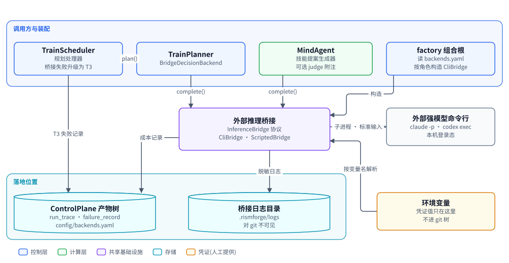
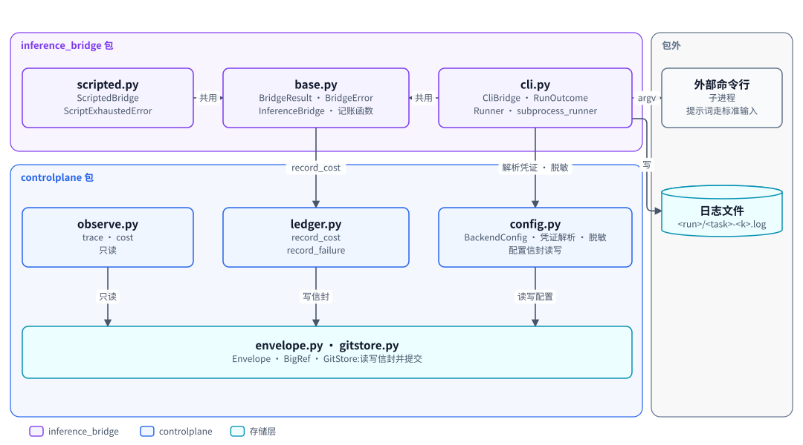
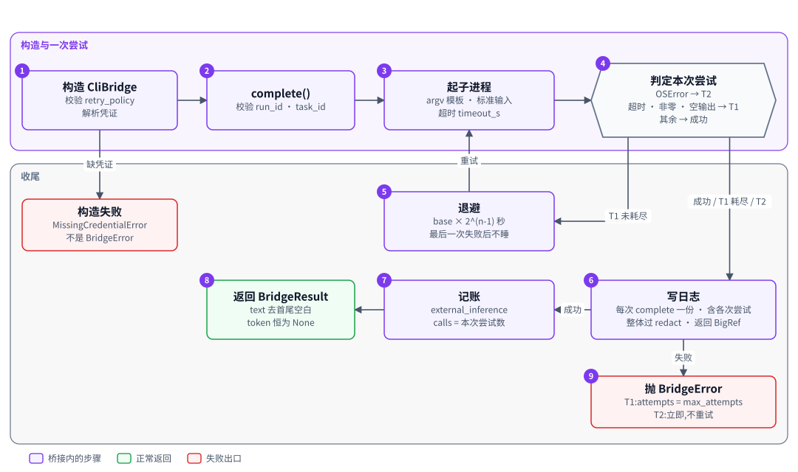
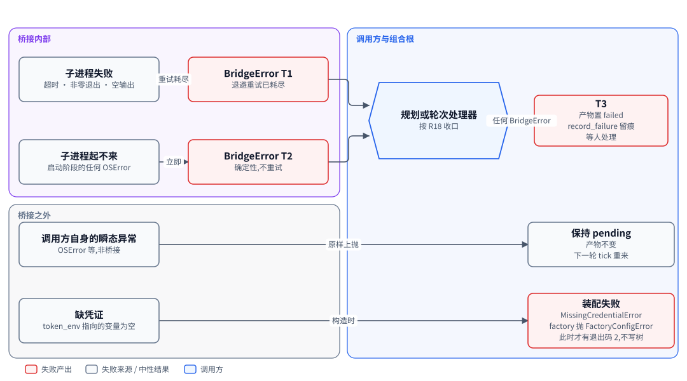
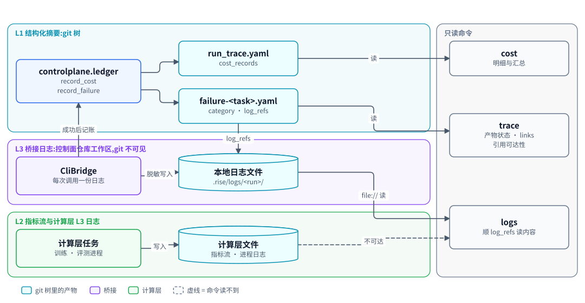

# 外部推理桥接:用命令行调用外部强模型,并把凭证、重试、日志与记账收在一处

| 项 | 内容 |
|---|---|
| 一句话 | 一个 `complete(prompt, run_id, task_id)` 协议,命令行实现用子进程调外部工具,吸收凭证、超时、重试、脱敏日志与成本记账 [计划中] |
| 状态 | 部分落地:`controlplane.config` 的 `BackendConfig`、`load_backend_config`、`resolve_credential`、`redact` 与 `controlplane.observe` 的 `trace`、`cost` [已落地];`inference_bridge` 包、`controlplane.ledger`、配置的命令行扩展 [计划中] |
| 所在层 | 共享基础设施,运行在控制层所在的本地开发机 |
| 代码位置 | `src/controlplane/config.py`、`src/controlplane/observe.py` [已落地];`src/inference_bridge`、`src/controlplane/ledger.py` [计划中] |
| 基线提交 | `8dd295b`(2026-10-10) |
| 依赖 | ControlPlane(信封、GitStore、路径函数、记账模块、配置模块) |
| 被依赖 | TrainPlanner(决策后端)、TrainScheduler(规划处理器的升级规则)、MindAgent(提案生成器、judge)、factory 组合根(按角色装配) |
| 对应实施计划 | 工作包 1(任务 21 至 26)[计划中];工作包 9(任务 101、102)装配与 `logs` 子命令 [计划中] |

## 0. 系统速览

<!-- shared:begin context-block -->
**系统是什么。** RismForge 是一套"AI 驱动的社会心智后训练工厂":输入通用开源基础模型,输出社会心智能力显著增强的模型,代号 **ZenGen**。工厂自己决定每一轮练什么、怎么练。训练决策可以交给外部更强的闭源模型(经命令行调用),关键决策点设人工审核门,其余环节自动。

**七个子系统。** 六个能力子系统加一个协调层 ControlPlane。

| 子系统 | 职责 | 所在层 | 现状 |
|---|---|---|---|
| ControlPlane | 协调层:git 版本化产物树、状态机、调和循环、三个审核门 | 控制层 | 核心 [已落地],闭环扩展 [计划中] |
| SocialSimulator | 情境与人格生成、多智能体仿真、实时环境服务、诊断评测 | 计算层 | [已落地],诊断用 mock 后端;vLLM 加 SoMEval 的真实运行器 [计划中] |
| MindTrainer | 权重级训练:BatchTrain(SFT 后接 GRPO 加 OPD)与 InteractTrain | 计算层 | [已落地],入口装配的训练执行器仍是 mock;ROLL LoRA SFT 真实执行器 [已落地],未装配、未在真实主机上验证 |
| MindAgent | 部署态智能体的技能与记忆自进化,不改权重 | 计算层 | [计划中] |
| RecipeStore | 验证有效的训练配方的版本化仓库 | 控制层 | [计划中] |
| TrainScheduler | 决策执行器:装配上下文、校验决策、构造训练指令、提名配方 | 控制层 | [计划中] |
| TrainPlanner | 决策学习者:经可插拔后端给出下一轮训练决策 | 控制层 | [计划中] |

共享基础设施有五个。**Actio** 是带技能库与显式记忆的智能体框架,每次响应附带激活轨迹。**外部推理桥接**用命令行调用外部强模型。**远端计算层** `compute` 经 SSH 在远端 GPU 主机上跑作业 [已落地]。**ROLL** 是分布式训练引擎,**vLLM** 是推理引擎。V1 经远端计算层接入 ROLL 的 LoRA SFT [已落地](尚未装配进入口,也未在真实主机上验证)与 vLLM 推理服务 [计划中]。已落地部分仍由确定性 mock 顶替。真实 GRPO 加 OPD 训练与真实 judge [推迟]。

**状态标记。** **[已落地]** 表示代码在主干上且有测试。**[计划中]** 表示设计与实施计划已定,代码还没写。**[推迟]** 表示明确不在 V1 范围内。图只画目标系统,不标进展,进展只看正文的状态标记。

**六条贯穿全系统的机制。**

| 机制 | 规则 |
|---|---|
| 产物树 | 所有协作数据是 git 树里的 YAML 产物,统一信封:`id`、`type`、`version`、`created_at`、`created_by`(含 `owner` 与 `visibility`)、`status`、`schema_version`、`links`、`payload`。checkpoint 等大体量内容只存引用 `{uri, sha256, size_bytes}`;V1 的数据集逐条 episode 进 git,只适合小规模 mock。git 树是唯一真相,读取时先经迁移器链再消费。 |
| 状态机 | 需审核类:`draft → pending_review → approved → effective`,之后可到 `deprecated` 或 `superseded`,`pending_review` 也可到 `rejected`。非审核类:`pending → executed → consumed`,`pending` 也可到 `failed`。被拒绝与失败的产物保留;被拒绝的候选进入下一轮规划的输入,失败只留痕、等人处理。 |
| 调和循环 | 纯函数 `reconcile(树视图) → 动作列表`,守护进程按间隔轮询并执行动作。循环无状态、动作幂等,进程崩溃后从 git 树续接。子系统之间不直接调用,只读写产物。 |
| 审核门 | 三道人工门:① checkpoint 晋级,② 技能与记忆增量纳入,③ 配方入库。证据不在场就不能批准:门①要诊断报告,门②要验证结果,门③要可复现性校验报告。门②与门③ [计划中]。 |
| 受限直连 | 两处高频实时调用绕过 ControlPlane:① MindTrainer 与 SocialSimulator 之间的 InteractTrain rollout,② MindAgent 与 SocialSimulator 之间的部署经验采集。两处都走 gRPC 双向流,发生在计算层内部。是否开会话仍由 ControlPlane 决策。 |
| 失败分类 | T1 瞬态:有限次指数退避重试,耗尽升为 T3。T2 确定性:不重放,按所属子系统的校验链处理,LLM 的随机输出可有限次重采样。T3 需人工:写失败记录,不自动重跑。失败是数据,不是异常。 |

**核心术语。**

| 术语 | 含义 |
|---|---|
| Run | 一轮迭代,对应产物树里的 `runs/run-<编号>/` 目录,该轮所有产物都挂在其下 |
| Directive(训练指令) | TrainScheduler 或人写入的 `directive.yaml`,调和循环据此下发训练 |
| Candidate(候选 checkpoint) | MindTrainer 产出的 `candidate_checkpoint.yaml`,经诊断评测与门①才能晋级 |
| ZenGen 版本 | 晋级后写入 `models/zengen-v<N>.yaml`;下一轮训练的基座取最新的 effective 版本 |
| Episode | 一次多轮交互的完整记录:情境、角色分配、逐轮话语、终止原因 |
| Scenario、Persona、RoleAssignment | 社会情境、人格模板,以及把角色位绑定到具体人格与模型后端的分配 |
| Recipe(配方) | 验证有效的完整训练方案,分 batch、interact、agent_rsi 三类 |
| DiagnosticReport | 诊断评测产出的报告:维度、分数、置信区间、错误类型、退化标记 |
| Activation trace(激活轨迹) | Actio 每次响应附带的记录:命中的技能候选、选中的技能、命中的记忆 |
| Evidence grade(证据等级) | 诊断报告的可信等级 `stub`、`mock`、`real`,决定它能否驱动规划与提名 [计划中] |
<!-- shared:end context-block -->

## 1. 定位

外部推理桥接是系统调用外部强模型的唯一出口。潜在调用方有三处:TrainPlanner 的决策后端、MindAgent 的技能提案生成器、MindAgent 可选的 judge。V1 的组合根只为前两个装配角色;judge 需要时人工接线,用 `build_bridge` 传不在 `BRIDGE_ROLES` 里的角色会报 `FactoryConfigError` [计划中]。凭证、调用形态与重试策略的差异被它吸收,调用方只看到一段文本或一个 `BridgeError` [计划中]。成本也在这里单点记账。

<!-- figure:begin 80-bridge-context -->


**图 1　外部推理桥接的上下文**　TrainPlanner 与 MindAgent 经桥接调用外部强模型,factory 读配置装配桥接。桥接按变量名从环境取凭证,经子进程调外部命令行工具,成功调用记成本,日志脱敏后写进 git 不可见的目录。TrainScheduler 把任何桥接失败升级为 T3 写失败记录。

<details>
<summary>文字版:图中的节点与连线</summary>

**节点**

- TrainScheduler:规划处理器 / 桥接失败升级为 T3
- TrainPlanner:BridgeDecisionBackend
- MindAgent:技能提案生成器 / 可选 judge 附注
- factory 组合根:读 backends.yaml / 按角色构造 CliBridge
- 外部推理桥接:InferenceBridge 协议 / CliBridge · ScriptedBridge
- 外部强模型命令行:claude -p · codex exec / 本机登录态
- ControlPlane 产物树:run_trace · failure_record / config/backends.yaml
- 桥接日志目录:.rismforge/logs / 对 git 不可见
- 环境变量:凭证值只在这里 / 不进 git 树

**连线**

- TrainScheduler → TrainPlanner:plan()
- TrainPlanner → 外部推理桥接:complete()
- MindAgent → 外部推理桥接:complete()
- factory 组合根 → 外部推理桥接:构造
- 外部推理桥接 → 外部强模型命令行:子进程 · 标准输入
- 环境变量 → 外部推理桥接:按变量名解析
- 外部推理桥接 → ControlPlane 产物树:成本记录
- 外部推理桥接 → 桥接日志目录:脱敏日志
- TrainScheduler → ControlPlane 产物树:T3 失败记录

</details>
<!-- figure:end 80-bridge-context -->

上方的调用方经 `complete()` 取文本,judge 在 V1 不装配,factory 组合根读 `backends.yaml` 按角色构造桥接。桥接以子进程调外部强模型命令行,提示词走标准输入;子进程只拿到白名单环境变量,在空临时目录里运行。凭证值只在环境变量里,桥接按变量名解析。桥接往两处落地:成本记录进产物树,脱敏日志进对 git 不可见的本地目录。 [计划中]

## 2. 目标、非目标与约束

桥接只负责"把提示词送出去、把文本取回来",其余语义都留给调用方。

| 编号 | 目标 | 验收方式 |
|---|---|---|
| G1 | 调用方与外部工具解耦 | 调用方只依赖 `InferenceBridge` 协议 [计划中];`ScriptedBridge` 可原样替换 `CliBridge` [计划中] |
| G2 | 凭证绝不外泄 | 凭证值不出现在 argv、日志、异常信息、git 树里,各有测试 |
| G3 | 失败分类明确 | 只抛 T1 或 T2 两类 `BridgeError` [计划中];启动阶段的 `OSError` 一律判 T2 |
| G4 | 成本单点记账 | 每次成功调用记一条 `external_inference`,同一 `(task_id, cost_type)` 只记一次 |
| G5 | 原始请求与响应可追查 | 每次 `complete` 写一份脱敏日志,树里只留 `BigRef` 引用 |
| G6 | 可脱离真实工具测试 | 子进程执行器与退避的 `sleep` 都可注入 |

| 项 | 状态 | V1 的处理 |
|---|---|---|
| API 形态的桥接 | [推迟] | 只留协议;组合根遇到 `invocation_form: api` 明确报错 |
| 解析外部工具输出里的用量 | [推迟] | token 字段恒为 `None`,记账只记调用次数 |
| 判定输出格式是否合法 | 非目标 | 输出格式不合法是调用方的 T2,桥接只取回文本 |
| 日志轮转与清理 | [推迟] | 每次调用一份文件,长期累积 |
| 异步或并发调用 | [推迟] | 同步阻塞,调和循环在调用期间不转 |

| 约束 | 内容 | 影响 |
|---|---|---|
| 凭证只存变量名 | 树里的配置只写 `token_env`;出现凭证值字段即拒绝加载 | 凭证要由人放进环境变量 |
| 依赖方向 | `inference_bridge` 只导入 `controlplane`;`controlplane` 不导入它 | 记账、配置逻辑放在 `controlplane`,桥接只调用 |
| 无新第三方依赖 | 只用标准库 `subprocess`、`hashlib` | 子进程管理能力受限于 `subprocess.run` |
| 运行位置 | 本地开发机 | 命令行工具的登录态和网络出口绑定在本机 |
| 外发数据 | 规划与提案的提示词整份交给外部命令行 | 上下文里有什么就发出去什么,V1 没有字段级脱敏 |

## 3. 架构

桥接是三个模块的小包,公共类型集中在 `base.py`,两种实现各占一个模块。全部 [计划中]。

<!-- figure:begin 80-bridge-architecture -->


**图 2　桥接组件与横切记账**　inference_bridge 由公共类型、命令行桥接、测试替身三个模块组成,只向 controlplane 一个方向依赖。controlplane 里的配置模块管凭证与脱敏,记账模块写成本与失败,观测模块只读,三者都经 GitStore 读写信封。

<details>
<summary>文字版:图中的节点与连线</summary>

**节点**

- scripted.py:ScriptedBridge / ScriptExhaustedError
- base.py:BridgeResult · BridgeError / InferenceBridge · 记账函数
- cli.py:CliBridge · RunOutcome / Runner · subprocess_runner
- 外部命令行:子进程 / 提示词走标准输入
- 日志文件:<run>/<task>-<k>.log
- observe.py:trace · cost / 只读
- ledger.py:record_cost / record_failure
- config.py:BackendConfig · 凭证解析 · 脱敏 / 配置信封读写
- envelope.py · gitstore.py:Envelope · BigRef · GitStore:读写信封并提交

**连线**

- scripted.py → base.py:共用
- cli.py → base.py:共用
- base.py → ledger.py:record_cost
- cli.py → config.py:解析凭证 · 脱敏
- cli.py → 外部命令行:argv
- cli.py → 日志文件:写
- observe.py → envelope.py · gitstore.py:只读
- ledger.py → envelope.py · gitstore.py:写信封
- config.py → envelope.py · gitstore.py:读写配置

</details>
<!-- figure:end 80-bridge-architecture -->

| 模块 | 职责 | 依赖 | 状态 |
|---|---|---|---|
| `inference_bridge.base` | `BridgeResult`、`BridgeError`、`InferenceBridge`、`record_bridge_cost`、路径段校验 | `controlplane.envelope`、`controlplane.ledger` | [计划中] |
| `inference_bridge.scripted` | 测试替身 `ScriptedBridge`、`ScriptExhaustedError` | `base` | [计划中] |
| `inference_bridge.cli` | `CliBridge`、`RunOutcome`、`Runner`、`subprocess_runner` | `base`、`controlplane.config`、`controlplane.gitstore` | [计划中] |
| `controlplane.config` | `BackendConfig`、凭证解析、脱敏 | 无 | [已落地];命令行扩展 [计划中] |
| `controlplane.ledger` | `record_cost`、`record_failure` | `controlplane.gitstore`、`controlplane.envelope` | [计划中] |
| `controlplane.observe` | `trace`、`cost`,只读 | `controlplane.gitstore` | [已落地] |

| 包 | 可以导入 | 不得导入 |
|---|---|---|
| `inference_bridge` | `controlplane`、标准库 | `simulator`、`diagnostic`、`mindtrainer` 及 `src/` 下其余业务包 |
| `controlplane` | 标准库、PyYAML、jsonschema;守护进程另导入 `simulator.stubs`(骨架桩,唯一回指) | `inference_bridge` |

两条依赖方向都由 `tests/test_bridge_packaging.py` 用 `ast` 扫描导入钉住 [计划中]。扫描前先断言文件列表非空,避免空目录让断言恒真。

## 4. 数据模型与状态机

桥接自己不持有产物,也没有状态机。它产生三样东西:返回值、异常、日志文件;另外经记账模块写树。

| 实体 | 字段与含义 | 约束 |
|---|---|---|
| `BackendConfig` [已落地] | `backend`、`invocation_form`、`model_name`、`prompt_template_version`、`token_env`、`retry_policy` | 冻结;不含凭证值 |
| `BackendConfig` 扩展 [计划中] | `command`:argv 模板;`timeout_s`:单次超时秒数;`env_allowlist`:交给子进程的环境变量名;`workdir`:子进程工作目录 | `command` 非空字符串列表;`timeout_s` 为正有限数,缺省 `120.0`;`token_env` 键必须在场,可为 `null`,空串或非字符串抛 `ValueError`;凭证键名不分大小写比较;`retry_policy` 缺省 3 次、退避基数 1.0 秒;`env_allowlist` 缺省为 `PATH`、`HOME`、`USERPROFILE`、`SYSTEMROOT`、`TMPDIR`、`TEMP`、`TMP`、`LANG`、`LC_ALL`、`TERM`、`CODEX_HOME`、`CLAUDE_CONFIG_DIR`,`token_env` 指向的变量自动加入,其余变量一律不传;`workdir` 只取 `empty_tmp`,缺省即它 |
| `BridgeResult` [计划中] | `text`、`input_tokens`、`output_tokens`、`model`、`log_ref` | 冻结;`CliBridge` 的两个 token 字段恒为 `None` |
| `BridgeError` [计划中] | `category`、`reason`、`attempts`、`log_ref` | `category` 只能是 `T1`、`T2`;`str(exc)` 为 `"<category>: <reason>"` |
| `RunOutcome` [计划中] | `returncode`、`stdout`、`stderr`、`timed_out` | 超时时 `returncode` 为 `None` |
| 日志引用 | `BigRef(uri, sha256, size_bytes)` [已落地] | `uri` 为 `file://<绝对路径>` |

| 产物或文件 | 路径 | 状态机种类 | 写方 | 状态 |
|---|---|---|---|---|
| 后端配置 | `control-plane/config/backends.yaml`,载荷 `{<角色>: <BackendConfig 原始字典>}` | 配置信封,`effective` | 人;`install-defaults` 不写这份文件,选 `--planner-backend bridge` 时必须先写 | [计划中] |
| 成本记录 | `control-plane/runs/<run>/run_trace.yaml` 的 `cost_records` | 非审核,`executed` | `controlplane.ledger` | [计划中] |
| 失败记录 | `control-plane/runs/<run>/failure-<task>.yaml` | 非审核,`executed` | 调用方经 `controlplane.ledger` | [计划中] |
| 桥接日志 | `<store.repo_root>/.rismforge/logs/<run>/<task>-<k>.log` | 不是产物,普通文件 | `CliBridge` | [计划中] |

后端配置的载荷示例,V1 的角色只有 `planner` 与 `agent`:

```yaml
planner:
  backend: claude_cli
  invocation_form: cli
  model_name: claude-opus
  prompt_template_version: v1
  token_env: null            # 用工具自带登录态
  command: ["claude", "-p", "--model", "{model}", "--tools", "", "--no-session-persistence"]
  timeout_s: 120
  env_allowlist: [PATH, HOME, LANG, TERM, TMPDIR]   # 省略时用默认白名单
  workdir: empty_tmp                  # 每次调用一个空临时目录,调用后删除
  retry_policy: {max_attempts: 3, backoff_base_s: 1.0}
```

不变量:

1. 树里的任何配置都不含凭证值,只含变量名或显式 `null`。
2. 失败的调用不记账;成功调用恰好记一条 `external_inference`。
3. `CliBridge` 有日志位置且入参合法时,每次 `complete` 恰好写一份日志,成功与失败都写;日志文件不覆盖,`k` 从 1 递增。`ScriptedBridge` 不写日志,`log_ref` 恒为空 [计划中]。
4. 日志根目录里有一份内容为 `*` 的 `.gitignore`,日志对任何 git 仓库都不可见。
5. `run_id`、`task_id` 是单个非空路径段,不含 `/`、`\`,不是 `.`、`..`。

## 5. 接口契约

入口只有一个方法。以下签名均 [计划中],施工时可能微调。

```python
class InferenceBridge(Protocol):
    def complete(self, prompt: str, *, run_id: str, task_id: str) -> BridgeResult: ...

class CliBridge:
    def __init__(self, config: BackendConfig, *, store: GitStore | None = None,
                 log_dir: str | Path | None = None, env: Mapping[str, str] | None = None,
                 runner: Runner = subprocess_runner,
                 sleep: Callable[[float], None] = time.sleep) -> None: ...

class ScriptedBridge:
    def __init__(self, script, *, model: str = "scripted", store: GitStore | None = None) -> None: ...

def record_bridge_cost(store, result, *, run_id, task_id, calls) -> None: ...
BRIDGE_COST_TYPE = "external_inference"
```

`Runner` 的形状是 `(argv, 标准输入文本, 超时秒数, 子进程环境, 工作目录) -> RunOutcome` [计划中]。子进程起不来时它抛 `OSError`。

已落地的配置入口:

```python
def load_backend_config(raw: dict) -> BackendConfig: ...
def resolve_credential(cfg: BackendConfig, env: dict[str, str]) -> str: ...
def redact(text: str, secrets: list[str | None]) -> str: ...
class MissingCredentialError(Exception): ...
class CredentialInGitTreeError(Exception): ...
```

工作包 1 把 `resolve_credential` 的返回值改为 `str | None` [计划中]:`token_env` 为 `None` 时不解析,返回 `None`。

| 约定 | 内容 |
|---|---|
| 提示词传递 | 走子进程标准输入,不进 argv |
| 参数模板 | `command` 里的 `{model}` 换成 `model_name`,其余原样;不经 shell |
| 凭证传递 | 只经子进程环境变量;环境变量只传白名单与 `token_env` 指向的那一个 |
| 工作目录 | 每次 `complete` 新建一个空临时目录作子进程工作目录,调用结束后删除 |
| 权限 | 默认参数模板关闭工具或开只读沙箱,见下表 |
| 输出解码 | UTF-8,非法字节替换为 U+FFFD |
| 返回文本 | 标准输出去掉首尾空白 |
| 日志位置 | 有 `log_dir` 用它;否则有 `store` 用 `<repo_root>/.rismforge/logs`;两者都无则不写,`log_ref` 为 `None` |
| 记账位置 | 有 `store` 才记;`calls` 为本次成功用掉的尝试次数,`tokens` 省略 |

两个工具的默认参数模板 [计划中]:

| 工具 | `command` | 作用 |
|---|---|---|
| claude | `["claude", "-p", "--model", "{model}", "--tools", "", "--no-session-persistence"]` | 关闭全部工具,不落会话文件 |
| codex | `["codex", "exec", "-m", "{model}", "--sandbox", "read-only", "--skip-git-repo-check", "--ephemeral"]` | 只读沙箱,不要求工作目录是 git 仓库,不落会话文件 |

触发条件:桥接自己不被调和循环触发。它只在调用方的处理器内同步运行。

| 邻居 | 本文依赖它什么 | 它依赖本文什么 |
|---|---|---|
| ControlPlane | `GitStore`、`BigRef` [已落地];`record_cost` 的幂等与省略未知键 [计划中] | 无;它不导入桥接 |
| TrainPlanner | 无 | `InferenceBridge` 协议;每次尝试用不同的 `task_id`(`planner-attempt-<n>`)[计划中] |
| TrainScheduler | 无 | `BridgeError` 的 `category`、`attempts`、`log_ref`,用于升级为 T3 [计划中] |
| MindAgent | 无 | 同上;提案解析重试每次换 `task_id` [计划中] |
| factory 组合根 | 无 | `CliBridge` 的构造参数;`build_bridge(store, role, *, env=None, log_dir=None)` 按角色新建 [计划中] |

调用方必须保证:每次 `complete` 用不同的 `task_id`。否则成本按 `(task_id, external_inference)` 去重,后几次调用的成本丢失。

## 6. 关键流程

主流程是一次 `CliBridge.complete`:构造时校验并解析凭证,调用时循环尝试,收尾时写一份日志,成功则记账返回,失败则抛 `BridgeError`。 [计划中]

<!-- figure:begin 80-bridge-call-flow -->


**图 3　一次 CliBridge 调用**　构造时解析凭证,缺凭证直接失败。每次调用先校验路径段,再起子进程并判定结果:T1 且未耗尽则退避后重试,其余情形都先写一份脱敏日志;成功的调用记一条成本后返回结果,失败的抛 BridgeError。

<details>
<summary>文字版:图中的节点与连线</summary>

**节点**

- 构造 CliBridge:校验 retry_policy / 解析凭证
- complete():校验 run_id · task_id
- 起子进程:白名单环境 · 空临时目录 / 标准输入 · 超时 timeout_s
- 判定本次尝试:OSError → T2 / 超时 · 非零 · 空输出 → T1 / 其余 → 成功
- 构造失败:MissingCredentialError / 不是 BridgeError
- 退避:base × 2^(n-1) 秒 / 最后一次失败后不睡
- 写日志:每次 complete 一份 · 含各次尝试 / 整体过 redact · 返回 BigRef
- 记账:external_inference / calls = 本次尝试数
- 返回 BridgeResult:text 去首尾空白 / token 恒为 None
- 抛 BridgeError:T1:attempts = max_attempts / T2:立即,不重试

**连线**

- 构造 CliBridge → complete()
- complete() → 起子进程
- 起子进程 → 判定本次尝试
- 构造 CliBridge → 构造失败:缺凭证
- 判定本次尝试 → 退避:T1 未耗尽
- 退避 → 起子进程:重试
- 判定本次尝试 → 写日志:成功 / T1 耗尽 / T2
- 写日志 → 记账:成功
- 记账 → 返回 BridgeResult
- 写日志 → 抛 BridgeError:失败

</details>
<!-- figure:end 80-bridge-call-flow -->

| 步骤 | 名称 | 内容 |
|---|---|---|
| 1 | 构造 CliBridge | 校验 `invocation_form == "cli"`、`command` 非空、`retry_policy`;按 `token_env` 解析凭证,缺失抛 `MissingCredentialError` |
| 2 | complete() | 校验 `run_id`、`task_id` 是单个路径段,不合法抛 `ValueError` |
| 3 | 起子进程 | 用 argv 模板在新建的空临时目录里起进程,环境变量只传白名单,提示词写入标准输入,超时为 `timeout_s`,结束后删除该目录 |
| 4 | 判定本次尝试 | 启动阶段 `OSError` 判 T2;超时、非零退出、空输出判 T1;其余判成功 |
| 5 | 退避 | T1 且未耗尽时睡 `backoff_base_s × 2^(n-1)` 秒,回到步骤 3;最后一次失败后不睡 |
| 6 | 写日志 | 每次 `complete` 一份,含各次尝试的 stdout 与 stderr,整体过 `redact`,返回 `BigRef` |
| 7 | 记账 | 成功时经 `record_bridge_cost` 记一条 `external_inference`,`calls` 为本次尝试数 |
| 8 | 返回 BridgeResult | `text` 为去首尾空白的标准输出,两个 token 字段为 `None` |
| 9 | 抛 BridgeError | T1 时 `attempts = max_attempts`;T2 时立即抛,不重试;都带 `log_ref` |

失败与恢复路径:

| 情形 | 桥接的行为 | 调用方的处理 |
|---|---|---|
| 缺凭证 | 构造时抛 `MissingCredentialError`,不是 `BridgeError` | factory 包成 `FactoryConfigError`,命令行以退出码 2 退出,不写树 [计划中] |
| 超时、非零退出、空输出 | 退避重试;耗尽抛 `BridgeError("T1")` | 升级为 T3 [计划中] |
| 可执行文件起不来 | 立即抛 `BridgeError("T2")` | 升级为 T3 [计划中] |
| 输出格式不合法 | 照常返回文本 | 调用方自行判 T2 或重采样 |
| `ScriptedBridge` 脚本用完 | 抛 `ScriptExhaustedError`,不是 `BridgeError` 子类 | 不被当成 T1、T2 吞掉,测试直接失败 [计划中] |

走查例子,数值取自 `tests/test_bridge_cli.py` [计划中] 的用例:

| 项 | 值 |
|---|---|
| 配置 | `max_attempts = 3`、`backoff_base_s = 0.5`、`timeout_s = 5` |
| 前两次尝试 | 非零退出,判 T1 |
| 两次退避 | 0.5 秒、1.0 秒 |
| 第三次尝试 | 成功,返回 `finally` |
| 记账 | `calls = 3`,不记 `tokens` |
| 全部失败时 | `BridgeError("T1")`,`attempts = 3`,退避仍是 0.5、1.0 秒 [计划中] |
| 最坏阻塞时长 | `3 × 5 + 0.5 × (2^2 - 1)` = 16.5 秒 |

对应用例为 `test_transient_failures_are_retried_with_exponential_backoff` 与 `test_exhausted_retries_raise_t1_with_the_attempt_count` [计划中]。

## 7. 关键决策

| 编号 | 决策 | 备选 | 理由 | 判错的代价 |
|---|---|---|---|---|
| R15 | V1 只实现命令行形态;参数模板放配置;`token_env` 允许显式 `null` | 同时做 API 形态 | 没有可用的 API 形态;工具可用自带登录态 | 要接 API 时新写一个实现 |
| R18 | 调用方把任何 `BridgeError` 都升级为 T3;非桥接的瞬态异常才原样上抛 | 把耗尽的 T1 留作 `pending` | 桥接已退避重试过,留 `pending` 会让守护循环重启后无限空转外部推理 | 外部工具短暂不可用时闭环停在 `failed`,要人处理 [计划中] |
| BR-1 | 启动阶段的任何 `OSError` 判 T2,不重试 | 原样上抛 | 起不来的可执行文件重试多少次都一样;原样上抛会被当瞬态,形成循环 | 异步装上的工具第一次调用会直接 T2 |
| BR-2 | 缺凭证在构造时抛 `MissingCredentialError` | 第一次调用时抛 `BridgeError` | 配置问题早失败,启动即报错 | 无 [计划中] |
| BR-3 | 每次 `complete` 写一份日志,含全部尝试 | 每次尝试一份 | 一个 `log_ref` 就能看到整次调用的来龙去脉 | 单次尝试的输出要在同一文件里按分隔行找 |
| BR-4 | 日志默认放在控制面仓库工作区的 `.rismforge/logs`,目录自带 `*` 的 `.gitignore` | 放到仓库外 | 不需要改控制面仓库里任何被追踪的文件 | `git add -f` 能加进去;`git clean -fdx` 会删掉日志;要放仓库外就传 `log_dir` |
| BR-5 | 不解析外部工具输出,token 字段恒为 `None` | 猜测 JSON 输出格式 | 不确定输出里是否有用量 | 成本表里外部推理只有调用次数 |
| BR-6 | `BridgeError` 在 `except` 块外抛出,异常链上不挂原异常 | `raise ... from None` | 原异常信息可能带凭证;`from None` 只断 `__cause__`,不断 `__context__` | 排查时看不到原异常对象,只有脱敏后的原因文本 [计划中] |
| BR-7 | 记账只有 `record_bridge_cost` 一处,`ScriptedBridge` 也调它 | 各实现自己记 | 测试替身也能走完记账路径 | 无 [计划中] |
| BR-8 | 子进程默认隔离:只传白名单环境变量与 `token_env`,工作目录是每次新建的空临时目录,默认参数模板关闭工具或开只读沙箱 [计划中] | 传全部环境变量,沿用守护进程所在目录 | 「外部推理只产出文本」由配置强制而不是靠约定,其他凭证不暴露给外部工具 | 登录态依赖的变量没进白名单时调用失败;工具仍能读 `HOME` 下的文件;参数模板要随工具版本维护 |

## 8. 失败处理与可观测

桥接只产生 T1、T2;T3 永远由调用方判定。

<!-- figure:begin 80-bridge-escalation -->


**图 4　桥接失败的分类与升级**　子进程超时、非零退出、空输出是 T1,退避重试耗尽后抛 BridgeError T1;启动阶段的 OSError 是 T2,立即抛。调用方处理器见到任何 BridgeError 都升级为 T3:产物置 failed、写失败记录、等人处理。调用方自身的非桥接瞬态异常原样上抛,产物保持 pending;缺凭证在装配时失败。

<details>
<summary>文字版:图中的节点与连线</summary>

**节点**

- 子进程失败:超时 · 非零退出 · 空输出
- 子进程起不来:启动阶段的任何 OSError
- BridgeError T1:退避重试已耗尽
- BridgeError T2:确定性,不重试
- 调用方自身的瞬态异常:OSError 等,非桥接
- 缺凭证:token_env 指向的变量为空
- 规划或轮次处理器:按 R18 收口
- T3:产物置 failed / record_failure 留痕 / 等人处理
- 保持 pending:产物不变 / 下一轮 tick 重来
- 装配失败:MissingCredentialError / factory 抛 FactoryConfigError / 此时才有退出码 2,不写树

**连线**

- 子进程失败 → BridgeError T1:重试耗尽
- 子进程起不来 → BridgeError T2:立即
- BridgeError T1 → 规划或轮次处理器
- BridgeError T2 → 规划或轮次处理器
- 规划或轮次处理器 → T3:任何 BridgeError
- 调用方自身的瞬态异常 → 保持 pending:原样上抛
- 缺凭证 → 装配失败:构造时

</details>
<!-- figure:end 80-bridge-escalation -->

| 失败点 | 类 | 处理 | 留痕产物 |
|---|---|---|---|
| 超时、非零退出、空输出,重试耗尽 | T1 | 抛 `BridgeError("T1")` | 桥接日志 [计划中] |
| 启动阶段 `OSError` | T2 | 立即抛 `BridgeError("T2")` | 桥接日志 [计划中] |
| 规划处理器收到任何 `BridgeError` | T3 | 决策置 `failed`,`point = trainscheduler.plan`,`task_id = plan-<run>` | 失败记录,带 `log_refs` [计划中] |
| MindAgent 轮次处理器收到任何 `BridgeError` | T3 | 轮次置 `failed` | 失败记录 [计划中] |
| 调用方自身的瞬态异常 | 不分类 | 原样上抛,产物保持 `pending` | 无 |
| 缺凭证 | 装配失败 | factory 抛 `FactoryConfigError`,退出码 2 | 无,不写树 [计划中] |

<!-- figure:begin 80-bridge-observability -->


**图 5　可观测的三层数据**　L1 在 git 树里:记账模块写 run_trace 的成本与失败记录。L3 本地日志由命令行桥接写,树里只留引用。L2 指标与计算层 L3 日志留在计算层,只读命令读不到。cost 读 run_trace,trace 列产物与引用可达性,logs 顺引用读日志。

<details>
<summary>文字版:图中的节点与连线</summary>

**节点**

- controlplane.ledger:record_cost / record_failure
- run_trace.yaml:cost_records
- failure-<task>.yaml:category · log_refs
- CliBridge:每次调用一份日志
- 本地日志文件:.rismforge/logs/<run>/
- 计算层任务:训练 · 评测进程
- 计算层文件:指标流 · 进程日志
- cost:明细与汇总
- trace:产物状态 · links / 引用可达性
- logs:顺 log_refs 读内容

**连线**

- controlplane.ledger → run_trace.yaml
- controlplane.ledger → failure-<task>.yaml
- CliBridge → controlplane.ledger:成功后记账
- CliBridge → 本地日志文件:脱敏写入
- failure-<task>.yaml → 本地日志文件:log_refs
- 计算层任务 → 计算层文件:写入
- run_trace.yaml → cost:读
- failure-<task>.yaml → trace:读
- 本地日志文件 → logs:file:// 读
- 计算层文件 → logs:不可达(虚线)

</details>
<!-- figure:end 80-bridge-observability -->

可观测数据分三层,桥接涉及 L1 与 L3。L1 在 git 树里,由记账模块写成本与失败记录。L3 是桥接日志,在本机,树里只留引用。L2 指标流与计算层进程日志的写入方推迟。

| 只读手段 | 读什么 | 状态 |
|---|---|---|
| `controlplane.observe.cost` | `run_trace.yaml` 的 `cost_records`,打印明细与合计 | [已落地] |
| `controlplane.observe.trace` | 每个产物的状态、`links`,以及 `log_refs` 的可达性 | [已落地] |
| `factory logs <repo> <run> [--task <id>]` | 顺 `log_refs` 读日志内容;不可达时退出码 1 | [计划中] |

## 9. 测试策略

全部测试不起真实外部工具。子进程执行器与 `sleep` 注入替身,另有几条用例用 `python -c` 做假可执行体真起子进程。

| 层次 | 对象 | 替身 |
|---|---|---|
| 单元 | `BackendConfig`、凭证解析、脱敏 | 无 |
| 单元 | `ScriptedBridge`、`record_bridge_cost` | 临时 `GitStore` [计划中] |
| 单元 | `CliBridge` 的重试、退避、分类、脱敏、日志 | 注入的 `FakeRunner`,记录时长的 `sleep` [计划中] |
| 集成 | `CliBridge` 真起子进程:超时、无 shebang 脚本 | `sys.executable -c` 假可执行体 [计划中] |
| 集成 | 凭证不进 git 树、日志对 git 不可见 | 真 git 仓库,`git ls-files`、`git status --porcelain --untracked-files=all` |
| 架构 | 两条依赖方向 | `ast` 扫描导入 |
| 端到端 | 桥接 T1 使规划决策 `failed`,`factory logs` 能读到日志 | 恒以退出码 3 结束的假工具 |

| 测试文件 | 用例数 | 状态 |
|---|---|---|
| `tests/test_config.py` | 8 | [已落地] |
| `tests/test_observe.py` | 5 | [已落地] |
| `tests/test_config_backend_cli.py` | 43 | [计划中] |
| `tests/test_ledger.py` | 33 | [计划中] |
| `tests/test_bridge_scripted.py` | 15 | [计划中] |
| `tests/test_bridge_packaging.py` | 3 | [计划中] |
| `tests/test_bridge_cli.py` | 47 | [计划中] |

计划中的用例数是计划数,参数化后可能多于测试函数个数,施工后实跑核对。

不依赖的外部服务:`claude`、`codex` 等真实命令行工具、网络、任何模型 API。

## 10. 现状、局限与未核实项

已落地的是配置与只读观测两块,桥接包本身与记账模块都还没写。

| 能力 | 状态 | 说明 |
|---|---|---|
| `BackendConfig`、`load_backend_config` | [已落地] | `token_env` 必填,不支持 `command`、`timeout_s` |
| `resolve_credential`、`redact` | [已落地] | 缺失或为空抛 `MissingCredentialError` |
| `trace`、`cost` | [已落地] | `trace` 已识别 `log_refs` |
| `command`、`timeout_s`、`token_env: null`、`env_allowlist`、`workdir` | [计划中] | 工作包 1 任务 22 |
| `controlplane.ledger` | [计划中] | 工作包 1 任务 21 |
| `inference_bridge` 包、`DEFAULT_COMMANDS`、白名单环境与空临时目录 | [计划中] | 工作包 1 任务 25、26 |
| 本代码仓库 `.gitignore` 加 `.rismforge/` | [计划中] | 工作包 1 任务 26 |
| 按角色装配与 `logs` 子命令 | [计划中] | 工作包 9 任务 101、102 |

| 局限 | 影响 | 缓解 |
|---|---|---|
| 无 token 数 | 成本表里外部推理只有 `calls` | 确认输出格式后加可选的用量解析器 |
| 同步阻塞 | 调用期间调和循环不转,审核动作被饿住 | 调小 `timeout_s` 与 `max_attempts` |
| 日志无轮转 | 长期运行累积文件 | 人工清理 `.rismforge/logs` |
| `file://` 是本机绝对路径 | 换机器后 `trace` 标为不可达 | 在原机器上查看 |
| 脱敏只替换 `token_env` 指向的值 | 工具自行打印的其他敏感变量不被脱敏 | 子进程只拿白名单环境变量与 `token_env` 那一个,其余凭证不会进入子进程,也就不会被打印 [计划中] |
| 默认隔离只限制写与环境,不限制读 | 默认模板关闭工具或开只读沙箱,工作目录是空临时目录;外部工具仍能读 `HOME` 下的文件,因为登录态在那里 | 不在 `HOME` 下放无关的敏感文件;要彻底隔离得把工具放进容器,V1 不做 [计划中] |
| 凭证字段检查只看键名 | `access_token` 这类带前后缀的键、列表里的凭证值挡不住 | 配置评审 |
| 超时只杀直接子进程 | 外部工具派生的孙进程可能残留 | 无 |
| 重入时同一 `task_id` 重跑 | 成本被去重,外部推理成本是下限 | V1 接受 |

| 未核实项 | 影响 | 核实办法 |
|---|---|---|
| `claude -p`、`codex exec` 的真实参数、退出码语义、输出是否混有进度信息 | 默认参数模板可能跑不通 | 在本机真实调用一次,对照日志 |
| 默认模板下外部命令行是否真的不能写文件、读不到白名单之外的环境变量 | 决定「外部推理只产出文本」是否被强制 | 在空目录里用默认模板提示创建一个文件、打印全部环境变量,看文件是否出现、输出里有没有白名单之外的变量;不同版本的默认行为不同 |
| 白名单是否足以让两个工具保持登录态 | 不够时工具报未登录,重试耗尽后成为 T1 | 在本机用默认模板各调一次;不够就把缺的变量名加进 `env_allowlist` |
| 外部工具 JSON 输出里是否带用量 | 决定能否记 token | 用 `--output-format json` 跑一次看字段 |
| Windows 下 `file://` 拼法 | `trace` 可能判不可达 | 在 Windows 上跑 `test_bridge_cli.py` [计划中] |
| Linux 下超时清理与 ENOEXEC 行为 | 分类可能不同 | 在 Linux 上跑两条真子进程用例 |

明确不做:API 形态;解析输出格式;并发调用;日志轮转;把日志移出工作区的默认配置。

## 附 本文术语

| 术语 | 含义 |
|---|---|
| 桥接 | 外部推理桥接的简称,即 `InferenceBridge` 的实现 [计划中] |
| 角色 | `backends.yaml` 的顶层键,V1 为 `planner` 与 `agent` |
| 一次尝试 | 一次子进程调用;一次 `complete` 含 1 到 `max_attempts` 次尝试 |
| 桥接日志 | L3 原始日志,已脱敏,位于 `.rismforge/logs` |
| 日志引用 | 指向桥接日志的 `BigRef`,在失败记录里存为 `log_refs` 列表 |
| `external_inference` | 桥接记账用的成本类型 |
