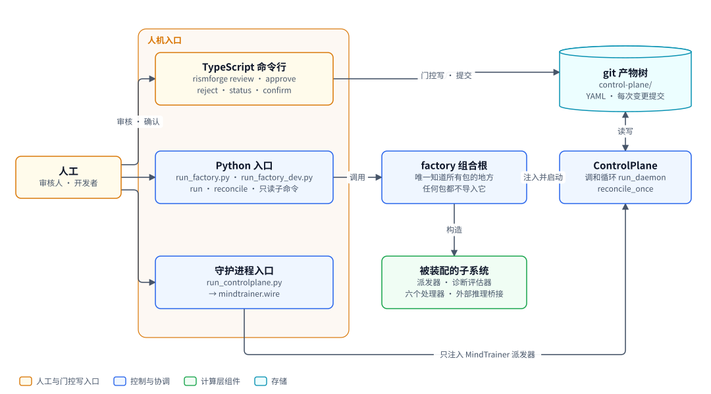
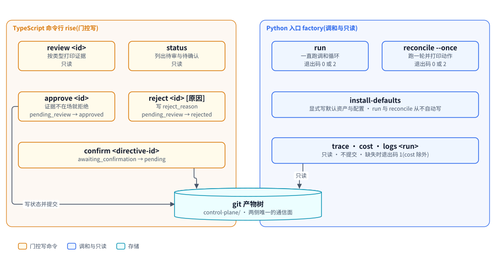
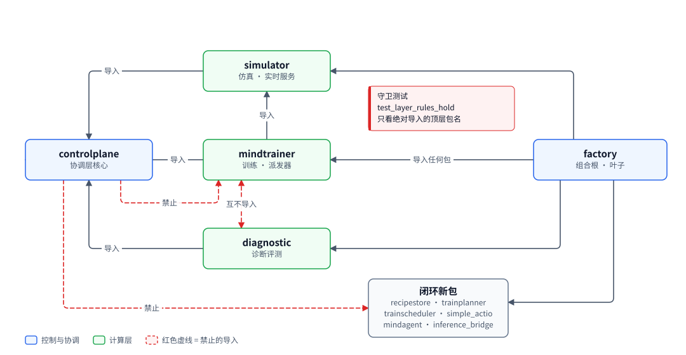
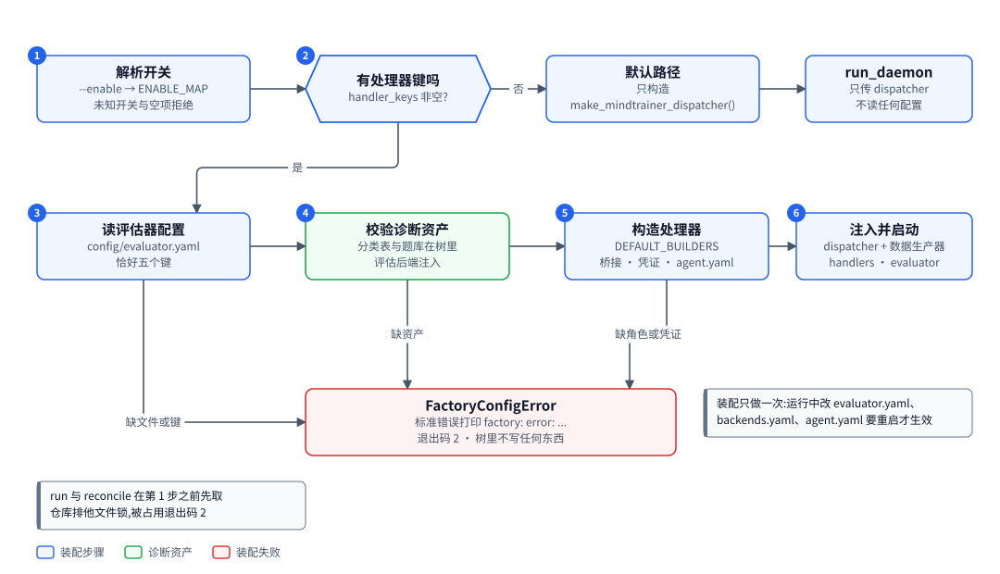
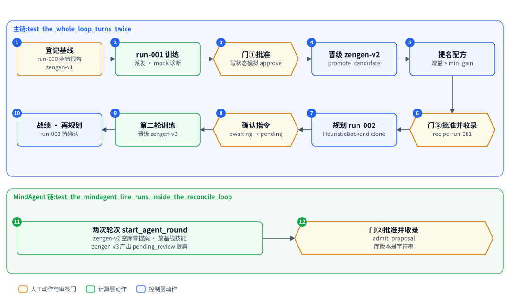

# factory 与命令行:把全部组件装起来,给人三个入口

| 项 | 内容 |
|---|---|
| 一句话 | 组合根 factory 读配置、按开关装配派发器、评估器与处理器后启动调和循环;两种语言的命令行分管门控写与只读观测 |
| 状态 | 主体落地,默认入口仍走 mock。组合根包 `src/factory`(开关、装配、六个处理器、桥接、评估器、只读子命令)、入口脚本 `scripts/run_factory.py` 与 `scripts/run_factory_dev.py`、TypeScript 命令行五个命令 `review`、`approve`、`reject`、`confirm`、`status`,以及守护进程入口 `mindtrainer.wire` 与 `scripts/run_controlplane.py` [已落地]。限制:两个默认入口只注入 mock 执行器与 mock 诊断;真实 ROLL LoRA SFT 与真实 SoMEval 由 `--executor roll`、`--evaluator someval` 显式装配,真机只各跑通一次,且两者暂不能与 `--enable` 同用;闭环端到端只在 mock 证据、`HeuristicBackend` 与罐头后端上跑过。部署会话超时的可配置与两侧共用读写 [计划中]。`run` 与 `reconcile` 的 `--interact` 装配开关 [已落地]:让 interact 指令从真实入口跑完,训练位由 vLLM 上的真实模型说话,训练仍是 mock,与 `--executor roll` 互斥;端到端测试用本机 HTTP 替身代替 vLLM,真机未跑。真实 GRPO 加 OPD 训练与真实 judge [推迟] |
| 所在层 | 控制层(入口与组合根) |
| 代码位置 | `src/mindtrainer/wire.py`、`scripts/run_controlplane.py`、`cli/src`、`src/controlplane/observe.py`、`src/factory`、`scripts/run_factory.py`、`scripts/run_factory_dev.py` |
| 基线提交 | `b826440`(2026-10-21) |
| 依赖 | ControlPlane(调和循环、产物树、配置信封、观测函数)、MindTrainer 派发器;闭环模式下还依赖诊断评测、RecipeStore、TrainPlanner、TrainScheduler、MindAgent、外部推理桥接、SocialSimulator 的实时服务 |
| 被依赖 | 无。factory 是依赖图的叶子,只有入口脚本与测试调用它 |
| 对应实施计划 | 命令行泛化与 `confirm`:工作包 8(任务 96 至 97);组合根与端到端:工作包 9(任务 100 至 109) |

## 0. 系统速览

<!-- shared:begin context-block -->
**系统是什么。** RismForge 是一套"AI 驱动的社会心智后训练工厂":输入通用开源基础模型,输出社会心智能力显著增强的模型,代号 **ZenGen**。工厂自己决定每一轮练什么、怎么练。训练决策可以交给外部更强的闭源模型(经命令行调用),关键决策点设人工审核门,其余环节自动。

**七个子系统。** 六个能力子系统加一个协调层 ControlPlane。

| 子系统 | 职责 | 所在层 | 现状 |
|---|---|---|---|
| ControlPlane | 协调层:git 版本化产物树、状态机、调和循环、三个审核门 | 控制层 | [已落地] |
| SocialSimulator | 情境与人格生成、多智能体仿真、实时环境服务、诊断评测 | 计算层 | [已落地];诊断默认用 mock 后端,`--evaluator someval` 装配 vLLM 加 SoMEval 的真实运行器 [已落地],真机只验证到预测阶段 |
| MindTrainer | 权重级训练:BatchTrain(SFT 后接 GRPO 加 OPD)与 InteractTrain | 计算层 | [已落地],默认入口的训练执行器是 mock;ROLL LoRA SFT 真实执行器 [已落地],由 `--executor roll` 装配,已在真实主机上端到端跑通一次 |
| MindAgent | 部署态智能体的技能与记忆自进化,不改权重 | 计算层 | [已落地],闭环里经 `--enable agent` 装配;部署驱动用的仍是罐头后端,真实模型后端未接 |
| RecipeStore | 验证有效的训练配方的版本化仓库 | 控制层 | [已落地] |
| TrainScheduler | 决策执行器:装配上下文、校验决策、构造训练指令、提名配方 | 控制层 | [已落地],含策略经验(默认关) |
| TrainPlanner | 决策学习者:经可插拔后端给出下一轮训练决策 | 控制层 | [已落地],默认后端经桥接调用命令行模型 |

共享基础设施有五个。**Actio** 是带技能库与显式记忆的智能体框架,每次响应附带激活轨迹。**外部推理桥接**用命令行调用外部强模型。**远端计算层** `compute` 经 SSH 在远端 GPU 主机上跑作业 [已落地]。**ROLL** 是分布式训练引擎,**vLLM** 是推理引擎。V1 经远端计算层接入 ROLL 的 LoRA SFT [已落地](由 `--executor roll` 装配,已在真实主机上从指令跑到候选一次)与 vLLM 推理服务 [已落地](命令拼装、SSH 隧道、服务生命周期;真机端到端待补)。已落地部分仍由确定性 mock 顶替。真实 GRPO 加 OPD 训练与真实 judge [推迟]。

**状态标记。** **[已落地]** 表示代码在主干上且有测试。**[计划中]** 表示设计与实施计划已定,代码还没写。**[推迟]** 表示明确不在 V1 范围内。图只画目标系统,不标进展,进展只看正文的状态标记。

**六条贯穿全系统的机制。**

| 机制 | 规则 |
|---|---|
| 产物树 | 所有协作数据是 git 树里的 YAML 产物,统一信封:`id`、`type`、`version`、`created_at`、`created_by`(含 `owner` 与 `visibility`)、`status`、`schema_version`、`links`、`payload`。checkpoint 等大体量内容只存引用 `{uri, sha256, size_bytes}`;V1 的数据集逐条 episode 进 git,只适合小规模 mock。git 树是唯一真相,读取时先经迁移器链再消费。 |
| 状态机 | 需审核类:`draft → pending_review → approved → effective`,之后可到 `deprecated` 或 `superseded`,`pending_review` 也可到 `rejected`。非审核类:`pending → executed → consumed`,`pending` 也可到 `failed`。被拒绝与失败的产物保留;被拒绝的候选进入下一轮规划的输入,失败只留痕、等人处理。 |
| 调和循环 | 纯函数 `reconcile(树视图) → 动作列表`,守护进程按间隔轮询并执行动作。循环无状态、动作幂等,进程崩溃后从 git 树续接。子系统之间不直接调用,只读写产物。 |
| 审核门 | 三道人工门:① checkpoint 晋级,② 技能与记忆增量纳入,③ 配方入库。证据不在场就不能批准:门①要诊断报告,门②要验证结果,门③要可复现性校验报告。门②与门③ [已落地]。 |
| 受限直连 | 两处高频实时调用绕过 ControlPlane:① MindTrainer 与 SocialSimulator 之间的 InteractTrain rollout,② MindAgent 与 SocialSimulator 之间的部署经验采集。两处都走 gRPC 双向流,发生在计算层内部。是否开会话仍由 ControlPlane 决策。 |
| 失败分类 | T1 瞬态:有限次指数退避重试,耗尽升为 T3。T2 确定性:不重放,按所属子系统的校验链处理,LLM 的随机输出可有限次重采样。T3 需人工:写失败记录,不自动重跑。失败是数据,不是异常。 |

**核心术语。**

| 术语 | 含义 |
|---|---|
| Run | 一轮迭代,对应产物树里的 `runs/run-<编号>/` 目录,该轮所有产物都挂在其下 |
| Directive(训练指令) | TrainScheduler 或人写入的 `directive.yaml`,调和循环据此下发训练 |
| Candidate(候选 checkpoint) | MindTrainer 产出的 `candidate_checkpoint.yaml`,经诊断评测与门①才能晋级 |
| ZenGen 版本 | 晋级后写入 `models/zengen-v<N>.yaml`;下一轮训练的基座取最新的 effective 版本 |
| Episode | 一次多轮交互的完整记录:情境、角色分配、逐轮话语、终止原因 |
| Scenario、Persona、RoleAssignment | 社会情境、人格模板,以及把角色位绑定到具体人格与模型后端的分配 |
| Recipe(配方) | 验证有效的完整训练方案,分 batch、interact、agent_rsi 三类 |
| DiagnosticReport | 诊断评测产出的报告:维度、分数、置信区间、错误类型、退化标记 |
| Activation trace(激活轨迹) | Actio 每次响应附带的记录:命中的技能候选、选中的技能、命中的记忆 |
| Evidence grade(证据等级) | 诊断报告的可信等级 `stub`、`mock`、`real`,决定它能否驱动规划与提名;缺标记一律判 `stub`,失败关闭 |
<!-- shared:end context-block -->

## 1. 定位

factory 是组合根:系统里唯一知道所有包的地方。它把各子系统装成一个能转起来的闭环,自己不含业务逻辑。

它解决两个问题。第一,ControlPlane 不导入任何新子系统,闭环动作要靠外部注入处理器才会产生,总得有一处负责装配。第二,人要有固定的入口去审核、确认、启动和观测,入口要分清"会改树"与"只读"。

人从三个入口进来。TypeScript 命令行 `rismforge` 直接改产物状态并提交。Python 入口调组合根,装配后启动调和循环。已落地的守护进程入口只注入 MindTrainer 派发器,与 factory 并存。

<!-- figure:begin 90-factory-context -->


**图 1　factory 与命令行的上下文**　人经两种语言的命令行进入系统。TypeScript 命令行直接改产物树并提交;Python 入口调用组合根 factory,由它装配各子系统并启动调和循环。原守护进程入口保留,只注入 MindTrainer 派发器。

<details>
<summary>文字版:图中的节点与连线</summary>

**节点**

- 人工:审核人 · 开发者
- TypeScript 命令行:rismforge review · approve / reject · status · confirm
- Python 入口:run_factory.py · run_factory_dev.py / run · reconcile · 只读子命令
- 守护进程入口:run_controlplane.py / → mindtrainer.wire
- factory 组合根:唯一知道所有包的地方 / 任何包都不导入它
- 被装配的子系统:派发器 · 诊断评估器 / 六个处理器 · 外部推理桥接
- git 产物树:control-plane/ / YAML · 每次变更提交
- ControlPlane:调和循环 run_daemon / reconcile_once

**连线**

- 人工 → TypeScript 命令行:审核 · 确认
- 人工 → Python 入口
- 人工 → 守护进程入口
- TypeScript 命令行 → git 产物树:门控写 · 提交
- Python 入口 → factory 组合根:调用
- factory 组合根 → 被装配的子系统:构造
- factory 组合根 → ControlPlane:注入并启动
- ControlPlane ↔ git 产物树:读写
- 守护进程入口 → ControlPlane:只注入 MindTrainer 派发器

</details>
<!-- figure:end 90-factory-context -->

审核人经 TypeScript 命令行做门控写,命令只改状态字段并提交。开发者经 Python 入口启动 factory,由它构造派发器、诊断评估器、六个处理器与外部推理桥接,再注入调和循环 [已落地]。守护进程入口走同一个调和循环,只注入 MindTrainer 派发器。两侧不互相调用,只经产物树通信。

## 2. 目标、非目标与约束

本子系统只做装配与入口,不做任何训练、评测、规划的判断。

| 编号 | 目标 | 验收方式 |
|---|---|---|
| G1 | 不传 `--enable`、执行器为默认 mock 时,与现有守护进程入口行为相同 | 两棵相同的仓库分别跑两个入口,整棵 `control-plane/` 与全部提交说明逐字节相同 [已落地]。`--interact` 加入后,此条件改为 `--enable` 与 `--interact` 都不传,新开关默认关,不影响这一比较 [已落地] |
| G2 | 五个开关恰好覆盖六个闭环处理器键 | 开关映射表的单测;每个键接到真实处理器 [已落地] |
| G3 | 闭环模式的装配全部在第一个 tick 之前完成 | 缺配置、资产、角色、凭证时退出码 2、一行错误、树里不写东西 [已落地] |
| G4 | 门控写命令证据不在场就拒绝 | 候选缺诊断、配方候选缺 `repro`、提案缺 `verification` 时 `approve` 抛错且不提交 [已落地] |
| G5 | 只读命令不改 `HEAD` 与工作区 | 前后比较 `HEAD` 与工作区快照 [已落地] |
| G6 | 闭环能从一条人工指令转到第二轮训练 | 端到端测试 `test_the_whole_loop_turns_twice` [已落地] |
| G7 | `--interact` 配置不齐就不装配 | 十一条拒绝项各有一条装配测试:退出码 2、一行错误、树里不写东西 [已落地] |

| 非目标 | 状态 | V1 的处理 |
|---|---|---|
| 真实 GRPO 加 OPD 训练、真实 judge | [推迟] | 仍用 mock |
| 真实 SoMEval、真实 vLLM(经远端计算层) | [已落地] | 由 `--evaluator someval` 显式启用(FC-16),默认仍是 mock 后端;真机只验证到预测阶段。MindAgent 仍用罐头后端 |
| 真实 ROLL LoRA SFT(经远端计算层) | [已落地] | 由 `--executor roll` 显式启用(FC-15);默认仍是 mock 执行器。装配与配置错误路径有测试;已在真实主机上从训练指令端到端跑到待审候选一次,只覆盖单段两步 |
| interact 指令从真实入口跑通(`--interact`) | [已落地] | 真推理加 mock 训练:设计要证明真模型能进会话、发言能落盘、奖励管线对真实发言成立,不证明模型变好。目前只用本机 HTTP 替身代替 vLLM 验证了会话、落盘与 `policy_backend` 记录,没有在真机上跑过,端到端测试也不断言奖励数值;真实 GRPO 落地后换执行器 |
| 桥接的 API 形态 | [推迟] | `invocation_form` 不是 `cli` 时装配报错 |
| 运行中热加载配置 | [推迟] | 改 `evaluator.yaml`、`backends.yaml`、`agent.yaml` 要重启 |
| 进程自我重启与重试 | [推迟] | 瞬态异常让进程退出,由外部监督者重启 |
| 图形界面 | [推迟] | 只有命令行 |
| 一个命令行统管两种语言 | 不做 | 门控写在 TypeScript,调和与只读在 Python(R16) |

| 约束 | 内容 | 影响 |
|---|---|---|
| 依赖方向 | factory 可以导入任何包,任何包都不导入 factory | factory 不导出名字,`__init__.py` 只有说明;守卫测试 `test_no_other_package_imports_factory` 扫全部源码 [已落地] |
| 原入口冻结 | `mindtrainer.wire` 与 `scripts/run_controlplane.py` 不删、不改 | 两个入口并存;改动范围用 `git diff` 证明,两个文件相对基线提交无改动 [已落地] |
| 无新第三方依赖 | 只用标准库 `argparse`、`hashlib`、`urllib.parse`、`inspect`;读本机主机映射用已有的 `yaml` | `pyproject.toml` 的 `dependencies` 不动 |
| 凭证不外露 | 凭证不进 git 树,值不进标准输出、标准错误、异常信息、日志 | 凭证相关的异常一律断开异常链 |
| 只走信封 | 读写产物走 `GitStore` 与 `Envelope`,配置走配置信封 | 直接文件读取只有两处:`logs` 读日志文件;真实后端读本机主机映射文件(路径来自环境变量 `RISMFORGE_COMPUTE_HOSTS`,仓库之外) |
| mock 证据默认关 | 默认入口不接受 mock 证据,开发入口显式打开(R17) | 默认配置下闭环不会自己转 |

## 3. 架构

入口分两种语言、三个入口,组合根在 Python 一侧的最右端。

<!-- figure:begin 90-factory-commands -->


**图 2　命令地图**　TypeScript 命令行管门控写命令,直接改产物状态并提交。Python 一侧管调和与只读可观测,只读子命令不提交。两侧只经产物树通信。

<details>
<summary>文字版:图中的节点与连线</summary>

**节点**

- review <id>:按类型打印证据 / 只读
- status:列出待审与待确认 / 只读
- approve <id>:证据不在场就拒绝 / pending_review → approved
- reject <id> [原因]:写 reject_reason / pending_review → rejected
- confirm <directive-id>:awaiting_confirmation → pending
- run:一直跑调和循环 / 退出码 0 或 2
- reconcile --once:跑一轮并打印动作 / 退出码 0 或 2
- install-defaults:显式写默认资产与配置 · run 与 reconcile 从不自动写
- trace · cost · logs <run>:只读 · 不提交 · 缺失时退出码 1(cost 除外)
- git 产物树:control-plane/ · 两侧唯一的通信面

**连线**

- approve <id> → git 产物树:写状态并提交
- confirm <directive-id> → git 产物树
- trace · cost · logs <run> → git 产物树:只读

</details>
<!-- figure:end 90-factory-commands -->

左边是 TypeScript 命令行,五个命令已落地,其中 `review`、`approve` 按产物类型处理三类门控产物。右边是 Python 入口 factory 的子命令,全部 [已落地];只读子命令只读树,不提交。

| 模块 | 职责 | 依赖 | 状态 |
|---|---|---|---|
| `cli/src/index.ts` | 命令分发,未知命令打印用法、退出码 1 | `commands.ts` | [已落地] |
| `cli/src/commands.ts` | `review`、`approve`、`reject`、`status`,需审核类迁移表 | `gittree.ts`、git 命令行 | [已落地] |
| `cli/src/gittree.ts` | `readProduct`、`writeProduct`(写文件、`git add`、`git commit`) | js-yaml、git 命令行 | [已落地] |
| `src/mindtrainer/wire.py` | 守护进程入口逻辑:`run`、`main` | `controlplane.daemon`、`mindtrainer.dispatch` | [已落地] |
| `scripts/run_controlplane.py` | `mindtrainer.wire.main` 的薄壳 | `mindtrainer.wire` | [已落地] |
| `src/controlplane/observe.py` | `trace`、`cost`、`sum_costs`,只读 | `controlplane.gitstore`、`controlplane.paths` | [已落地] |
| `factory.switches` | `ENABLE_MAP`、`parse_enable`、`handler_keys` | 无 | [已落地] |
| `factory.wire` | `FactoryOptions`、`BuildContext`、`assemble`、`run`、`reconcile_one_tick`;`--interact` 的互斥检查与装配 [已落地] | 全部包 | [已落地] |
| `factory.cli` | argparse 子命令、开关、退出码、`main`、`dev_main`;`--interact` 开关 [已落地] | `factory.wire`、`factory.readonly` | [已落地] |
| `factory.readonly` | `trace`、`cost`(即观测函数)、`collect_log_refs`、`render_logs` | `controlplane.observe` | [已落地] |
| `factory.bridges` | `BRIDGE_ROLES`、`build_bridge` | `inference_bridge`、`controlplane.config` | [已落地] |
| `factory.evaluation` | `EVALUATOR_CONFIG`、`read_evaluator_config`、`build_mock_evaluator`;真实 SoMEval 运行器与污染准入检查的装配 | `diagnostic`;真实运行器另加 `compute` | [已落地] |
| `factory.handlers` | `DEFAULT_BUILDERS`、`scheduler_config_loader` | `recipestore`、`trainscheduler`、`trainplanner`、`mindagent` | [已落地] |
| `factory.agent` | `agent.yaml` 读取、`AgentRuntime`、`DeadlineStub`、`CannedGuidedBackend`;interact 用法下带落盘钩子、按角色位选对手驱动、流 deadline 按局数算 [已落地] | `mindagent`、`simulator.realtime` | [已落地] |
| `factory.defaults` | 默认诊断资产、评估器配置、部署素材、`install_defaults` | `diagnostic`、`simulator`、`trainplanner`、`trainscheduler` | [已落地] |
| `factory.sombench` | `import-sombench` 子命令:读 SoMEval 检出目录里的 parquet,写分类表、题库与污染索引;pyarrow 在函数内惰性导入 | `diagnostic.assets`、`diagnostic.contamination` | [已落地] |
| `factory.compute_config` | 读树内 `compute/endpoints.yaml` 出 `ComputeEndpoint` 列表,读本机主机映射出 `ComputeClient`;缺文件、键缺失或多余、取值不合、映射里查不到 `endpoint_id` 一律 `FactoryConfigError`,退出码 2,只写键名与路径,不回显取值 | `compute`、`factory.configio` | [已落地] |

两个入口脚本 `scripts/run_factory.py` 与 `scripts/run_factory_dev.py` 都是 `factory.cli` 的薄壳 [已落地]。前者默认不接受 mock 证据,后者对 `run`、`reconcile` 自动加 `--allow-mock-evidence`。

<!-- figure:begin 90-factory-layers -->


**图 3　依赖方向与分层守卫**　factory 在依赖图最右端,可以导入任何包,任何包都不导入它。红色虚线是守卫测试禁止的导入边。

<details>
<summary>文字版:图中的节点与连线</summary>

**节点**

- factory:组合根 · 叶子
- controlplane:协调层核心
- simulator:仿真 · 实时服务
- mindtrainer:训练 · 派发器
- diagnostic:诊断评测
- 闭环新包:recipestore · trainplanner / trainscheduler · actio / mindagent · inference_bridge

**连线**

- simulator → controlplane:导入
- mindtrainer → controlplane:导入
- diagnostic → controlplane:导入
- mindtrainer → simulator:导入
- factory → mindtrainer:导入任何包
- factory → simulator
- factory → diagnostic
- factory → 闭环新包
- mindtrainer ↔ diagnostic:互不导入(虚线)
- controlplane → mindtrainer:禁止(虚线)
- controlplane → 闭环新包:禁止(虚线)

</details>
<!-- figure:end 90-factory-layers -->

依赖方向规则:

| 包 | 可以导入 | 不得导入 | 状态 |
|---|---|---|---|
| `factory` | 任何包 | 无 | [已落地] |
| 其余任何包 | 各自的规则 | `factory` | 守卫测试 [已落地] |
| `controlplane` | `simulator.stubs`(骨架桩,唯一回指) | `diagnostic`、`mindtrainer` 与七个新包 | 今天成立;常驻守卫 [已落地] |
| `mindtrainer` | `controlplane`、`simulator` | `diagnostic` | 今天成立;常驻守卫 [已落地] |
| `diagnostic` | `controlplane`、`simulator` | `mindtrainer` | 今天成立;常驻守卫 [已落地] |

"今天成立"是在基线提交上用 grep 查的:三个已落地包里没有越界的绝对导入。常驻守卫 `test_layer_rules_hold` 用语法树扫真实源码,只看绝对导入的顶层包名 [已落地]。

## 4. 数据模型与状态机

本子系统不拥有产物状态机。它读写配置信封,并经命令行驱动别人的状态迁移。

| 实体 | 字段与含义 | 约束 |
|---|---|---|
| `FactoryOptions` | `switches`、`allow_mock_evidence`、`confirm_directives`、`planner_backend`、`repo_commit`、`executor`、`endpoint`、`evaluator` | 冻结数据类;`confirm_directives` 三态,`None` 表示用配置 [已落地]。新增布尔字段 `interact`,默认 `False` [已落地] |
| `BuildContext` | 仓库、证据开关、确认覆盖、规划后端、环境变量、日志目录、`repo_commit`、收尾函数列表 | 交给处理器构造器;`bridge(role)` 每次新建一个桥接 [已落地] |
| `Assembly` | 派发器、处理器字典、评估器、证据开关、收尾函数 | 处理器为空即默认路径;`close()` 逆序收尾 [已落地] |
| `ENABLE_MAP` | 开关到处理器键的固定表 | 五个开关、六个键,见下表 [已落地] |

| 开关 | 处理器键 | 处理器来自 |
|---|---|---|
| `plan` | `plan_next_round` | TrainScheduler 的规划处理器 [已落地] |
| `nominate` | `nominate_recipe` | TrainScheduler 的提名处理器 [已落地] |
| `track` | `record_track` | RecipeStore 的战绩处理器 [已落地] |
| `agent` | `start_agent_round` | MindAgent 的轮次处理器 [已落地] |
| `admit` | `admit_recipe`、`admit_proposal` | RecipeStore 与 MindAgent 的收录处理器 [已落地] |

| 产物类型 | 路径(`control-plane/` 下) | 状态机种类 | 写方 | 状态 |
|---|---|---|---|---|
| 评估器配置 | `config/evaluator.yaml` | 配置信封 | `install-defaults`,之后由人改 | [已落地] |
| MindAgent 部署素材 | `config/agent.yaml` | 配置信封 | `install-defaults`,之后由人改 | [已落地] |
| 规划提示模板 | `config/prompts/planner-<版本>.yaml`,默认模板 `PLANNER_V1` | 提示模板信封 | `install-defaults`,之后由人改 | [已落地] |
| 调度配置与训练默认值 | `config/scheduler.yaml`、`config/training_defaults.yaml` | 配置信封 | `install-defaults`,之后由人改 | [已落地] |
| 默认部署情境与人格 | `scenarios/` 下 `factory-deploy-s1` 至 `s3`,`personas/` 下两个人格 | 情境与人格产物 | `install-defaults` | [已落地] |
| 桥接配置 | `config/backends.yaml` | 配置信封 | 人 | [已落地] |
| 默认分类表与题库 | `diagnostics/` 下 `factory-tax-v1`、`factory-pool-v1`;SoMBench 导入的 `sombench-<哈希前缀>` | 登记即 `effective` | `install-defaults`;`import-sombench` | [已落地] |
| 本机评测配置 | 树外,路径由环境变量 `RISMFORGE_EVAL_CONFIG` 给出,权限 0600 | 无;不进树 | 人 | [已落地] |
| 候选 checkpoint | `runs/<run>/candidate_checkpoint.yaml` | 需审核 | 命令行改 `approved` 或 `rejected` | [已落地] |
| 配方候选、技能提案 | `recipe_candidates/`、`skill_memory_proposals/` | 需审核 | 命令行改状态 | [已落地] |
| 训练指令 | `runs/<run>/directive.yaml` | 非审核 | `confirm` 改 `pending` | [已落地] |

`evaluator.yaml` 的载荷恰好五个键,`backends` 不可配置:mock 评估器恒为 `mock`,`--evaluator someval` 恒为 `real`:

```yaml
taxonomy_version: factory-tax-v1
item_pool_version: factory-pool-v1
benchmark_version: factory-bench-v1
tier: full          # full 或 quick
sampling_k: 4       # 整数,至少 1
```

`agent.yaml` 的载荷必填三个键:`scenario_ids`、`bindings`(角色绑定字典的列表)、`opponent_lines`(对手台词列表)。可选键是 `AgentConfig` 的其余八个字段,缺省取它的默认值。未知键与类型错误都是装配错误,退出码 2 [已落地]。`install-defaults` 写入的默认值:三个部署情境 `factory-deploy-s1` 至 `s3`;`user` 位绑定 `frozen_reference`(`model_ref` 为 `zengen-v1`),`agent` 位绑定 `self_play`;对手台词三句;`max_turns` 为 4,`min_support` 为 3,`min_ratio` 为 0.5 [已落地]。

命令行驱动的迁移:

| 命令 | 产物 | 迁移 | 状态 |
|---|---|---|---|
| `approve <id>` | 候选 checkpoint | `pending_review → approved` | [已落地] |
| `reject <id> [原因]` | 候选 checkpoint | `pending_review → rejected`,写 `reject_reason` | [已落地] |
| `approve`、`reject` | 配方候选、技能提案 | 同上 | [已落地] |
| `confirm <directive-id>` | 训练指令 | `awaiting_confirmation → pending` | [已落地] |

不变量:

1. 不传 `--enable`、且执行器是默认 mock 时,factory 不读任何配置文件,不注入派发器以外的任何东西 [已落地]。`--executor roll` 是例外:它读端点与本机主机映射,并注入执行器与转换器(`src/factory/wire.py:141-160`)。传了 `--interact` 就要读端点与本机主机映射、`training_defaults.yaml` 与点名的情境、人格,并给派发器多注入实时客户端与策略工厂;不传 `--interact` 时这条不变量原样成立 [已落地]。
2. 开了任一闭环开关,就同时注入数据生产器与 mock 后端的真实评估器 [已落地]。
3. 证据开关只有一个来源:命令行 `--allow-mock-evidence`。同一个值交给调和循环与提名处理器 [已落地]。
4. 确认覆盖不写回 `scheduler.yaml`,只改 loader 的返回值 [已落地]。
5. 门控写命令在迁移不合法或证据不在场时,不写文件、不提交。
6. 已存在的配置文件 `install-defaults` 不覆盖,人改过的配置优先 [已落地]。已存在的分类表、题库、部署情境与人格,内容与默认值相同就不动,不同就拒绝:一行错误、退出码 2,指出哪个文件。同一版本号、同一 id 必须对应同一份内容,题库与分类表的版本进诊断报告,静默还原会让前后两份报告的分数不可比;要换内容就升版本号或换 id。先把这几类资产全部检查完再写任何东西,冲突时树里不留半截安装 [已落地]。
7. `--executor roll` 与任一 `--enable` 开关同时给是用法错误,退出码 2,树里不写东西 [已落地]。第 8 到 10 条是本轮新增的组合规则 [已落地]。真训练会同步占住调和循环数小时(CP-15),闭环处理器的排队语义是按 mock 训练的前提写的;先让一条链路跑通真机,再决定叠加。以后放开比以后收紧容易。
8. `--evaluator someval` 必须同时给 `--executor roll`,且暂不能与 `--enable` 同用;任一不满足是用法错误,退出码 2(FC-16)。
9. `--executor roll` 且不传 `--evaluator someval` 时,仍然要求污染索引在场且数据集哈希对得上,否则拒绝装配。真训练必须过关,不论是否评测(DX-19)。
10. `--evaluator someval` 要求本机评测配置在场、权限 0600、不在仓库目录里,且 SoMEval 检出目录与数据集哈希都对得上;缺一项退出码 2,不回显任何凭证取值(DX-20)。

## 5. 接口契约

对外只承诺入口函数与几个数据类,其余模块都是内部实现。

已落地的守护进程入口:

```python
# mindtrainer.wire
def run(repo_root: str, *, interval_s: float = 2.0, max_ticks: int | None = None) -> None
def main(argv: list[str] | None = None) -> int
# 命令行:scripts/run_controlplane.py <repo_root> [--interval-s S] [--max-ticks N]
```

组合根的对外签名,已落地:

```python
# factory.wire
def assemble(store, options, *, env=None, log_dir=None, builders=None) -> Assembly
def run(repo_root, options=FactoryOptions(), *, interval_s=2.0, max_ticks=None,
        env=None, log_dir=None, builders=None) -> None
def reconcile_one_tick(repo_root, options=FactoryOptions(), *, env=None,
                       log_dir=None, builders=None) -> list[Action]
# factory.cli
def main(argv=None, *, env=None, builders=None) -> int
def dev_main(argv=None, **kw) -> int
```

Python 子命令 [已落地]。每个子命令的第一个位置参数都是控制面仓库根目录:

| 子命令 | 作用 | 退出码 |
|---|---|---|
| `run <repo>` | 一直跑调和循环,带 `--interval-s`、`--max-ticks` | 0;装配错误 2 |
| `reconcile <repo> --once` | 跑一轮,每个动作打印一行 `<kind> <target_id>`,没有动作打印 `no actions` | 0;不带 `--once` 或装配错误 2 |
| `install-defaults <repo>` | 显式写默认资产与配置,打印涉及的路径 | 0;仓库被另一个进程锁住时 2,树里不写任何东西 |
| `import-sombench <repo> --someval-root <路径> --index <树外路径>` | 从 SoMEval 检出目录导入 SoMBench:写分类表与题库(版本带数据集哈希前缀),写污染索引;内容相同不提交 [已落地] | 0;parquet 缺失或 pyarrow 未装,退出码 2 |
| `trace <repo> <run>` | 原样打印观测函数 `trace` 的输出 | 0;run 不存在 1 |
| `cost <repo> <run>` | 原样打印观测函数 `cost` 的输出 | 0,没有 `run_trace` 也是 0 |
| `logs <repo> <run> [--task <id>]` | 按 run 目录产物的 `log_refs` 打印日志 | 0;run 不存在、有引用不可达或哈希不符、有产物读不出或引用畸形 1 |

`run` 与 `reconcile` 共用的开关 [已落地]:

| 开关 | 取值 | 含义 |
|---|---|---|
| `--enable` | `plan,nominate,track,agent,admit` 的子集 | 未知开关与空项是用法错误,退出码 2 |
| `--allow-mock-evidence` | 布尔 | 接受 mock 证据驱动规划、提名与战绩 |
| `--confirm-directives` / `--no-confirm-directives` | 三态 | 不传就用 `scheduler.yaml` 的 `confirm_directives` |
| `--planner-backend` | `bridge`(默认)、`heuristic` | `heuristic` 是确定性后端,不需要外部工具 |
| `--repo-commit` | 提交号 | 不传取代码仓库根的 `git rev-parse HEAD`,取不到为 `None` |
| `--executor` | `mock`(默认)、`roll` | `roll` 装配真实 ROLL LoRA SFT 执行器与适配器导出转换器 [已落地],装配步骤见下文的 4a,取舍见 FC-15 |
| `--endpoint` | 端点 id | 只在 `--executor roll` 或 `--interact` 时有意义,其余组合装配期拒绝;点名 `compute/endpoints.yaml` 里的哪个端点;只有一个端点时可省 [已落地] |
| `--evaluator` | `mock`(默认)、`someval` | `someval` 装配真实评估器:起 vLLM 服务、跑 SoMEval 子进程、把结果转成诊断报告。必须同时给 `--executor roll`,暂不能与 `--enable` 同用 [已落地] |
| `--interact` | 布尔,默认关 | 装配实时客户端与策略工厂,让 interact 指令在真实入口跑完。与 `--executor roll` 互斥;要求 `training_defaults.yaml` 有 `interact` 段(缺段退出码 2,见拒绝项 2);不要求 `allow_interact`,它只给调度器构造 `new` interact 用 [已落地] |

TypeScript 命令行:`rismforge <review|approve|reject|confirm|status> [id] [reason]` [已落地],五个命令都在 `cli/src`。

| 命令 | 泛化前的行为 [已落地] | 泛化后即今天的行为 [已落地] |
|---|---|---|
| `review <id>` | 打印候选头行与诊断摘要;缺报告标 `MISSING`,桩报告标 `[STUB]` | 三类产物按类型打印证据;mock 报告标 `[MOCK BACKENDS]` |
| `approve <id>` | 先判迁移,再要求同 run 目录有诊断报告 | 配方候选要有 `repro`,提案要有 `verification` |
| `reject <id> [原因]` | 写 `reject_reason`,原因缺省为 `no reason` | 三类产物通用 |
| `status` | 列出 `pending_review` 的候选 | 同时列出三类待审产物与待确认指令 |
| `confirm <id>` | 不存在 | 只认 `awaiting_confirmation`;多处命中报歧义 |

对邻居的假设:

| 邻居 | 本文依赖它什么 | 它依赖本文什么 |
|---|---|---|
| ControlPlane | `run_daemon`、`reconcile_once` 接受 `dispatcher`;闭环模式还接受 `handlers`、`evaluator`、`accept_mock_evidence`;非闭环的 `--evaluator someval` 也传 `evaluator` | 有人注入处理器,闭环动作才会产生(R2) |
| MindTrainer | `make_mindtrainer_dispatcher()`;闭环模式传 `data_producer` [已落地];`--interact` 时另传 `client_factory` 与 `policy_factory` [已落地] | 无 |
| 诊断评测 | `make_diagnostic_evaluator` 与资产读写;`ScoredSoMEvalRunner` 协议、`write_failure_report` | 无 |
| TrainScheduler | `make_plan_handler`、`make_nominate_handler`、`install_default_configs` [已落地] | 传入 `accept_mock_evidence`、`repo_commit` 与带覆盖的 loader |
| TrainPlanner | `install_default_template`、`BridgeDecisionBackend`、`HeuristicBackend` [已落地] | 选后端、安装默认模板由本文负责 |
| SocialSimulator | `create_server`、`EnvironmentServiceClient`、`read_persona`、`read_scenario`、`write_persona`、`write_scenario`;`--interact` 另用 `on_session_closed` 落盘 episode [已落地] | 无 |
| RecipeStore | `handle_admit_recipe`、`handle_record_track` [已落地] | 无 |
| MindAgent | `make_start_round_handler`、`handle_admit_proposal` [已落地] | 实时客户端工厂、罐头后端、人格 loader |
| 外部推理桥接 | `CliBridge` [已落地] | `backends.yaml` 的 `planner`、`agent` 两个角色 |
| 远端计算层 | `ComputeClient`;`--executor roll` 与 `--evaluator someval` 已在用 [已落地];`--interact` 的策略工厂经 `serve` 按指令起停 vLLM [已落地] | 无 |

## 6. 关键流程

主流程是装配:解析开关后分两条路径,闭环路径在第一个 tick 之前装配完毕。

### 6.1 装配

<!-- figure:begin 90-factory-assembly -->


**图 4　组合根的装配流程**　不传 --enable 时只构造 MindTrainer 派发器,与现有入口逐字节相同。传了 --enable 时读配置、校验资产与凭证、构造评估器与处理器,全部在第一个 tick 之前完成;任一步出错打印一行错误、退出码 2,树里不写任何东西。

<details>
<summary>文字版:图中的节点与连线</summary>

**节点**

- 解析开关:--enable → ENABLE_MAP / 未知开关与空项拒绝
- 有处理器键吗:handler_keys 非空?
- 默认路径:只构造 / make_mindtrainer_dispatcher()
- run_daemon:只传 dispatcher / 不读任何配置
- 读评估器配置:config/evaluator.yaml / 恰好五个键
- 校验诊断资产:分类表与题库在树里 / 评估后端注入
- 构造处理器:DEFAULT_BUILDERS / 桥接 · 凭证 · agent.yaml
- 注入并启动:dispatcher + 数据生产器 / handlers · evaluator
- FactoryConfigError:标准错误打印 factory: error: ... / 退出码 2 · 树里不写任何东西

**连线**

- 解析开关 → 有处理器键吗
- 有处理器键吗 → 默认路径:否
- 默认路径 → run_daemon
- 有处理器键吗 → 读评估器配置:是
- 读评估器配置 → 校验诊断资产
- 校验诊断资产 → 构造处理器
- 构造处理器 → 注入并启动
- 读评估器配置 → FactoryConfigError:缺文件或键
- 校验诊断资产 → FactoryConfigError:缺资产
- 构造处理器 → FactoryConfigError:缺角色或凭证

</details>
<!-- figure:end 90-factory-assembly -->

| 步 | 动作 | 失败时 |
|---|---|---|
| 0 | 取仓库排他文件锁(`run`、`reconcile`、`install-defaults`、`import-sombench` 取,只读子命令不取;`reconcile` 在装配前取,`run` 在装配后、第一个 tick 前取) | 锁已被占用,退出码 2 [已落地] |
| 1 | 解析 `--enable`,经 `ENABLE_MAP` 得到处理器键 | 未知开关或空项,退出码 2 |
| 2 | 处理器键为空:只构造 `make_mindtrainer_dispatcher()`,调 `run_daemon` 时只传派发器 | 无 |
| 3 | 读 `evaluator.yaml`,要求恰好五个键 | `FactoryConfigError`,退出码 2 |
| 4 | 校验分类表与题库在树里,构造 mock 评估器;`--evaluator someval` 时改为校验本机评测配置与 SoMEval 检出目录,构造真实运行器与真实评估器 | 同上;凭证只写键名,不回显取值 |
| 4a | `--executor roll` 时:读 `compute/endpoints.yaml` 与本机主机映射,选定端点,造 `ComputeClient`,再造执行器工厂与转换器 [已落地] | `FactoryConfigError`,退出码 2;缺文件、键缺失或多余、映射里查不到端点、别名形态不合、`--endpoint` 点名了不存在的端点、有多个端点却没点名,全在第一个 tick 之前报 |
| 4b | `--executor roll` 时:读污染索引,校验数据集哈希,把准入检查注入执行器;`--evaluator someval` 时另把真实运行器注入评估器 | `FactoryConfigError`,退出码 2;索引缺失、哈希对不上、stub 前端断言失败 |
| 4c | `--interact` 时 [已落地]:先查与 `--executor roll` 互斥,再读 `training_defaults.yaml` 的 `interact` 段,校验点名的情境与人格,最后构造带落盘钩子的 `AgentRuntime` 与策略工厂。已因 `--enable agent` 构造了运行时就复用同一个 | `FactoryConfigError`,退出码 2,指出缺哪一项 |
| 4d | 没传 `--interact` 且 `--enable` 含 `plan` 时 [已落地]:读 `scheduler.yaml` 的 `allow_interact`,为真就拒绝装配。此时规划器可能写出 interact 指令,而没有 `--interact` 派发必然判 `failed` | `FactoryConfigError`,退出码 2,点名缺 `--interact` |
| 5 | 按 `DEFAULT_BUILDERS` 逐个构造处理器,需要时经 `build_bridge(store, role, *, env=None, log_dir=None)` 建桥接、读凭证、读 `agent.yaml`。`planner` 角色只在 `--planner-backend bridge` 时必需,`agent` 角色可选,缺了就不建桥接,提案生成回到规则模板 [已落地] | 同上;已登记的收尾函数逆序调用 |
| 6 | 注入派发器(带数据生产器)、处理器、评估器、证据开关,启动调和循环 | 运行中的异常原样上抛,进程退出 |

以上步骤全部 [已落地]。`--executor roll` 带任何 `--enable` 都是配置错误,装配走完 4a、4b 就返回,没有第 5 步;`--evaluator someval` 同样不能与 `--enable` 同用。第 2 步与守护进程入口走同一条代码路径,所以两者逐字节相同。任一步出错,标准错误打印一行 `factory: error: ...`,树里不写任何东西。

**`--interact` 装配 [已落地]。** `--interact` 让 interact 指令在真实入口跑完:组合根给派发器注入实时客户端与策略工厂,派发器据此走实时会话,训练位经 vLLM 由真模型说话。它是 `run` 与 `reconcile` 共用的布尔开关,默认关,不属于 `--enable` 的五个短名:`--enable` 管调和循环的闭环动作,`--interact` 管派发器的装配。

| 项 | 语义 |
|---|---|
| 注入什么 | `client_factory`:进程内实时服务端的客户端工厂,服务端带落盘钩子;`policy_factory`:按 run id 与基座引用构造训练位策略。两者交给 `make_mindtrainer_dispatcher` |
| 落盘钩子 | 会话结束时由服务端的 `on_session_closed` 把 episode 写进产物树。轨迹源不写 episode,只在 metadata 里记 id |
| 对手位 | 组合根按角色位选驱动:固定对话、站内 vLLM 上的对手模型、外部 OpenAI 兼容 API。模拟器本身只认后端协议 |
| 运行时复用 | 已因 `--enable agent` 构造了 `AgentRuntime` 就复用同一个,不起第二个服务端;运行时登记收尾函数,与处理器同一机制逆序收尾。共用的影响面不止落盘钩子:训练登记表按会话记录该会话属于哪个 run,落盘钩子只处理训练登记过的会话,把 episode 写进对应 run;部署会话没有训练登记,仍由 MindAgent 驱动器自己落盘,两边的 episode 不混写。判错的代价是部署 episode 被误写进 interact 的数据,或同一条 episode 被两边各写一次 [已落地] |
| 不打开时 | 不注入这两样,interact 指令仍判 `failed`(T2)。设计要原因点名 `--interact`,还没做 [计划中],现在的原因文字是 `interact mode needs a client_factory and a policy or policy_factory`。`--enable agent` 构造过运行时也不改变这一点 |
| 与 `--evaluator someval` | `someval` 要求 `--executor roll`,而 `--interact` 与 `--executor roll` 互斥,所以两者无法同用 |

装配期的十一条拒绝项。前十条在 `--interact` 打开时检查,第 11 条在没传 `--interact` 时检查。检查全部在第一个 tick 之前,出错都是退出码 2、一行错误、树里不写东西:

| 序 | 检查 | 失败原因 |
|---|---|---|
| 1 | 不与 `--executor roll` 同用 | 真实执行器只支持 SFT(`supported_phases` 是 `{"sft"}`,`src/mindtrainer/roll_executor.py:87`),开不了 interact 的实时会话。选项层面的检查,与 `--evaluator someval` 的互斥检查同处(`src/factory/wire.py:227` 起) |
| 2 | `training_defaults.yaml` 有 `interact` 段 | 缺段。错误信息点名缺的是 `interact` 段 |
| 3 | 有角色位用 `external_api` 时,其凭证环境变量在场 | 与 `factory.bridges` 同一口径:凭证在装配期解析,缺就起不来;异常只报变量名。`allow_interact` 不在装配期检查,它只管调度器构造 `new` interact |
| 4 | 点名了 `scenario_ids` 就必须点 `persona_ids`,反之亦然 | 只写了一半 |
| 5 | 点名的情境与人格都在产物树里 | 不在树里 |
| 6 | 点名的情境 `purpose` 是 `training` | `install-defaults` 写入的三个部署情境 `purpose` 是 `deployment_simulation`,拿它们训练等于污染;人格不受此限 |
| 7 | 点名路不给 `sft_steps > 0` | 点名路不带 `data_spec`,没有合成,`sft` 阶段会因缺清单判 `failed`;点名路不做冷启动 |
| 8 | 情境数不少于 `groups_per_step`(默认 2) | 一个 GRPO step 要取 `groups_per_step` 个情境,不够时同一情境会在一步里出现两次、两组并成一组 |
| 9 | 对手用 `external_api` 时凭证环境变量在场 | 与 `factory.bridges` 同一口径:凭证在装配期解析,缺就起不来;异常只报变量名 |
| 10 | `policy` 与 `policy_factory` 不同时给 | 两个来源说不清谁生效,宁可报错 |
| 11 | `--enable` 含 `plan`、`scheduler.yaml` 的 `allow_interact` 为真时,必须同时传 `--interact` [已落地] | 规划器可能写出 interact 指令,而没有 `--interact` 时派发必然判 `failed`,闭环停住。这是启动时就看得出的配置矛盾,不留到第一条指令。错误信息点名缺 `--interact`,并说明二选一:加 `--interact`,或把 `allow_interact` 关掉 |

没点名时按 `data_spec` 的 `seed` 生成情境与人格,生成发生在派发时,装配期不检查。开关名、检查顺序与错误文字以 `src/factory/interact_checks.py` 为准;第 4、8 条由 `training_defaults.yaml` 的严格解析一并把关,先于第 2 条。

### 6.2 失败与恢复

| 场景 | 发生什么 | 恢复 |
|---|---|---|
| 闭环模式缺评估器配置、诊断资产、桥接角色、凭证或 `agent.yaml` | 启动即退出码 2,指出缺哪份文件 | 跑一次 `install-defaults` 或补文件,再启动 [已落地] |
| 缺规划提示模板或调度配置 | 装配期就拦下:`--enable plan` 预检 `scheduler.yaml`、`training_defaults.yaml` 与提示模板,只开 `nominate` 时预检 `scheduler.yaml`;缺任一项即以退出码 2 结束,不会起守护进程 [已落地] | 先跑 `install-defaults`,再启动 |
| `--interact` 缺 `interact` 段、点名的情境与人格对不上,或与 `--executor roll` 同用 [已落地] | 启动即退出码 2,指出缺哪一项 | 补 `training_defaults.yaml`,或去掉 `--executor roll`,再启动 |
| `--enable plan` 开着、`allow_interact` 为真,但没传 `--interact` [已落地] | 启动即退出码 2,错误信息点名缺 `--interact`。不拦的话规划器可能写出 interact 指令,派发时必然判 `failed`,闭环停住 | 加 `--interact`,或把 `scheduler.yaml` 的 `allow_interact` 关掉,再启动 |
| 缺凭证或凭证写进了树 | 退出码 2,信息只含变量名或键路径 | 设好环境变量,从树里删掉凭证 [已落地] |
| 规划桥接失败 | 决策 `failed`,写 T3 失败记录,闭环停住(R18) | 人写新指令或手工重置 [已落地] |
| 处理器或派发器抛 `DeferredError` | 不写树,同一进程按退避重试;连续延后超过上限才退出 | 无需人工 [已落地] |
| 处理器或派发器抛其他瞬态异常 | 进程退出 | 外部监督者重启,调和循环从树续接 |
| 运行中删了诊断资产 | 评估器在调用处抛 `DiagnosticAssetError` | 补齐后重启 [已落地] |
| `approve` 时诊断报告缺失 | 抛错,不改文件、不提交 [已落地] | 等报告出来,先 `review` 再批准 |

### 6.3 走查:端到端测试转两圈

<!-- figure:begin 90-factory-e2e -->


**图 5　端到端测试走的闭环**　测试先手工登记全错的基线 run-000 与 zengen-v1,再从人工写的 run-001 出发,每一步都经 factory reconcile --once,人工动作用写状态模拟。主链转到第二轮训练与第三条指令;MindAgent 链在同一套装配下并行验证。

<details>
<summary>文字版:图中的节点与连线</summary>

**节点**

- 登记基线:run-000 全错报告 / zengen-v1
- run-001 训练:派发 · mock 诊断
- 门①批准:写状态模拟 approve
- 晋级 zengen-v2:promote_candidate
- 提名配方:增益 > min_gain
- 门③批准并收录:recipe-run-001
- 规划 run-002:HeuristicBackend clone
- 确认指令:awaiting → pending
- 第二轮训练:晋级 zengen-v3
- 战绩 · 再规划:run-003 待确认
- 两次轮次 start_agent_round:zengen-v2 空库零提案 · 放基线技能 / zengen-v3 产出 pending_review 提案
- 门②批准并收录:admit_proposal / 库版本是字符串

**连线**

- 登记基线 → run-001 训练
- run-001 训练 → 门①批准
- 门①批准 → 晋级 zengen-v2
- 晋级 zengen-v2 → 提名配方
- 提名配方 → 门③批准并收录
- 门③批准并收录 → 规划 run-002
- 规划 run-002 → 确认指令
- 确认指令 → 第二轮训练
- 第二轮训练 → 战绩 · 再规划
- 两次轮次 start_agent_round → 门②批准并收录

</details>
<!-- figure:end 90-factory-e2e -->

主链对应 `test_the_whole_loop_turns_twice` [已落地]。每一步都经 `factory reconcile --once`,人工动作用写状态模拟,与已落地的 `tests/test_mt_wire.py` 同一手法。从步骤 2 起每个 tick 都带 `--allow-mock-evidence --planner-backend heuristic`:mock 证据默认不可接受,不带它时晋级之后没有提名也没有规划(`test_without_mock_evidence_the_loop_does_not_turn`)。动作行与状态取自该测试的断言;分数与画像由 `factory/evaluation.py` 的 mock 答法决定,测试只断言增益大于 `0.01`。

| 步 | 图中节点 | 动作或结果 |
|---|---|---|
| 1 | 登记基线 | 人工登记 `run-000` 的全错 mock 报告与 `zengen-v1`,`links = [cand-run-000, run-000]` |
| 2 | run-001 训练 | 开关 `nominate,track,admit`;数据集清单由夹具预先写好,不走合成;依次打印 `dispatch_directive run-001`、`request_diagnostic cand-run-001`、`await_review cand-run-001` |
| 3 | 门①批准 | 写状态模拟 `approve`,候选置 `approved` |
| 4 | 晋级 zengen-v2 | `promote_candidate cand-run-001`;报告证据等级 `mock` |
| 5 | 提名配方 | 增益大于 `0.01`;`nominate_recipe run-001`,配方候选 `pending_review` |
| 6 | 门③批准并收录 | 写状态模拟批准;`admit_recipe recipe-run-001`,配方 `effective` |
| 7 | 规划 run-002 | 开关加上 `plan`;`plan_next_round run-001`,决策 `clone recipe-run-001`;新指令停在 `awaiting_confirmation`,下一 tick 没有动作 |
| 8 | 确认指令 | 写状态模拟 `confirm run-002`,指令置 `pending` |
| 9 | 第二轮训练 | 训练、诊断、批准,晋级为 `zengen-v3`;复用 `run-001` 的清单,不为 `run-002` 合成 |
| 10 | 战绩 · 再规划 | 先一个 tick 打印 `record_track run-002`、`nominate_recipe run-002`(增益 0,跳过,写 `skipped` 标记);提名标记在场后,下一个 tick 才打印 `plan_next_round run-002`;`run-003` 的指令停在 `awaiting_confirmation` |

默认 mock 评估器对变体族的基题答参考答案、对变体题恒答错,各 `sampling_k` 次。所以每个候选的一级分数严格在 0 与 1 之间,错误画像是 `{"surface_match": 1.0}`。基线全错,第一轮才有正增益;第二轮与第一轮同分,增益为 0。

MindAgent 链对应 `test_the_mindagent_line_runs_inside_the_reconcile_loop` [已落地],是图中第 11、12 步,上表只列主链的 1 到 10 步。这个测试里 `zengen-v1` 是人工登记的基线,所以空库轮绑定 `zengen-v2`、出提案的轮次绑定 `zengen-v3`:`zengen-v2` 的轮次空库零提案,放入基线技能后 `zengen-v3` 的轮次产出 `pending_review` 提案,批准收录后库版本是 `{"skill": "2", "memory": "0"}`,两个值都是字符串。

### 6.4 九个工作包的顺序与依赖

factory 是最后一个工作包,前八个全部落地后才能施工。

| 序 | 工作包 | 任务范围 | 前置 | 与本文的关系 |
|---|---|---|---|---|
| 1 | 地基 | 任务 19 至 27 | 无 | 配置信封、证据等级、桥接、凭证检查 |
| 2 | 数据合成接线 | 任务 30 至 34 | 1 | 派发器的 `data_producer` 参数 |
| 3 | RecipeStore | 任务 40 至 48 | 1 | 收录与战绩处理器 |
| 4 | TrainPlanner | 任务 50 至 56 | 1 | 两种规划后端、默认提示模板 |
| 5 | TrainScheduler | 任务 60 至 68 | 2、3、4 | 规划与提名处理器、默认调度配置 |
| 6 | Actio | 任务 70 至 78 | 无 | 经 MindAgent 间接使用 |
| 7 | MindAgent | 任务 80 至 89 | 1、6 | 轮次与收录处理器 |
| 8 | 调和循环扩展 | 任务 90 至 99 | 1 | 注入缝、真实诊断评估器、命令行泛化与 `confirm` |
| 9 | 组合根与端到端 | 任务 100 至 109 | 1 至 8 | 本文的 factory 全部内容 |

### 6.5 首次部署

一个新的控制面仓库从零到闭环转起来,按下表的顺序做 [已落地]。

| 步 | 动作 | 谁做 | 说明 |
|---|---|---|---|
| 1 | 建仓库:`GitStore.init()` 建 git 仓库、写本地提交身份、建全部产物目录 | 人 | 之后每次状态变更都是一次提交 |
| 2 | `install-defaults <repo>` | 人 | 写默认分类表与题库、`evaluator.yaml`、规划提示模板、两份调度配置、默认部署情境与人格、`agent.yaml`;已存在的配置不覆盖,已存在而内容不同的资产拒绝并以退出码 2 退出。不写 `compute/endpoints.yaml`:远端路径没有合理默认值 |
| 3 | 登记基线 | 人 | 一个已晋级的基线模型,`links` 为 `[候选 id, run id]`,那个 run 里放一份诊断报告。报告分数要低于后续候选,否则增益恒为 0,配方永远不被提名 |
| 4 | 设凭证环境变量,写 `backends.yaml` | 人 | 只有 `--planner-backend bridge` 才需要 `planner` 角色,`agent` 角色可选;用 `heuristic` 规划后端时可以不写 |
| 5 | 写首条训练指令,启动 `factory run` | 人 | 开发入口 `run_factory_dev.py` 自动打开 `--allow-mock-evidence`;默认入口不接受 mock 证据,闭环不会自己转 |

第 3 步没有命令,本文列出的命令都不写基线,只能手写产物;第一条训练指令也要手写完整信封,含二十多个训练配置字段。MindAgent 的空库不会自己长出第一条技能,要人手写技能产物与库状态产物。为这几件事加子命令目前没有排进任何工作包。真实部署前先查 `models/` 下是否已有晋级模型。

## 7. 关键决策

决策来自闭环集成阶段的裁决与工作包 9 的细则。

| 编号 | 决策 | 备选 | 理由 | 判错的代价 |
|---|---|---|---|---|
| R2 | 新动作只有对应处理器被注入时才产生,`controlplane` 不导入新包 | 调和循环直接调各子系统 | 保住依赖方向;不注入时行为不变 | 入口要自己装配处理器 |
| R16 | 命令拆两个入口:TypeScript 管门控写,Python 管调和与只读 | 一个入口 | 门控写已在 TypeScript 落地;调和本来在 Python | 用户要记两个入口 |
| R17 | 默认不接受 mock 证据,开发入口显式打开 | 默认接受 | 防止把假分数当真证据驱动闭环 | 默认配置下闭环不会自己转 |
| FC-1 | 五个开关到六个处理器键是一张固定表,`admit` 同开两类收录 | 每个键一个开关 | 两类收录都是"门已批准就写进正式库";拼错的开关若被忽略,动作永不触发且无提示 | 想只收录配方、不收录提案做不到 |
| FC-2 | 不传 `--enable` 时只构造派发器,不读任何配置 | 默认也换评估器 | 与已落地入口逐字节相同,迁移零风险 | 想只换评估器、不开闭环做不到 |
| FC-3 | 开了任一开关就同时注入数据生产器与 mock 评估器,评估器不单设开关 | 评估器单独开关 | 桩诊断证据等级恒为 `stub`,闭环一个动作都不会触发 | 闭环模式的报告恒为 mock,审核门醒目标出 |
| FC-4 | 评估器参数放 `evaluator.yaml`,恰好五个键,`backends` 恒为 `mock` | 可配置成 `real` | V1 只有 mock 运行器,允许配成 `real` 等于谎报证据等级 | 换题库必须同时换 `benchmark_version`,否则跨题库比较 |
| FC-5 | 默认资产由 `install-defaults` 显式写入,`run` 与 `reconcile` 从不自动写 | 启动时自动补 | 组合根不应静默往树里写东西 | 第一次用闭环模式要多跑一条命令 |
| FC-6 | 装配全部在第一个 tick 之前完成,出错退出码 2,树里不写东西 | 运行到用时才报错 | 启动即失败比跑到第一个候选才崩好查 | 资产在运行中被删时仍在调用处抛错 |
| FC-7 | 凭证错误一律断开异常链,信息只含变量名与键路径 | 保留原异常 | traceback 里也不会出现凭证值 | 排查时看不到原始异常类型 |
| FC-8 | 退出码:0 成功,1 只读命令发现缺失,2 用法或装配错误;`cost` 没记账时仍是 0 | 统一非 0 | 没有记账是正常状态 | 用 `cost` 判断 run 是否存在会判错,要用 `trace` |
| FC-9 | `--allow-mock-evidence` 是证据开关的唯一来源 | 各处读各自配置 | 两处各读各的会出现"有提名动作而处理器跳过",跳过还会写幂等标记 | 只改 `scheduler.yaml` 打开 mock 证据没有效果 |
| FC-10 | 确认覆盖在 loader 里替换返回值,不写回文件 | 写回 `scheduler.yaml` | 人看到的配置就是默认行为 | 事后看配置看不出指令为什么没停在确认态 |
| FC-11 | `repo_commit` 取组合根所在代码仓库的 HEAD,启动时取一次 | 取控制面仓库的 HEAD | 控制面仓库不是代码仓库 | 长跑跨提交时记的是启动时的提交 |
| FC-12 | 端到端用确定性的 `HeuristicBackend` 规划,桥接只单测正向与失败路径 | 罐头桥接 | 每一步都是真实代码,命令行一个开关选得到 | 桥接往返的格式问题要到接真实后端才暴露 |
| FC-13 | MindAgent 用罐头后端与进程内 loopback 实时服务端,首次需要时才起 | 起外部服务端 | V1 没有加载 checkpoint 的推理后端 | 部署 episode 只证明路由与轨迹,不代表模型能力 |
| FC-14 | `run` 与 `reconcile` 在第一个 tick 之前取仓库排他文件锁,`install-defaults` 在写第一个产物之前取,只读子命令不取 [已落地] | 只靠只带本文件提交;把锁放进每次写入 | 挡住两个守护进程重复派发与记账互相覆盖,开销只在启动时一次 | 锁被占用时退出码 2,第二个守护进程起不来 |
| FC-15 | 真实 ROLL 执行器由显式的 `--executor roll` 启用,默认 `mock`;`--endpoint` 点名端点 [已落地]。执行器工厂接收 `run_id`:派发器按指令 id 调 `executor_factory(run_id)`,`MockExecutor` 一侧用 `lambda _: MockExecutor()` 适配 | 看树里有没有 `compute/endpoints.yaml` 就自动启用;环境变量启用 | 一次训练会同步占住调和循环数小时并真的动远端 GPU(CP-15),这个后果值得在命令行上明写;自动启用会让「提交一份配置」悄悄改变入口行为;环境变量在 `--help` 里看不见,也与已有五个开关风格不一致 | 要多输入一个参数;派发器的 `executor_factory` 签名从无参改成带 `run_id`,既有五处测试调用要跟着改 |
| FC-16 | 真实评估器由显式的 `--evaluator someval` 启用,默认 `mock`;它要求 `--executor roll`,暂不能与 `--enable` 同用;真训练一侧不论是否评测都要求污染索引在场并通过哈希校验 [已落地] | 让 `--executor roll` 自动带上真实评估器;把评估并入 `--enable` | 评测要真实存点才有意义,所以依赖真实执行器;但真训练与真评测是两个独立后果,各自一个开关才看得清;污染索引跟着真训练走,是因为「评测题不进训练」是硬约束,与这次开不开评测无关 | 想只换评估器不开真训练做不到;索引缺失时连不开评测的真训练也起不来,要先跑一次导入 |
| FC-17 | 默认不接真推理:不传 `--interact` 时不注入实时客户端与策略工厂,interact 指令判 `failed`;测试与库级调用方自己注入替身策略;`--interact` 才接真推理 [已落地] | 默认就接真推理 | 默认跑测试不碰远端、不占卡 | 打开时要在装配期确认配置齐全,缺项就退出码 2 |
| FC-18 | `--interact` 是 `run` 与 `reconcile` 的独立装配开关,与 `--executor roll` 互斥 [已落地] | 并进 `--enable` | `--enable` 管调和动作的处理器,不管派发器装配;真实执行器只支持 SFT,interact 指令带 `grpo_steps` 大于 0,同用必然在训练前被判 `failed`,不如装配期拒绝 | 漏开时 interact 指令判 `failed`,所以失败原因必须点名这个开关 |
| FC-19 | `--enable` 含 `plan`、`scheduler.yaml` 的 `allow_interact` 为真、却没传 `--interact` 时,装配期拒绝并点名缺 `--interact` [已落地] | 只打一行警告后继续;不检查,等第一条 interact 指令判 `failed` | 这是启动时就能知道的配置矛盾:规划器可能写出 interact 指令,派发时必然 `failed`,闭环停住。与既有拒绝项同一口径(FC-6),宁可启动失败也不留到运行中 | 想让规划器先写 interact 指令、之后再单独带 `--interact` 派发的用法做不到,要先关掉 `allow_interact` 或补上开关 |

## 8. 失败处理与可观测

装配错误一律在启动时暴露;运行中的失败沿用各子系统的分类,factory 不再加一层。

| 失败点 | 类 | 处理 | 留痕产物 |
|---|---|---|---|
| 开关拼错、`reconcile` 缺 `--once` | 用法错误 | 退出码 2,一行错误 | 无,树里不写 [已落地] |
| 缺配置、资产、桥接角色或凭证 | 装配错误,发生在启动前,不属于 T1 至 T3 | 退出码 2,`FactoryConfigError` | 无,树里不写 [已落地] |
| `--interact` 与 `--executor roll` 同用 | 用法错误 | 退出码 2,一行错误,树里不写 | 无 [已落地] |
| `--interact` 打开但缺 `interact` 段 | 装配错误,发生在启动前 | 退出码 2,`FactoryConfigError`,指出缺哪一项 | 无,树里不写 [已落地] |
| `--enable plan` 开着、`allow_interact` 为真,但没传 `--interact` | 装配错误,发生在启动前 | 同上,错误信息点名缺 `--interact` | 同上 |
| 点名的情境 `purpose` 不是 `training` | 装配错误 | 同上 | 同上 |
| 点名的情境与人格只写了一半 | 装配错误 | 同上 | 同上 |
| 点名的情境或人格不在树里 | 装配错误 | 同上 | 同上 |
| 没传 `--interact` 却有 interact 指令 | T2 | 指令判 `failed`,原因点名 `--interact` 还没做,现在的原因是 `interact mode needs a client_factory and a policy or policy_factory` | 指令 `payload["failure"]` [计划中] |
| 规划桥接失败 | T3 | 决策 `failed`,不写新指令(R18) | 决策与失败记录,带桥接日志的 `log_refs` [已落地] |
| 轮次产物读不出 | T3 | 轮次处理器重写为 `failed`,循环继续(R19) | 轮次产物与失败记录 [已落地] |
| 轮次中途瞬态异常或被杀 | T1 | 轮次留在 `pending`,守护进程退出;重启后的 tick 复用已落盘的 episode 续上(R19) | 已落盘的 episode [已落地] |
| 派发器或处理器抛 `DeferredError` | 资源暂不可用 | 不写树,按退避重试;连续延后超过上限抛 `DeferredExhaustedError` 退出 | 一行结构化日志 [已落地] |
| interact 指令起 vLLM 服务:租约被占 `ComputeBusyError`,或起服务失败 `ServeStartupError` | 资源暂不可用 | 同上 | 同上 [已落地] |
| 派发器或处理器抛其他瞬态异常 | T1 | 进程退出,外部监督者重启 | 树里已提交的部分 |
| 门控写证据不在场或迁移非法 | 用法错误 | 命令抛错,不写文件、不提交 | 无 [已落地] |

只读观测手段:

| 想知道 | 用什么 | 状态 |
|---|---|---|
| 一轮的全部产物、状态与溯源链 | `controlplane.observe.trace`;`factory trace <repo> <run>` | [已落地] |
| 一轮的成本明细与汇总 | `controlplane.observe.cost`;`factory cost <repo> <run>` | [已落地] |
| 失败记录登记的日志 | `factory logs <repo> <run> [--task <id>]` | [已落地] |
| 待审候选 | `rismforge status` | [已落地] |
| 候选的诊断证据 | `rismforge review <id>` | [已落地] |
| 本 tick 做了什么 | `factory reconcile <repo> --once` 的输出 | [已落地] |

`logs` 对不可达的引用标 `[unreachable]` 并写明不显示内容(本机读文件时的权限等 `OSError` 同样算不可达),哈希不符标 `[sha256 mismatch]` 但照样打印 [已落地]。它是排查问题时最需要的命令,所以树里有坏东西时自己不崩:读不出的产物标 `[unreadable]` 并写明异常类名,`log_refs` 不是列表或引用缺字符串 `uri` 时标 `[malformed]`,其余引用照常打印;`file://` 地址按百分号编码解码 [已落地]。成功调用的桥接日志不进树,只在控制面仓库的 `.rismforge/logs/<run>/` 目录里。

## 9. 测试策略

已落地部分用真实的 git 仓库与 mock 执行器;闭环部分在此之上加真实的闭环处理器,外部工具一律用替身。

| 层次 | 对象 | 替身 | 测试文件 | 用例数 |
|---|---|---|---|---|
| 入口 | 守护进程入口单 tick、参数解析、到晋级、重复 tick 幂等 | `MockExecutor`、`ScriptedBackend` | `tests/test_mt_wire.py` | 4 [已落地] |
| 观测 | `trace`、`cost`、`sum_costs` | 临时仓库 | `tests/test_observe.py` | 5 [已落地] |
| 命令行 | `review`、`approve`、`reject`、`status` | 临时 git 仓库 | `cli/test/commands.test.ts` | 19 [已落地] |
| 命令行 | 命令名常量 | 无 | `cli/test/smoke.test.ts` | 1 [已落地] |
| 开关与边界 | 映射表;无包导入 factory | 无 | `tests/test_factory_switches.py`、`tests/test_factory_boundaries.py` | 17、2 [已落地] |
| 只读 | `trace`、`cost`、`logs` | 临时仓库 | `tests/test_factory_readonly.py` | 16 [已落地] |
| 桥接装配 | 角色、凭证不外露 | `sys.executable -c` 假可执行体 | `tests/test_factory_bridges.py` | 14 [已落地] |
| 评估器装配 | 配置校验、默认资产 | `MockSoMEvalRunner`、`MockJudgeBackend` | `tests/test_factory_evaluation.py` | 12 [已落地] |
| 组合根与命令行 | 逐字节相同、注入、装配错误、退出码、仓库锁被占用时的退出与只读照常 | 记录调用的假处理器 | `tests/test_factory_wire.py`、`tests/test_factory_cli.py` | 37、9 [已落地] |
| 端到端框架 | 空闭环一个 tick、mock 证据默认不转 | 假处理器 | `tests/test_factory_e2e_frame.py` | 4 [已落地] |
| 处理器构造 | 六个构造器、证据开关单一来源、Interact 流超时 | 罐头后端 | `tests/test_factory_handlers.py` | 18 [已落地] |
| 端到端 | 完整闭环、R5、规划等配方入库门、R18、R19、MindAgent 链 | `HeuristicBackend`、罐头后端 | `tests/test_factory_e2e_loop.py` | 10 [已落地] |
| 跨工作包 | 共享用例表、分层规则、run 编号数值序 | 无 | `tests/test_factory_cross_plan.py`、`tests/test_factory_run_order.py` | 31、3 [已落地] |
| `--interact` 装配 | 十一条拒绝项各一条;打开后派发器带上实时客户端与策略工厂;不打开时 interact 指令的失败原因点名开关还没做 [计划中] | 假 serve、本机 HTTP 桩 | `tests/test_factory_interact_wire.py` | 58 [已落地] |
| `--interact` 端到端 | `factory reconcile --once --interact` 走到候选 `pending_review`,episode 都在产物树里 | 假 vLLM(本地 HTTP 回固定文本)、mock 执行器 | `tests/test_factory_interact_e2e.py` | 2 [已落地] |

上表的 pytest 用例数由 `pytest --collect-only -q` 逐个文件实测,按参数化展开计;TypeScript 的两个数按测试文件的 `it(` 计,未跑 vitest 收集。工作包 9 另有一个前置核对脚本 `scripts/check_factory_assumptions.py`:它逐行核对各包的符号名与签名,本次运行有 20 行 `OK`、1 行 `MISMATCH`,缺的是 `SchedulerConfig` 上新增的 `strategy_experience` 字段。

不依赖的外部服务:GPU、外部网络、真实模型、真实 `claude` 与 `codex` 命令行。实时服务端只绑 `127.0.0.1`,在进程内起停。

## 10. 现状、局限与未核实项

组合根、两个入口脚本、命令行泛化与端到端都已落地;闭环只在 mock 证据、`HeuristicBackend` 与罐头后端上跑过,真实 ROLL 执行器与真实 SoMEval 是显式开关且暂不能与闭环同开。`--interact` 让 interact 指令在真实入口跑通,训练仍是 mock [已落地]。

| 能力 | 状态 | 说明 |
|---|---|---|
| 守护进程入口 `mindtrainer.wire` 与 `scripts/run_controlplane.py` | [已落地] | 只注入 MindTrainer 派发器;interact 指令因缺实时客户端判 `failed`。`factory run` 与 `factory reconcile` 的 `--interact` 补上实时客户端与策略工厂 [已落地] |
| TypeScript 命令行 `review`、`approve`、`reject`、`confirm`、`status` | [已落地] | 门控写覆盖三类需审核产物与待确认指令 |
| 组合根包 `src/factory`、入口脚本 `scripts/run_factory.py` 与 `scripts/run_factory_dev.py` | [已落地] | 不传 `--enable` 时与守护进程入口逐字节相同 |
| 开关、只读子命令、桥接、评估器装配、六个处理器构造 | [已落地] | 工作包 9 任务 100 至 103、105 至 107 |
| 完整闭环与跨工作包核对 | [已落地] | 任务 108 至 109;端到端只用 mock 证据、`HeuristicBackend` 与罐头后端 |
| 真实 ROLL LoRA SFT(经远端计算层) | [已落地] | 由 `--executor roll` 装配,暂不能与 `--enable` 同用;真机只跑通单段两步 |
| 真实 SoMEval 与 `import-sombench` | [已落地] | 由 `--evaluator someval` 装配,必须同时给 `--executor roll`;真机只验证到预测阶段 |
| `--interact`:interact 指令在真实入口跑通 | [已落地] | 真推理加 mock 训练,与 `--executor roll` 互斥;装配期十一条拒绝项。不打开时 interact 指令的失败原因点名该开关还没做 [计划中] |
| 真实 GRPO 加 OPD 训练与真实 judge | [推迟] | 仍用 mock |

| 局限 | 影响 | 缓解 |
|---|---|---|
| 闭环模式的诊断恒为 mock 证据 | 默认入口下闭环永远不会自己转 | 开发入口打开 `--allow-mock-evidence` |
| mock 诊断对每个候选打同样的分 | 首轮之后增益恒为 0,不再提名新配方,退化标记不会出现 | 首次闭环人工登记更低分的基线 |
| 装配是一次性的 | 改 `evaluator.yaml`、`backends.yaml`、`agent.yaml` 要重启 | `scheduler.yaml` 与模板每次调用重读 |
| 外部推理与部署会话同步执行 | 调用期间调和循环不转,审核被饿住 | 记录调用时长,必要时改异步 |
| 瞬态异常让进程退出 | 需要外部监督者,但没有任何工作包交付监督脚本、重启退避或崩溃计数;规划与轮次处理器在非桥接瞬态异常下没有重入次数上限,只有 MindTrainer 的续训次数有上限 | 调和循环无状态,重启从树续接 |
| `logs` 看不到成功调用的桥接日志 | 只能看到失败记录登记的引用 | 直接看 `.rismforge/logs/<run>/` |
| 默认诊断资产是一个一级维度、两道题的最小夹具 | 只证明流程,规划器只看到一个维度 | 换真实题库 |
| 一条部署会话超过 15 秒即 `DEADLINE_EXCEEDED`;`--interact` 下流 deadline 改按 `max_turns × 30 秒` 算,提交上限传 30 秒 [已落地] | 轮次 `failed` | `AgentRuntime` 的 `interact_deadline_s` 是运行时属性,每条 interact 指令进出时设置并还原,不在 `agent.yaml` 里;部署会话的 15 秒不变 [已落地] |
| TypeScript 的 `writeProduct` 无条件提交,读取不经迁移与 Schema 校验 | 两侧校验强度不同;空提交会抛错。提交已只带本文件 | 命令行只改状态字段;根治要两侧共用读写 [计划中] |

| 未核实项 | 影响 | 核实办法 |
|---|---|---|
| `cli/` 侧用例数与真实运行结果 | 用例数按源码计,未实跑 | 在 `cli/` 目录跑一次 `npx vitest run` |
| 前八个工作包的符号名与本文是否同名 | 组合根引用的名字可能对不上 | `scripts/check_factory_assumptions.py` 本次 20 行 `OK`、1 行 `MISMATCH`:`SchedulerConfig` 已多出 `strategy_experience` 字段,脚本的期望列表还没跟上 |
| 外部命令行的参数模板与用量输出 | 成本数字可能缺失,模板可能要调 | 用真实 `claude`、`codex` 各调一次,看输出里有没有用量 |
| 规划经真实桥接的正向路径 | 带围栏、带说明文字、被截断的输出只在接真实后端时暴露 | 接真实后端,用 `--planner-backend bridge` 跑一圈 |
| 规划与提案的质量 | 罐头与启发式后端只证明流程与解析 | 接真实后端后人工评审一批决策 |
| 外部推理成本少记 | 重入时同一组 `(task_id, cost_type)` 被去重,`cost` 输出是下限 | 构造一次规划重入,对比桥接日志条数与账本条数 |
| 成本增益上下文大多为空 | 全仓没有 GPU 小时的写入方,规划器只看得到 token 数 | 真实执行器接入后检查 `run_trace` 的 `cost_records` |
| 配方候选的 `repro` 恒有两条缺口 | 审核人容易对错误列表脱敏 | 让评估器把分类表与题库版本写进报告后,看候选的 `repro.errors` 是否清空 |
| 后端从 mock 切到 real 后的头几轮 | real 候选对非 real 基线没有可比增益,提名跳过 | 切换后观察提名标记的 `reason` |
| 已提交产物损坏时进程退出,重启后同一处再抛 | 循环卡死,需人工修树 | 构造一个带合并冲突标记的指令,观察守护进程行为 |
| 第一次闭环没有基线模型 | 没有可比增益就不会提名 | 真实部署前检查 `models/` 下是否已有晋级模型 |
| `factory run` 长跑 | 只用 `--max-ticks` 跑过几轮;端口与 15 秒超时都没实测。通道数有界由用例证明:会话结束的客户端,通道在下一次发客户端时关掉,在途只留尚未结束的那几条 [已落地];长跑下的文件句柄未实测 | 跑数小时长循环,监控进程的端口与文件句柄 |
| `--interact` 与 `--enable agent` 共用一个运行时时,落盘钩子是否也收到部署会话的 episode,是否与轮次处理器自己的落盘重复 [已落地] | 部署 episode 重复落盘或被误写进 interact 的数据 | 已定:钩子只写训练登记过的情境 id;本 run 的情境与 `agent.yaml` 的部署情境相交时指令判 `failed`;`tests/test_factory_handlers.py` 与 `tests/test_factory_interact_wire.py` 各有用例 |
| `--interact` 打开时注入数据生产器 [已落地] | 「按种子生成」一路要靠生产器合成,不注入则这类指令判 `failed` | 已定:`--interact` 一律注入 `TemplateDataProducer`;`tests/test_factory_interact_e2e.py` 用带 `data_spec` 的 interact 指令走 `reconcile --once --interact` |
| 策略工厂连哪个计算端点 [已落地] | 端点来源不明,`policy_backend` 的 `trained.endpoint` 无从取值 | 已定:`--interact` 允许与 `--endpoint` 同用;只有一个端点时自动选,多个时必须用 `--endpoint` 点名(`select_endpoint`)。`--endpoint` 只在 `--executor roll` 或 `--interact` 时有意义,其余组合装配期拒绝(`src/factory/wire.py`) |
| 对手用 `external_api` 时缺凭证环境变量 [已落地] | 已定:装配期拒绝(第 9 条拒绝项),不是派发期失败 | 与 `factory.bridges` 同一口径:凭证在装配期解析,缺就起不来;异常只报变量名。补一条装配测试 |
| TypeScript 泛化只按测试文件的用例清单核对过 | 本次没有在 `cli/` 仓库里实跑 vitest,用例数按源码里的 `it(` 计 | 在仓库里跑一次 `npx vitest run` |

明确不做:真实 GRPO 加 OPD 训练与真实 judge 的接入;桥接的 API 形态;运行中热加载配置;进程内自动重试与自我重启;两种语言合并成一个命令行;图形界面。

## 附 本文术语

| 术语 | 含义 |
|---|---|
| 组合根 | 唯一知道所有包、负责把它们装成一个进程的地方,即 factory |
| 装配 | 读配置、构造派发器、评估器、处理器与桥接,注入调和循环 |
| 默认路径 | 不传 `--enable` 时只注入派发器、与守护进程入口逐字节相同的路径 |
| 闭环模式 | 传了任一 `--enable` 开关,注入处理器、数据生产器与 mock 评估器的模式 |
| 开关 | `--enable` 接受的五个短名之一:`plan`、`nominate`、`track`、`agent`、`admit` |
| 处理器键 | 调和循环闭环动作的六个名字,开关经 `ENABLE_MAP` 映射到它们 |
| 门控写命令 | 改产物状态并提交的 TypeScript 命令:`approve`、`reject`、`confirm` |
| 开发入口 | 自动打开 `--allow-mock-evidence` 的 Python 入口脚本 |
| 收尾函数 | 构造器登记的资源释放函数,装配失败或运行结束时逆序调用 |
| `--interact` | `run` 与 `reconcile` 的装配开关:给派发器注入实时客户端与策略工厂,让 interact 指令在真实入口跑完;与 `--executor roll` 互斥 [已落地] |
