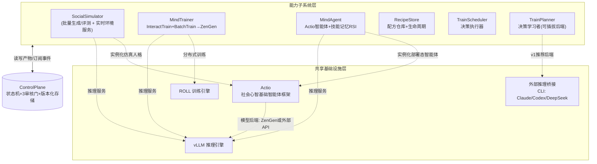
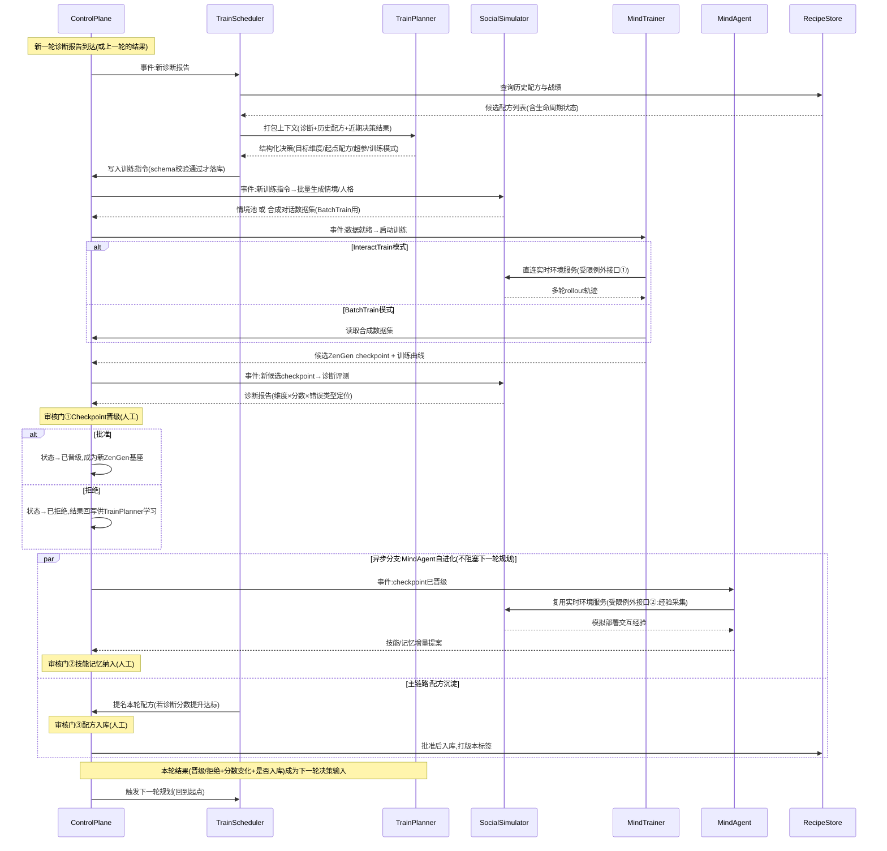

# Rise:AI驱动的社会心智后训练工厂 —— 总体架构设计

- **状态**:已完成总体架构与子系统设计,待用户审阅
- **日期**:2026-09-22
- **范围**:总体架构 + 七个子系统职责边界 + 端到端数据流。不包含任何子系统内部详细设计,不包含代码。

---

## 1. 背景与目标

Rise 是一套"AI驱动的社会心智后训练工厂"——一个 RSI(AI训练AI)风格的自进化训练系统,输入通用基础模型,输出社会心智能力大幅增强的模型(称为 **ZenGen** 模型)。

工厂需要覆盖四类核心能力:

1. **社会情境仿真模拟**:情境生成、各类人格模拟、社会心智训练数据合成、交互式训练支持、交互式动态评测
2. **RSI 社会心智后训练**:三条子路径——
   - 交互式多轮训练(在仿真环境中进行多轮交互,更新模型参数)
   - 传统单轮后训练(自动合成训练数据,走 SFT/GRPO/OPD 更新模型参数)
   - 不改模型参数,通过自我进化 skills/prompt/记忆提升智能体社会心智能力
3. **智能体技能、记忆 RSI**:部署态智能体的运行时自我进化(不改权重)
4. **有效训练方案沉淀为可复用模板**:将验证有效的完整训练配方(情境参数+奖励设计+训练超参+评测标准)版本化、可检索、可复用;v2支持配方跨工厂实例导入导出

此外,"RSI"在本项目中不是狭义的"被训练模型自主决策训练自己",而是更广义的"用AI决策训练过程"——**允许调用外部更强大的闭源模型(通过 CLI 方式,如 Claude Code、Codex、DeepSeek harness)来决策每一轮的训练策略与数据合成方向**,这是工厂"元认知自进化"的核心机制。

## 2. v1 范围与关键架构决策

在设计过程中确认的关键约束,决定了本架构的整体形态:

| 决策项 | 结论 | 影响 |
|---|---|---|
| v1 定位 | **研究原型**:先在单一社会心智能力维度上跑通"仿真生成数据→RSI训练→评测→技能记忆RSI→沉淀模板"的完整闭环,子系统轻量可替换 | 不做多租户运行时(隔离/调度/鉴权)、不做生产SLA;架构追求闭环完整性而非规模化。**但v2多租户/配方跨工厂流通/数据迁移已是既定目标,v1须付四项低成本"扩展性税"(数据结构预留),见子系统设计文档补充 F** |
| 基础模型访问方式 | **开源权重模型**,支持全参数/LoRA微调、GRPO/PPO等权重级RL训练 | 权重级训练引擎(MindTrainer)可以真实存在并落地 |
| "智能体技能/记忆RSI"范围 | **两条独立的RSI循环都要**:① 部署态智能体的技能/记忆自进化(MindAgent)② 工厂自身的训练决策能力自进化(TrainPlanner) | 产生七子系统中的两条对称RSI循环,而非合并为一个 |
| 开源组件复用策略 | **只复用底层基础设施,业务逻辑自建**(仿真环境、奖励设计、评测基准等业务逻辑不直接套用SOTOPIA/Concordia/verl等项目代码,而是自建;分布式训练/推理框架复用成熟开源库) | 决定了"共享基础设施层"与"能力子系统层"的分层 |
| 人工审核 | **关键决策点设人工审核门**,其余环节全自动 | 产生ControlPlane承载的三个审核门机制 |
| RSI决策后端 | **可插拔,v1推荐外部CLI强模型**(Claude/Codex/DeepSeek harness),而非要求被训练模型零外部信号自举决策 | TrainPlanner的核心设计前提,决定了它不产出持久化策略权重,输出限定为结构化决策 |
| 智能体基础设施 | SocialSimulator 与 MindAgent 共用同一套社会心智基础智能体框架 **Actio**(技能库+显式记忆+人格实例化+模型后端抽象),模型后端可为自部署 ZenGen 或外部API | Actio 被提升为共享基础设施层组件,而非挂在单一子系统下 |
| 训练/推理基础设施 | 训练框架用 **ROLL**,推理用 **vLLM**,归入共享基础设施层 | 明确基础设施层的具体技术选型 |

## 3. 总体架构

Rise 由**七个能力子系统**、**一个协调层(ControlPlane)**、**一个共享基础设施层**组成。子系统之间**不直接互相调用**,只通过 ControlPlane 读写数据和订阅状态变更事件——除两处经明确批准的高频受限例外直连接口。

**架构图**:[`docs/assets/rise-architecture.html`](../assets/rise-architecture.html) — 三层结构(能力子系统层 / 协调层 / 共享基础设施层)+ 两处受限例外接口 + 三道人工审核门,支持明暗双主题,在浏览器中打开查看。下方 Mermaid 版本作为终端/纯文本阅读场景的简化备份,信息量以 HTML 版本为准。

**架构核心原则**:
1. **松耦合**:子系统只依赖 ControlPlane 的数据格式约定,内部实现可独立替换、独立测试
2. **状态驱动**:所有子系统间协作通过 ControlPlane 的产物状态迁移触发,而非直接函数调用
3. **双层RSI对称性**:MindAgent(部署态智能体自进化)与 TrainPlanner(工厂决策能力自进化)是结构对称的两条独立RSI循环,都不碰模型权重,都向 ControlPlane 提交版本化产物,都受审核门约束
4. **受限例外明确且窄**:仅两处高频实时接口绕过 ControlPlane,且"是否启动该会话"仍完整走 ControlPlane 决策

## 4. 七个能力子系统

### 4.1 SocialSimulator

**职责**:社会情境与人格生成(支持自动生成 + 外部配置数据两路输入)、驱动多智能体交互合成对话数据、诊断式评测(标准化能力基准测试,产出维度×分数×错误类型定位的结构化报告)。

**内部结构**(两个独立部署单元,非对外可见的子系统划分,但需独立测试与独立扩容):
- **批量生成/评测模块**:异步、可以慢,负责情境批量合成、离线数据集生成、诊断评测
- **实时环境服务模块**:同步、低延迟、高频,专门服务 MindTrainer 的 InteractTrain rollout 调用和 MindAgent 的经验采集调用

**关键接口约定**:
- 环境服务接口必须显式接受"本轮每个角色由哪个模型后端驱动"参数(自博弈/冻结参考模型/外部API),由调用方(具体训练配方)指定,不由 SocialSimulator 内部写死
- MindAgent 的模拟部署交互**复用**实时环境服务模块的经验采集接口,不自建模拟能力
- 经验采集接口预留扩展点:未来可从"仅模拟"扩展到"模拟+真实生产交互日志"两路输入(v1不实现,仅保留接口可扩展性)

**依赖**:Actio(实例化仿真人格)、vLLM(推理服务)、可选调用外部推理桥接获取更有创意的情境生成。

### 4.2 MindTrainer

**职责**:权重级RSI训练引擎,两条训练路径,产出**候选ZenGen checkpoint**:

- **InteractTrain(在线交互式多轮训练)**:通过 SocialSimulator 实时环境服务接口做活rollout,被训练模型与对手角色(自身历史checkpoint/冻结参考模型/外部API,由配方指定)完整走多轮对话,采用逐句/逐决策点归因方式将回合级社会目标分数分解为细粒度奖励,GRPO更新权重
- **BatchTrain(传统单轮后训练)**:读取 SocialSimulator 批量合成的训练数据集,走 **SFT → GRPO → OPD**(在线蒸馏防遗忘约束)标准流水线

**明确边界**:MindTrainer 只负责权重级训练,不产出技能/记忆/prompt类的产物——"不改权重的智能体能力提升"完全由 MindAgent 独立负责,不是 MindTrainer 的第三条路径。

**依赖**:ROLL(分布式训练)、vLLM(rollout生成)、SocialSimulator 实时环境服务(受限例外直连接口①)。

### 4.3 MindAgent

**职责**:部署态社会心智智能体运行时RSI(技能库、prompt自进化、显式记忆),不改变模型权重。基于 Actio 实例化,模型后端可为最新晋级的 ZenGen checkpoint 或外部API。

**触发机制**:自主订阅 ControlPlane 的"checkpoint已晋级"事件,自动启动新一轮自进化循环,不由 TrainScheduler 主动调度——这是 MindAgent 作为独立子系统而非任务执行器的关键设计点。

**版本绑定策略(v1)**:始终对齐"当前最新晋级checkpoint"。新checkpoint晋级时,若MindAgent当前轮次尚未完成,直接中止重启。**已知的v2+优化方向**:若浪费的工作量在实践中显著,可升级为"标注版本+若基座已升级则降级为需重新验证"的更精细策略,v1不实现。

**经验来源**:模拟部署交互,复用 SocialSimulator 的实时环境服务(受限例外直连接口②,经验采集场景,逻辑上独立于MindTrainer的训练rollout场景)。**扩展点(v1不实现)**:未来可接入真实生产交互日志作为经验来源的第二路输入。

**产出**:技能/记忆增量提案,提交 ControlPlane 审核门②。

### 4.4 RecipeStore

**职责**:验证有效的完整训练配方的版本化仓库。一条配方包含:能力目标维度、情境生成参数、奖励函数配置、训练超参、评测标准与通过门槛、产出checkpoint引用、实验元数据(迭代轮次、效果曲线)。

**生命周期模型**:配方状态非单向追加,支持迁移(**有效 → 已废弃 → 被取代**)。当某配方关联的checkpoint被后续评测发现退化(如reward hacking)或评测基准本身被修订,对应配方状态需要能被更新,而非停留在过时的"有效"状态误导后续决策。

**耦合边界**:仅两个读写方——ControlPlane 写入(配方入库审核门批准后),TrainScheduler 查询(检索/对比/克隆变体)。RecipeStore **不主动拉取数据**,是被动响应式的存储与检索服务。

### 4.5 TrainScheduler

**职责**:决策执行器。订阅 ControlPlane 的关键事件(新诊断报告等),向 TrainPlanner 请求决策,校验返回结果的结构合法性,将决策转化为对 SocialSimulator/MindTrainer 的具体训练指令,写入 ControlPlane 触发下游流水线。

**明确的决策粒度划分**:
- **TrainScheduler自主执行**(TrainPlanner决策后自动落地):选择本轮训练维度、克隆哪条历史配方、调整超参变体
- **需人工审核**:提名配方入库(审核门③)
- **不介入**:SocialSimulator内部情境生成细节、MindAgent内部技能路由逻辑——这些是对应子系统的内部自主权

**与ControlPlane的分工**:ControlPlane只做无判断的状态广播("产物X状态变了"),TrainScheduler是众多订阅者之一,专门负责调用TrainPlanner做策略推理并落地为具体指令——两者不是重复建设。

### 4.6 TrainPlanner

**职责**:决策学习者,承载"工厂元认知RSI"循环——工厂自身的训练决策能力,应像模型权重、技能记忆一样是持续被改进、可评估好坏的独立能力,而非写死规则。

**决策后端可插拔设计**:
- **v1推荐后端**:调用外部CLI强模型(Claude Code / Codex / DeepSeek harness),将当前诊断分数、RecipeStore历史配方与战绩、近期决策结果打包为上下文,做一次agentic推理,返回下一步训练维度/配方/数据合成方向的结构化决策
- **备选后端**:轻量启发式/bandit策略,留给未来完全自动化、不依赖外部API的场景
- 两种后端下,TrainPlanner都不需要维护额外的元知识库——决策所需的历史效果数据完全来自RecipeStore

**输出边界(v1明确约束,避免过度设计)**:TrainPlanner的输出**限定在结构化决策/配置范围内**(选维度、选配方、调超参、给数据合成方向的具体指令),**不允许直接改写子系统实现代码**。这使得"沙箱化代码执行环境"这一复杂能力可以完全推迟到v2+,v1的ControlPlane只需对结构化输出做schema校验,不需要设计任何代码执行沙箱。

**可测试性设计**:内部必须拆分为两部分——"上下文打包与输出解析"(纯逻辑,可用固定fixture单测,验证prompt拼装与输出解析正确性)与"实际外部CLI调用"(测试时整体替换为可控mock/罐头响应)。这是保证核心决策逻辑可脱离外部服务被单测覆盖的关键设计。

### 4.7 ControlPlane

**职责**:全工厂唯一的协调层与共享数据底座。

**核心机制:产物状态机**。每类产物(情境数据、候选checkpoint、技能记忆增量、配方候选)都有明确状态迁移路径(如`待生成→已生成→待审核→已晋级/已拒绝→已归档`),状态变更即是触发下游子系统工作的信号。子系统只订阅自己关心的状态变更事件,不直接调用彼此——这是"子系统解耦"原则的具体实现机制。

**三个人工审核门**:
1. **Checkpoint晋级门**:MindTrainer候选checkpoint → 晋级为正式ZenGen基座
2. **技能/记忆增量纳入门**:MindAgent增量提案 → 纳入正式技能/记忆库
3. **配方入库门**:TrainScheduler配方提名 → 纳入RecipeStore

**审核结果不是死胡同**:被拒绝的checkpoint、未被提名的配方、被拒的技能提案,其结果都会被记录进对应产物的历史,构成TrainPlanner下一轮决策的输入信号——"没有改进"本身也是有价值的信号,不能被丢弃。

**结构化决策校验**:对TrainScheduler/TrainPlanner产出的结构化决策做schema校验,拒绝格式非法或越界的决策。

**安全边界(v1明确范围)**:因v1限定TrainPlanner输出为结构化决策而非可执行代码,ControlPlane**不需要**承担"未知代码安全执行"的沙箱能力——这部分能力被明确推迟到v2+(如果未来允许外部智能体直接改写pipeline代码,需要专门设计独立沙箱化执行环境,当前不需要为此设计任何东西)。

## 5. 共享基础设施层

四个组件为多个能力子系统共同依赖的执行底座,不属于任何单一子系统,也不承担ControlPlane式的协调职责:

| 组件 | 承载能力 | 使用方 |
|---|---|---|
| **Actio** | 社会心智基础智能体框架:技能库+显式记忆+人格实例化+模型后端抽象 | SocialSimulator(仿真人格实例化)、MindAgent(部署态智能体实例化) |
| **ROLL** | 分布式训练引擎 | MindTrainer(InteractTrain + BatchTrain) |
| **vLLM** | 推理引擎 | MindTrainer(rollout生成)、SocialSimulator(仿真人格模型驱动)、MindAgent(部署态智能体模型服务) |
| **外部推理桥接** | CLI方式调用Claude Code/Codex/DeepSeek harness等外部强模型 | TrainPlanner(v1推荐决策后端)、SocialSimulator(可选,创意情境生成) |

## 6. 端到端数据流

一次完整迭代按时间顺序:

### 6.1 六类关键产物

| 产物 | 产出方 | 消费方 | 状态迁移 |
|---|---|---|---|
| 训练指令 | TrainScheduler | SocialSimulator / MindTrainer | 待执行 → 已执行 |
| 情境池 / 合成数据集 | SocialSimulator | MindTrainer | 待训练 → 已消费 |
| 候选checkpoint | MindTrainer | SocialSimulator(评测) / 审核门① | 候选 → 已晋级 / 已拒绝 |
| 诊断报告 | SocialSimulator | TrainScheduler / 审核门① | 生成 → 已读取 |
| 技能/记忆增量提案 | MindAgent | 审核门② | 待审 → 已纳入 / 已拒绝 |
| 配方候选 / 配方 | TrainScheduler → RecipeStore | TrainScheduler(下轮查询) | 待审 → 有效 → (可能)已废弃 / 被取代 |

### 6.2 两处受限例外直连接口

在"子系统间不直接调用,只通过ControlPlane"的总原则下,开出两处窄而明确的例外,仅用于高频、低延迟的实时交互场景,不用于任何决策性操作:

- **接口①(MindTrainer ↔ SocialSimulator)**:InteractTrain模式的高频rollout调用。"是否启动该训练会话"仍完整走ControlPlane决策。
- **接口②(MindAgent ↔ SocialSimulator)**:MindAgent模拟部署交互的经验采集,复用同一实时环境服务,是逻辑上独立的调用场景。

### 6.3 异步并行原则

MindAgent的自进化循环与"配方沉淀→触发下一轮规划"是并行分支——checkpoint一晋级,下一轮TrainScheduler的规划即可基于新诊断报告立即启动,不等待MindAgent那一轮(通常更慢的)模拟部署经验积累完成。

## 7. 测试与开发策略

- **工厂模拟器优先**:搭建一套全轻量替身(stub)版本的集成测试环境——玩具情境、空训练步、罐头决策——先验证ControlPlane的状态机、审核门触发、数据流转等编排逻辑正确,再逐步替换为真实、昂贵的子系统实现。将"编排对不对"和"训练效果好不好"两类问题分开验证。
- **开发顺序建议**:第一轮端到端打通时,TrainPlanner/TrainScheduler的决策部分先人工写死(直接向ControlPlane写入"这轮练维度X、用配方Y"),优先验证主链路(SocialSimulator→MindTrainer→三道审核门→MindAgent)可跑通,再接入TrainPlanner的外部智能体调用,避免一开始就卡在最难测的环节。
- **TrainPlanner可测试性**:核心逻辑(上下文打包、输出解析)与外部CLI调用物理分离,前者可用固定fixture完全脱离外部服务单测。
- **ControlPlane优先级最高**:作为安全关键的协调层与审核门载体,应获得全工厂最高优先级的测试投入。
- **SocialSimulator内部两模块独立测试**:批量生成/评测模块与实时环境服务模块的非功能性需求(延迟、吞吐、可用性)完全不同,需要能分别压测、分别扩容,避免情境生成逻辑的改动影响正在运行的RL rollout服务稳定性。

## 8. 明确推迟到v2+的事项(v1非目标)

以下事项在设计中被有意识地排除在v1范围外,以避免过度设计,但接口留有扩展空间:

1. **MindAgent接入真实生产交互日志**:v1仅支持模拟部署经验,真实生产交互作为经验来源第二路输入留待v2+
2. **MindAgent的checkpoint版本绑定精细化策略**:v1采用简单的"始终对齐最新晋级版本,新版本到来即中止重启";若浪费工作量显著,v2+可升级为"标注版本+降级重验证"机制
3. **TrainPlanner直接改写子系统代码**:v1输出严格限定为结构化决策,不涉及代码级自我修改(Darwin Gödel Machine式的能力),因此也不需要设计沙箱化代码执行环境
4. **多租户/平台化调度**:v1为单团队单能力维度的研究原型,多租户的**运行时能力**(资源调度、租户隔离、鉴权访问控制)推迟到v2;但v2多租户已是既定演进目标,v1**必须预留数据归属维度**(产物信封 `created_by` 升格为 `{owner, visibility}`),因为归属信息无法事后补录。详见子系统设计文档补充 F.1
5. **有效配方跨工厂导入导出**:v2支持把沉淀的有效配方导出、导入到另一工厂实例复用;v1只需保证配方引用自描述、预留 `fetch_hint` 字段,不实现导入导出CLI。详见子系统设计文档补充 F.2
6. **数据结构升级迁移**:v2随系统演进产物结构会变,历史数据须能被平滑迁移;v1必须为每个产物信封加 `schema_version`、读取路径走"迁移器链(v1为空)后再消费"的结构——这是所有迁移能力的地基,事后无法补。详见子系统设计文档补充 F.3
7. **决策策略的持久化版本管理**:若TrainPlanner未来更换为自训练策略后端(而非外部CLI调用),需要为其产出的策略版本重新设计审核门,v1因后端是无状态的实时调用而不需要
8. **图形界面/看板**:v1人机交互为纯CLI(审核门、调和、可观测命令),不做Web界面,也不引入独立监控看板;v2服务化后同一套命令语义可包一层界面。详见子系统设计文档补充 G.1

## 9. 子系统命名参考

| 子系统 | 英文名 | 一句话职责 |
|---|---|---|
| ① | **SocialSimulator** | 情境/人格生成+多智能体仿真+诊断评测 |
| ② | **MindTrainer** | 权重级RSI训练引擎(InteractTrain+BatchTrain)→ZenGen |
| ③ | **MindAgent** | 部署态智能体运行时+技能记忆RSI |
| ④ | **RecipeStore** | 验证配方版本化仓库 |
| ⑤ | **TrainScheduler** | 决策执行器 |
| ⑥ | **TrainPlanner** | 决策学习者(工厂元认知RSI) |
| ⑦ | **ControlPlane** | 状态机+审核门+版本化存储 |

共享基础设施:**Actio**(智能体框架)、**ROLL**(训练引擎)、**vLLM**(推理引擎)、**外部推理桥接**(CLI强模型调用)。

工厂整体产出物模型代称:**ZenGen**。

---

## 附:本设计的调研基础

本架构设计建立在对以下开源RSI系统与前沿研究的调研基础上(详见对话历史):

- **训练类RSI机制参考**:R-Zero(Challenger-Solver协同进化)、Absolute Zero Reasoner(proposer-solver统一模型+可插拔内在奖励)、Sotopia-π/Sotopia-RL(行为克隆+自我强化、话语级归因奖励+GRPO)、SEAL(自生成数据+自生成更新指令)
- **社会心智工程化参考**:中科院"知境"体系(SoMBench诊断评测→Zing两阶段训练+OPD防遗忘→Actio运行时部署的完整链路)
- **代码级自我改进参考**:Darwin Gödel Machine谱系(自我修改代码+Docker sandbox隔离的设计先例,是v1明确不采用但保留认知的方向)
- **治理与安全参考**:Anthropic《When AI builds itself》(人工审核瓶颈警示、可验证协调机制建议)
