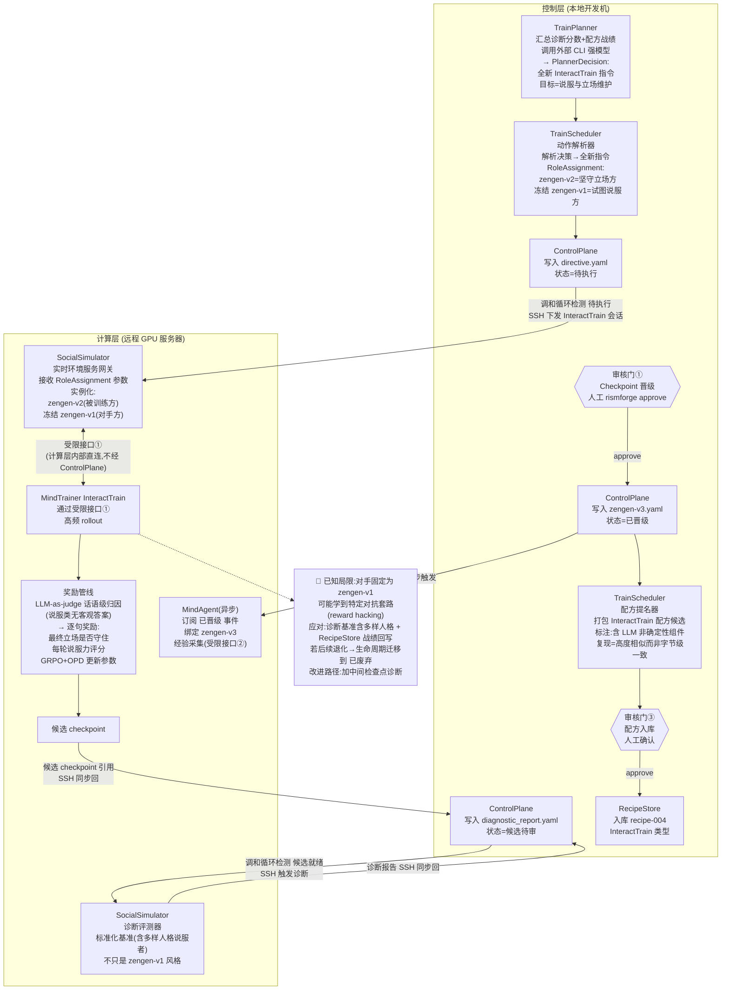
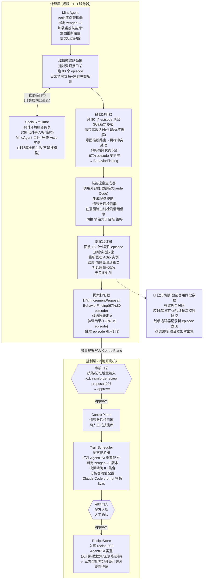

# RismForge:七个子系统详细设计

- **状态**:待用户审阅
- **日期**:2026-09-24
- **前置文档**:`2026-09-22-rismforge-architecture-design.md`(总体架构)
- **范围**:七个能力子系统的内部模块划分、数据模型、模块间协作方式。不包含字段级schema、算法伪代码、任何代码实现。

---

## 补充:部署拓扑

七个子系统按是否需要 GPU 计算,分为两层:

| 层 | 子系统 | v1 运行位置 | v2 演进 |
|---|---|---|---|
| **控制层** | ControlPlane、TrainScheduler、TrainPlanner、RecipeStore | 本地开发机(Mac/Windows/WSL) | 迁移到统一服务器,本地降级为CLI客户端 |
| **计算层** | MindTrainer、SocialSimulator(批量+实时)、MindAgent | 远程GPU服务器,由控制层经SSH调度 | 服务器上的资源池,调度方由服务器端发起 |

**关键推论**:两处受限例外直连接口(接口①MindTrainer↔SocialSimulator、接口②MindAgent↔SocialSimulator)发生在**计算层内部**,不跨越SSH隧道——控制层只负责"发起一次训练/评测会话"这个决策性动作,会话建立后计算层内部子系统直接互联,不再回头经过ControlPlane。

TrainPlanner 调用外部CLI强模型的逻辑运行在**控制层**——CLI凭证、网络出口通常绑定在本地开发机上。

---

## 1. ControlPlane

### 1.1 架构选型

**Git版本化文件树(元数据唯一真相) + 可重建的SQLite索引(查询加速) + SSH(控制层↔计算层传输)**

- 元数据(产物状态、审核记录、训练指令、诊断报告、配方定义等结构化小文件)存为 git 追踪的目录树
- 大体量产物(checkpoint、训练数据集)留在计算层文件系统,git树里只存路径引用+sha256校验
- SQLite是从git树派生的可随时重建的缓存,服务RecipeStore的结构化查询,源真相始终是git树
- SSH承担控制层→计算层的任务下发和产物引用同步,认证方式(账密/免密SSH key)可配置

### 1.2 目录结构

```
control-plane/                              # git仓库根
├── runs/                                   # 每轮迭代的运行记录
│   └── run-<id>/
│       ├── manifest.yaml                   # 本轮元信息:目标维度、触发时间、当前状态
│       ├── directive.yaml                  # TrainScheduler写入的训练指令
│       ├── scenario_ref.yaml               # 情境池/数据集的引用(路径+sha256)
│       ├── checkpoint_candidate.yaml       # 候选checkpoint引用+训练曲线摘要
│       ├── diagnostic_report.yaml          # 诊断报告(维度×分数×错误定位)
│       ├── gate_checkpoint_promotion.yaml  # 审核门①记录
│       └── outcome.yaml                    # 本轮结果摘要,供下一轮决策读取
├── recipes/                                # RecipeStore的存储子树(读写权限按约定隔离)
│   └── recipe-<id>/
│       ├── recipe.yaml                     # 完整配方快照(三种类型之一)
│       ├── lineage.yaml                    # 生命周期状态迁移历史
│       └── track_record.yaml              # 历次复用效果回写记录
├── skill_memory_proposals/                 # MindAgent提交的增量提案
│   └── proposal-<id>/
│       ├── proposal.yaml
│       └── gate_skill_inclusion.yaml       # 审核门②记录
├── models/                                 # 已晋级ZenGen版本历史(仅引用)
│   └── zengen-v<N>.yaml
├── compute/
│   └── endpoints.yaml                      # 远程GPU服务器连接配置
└── index.sqlite                            # 从文件树重建的查询索引(.gitignore排除)
```

**注**:`recipes/` 子树物理上与 ControlPlane 其他产物同在一个 git 仓库,但读写权限按子树约定隔离——只有 ControlPlane(审核门③批准后)和 RecipeStore 自身被允许写该子树,其他子系统不写。

### 1.3 产物状态机

**需审核类产物**(checkpoint候选 / 技能记忆提案 / 配方候选):

```
草稿 → 待审 → 已批准 → 已生效 → (已废弃 | 被取代)
              ↓
            已拒绝 [保留记录,不删除]
```

**非审核类产物**(训练指令 / 情境池 / 诊断报告):

```
待执行 → 已执行 → 已消费
  ↓
 失败 [SSH超时/远程任务异常,保留记录]
```

**已拒绝/失败保留原则**:两类负面状态均保留在git历史中,`outcome.yaml` 汇总时包含这些负面信号,构成 TrainPlanner 下一轮决策的输入,不可丢弃。

### 1.4 事件分发:状态调和循环

采用类Kubernetes controller的**调和循环(Reconciliation Loop)**,运行在控制层:

1. 扫描git树(文件监听或轮询),比对当前状态与期望状态
2. 发现"directive=待执行" → 通过SSH向计算层下发任务
3. 发现"candidate=待审" → 等待人工CLI命令(`rismforge approve/reject <id>`)
4. 任务运行完毕 → 产物/结果经SSH同步回git树,状态更新

**幂等可恢复**:调和循环进程崩溃重启、SSH连接中断后,下次扫描重新评估当前git树状态并正确续接,不丢事件,不重复执行已完成动作。

### 1.5 三个审核门(统一交互流程,以门①为例)

1. 调和循环检测到候选产物"待审"且依赖产物已就位,停止等待人工命令
2. 人工执行 `rismforge review <id>` — CLI读取产物+对比摘要打印
3. 人工执行 `rismforge approve/reject <id> [--reason "..."]` — 修改状态字段,提交git commit
4. 调和循环下次扫描读到新状态,执行后续动作

**v2升级路径**:CLI从"直接读本地文件"改为"通过RPC问远程ControlPlane服务",交互命令不变。

### 1.6 产物通用信封

所有产物文件遵循通用字段:
- 标识:`id / type / version / created_at / created_by`
- 状态:`status`(对应状态机)
- 溯源:`links` — 引用产出它的上游产物id(任一ZenGen版本都能沿links追溯到配方/决策/数据)
- 大体量引用:`{uri, sha256, size_bytes}` — 不将二进制放入git树

### 1.7 可测试性

调和循环核心逻辑(给定git树状态→决定下一步动作)是纯函数式的——测试时构造fixture形式的git树状态,断言下一步动作,完全不需要真实SSH/GPU/子系统。

---

## 2. SocialSimulator

### 2.1 内部模块划分

```
┌─────────────────────────────────────────────────────────┐
│ 批量生成/评测模块(异步,计算层)                           │
│  情境生成器 ─┐                                           │
│  人格生成器 ─┤→ [共享核心:仿真执行器(Simulation Runner)] │
│  诊断评测器 ←┘      ↑                                    │
│  打分器(规则式/LLM) ─┘                                   │
├─────────────────────────────────────────────────────────┤
│ 实时环境服务模块(同步,低延迟,计算层)                     │
│  环境服务网关 ─→ [同一套Simulation Runner的实时包装]      │
│    ├─ 受限接口①:MindTrainer rollout调用                  │
│    ├─ 受限接口②:MindAgent 经验采集调用                   │
│    └─ 开发者工具接口:人工CLI交互式调试观察(非流水线)       │
└─────────────────────────────────────────────────────────┘
```

**批量模块与实时服务模块共享同一个 Simulation Runner 核心**,只是外面包了两种调用方式——批量模块异步落盘,实时服务网关维持单次会话的多步状态并同步响应。

### 2.2 各模块职责

**情境生成器**:生成社会情境(场景背景、角色关系结构、核心冲突/目标设定、社会规范约束)。支持两路输入:
- 自动生成(后端可插拔:内部模板参数化,或调用外部推理桥接做更有创意的生成)
- 外部配置数据(读取人工预置的情境定义)

两路输入产出格式一致,下游 Simulation Runner 不关心情境从哪来。

**人格生成器**:生成人格模板(性格特质、背景动机、说话风格、价值观/目标倾向)。同样支持自动生成+外部配置两路输入,后端可插拔。

**诊断评测器**:加载候选checkpoint,跑标准化多维度细粒度诊断基准,产出结构化诊断报告。依赖独立的**打分器**子模块(规则式打分用于有客观答案的题目;LLM-as-judge用于开放式社会交互题目),打分器质量是诊断报告质量的关键。

**环境服务网关**:对外暴露三类调用场景——MindTrainer rollout(受限接口①)、MindAgent经验采集(受限接口②)、以及开发者工具接口(人工CLI直接发起交互式会话,实时观察模型表现,不产出标准化诊断报告,仅用于开发迭代调试,不是流水线的一环)。

**关键接口约定**:环境服务接口必须显式接受"本轮每个角色由哪个模型后端驱动"参数(自博弈/冻结参考模型/外部API),由调用方(具体训练配方)指定,不由 SocialSimulator 内部写死。

### 2.3 数据模型

| 实体 | 概念内容 | 关键设计点 |
|---|---|---|
| **Persona(人格模板)** | 性格特质、背景动机、说话风格、价值观/目标倾向、来源标记 | 与Scenario完全解耦,可自由组合 |
| **Scenario(社会情境)** | 场景背景、角色关系结构、核心冲突/目标设定、社会规范约束、来源标记、**purpose标记**(training/deployment_simulation) | purpose标记决定倾向的难度分布和多样性要求 |
| **RoleAssignment(角色分配)** | 把Scenario里的抽象角色位绑定到具体Persona+具体模型后端 | Recipe的"情境生成参数"实际指定的内容;环境服务接口"角色-模型后端映射"参数的落地位置 |
| **Episode(对话轨迹)** | 一次完整多轮交互记录:每轮的角色、话语、可选内部推理过程 | BatchTrain的训练数据来源;诊断评测的中间产物 |
| **DiagnosticReport(诊断报告)** | 维度×分数×错误类型定位的结构化报告 | 交给ControlPlane供TrainScheduler决策的关键产物 |

**Persona与Scenario解耦的意义**:两者通过RoleAssignment自由组合,多样性防护机制(BLEU聚类惩罚、多样性奖励)可以分别在Persona维度和Scenario维度独立计算。

**关于情境/人格模板层的复用策略**:SocialSimulator只维护一套模板池。MindTrainer(训练rollout)和MindAgent(经验采集)都从同一个模板池中按各自的筛选条件选取模板;Episode层(实际的逐轮对话内容)永远实时生成,任何已存在的Episode不可被替代一次新的live会话。

### 2.4 可测试性

批量模块与实时服务模块因非功能性需求完全不同(异步批量 vs 同步低延迟),需要分别压测、分别扩容,互相隔离。情境生成器、人格生成器、打分器均可独立fixture测试。

---

## 3. MindTrainer

### 3.1 内部模块划分

```
                 ┌─────────────────────────────────────────┐
                 │         Trajectory Source               │
                 │  ┌─────────────────┐                   │
                 │  │ InteractTrain   │← 受限接口①         │
                 │  │ (在线多轮RL)    │→ SocialSimulator   │
                 │  └────────┬────────┘                   │
                 │           │ TrajectoryBatch             │
                 │  ┌────────┴────────┐                   │
                 │  │  BatchTrain     │← ControlPlane      │
                 │  │  (读合成数据集)  │  (已有数据集)       │
                 │  └────────┬────────┘                   │
                 └───────────┼─────────────────────────────┘
                             ↓ TrajectoryBatch(统一格式)
                     ┌───────────────┐
                     │  奖励管线      │
                     │  归因阶段      │
                     │  组合阶段      │
                     └───────┬───────┘
                             ↓ RewardedTrajectory
                     ┌───────────────┐
                     │  训练执行器    │
                     │  SFT冷启动    │← ROLL
                     │  GRPO+OPD联合 │
                     └───────┬───────┘
                             ↓
                     ┌───────────────┐
                     │ Checkpoint管理器│
                     │ 格式转换+注册  │→ ControlPlane
                     └───────────────┘
```

**核心设计原则**:两种训练模式的差异被收窄到 Trajectory Source 这一个模块的两种实现里,奖励管线、训练执行器、checkpoint管理器完全共享、模式无关。

### 3.2 各模块职责

**Trajectory Source**:抽象"rollout从哪来",两种实现:
- **InteractTrain实现**:作为客户端调用 SocialSimulator 实时环境服务网关(受限接口①),内含角色-模型后端解析逻辑,根据Recipe的RoleAssignment配置决定每个角色由谁驱动
- **BatchTrain实现**:从 ControlPlane 读取 SocialSimulator 批量合成的 Episode 数据集

两种实现产出统一格式的 **TrajectoryBatch**,下游模块不关心轨迹来源。

**奖励管线**:两阶段,由Recipe配置驱动:
- **归因阶段**:把回合级/目标级信号分解到逐句/逐决策点的细粒度奖励(可调用LLM或专门的奖励模型做归因)
- **组合阶段**:按Recipe指定的组合方式(求和/相乘等)合成最终奖励

**训练执行器**:运行在ROLL上。冷启动阶段跑SFT,主训练阶段跑**GRPO+OPD联合更新**:
- GRPO负责策略梯度更新(探索新能力)
- OPD在同一批轨迹上同步施加教师分布约束(防止偏离已验证的推理模式)
- 两者作用在同一次训练step里,不是先后阶段

**Checkpoint管理器**:处理ROLL训练格式与vLLM/HuggingFace推理格式之间的转换,把候选checkpoint连同训练曲线摘要按ControlPlane产物schema信封注册。

**明确边界**:MindTrainer只负责权重级训练,不产出技能/记忆/prompt类产物——"不改权重的智能体能力提升"完全由MindAgent独立负责。

### 3.3 数据模型

| 实体 | 概念内容 |
|---|---|
| **TrainingDirective(训练指令)** | 模式选择(InteractTrain/BatchTrain)、目标维度、Recipe引用、起始checkpoint |
| **TrajectoryBatch(轨迹批次)** | 统一格式的多轮交互序列,不区分来源 |
| **RewardedTrajectory(带奖励轨迹)** | TrajectoryBatch + 逐句归因奖励 + 组合后的最终奖励 |
| **TrainingRun(训练运行记录)** | 阶段进度、中间checkpoint、断点恢复所需状态(内部记账) |
| **CandidateCheckpoint(候选checkpoint)** | 引用+训练曲线摘要+links回对应Directive/Recipe |

### 3.4 可测试性

奖励管线和训练执行器可用合成的TrajectoryBatch fixture独立测试(不需要真实ROLL/GPU)。两种Trajectory Source实现可分别独立测试(InteractTrain实现可mock SocialSimulator响应)。

---

## 4. MindAgent

### 4.1 内部模块划分

```
ControlPlane("checkpoint已晋级"事件)
       ↓ 自主订阅,自动触发
┌──────────────────┐
│ Actio实例管理器   │  绑定最新晋级checkpoint + 当前技能/记忆库状态
│ (新版本到来→中止重启)│
└────────┬─────────┘
         ↓
┌──────────────────┐
│ 模拟部署驱动器   │──→ 受限接口②: SocialSimulator实时环境服务网关
└────────┬─────────┘    (MindAgent自身角色由完整Actio实例扮演,
         ↓              SocialSimulator提供对手人格)
┌──────────────────┐
│ 经验分析器       │  跨episode聚合,识别行为模式/能力缺口
│ (不基于单一个案)  │
└────────┬─────────┘
    ┌────┴────┐
    ↓         ↓
┌───────┐ ┌────────┐
│技能   │ │记忆增量│  (技能提案生成可选调用外部推理桥接)
│提案   │ │生成器  │
│生成器 │ └───┬────┘
└───┬───┘     │
    └────┬────┘
         ↓
┌──────────────────┐
│ 提案验证器       │  回放motivating episodes + 加载候选增量
│                  │  验证是否真的带来行为改善
└────────┬─────────┘
         ↓
┌──────────────────┐
│ 提案打包器       │  打包为标准化IncrementProposal
│                  │  links回BehaviorFinding与episode证据
└────────┬─────────┘
         ↓
    ControlPlane(审核门②)
```

### 4.2 各模块职责

**Actio实例管理器**:管理活跃Actio智能体实例生命周期。MindAgent的Actio实例是**长期存活**的(跨多个episode持续积累经验),与SocialSimulator里**单个episode即用即弃**的仿真人格语义不同——两者共用同一套Actio基础设施但生命周期语义不同。

**触发机制**:MindAgent自主订阅ControlPlane的"checkpoint已晋级"事件自动启动——不由TrainScheduler主动调度。

**版本绑定策略(v1)**:始终对齐最新晋级checkpoint;新版本晋级时当前轮次直接中止重启。已知的v2+优化方向:若浪费工作量显著,可升级为"标注版本+降级为需重新验证"的精细策略。

**模拟部署驱动器**:驱动一批部署交互episode。通过受限接口②调用SocialSimulator实时环境服务网关。调用时MindAgent自身角色由**完整Actio实例**(技能库+显式记忆+路由逻辑全部生效)扮演,不是裸模型——这是观察技能/记忆脚手架表现的必要条件。SocialSimulator提供对手人格(临时实例化的仿真人格)。

**经验来源(扩展点,v1不实现)**:当前仅"模拟部署交互";未来可扩展为"模拟+真实生产交互日志"两路输入,接口预留可扩展性。

**经验分析器**:跨多个episode聚合分析,识别具体行为模式或能力缺口。**核心原则:发现必须基于跨episode的聚合模式,不基于单一个案**——避免把噪声当成信号提案。

**技能提案生成器/记忆增量生成器**:基于行为发现,分别提出候选技能库变更和记忆库变更。技能提案生成器可选调用外部推理桥接辅助合成(与SocialSimulator的情境生成、TrainPlanner的决策后端遵循同一"后端可插拔"设计原则)。

**提案验证器**:打包提交前,回放当初触发提案的episodes,加载候选增量,验证是否确实改善行为。"先自证有实证支持,再提交人工把关"的原则——降低送到审核门的低质量提案比例。

**提案打包器**:打包为标准化IncrementProposal,links回BehaviorFinding与episode证据,提交ControlPlane审核门②。

### 4.3 数据模型

| 实体 | 概念内容 |
|---|---|
| **AgentInstance(智能体实例)** | 绑定的ZenGen版本、当前技能记忆库版本、实例生命周期状态(长期存活) |
| **InteractionEpisode(部署交互记录)** | 格式与SocialSimulator的Episode一致;purpose标记为deployment_simulation |
| **BehaviorFinding(行为发现)** | 跨episode聚合识别的具体行为模式/能力缺口(不基于单一个案) |
| **SkillIncrementProposal / MemoryIncrementProposal** | 经提案验证器验证前的候选状态 |
| **IncrementProposal(增量提案)** | 提交ControlPlane的顶层产物;links回BehaviorFinding与motivating episodes |

### 4.4 与SocialSimulator的交互关系澄清

- 交互路径:唯一一条——MindAgent作为客户端调用受限接口②
- 复用层次:复用**模板层**(情境/人格模板从共享模板池按purpose标记筛选);不复用**episode层**(对话内容永远实时生成,不可替代一次live会话)
- 调用目的:经验采集(观察Actio脚手架表现),与MindTrainer的训练rollout目的不同,数据流完全隔离

---

## 5. RecipeStore

### 5.1 三种配方类型

RecipeStore存储的配方按对应的训练路径分三种类型。每种类型有各自需要精确锚定的内容,以保证可复现性:

| | **BatchTrain配方** | **InteractTrain配方** | **AgentRSI配方** |
|---|---|---|---|
| 对应路径 | SFT→GRPO+OPD多阶段静态后训练 | 在线多轮交互式RL训练 | 不改权重的技能/记忆自进化 |
| 精确数据 | 每阶段Episode数据集引用(sha256锚定) | 情境/人格模板精确ID集合+RoleAssignment | 模拟部署会话用到的模板精确ID集合+绑定的ZenGen checkpoint版本 |
| 精确配置 | 每阶段超参(学习率/batch size/步数/OPD约束系数等) | 在线RL循环超参(rollout episode数、GRPO设置等) | 经验分析器的显著性阈值、提案验证器的通过标准、episode批次规模 |
| 精确代码 | Training Executor+Reward Pipeline的确切版本(commit哈希) | Trajectory Source的InteractTrain实现+Reward Pipeline的确切版本 | 技能/记忆生成器的确切版本+外部推理桥接的精确prompt模板版本(若使用) |
| 产出引用 | 候选checkpoint | 候选checkpoint | 技能/记忆增量提案 |

**三类共享的通用信封**:能力目标维度、评测标准与通过门槛(精确版本锚定)、生命周期状态、战绩记录、实验元数据。

**InteractTrain配方的复现限制**:由于LLM推理服务的非确定性(采样、批处理调度等),即使把种子/模板ID/代码版本全部锚定,也无法保证字节级完全一致的复现结果。"可复现"对InteractTrain配方应理解为"忠实重放同一套设置,得到高度相似的实验",而非"保证完全相同的输出"。

**工程前提**:精确锚定训练代码版本,要求 MindTrainer 和 MindAgent 各自的内部逻辑走标准版本控制(git commit哈希可引用)——这是 MindTrainer/MindAgent 的工程责任,RecipeStore 只负责存储该引用。

### 5.2 内部模块划分

```
ControlPlane(审核门③批准) → 可复现性校验器 → 配方存储管理器
ControlPlane(轮次结果回写) ──────────────────→ 配方存储管理器
                                                     ↓
                                           ┌─────────┴────────┐
                                           ↓                   ↓
                                     生命周期管理器         战绩追踪器
                                           ↓                   ↓
                                           └─────────┬────────┘
                                                     ↓
                                               检索引擎
                                                     ↓
                                           TrainScheduler(查询)
```

**可复现性校验器**:配方候选写入前,检查每一项引用是否已锚定为精确值/ID,而非会随时间漂移的软引用(如"当前最优配方"这类相对引用)。校验不一定是强制硬拒绝——可作为审核门③人工审核时的参考信息。按配方类型分别校验(三种类型该锚定的字段不同)。

**配方存储管理器**:`recipes/` 子树实际读写。所有写入只来自两个触发源:审核门③批准的新配方入库,或某轮迭代结果对已有配方的回写。RecipeStore不主动发起任何写入。

**生命周期管理器**:维护配方状态迁移(有效→已废弃→被取代)。触发条件:新配方入库时初始为"有效";后续回写显示关联checkpoint退化或被更优配方替代时推进迁移。

**战绩追踪器**:每次某条配方被克隆复用后,把该次结果(所属run、诊断分数变化、是否晋级)累积进战绩记录——这是TrainPlanner决策依赖的"历史效果数据"的实际来源。

**检索引擎**:服务TrainScheduler的三类查询:
- 按能力维度检索(可附加生命周期状态筛选、按配方类型筛选、按战绩排序)
- 对比两条配方(配置差异+战绩对比)
- 取完整定义供克隆(原样返回完整定义,参数扰动由TrainScheduler负责)

**边界**:克隆操作产生的"新草案"不是RecipeStore内部的对象——检索引擎只返回原始定义,新草案的构造发生在TrainScheduler侧。RecipeStore维持"只有两个读写方"的边界。

### 5.3 数据模型

| 实体 | 概念内容 |
|---|---|
| **Recipe(配方)** | 三种类型之一的完整配方快照(含上述各类型所需的精确锚定内容+通用信封) |
| **RecipeLineage(生命周期记录)** | 状态迁移历史,每次迁移的触发原因、时间、触发方 |
| **TrackRecordEntry(战绩记录条目)** | 某次复用/克隆该配方产生的具体结果:所属run、诊断分数变化、是否晋级/入库 |

---

## 6. TrainScheduler

### 6.1 内部模块划分

```
ControlPlane(新诊断报告触发)
       ↓
上下文汇编器 → (查询RecipeStore)
       ↓ PlanningContext
决策请求器 ←→ TrainPlanner
       ↓ PlannerDecision
决策校验器 → (不通过→重试决策请求器)
       ↓
动作解析器 → [全新指令 / 克隆扰动 / 精确复现]
       ↓ ResolvedAction
指令构造器 → ControlPlane(写入TrainingDirective)

ControlPlane(轮次结果事件)
       ↓
配方提名器 → ControlPlane(审核门③)
```

### 6.2 各模块职责

**上下文汇编器**:响应触发事件,把当前诊断报告、从RecipeStore按维度查到的相关配方(含战绩)、近期决策结果历史,汇总打包成PlanningContext。只做收集,不做判断。

**TrainScheduler自身无状态**:决策所需的全部"记忆"外置——近期决策结果在ControlPlane的run历史里,配方长期战绩在RecipeStore里。上下文汇编器每次现读现汇总,TrainScheduler崩溃重启后从git树即可完整恢复。

**决策请求器**:把PlanningContext交给TrainPlanner,拿到PlannerDecision。薄模块,推理复杂度留在TrainPlanner内部。

**决策校验器**:对PlannerDecision做校验——不只是通用schema格式检查,更重要的是**领域有效性校验**:
- 指名克隆的配方id是否真实存在
- 该配方是否处于可用的生命周期状态(不能克隆"已废弃"的配方)
校验不通过则退回决策请求器重试,不硬失败。

**动作解析器**:把通过校验的决策解析成三种具体动作之一:
- **全新指令**:TrainPlanner直接给出的新参数,不依赖已有配方
- **克隆扰动指令**:取某条已有配方,在其基础上做参数扰动
- **精确复现指令**:取某条已有配方,原样锚定值不做任何扰动

**指令构造器**:构造正式TrainingDirective写入ControlPlane。**只构造BatchTrain或InteractTrain类型的指令**,不构造AgentRSI类型——MindAgent是自主订阅事件、自己触发的,TrainScheduler从不主动派发MindAgent的工作。

**配方提名器**:独立于主流程的动作,监听轮次结果事件(包括MindTrainer和MindAgent两种来源),达到入库标准时打包对应类型(包括AgentRSI类型)的配方候选提交审核门③。TrainScheduler是三种配方类型统一的提名入口——MindAgent不直接写RecipeStore,RecipeStore"只有两个读写方"的边界得以保持。

### 6.3 指令确认模式(人在环路)

在训练指令的状态机里加一个可配置的"待确认"状态:
- **手动模式**:TrainScheduler构造的指令进入"待确认"状态,人工执行 `rismforge confirm <directive-id>` 后才进入"待执行"
- **自动模式**:跳过"待确认"状态,信任建立后切换

另外,人工随时可以绕过TrainPlanner直接向ControlPlane写入指令——作为最强的人工干预手段(开发策略中"第一轮打通时决策人工写死"就是这个路径,它是正式能力而非临时脚手架)。

### 6.4 数据模型

| 实体 | 概念内容 |
|---|---|
| **PlanningContext(规划上下文)** | 当前诊断报告+相关配方查询结果+近期决策结果历史 |
| **PlannerDecision(决策结果)** | 目标维度、动作类型、源配方引用(若克隆/复现)、建议扰动参数(若克隆) |
| **ResolvedAction(已解析动作)** | 完整指定的指令内容 |
| **RecipeNomination(配方提名候选)** | 三类型配方候选之一,提交审核门③前的形态 |

### 6.5 可测试性

决策校验器和动作解析器可用合成的PlannerDecision fixture独立测试——不需要真实调用TrainPlanner。与TrainPlanner的"上下文打包解析与外部CLI调用物理分离"设计正好衔接:两边各自可独立测试,拼起来才需要一次真实端到端集成测试。

---

## 7. TrainPlanner

### 7.1 内部模块划分

```
TrainScheduler(PlanningContext)
       ↓
上下文打包器 → (套用版本化Prompt模板)
       ↓ PackedContext
决策后端适配层(可插拔)
  ├─ 外部强模型后端(v1推荐)
  │   └─ 经外部推理桥接(同时支持CLI进程和API两种形态)
  └─ 启发式/bandit后端(备选)
       ↓ 后端原始输出
输出解析器 → (严格结构校验,失败则重试有限次数)
       ↓ PlannerDecision + DecisionRationale
TrainScheduler
```

### 7.2 各模块职责

**上下文打包器**:把PlanningContext套入**版本化的Prompt模板**,渲染成交给后端的完整输入。Prompt模板必须版本化管理——它实质上是TrainPlanner的"决策代码",每个决策产物都记录它用的是哪个版本的模板,以保证决策质量的可追溯性。

**v2+ 的自然延伸(现在只留认知,不设计)**:让工厂自己实验和改进Planner的prompt模板,这将是元认知RSI的更深一层。

**决策后端适配层**:可插拔接口,两个实现:
- **外部强模型后端(v1推荐)**:经共享基础设施的外部推理桥接调用(CLI进程方式或API方式均支持,凭证和调用形态的差异被桥接层吸收,TrainPlanner不感知)
- **启发式/bandit备选后端**:留给不依赖外部服务的场景

**输出解析器**:把后端返回的自由文本严格解析为结构化PlannerDecision。解析失败时带着错误信息重试有限次数,重试耗尽则显式失败并留痕——**不做"尽力猜测"式的宽容解析**。这是纵深防御的第一层:输出解析器管结构合法 → TrainScheduler的决策校验器管领域有效 → ControlPlane管schema终检。

**DecisionRationale(决策依据)强制保留**:后端给出决策的同时必须给出理由说明,与决策一起持久化进ControlPlane。两个用途:
1. 人工在指令确认模式下看的就是它
2. 进入后续轮次的PlanningContext,让下一次决策能参考"上次为什么这么选、结果如何"

**这是v1元认知RSI循环的实际运作方式**:TrainPlanner自身无状态,其"变聪明"完全来自上下文里越积越厚的**决策-理由-结果三元组**,不依赖内部私有记忆。

**输出边界(v1明确约束)**:TrainPlanner输出**严格限定在结构化决策/配置范围内**(选维度、选配方、调超参、给数据合成方向的具体指令)——**不允许直接改写子系统实现代码**。因此ControlPlane不需要设计任何代码执行沙箱,只需对结构化输出做schema校验即可。这一约束被明确推迟到v2+:如果未来允许外部智能体直接改写pipeline代码(Darwin Gödel Machine式的能力),需要专门设计独立沙箱化执行环境。

### 7.3 数据模型

| 实体 | 概念内容 |
|---|---|
| **PromptTemplate(提示模板)** | 版本化的决策提示模板;决策产物引用其版本 |
| **PackedContext(打包上下文)** | 模板渲染后的完整后端输入,含所用模板版本引用 |
| **PlannerDecision(决策)** | 目标维度、动作类型(全新/克隆/复现)、源配方引用、扰动参数 |
| **DecisionRationale(决策依据)** | 后端给出的理由说明,与决策一起持久化 |

### 7.4 可测试性

上下文打包器用固定PlanningContext fixture测试模板渲染正确性;输出解析器用各类构造的后端返回(合法/缺字段/格式错乱)测试解析与重试逻辑。外部后端在测试中整体替换为罐头响应——"上下文打包/输出解析"与"外部CLI调用"物理分离,前者完全脱离外部服务可独立测试。

---

---

## 典型场景端到端流程验证

以下三个场景分别覆盖三种训练路径,用于验证整体架构与子系统设计的自洽性与可实现性。

---

### 场景一:BatchTrain 路径——首次训练"高阶信念推理"能力

**背景**:工厂刚启动,ZenGen 基座是 Qwen3-14B,没有任何历史配方,第一轮决策人工写死。


**⚠️ 设计验证点**:指令里的"情境生成参数"此时是筛选条件,还没有"精确锚定的模板 ID 集合"。精确锚定发生在配方候选打包阶段——模板被生成后 ID 集合才确定,RecipeStore 可复现性校验器在入库时验证。先运行再锚定的时序是合理的。✅ 自洽。

**Step 3:BatchTrain 训练(MindTrainer)**
调和循环检测到数据集就绪,SSH 启动 MindTrainer。BatchTrain 实现读取数据集,走 SFT 冷启动 → GRPO+OPD 联合更新(GRPO 探索新推理能力,OPD 约束不偏离已有通用推理分布,作用于同一训练 step)。产出候选 checkpoint 写入 ControlPlane,状态=候选。

**Step 4:诊断评测(SocialSimulator 批量/评测模块)**
诊断评测器加载候选 checkpoint,打分器(规则式,HiToM 题有客观答案)产出诊断报告:三阶信念+12.3 分,四阶信念+8.7 分,通用推理无退化(-0.3 分,在 OPD 容忍范围内)。

**Step 5:审核门① Checkpoint 晋级(人工)**
人工执行 `rismforge review run-001` 看报告,执行 `rismforge approve run-001`。ControlPlane 状态变更提交 git commit,checkpoint 写入 `models/zengen-v1.yaml`,状态=已晋级。

**Step 6:MindAgent 并行自动触发**
MindAgent 自主订阅"checkpoint 已晋级"事件,绑定 zengen-v1,通过受限接口②调用 SocialSimulator 实时环境服务跑部署仿真 episode。**⚠️ 第一轮技能库/记忆库为空,沉默是预期行为**。✅ 自洽。

**Step 7:配方入库(RecipeStore)**
TrainScheduler 配方提名器打包 BatchTrain 类型配方候选:锁定模板 ID 集合、数据集引用(sha256)、超参精确值、Training Executor+Reward Pipeline 的 git commit 哈希、评测基准版本。审核门③批准后,RecipeStore 入库 recipe-001。

**Step 8:TrainPlanner 接手下一轮**
TrainPlanner 汇总 run-001 诊断报告+recipe-001 战绩,调用外部 CLI 强模型,决策:克隆 recipe-001,提高四阶信念推理场景比例。

---

### 场景二:InteractTrain 路径——训练"说服与立场维护"的多轮社交能力

**背景**:已有 zengen-v2(经两轮 BatchTrain 产出),RecipeStore 已有三条 BatchTrain 配方。TrainPlanner 决定切换 InteractTrain 模式——"说服与立场维护"需要多轮动态对抗,静态数据无法充分覆盖。



**Step 1:InteractTrain 指令生成**
TrainScheduler 动作解析器解析 PlannerDecision:全新 InteractTrain 指令,目标维度=说服与立场维护,RoleAssignment=被训练模型(zengen-v2)扮演"坚守立场方",对手角色由冻结的 zengen-v1 扮演"试图说服方"(类 R-Zero 的 Challenger-Solver 结构迁移到社会场景)。

**⚠️ 设计验证点**:"对手角色=冻结的 zengen-v1"通过环境服务接口显式传给 SocialSimulator,不由 SocialSimulator 内部写死。"角色-模型后端映射必须由调用方指定"这条约束得到验证。✅ 自洽。

**Step 2:实时 rollout(计算层内部直连)**
MindTrainer InteractTrain 实现通过受限接口①连接 SocialSimulator 实时环境服务网关,高频 rollout。奖励管线的归因阶段用 LLM-as-judge(说服类任务无客观答案,规则式打分不适用)做话语级归因,把"最终立场是否守住""每一轮回应的说服力"分解到逐句奖励。GRPO+OPD 更新参数。

**⚠️ 已知局限**:对手是 zengen-v1,被训练模型可能学到"专门对抗 zengen-v1 的套路"而非泛化说服能力(reward hacking)。当前架构的应对是延迟发现机制:①诊断评测用标准化基准(含各种不同人格的说服者,不只有 zengen-v1 风格);②RecipeStore 战绩回写若后续显示退化,生命周期管理器推进配方状态到"已废弃"。这是 v1 已接受的权衡,改进路径是加中间检查点诊断缩短发现周期。🔶 局限已知,有明确改进路径。

**Step 3-7:与场景一相同(诊断→审核门①→晋级→MindAgent 触发→配方入库)**

**InteractTrain 配方入库的特殊处理**:可复现性校验器在 recipe.yaml 元数据中标注"含 LLM 推理服务非确定性组件,复现结果为高度相似而非字节级一致",人工审核门③时可见此说明,不影响入库。✅ 自洽。

---

### 场景三:AgentRSI 路径——MindAgent 自主发现并提案"情绪感知技能"

**背景**:MindAgent 已积累三轮模拟部署交互经验(跨 zengen-v1/v2/v3 三个版本),当前绑定 zengen-v3,技能库已有两个技能:意图推断路由、信念状态追踪。



**Step 1:经验采集与分析**
本轮通过受限接口②跑了 80 个模拟部署 episode。经验分析器跨 80 个 episode 聚合分析,发现跨 episode 的稳定模式:当对话方情绪高度激动时,意图推断路由把话语全部路由到"目标冲突处理"技能,忽略了情绪状态识别,约 67% 的 episode 受影响。记录为 BehaviorFinding:能力缺口类型=情绪感知缺失。

**Step 2:技能提案生成**
技能提案生成器调用外部推理桥接(Claude Code)生成候选技能:"情绪激活检测器"——在意图推断路由之前检测高情绪激活信号,若检测到则切换"情绪先于目标"响应策略。

**Step 3:提案验证器**
回放 15 个代表性 episode,加载候选技能,重新驱动 Actio 实例。验证结果:情绪高激活轮次后续对话质量平均提升 23%,无负向影响。

**⚠️ 已知局限**:验证器回放的是"触发提案的同批数据",有过拟合风险。应对:审核门②后续轮次 MindAgent 经验采集会用新 episode 持续验证,战绩追踪器记录后续表现。审核门是第一道关,不是最后一道。🔶 局限已知,架构设计一致。

**Step 4:审核门②(人工)**
人工执行 `rismforge review proposal-007`,看到完整证据链后 `rismforge approve proposal-007`,情绪激活检测器纳入正式技能库。

**Step 5:AgentRSI 配方入库**
TrainScheduler 配方提名器打包 AgentRSI 类型配方:锁定 zengen-v3 版本、模拟部署用到的情境/人格模板精确 ID 集合、经验分析器显著性阈值配置、技能提案生成器调用的 Claude Code prompt 模板版本。审核门③批准后入库 recipe-008(AgentRSI 类型)。

**⚠️ 设计验证点**:AgentRSI 配方里没有训练数据集和训练超参——这两项是 BatchTrain/InteractTrain 配方的核心字段,对 AgentRSI 毫无意义。三类型配方分开设计而不是强行套同一个 schema 的必要性在此得到直接验证。✅ 设计必要且自洽。

---

### 场景验证总结

| 已知局限 | 暴露场景 | 当前应对机制 | v2+ 改进路径 |
|---|---|---|---|
| InteractTrain 的 reward hacking 延迟发现 | 场景二 Step 2 | RecipeStore 战绩回写+生命周期迁移到"已废弃" | 加中间检查点诊断,缩短发现周期 |
| 提案验证器有过拟合风险 | 场景三 Step 3 | 审核门②后续轮次持续监控+战绩回写 | 验证器加留出集(非 motivating episodes) |
| MindAgent 第一轮沉默 | 场景一 Step 6 | 预期行为,无需应对 | 冷启动阶段可人工预置少量初始技能 |

**三个场景均未发现结构性矛盾或不可实现环节**,整体架构可支撑一次完整的端到端 RSI 闭环。

---

## 附:七个子系统设计一致性对照

| 设计原则 | 在各子系统中的体现 |
|---|---|
| **后端可插拔** | SocialSimulator情境生成后端、MindAgent技能提案生成后端、TrainPlanner决策后端——三处遵循同一设计模式 |
| **数据流而非控制流** | 子系统只产出产物写入ControlPlane,不直接调用彼此(两处受限例外明确标注) |
| **证据驱动的审核门** | 诊断报告附于checkpoint晋级门、episode证据附于技能提案门、可复现性校验附于配方入库门 |
| **负面信号保留** | 被拒绝的checkpoint/提案、失败的任务——结果都保留,进入TrainPlanner的决策上下文 |
| **无状态+外置记忆** | TrainScheduler无状态(记忆外置于ControlPlane+RecipeStore)、TrainPlanner无状态(记忆外置于ControlPlane的决策-理由-结果三元组) |
| **可独立fixture测试** | 所有子系统的核心逻辑都可以不依赖GPU/外部服务独立测试 |
